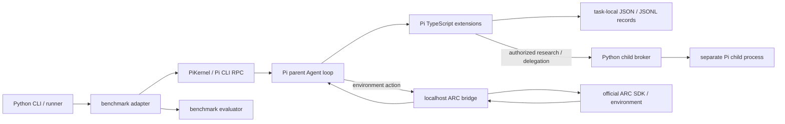

# AutoResearch Pi Project 代码导读

> 适用快照：仓库分支 `codex/jev-harness-routing-phase1`，基线提交 `3fb52b7a`（2026-10-07）。本文按当前跟踪的源码、CLI 和文档整理；目录和接口会继续变化，读代码时以当前文件为准。

本文面向第一次进入仓库的开发者，解释程序从哪里启动、Python 与 Pi 扩展如何协作、ARC 和 Auto-Research 的关键路径、运行产物存在哪里，以及应从哪里继续读。它是导航与架构说明，不代替源码、运行验收或实验报告。

## 一、先建立整体认识

这是一个以 Pi 原生 Agent loop 为中心的 Python/TypeScript 项目。Python 负责启动环境、Pi 进程、bridge、child broker 和评测器；Pi 在自己的进程中管理父 Agent、工具调用和会话；`demo/` 中的 TypeScript 扩展向 Pi 注册工具与 hooks，并实现 task-local 资源、研究和 Self-Harness 机制。



Python wrapper 不替父 Agent 作策略決策。Pi extension 負責把資源和操作接到原生 Pi 工具/hook；bridge 把環境事實與動作送到 ARC SDK；evaluator 判斷任務結果。這些責任分開很重要：注册工具、生成报告或跑通 fixture 均不自动说明 Agent 实际采用了它或提高了任务表现。

## 二、目录地图

| 路径 | 内容 | 阅读时注意 |
| --- | --- | --- |
| `src/autoresearch_pi/` | Python 包：CLI、Pi RPC、bench runner、环境适配器、隔离和证据投影 | 入口相对薄；实际 Agent loop 在 Pi CLI 与 extension 中 |
| `demo/` | Pi/TypeScript 扩展、共享 runtime 模块、bench 扩展和作者方法 | 名称虽为 demo，主要 ARC/self-harness runtime 也在此 |
| `demo/prompts/` | 按 ARC、研究、创作、评估等用途拆分的 prompt 正文 | 查看 `demo/prompts/README.md` 和 loader；不要假设所有 prompt 每轮都加载 |
| `demo/harness-methods/` | skill、tool、subagent、研究编排的 task-local 作者参考 | 方法文档不是已发布 Harness 组件，也不代表每次运行都会使用 |
| `tools/` | ARC bounded runner、审计、监控和诊断工具 | 先辨别只读审计、离线诊断和真实运行启动器 |
| `tests/` | Python 与 Node 原生机制测试、runner 诊断、fixtures | 测试证明各自覆盖的边界；组件测试不等同真实 provider 或完整 ARC 验收 |
| `docs/` | 当前机制说明、ADR、实验方案、历史报告与 backlog | 按日期、状态和产物读；历史方案不能覆盖当前实现 |
| `versions/arc/` | 多个冻结的 ARC 源码/证据快照 | 可按 manifest 恢复与比较；不是运行时依赖。索引记录候选版本和各自证据边界 |
| `runs/` | 本地运行产物默认位置 | 运行时目录通常不提交；按 summary 中的 manifest、事件和环境识别来源 |
| `.env.example` | 环境变量样例 | 真实 `.env` 只放本地；不要提交密钥 |

根目录常用文件：`pyproject.toml` 定义 Python 包和 `autoresearch-pi` 命令；`package.json` / `package-lock.json` 固定 Node 侧 `pi-jev` 依赖；`README.md` 是快速运行入口；`AGENTS.md` 与 `docs/development-workflow.md` 约束开发 Agent 的设计、验证和证据声明。

## 三、运行时分层与主要模块

### Python 启动与进程管理

- [`src/autoresearch_pi/cli.py`](../src/autoresearch_pi/cli.py) 定义所有 `autoresearch-pi` 子命令，把参数转换成具体 runner 调用，并在启动前解析项目路径、执行隔离检查。阅读某条命令时，从 argparse 的 `add_parser` 和 `if args.command` 分支入手。
- [`src/autoresearch_pi/project.py`](../src/autoresearch_pi/project.py) 统一解析仓库、外部 JIT、ARC 和 Terminal-Bench 路径；只从项目 `.env` 补充环境值，不覆盖已设置的进程环境变量。`assert_isolated()` 防止项目输出根目录误指向 JIT checkout。
- [`src/autoresearch_pi/pi_kernel.py`](../src/autoresearch_pi/pi_kernel.py) 是 Pi CLI 的行式 JSON-RPC 子进程客户端：启动进程、发送命令、读取 stdout 事件、采集 stderr、处理 timeout/deadline，并可把事件送入 sink/projector。它传输 Pi 事件，不在 Python 中执行模型决策。
- [`src/autoresearch_pi/task_agent.py`](../src/autoresearch_pi/task_agent.py) 是轻量任务入口：提交 prompt 并从 Pi 完成事件提取答案。它刻意不重复实现 Pi 的工具循环。
- [`src/autoresearch_pi/subagent_broker.py`](../src/autoresearch_pi/subagent_broker.py) 承接授权的 Pi child 进程工作。ARC runner 作为 Pi 父进程的宿主启动 loopback broker，绕开某些桌面运行时禁止 Node 子进程嵌套启动的问题。Broker 处理排队、启动、流式结果、检查和取消，不替研究 Agent 判断结论。
- [`src/autoresearch_pi/task_scope.py`](../src/autoresearch_pi/task_scope.py) 关闭被标记的 task scope，并按精确路径约束清理命名的临时 cache；规范记录和审计产物会保留。

### Pi 扩展与环境边界

- [`demo/pi_arc_agi_3_extension.ts`](../demo/pi_arc_agi_3_extension.ts) 是 ARC 运行时的主要装配入口。它注册 ARC 状态/动作能力，连接 observation、坐标和图像投影、研究资源、Self-Harness、task tools、subagents 及各类 context hooks。当前文件职责较集中；若改环境协议，应把扩展入口、bridge 协议和官方 SDK 的边界一起核对。
- [`src/autoresearch_pi/arc_agi_3_bridge.py`](../src/autoresearch_pi/arc_agi_3_bridge.py) 在 Python 一侧与官方 SDK 通信；Pi extension 通过 [`demo/pi_arc_bridge_client.ts`](../demo/pi_arc_bridge_client.ts) 请求状态或动作。bridge 应表达环境观察和动作结果，不把 Agent 推断伪装为环境事实。
- [`src/autoresearch_pi/arc_agi_3_adapter.py`](../src/autoresearch_pi/arc_agi_3_adapter.py) 将 SDK frame/action 变成 Agent 面向的统一表示，包含可见动作、网格文本和动画帧处理。
- [`src/autoresearch_pi/arc_agi_3_e2e.py`](../src/autoresearch_pi/arc_agi_3_e2e.py) 编排 ARC 任务：解析配置、启动 broker 与 Pi parent、加载扩展、关联事件与遥测、等待动作/turn settlement，最终输出 summary。它是端到端 runner，不是 Self-Harness 的语义决策层。
- [`demo/pi_arc_action_input.ts`](../demo/pi_arc_action_input.ts)、`pi_arc_observation_*`、`pi_arc_frame_image.ts`、`pi_arc_transition_geometry.ts` 等模块负责动作参数校验、观测快照/窗口、图像或网格渲染及 transition 派生信息。canonical 原始观测与模型可读投影要区分：投影可压缩/分页，canonical 证据仍需可恢复。

### Self-Harness 组件与装配

- [`demo/pi_task_local_self_harness.ts`](../demo/pi_task_local_self_harness.ts) 提供模型可见的 `task_harness` facade，协调候选创建/修改、组件状态、审阅、版本校验和 route 处理。先看 `installTaskLocalSelfHarness(...)`、顶层依赖结构和实际注册的 facade，再沿 action 分支追到具体 handler。
- [`demo/pi_task_resource_store.ts`](../demo/pi_task_resource_store.ts) 是 task-local 资源的持久化/版本读写基础。资源以稳定身份和版本引用访问；修改需要检查当前版本，避免旧候选覆盖新状态。
- [`demo/pi_task_harness_assembly.ts`](../demo/pi_task_harness_assembly.ts) 管理 Agent 显式选择的精确资源版本。组件“已创建”与“已选入 assembly”是两个事实；更改 assembly 还要检查其 revision 与实际后续 Pi surface。
- [`demo/pi_task_harness_route_runtime.ts`](../demo/pi_task_harness_route_runtime.ts) 把确定性 route 连接到 Pi 原生执行器；route/receipt 记录执行计划与实际结果。代码可以校验、版本化和执行，但不能据此宣布后续模型已理解或任务获得收益。
- [`demo/pi_task_local_tools.ts`](../demo/pi_task_local_tools.ts) 安装 task-local Tool 能力及其有界 adapter。纯表达式/声明式执行、参数 binding、宿主 adapter 和执行许可分别有自己的合同，不能从工具描述文字推断出未授权的主机能力。
- [`demo/pi_task_local_subagents.ts`](../demo/pi_task_local_subagents.ts) 注册 task-local delegation、Auto-Research sessions、子进程调度和返回处理。Parent 选择研究目标、证据 refs、上下文和职责；child 的权限来自明确传入的授权范围。
- [`demo/pi_task_local_context_lifecycle.ts`](../demo/pi_task_local_context_lifecycle.ts)、`pi_parent_context_control.ts`、`pi_child_context_control.ts`、`pi_read_workset.ts` 处理请求上下文、工作集寿命、压缩和精确恢复。判断是否保留关键信息，应查看实际 provider payload 和后续行动；文件存盘或 ref 可读仅证明恢复能力。
- [`demo/pi_harness_protocol.ts`](../demo/pi_harness_protocol.ts)、`pi_task_json_schema.ts`、`pi_management_schema_surface.ts`、`pi_harness_control.ts` 集中处理 schema、语义类别、参数规范化、完整性和控制操作。遇到“工具调用被拒绝”，沿 schema → admission/preflight → native executor → receipt 的顺序定位。

当前五类可创作组件是 `system_prompt`、`skills`、`memory`、`tools`、`subagents`。`task_prompt` 是 task memory/assembly 产生的上下文投影；checkpoint、finding、report、review 或 assembly 本身均不是第六类组件。

| 类型 | 主要承载内容 | 典型后续使用证据 |
| --- | --- | --- |
| `system_prompt` | 当前 task 有范围的行为补充 | 准确版本进入 parent 的实际 system context，之后决策与它相关 |
| `skills` | 供 Agent 读取的方法步骤和适用条件 | 读取对应版本后按步骤行动；读取本身不证明采用 |
| `memory` | 有来源、适用范围、有效期/反证的事实与假设 | 正确的 memory 投影进入工作集，并被后续判断利用 |
| `tools` | 有明确参数、实现及权限边界的机械操作 | 调用返回正确语义结果，并被任务步骤使用 |
| `subagents` | 隔离上下文中的明确职责、输入和返回合同 | 实际 child 语义输出到达 parent 并影响后续选择 |

对组件生命周期要分别追踪：机会 → 识别 → 投入 → 候选 → assembly → 实际暴露 → 语义使用 → 反馈 → 保留/修订/撤下。不要将 `created`、`selected`、`effective`、`used` 和 `beneficial` 合并成一个“已启用”。

### Auto-Research 与研究 worker

- [`demo/pi_external_benchmark_research.ts`](../demo/pi_external_benchmark_research.ts) 是跨 benchmark 的研究/child 会话实现之一；ARC extension 将它与 ARC 证据、工具和运行状态对接。
- `demo/pi_auto_research_protocol.ts`、`pi_auto_research_evidence.ts`、`pi_auto_research_output.ts` 处理计划/节点、证据授权与结构化报告归一化。Child 能看到什么，取决于 parent 明确传入的证据 refs、资源 refs、Harness refs 和 context recipe。
- `demo/pi_auto_research_agenda.ts`、`pi_auto_research_handoff.ts`、`pi_auto_research_history.ts` 管理研究连续性、交接和历史目录。完整 canonical report 保存在 task 记录里，模型通常先收到短交付或引用。
- [`demo/pi_auto_research_workers.ts`](../demo/pi_auto_research_workers.ts) 保存持久研究职责和证据批次；[`demo/pi_auto_research_worker_runtime.ts`](../demo/pi_auto_research_worker_runtime.ts) 按已有授权自动排队、恢复、增量发布、整合和停止 worker。Worker 与有界 session/run 是不同概念；不需要常驻一个模型进程才能保存研究线。
- `demo/pi_research_method_runtime.ts`、`pi_research_confidence.ts`、`pi_research_request_identity.ts` 等用于比较方法、检查置信/请求身份和连接实验。判断研究是否完成时，要分开结论、方法候选、实验请求、Harness delivery 和 parent 后续行动。
- [`demo/prompts/`](../demo/prompts/README.md) 存放 parent/child 各层 prompt。运行时 prompt 拼装还受扩展 hook 和所选 task resources 影响；不能只读单一 prompt 文件就断言 provider 收到完整内容。

研究 child 是只读研究者，不执行 ARC action，也不直接修改 parent 的 Harness。研究结果需要 parent 判断、创建或选择组件，并通过下一步任务行动验证。worker 的自动调度不表示其已正确消费证据或产出有效结论。

### 其他任务适配器

- OfficeBench：`officebench_e2e.py` + `demo/pi_officebench_e2e_extension.ts` + `officebench_tool_bridge.py`。外部 JIT workspace 被当作只读宿主；文件操作和产物验证受 artifact contract 限制。
- Shopping：`shopping_e2e.py` + `demo/pi_shopping_e2e_extension.ts` + `shopping_tool_bridge.py`。Adapter 准备 case，扩展提供 task tools；实验/ablation orchestration 留在 Python runner。
- Terminal-Bench：`terminal_bench_e2e.py` + `terminal_bench_agent.py` + `demo/pi_terminal_bench_extension.ts`。Harbor/Docker 负责任务容器和 verifier；任务评分与 Harness evidence 分开记录。
- `jit_adapter.py` 提供对外部 JIT benchmark runner 的薄只读调用面。

这些任务复用部分 research/self-harness 原语，但各自 action API、测试夹具和 evaluator 不相同。ARC 的真实 bridge 验收不能替代其他 benchmark 的 evaluator 验收。

## 四、一次 ARC 运行会经历什么

下面按生产边界描述主路径，具体运行选项会改变启用的模块：

1. `python -m autoresearch_pi.cli arc-agi-3-e2e ...` 进入 `cli.main()`，调用 `ProjectPaths` 解析路径和配置；runner 在项目隔离边界内准备 run root、provider 设置和官方 SDK。
2. Python 启动 ARC bridge 服务以及 Pi parent RPC 会话；创建 run manifest、runtime status 与事件/遥测输出。
3. Pi CLI 使用显式 `--extension` 加载 `demo/pi_arc_agi_3_extension.ts`，以及配置的 provider extension 和最终 provider payload observer。关闭宿主默认扩展/tools 的运行会显式注册本项目需要的 surface。
4. 扩展初始化 task-local resource scope，读取或建立 task-local records，按 treatment/control 与 capability flags 注册可见工具及 hooks。
5. Parent 读取当前 ARC observation；adapter 提供 state、levels、available actions 和可选择的完整网格/图像投影。投影应能回指 canonical frame。
6. Parent 选择 read/research/delegate/harness 操作或 ARC action。action 参数经过类型/坐标验证、action boundary、预算 admission 和 bridge；child 获得独立进程、显式工具权限与固定证据上下文。
7. SDK 返回新的 observation/action receipt。extension 和 runner 将环境状态、Agent/tool 行为、provider payload 与 child/research 记录关联到同一 run。
8. Pi 处理后续父轮。模型是否将结果纳入下一步，要通过真实后续 provider context 和行动审阅，不从“工具成功”推断。
9. runner 在结束时写 summary、任务评估、Harness 中间证据和资源 manifest。任务分数、接线是否可达、实际采用与净收益是不同报告字段。

**运行主链关键文件：**CLI → `arc_agi_3_e2e.py` → `pi_kernel.py` / `subagent_broker.py` / `arc_agi_3_bridge.py` → Pi CLI + `pi_arc_agi_3_extension.ts` → extension 内部 task/harness/research 模块 → ARC SDK → runner summary。

## 五、关键机制的数据流

### Parent 创作 Self-Harness

```text
Parent 发现有价值的重复任务缺口
  → 决定直接创作/复用/不创作
  → task_harness facade 接收有 schema 的候选
  → 参数、权限、scope、证据和版本检查
  → resource store 写入精确版本
  → Parent 显式选择精确版本进入 assembly
  → Pi hook/tool surface 投影该版本
  → 后续 parent/child/action 使用
  → observation、工具结果与 review 作为 feedback
```

发布、assembly、投影、实际使用和效果评估可能分别失败，receipt 应如实保留 partial/error 状态。没有可执行实现的“计算工具”文字不会自动成为程序；缺少 host/adapter authority 时要报告 capability gap。

### Auto-Research child 研究

```text
Parent 选择问题 + 证据范围 + 预算 + 输出合同
  → child Pi session 在隔离上下文中研究
  → checkpoint / provider length continuation / report
  → parent 收到 capsule 或 report ref，必要时精确读取原报告
  → parent 判断结论、试验或组件候选的价值
  → 由 parent 创作/装配/试用，或合理放弃
  → 后续反馈可回到同一研究线/授权 worker
```

`length` 表示当前计算输出被截断，应在同一 run/session 内续算；`pending` 表示 session 已暂停，等待定义的条件恢复；`cancelled`、deadline 和失败也各有状态。它们不能用一个“继续”标志混为一谈。

### Context、canonical evidence 与 telemetry

概念上分三层：

1. **Canonical 记录：**run-local JSON/JSONL 里的原始 observation、action、resource 版本、研究报告、tool receipt、checkpoint 和 provider 遥测。
2. **Projection / workset：**按当前任务、权限、版本、上下文预算形成的 prompt、目录、短回执、图片/网格窗口和引用。
3. **Provider 输入与决策：**实际发送给模型的内容以及它后续采取的行动。

前两层可证明数据可恢复或已暴露；要证明认知连续性/语义使用，还要检查第三层。Token 字段的定义也要看来源：JSON 字符数、请求字节数、模型 input/output/reasoning/cache 和估算费用不能相互替代；字段缺失应保留 unknown。

## 六、常用 CLI 与开发入口

安装 Python editable package 后可使用 `autoresearch-pi`，或从仓库根目录使用 `python -m autoresearch_pi.cli`。当前主要命令如下；全部选项以 [`cli.py`](../src/autoresearch_pi/cli.py) 为准。

| 命令 | 作用 | 证据边界 |
| --- | --- | --- |
| `doctor` | 检查本地路径和集成前提 | 只检查环境，不跑 Agent |
| `meta-synthetic` | 调用 autoresearch-meta 的无网络 synthetic 回归 | 不跑真实 provider |
| `meta-harness-demo` | 运行任务局部 Auto-Research/Self-Harness demo | 确定性 fixture + Pi extension probe；不代表一般自主采用 |
| `jit` | 通过只读 adapter 启动外部 JIT seed harness | 外部 checkout 保持只读；看 JIT 输出 |
| `officebench-smoke` | 生成静态兼容 smoke 产物 | 不是 OfficeBench Agent 运行 |
| `officebench-e2e` / `officebench-experiment` / `officebench-cohort` / `officebench-continuation` | 单 case、成对实验、队列或跨 Pi process continuation | 按具体 run summary/evaluator 判读 |
| `shopping-e2e` / `shopping-experiment` / `shopping-context-ablation` | Shopping case 与对照/上下文 ablation | 需要数据集、adapter 和模型环境 |
| `arc-agi-3-e2e` | 真实 ARC SDK + Pi parent run；可选启用 harness/research/cross-situation probe | Real provider/官方 ARC 环境证据需检查 run 实际配置 |
| `arc-harness-smoke` | 确定性 provider 场景穿过真实 ARC/Pi/self-harness runner | 测 wiring/lifecycle，不测真实模型能力或游戏质量 |
| `arc-method-audit` | 从 ARC durable artifacts 审计方法 feedback | 离线审计，不会补跑缺失步骤 |
| `terminal-bench-e2e` | 本地 Harbor/Docker Terminal-Bench run | verifier reward 与 Harness 中间证据分开读 |

启动例子：

```powershell
$env:PYTHONPATH = "$(Get-Location)\src"
python -m autoresearch_pi.cli doctor
python -m autoresearch_pi.cli meta-harness-demo --root runs/meta-harness-demo-latest
```

ARC runner 需要本地 SDK checkout 和对应凭据；不要把 API key 写进命令行或 run artifact。按需看 [`README.md`](../README.md) 的隔离、ARC 和环境变量说明，再运行有预算的命令。`--harness-validation` 等参数是显式的 guided wiring probe；用于 ordinary adoption 的 run 不应把这种强制触发条件误当普通采用。

Jev component routing 默认 `disabled`；`shadow` 只记录候选，不改变当前 surface；`active` 会改现有 assembly 的选择。全局参数需要放在子命令之前。改变 routing mode 只能说明 route 选择方式变了，不能单独说明模型质量或任务收益变好。

## 七、测试布局与验收证据

测试大致分为：

- `tests/*.test.ts` 与 `tests/pi_*.ts`：用 Node 原生 test runner 检查 TypeScript 模块、Pi hook/tool 和 provider transport 行为。
- `tests/test_*.py`：pytest 侧检查 CLI、适配器、持久记录、边界、协议和 runner 编排。
- `tests/fixtures/`：历史候选、原始请求/事件和失败复现输入；fixture 是诊断样本，不是当前运行版本本身。
- `tools/arc_harness_smoke_provider.ts` 以及相关 fixture：为 deterministic ARC self-harness runner 提供结构化 provider 场景。

一般本地功能检查可按改变触及的模块选择对应测试；项目开发工作流要求按声明层级分别评价：

| 证据层 | 能回答什么 | 不能据此回答什么 |
| --- | --- | --- |
| 功能正确 | 对给定输入，校验/恢复/适配行为是否符合合同 | Pi/child/bridge 的真实串接，或真实 provider 会怎样用 |
| 全链路可达 | runner → bridge → Pi parent → broker/child → router → native mutation → assembly/action → 后续父轮是否可走通 | 普通运行里 Agent 会不会自主发现机会，或任务是否变好 |
| 自主采用 | 未强制调用的真实 provider 是否识别、选择并语义使用；也审阅合理不使用和漏用 | 重复性、跨任务泛化与成本净收益 |
| 净收益 | 相近预算的独立比较同时看任务效果、父子总成本、延迟和管理轮 | 未测 provider、任务和配置上的普遍结论 |

本仓库 ARC 闭环声明必须通过 `arc-harness-smoke` 的完整矩阵：真实 ARC bridge、Pi parent、child broker/process、结构化 child 返回、router、native Harness mutation、ARC action boundary 和后续真实父轮；覆盖五种组件，检查语义工具输出，并覆盖 Auto-Research 与普通 `delegate_task` 的 provider `length` continuation。根据当次实际环境标注 deterministic provider、mock 环境或真实 provider。fixture、pytest、手写 JSONL 或离线脚本父模型不关闭此门槛；deterministic real-runner smoke 也不证明自主行为或游戏表现。

开发者可从 [`docs/development-workflow.md`](development-workflow.md) 查详细证据规则，从根 [`AGENTS.md`](../AGENTS.md) 查 ARC 矩阵和项目 follow-up 规则。相关专题验收、运行数值和未测项应链到产生它们的 report/summary，而不要把历史文档里的数字写成当前 HEAD 的新测试结果。

## 八、按任务读代码

| 你要改什么 | 建议先读 | 再沿着什么追踪 |
| --- | --- | --- |
| 新增 CLI 参数/命令 | `cli.py`、`README.md` | 对应 `*_e2e.py` runner 和 `tests/test_cli.py` |
| Pi RPC 或事件卡住 | `pi_kernel.py`、`subagent_broker.py` | ARC caller、deadline/watchdog、run JSONL 和 stderr tail |
| ARC 观察或动作语义 | `arc_agi_3_bridge.py`、`arc_agi_3_adapter.py`、`pi_arc_agi_3_extension.ts` | `pi_arc_action_input.ts` / observation modules、`test_arc_agi_3_e2e.py` 和 targeted native tests |
| 组件版本/assembly | `pi_task_resource_store.ts`、`pi_task_harness_assembly.ts` | `pi_task_local_self_harness.ts` → route runtime → 实际 Pi context/tool exposure |
| Auto-Research child 生命周期 | `pi_task_local_subagents.ts`、`pi_auto_research_protocol.ts` | evidence/output/handoff/worker runtime → broker → provider continuation 和 report refs |
| context 重复或压缩 | `pi_task_local_context_lifecycle.ts`、`pi_read_workset.ts` | final payload observer、telemetry 与真实后续父轮 |
| 外部 benchmark 问题 | 对应 Python adapter 与 `demo/pi_*_e2e_extension.ts` | bridge action、evaluator、summary 与 task-specific tests |
| 报告 token/成本 | `pi_provider_telemetry.ts`、`pi_reported_token_budget.ts` | final provider payload、父与所有 child run 的用量和失败/pending 尝试 |

定位一个问题时，沿“外部输入 → schema/admission → handler/runtime → 持久记录/receipt → 下一轮暴露 → 真实使用”的链条找第一处缺失。尤其 `status=completed`、文件存在或工具注册不是 semantic output 的替代证据。

## 九、当前限制与历史材料

- [`docs/current-architecture-and-mechanisms-2026-09-18.md`](current-architecture-and-mechanisms-2026-09-18.md) 是早期源码检查的架构快照，自己注明并非当前 HEAD 的完整实现说明；其中的接口名与状态判断需要对照现在的代码。
- [`docs/auto-research-task-local-self-harness-protocol.md`](auto-research-task-local-self-harness-protocol.md) 首页标注其中一部分旧审批/路由协议已退役。它适合查迁移背景，不应当作当前 Agent workflow 的唯一真值。
- [`docs/plans/2026-10-06-self-harness-simplification-and-validation.md`](plans/2026-10-06-self-harness-simplification-and-validation.md) 是详细阶段设计和证据记录；计划里的未实现工作不能当成已交付 runtime。
- `docs/reports/arc-mechanism-version-index.json` 当前列出 `current_candidate=stage142`、没有可恢复的 verified Qwen winner；这是版本/评估索引的结论，不等于当前 checkout HEAD 是某个 `versions/arc/stage*` 目录的字节级副本。恢复版本前应核对 manifest 和当前代码。
- 依 [`docs/deferred-research-todos.md`](deferred-research-todos.md)，仍需保留的相关问题包括：ARC adapter 的环境边界与职责拆分、研究父子之间更可靠的证据/实验交接、父子总成本与管理延迟、跨压缩后的语义连续性，以及真实 provider ordinary 采用与重复净收益。这些属于待验证或延后事项；本导读不改变其状态，也不授权扩大实现范围。

读历史材料时，把“设计目标、源码机制、确定性接线结果、真实模型行为和任务净收益”分开。当前 snapshot 可以包含已实现接口与尚未验证的收益假设。

## 十、建议的上手顺序

1. 读 [`README.md`](../README.md) 的隔离、运行、ARC/Terminal-Bench 部分，确认本机 JIT/SDK/数据集和 `.env` 的边界。
2. 读本文的目录地图和对应 runner，再看实际扩展的注册入口；从一次 run root 里的 summary/manifest 追踪真实路径。
3. 对想修改的模块，从行为入口、调用者、资源/事件 schema、receipt 和后续消费者一起读，不要只改 helper。
4. 阅读该模块最近的专题计划/实现报告，确认是现行机制、迁移兼容层还是未实施方案。
5. 按改动范围运行相关功能检查；若要声明 ARC 全链路、自主采用或净收益，再分别完成对应证据级别并链接产物。

这份导读没有重新执行 ARC、真实 provider 或 benchmark 实验。它的实现状态是文档导航；对当前功能、完整链路、自主采用和净收益均不作新的通过声明。
