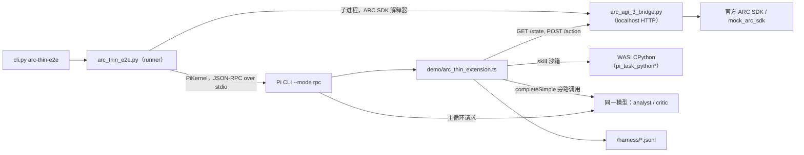
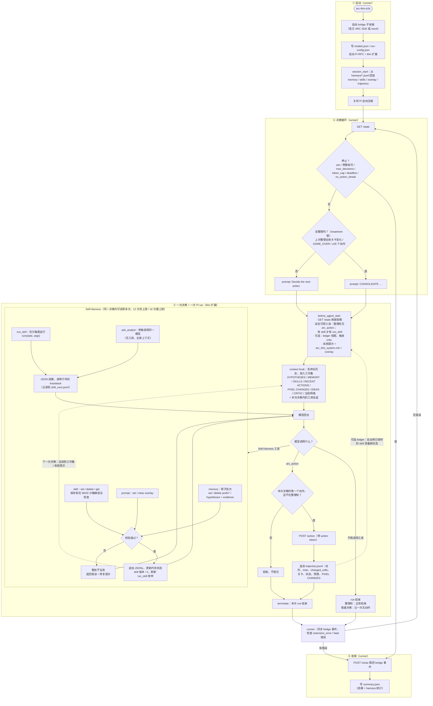

# 架构

## 1. 概览

项目在 Pi coding agent 上构建 ARC-AGI-3 的 meta-harness：玩游戏的 Agent 在任务过程中自己创建、修改并使用 prompt、skill、memory、tool 和 subagent。现在有两条 ARC 路径：

| 路径 | 入口 | 状态 |
| --- | --- | --- |
| **Thin 路径**（当前主线） | `arc-thin-e2e` → `src/autoresearch_pi/arc_thin_e2e.py` → `demo/arc_thin_extension.ts` | 新的 runtime 工作都放在这里 |
| Legacy 路径 | `arc-agi-3-e2e` / `arc-harness-smoke` → `arc_agi_3_e2e.py` → `demo/pi_arc_agi_3_extension.ts`（连同约 2.6 万行依赖） | 冻结，只作对照臂；结构见 [codebase-guide-zh.md](codebase-guide-zh.md) |

Thin 路径的设计原则见 [thin 扩展设计 §1](plans/2026-10-08-thin-arc-self-harness-extension.md)：

- 每类组件只需**一次工具调用**就能保存或使用。不需要手册、版本选择、assembly 或激活步骤。
- 每次决策都从存储**重建**上下文。没保存的东西下一步就看不到，这本身就是保存的理由。
- harness 出错**不消耗** ARC 动作，错误一律写入运行产物。

## 2. 进程拓扑与主要流程

### 2.1 进程拓扑



职责划分：

- **Runner（Python）** 只决定三件事：何时发下一个 prompt、何时安排一次整理（consolidation）、何时停止。它不替模型做策略决策。
- **Pi** 跑原生 Agent loop，负责工具调用、provider 请求和 usage 回报。
- **Thin 扩展** 注册工具和 hooks，每次请求都从 JSONL 存储重建工作集。
- **Bridge** 是唯一能接触环境的地方。动作要带 `X-ARC-Action-Token`。

### 2.2 完整流程

下图从启动画到结束，Self-Harness 嵌在每次决策内部，与 ARC 动作处在同一个循环里。thin 路径的组件**保存成功即生效**，没有 pool、assembly、选择或激活步骤；删除即停用。持久化、校验和“下一步可见”由代码负责，写什么、何时修订由 Agent 判断。



按编号说明：

1. **启动**：runner 启动 bridge 和 Pi。扩展在 `session_start` 时回放已有存储，所以重启 Pi 不会丢失组件。
2. **决策循环**：每轮先读状态、检查停止条件，再决定发普通决策还是整理轮。整理轮是 runner 唯一主动促成的 Self-Harness 时机，只用于修订组件，不能执行动作。
3. **一次决策**：上下文每次都重建，模型只能看到存储里的内容和本次决策内的工具往返。模型可以多次调用 Self-Harness 工具，写入、运行、修复、删除组件，最后用一个 `arc_action` 结束。动作结果写入 trajectory，作为后续修订组件的证据。
4. **收尾**：正常停止或出错时，runner 关闭 bridge 并写出汇总。

各组件写入后什么时候被看见：

| 组件 | 同一决策内 | 下一次决策 |
| --- | --- | --- |
| memory / hypotheses | 只能看到工具回执；工作集在每次决策开始时生成一次，决策内不会刷新 | 渲染到 HYPOTHESES / MEMORY |
| skill | 从下一个模型 turn 起可用 `run_skill(name=…)` 调用（工具 schema 重新注册） | 出现在 SKILLS 目录 |
| prompt overlay | 不生效 | 系统提示在 `before_agent_start` 重新渲染时加入 |
| ask_analyst | 回答作为工具结果立即可见 | 不保留（除非 Agent 把结论写进 memory） |

与 legacy 路径的区别：legacy 的组件要经过“候选 → 资源版本 → assembly 选择 → 投影到 Pi surface”多个步骤，还有 Auto-Research child 和 worker 参与产出候选（见 [codebase-guide-zh.md §五](codebase-guide-zh.md)）。thin 路径把这些步骤合并成“保存即生效”，研究职责暂时只由 `ask_analyst` 承担。

## 3. Runner：`src/autoresearch_pi/arc_thin_e2e.py`

### 3.1 启动

1. 用 ARC SDK 的解释器启动 bridge（`--port 0`，可选 `--max-actions`）。stderr 写到 `bridge-stderr.log`。
2. 根据 `.env` 写出 `.pi-agent/models.json`（OpenAI 兼容 provider，默认 `yibu`），然后启动 Pi：

   ```
   pi --mode rpc --provider <p> --model <m> --no-session --no-extensions --no-skills
      --no-prompt-templates --no-context-files --no-builtin-tools
      --extension demo/arc_thin_extension.ts [--extension <provider 扩展>]
   ```

3. 传给扩展的环境变量：
   - 必需：`PI_ARC_BRIDGE_URL`、`PI_ARC_ACTION_TOKEN`、`ARC_RUN_ROOT`、`ARC_GAME`、`ARC_THIN_VARIANT`。
   - 可选：`ARC_HARNESS_LEDGER`、`ARC_HARNESS_CRITIC`、`ARC_CRITIC_*`。
4. 关闭 Pi 自动压缩（`set_auto_compaction false`）。上下文的长度由扩展的 `context` hook 控制。
5. 写 `run-config.json`，其中包含所有 `arc_thin_*.ts` 和系统提示文件的 sha256，用来冻结和比对版本。

### 3.2 主循环

每轮先 `GET /state`，然后依次检查停止条件：

| stop_reason | 条件 |
| --- | --- |
| `win` / `budget_exhausted` | 环境到达 WIN，或进入终态、动作预算耗尽 |
| `max_decisions` / `token_cap` / `deadline` | runner 自己的上限（token 数按 `usage.jsonl` 的 reported 用量累计） |
| `no_action_streak` | 连续 3 次决策都没有 `arc_action` |
| `extension_error` / `harness_fatal` | Pi 报告扩展异常，或 `errors.jsonl` 出现 fatal 行 |
| `decision_timeout` / `pi_failed` / `bridge_unavailable` | 单次决策超时、Pi 拒绝 prompt、`/state` 重试 3 次仍失败 |

`win`、`budget_exhausted`、`max_decisions`、`token_cap` 和 `deadline` 算正常结束（`passed=true`）。

没有触发停止时，runner 发出下面三种 prompt 之一：

- `Decide the next action.`：普通决策。
- 上一次决策没有出动作时，改用要求“必须以一个 arc_action 结束”的 prompt。
- `CONSOLIDATE: ...`：整理轮，只在 treatment 臂发出。触发条件是上次整理后发生过关卡变化，或进入 GAME_OVER，或已经过了 `--consolidate-after` 个动作（默认 25）。整理轮不能执行动作，只用来修订 memory、hypothesis 和 skill。

### 3.3 收尾

收尾时先 `POST /close` 取回 bridge 事件，再写 `summary.json`（格式 `arc-thin-run-v1`）：

- 运行结果：动作数、关卡数、reported tokens、stop_reason。
- harness 统计：memory 和 hypothesis 的读写次数、evidence 和 refutation 条数、各工具的错误数、skill 版本和运行成功率、overlay 长度、analyst 调用次数。
- ledger/critic 统计（启用时才有）。

### 3.4 离线 smoke

`arc-thin-smoke [--ledger]` 的组成：mock ARC SDK、真实 bridge、真实 Pi、thin 扩展、WASI 沙箱，以及脚本化 provider [`tools/arc_thin_smoke_provider.ts`](../tools/arc_thin_smoke_provider.ts)。检查项写在 `_smoke_checks` / `_ledger_smoke_checks` 里。它验证的是接线和生命周期，不涉及模型行为。

## 4. Bridge：`src/autoresearch_pi/arc_agi_3_bridge.py`

- `GET /state`、`/trajectory`、`/events`；`POST /action`、`/action-lease`、`/close`。
- `/action` 返回新状态和 `observation_delta`（变化像素、bbox）。扩展用 [`arc_thin_feedback.ts`](../demo/arc_thin_feedback.ts) 把它压缩成 `PIXEL CHANGES` 摘要（4-连通区域、颜色变化、最多 1200 字符）。
- 观察的文本表示复用 `arc_agi_3_official_adapter.ts` 的 `renderArcLatestFrameRuns`（粗布局加无损行程编码）；图像复用 `pi_arc_frame_image.ts`，只在模型支持图像输入时附上。

## 5. Thin 扩展：`demo/arc_thin_extension.ts`

### 5.1 工具（treatment 臂）

| 工具 | 作用 | 要点 |
| --- | --- | --- |
| `arc_action` | 提交一个动作并结束本次决策 | 只有 ACTION6 带 x,y；`note` ≤300 字，会出现在后续的 RECENT ACTIONS 里；启用 ledger 时多两个可选字段 `idea` / `expect`（超长截断，不拒绝） |
| `memory` | 管理 facts 和 competing hypotheses | 一次调用是一个**原子批次**：`set` / `delete`（支持 `prefix*`）/ `hypotheses`，任一部分无效就整批不生效；evidence 只追加不覆盖 |
| `skill` | 保存、删除或读取 Python skill | 必须定义 `run(state, args)`；保存前在沙箱里做语法检查；每次 set 版本号加一；最多 40 个 |
| `run_skill` | 运行已保存的 skill | **只有存在 skill 时才出现**；`name` 参数是已保存名字的枚举（[skill 调用绑定](plans/2026-10-09-thin-skill-call-binding.md)）；出错时返回带行号的 traceback |
| `prompt` | 设置或清除常驻指令（overlay） | ≤1500 字，从下一次决策起追加到系统提示 |
| `ask_analyst` | 一次性的分析调用 | 用同一模型、不带工具、全新上下文；可选附上一帧和 memory；用量记为 `usage.jsonl` 中 `kind=analyst` |

Control 臂（`--variant control`）只注册 `arc_action`，使用 [`arc_thin_control_system.md`](../demo/prompts/arc_thin_control_system.md)，工作集里只有 RECENT ACTIONS 和当前状态。

### 5.2 Hooks

| Hook | 职责 |
| --- | --- |
| `session_start` | 回放 JSONL 存储，恢复内存中的状态，刷新 skill 工具面 |
| `before_agent_start` | 决策计数加一；按 prompt 判断是否为整理轮，并设置可用工具（整理轮隐藏 `arc_action`）；`GET /state`（失败记 fatal）；准备 ledger/critic；渲染系统提示（`arc_thin_system.md`，填入 `{{game}}`、`{{board}}`、`{{overlay}}`） |
| `context` | 用“本次决策的 user prompt + 重建的工作集 + 本次决策内的工具往返”替换整段历史；工具结果超过 8000 字截断 |
| `message_end` | 把 assistant 消息的 usage 写入 `usage.jsonl`，并标记含 `arc_action` 的消息 |
| `tool_result` | 把带 `details.refused` 的结果改成 `isError` |

### 5.3 工作集（每次 provider 请求都重建）

```
[system]  arc_thin_system.md（+ 可选 IDEAS/CRITIC 说明 + 常驻 overlay）
[user]    <runner 的本次 prompt>
          HYPOTHESES …（状态、条件化 evidence、上次检验、next_test）
          MEMORY …（facts）
          SKILLS (n): name vK — description   或   "none saved, so run_skill is not available yet"
          RECENT ACTIONS（最近 8 条：动作 → changed_cells/level/state/budget | note）
          LATEST ACTION #n …  PIXEL CHANGES …（仅当它确实是最新一步时）
          IDEAS / LAST EXPERIMENT …（启用 ledger 时）
          CRITIC …（启用 critic 且有新 note 时，只显示一次）
          CURRENT STATE（renderArcLatestFrameRuns）[+ PNG]
[本次决策内的 assistant/toolResult 往返]
```

工作集的长度不会随决策数增长，上限由各类条目的数量限制决定（facts ≤40、hypotheses ≤6、每个 hypothesis 的 evidence ≤6、skills ≤40、最近动作 8 条）。

### 5.4 决策边界（`gate` / `guardTool`）

Pi 0.80.6 的行为是：只有当一批工具结果**全部** `terminate` 时，这次 run 才会结束；而在 `tool_call` hook 里拦截产生的错误不会结束 run。因此边界检查放在每个工具的 `execute` 里（原因见 [设计 §6.0](plans/2026-10-08-thin-arc-self-harness-extension.md)）：

- 同一决策里第二个 `arc_action`、整理轮里的 `arc_action`、超过硬上限（16 次）的调用：都被拒绝，并返回 `terminate: true`。
- 与 `arc_action` 在同一条消息里的其他工具：照常执行，但返回 `terminate`，好让这批调用能结束。
- 超过软上限（12 次）：普通决策返回一个不终止的错误，提示“现在调用 arc_action”；整理轮则直接终止。
- 模型可见的预期错误（`Refusal`）不写入 `errors.jsonl`；其他异常会写入。

### 5.5 存储（`<run root>/harness/`，追加写 JSONL，后写覆盖前写）

| 文件 | 内容 |
| --- | --- |
| `memory.jsonl` | fact 行 `{key,text,confidence}`、hypothesis 行 `{key:"hyp.*", hyp:{claim,predicts,status,next_test,evidence[]}}`、删除行 |
| `skills.jsonl` / `skill_runs.jsonl` / `skill_surface.jsonl` | skill 版本、每次运行（耗时、成功与否、错误）、run_skill 工具面的变化 |
| `prompt.jsonl` | overlay 历史（空文本表示清除） |
| `trajectory.jsonl` | 每个 `arc_action` 一行：动作、坐标、note、idea/expect、changed_cells、bbox、关卡、状态、预算、PIXEL CHANGES |
| `usage.jsonl` | 每次模型响应的用量，`kind` ∈ agent / analyst / critic |
| `errors.jsonl` | 扩展捕获的异常（fatal 行会让 runner 停止） |
| `states.jsonl` / `observations.jsonl` / `critic.jsonl` | 仅在启用 ledger/critic 时写入 |

## 6. 五类组件在 thin 路径上的落点

| 组件 | 载体 | 创建 / 修改 | 下一步如何生效 |
| --- | --- | --- | --- |
| system prompt | `prompt` overlay | 一次 `prompt(op="set")` | 下一次决策起追加到系统提示 |
| skills | Python `run(state, args)` | 一次 `skill(op="set")` | 出现在 SKILLS 目录，并加入 `run_skill` 的枚举 |
| memory | facts + hypotheses | 一次 `memory` 批次 | 每次决策都会渲染到工作集 |
| tools | 暂无独立的 typed tool；可编程计算目前只能做成 skill，经 `run_skill` 间接调用 | — | 见 §9 |
| subagents | `ask_analyst`（一次性、无状态） | 不需要创建 | 回答作为本次决策内的工具结果出现 |

Memory 模型（[`arc_thin_memory.ts`](../demo/arc_thin_memory.ts)，[记录](plans/2026-10-09-thin-hypothesis-memory.md)）：hypothesis 记录 claim、predicts、status（open / supported / rejected）、next_test，以及逐条追加的 evidence `{action, condition, observed, verdict}`。设计目的是让反证一直带着它当时的检验条件，并且一次调用就能完成清理和修订。

## 7. Skill 沙箱

- [`arc_thin_skill_guest.ts`](../demo/arc_thin_skill_guest.ts) 提供一个固定的 guest 程序。skill 源码作为输入数据传进去，以 `<skill>` 为文件名编译，所以报错行号和保存的源码一致。`mode=check` 只做语法检查，`mode=run` 执行 `run(state, args)`。
- `state` 包含：`grid`、`prev_grid`、可选的 `frames`、`state`、`levels_completed`、`available_actions`、`action_budget`、`recent_actions`（最近 8 条）、memory 和 hypotheses。
- 执行环境是 [`pi_task_python.ts`](../demo/pi_task_python.ts) 加 `pi_task_python_runtime.py`：WASI CPython，只有标准库，没有 I/O，有输入、输出和时间限制。
- [`pi_task_python_pool.ts`](../demo/pi_task_python_pool.ts) 和 `pi_task_python_server.py` 是常驻主机，复用模块编译结果，每次请求仍是新的 WASI 实例。在本机上，单次调用从约 1.7 s 降到约 0.13 s。目前只有 ledger 的批量观测用它；`run_skill` 和语法检查走 `evaluateTaskPython`。

## 8. 可选层：ledger 与 critic（默认关闭）

由 `--ledger` / `--critic` 开启（critic 会连带开启 ledger），只在 treatment 臂生效。设计见 [lightweight-hypothesis-loop-with-critic](plans/2026-10-09-lightweight-hypothesis-loop-with-critic.md)：当前实现的是修订 1，修订 2 的改动尚未实现。

- **Ledger**（[`arc_thin_ledger.ts`](../demo/arc_thin_ledger.ts)，纯函数）：
  - 用 trajectory 和可选的 `idea` / `expect` 生成 experiments、每个 idea 的投入量，以及“预期 vs 观测”行。
  - 后台把每个已保存的 skill 在每个状态上用 `args={}` 跑一遍（`observations.jsonl`）；新保存的 skill 会回放到最近 200 个状态上。某个版本如果连续 3 次出错且从未成功，就不再跑。
  - 根据状态 hash 检测重复转移和停滞。
  - 结果渲染为 IDEAS 视图。它不解析、也不评判任何自由文本。
- **Critic**（[`arc_thin_critic.ts`](../demo/arc_thin_critic.ts)）：
  - 触发时机由代码决定：关卡变化、GAME_OVER、RESET、experiment 结束、单一 idea 投入过长、重复、停滞，并有间隔和每关次数限制。
  - 输入只取 ledger 和存储（dossier），不包含模型的推理过程。
  - 回复中引用的动作编号必须真实存在，否则那一行被丢弃。
  - 异步运行，最多等 3 s。结论是建议性的，只显示一次，失败不影响决策。

两者都是 fail-open：任何异常只写入 `errors.jsonl`，不阻断动作，也不改写组件。

## 9. 已存在但尚未接线的模块

| 文件 | 内容 | 状态 |
| --- | --- | --- |
| [`demo/arc_thin_subagents.ts`](../demo/arc_thin_subagents.ts) | 可保存的 subagent：有自己的 role、被授予的工具子集、跨调用保留的最近 4 轮对话和 notes，可设定每 N 个动作自动汇报一次（`every`） | 当前工作区的 `arc_thin_extension.ts` 还没有 import 它；对应的 `subagent` / `ask_subagent` / `tool` 工具尚未注册。记录：[thin-tools-subagents-prompt](plans/2026-10-09-thin-tools-subagents-prompt.md)（状态为“implementation in progress”） |
| [`demo/pi_harness_board.ts`](../demo/pi_harness_board.ts) | 证据板：声明了 `predicts` 的 skill 会在历史上回放并逐动作打分 | [证据板记录 §15](plans/2026-10-08-self-harness-evidence-board.md) 记载它曾以 `--harness-board` 接到 thin 路径；当前工作区的 extension、runner 和 CLI 都不再引用它。它面向 Agent 的部分已被 ledger/critic 设计取代 |

## 10. 证据状态

按 [development-workflow](development-workflow.md) 分四层报告：

| 层 | 状态 |
| --- | --- |
| 功能正确 | Node 单元测试：`tests/arc_thin_memory.test.ts`、`arc_thin_skill_surface.test.ts`、`arc_thin_feedback.test.ts`、`arc_thin_ledger.test.ts` |
| 全链路可达 | `arc-thin-smoke`（含 `--ledger`）用 mock SDK、真实 bridge 和 Pi、脚本化 provider 跑通。注意：thin 路径**不等于**AGENTS.md 中针对 legacy 的 `arc-harness-smoke` 五组件闭环矩阵，那个结论不能套用到 thin 路径 |
| 自主采用 | 真实运行（yibu / qwen3.8-27b，ls20）：skill 和 memory 有自主使用，`prompt` 几乎没用过，没有出现声明 `predicts` 的 skill。hypothesis memory、skill 调用绑定和 ledger/critic 都还**没有**真实 provider 运行 |
| 净收益 | 未验证。已有的 thin 真实运行都是 0 关，例如 p1-uncapped：319 动作、0/7 关、7.78M reported tokens。还没有在相同预算下的 treatment 与 control 对照 |

已知的真实问题和诊断材料见 [thin-hypothesis-memory 记录](plans/2026-10-09-thin-hypothesis-memory.md) 和 [319 动作诊断](../runs/pi-arc-thin-ls20-treatment-p1-uncapped-real-20261009/diagnostics/level0-diagnosis.md)：检验条件丢失、已被否定的条件被重复检验、修订在工具调用上限处失败。

## 11. 与延后待办的关系

[deferred-research-todos.md](deferred-research-todos.md) 中与本架构直接相关、仍未完成的项：

- ARC adapter 输出规范化的转移记录。
- 把 competing hypotheses 做成可执行模型（证据板 / ledger 方向）。
- 研究结论到行动的连续性，以及父子总成本（B/C/D）。

thin 路径默认关闭 Auto-Research，只用 `ask_analyst`（以及今后可能接入的 saved subagent）承担“研究”职责。是否以及如何在 thin 路径上恢复研究 worker，仍是开放问题。

## 12. 阅读顺序

1. [`src/autoresearch_pi/arc_thin_e2e.py`](../src/autoresearch_pi/arc_thin_e2e.py)：`run_arc_thin_e2e` 的主循环和停止条件。
2. [`demo/arc_thin_extension.ts`](../demo/arc_thin_extension.ts)：按 stores → `buildWorkingSet` → `gate`/`guardTool` → 工具 → hooks 的顺序读。
3. [`demo/prompts/arc_thin_system.md`](../demo/prompts/arc_thin_system.md)：模型实际看到的全部常驻说明。
4. [`demo/arc_thin_memory.ts`](../demo/arc_thin_memory.ts)、[`arc_thin_skill_guest.ts`](../demo/arc_thin_skill_guest.ts)、[`arc_thin_feedback.ts`](../demo/arc_thin_feedback.ts)。
5. 需要时再读 ledger/critic 和对应的设计记录。
6. 真实运行的产物在 `runs/pi-arc-thin-*/`：先看 `summary.json` 和 `run-config.json`，再看 `harness/*.jsonl` 和 `pi-events.jsonl`。
