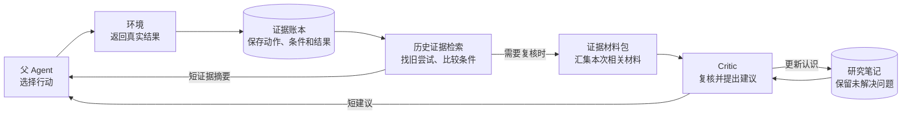
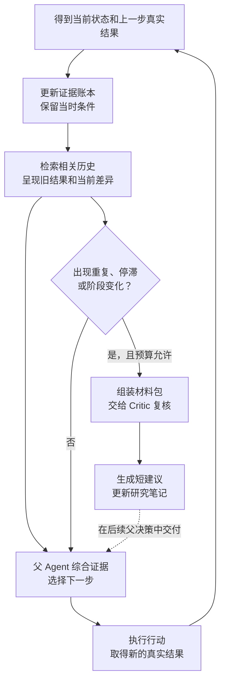

# Critic 与证据账本：简版架构和流程

## 问题

Agent 曾经反思、测试和否定过某个想法，后来却遗忘了反例，或把“特定条件下失败”记成“永远不可行”。方案让历史证据及其当时条件重新进入当前决策，并在需要时由 Critic 帮忙复核。

例如，过去在条件 A 下尝试失败，现在条件变成了 B。系统找回这次失败，告诉父 Agent“当时是 A，现在是 B”；父 Agent 判断这个变化是否值得重试。

## 核心机制的职责

| 机制 | 职责 | 大概方法 |
| --- | --- | --- |
| **父 Agent** | 决定下一步行动，以及如何修改自己的 memory、skills 和策略 | 综合当前状态、历史证据和复核建议，作语义判断 |
| **证据账本（Ledger）** | 保留“做过什么、当时什么条件、结果是什么” | 根据真实动作回执，持续保存动作前后状态；已有 skill 测量可作为补充 |
| **历史证据检索** | 找回与当前决策有关的旧尝试 | 查相似状态、相同动作和 memory 中引用的历史，呈现旧结果与当前差异 |
| **证据材料包（Dossier）** | 给一次 Critic 复核准备相关材料 | 汇集当前状态、检索结果、父保存的认识和既有研究笔记；每次调用重新组装 |
| **复核者（Critic）** | 检查遗漏的反例、结论矛盾和未充分检验的解释 | 对照原始证据，提出少量有依据的修订或检验建议 |
| **研究笔记（Notebook）** | 让 Critic 跨调用延续研究 | 保存条件性结论、竞争解释和待检验问题；下一次根据新证据更新 |

**材料包是“这一次看什么”，研究笔记是“研究到哪里了”。** 两者都是数据，由 runtime 组织和保存；Critic 承担语义分析。

## 简化架构图

日常路径是“父 Agent → 环境 → 账本 → 检索 → 父 Agent”。Critic 是按需增加的复核路径。它可以继续追踪问题，但最终行动与 Self-Harness 修改仍由父 Agent 决定。

图中的材料包也会包含当前状态、父的 memory 和研究笔记，省略这些输入连线以突出主要数据流。研究笔记为拟议机制。

## 简化运行流程图

流程可以按五步理解：

1. **记录：** 动作完成后，账本保存实际条件与结果，避免只留下泛化结论。
2. **找回：** 下一次决策前，检索过去的类似尝试，说明这次有什么不同。
3. **复核：** 出现重复、停滞或阶段变化时，在预算内把相关证据交给 Critic。
4. **决策：** 父 Agent 使用证据和已经返回的建议，也可以拒绝不合适的建议。Critic 异步进行，父不必等待它完成才能行动。
5. **反馈：** 新结果回到账本，下一次复核据此修订研究笔记和建议。

## 方法上的几个关键点

- **原始条件随证据保留。** “以前失败”需要同时说明“当时在什么条件下失败”。
- **代码负责记录和检索，Agent 负责解释。** 相似状态只是线索，是否支持或反驳一个假设由父 Agent / Critic 判断。
- **研究按需开展。** 历史摘要可以直接帮助父；需要额外复核时才调用 Critic，并受总预算限制。
- **建议与行动分开。** Critic 提建议、更新自己的研究笔记，父掌握动作和 Harness 修改权。
- **父接收短结论，研究细节留在笔记。** 下一次 Critic 调用接续重要反证和未完成检验。

实现接口、调度限额、失败恢复和验证协议继续见 [主设计记录](2026-10-09-lightweight-hypothesis-loop-with-critic.md)。本次只简化文档表达，不改变 runtime 或既有证据状态。
