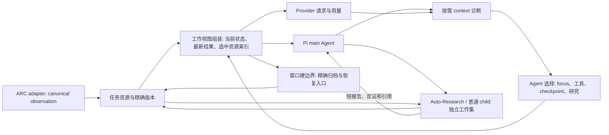

# Agent 主导的上下文管理优化设计

日期：2026-09-29。状态：设计建议，未实施、未运行新测试。依据：[Codex/Claude 调研](../reports/industry-context-management-2026-09-29.md)、当前源码和已有 ARC 遥测。本文讨论 provider 输入的工作视图；canonical 观测、任务资源与环境动作语义保持独立。针对当晚 208k 字符请求与 14 步计划停滞的执行阶段细化，见[ARC 执行阶段的上下文控制设计](2026-09-29-arc-execution-context-control-design.md)。

## 1. 目标与约束

目标是让 main Agent、Auto-Research child 和普通 child **看见成本、选择当前工作集、恢复精确证据、观察选择效果**，在长 ARC 任务中维持规则、通关条件、竞争策略及规划的连续性。评估同时看任务表现、请求长度、缓存、输出长度、延迟和总成本，不以最短 prompt 为单一目标。

必须保持：main Agent 独占真实环境动作及其结果；child 只能在已授权快照/资源内读取和研究；Self-Harness 只执行明确选择及确定性版本、权限和投影逻辑；研究结论不是环境事实；每次 action 后的最新结果与当前完整 frame 必须供 main 下一次决策使用。精确资源版本及 child 截止点不能因上下文优化而扩大或改变。详见[单次生命架构约束](2026-09-20-agent-native-single-life-harness.md)。

## 2. 当前基线与真正缺口

| 已有能力 | 当前实现 | 剩余问题 |
|---|---|---|
| 父 Agent 诊断与选择 | `task_harness(context)` 列出估算模块成本、最大工具 schema、最近 child、focus 和工具入口；`focus` 选择组装资源的正文投影；`task_tool_policy(apply)` 改 active tools。见 `demo/pi_task_local_self_harness.ts`。 | 诊断主要引用 `ceil(JSON chars/4)`；选择后的比较不与 provider 实际用量、缓存、延迟和任务质量直接关联。工具集合变动可能抵消缓存收益。 |
| 任务内 Memory | `task_memory_pool` 有 scope、版本、证据引用、`supersedes_refs`、短目录和 retire；只有显式 assembly 的版本进入父工作视图。见 `demo/pi_task_local_self_harness.ts`。 | 尚无“哪些 Memory 重复、过期、相互冲突、值得整合”的便宜诊断；Agent 需要在压缩前明确保留反证和适用条件。Codex/Claude 的跨会话 Memory 不是当前 ARC 工作状态的替代品。 |
| 工具结果 | ARC 保留最新动作回执并缩减历史 frame；Harness 某些已完成 creator 读取和重复 JSON `details` 会压缩；child 可按 ref 压缩 read result。见 `demo/pi_arc_agi_3_extension.ts`、`demo/pi_task_local_self_harness.ts`、`demo/pi_child_context_control.ts`。 | 通用工具没有一致的“大结果落盘→短结构化回执→按需分页”边界；只靠全局历史归档可能等结果已进入多轮上下文才处理。 |
| child 诊断与选择 | `child_context(inspect/compact/restore/read/tools)` 保留指定读取结果原文，并要求 child 自写覆盖已压缩集合的连续性摘要。见 `demo/pi_child_context_control.ts`。 | child 摘要的语义质量没有真实任务验收；长期累计摘要和历史 tool result 仍需监测。普通 child 与 Auto-Research 应用同一成本口径。 |
| 自动安全投影 | 通用 lifecycle 保留初始任务头、受保护状态与最近工具事务；超过工作预算或最近消息数时归档历史，并给出精确 ref。见 `demo/pi_task_local_context_lifecycle.ts`。 | 目前即使未接近 token 窗口，也会因 `keepRecentMessages` 默认 24 而归档；原文可找回不等于旧假设、反证已进入后续模型输入。每次 context hook 注入预算卡，虽被去重，仍占当前请求。 |
| 资源恢复 | `task_resource(read)` 按 ref 分页；`inspect` 可按 kind/index 翻页。见 `demo/pi_task_resource_store.ts`。 | `inspect` 不传 `limit` 时返回该索引的全部资源；长期任务可能把目录本身变成大回执。按时间、动作、topic、证据关系定位仍偏依赖已有 ref。 |
| 子研究隔离 | Auto-Research 有 topic 身份、短索引、独立 session、限界 workset 和精确资源授权。见 `demo/pi_task_local_subagents.ts`、`demo/pi_auto_research_protocol.ts`。 | 真实模型是否会选择有价值的 topic、在压缩后保留竞争假设，尚未由 provider ARC 运行证明；自动截取 `selected_context` 仍是容量兜底，不应被误认为语义选择。 |
| provider 遥测 | 记录 provider payload 的类别估算，以及返回用量和缓存字段。见 `demo/pi_provider_telemetry.ts`。 | 分类估算与 provider 账单字段不是同一量；部分 adapter 只有 context-hook fallback。需要按 request ID 合并并标明测量基础。 |

已有运行说明了量级：[ARC context budget 记录](2026-09-29-arc-context-budget.md)中，旧请求曾有 66,720 字符 ARC observation；另一次请求的 assistant 历史达 93,529 字符。对应投影已缩短，但并未证明游戏质量。`runs/arc-context-budget-live-reasoning-20260929/context-token-debug.jsonl` 的首个 provider payload 估算 10,224 tokens，而 provider 用量记录 13,978 input tokens，说明字符估算不能当作准确 token。另一次记录同时含 4,733 input 与 12,288 cache-read tokens；不能把缓存命中当作窗口长度下降。

## 3. 方案比较与决定

| 方案 | 优点 | 主要代价 | 决定 |
|---|---|---|---|
| A. 更多固定裁剪、缩短 prompt 和工具回执 | 容易降低可见字符数。 | 运行时无法可靠判定旧规则反例或策略证据的未来价值；ARC 单次生命可能永久错失信息。 | 只用于机械重复和无语义的显示冗余，不作为主方案。 |
| B. 完全由 Agent 手动维护上下文 | 最大限度让 Agent 控制取舍。 | Agent 可能未及时检查成本；provider 硬窗口、`length` 结束、意外大回执仍需兜底。 | 保留 Agent 选择，但必须有运行时保护。 |
| **C. Agent 主导的分层工作集 + 运行时硬边界** | 沿用现有工具和资源；平时让 Agent 选择，窗口临界时有精确归档与恢复。 | 需做好预警、测量口径与恢复验证，否则会变成又一层隐性裁剪。 | **推荐。** 先完善现有接口，不新增通用“上下文管理 Agent”。 |

### 决策 ADR-1：谁决定保留什么

Agent 决定 focus、工具集合、child 读取结果压缩、checkpoint 内容和证据恢复。Runtime 只决定权限、版本、当前 provider 窗口安全边界及机械重复投影；不得自动把假设判为事实或将 Auto-Research 结论写成当前策略。理由是 ARC 证据的价值会随新观察改变。代价是 Agent 会花少量调用做诊断；用按需、短回执和高水位提醒控制这项成本。

### 决策 ADR-2：工作视图与证据源

当前完整 frame、最新 action 结果、当前任务状态与未解决决策构成最小工作视图。历史原文、完整 child 报告、工具结果和 Harness 版本留在现有精确资源中；索引只负责定位。`task_checkpoint` 与 strategy state 是 Agent 当前解释/计划，canonical observation 才是环境证据。复用这些存储，不引入另一份“上下文事实库”。

Memory 分成三个时域：当前决策使用 checkpoint/strategy state；同一任务内可复用认识使用 versioned `task_memory_pool`；跨任务经验只能在任务结束或阶段结果明确后作为**候选**提取，不能自动进入当前 ARC 的规则库。借鉴 Codex 的后台提取/整合及 Claude 的短索引和 topic 文件，但整合的语义由 Agent 作出、依据精确 refs、旧版本保持可读。现阶段不新建跨任务 Memory 注入器。

### 决策 ADR-3：压缩与缓存

优先将冗长工具回执变成短回执加精确 ref，控制目录读取，再评估稳定工具 schema 与动态 active set 的取舍。保留 hard envelope 的自动归档作为兜底，但不因任意消息条数提前隐藏尚有预算的历史。缓存仅是费用和延迟指标，不是窗口容量或语义保留指标。

工具结果采用两级保护：**工具边界**先保存完整原文，再给 Agent 决策关键字段、大小、完整性状态和精确读取 ref；**历史边界**在后续轮次由 Agent 选择哪些旧结果可替换为占位符。未知结构的工具结果不能由 runtime 硬造语义摘要，只能给通用元数据与原文入口。ARC 当前 action 结果、完整 frame 和未评估反例享有更高保留优先级。Anthropic API 的自动 tool-result clearing 只是可借鉴的策略形状，并非当前 Pi/provider 已具备的能力。

## 4. 建议架构与执行流程

**平时：** provider 请求前组装短的当前状态、当前完整 frame、最新 action 结果、当前适用 Harness 版本和研究 inbox 变更。过去的 observation、完整报告、技能正文及工具回执使用索引与 ref；Agent 可随时读取全文。不要重复注入未变化的操作手册、完整候选池或每轮相同预算说明。现有 protected task state 和 dedupe 逻辑可复用；改变哪些投影常驻前，必须确认它们是否承载下一步动作的必要事实。

**出现增长：** telemetry 按 `request_id` 给出实际/估算口径、窗口余量、最大的三类来源、最大回执和最近一次选择后的变化。默认只有 Agent 调用 `task_harness(context)` 或 `child_context(inspect)` 才显示详细报表；当接近可用输入上限、单个回执突然增长或预计下一请求会超限时，仅给一条短高水位提醒及诊断调用。提醒按 request/state revision 去重，避免自身反复膨胀。预算判断始终使用总逻辑输入估计和保守余量，不扣掉 cache-read tokens。

**Agent 选择：** main 可更新既有 `task_checkpoint` 的 working summary、规则/目标/策略候选、反证引用及下一验证步骤；用 `focus` 选择本轮需要展开的组装资源，用 `task_tool_policy(apply)` 设置阶段性的 active tools。Child 可在 `child_context` 中选择指定 read result 压缩、恢复和工具集合。每次选择留下当前 `checkpoint revision`、依据 refs 与可逆调用；不要求每轮写一份大摘要，也不把摘要作为操作许可证。

**下一请求与恢复：** runtime 记录选择前后相邻 provider 请求的 payload 类别和 usage/cache/latency，标明其他任务状态是否变化，不能把相关性直接当因果。若 Agent 发现缺失依据，先查 metadata/事件定位，再对精确 ref 分页读取，必要时恢复原 tool result。主动压缩后的第一轮给出极短连续性提示：当前假设、反证、计划和资源入口是否仍可定位；缺失时引导恢复而非补写猜测。

**硬边界：** Agent 无响应或单条结果超大时，现有 lifecycle 仍可机械归档旧事务，保留最新 action 结果、当前 frame、protected task state 和 archive ref。若 protected 内容自身超过输入边界，应显式报告 `protected_overflow`/拒绝安全组装，不能悄悄截去当前决策所需状态。provider `length` 继续沿用现有 continuation 语义。

## 5. 具体改动边界与优先级

### P0：先让诊断可靠且便宜

1. 在 telemetry 的同一 `request_id` 视图中关联 payload 类别估算、provider usage、cache read/write、latency 与 `measurement_basis`；提供 top 3 来源和上一选择的 delta。当前请求未完成时标注用量待返回，不用字符估算冒充真实 token。
2. `task_resource(inspect)` 设置小的默认页大小与明确最大值，并在回执中返回 `next_offset`；指定 kind、精确 ref 和 offset 的能力保留。父/child 继续遵守原有权限和快照截止点。
3. 将每请求重复的预算卡改为短、去重的高水位通知，详细内容按需查询。测量这项改变是否实质减少 provider payload，避免“通知机制比问题更贵”。
4. 在 provider payload 遥测中列出最大的工具结果及其完整/分页/历史占位状态，确认同一 JSON 同时出现在 `content` 和 `details` 时是否仍被发送；先定位再调整投影。

### P1：把选择与连续性接起来

1. 对现有 `focus`、tool policy、child compact/restore 和自动 archive 统一记录：操作前后 request ID、workset/assembly 版本、精确 refs、Agent 声明的理由或 `unspecified`、后续是否成功读取依据。只增加审计字段，不增加日常模型必须填写的大表。
2. 归档触发从“固定最近消息数”调整为基于可用窗口的压力与安全边界；消息数可作诊断信号。先确保工具事务、当前 frame、action 回执及 protected state 的现有不变量仍成立。
3. 压缩/归档后用现有 checkpoint 和 strategy index 提供一张短认知卡：当前目标与状态、竞争假设及反例索引、当前计划步骤、下一实验、archive/ref。Agent 可修订或恢复；runtime 不生成语义结论。
4. 为会产生大文本的工具提供统一回执约定：`status`、决策所需的类型化字段、`complete`、`total_chars`、`resource_ref`、`read_call`。先将完整结果持久化并绑定任务/child 权限，再返回短回执；读取可按 ref 分页。结果本身较小时继续直接返回，避免多一次模型工具调用。ARC 的最新动作效果、状态转移和后续完整 frame 不走无条件截断。
5. 对旧工具结果提供 Agent 可选的精确 ref 归档，保留最近事务，并允许按工具种类保护结果。运行时仅在真实输入上限临界时兜底。评估“清理节省的 token”是否大于前缀缓存失效的代价；若 provider 不支持服务器端 context editing，就在 Pi 投影层完成并保留本地原文。
6. 在现有 Memory pool 的 `list` 上增加小的整合候选视图：同 key/scope、显式 supersedes、过期作用域和证据引用重叠可由代码提示；相互矛盾或可合并的语义由 Agent 判断。Agent 用现有版本化写入/retire 路径提交一条短索引或新版本，保留原 claim、反证、适用条件和精确 refs；runtime 不自动合并、不自动提升研究结论。

### P2：渐进发现与缓存取舍

1. 保留 `task_harness`、`task_checkpoint`、`auto_research` 等必要入口；其余大型操作契约通过现有 `contract`/`inspect` 按需读。每次 active tool set 变动记录 schema 指纹，与 cache hit、费用和成功率一起比较。常用工具可按阶段保持稳定，避免逐 turn 抖动。
2. Skills、Memory、研究 topic 默认只投影短描述/适用条件/版本/ref。Agent 显式 focus 或 read 才展开正文；正文用完后的历史由 Agent 选择归档或留存。现有 assembly、有效期与 read 权限照常执行。
3. Auto-Research topic 继续以 `research_line_ref` 为长期身份、session 为短生命周期。新 session 获取自己的议程、当前策略索引和授权证据；完成时只回传本轮决策相关结论、反证与精确引用。普通 delegate 使用相同成本诊断和结果恢复方式，不复制整个父 transcript。

## 6. 验收与失败处理

| 检查 | 通过条件 |
|---|---|
| 上下文与费用 | 同阶段比较 provider payload、实际/缓存用量、输出 token、耗时和总费用；分别报告 main、Auto-Research 与普通 child。不能只比较字符数或单次最大请求。 |
| 工具结果 | 大结果先持久化，短回执包含关键状态与精确 ref；跨轮恢复得到字节等价原文。当前 ARC 动作效果和下一完整 frame 仍供父 Agent 决策；缓存代价被单独计算。 |
| Memory 整合 | 历史版本、证据、反证与作用域可恢复；Agent 能指出哪些条目被新版本替代、哪些仍是未验证假设。目录缩短不能以遗漏当前关键规则为代价。 |
| 认知连续性 | 压缩或 session 恢复后，真实 parent 能继续陈述至少一条仍成立的规则/目标假设、关键反证、当前计划及下一实验，并通过精确 ref 追溯；有不确定性时明确保留。 |
| ARC 决策 | 相同起点、预算和 provider 条件下，比较无效/重复动作、规则发现、策略修订、关卡进度；不从离线轨迹倒推通关条件作为模型能力证明。 |
| 边界与恢复 | 最新 action 结果和当前完整 frame 可见；child 只读且不越过快照截止点；archive、tool result 和研究报告可分页恢复。五类 Harness 组件和 provider `length` continuation 不能退化。 |
| 失败模式 | 对估算偏差、provider 无 usage、缓存失效、单条大回执、protected overflow、失效 ref、child 恢复与并行 topic 分别给出显式状态，避免静默丢信息。 |

组件检查和确定性 smoke 只证明接线；涉及 parent/child/Harness 闭环时，验收须通过真实 ARC bridge、Pi parent loop、child broker/process、structured return、router、native mutation、动作边界与后续 parent turn，覆盖五类组件及 Auto-Research/普通 delegate 的 provider `length` continuation。真实 provider 的成本和 ARC 表现另需真实运行，不能由 smoke 推断。

## 7. 尚未解决的关联事项

[延后待办 D](../deferred-research-todos.md)仍要求验证跨压缩的认知连续性；本设计把它列为质量验收，而不是把“原文可读”当成完成。[待办 C](../deferred-research-todos.md)涉及 child 主动请求证据或实验时的父子路由；此处只规定其上下文与权限边界，不改变 main 独占真实环境动作。ARC adapter 与 Agent runtime 职责拆分（待办 A）应在之后的边界工作中继续处理，不作为本轮上下文优化的前置重构。

## 8. 官方机制依据

- [Codex Skills](https://developers.openai.com/codex/skills)、[Codex CLI commands](https://developers.openai.com/codex/cli/slash-commands)、[Codex subagents](https://developers.openai.com/codex/subagents)
- [Codex local Memories](https://learn.chatgpt.com/docs/customization/memories.md)、[Codex config reference](https://developers.openai.com/codex/config-reference.md)：本地跨聊天记忆和单结果历史预算分别属于不同机制。
- [OpenAI prompt caching](https://developers.openai.com/api/docs/guides/prompt-caching)、[OpenAI compaction](https://developers.openai.com/api/docs/guides/compaction)：API 能力不等同于 Codex CLI 内部实现。
- [Claude Code context window](https://code.claude.com/docs/en/context-window.md)、[MCP tool search](https://code.claude.com/docs/en/mcp.md)、[subagents](https://code.claude.com/docs/en/sub-agents.md)、[prompt caching](https://code.claude.com/docs/en/prompt-caching.md)
- [Claude Code Auto Memory](https://code.claude.com/docs/en/memory.md)、[MCP 输出落盘与上限](https://code.claude.com/docs/en/mcp.md#mcp-output-limits-and-warnings)、[Anthropic API context editing](https://platform.claude.com/docs/en/build-with-claude/context-editing.md)：API 的清理策略不等同于 Claude Code 产品的内部实现。
- [Anthropic: Effective context engineering for AI agents](https://www.anthropic.com/engineering/effective-context-engineering-for-ai-agents)：压缩时先保证重要信息召回，再逐步减少冗余。
