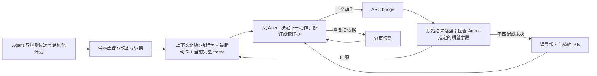

# ARC 执行阶段的上下文控制设计

日期：2026-09-29。状态：核心机制已编码，尚未完成运行验收。本文细化[Agent 主导的上下文管理设计](2026-09-29-agent-led-context-management-design.md)，针对 `arc-ft09-topics-200-20260929` 的真实轨迹。它不改变 ARC 动作权限、游戏规则判断者或 Auto-Research 的按需调用方式。

## 1. 这次运行暴露了什么

21:37 的单次 provider 请求为 207,855 JSON 字符、28 条消息和 10 个工具定义；估算输入约 51,920 tokens。前一条已完成回复实际使用 55,745 输入、58,499 输出 tokens。分类统计中 ARC 观测约 65.0k 字符、普通工具结果约 31.8k、checkpoint 投影约 25.0k、其他消息约 32.5k、工具定义约 20.9k。工具角色消息合计 91.6k 字符，与上述内容分类交叉，不应相加。依据是本次运行的 `provider-telemetry.jsonl` 和 `context-token-debug.jsonl`。

父 Agent 已写下 14 步关卡方案，21:23 执行了第一步；到 21:37 仍未执行第二步，期间读取了五页旧资源，原文约 41.5k 字符。第一步目标格确实由 8 变为 12，但 checkpoint 的 `next_step` 仍从第一步开始，`working_summary` 保留了较旧的规则判断。实际 `changed_cells=37` 也与预测文本中的 36 不同。日志能证明这些事实，不能证明模型内部为何重读。两次普通委托超时，Auto-Research child 未启动，因此不能把子研究当成本次停滞的直接原因。

当前代码已经有 ARC 历史 frame 投影、通用 archive、`task_harness(context/focus)`、child 的结果压缩、精确资源读取和版本化策略状态。缺口是：父 Agent 的 `focus` 只选择组装资源，不能精确移走历史读取回执；每轮投影完整 `recent_actions` 和旧失败操作；普通 checkpoint 更新返回整份状态；失效知识通知整批常驻；策略状态的计划游标没有与这次自由文本 14 步方案接上。通用生命周期在 400k 字符上限内仍会保留最近工具事务，且本次没有真实 provider 窗口配置。因此单靠现有 archive 和字符上限不会使下一次请求变轻。

## 2. 目标、不变量和备选方案

目标是让 Agent 在探索时保有规则、竞争假设和反证，在方案已经可执行时看到简短的**当前执行状态**，并能一键回到完整证据。评估输入、输出、延迟、动作吞吐、关卡进展和恢复质量；缩短字符数不是唯一目标。

不变量：每个真实动作仍由父 Agent 发起；父 Agent 下一决策始终收到最新动作结果和当前完整公开 frame；canonical 观测与完整工具结果持久保存，按精确版本和原权限恢复；研究结论不会自动成为环境事实；child 只使用获授权的截止快照；任何压缩不能静默丢失当前反证、未决异常或 plan 所需条件。

| 方案 | 收益 | 代价与决定 |
|---|---|---|
| A. 继续降低全局字符上限，机械截断最近消息 | 容易减少请求字符 | 最近完整 frame、动作结果或反证可能被误删；Agent 仍不知道如何推进计划。只作最终安全兜底。 |
| B. Agent 选择工作集，runtime 提供短执行卡、精确回执和计划游标 | 同时解决重复上下文与执行停滞，保留可追溯证据 | 需要统一 checkpoint/strategy 投影和父 Agent 工具结果控制。采用。 |
| C. 把 14 步交给自动执行器或 child | 可提高动作速度 | 违反父 Agent 独占逐步动作及结果判断的既定边界，且可能越过新反例。不采用。 |

**ADR-1，工作视图：**采用 Agent 编制的结构化计划与短执行卡。runtime 仅校验版本、动作回执和 Agent 指定的可观测期望；语义结论仍由 Agent 作出。代价是旧自由文本计划需要显式迁移。

**ADR-2，历史结果：**采用精确原文存储、父/child 分权选择和可逆恢复。最近动作与当前 frame 是受保护输入。代价是多一层结果索引和一次按需读取；好处是读过的 10k 字符旧页不会永久占用后续请求。

**ADR-3，长轮次：**先用状态版本去重的无进展提醒和真实 provider 遥测，再评估输出预算及安全取消。避免把未经验证的截断当成推理优化。

## 3. 运行流程

### 3.1 Agent 编制计划，runtime 只维护机械游标

复用 `task-strategy-state.json`，让 Agent 以版本化 `plan_update` 提交步骤。执行步骤应有结构化动作参数、可选的**最小可检验期望**、以及不满足时要检查的证据引用；自然语言仍可作为说明。Agent 决定规则、目标、动作顺序、期望和何时修订。runtime 只比较已指定的可观测字段，例如目标格前后颜色、`level_changed`、动作编号，不推断规则真假。

每次 `arc_action` 由父 Agent 显式提交 `plan_id` 和 `plan_step`（无计划时继续允许探索动作）。执行后先持久化完整结果，再标记该步骤 `matched`、`mismatch` 或 `unassessed`；只有明确匹配才机械推进游标。下一个动作仍需父 Agent 再次发起。若动作未附计划身份、版本过期、期望无法观测或结果不匹配，停止**自动游标推进**并展示短异常卡；不能因 `changed_cells=37` 与一段非结构化预测文本中的 36 不同，就由 runtime 宣布方案已失败。父 Agent可以接受差异、修订期望、改计划或继续探索，均需留下依据。

旧的自由文本计划不被代码猜测转换。恢复旧 run 时，Agent 可用当前 checkpoint 和精确证据显式提交一次结构化版本。本次“第一步已经执行但 `next_step` 未变”的矛盾要在迁移卡中列出，避免重复点击。

### 3.2 当前决策只投影一张执行卡

在有活动计划时，替换当前 `CURRENT TASK STATE` 的完整历史投影为短卡：环境动作计数和关卡、当前 frame 版本、最新动作结果 ref、当前 plan/candidate/revision、已完成步数、下一步、Agent 选定的关键规则与反证 refs、未决异常和 checkpoint 全文 ref。当前完整 frame 单独保留，不能以这张卡代替。无活动计划时给探索卡：目标、竞争候选的短索引、下一实验和证据入口。

以这次运行作**迁移后示意**（不是对真实 checkpoint 的自动改写）：`level=2/6, actions=55/200, frame=parent-state-56@v1; plan=lvl2-v3, completed=1/14; last=(14,22):8→12, level_changed=false, observation=execution-observation-57; next=(38,22); unresolved=changed_cells 37 versus free-text prediction 36; rule/counterevidence=<Agent 选定 refs>; full_checkpoint=<ref>`。短卡显示异常，但是否影响规则与下一动作仍由 Agent 判断。

`recent_actions` 全部 55 条、旧 `pending_operations`、完整旧观测、历史候选正文保存在原任务资源中，索引展示数量、最新项和可读取 ref。失败操作只在尚需处理或其状态改变时进入卡片。`task_checkpoint(update)` 的所有成功路径只返回 revision、变更字段、下一步和精确全文入口；`inspect/read` 才返回分页内容。策略状态是计划与候选的单一来源，checkpoint 只投影它，不再维护一份会过期的独立 `next_step`/策略描述。

### 3.3 父 Agent 能选择历史工具结果

复用 `task_harness(action=context)` 作按需成本诊断：按 request ID 同时显示实际 provider 用量（若已返回）、缓存、估算、最大的结果 ref、是否当前必需、上次选择后的变化。增加父 Agent 的 `compact_results/restore_results` 控制，使用短参数与精确 `toolCallId`/资源 ref；可以选择已完成的历史 `task_resource` 读取、旧 checkpoint 回执和其他普通大结果。先把完整结果保存到任务库，随后在下一次 provider 视图中替换为含工具名、结果状态、大小和读取方式的短占位。当前 `arc_action` 结果和当前 frame 不可由此控制压缩；未评估反例需要显式保留或先放进带证据引用的 Agent 状态。

Agent 对语义相关性负责；runtime 验证 ref、权限、任务身份、最新结果保护与恢复可用性。既有 child `child_context` 可复用这一结果存储与选择规则，但各 child 的工作集、恢复权限、截止点和研究 topic 仍独立。避免把 child 的一份全局连续性摘要无限增长：按 topic/阶段维护短索引，原文和旧摘要按 ref 读取。普通 delegate 与 Auto-Research 都适用，研究报告只回传当前决策相关结论、反证和引用。

### 3.4 减少重复投影和重复读取

失效知识仍立即从有效 assembly 中移除；父 Agent 每轮只看到**当前选择受影响**的短失效摘要和未处理数量。详情通过 `task_harness(inspect)` 或精确 ref 读取；同一失效集合不在每轮重复展开 15k 字符。旧知识被读取时必须标注状态，不能重新成为有效指导。

`task_resource` 的同一 ref、版本、offset、limit 在同一环境状态下反复读取时，可以返回“该页已读、内容未变”的短回执，并提供显式 `force_full`。首次读取、状态变更后的读取及明确 `force_full` 必须返回原页。默认页尺寸小，超大页由 Agent 显式申请。目录同样分页，不能让目录本身膨胀。

工具定义保持稳定的核心入口；大操作契约和 skill 正文按需加载。精简 schema 描述需要保证参数验证不变，并与动态启用工具的缓存命中率比较。缓存命中只降低计算/费用/延迟，**不减少逻辑上下文长度**。

### 3.5 无进展与长输出

以 `action_count`、plan revision、有效新证据、检查点 revision 记录进展。活动计划处于 `matched` 状态，而连续两次已完成模型轮次没有动作、计划修订或新证据时，下一轮只注入一次短提示：当前计划步骤、上次结果、差异状态，以及可选的 `execute / revise with evidence / inspect exact ref / defer`。这是选择提示，不自动执行动作，也不禁止复核。重复读相同旧页本身不算新证据。提示按状态版本去重；Agent 真正修订或执行后重置。

本次 provider 声明 `max_completion_tokens=65536`，前一条回复耗费 58,499 输出 tokens。输出预算应单独治理：先按“执行已验证步骤”和“探索/规则修订”分层测量，再评估 Pi/provider 是否允许安全地逐轮设置上限和 reasoning 参数。若只能全局设置 `ARC_MODEL_MAX_OUTPUT_TOKENS`，先作对照运行，确认 `length` continuation、工具调用完整性和游戏质量，再调整默认值。不能直接把 65,536 改成任意小值并假设思考质量不受影响。对请求已发出但长时间没有完成消息的情况，另设计可取消/恢复边界；必须先证明没有未确认的 ARC 动作及重复调用风险，不能把超时当作已安全停止。

## 4. 触发、回退和审计

平常只投影短卡，不每轮注入详细预算报告。出现单次请求增长、旧结果成为前三大来源、已执行计划两轮无进展、或接近 provider 窗口时，给一次短成本提醒和 `task_harness(context)` 入口。runner 已解析模型窗口和输出上限，但本次生命周期日志中的两者都是 `null`；实现时要将实际配置传入生命周期并核对 provider 请求中的 `max_completion_tokens`。若仍未知则明确标为 `unknown`，不能把 400k 字符兜底当成模型窗口。Agent 无法响应时，现有硬归档仍可替换已持久化的旧事务，但必须保留当前 frame、最新动作回执、未决异常和短认知卡；`protected_overflow` 应显式报错或降级，不可静默丢字段。

每次选择记录来源请求、选择的 refs、plan revision、压缩前后消息/工具定义大小、provider 实际输入输出与缓存字段、后续恢复调用和动作进展。估算 token、实际 usage 和 cache-read 分开报告。比较时标记同时发生的关卡/计划变化，不把相关变化直接说成因果。

## 5. 分期实施与验收

1. **先消除确定的重复源**：checkpoint 更新短回执；当前状态投影改成短卡和精确 ref；失效通知改成变更摘要；保留所有原始任务资源和恢复入口。此期不需要新语义压缩器。
2. **接上计划执行**：结构化步骤、计划身份、可观测期望、机械游标和 mismatch 状态；兼容无计划探索，旧自由文本计划显式迁移。父 Agent 每步都继续看完整 frame 并决定下一动作。
3. **补齐 Agent 结果选择**：父 Agent 精确 compact/restore、重复页短回执、child 按 topic 的工作集索引、同一 request ID 成本比较。再评估稳定核心工具 schema 与分阶段工具启用。
4. **处理极端长轮次**：无进展提示先上线；provider 输出上限和取消/恢复须单独验证其 Pi/provider 可行性，不与前述语义更改同时上线。

设计目标是在同阶段真实运行中使“已有可执行计划”的 provider 输入相对这次约 208k JSON 字符下降至少一半，并显著降低无动作的连续模型轮次；同时不能增加重复/错误动作，且 Agent 能说清当前规则、关键反证、计划游标和下一实验。具体阈值应由真实 provider 的成本、延迟和 ARC 质量共同决定，不把字符指标当作单独验收。

验证要分别覆盖：字节等价恢复；最新 frame/动作结果始终可见；匹配、异常、旧计划迁移和重复读取；父、Auto-Research child、普通 child 的权限与压缩恢复；provider `length` continuation。若主张 Auto-Research 到 Self-Harness 闭环，必须按项目 `AGENTS.md` 通过真实 ARC bridge、Pi parent、child broker/process、structured return、router、native mutation、动作边界及后续父轮，覆盖 `system_prompt`、`skills`、`memory`、`tools`、`subagents`；组件检查只作诊断。成本与游戏能力主张还需真实 provider ARC 对照运行。

## 6. 与未完成事项的关系

[延后待办 D](../deferred-research-todos.md)仍要求验证压缩后的认知连续性。本设计将规则、反证、计划和精确证据入口保留在当前工作卡与版本化任务资源中，但不声称已有真实模型验证。待办 C 中 child 主动请求证据或实验的路由仍属独立议题；这里仅复用已有只读权限与 topic 隔离，不扩大 child 环境动作权。

## 7. 本次实现记录

已编码：版本化 checkpoint 全文资源与短更新回执、当前决策卡、结构化计划步骤和可观测结果匹配、计划游标与旧步骤预检、父 Agent 旧工具回执的选择/恢复、资源目录分页及重复页短回执、失效知识短摘要、child 连续性摘要的短投影、高水位提醒与已完成轮次的无进展提示、模型窗口/输出上限向上下文生命周期的配置传递。代码入口分别位于 `pi_external_benchmark_research.ts`、`pi_task_strategy_state.ts`、`pi_parent_context_control.ts`、`pi_task_resource_store.ts`、`pi_task_local_self_harness.ts`、`pi_child_context_control.ts`、`pi_task_local_context_lifecycle.ts` 和 `arc_agi_3_e2e.py`。

设计中明确要求先验证可行性的逐轮 provider 输出上限与请求取消/恢复仍未实现。历史运行的旧工具结果不会凭源码更新自动补录，且运行中的旧进程不会加载新代码。此次只完成静态语法检查；未运行测试、真实 ARC smoke 或真实 provider 对照，因此上面的成本与动作吞吐目标仍是待验收目标，不是已证明结果。

## 8. 2026-09-30：读取结果的工作集寿命

旧峰值请求中，ARC 观测读取约 65k 字符、普通工具结果约 31.8k、当前 checkpoint 约 25k、其他管理消息约 32.5k；这些是 provider payload 的互斥文本分类，工具角色消息总量与之交叉。压缩前归档显示，最近消息中有多次 8–14k 字符的旧状态/观测读取和约 30k 字符的 checkpoint 回执。通用 lifecycle 的 24 条最近消息可容纳这些大结果，400k 字符上限没有触发。Memory 和 Skills 在该请求中均为零。

父与 child 的大只读工具结果现先完整保留至首次模型续轮。只有在结果后出现一条 assistant 消息后，后续 context 投影才将未钉住的结果换成含精确 ref 的短占位；原始结果及权限边界不变。父 `task_harness(action=restore_results)`、child `child_context(action=restore)` 钉住结果，显式 compact 取消钉住；错误结果、ARC 动作与当前状态不走此寿命规则。父侧只对 `task_resource`、`research_resource`、`task_harness_status`、checkpoint inspect 及 Harness 只读检索生效，阈值 2000 序列化字符。child 只对获授权的只读工具生效。选择和恢复在重启后从原有 ledger 重建；诊断入口显示当次自动替换的结果数和节省字符估算。

当前验证索引改为完整 open refs 与最近四项详情；周期复盘提示改为短窗口卡，完整 review 契约按 `task_harness(action=inspect,section=review_contract)` 读取。Agent 仍负责把规则、反证和计划写进已有 checkpoint/strategy/research progress；运行时不从旧证据推断语义。当前完整 ARC frame、最新动作结果和未处理异常继续受保护。源码入口为 `pi_parent_context_control.ts`、`pi_child_context_control.ts`、`pi_task_validation.ts`、`pi_task_local_self_harness.ts` 及相关 ARC/child 提示。

新真实 provider 运行位于 `runs/arc-ft09-context-workset-60-20260930`，游戏 `ft09-0d8bbf25`、treatment、Jev 关闭、桥接层总动作上限 60。首个请求约 35.9k JSON 字符；真实后期收益、压缩后的认知连续性、ARC 进度和 provider 输出长度须由该运行后续轨迹判断，不因机制已编码而预先宣称改善。
