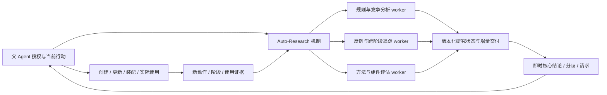

# ADR：Auto-Research 机制与多个研究子 Agent

日期：2026-10-01（Asia/Shanghai）。

状态：用户已确认核心职责与目标；持续职责、增量证据、active 交付与 Harness 反馈运行路径已实施。实现与验收见 [2026-10-01 实施记录](../auto-research-workers-implementation-2026-10-01.md)。真实 provider 的自主使用、总成本与任务收益仍待对照验收。第 7、10 节保留实施前审计记录。

## 1. 用户确认的定位

Auto-Research 是组织持续研究的机制。它的具体实现和作用途径可以由多个 sub-agent 承担。

- 即时、核心结论交付给父 Agent，服务当前决策。
- 需要持续追踪、分析的任务和内容由对应子 Agent 承载。
- 研究围绕问题及研究线延续，可跨窗口、阶段和执行进程。
- 父 Agent 无需保存每条研究线的完整分析、所有候选和所有跟踪细节。

Auto-Research 的机制包括授权、问题组织、证据分发、调度、状态延续、交付与反馈。runtime 负责确定性事实、版本与预算；语义选题、分解、竞争分析和结论更新由父或受授权的研究子 Agent 完成。无需预设一个额外的总控 LLM，也不把机制等同于单个 worker 或单次调用。

## 2. 背景

真实 ARC 核心运行 23 个已完成模型轮次输出 232022 token，其中 reasoning=213547（92.0%）；追加运行推理占比 96.1%。父持续承担视觉与规则探索、规划、窗口判断及追踪。两次运行没有实际 Auto-Research 研究样本，因此这些数据说明减轻父负担的动机，不能证明委派后收益。

旧窗口逐个要求父延期，导致父已作一次判断后，随后动作仍被另一旧窗口阻止。仅将研究工具放入 prompt 尚未形成持续承载、及时交付和行动反馈的运行方式。

证据及局限见 [超时分析](../arc-timeout-analysis-2026-10-01.md)。本决定关联延期事项 B（研究目的/视图）、C（父子证据通信）、D（认知连续性），不表示这些事项已经完成。

## 3. 职责与身份

| 对象 | 负责内容 | 延续的身份 |
| --- | --- | --- |
| 父 Agent | 当前任务目标、行动、研究授权、核心结果采纳、组件创作/装配/效果判断 | task、checkpoint、当前选择 |
| Auto-Research 机制 | 授权内的证据路由、调度、版本、预算、交付、反馈与停止 | 研究线、议程、计划/节点、证据游标 |
| 研究子 Agent | 目标/规则探索、竞争解释、反例、方法分析、跨阶段跟踪及候选建议 | 分配的职责与研究线；可由后续 session 续接 |
| Self-Harness runtime | 校验、原生组件版本、精确装配、执行/暴露/使用回执 | 组件版本、assembly、实际使用证据 |

`research_line_ref` 标识持续问题；plan/node 表达工作分解和依赖；session/run 表达一次有界执行。worker 与 Harness 中保存的 subagent 组件也不同：一个研究进程的存在不等于已创建或使用了 subagent 组件。岗位定义若需要复用，仍走 creator 与独立创建流程。

一条研究线可以由多个 worker 分工或独立提出竞争解释；多个研究线也可以并存。一个窗口是证据范围，可以支撑多个问题。不能用“一窗口一 worker”或“一调用一主题”替代问题组织。

## 4. 授权、调度与证据连续性

父授权研究目标/范围、可访问证据、允许的职责、预算、交付与停止条件。父不必先写出完整窗口分析、最终问题答案或确定的因果解释。

在该授权内，研究 Agent 可以提出子问题、下一次证据需求和工作分解；runtime 按已授权、版本化的任务/分配执行调度与限制，不自行判断科学结论或扩展权限。具体子 Agent 是否可直接创建子任务、由谁确认其语义依赖，实施时复用并核对已有 plan/node release 合约。

连续追踪的实施目标：

1. 新动作、阶段变化、validation 与实际使用/评估形成精确的新证据批次。
2. 已分配的研究线登记可读批次与证据截止点；重叠材料不自动产生重复任务。
3. worker 在有界计算片段读取新材料，修订支持、反证、候选、未完成检验和 next_step。
4. 读取、消费确认和研究结论分开记录。仅渲染提示或授予访问不推进已分析游标。
5. active worker 不因每个新窗口重启；新证据可排队供下一片段消费。现有固定快照不能假装已随环境实时刷新。
6. pending 等待具体新证据或恢复条件；completed session 后的新工作创建后续 session，保持同线与精确前序引用。
7. 预算不足、无新证据、重复无进展、任务结束或父撤销授权时停止计算并保存研究状态。

持续存在的是研究职责和状态，不要求长期驻留且不断生成的模型进程。跨阶段恢复需保留未解决问题与反例，不能只重读最近一段轨迹。

## 5. 即时交付与持续分析并行

worker 可以在任务仍 active 或等待后续证据时发布有界的阶段结论，不必等到整个研究 complete。报告持久化、研究生命周期和父关注事件是三个不同维度。

父默认接收短增量：发生了什么变化、依据与截止点、对当前决策的影响、适用条件/不确定性、是否需要父动作或组件决策，以及完整详情 ref。字段首先复用现有 report/progress/experiment_request/authoring_handoff，不把本文用语直接新增为工具必填字段。

- **当前相关：** 新反例、解释变化、决策分歧、当前可用方法或实验请求，交付到后续父决策边界。
- **后续相关：** 历史比较、尚未行动的候选、持续跟踪状态，保存到研究线，父只获得可检索索引或必要状态变化。
- **紧急：** worker 明确说明可能影响已选动作/组件的反证，机制按父授权的通知策略提请注意。runtime 不从文本自行推导“危险”，也不让异步结论直接替换父计划。

对同一版本只交付一次，后续交付声明修订、撤回或新增依据。独立 worker 的分歧必须保留；语义整合可由授权研究职责承担，不能在 runtime 内多数表决为“验证”。父按需恢复完整证据，不被迫重放全部报告。

阶段切换时标注报告证据截止点、scope 与依赖；历史结论仍可检索，但采用前需对照最新状态。异步交付在可恢复的父轮边界消费，不打断已提交的不可逆动作。

## 6. 与 Harness 演化的关系

研究产物可以是结论、竞争解释、实验请求或方法/组件候选，不要求每条研究产生组件。

本次定位保留现有研究与创作的权限边界：Auto-Research worker 只读真实环境并写隔离研究产物，不能直接修改/装配当前 Harness。父依据研究交付读取对应 creator、通过 task_harness_create/change 创作、选择精确版本 assemble 并试用。后续真实输入、输出、动作、成本与效果评估按同线反馈，由对应研究职责持续复查。

普通 delegate 的显式有界动作授权维持现状，不能由一个 Auto-Research 分工任务继承。Self-Harness 继续是确定性校验、装配和证据 runtime；授权研究调度属于 Auto-Research/Agent runtime。

## 7. 现有基础与实际缺口

| 能力 | 当前源码依据 | 本设计仍需补齐 |
| --- | --- | --- |
| 多研究线、议程与历史访问 | pi_auto_research_agenda.ts、pi_auto_research_history.ts | 持续职责/worker 分配和交接；复用现有资源身份 |
| 非阻塞、broker、pending/session | pi_task_local_subagents.ts | 授权后的跨证据批次恢复与有界持续调度 |
| 多节点计划与依赖 | pi_auto_research_protocol.ts、auto_research(plan/release/launch) | 研究线/职责与节点的绑定、分工竞争及去重 |
| 有新证据的续研卡 | researchContinuationCard、self-harness 投影 | 当前只是父提示，不能称为已自动路由给持续 worker |
| 按当前相关性短交付 | research_progress.parent_relevance、researchReportNeedsParentAttention | 已有开放研究的完成报告策略；显式问题通常仍要求父关注，active 阶段结论和统一增量通知尚未闭合 |
| 方法与组件反馈 | method lifecycle、authoring handoff、use/assessment refs | worker 对多次应用证据持续更新、必要时即时修订建议 |

现有完整 SDK matrix 证明原链路可达，不证明本 ADR 的持续多 worker 机制已实现。最新两个真实 provider run 没有研究样本，也不能用它们验收本设计。

## 8. 后果、取舍与实施顺序

预期收益：父不再承担每条研究线的完整追踪；能在行动推进期间取得即时结论；跨阶段反例与方法验证有持续责任主体。

成本与风险：子 Agent 总生成量可能增加；并发会竞争 provider 配额；返回结论可能过时；职责重叠会形成重复研究或冲突报告。用总预算、精确证据、明确分配、版本化增量、停止条件和父当前状态核查处理。独立上下文的盲审条件可按研究目的选择，不预设所有 worker 共享父解释。

实施顺序：

1. 修复 provider 生命周期遥测，保留 reasoning 与正文计数；形成父子总成本口径。
2. 复用研究线、议程、计划和历史游标，补齐父授权与持续职责绑定。
3. 实现增量证据路由、pending 恢复、阶段性结构化交付和去重。
4. 将周期窗口的历史分析交给被授权职责；父只处理需要当前决策的交付，消除旧窗口逐个管理的往返。
5. 保持 creator→创建/修改→装配→实际使用→同线证据更新的路径。

先诊断协议与恢复，再用真实 ARC bridge/Pi/broker/process/router/native mutation/action/后续父轮验收；五类组件和两类 provider length 续接的既有门槛继续适用。真实 provider 对照需检查父 reasoning、行动等待、父子总成本、分歧/反例保留和任务进展，不能只比较父 token 或报告数。

替代方案：所有分析留在父上下文会延续当前负担；每窗口新建 worker 会割裂问题连续性；长期单 worker 容易混合多职责并积累上下文。多 worker 的问题/职责承载提供可调整的分工，但不要求同时启动固定数量子 Agent。

## 9. 文档关系

本 ADR 更新旧文档中 Auto-Research 与单个 Pi child 并列绑定的概念，以及父需要先完成大量窗口分析再交接研究的实现方向。继承有依据、有界、可局部评测的研究要求，并保留环境、创作、版本和采纳权限。实现层接口变化另行核对源码；文档落盘不构成运行验收。

- [有依据的持续研究指引](2026-09-18-grounded-auto-research-guidance.md)
- [单次生命在线模型](2026-09-20-agent-native-single-life-harness.md)
- [能力创作所有权](2026-09-21-harness-capability-authoring-adr.md)
- [延期事项](../deferred-research-todos.md)

## 10. 2026-10-01 ADR 运行接入冒烟

用户要求检查 ADR 是否对 ARC Agent 生效。本次真实 ARC SDK `arc-harness-smoke` 16/16 场景、393 项检查通过，provider 为确定性脚本，环境和 runtime 边界均未 mock。它确认现有研究/组件/装配/反馈链路，但没有本 ADR 新增持续职责调度或 active 阶段性交付的验收场景。

接入审计确认 `_run_pi` 使用 `--no-context-files`，不会自动读取仓库 AGENTS.md；当前 demo/src/tools/tests 没有本 ADR 引用。因此本 ADR 的工程设计状态仍是已确认，新增机制的运行状态仍是尚未实现/验收。详见 [ARC ADR 冒烟记录](../arc-adr-smoke-2026-10-01.md)。

## 11. 2026-10-01 实施与最终接线验收

第 7、10 节记录实施前状态。本设计的持续职责授权、增量证据路由、有界调度、active 阶段短交付、周期窗口交接，以及实际 Harness 使用/评估的同线反馈已实现。ARC 薄 prompt 已接入相应操作指引。

最终真实 ARC SDK 矩阵 17/17 场景、419 项检查通过，环境与 runtime 边界均未 mock，provider 为确定性脚本。新增持续场景覆盖独立职责、分歧/修订/撤回、pending 恢复、completed 后续 session、RESET 后反例保留、父 creator/create/精确装配、工具语义输出 2、反馈回流及后续真实父轮。五类 Harness 组件与两类 length 续接门槛均通过。

详见 [实施记录](../auto-research-workers-implementation-2026-10-01.md) 与 [最终验收产物](../../runs/arc-workers-accepted-matrix-20261001/arc-self-harness-smoke-summary.json)。真实 provider 的自主采纳、总成本和任务收益仍未对照验收。
