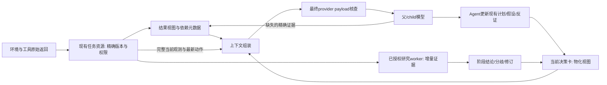

# Auto-Research Pi：上下文、工具结果与推理效率设计

日期：2026-10-02，更新2026-10-03（Asia/Shanghai）。状态：基础压缩/恢复、部分去重、管理schema按需展示与推理实验入口已实施；跨来源语义去重、紧凑认知状态的有效形成与真实任务收益尚未完成。功能与确定性全链路验收通过不能表示完整效率目标已实现。最新实施/实验/局限见第 25–26 节；前文保留历史交付范围和失败样本。文献核查见 [一手资料笔记](../reports/2026-10-02-context-reasoning-primary-sources.md)。

同日增补：已整合 [ARC 运行路径与关键问题分析](../reports/2026-10-02-arc-path-and-problem-analysis.md)，并复核其原始 summary、调用/复盘/压缩事件及当前源码。最新设计以 [开发流程](../development-workflow.md) 为证据标准；本文件第 2.1、9.4、12 节共同维护本次变更记录，不另建重复报告。原始运行报告保留其诊断口径。

核心目标：降低完成任务所需的父子总成本，同时保持行动所需的事实、反证、计划和未决问题。优化的是整条执行轨迹，而不是某一轮输入字符数或 CoT 长度。

## 1. 两张图究竟在说什么

### 第一张：长程任务的训练切片与状态分布

原文首先讨论 Agentic SFT：长程由跨环境交互的决策依赖定义，不由文件数量、tool call 数量定义。一次独立读取多份文档，可以在一个训练样本内处理；第二次调用依赖第一次真实返回时，需要先执行第一次调用，再让模型面对实际状态决定第二次。训练 loss 的覆盖范围和序列并行是训练工程问题，不能直接转换为运行时删除工具历史的规则。

“工具上下文防爆炸”的关键信息是：下一步可以依据最近结果和之前调用的证据 ID，而不总是重放完整历史。但证据 ID 必须配合当前决策所需的有效状态；原文没有证明只留 ID 就足够。信息边界由决策依赖决定，不能统一设为一个工具调用。

另一个重点是训练与实际运行使用同一种状态表示。评论指出：专家读取 A 后得到 ev_A，模型实际读取 C 时得到 ev_C；后续正确动作应依据 ev_C、预算和真实结果重新判断。专家轨迹上的“下一步 B”并不必然仍正确。对本项目的含义是：压缩、恢复、RESET、工具失败或不完整返回后，都应依据实际输入形成下一步，而不是继续复述旧计划。

### 第二张：CoT 质量、效率和自我改进

内容涉及“生成→验证→筛选→再训练”、CoT 的结构/纠错/压缩，以及可验证任务上的 RL/自博弈。它提出研究方向，没有给出实验结果，不能据此确认 RSI 能持续提高基础智能，也不能推出“思考越短越好”。

本项目现阶段可以做的是运行时的证据整理、外显决策状态和推理预算实验；它们不同于训练基础模型。需要权重更新的 CoT 蒸馏/RL 是独立后续路线。工具轨迹、公开理由和验证结果可作为候选数据，不应把不可见的模型内部推理补写成训练真值。

## 2. 最新项目基础与明确缺口

以下是本次核对工作树所得，不用历史日志代替当前源码。已有大量未提交改动，本提案不更改它们。

| 已有机制 | 当前入口 | 与本设计的关系 |
|---|---|---|
| 当前完整网格自动注入，图像模式每次续轮提供完整 PNG；父 `arc_state` 已移除 | `demo/pi_arc_agi_3_extension.ts`、[最新观测记录](2026-09-30-multimodal-arc-observation.md) | 保持；不能重新改为裁剪、纯 delta 或让父反复调用状态读取 |
| 历史 frame 投影、任务资源精确版本、分页权限 | `pi_arc_context_projection.ts`、`pi_task_resource_store.ts` | 保留 canonical 资源与获授权恢复 |
| 通用生命周期、保护工具事务、归档和类别去重 | `pi_task_local_context_lifecycle.ts` | 提升最终输入覆盖核查，避免归档标记替代认知状态 |
| 结构化计划、机械游标、短 checkpoint 回执和竞争视图 | `pi_task_strategy_state.ts`、`pi_external_benchmark_research.ts` | 复用；不另建一份计划真值源 |
| 父/child compact、restore、结果原文缓存 | `pi_parent_context_control.ts`、`pi_child_context_control.ts` | 改进结果释放条件和恢复寿命 |
| 持续研究职责、增量证据、分析消费确认、阶段性交付 | `pi_auto_research_workers.ts`、`pi_auto_research_worker_runtime.ts` | 复用 worker/研究线，不每窗口新建 worker |
| 语义等价 schema 编码、渐进 creator/contract 读取 | `pi_compact_tool_schema.ts`、self-harness 相关模块 | 先测量，再考虑进一步分阶段发现 |
| 父子 usage、reasoning、缓存及完成边界遥测 | `pi_provider_telemetry.ts`、`arc_agi_3_e2e.py` | 用于总成本评价；缺失值继续标为未测量 |

需要优先解决的风险：

1. **续轮不等于吸收。** 父和 child 的大只读结果阈值目前为 2000 JSON 字符；后方出现任意 assistant 消息且未 pin 时，就可过期为短 ref。这个 `laterAssistant` 条件不检查关键内容是否已进入 checkpoint、finding、plan 或研究交接。
2. **读过不等于可见。** `task_resource` 的 `seenPages` 用 `[ref,offset,limit]` 去重，不检查正文是否被后续 context projection 清走。历史读过的页可能返回 `already_read_unchanged`；恢复需要额外 `force_full` 或 restore 往返。
3. **短卡仍可能丢掉决策依据。** 当前 checkpoint 投影对 hypothesis、working_summary 等做字符截断；active plan 时不显示这些旧自由文本字段。竞争视图可提供部分补充，但不能假设所有适用条件、反证和异常都已转入它。`basis_refs` 并不能代替关键内容。
4. **“拓扑保留”弱于“语义完整”。** lifecycle 的最新事务保护主要保证调用与回执关系；per-message 和 emergency shorten 仍可能缩短文本。protected category 也不是每条必需字段的完整性证明。
5. **压缩链条的覆盖范围不同。** parent/child 结果投影、ARC 历史投影、通用 lifecycle、原生 Pi compaction/rotation 与最终图像注入依次影响输入。临时图像在 transcript lifecycle 后加入；只看前面的字符预算或 fallback 遥测不能确认最终输入完整与合规。

这些是源码可见的失败条件，并不直接证明历史运行的每次重读都由它们导致。重读也可能用于复核、检验矛盾、恢复新上下文或查看新版本，应保留这些合法用途。

### 2.1 最新真实失败：主要成本来自重复管理与未纠正的目标理解

复核运行 `runs/arc-ft09-full-frame-real-60-20261002-005748` 的 [summary](../../runs/arc-ft09-full-frame-real-60-20261002-005748/summary.json)、`pi-events.jsonl`、`task-harness-review-events.jsonl`、`task-context-compactions.jsonl` 及 [收尾错误](../../runs/arc-ft09-full-frame-real-60-20261002-005748/runner-error.json)：

| 观察 | 核对结果 | 对本设计的约束 |
|---|---|---|
| 真实配置与任务结果 | qwen3.8-27b / yibu，openai-completions；175000 window、65536 最大输出；60 步上限下 55 个成功动作，第 0 关未过 | 保留失败样本；历史同模型成功仅用于诊断，不构成新旧机制因果对照 |
| 输入容量 | 最大实际 input=60334；provider error=0；压缩记录中 degraded/overflow 均为 0 | 本次没有容量溢出的证据；不能把进一步压短输入当首要补救 |
| 压缩活动 | 102 条记录均有历史归档，单次最多 272 条消息 | 未超窗仍在压缩；不能因没有溢出就宣称没有认知遗失，需另查字段与后续行为 |
| 推理成本 | 父 output=1687833，其中已报告 reasoning=1585830，约占 94%；单条 elapsed 最大 748.078 秒 | 需减少无效管理与重复目标推演；比例是已报告用量的描述，不是全部失败流内部过程的证明 |
| 管理调用 | defer_review 54 次尝试：48 成功、6 错误；skip 21 次尝试：20 成功、1 错误 | 尝试、成功回执和科学消费分开；两类管理尝试共 75/146，约占全部工具执行启动的 51%，不能据此分配同等比例的 reasoning 因果成本 |
| 旧窗口重复 | arc-pattern-5 成功延期 7 次，arc-pattern-10 为 8 次；action_deferred 事件 5 次 | 原文 ref 压缩不了“必须再作一次同样判断”的决策成本；需要复用控制决定 |
| 研究与计划采用 | worker/session=0，结构化计划=0；checkpoint 更新成功 36 次 | 机制存在不代表被采用；不能要求先建 active plan 才获得探索纠偏支持 |
| 读取轨迹 | summary resource_access_count=0，无 task_resource 执行启动，无页访问记录 | 原方案的 seenPages/恢复修复仍有必要，但它不是这次失败的已观察主因 |
| 图像与环境 | 报告记录 88 个正常完成消息均有有效 PNG 暴露；第 56 个位置发生环境错误，收尾 bridge_close 超时 | 图像暴露不等于识别到细节；环境异常独立处理，不能解释此前 55 步目标理解失败 |

当前代码支持的进一步判断：

- `periodicReviewQueue` 以动作计数重新打开 deferred 的固定旧窗口；旧窗口的 evidence_refs 不随新动作扩展。runner 明确设置 `PI_HARNESS_REVIEW_DECISION_REQUIRED=enabled`，使研究/复盘判断可以阻挡行动。这是本次管理负担的实际入口，不是仅有提示文字。
- parent 的 `noProgressTurns` 依赖 active plan；签名还包含动作数和自由文本状态，因此做了动作或改了措辞也可能重置该计数。它主要检测计划执行停滞，不能代表目标规则研究在推进。
- 已有 `reviewProgress` 能记录 public not_advanced 桶，但其通用机会提示位于 `!periodicReviewEnabled()` 分支；最新 ARC 开启 periodic review，不能假定两种模式的纠偏覆盖相同。
- 已有 competition/decision_review 能展示未结构化主张、实验结果和触发；具体绑定及语义消费不足。不能声称竞争机制完全不存在，也不能通过再要求填写一套同类字段解决漏用。
- 当前 ARC 的 open admission 已允许首次 start/assign 自动准备研究方法，不需要新增“先完整复盘→再读研究方法→再许可启动”的流程。本次模型未作研究授权，不能把断点误定为 worker 调度失败。

所以当前设计调整为两条可分别验证的路线：**近期优先减少重复管理并支持目标纠偏；上下文路线继续修复真实可见性与认知连续性。** 两者不能在一次 treatment 中一起改完后宣称单项收益。研究投入、竞争表示和推理预算也分别作为后续主要因素。

### 2.2 整合与保留边界

报告 P1–P5 整合到知识状态、管理生命周期、worker 首次采用和成本实验中。P6 仅增加“未确认动作结果/退出原因”的状态完整性要求；SDK None、bridge 502 与收尾 timeout 的可靠性修复另立窄命题。

报告中已验证的特定游戏坐标与目标配置仅用于离线诊断，不进入通用 prompt、初始 memory、研究输入或评测答案。完整当前网格/PNG 保持现状，细节识别可用公开状态上的确定性结构解析辅助，但原始视觉暴露本身不证明空间规则已被理解。

## 3. 设计选择与不变量

比较三种方案：

| 方案 | 收益 | 代价 | 选择 |
|---|---|---|---|
| 继续收紧字符上限、按时间或轮次清空结果 | 易实现，单次请求较短 | 不知道决策依赖，容易造成重读和反证遗失 | 只保留为可审计的传输兜底，不作为主要策略 |
| 扩大窗口，保留全部历史 | 减少主动压缩造成的缺失 | 总输入持续增长，检索与注意力负担仍在，费用高 | 作完整历史对照及局部保守回退 |
| 决策状态常驻、历史分层、消费与可见性分开管理 | 控制重复输入，保住下一步所需内容，可追溯恢复 | 需要明确依赖和覆盖核查 | 推荐 |

不变量：

- 当前完整 ARC 网格及已启用的完整 PNG、最新动作结果、必需的动作过渡/动画证据必须真实送入后续决策；历史观测可分层。
- 任务事实来自 runtime/观测；假设、重要性、计划和语义消费来自 Agent。反证不因旧或与主张不一致就被删除。
- canonical 记录、证据 ID、版本、工具参数、数值、坐标、错误码、权限和 child 截止点不被自由文本压缩器改写。
- `stored`、`read`、`included_in_payload`、`agent_acknowledged`、`verified` 分开。输入覆盖也不能证明模型注意到、理解或采纳了内容。
- 原文可恢复是必要条件；当前决策仍然正确才是压缩质量目标。
- 不为每次工具调用强制增加“总结→提交→审批”的模型往返。复用现有更新与报告渠道，按相关性和上下文压力触发。
- Auto-Research 沿用只读研究、父侧 creator/create/assemble/trial/feedback 权限链。普通 delegate 的显式动作租约保持独立。

## 4. 一份 canonical 记录，三个工作层次



### L0：当前决策必需内容，持续驻留

包括当前环境完整视图、最新动作及其确认状态、当前目标/约束、选中计划及游标、计划适用条件、会影响下一动作的竞争解释/反证、未解决错误或异常、待完成实验和证据缺口。核心内容写在卡片里，同时提供原文 ref；不能只保留“详情见某 ID”。

`DecisionCard v2` 是已有 checkpoint、strategy、competition、validation 和 worker inbox 的物化投影。各字段仍由原模块拥有；卡片不另写一份独立事实库。

最新失败要求把知识对象区分为：**操作效果、目标/成功规则、表示与对应关系、执行路线**。某项操作效果已支持，不能把未解释的目标规则压成“机制已完全理解”。这是现有候选/主张的可选语义类型和投影原则，不是新增每轮必须填写的四份表单。Agent 可在已有 checkpoint/progress 更新中只改发生变化的项；缺失标签保持 unknown，runtime 不从文字自动认证“已知”。

示意字段：

```json
{
  "environment_revision": "<exact observation ref>",
  "checkpoint_revision": 12,
  "plan": {"ref": "<exact plan version>", "cursor": 1, "last_outcome": "matched"},
  "knowledge_gaps": [{"kind": "goal_rule", "question": "<尚未解释的成功规则>", "status": "unresolved"}],
  "decision_facts": [{"value": "<已观测的关键事实>", "source_ref": "<exact ref>"}],
  "active_claims": [{"id": "H1", "kind": "goal_rule", "claim": "<Agent假设>", "scope": "<适用范围>", "status": "hypothesis", "evidence_refs": ["<ref>"]}],
  "counterevidence": [{"claim_id": "H1", "fact": "<关键反例内容>", "source_ref": "<ref>", "disposition": "unresolved"}],
  "next_decision": {"intent": "<下一动作或检验>", "preconditions": ["<条件>"], "stop_if": ["<可观测异常>"]},
  "evidence_gaps": [{"question": "<确实缺失的依据>", "ref": "<exact ref>", "range": [0, 2000]}]
}
```

事实、假设和 Agent 计划的标签须明确；例中的 `matched` 仅表示机械期望匹配，不是科学假设被证明。最后一张 frame 无变化时，最新动作结果、过渡和预算仍有变化，不能仅按 frame hash 去重整个状态。

有限检验保留“候选预测的目标状态/成功事件→达到该测试终点的证据→实际结果→适用修订”。只有测试确实到达终点、必要观测完整，才能将未成功作为该预测的反证；中途错误、不匹配动作或不完整返回保持 unknown。不是每个未通关动作都反驳整个规则，也不自动把局部切换成功记为任务目标已解释。

没有 active plan 时仍可直接探索并获得纠偏材料；不要求先创建完整计划或两个候选才可行动。有重复、可计算的表示核对任务时，复用确定性工具提取尺寸、坐标、区域/配置和状态指纹；语义映射与目标解释仍由 Agent 判断。派生视图与当前完整观测共存，不能恢复父裁剪/回看流程。

短卡不设一个会静默截断必要字段的总字符配额。目标是删除冗余表述、历史展开和重复来源；关键字段过长时，先由 Agent 结构化或调整工作集。确实装不下时报告保护内容超限，而不是在正确运行的表象下丢字段。一个 active plan 的成立条件和未决反例不能被省略到只有归档 ID。

### L1：正在使用的工作集

最近读取、用于当前检验的片段、活跃 contract、creator 和关键历史样本。可以设一个软预算，按下一决策依赖和 Agent 选择保留；单轮 TTL 只适合已确认是一次性且无未决依赖的内容。

它包含完整小结果或精确分页片段，不要求所有资料都进入 L0。一份长日志中，与下一步有关的错误信息和测试失败上下文可以进入 L0，其余原文进入 L2。

### L2：完整可追溯历史

现有 canonical 工具结果、观测、轨迹、研究报告、旧计划、撤回主张、归档 transcript。保持原权限、版本和分页；目录使用已有分页索引。原文不重复存入每条 memory、checkpoint 和 worker 报告。

此分层不声称得到数学上的充分统计量。Agent 的状态选择只能通过行为对照检验：同样的新观测输入下，压缩状态是否仍支持正确下一决策、反证更新和必要的精确恢复。

## 5. 结果寿命：用依赖闭合替代“出现一次 assistant”

每个结果增加轻量表示元数据，挂在现有 result/resource ledger 中，避免新增知识真值源：

- 精确 result ref、版本、内容 hash、toolCallId、页范围、任务/reader/cutoff。
- `exposure_epoch` 与最终请求中覆盖到的完整正文或范围。
- 当前是否 pin、由哪个活动计划/检验/未决操作引用。
- Agent 声明的 `covered_by`：现有 checkpoint/finding/research progress 精确版本；或者 `release_reason`。
- 视图状态：`resident`、`distilled`、`cold`、`rehydrated`；该状态不等于结论的正确性。

典型流程：

1. 保存原文，再返回完整小结果或决策相关视图；新的必要结果至少进入后续有效 payload。
2. 模型可以在现有 checkpoint 更新、plan 修订、报告提交或 worker progress 中顺带说明哪些结果已整理、哪些仍在工作集。工具调用成功不自动算分析。
3. 对关键结果，先确认依赖所需字段仍在决策卡或工作集，再移走正文。Agent 也可以明确标为无关；runtime 只记录和检查引用，不判断其语义判断是否正确。
4. 对纯控制回执、字节等价重复说明、已结束且无开放依赖的只读页，可以确定性去重。
5. 未说明去向的结果在无压力时留在 L1；接近输入边界时给一次待整理集合，允许同一更新批量处理。不要每一页增加一个模型交互。
6. 紧急窗口压力下仍可归档非当前必要的完整历史，并明确记录未经语义整理的证据缺口。下一决策应恢复确实需要的部分，不能宣称它已被吸收。

“有 `covered_by` 引用”只证明 Agent 作过声明；runtime 校验 ref 存在、版本、scope、字段覆盖与引用关系，行为测试再验证语义。多个互相矛盾的主张保留各自身份与反证，不由 runtime 自动合并。

### 可见性感知的页读取与恢复

把当前 `seenPages` 从唯一去重依据降为访问历史。短重复回执的安全条件应是：请求内容在下一 provider 输入仍有完整、有效覆盖，或者 Agent 明确接受使用对应的结构化派生状态。仅仅“此前读过”不能省略正文。

推荐行为：

- **正文已移走：** `task_resource(read)` 直接用本地不可变缓存返回请求页，无需模型先收一个空回执再加 `force_full`。它是恢复旧证据，不记为新环境证据。
- **正文仍完整驻留：** 可返回短 `already_visible`，指明现有 result ref 与覆盖范围；同时保证下一输入仍保留正文。不能在去重后又把那个唯一正文清走。
- **Agent 要求全文复核：** 保持现有 `force_full`；不因重复次数而拒绝读取。
- **恢复时：** 默认给予当前消费者的工作集租期。直到显式整理、检验结束、计划依赖解除、阶段不适用或 Agent 释放，再转冷；不要刚读回来下一轮又按单续轮 TTL 清走。
- **重叠页：** cache 元数据记录实际范围，可识别重叠；没有授权不能扩大范围，没有完整覆盖不能声称重复。必要时返回缺失部分并保持可重建顺序。
- **原生 compaction/rotation：** 使旧可见性 epoch 失效，依据最终输入重新建覆盖表。旧读取/分析回执保持历史，但不能继承 `visible=true`。

最终 payload 的可见性检查发生在工具执行之后，因此读取时先作候选决定，组装结束时必须再验证。若唯一正文随后被清走，提升该页为当前必需并重新组装；若仍超限则显式失败。即使某 provider 不暴露最终 payload hook，也应有明确的 `coverage_unknown`，保守返回正文，不能拿 fallback 估计冒充覆盖证明。

### 重读的反馈控制

记录相同精确版本/页的读取是否紧跟压缩或恢复，以及后续有没有推进问题。再次读取同页时，优先检查是否为系统清走造成的缺失；若是，恢复并延长该工作集租期。

只有正文仍在、没有新版本/新问题且持续无进展时，才给一次带缺口定位的短提醒。保留合法复核，避免用禁读次数或读工具处罚掩盖状态不足。评估失败时局部放宽相关结果寿命，不全局重放整个 archive。

### 管理决定的寿命：保留判断，移除重复义务

工具正文压缩之外，需要处理“旧窗口再次要求父决策”的运行成本。管理回执不属于已验证知识；保留精确 window/evidence refs、父判断与适用范围，复用它不会伪装成已完成分析。

推荐分开比较三种改动，而不是一次性上线：

1. **同旧窗口决策复用：** 对父明确选择事件驱动搁置的固定窗口，精确证据集合、作用域和判断未变时，不因动作计时器经过而要求父重新确认同一延期。新动作形成新证据批次；反证、阶段/权限/预算变化或父显式重开才产生对应的新决策事件。父要求特定动作数后真的再次复核时应保留该意图；不能把所有 after_actions 语义都改为永不恢复。
2. **旧窗口批量投影（另一个因素）：** 将已授权同问题的待处理材料合成一张增量索引，保留各原窗口 identity 和完整覆盖关系，只传新 refs/未决问题。机械 refs 去重不合并科学解释、不标已读/已分析。新窗口有新的相关证据时仍送达，不能用“旧判断继续有效”掩盖新失败。
3. **语义复盘非阻塞（单独评估）：** 研究/复盘机会作为短事件或现有卡片中的变更，权限、预算、版本和动作完整性继续硬检查。是否改变已有 review 动作门禁单独实现和验证；不能以文档中的“advisory”声称当前 enabled 门禁已不存在。

原接口只允许 after_actions 延期，因此第一项需要明确区分“定时复核请求”和“继续搁置且无新依据不必再问”，是待实现的控制语义，不是按历史自然语言猜测。迁移旧 run 保留既有回执，不由 runtime 解析父理由自动改写授权。

不增加一个常驻“复盘管理 Agent”，不为了移除 due 队列强制启动 worker，也不要求逐个窗口提交五类组件判断。已有明确授权的 `handle_periodic_reviews` 职责可以复用；worker 失败/撤销后，未分析证据保持 pending，按实际新问题和预算决定接手，不立刻退回成逐窗口父强制义务。

## 6. 工具上下文：四种成本分别处理

### 6.1 Schema 与操作契约

继续做验证等价的 enum 编码、重复描述共享和稳定核心入口。ARC 行动、必要的资源/状态管理、研究授权和恢复入口必须可调用。

进一步采用分阶段发现时，使用现有 tool policy 与 contract/creator 机制；把实验设置在探索、执行或研究阶段边界，不按每轮反复切工具表。首次发现成本、schema 缓存失效、错误调用与额外读取一起计费。Anthropic tool search/programmatic tool calling 可提供启发，但不能假设当前 Pi/provider 已支持这些 API。

### 6.2 工具返回正文

引入结果视图契约，完整记录照常存在：

```text
result_ref / source_version / status / decision_fields / error
view_complete / covered_ranges / omitted_fields / next_offset
canonical_ref / provenance / reader_scope
```

`status=completed` 表示工具执行状态，不能代替有意义的语义输出；`view_complete` 明确是“此视图覆盖范围完整”，不要与整份记录/全部分页读完混用。缺失范围、错误和下一页必须可定位。

采用类型化视图：

| 结果类型 | 默认给模型 | 完整内容 |
|---|---|---|
| 小查询结果 | 直接正文，减少额外往返 | 原文资源 |
| 成功控制/更新回执 | revision、变更字段、当前后果、精确 ref | 原文资源；错误不按成功回执压掉 |
| 搜索/表格/长日志 | 与查询相关的记录、计数、异常、有效下一页 | 分页；不拿统一头尾截断替代结构 |
| 测试执行 | 命令/目标版本、exit code、失败例、关键错误与上下文 | 全日志；不能只写“tests passed” |
| ARC 行动 | 完整当前结果、确认与动作索引、阶段变化、必要过渡证据 | canonical action/trajectory；后续完整当前视图仍自动注入 |
| 研究交付 | 当前相关结论、证据范围、不确定性、反证/撤回、需父决策内容 | 原有报告与研究线 |

数字、ID、坐标、引用、参数和代码片段优先精确抽取；开放语义概括由 Agent 做。LLMLingua 类 token 删除仅作为长背景文字的消融，不用于协议、当前观测、代码补丁、错误栈或关键反证的默认压缩。

### 6.3 计算型组合工具

可把筛选、排序、聚合、精确定位和机械比较放进确定性代码，减少模型中间文本往返；复用 task tools。返回计算结果与验证来源，不把计算关系升级为因果结论。

不因为“程序化调用节省 token”就改变 ARC 动作边界。现有批量动作、停止条件及显式授权维持；推理需要检查新环境结果时仍必须回到模型。工具选择也不能静默获得 child 动作权。

### 6.4 Prompt caching

静态规则/稳定工具 schema 放在稳定前缀，动态状态与研究更新在后部。记录前缀指纹和缓存失效事件。

缓存降低收费或计算量，不减少逻辑上下文，也不保证注意力质量。缓存已经存在时，频繁改写旧历史可能比多保留一小段便宜正文更贵；以实际 billable usage 和端到端延迟选择策略。

## 7. CoT：分开治理生成、保留与决策质量

### 7.1 三类内容，三种边界

1. **模型内部/原生 reasoning：** 受 provider 协议管理，可能不可见、加密或带签名。保持官方要求的原生 continuation 语义，不对 opaque block 做逐字符截断、自由改写或“总结后伪装为原 thinking”。现有删除 completed reasoning 的通用 regex 路径须按 provider capability 审查，组件 fixture 不能证明跨 provider 兼容。
2. **外显决策记录：** Agent 自主输出的结论、简要依据、预测、反证、适用条件、未决项与下一检验。它服务状态延续，应结构化进入现有任务资源，不要求记录完整内部 CoT。
3. **历史重复叙述：** 已被外显状态覆盖的旧解释、已闭合分支和重复说明，可以从 provider 工作视图移走；原文保留。未知内部推理不能靠复读旧文本重建。

压缩历史推理和减少本次生成 token 是不同优化。前者不会自动缩短 provider 本次 thinking，后者也不会自动消除工具输入膨胀。

Provider capability 的最低契约：OpenAI 独立 `/responses/compact` 的完整返回窗口按官方要求原样续接，不裁剪其中 retained items；手工优化 reasoning 历史时，保护最后 user 到 function-call output 的原生 items。Anthropic tool-use turn 中完整回传未修改的 thinking blocks 和 signature。服务端自动 compaction、独立 compaction 和本地 Pi 归档是三种不同路径，不能共用一个字符串缩短函数。协议不明确的 provider 保守保留必要原生对象，记录能力未知。

### 7.2 更好的结构、纠错与停止

外显记录保留六类内容：当前主张、依据、适用条件、能推翻它的观测、尚未完成的检验、下一步决策。更新以 delta 为主，重要纠错明确 `supersedes/retracts`；不重复输出一遍全部探索史。

整理触发以主张/计划实质改变、实验结论、阶段交接或输入压力为主，不每轮重新写摘要。复用已有 checkpoint/progress/report 更新，优先在同次交付附带 delta；只有确实缺失当前必要状态时才发起额外整理。所有整理输出与额外模型调用仍计入总成本。

同一状态下已得到可靠可执行方案，继续增加语言推演的价值通常低于检查真实下一观测；有 mismatch、反证、隐藏条件或不可逆后果时，应允许更充分推理。模型自报“很确定”只是一个信号，不能单独触发缩短预算。行为纠错和可验证结果比 CoT 文笔、更长或更短的表面形式更重要。

最新运行要求区分三种进展：环境执行/公开任务进展、取到的新证据、语义上修订或排除解释。移动了方块不是研究已进展，改写 working_summary 不是新增证据，没有通关也不等于探索无价值。runtime 记录动作与结果、已有预测是否到终点、状态指纹/重复配置、管理调用及成本；认识是否改变由 Agent 声明并接受行为核查。

复用 `reviewProgress`、competition 的 `decision_review` 和已有 validation，在无 active plan、periodic review 开启时仍提供可见的未解释问题与测试结果。不新建独立 watchdog/提醒串；将有关变化合入当前卡或已授权 worker 增量。阶段性无公开进展仅是一次重新检查的信号，不能自动否决候选、强制研究或停掉合理探索。签名按证据/问题/处理状态去重，不能因模型换一句话就清零。

### 7.3 自适应生成预算：实验参数，不直接变成默认硬限

先按真实运行分类测量：已验证计划执行、常规探索、反证修订/规则发现、复杂规划、worker 分析、报告交付。用状态与依赖、上一轮 mismatch/进展、remaining budget 和工具可验证性选择预算档。

初期只在明确支持的 provider 上比较 low/medium/high reasoning effort 或 thinking budget，以及有界 session 的 output envelope；不编造通用 API 参数。Provider 不支持则记录不可用，不用 prompt 指令假装真正限制推理计算。

最新样本中，先减少重复 defer/skip 决策及其附带推理，再评估 budget。按请求关联后续工具选择、管理/行动/复核及真实结果，统计各类已报告 reasoning 和完成时间；这是描述分组，不能把工具前所有思考都因果归给最后一个工具。对昂贵而持续未产出区分证据的研究，检查目标、可达检验和剩余预算，允许转向或合理停止；不以“长 CoT”本身判定无效。

如需数值候选，按该模型基线实际 output/reasoning 的分位数构造多个档位，而不是预设所有模型每轮 1k/4k/16k。确定参数前检验：thinking 与普通 output 是否共享上限、工具调用是否完整、`length` 的解释与继续成本、结果提交是否仍完成。

TALE 和高效 reasoning RL 提供预算感知/成本优化证据；s1 的 budget forcing 也说明在困难任务上增加推理可能提高质量。应拟合质量—总成本曲线，选择满足质量约束的策略，不采用“越短越好”。数学或 QA 上的结果不能直接当作 ARC 多轮效率证据。

不取消当前 `length` 续接，不把截止误当失败结论，不自动重启同一研究重做。保持原生 run/session、完整工具事务、结构化 pending/partial 状态和已执行动作确认。

[旧 ADR 0003](../adr/0003-bounded-auto-research-output.md)禁止默认本地输出配额，后来的 worker ADR 已允许父显式授权的有界 run/output 预算。本提案不把预算实验扩大为未经确认的全局硬 cap；若要调整默认生成限制，需要单独更新 ADR，并验证两类 length continuation。本次不启动或重启真实模型运行。

### 7.4 学术 RSI 的可实施边界

先建设“可验证轨迹→复核→筛选→held-out 评估”的数据与 harness 改进流程。筛选要求完整真实状态和工具返回、结论正确、反证被处理、成本被计量，不能只以答案碰巧成功或 token 少筛选。

若以后训练：只在无跨调用依赖的边界切 SFT 样本；包含模型实际 off-policy 返回与压缩后状态，拒绝专家旧历史/隐藏答案泄漏；训练时用同版状态组装器。代码/可验证任务可考虑效率奖励，但先保证正确性，再惩罚可避免的成本，防止通过不调用工具、不验证或过早终止“赚取”效率奖励。

不使用含未来 evidence 的事后摘要指导过去动作。无法无损还原分布的离线 replay 只能做诊断，最终行为质量仍需真实 provider 在线实验。推理可读性和 CoT 自述不等于真实因果/faithfulness。

## 8. Auto-Research worker 如何承担持续认知

延续 [2026-10-01 机制 ADR](2026-10-01-auto-research-mechanism-and-workers.md) 与 [实施记录](../auto-research-workers-implementation-2026-10-01.md)：研究线承担长期身份，worker 承担职责，session/run 承担有界执行。问题持续不要求 permanent 模型进程。

- 每个 worker 保留自己的当前问题、竞争解释、证据 cutoff/分析 cursor、已排除原因、未完成检验与前序报告 refs；与 parent 使用相同的结果覆盖/恢复基础设施，语义工作集彼此独立。
- 已授权的新增证据由 runtime 增量路由；`consumed_evidence_refs` 表示 worker 分析确认，排队、读页或摘要送达分别记账，不能混用。
- 父常驻当前相关结论、关键分歧/反例、建议所依赖的环境 revision、待决定请求。完整推导留在研究线；收到新反例时短交付修订/撤回，即使研究仍 active。
- 旧结论失效不能静默删掉历史：当前卡标记不适用，保留反例、替代版本和未完成验证。分歧不以多数表决压成一个“正确答案”。
- 对同证据相同任务可以复用已有研究报告；独立盲审或新复核理由保留独立 workset，不因去重取消必要研究。
- 父子总输入、生成、恢复成本、延迟、失败/pending 片段都计入。只缩短父上下文而让 worker 无限制重复读取不算改善。

### 首次研究采用：减少前置工作，保持合理不使用

最新失败定位在“机会→识别→投入”，不是授权后的持续 worker 机制失效。优先在已有工作卡中保留目标规则的未决问题及真实失败/竞争材料，让父可以直接作一次有界 `auto_research(assign)` 决定；父不必先完成目标推导、完整复盘或组件创作。当前 ARC open admission 的方法准备机制复用，不重新增加前置读取步骤。

父首次获益路径为：依据未决问题决定是否授权→runtime 路由精确证据并在授权内调度→worker 给当前相关结论/区分检验→父决定当前行动。纯研究结论不经过 creator/组件装配；只有方法需要成为可复用能力时才走原有创作、精确装配和语义试用。

一个目标研究职责可覆盖多个窗口；如需独立反例职责，再按预算授权，而不是预设必须两个 worker 或每窗口一个。优先复用既有研究线与授权，新增计算和汇报成本全部测量。明确 parent/worker 的问题 scope，使“操作效果已知”的合理不使用不能替代对目标规则问题的判断；runtime 不从一句 skip 理由自动生成职责。

合理不使用、暂停与撤销包括：目标已由充分证据解释、区分检验已排队且应先等真实结果、材料不足、重复研究无新增价值、剩余预算不足或结果过时。候选 skip 是该候选/版本的管理判断，不是整条目标问题已解决。授权后无实质分析、连续重复材料、结果过时或负收益时停止/修订已有职责；不强迫通过创建组件完成研究。

## 9. 任务进展、总成本与认知连续性的验收

### 9.1 指标定义

首要质量指标：任务成功/关卡进展、错误/重复动作、反证后的修订、未完成计划继续能力、真实下一决策正确性。不能以 `status=completed`、报告数或摘要流畅度代替。

效率指标：父+所有 child 的实际 input/output、reasoning（若提供）、billable cache read/write、总费用、端到端 p50/p95、动作/有效研究推进吞吐、length 次数及续接成本。Output 已含 reasoning 时不重复相加；失败、pending、取消和压缩总结调用也计算。

管理指标新增：review/defer/skip/inspect 的尝试、成功、错误分别计数；同窗口/证据版本反复处理次数、行动被管理阻挡次数、首次有效行动等待、首次研究结论前的父决策/往返数。机会→识别→投入→交付→父采用→后续反馈分别记录，组件路径另记录创作/装配/语义使用。保留适用机会分母、合理不使用及未知项；有提示或工具可达不直接算适用机会。

同时报告固定时间下的进展，以及非动作工具调用后的下个行动等待。父子模型时长之和是计算负担，墙钟按并发区间核对；响应头到达不是流完成。异常、aborted、pending 与环境超时保持单独状态，不只统计成功轮次。

重读指标分别报告：

- 同精确版本/页的重复请求次数及输入 token；含 `force_full` 和 restore。
- **压缩诱发恢复**：正文确被移出当前输入后，为同一决策恢复的读取。
- **空回执往返**：`already_read_unchanged` 后追加 `force_full`/restore 的序列。
- **有效复核**：新问题、新 scope、新版本或矛盾检查下的重读。
- 冷页恢复后的再次过期、同一轮循环次数和下一行动等待。

上述归因来自精确读/投影/payload/状态版本日志；无法区分时标为 unknown，不把所有重复都判定为浪费。

可用成本目标写为：在质量非劣且关键状态无遗失的约束下，最小化父子总费用和完成时间。字符指标只作诊断；PNG base64 传输量不是视觉 token 数，cache-read 也不是已释放的逻辑窗口。

### 9.2 必须覆盖的诊断场景

| 场景 | 预期行为 |
|---|---|
| 工具结果包含下一步必须用的坐标/ID，随后调用无关工具 | 关键值仍在工作集或结构化状态，不能因后来有 assistant 自动清走 |
| 读大页→压缩→再次请求同页 | 一次直接恢复正文，无空回执再强制读取 |
| 页仍在最终输入→重复读 | 只在保证正文继续驻留时短回执；复核请求仍可全文 |
| restore 后再调用两个其他工具 | 相关消费者结束前不再失效；最终覆盖表正确 |
| 摘要漏反例或 active plan 依赖条件 | 保留相关结果或显式缺口，不能输出看似完整的状态卡 |
| 一份长结果触发单消息上限 | 类型化关键字段完整，省略范围明确；不要切断 ID/JSON/错误上下文 |
| 原生 compaction、rotation、length、取消后恢复 | 可见性 epoch 更新；原 session/工具事务及动作确认正确 |
| frame 不变但发生动作/动画/失败 | 最新回执、预算、过渡仍可见，不按 frame hash 整体去重 |
| RESET/关卡变化 | 旧规则重查适用性，父/worker 反例和未完成检验不失踪 |
| worker 修订、撤回、分歧或旧 cutoff | 父正确看到来源/版本/范围，不把已送达当已采纳 |
| 固定旧窗口多次重新到期 | 已有判断、原 refs 和未分析状态可恢复；不因时间过去伪造新证据或已分析 |
| 新窗口/新反证到来而旧窗口被批量收纳 | 精确新增材料仍可见；不能因旧 skip/defer 抑制新的目标问题 |
| 操作效果有支持、目标仍未解释 | 两类状态区分；跳过操作研究不被投影为目标已解决 |
| 没有 active plan，却持续更换文字猜想或重复配置 | 复用当前竞争/检验材料处理未决问题，无新增前置建计划义务 |
| 新动作未到预测终点、预算不足或结果未确认 | 保持 unknown；不把未成功自动宣告整个假设被推翻 |
| worker 未授权或已失败/撤销 | 不越权启动；未分析 refs 保持 pending，不伪造研究消费 |
| provider opaque/signed reasoning | 原生协议兼容；不经过自由截断/语义改写 |
| 必需保护内容真的超窗 | 显式超限/无法安全组装状态；保存原文，不静默丢字段 |

### 9.3 真实 provider 对照

最新失败的首轮优先是管理路线。保留原上下文路线的独立顺序，但不再把它作为该 run 的已证实主要补救：

- **管理/采用路线：** 当前 required 复盘模式→只改变复盘是否阻挡行动→按证据决定是否另测固定旧判断复用或批量索引→再单独检验研究职责采用及 planless 纠偏。每次只选一个主要因素。
- **上下文路线：** 以下 C1、C2、C3b 分别验证可见性恢复、决策状态、生成预算；C3a 的工具视图/schema 优化另设变量，不与上述处理混在同一个 treatment 中。

1. 基线：当前代码、完整当前观测、现有单续轮结果寿命。
2. C1：只改可见性感知去重与恢复寿命。
3. C2：在 C1 上增加决策状态字段与依赖闭合释放。
4. C3b：在 C2 上比较 provider 推理预算策略，保持工具视图/schema 不变。
5. 可选：完整历史参考组，用于测量压缩质量损失；逻辑窗口不足时明确停止，不能偷偷采用另一种压缩。

固定 provider/model 版本、游戏集合、起点、动作预算、工具能力和 worker 总预算；随机化顺序并覆盖探索、执行、反证和 RESET。一次性在线轨迹分岔后，不把后半段单次请求差异说成配对因果；比较 episode 或预设阶段指标，报告样本量和不确定性。

若用于 benchmark，规则/摘要只可由此前公开证据构建，不用 evaluator 私有信息。对潜在语义风险，在固定公共快照上先比较下一决策，再以真实在线多轮检验延迟后果。一次真实模型“能继续”不等于长期认知质量验收。

质量门槛先定后测：关键事实/反证/未决动作不得遗漏，空回执绕路应在目标场景归零，正确 next-step 与整体成功率满足预设非劣界。探索性成本目标可设父子总费用下降 20% 或更多、p95 无行动等待下降，但这是待测目标，不是已证明收益，也不以成本目标牺牲正确率。

若声称 Auto-Research→Self-Harness 闭环，按项目 AGENTS.md 运行 `arc-harness-smoke`：真实 ARC bridge、Pi parent、child broker/process、structured return、router、native mutation、ARC action boundary 和后续真实父轮；矩阵覆盖 system_prompt/skills/memory/tools/subagents、工具语义输出，以及 Auto-Research 和普通 delegate 的 provider length 续接。Pytest、离线 scripted parent 或组件 fixture 只作诊断。确定性 provider 的真实 runner smoke 证明接线；涉及 provider 行为、成本或游戏质量仍需真实 provider ARC 运行。

### 9.4 最新失败的下一窄命题与运行前协议（未执行）

**窄命题 M1：** 在 periodic review 开启的普通 ARC 运行中，只将语义复盘从 required action gate 改为 advisory，保留同样的窗口和研究入口，能够降低父管理调用/被阻挡动作及总推理负担，同时满足预先设定的任务质量标准。若只是 blocked 次数归零，但 defer/skip、总成本或任务进展未改善，则只能证明阻挡减少，不能声明整体收益。

这是先比较简化已有模式的低成本试验，不新建 worker、不改 token budget、不做答案提示。扩展已有 advisory 分支可复用，但 runner 当前硬设 required，实验配置尚未接入；外部设一个同名变量不能假设已覆盖它。

| 运行前栏目 | 预定内容 / 未决内容 |
|---|---|
| 目标证据层级 | 功能与相关 ARC 行动链路随后验证；真实普通运行检验管理行为；独立重复对照才可判净收益 |
| 主要变量与比较器 | 新采当前 required 基线 vs 仅 advisory treatment；窗口算法、压缩/当前观测、工具能力与推理设置不变；历史成功 run 不充当比较器 |
| 模型/任务/初态 | 拟沿用 qwen3.8-27b / yibu、openai-completions，175000 window、65536 最大输出；ft09-0d8bbf25，同公开初态；确认启动时实际版本/配置是否仍一致 |
| 探索与确认样本 | 先短诊断验证两模式配置实际生效、普通运行没有强制调用指令；确认样本独立、交替/随机运行。次数、种子/初态可对齐条件须在启动前写定，探索样本不混入确认统计 |
| 有界预算 | 动作上限拟均为 60；墙钟与父子总 input/output 预算、并发限制和重复次数目前未定。本次只做文档/日志复核，不发起模型请求；该协议尚未达到可执行状态 |
| 停止规则 | 预算/时间耗尽、用户取消、环境不确定动作或不可恢复错误停止；保留 partial/aborted，length 在原 session 内续接并计费，不重放已执行动作 |
| 主要指标 | 固定时间进展、关卡/任务结果、defer/skip 成功及错误、相同旧窗口重复处理、action_deferred、父子实际 input/output/reasoning、总耗时；不把组件数、研究频率或 skip 下降作为任务奖励 |
| 判定/推翻条件 | 质量非劣界、管理/成本改善阈值与统计方法在启动前确定；任务进度退化、遗漏关键反证或总成本未降低则否定/修订净收益主张；样本不足记不确定 |
| 负例 | 复盘确实有价值、新反证、已解释目标、合理探索、低信息增益、预算不足、环境异常、worker 未授权及撤销；不能以管理减负抑制必要证据 |
| 遥测与材料 | 复用 pi-events、review/control、competition、provider/context telemetry 与 bridge events；按当前 schema 分开计尝试/落盘/消费/采用；补齐缺失时只加确定性日志，不加父表单 |

M1 若无收益，先查管理是否仍被 prompt/窗口反复要求、问题识别是否仍断裂，再选 M2“固定旧判断复用”或 M3“窗口批量投影”其中之一，不一起叠加。研究职责采用另设命题：在可见目标缺口下，父自主授权有界职责，阶段结论改变候选/实验且父子总成本改善；不能用脚本强制启动 worker 再称为自主采用。

## 10. 实施顺序、ADR 与回退

不先做大规模 adapter 重构、不先加独立向量库或通用总结 Agent。以已有 TypeScript runtime、JSONL/版本化任务资源、provider capability 配置为基础。

以下为并列路线，不是一次授权实施全部内容。当前真实失败先选 M1；M2/M3 是其后的备选因素。C0/C1 仍是上下文恢复的正确性优先项，实际后续排期依据相应真实失败而定。

| 优先级 | 改动 | 主要入口 | 可独立验证的结果 |
|---|---|---|---|
| M1，最新样本优先 | 只对比 required/advisory 复盘模式，减少语义管理阻挡 | `pi_harness_review.ts`、`pi_task_local_self_harness.ts`、runner 实验配置 | 独立核对实际配置、管理调用与任务/成本；结果可能反驳命题 |
| M2/M3，择一 | 固定旧判断复用，或窗口批量索引；保留定时意图与新证据 | review queue/control、已有窗口/worker 覆盖 | 减少重复父决定，未分析状态不被伪造、新反证仍送达 |
| M4，另测采用 | 无 plan 时保留目标问题/反证；复用现有一次职责授权及阶段交付 | competition、checkpoint、worker runtime | 识别→投入→结论→后续行动的实际路径；合理不使用保留 |
| C0 | 给现有读取、结果投影、最终输入建立页覆盖/epoch/恢复事件口径 | `pi_task_resource_store.ts`、parent/child context control、telemetry | 能区分读过、可见、分析确认，并定位空回执循环 |
| C1 | 正文已清走时直接恢复；恢复页按消费者保留；安全 `already_visible` | 同上，lifecycle/provider 组装边界 | 不增加当前状态读取；目标场景无需 `force_full` 绕路 |
| C2 | 复用 checkpoint/strategy/competition 的 DecisionCard v2 与批量消费声明 | `pi_external_benchmark_research.ts`、strategy、worker progress | 跨压缩保持目标/操作知识差异、条件、反证、计划、未决检验 |
| C3a | 按类型提供大结果视图，减少重复 schema/contract 载入 | task tools、schema、resource views | 语义与验证兼容，实测费用收益 |
| C3b，生成预算另测 | provider reasoning capability 与预算档对照 | runner/provider 配置、subagent/session continuation | length 可续、调用完整、质量非劣后再决定默认策略 |
| 后续训练研究 | 可验证轨迹数据筛选与可选训练研究 | 后续独立计划 | held-out 质量与成本收益，避免自我评价闭环 |

回退按模块/结果类型控制：关闭新释放策略、扩大特定结果工作集、恢复精确页；保留所有 canonical 与消费历史。原生 reasoning 不兼容时关闭该 provider 的 reasoning 投影操作。保护内容过载时保留状态并报告原因，不能自行切换用户已取消的当前帧裁剪策略。

重大决策作为本提案内的 ADR，状态均为 Proposed：

- **ADR-C1：** 复用 canonical 资源，当前决策卡作物化视图。收益是单一字段所有权；代价是需要跨模块覆盖检查。替代方案是自由长摘要或新增全局记忆库。
- **ADR-C2：** 结果释放依赖状态与消费声明；访问历史和可见性分开。收益是减少清走后重读；代价是某些结果会多驻留几轮。替代方案是单续轮 TTL。
- **ADR-C3：** 最终 payload 负责覆盖核查与真实预算判断。收益是能发现后续 hook 移走正文或临时图像增加成本；代价是 provider 能力不同，未知时必须保守处理。替代方案是只看 context-hook 字符数。
- **ADR-C4：** 使用类型化工具视图，关键精确字段保持完整。收益是减少长正文重放；代价是每类工具需明确必需字段。替代方案是统一 token 删除或头尾截断。
- **ADR-C5：** 外显决策状态与 native reasoning 分离，生成预算先做质量约束实验。收益是保留协议和认知连续性；代价是无法用一条通用规则缩短全部 CoT。替代方案是统一删 reasoning 或低 output cap。
- **ADR-C6：** 先真实行为验证再考虑训练。收益是避免把格式漂亮/自洽当作能力；代价是实测成本。替代方案是只凭离线成功样本做自我强化。
- **ADR-M1：** 优先比较简化复盘模式，控制决定与知识消费分开。收益预期是减少父重复管理；代价是可能少一次有价值的复核，必须检验反证/任务质量。替代方案是继续逐窗口门禁或额外管理 worker。
- **ADR-M2：** 操作、目标、表示和执行知识分别保留；无 active plan 也能使用现有竞争材料。收益预期是避免把局部效果理解投影为目标已知；代价是语义状态质量仍需真实 Agent 验证，不增设运行必填表单。

这些是可供评审和后续实施的设计决策，尚未标为 Accepted，也不要求本次启动模型或提交已有工作树改动。

## 11. 与延期事项及文献的关系

[延期 D](../deferred-research-todos.md)的跨压缩认知连续性是本设计的质量门槛，仍未完成。B/C 中独立研究视图、分歧、证据请求与父子总成本直接关联 worker workset；A 的 adapter 边界仍维持“环境提供 canonical 状态，Agent runtime 管表示/压缩/调度”。本次不勾选任何整体待办完成。

一手来源的核查、日期、适用范围和限制见 [资料笔记](../reports/2026-10-02-context-reasoning-primary-sources.md)。核心依据：

- [Anthropic context engineering](https://www.anthropic.com/engineering/effective-context-engineering-for-ai-agents)：先保关键内容，再移冗余；工具历史、结构化笔记和 subagent 分工。
- [Anthropic advanced tool use](https://www.anthropic.com/engineering/advanced-tool-use)：发现大型工具集、用代码处理中间结果；适用 API 能力需独立核对。
- [OpenAI compaction](https://developers.openai.com/api/docs/guides/compaction)、[reasoning](https://developers.openai.com/api/docs/guides/reasoning)、[prompt caching](https://developers.openai.com/api/docs/guides/prompt-caching)：原生状态延续与缓存，不能当成本地通用文本压缩器。
- [AgentFold](https://arxiv.org/abs/2510.24699)、[ACE](https://arxiv.org/abs/2510.04618)、[MemAgent](https://arxiv.org/abs/2507.02259)：主动上下文管理、避免反复重写造成知识塌缩、学习记忆更新；其原实验不直接证明本项目 ARC 收益。
- [LLMLingua-2](https://arxiv.org/abs/2403.12968)：任务无关文本 token 压缩；不能据此保证工具协议和关键状态语义无损。
- [TALE](https://arxiv.org/abs/2412.18547)、[s1](https://arxiv.org/abs/2501.19393)、[Training Language Models to Reason Efficiently](https://arxiv.org/abs/2502.04463)：预算感知和质量—成本优化，以及困难问题增加推理的相反方向证据。
- [DeepSeek-R1](https://arxiv.org/abs/2501.12948)、[Anthropic reasoning faithfulness](https://www.anthropic.com/research/reasoning-models-dont-say-think)：训练推理与验证的价值及 CoT 解释的局限；不把 runtime 压缩称为基础智能 RSI。

## 12. 本次整合变更记录与交付决定

### 问题与命题

真实材料与断点见第 2.1 节；下一窄命题及运行前协议见第 9.4 节。减少的负担为同证据重复延期/跳过、无 plan 时父独自维持全部目标猜想，以及压缩后恢复绕路。三者分开验证，不把此次失败都归给压缩或图像方案。

本次范围是分析与设计整合。未执行模型实验、修改 runtime 或把本关解法写入 Agent 上下文；环境可靠性修复另列。适用、合理不使用和推翻条件已有明确栏目；运行预算与确认样本未定，协议保持未执行状态。

### 设计与成本

首次获益路径：M1 复用已有 required/advisory 分支，预期无需新增父模型决定；旧判断复用/批量索引与 worker 投入分别在后续比较。研究一次授权后由 runtime 做机械路由/预算/恢复；worker 形成科学解释，父采纳与行动。方法不需要组件时到研究结论即结束；需能力创作时保留 creator/精确装配/语义试用。

| 生命周期转移 | 推进者与完成证据 | 等待、失败与停止 |
|---|---|---|
| 机会→问题识别 | runtime 提供事实/事件；父或已授权 worker 指出未解决目标及证据 | 未识别/无价值分别记录，不能把提示暴露算识别 |
| 识别→投入 | 父一次明确研究职责/范围/预算，或自行做区分实验 | 预算不足/已有检验在途可合理不投入；不越权启动 |
| 投入→竞争结论 | worker 分析确认、阶段 publication 与精确依据 | 不完整/过时、连续无分析或预算耗尽停止，保存未决项 |
| 结论→行动/可选组件 | 父根据当前状态选择；必要时 creator/create/assemble/trial | 未采纳/拒绝有记录；无方法价值不强制创作 |
| 行动/使用→反馈 | runtime 记录真实结果，授权研究线消费；父/worker 语义评估 | 不确定动作结果不计成功，错误与超时单独归因 |
| 反馈→保留/修订/撤下 | 获授权 Agent 判断；runtime 执行版本、引用、撤销 | 负收益则修订/停止；环境历史不能回退 |

方案不把新增 knowledge kind、覆盖 ledger 或实验模板作为父每轮必填流程。新增日志/状态投影有字节和计算成本，实际 schema 差异需实现时测量；worker 计算只在已有明确授权内发生。当前交付本身新增 Pi 常驻 prompt、schema、门禁、worker 和模型管理往返均为 0。

### 实现与验证

本轮只修改本设计并在 backlog 增加关联链接；原始诊断报告保持不变。复核源码中的定时窗口、门禁配置、plan 计数、periodic 分支、competition 及首次 research admission，并用原始事件核对尝试/成功/错误数。文档本地链接、JSON 示例、章节/协议栏目与差异做比例相称检查；未用 pytest 或历史 smoke 替代真实行为验证。

| 证据层级 | 本次状态 | Provider / environment | 产物与边界 |
|---|---|---|---|
| 功能正确 | 新 runtime 不适用；文档一致性另查 | 本轮无运行改动 | 设计完整性不能证明候选功能正确 |
| 全链路可达 | 未验证新设计 | 原有 deterministic smoke 不充当本轮证据 | 最新普通 run 没有执行 worker/创作/装配路径 |
| 自主采用 | 新设计未验证；当前基线在该样本未达预期 | 真实 qwen3.8-27b/yibu、真实 ARC | 父持续 skip/defer，未授权研究；仅适用于该样本 |
| 净收益 | 未验证 | 尚无单因素独立重复对照 | 原始失败支持修改优先级，不支持宣称已降成本/提升通关 |

### 交付决定

保留完整当前观测与原上下文恢复设计；将重复管理、目标知识分层及 planless 纠偏整合进同一方案，并修订实施/实验优先级。下一步先具体化 M1 的实际配置入口、运行预算和确认样本；只有在后续相应授权范围内才实施/运行。B/C/D 仍未完成，不以设计更新或旧接线记录勾选质量事项。

## 13. 2026-10-02 授权实施：M1 与 C1 的第一批优化

用户随后要求“完成后根据设计方案进行优化”。本节是第 12 节文档交付之后的实施记录，覆盖 M1 和 C1 的独立改动。没有重新启动已关闭的运行，也没有发起付费真实模型实验。实施前文件副本与哈希保存在 `tmp/context-optimization-baseline-20261002-151540/manifest.json`；验证比较的是本轮实施前工作树，不是 Git HEAD。

### 问题、窄命题与成本

M1 的真实失败依据仍为第 2.1 节及 ARC 运行分析报告。功能命题是：普通 ARC runner 保留周期复盘机会，但不因尚未处理该机会而挡住下一动作；显式 required 可恢复原模式。成本/质量命题仍待第 9.4 节的独立对照，不能用专项脚本的零管理调用推断真实模型也会少调用。

C1 的正确性故障另行复现：读第一页 → 工具型 assistant 继续读第二页 → 第一页被单续轮 TTL 移走 → 再读第一页只收到 `already_read_unchanged`。窄命题是：工具型中间续轮不表示消费完毕；正文被投影掉后再次读精确页，应在这一次调用返回原文，不要求 `force_full` 再调用一次。

两项均复用现有资源与控制边界，没有新增 review、必填字段或 worker 授权。代价是分页读取期间正文可能多驻留几轮，显式重复读取重新支付正文输入成本。原生命周期的容量控制仍生效；最终 payload 覆盖不明时优先正确恢复，不能把省下空回执当作已证实总 token 下降。

### 实现、责任与回退

| 项目 | 实际行为与入口 | 边界 |
|---|---|---|
| M1 | `arc_agi_3_e2e.py` 的两个运行入口默认 `review_mode="advisory"`；CLI 支持 `--review-mode advisory|required` | 非法值在创建 run 或启动 Pi 前拒绝；required 显式回退；旧 smoke 明确使用 required |
| 生效配置 | `_run_pi` 在所有 environment overrides 后写 `arc-runtime-config.json`，summary 的 `runtime.review_configuration` 引用其内容 | 分开记录 requested/effective mode 和周期复盘开关；没有配置文件的历史 run 标为未知；不保存密钥 |
| C1 直接恢复 | `task_resource(read)` 始终返回获授权精确版本的请求页；`force_full` 保留为兼容参数 | 访问历史不再控制正文省略；没有最终覆盖证据，`visibility=unknown`；版本、scope 和 child grants 检查保持 |
| C0 部分遥测 | 页正文的 `page_sha256` 随输出和 access ledger 记录；重复请求写 `repeated_page_request` | 不把“读过”记成“可见”或“已分析”；完整最终覆盖/epoch ledger 尚未实现 |
| C1 读取工作集 | 父/child 共用 `pi_read_workset_lifetime.ts`：`task_resource` 页跨工具型续轮保留，到普通文本回复或已确认成功的 ARC action receipt 才允许自动释放 | thinking-only、length/error/aborted、失败/空 action batch 不构成消费边界；释放仅是机械寿命边界，不证明理解或分析完成 |
| 显式控制 | 已有 compact/restore 仍生效，restore pin 仍能保留精确结果 | 其他读取工具的原 TTL 暂不泛化修改；后面的原生 compaction 仍可能移走正文，读页可直接恢复 |
| CoT | 不改 native reasoning、签名/opaque 内容、provider 输出预算及 length 续接 | 本次减少的是管理阻挡和恢复往返；没有声称推理已缩短或质量更高 |

当前完整 canonical 网格和图像模式的完整 PNG 仍由运行时自动提供；没有恢复父侧 `arc_state` 或当前状态裁剪/按 ref 读取入口。Auto-Research 的持续职责、只读研究与父行动/创作/装配边界保持。

恢复责任：runtime 根据精确授权提供正文，父/child 根据证据作语义判断并更新既有 checkpoint/report；容量不足和后续压缩不被解释成已消费。若较长驻留有负收益，缩小工作集寿命或使用已有显式 compact；不能恢复“仅凭历史读过便省略正文”的错误条件。M1 回退只需 `--review-mode required`，不改变环境历史。

### 有界验证与结果

实现前先运行行为测试，确认默认强制 review 及父/child 页过早释放的预期失败，再实现修复。验证预算为本地行为/原生 Pi 检查、17 场景矩阵和两个专项诊断；smoke 每场景沿用 180 秒 Pi 上限及原动作上限。没有把 benchmark 关卡解法写入 runtime。

| 证据 | 结果与产物 | 说明 |
|---|---|---|
| API/CLI 专项 | 7 passed；`tmp/context-optimization-api-final.log` | 默认 advisory、显式 required、override 后有效配置、非法 mode、provider fail-fast 及 CLI 路由 |
| Node 行为/关联检查 | 20 passed；`tmp/context-optimization-node.log` | 父/child 两页共存、投影后直接恢复、不同页/版本、child 未来版本拒绝、成功/失败动作、length/native thinking 和 restore pin；含竞争与 worker 关联检查 |
| 相关 Python/Pi 回归 | 当前与隔离基线均为 96 passed / 34 failed；`tmp/context-optimization-regression-comparison.json` | 五个相关测试文件共 130 项，失败集合完全相同，新增失败为 0。旧 fixture 存在过期 prompt/schema/行为断言，不能报告整个回归为全绿 |
| ARC API 较广检查 | 当前 84 passed / 6 failed；隔离基线 80 passed / 相同 6 failed | 六项既有失败在实施前 runner/工作树复现；本轮没有顺便改写无关断言 |
| M1 原生动作路径 | [review-advisory 专项](../../runs/arc-context-review-advisory-20261002-v2/arc-self-harness-smoke-summary.json) | 确定性 provider、真实 SDK/bridge/Pi；7 动作跨五步窗口，机会落盘，没有 review 管理调用或 action_deferred |
| C1 最终输入与恢复路径 | [read-workset 专项](../../runs/arc-context-read-workset-20261002-v5/arc-self-harness-smoke-summary.json) | 确定性 provider、真实 SDK/bridge/Pi；两页共存于实际 provider 请求，原生 compact 后一次重读恢复同 hash 正文，再执行真实动作 |
| 既有闭环矩阵 | [17 场景结果](../../runs/arc-context-optimization-matrix-20261002/arc-self-harness-smoke-summary.json)全部通过 | 五类组件、Auto-Research 与普通 delegate 的 length continuation、语义输出、真实 child/broker/router/native mutation/action/后续父轮；环境真实，provider 为确定性脚本 |

专项探针的失败尝试全部保留：read-workset 初始和 v2 的合成 Memory 超过既有 8192 字节限制；v3/v4 使用错误的 compact reason 参数名。只修正探针数据/调用，未放宽生产限制；v5 使用有效数据与 `result_reason` 完成验收。单 case 的 smoke 输出现在明确声明只证明其断言中的路径，不把专项成功冒充完整闭环矩阵。

| 开发证据层级 | 状态 |
|---|---|
| 功能正确 | 本轮专项通过；较广回归有已复现的既有失败，不能称整个仓库全绿 |
| 全链路可达 | 确定性 provider + 真实 ARC SDK 的既有完整矩阵及两个专项通过；child 新工作集寿命的细项另由行为检查证明 |
| 自主采用 | 未验证；脚本没有证明真实父主动少管理、善用研究职责或正确消费证据 |
| 净收益 | 未验证；未作真实 provider 的质量、父子总 token、延迟或通关率独立重复对照 |

### 交付决定与剩余范围

保留 M1 的默认 advisory 和 C1 的保守直接恢复、读取批次寿命修复，作为有显式回退的第一批优化。ADR-M1 的实现路径与 ADR-C2 的上述窄寿命规则已经落地；其真实收益仍为待检验命题。C0 的最终覆盖、C1 的语义消费租期、C2 的认识分层以及 C3b 的推理预算对照仍未实现/验收，本节不把完整方案标为全部完成。

下一收益验证仍按第 9.4 节先单独比较 M1，具体预算和样本在启动前写定；C1 分开评估恢复往返与驻留成本。后续再按证据选择 M2/M3/M4 或 provider 推理预算，避免同时叠加后无法归因。延期 B/C/D 的整体研究质量、在线实验通信与认知连续性保持未完成。

## 14. 2026-10-02 完整运行时方案实施与分层验收

本节接续用户“完成完整方案优化、遵循最新 AGENTS.md 开发规则校验落实”的授权，覆盖第 13 节之后的实现。遵循根 AGENTS.md、development-workflow.md、Auto-Research ADR；不重启用户关闭的旧 run。实施前工作树完整源码/测试哈希为 `tmp/context-full-baseline-20261002-u7jnfasc/manifest.json`，基线不是 Git HEAD。第 12、13 节保留其历史范围，本节为最新状态。

### 问题与窄命题

真实失败来源为第 2.1 节和运行路径分析报告：旧管理决定反复重开、无 plan 时目标认识纠偏不足，以及独立复现的页恢复死循环。功能命题分别为：精确读页不会凭“读过”或普通回复被当作已消费；固定手动延期不会随动作定时重开；活跃执行路线不隐藏目标缺口/反证；协议 reasoning 不被通用截断。它们减少恢复和管理决策，不能据此宣称模型已学会更好推理。

新增认识字段均可选；没有新增强制 review、行动门禁或研究 worker。runtime 负责精确路由/校验/覆盖及恢复，Agent 承担语义消费声明、研究授权、候选评估和采纳。Auto-Research 的研究线/职责延续复用已实施调度，窗口仍是证据批次；第一张图的依赖结果必须到齐再决策与运行状态对齐原则沿用。第二张图的训练 RSI/自博弈属于训练研究方向，本轮 API runtime 不冒称基础智力训练。

### 设计、成本和恢复

| 项目 | 当前实现 | 成本与回退 |
|---|---|---|
| C0 覆盖 | 页精确 ref/range/hash、读历史、Agent声明、最终payload及epoch分离；缺 hook 时 coverage_unknown，跨进程不沿用旧覆盖 | audit 只写描述符，已退役且不在输入的页不反复展开；相同页重读替换活跃租期，不认证理解 |
| C1 工作集 | checkpoint 可选 consumed_result_refs；child 显式 consumed_evidence_refs；活动计划依赖继续保留。租期覆盖整段调用/结果事务，原生摘要移走正文时从已授权原回执恢复，无额外模型取证轮 | 未声明消费的正文增加驻留；保护内容超过软预算报告 overflow，不静默删证据。Agent可显式 compact/restore；反证仍按精确ref恢复 |
| C2 / M4 | DecisionCard v2 是 checkpoint/strategy 的物化视图；保留目标、假设、成功条件、适用条件、反证、未完成检验、计划及worker摘要，不因active plan隐藏旧认识。knowledge_kind区分操作/目标/表示/路线；写前校验shape和新字段精确refs | 有语义依赖的完整内容不截字符；其他未选候选仅保留最近3条加精确恢复refs，计数公开。PI_CONTEXT_DECISION_CARD_V2=disabled回退旧投影 |
| M2 / M3 | manual固定延期不自动计时，after_actions与legacy timer保持；全部due窗口批量索引保持各自身份/范围与analyzed=false。通过已有opportunity_id可显式提交旧窗口review | 不从自然语言猜延期；独立新窗口/反证仍保留。复盘详情继续按需inspect；未新增每窗口worker |
| M4 无plan | 复用既有无进展计数与单次advisory cue，探索期也可见；操作有效不升级为目标已知 | 不挡动作、不强制建立候选或研究；实际自主投入仍需provider证据 |
| C3a 结果 | 已有resourceMetadata为标准成功创建提供短元数据；可识别成功change receipt只省略已知candidate/resource正文路径，保留条件/version/activation/decision；失败、partial和未知契约原样。worker相关结论、分歧、限制、实验请求不截断 | PI_CONTEXT_TYPED_RESULTS=disabled可关闭新视图；原回执可精确分页。已有类型投影与分页继续复用，不引入通用头尾截断 |
| C3b 生成预算 | 可选reasoning_policy/已核实reasoning_levels/max_output_tokens。Pi原生RPC选择档位，unknown不造参数；已匹配计划且无缺口才low，反证/reconciliation高。默认provider-default | 父子使用同一model registry，输出上限同时作用两者，runtime config记录两者与scope；child effort保留已有显式入口。能力未知时不启用自适应策略 |
| native CoT | 默认preserve；仅显式discard_unsigned_thinking允许投影无签名thinking；签名/opaque、length/error/aborted及调用参数保持 | 可见CoT不是环境事实；删除历史文字不等于减少当前模型reasoning计算。极限容量不能假称完整协议能装入 |

读取声明是 Agent 的自报，不证明理解或科学检验。已授权原输出机械恢复不增加child grants，不取得未来版本，保留scope/版本/action/预算边界。完整当前网格及启用图像模式下完整PNG继续自动提供。canonical历史不可回退。

### 运行前实验协议（在真实provider新run前登记）

本轮先完成组件负例、最终工作树真实SDK/Pi的17场景矩阵与read-workset/advisory专项。确定性provider自选步骤只作为接线诊断；新增专项验证精确消费回执和后续决策卡仍保有未决目标/反证。没有把fixture顺序注入普通游戏。

真实provider采用**有界探索性输出预算对照**，只检验输出envelope是否送达、length是否可继续、短计算是否仍能形成有效动作；不声称统计净收益。模型qwen3.8-27b/yibu、openai-completions，window175000、普通ft09新独立运行、同一当前实现/advisory；显式text,image完整观测；reasoning_policy=provider-default，levels未知。主变量shared output上限，A=8192后B=4096；每臂1独立样本、6动作、Pi180秒，到任一界限停止，parent deadline及broker关闭纳入失败/pending记录。模型调用数不作为奖励，研究由父自主决定，不强制创建/使用组件。输出reserve随envelope一起变动；本窄实验不是C0/C1/M1的因果对照。

主要指标：确认动作及公开进展、父子已报告input/output/reasoning、模型和工具耗时、length续接、失败/超时/管理和重读。请求输出上限与实际预算配置核对；中断流缺usage写未知，不当作零。预定判定：存在完整调用且请求参数对应各臂、工具/续接完整是功能证据；动作/质量劣化或超时不能称净收益。单样本、阶段/初态/随机性及短任务截尾使收益只能“不确定”。两臂均无法完成模型轮时停止扩大实验，记录下一有界检查，不为拿到正结果追加预算。真正质量非劣和净收益需要后续预注册重复同预算对照；本轮实验不把低output cap设为默认。

### 实现与验证

验收结果如下；未完成层级保持未验证，不用旧记录代替。本轮从最终代码检查，保留失败日志及隔离基线的配置修复记录。B/C/D的研究质量和认知连续性只关联本节，不勾选完成。

实际验收（本节的最终结果）：

| 检查 | 结果与产物 | 边界 |
|---|---|---|
| 组件与负例 | 最终39 passed；`tmp/context-full-final-node.log` | parent/child精确页、最终payload覆盖epoch、原生摘要输入模拟后自动恢复且不新增read、压力下完整租期事务/overflow、相同页正文只驻留一次且不扩张live audit、知识字段与未知ref写前拒绝、partial状态更新保留反证/缺口、stale旧问题不升级为当前gap、inactive候选恢复refs、manual/timed/legacy、worker分歧、签名/opaque/length/error/native调用完整性 |
| 预算API/CLI | 最终11预算检查 + 3启动检查 = 14 passed；`tmp/context-full-final-policies.log` | 参数写前拒绝、native effort RPC、共享models.json输出envelope与reserve、未知能力、未匹配plan/有legacy规划缺口不降档、CLI精确路由；这不证明gateway接受自适应effort |
| 相关Python/Pi回归 | 最终当前164 passed / 40 failed；实施前隔离基线155 passed / 相同40 failed；[比较结果](../../tmp/context-full-regression-comparison.json) | 新增失败0。六个相关文件加新增9项预算测试；后来增加的第10项CLI测试单独通过。不能称全仓库全绿；不改写无关旧断言来凑通过 |
| 完整ARC接线 | [启动修复后最终17矩阵](../../runs/arc-context-full-launch-matrix-20261002/arc-self-harness-smoke-summary.json)：419断言通过；首轮冻结失败和重验保留，见下节 | 真实SDK、bridge/Pi/broker/child/router/native mutation/action/后续父轮，五类组件，Auto-Research与普通delegate两类length及语义工具输出；确定性provider，不证明自主采用 |
| C1/C2实际父路径 | [最终read-workset专项](../../runs/arc-context-full-launch-read-20261002/arc-self-harness-smoke-summary.json)：9断言通过 | 两页实际输入共存、显式compact后直接同hash恢复、原生checkpoint消费回执、后续父轮目标缺口和反证仍在、真实ARC动作。它不替代完整矩阵；未知payload hook不伪造已覆盖 |
| M1实际动作 | [最终advisory专项](../../runs/arc-context-full-launch-advisory-20261002/arc-self-harness-smoke-summary.json)：5断言通过 | 7动作跨周期窗口，没有强制review管理调用；仍是确定性诊断 |

回归基线第一次隔离回放56失败，探针定位到缺失 `demo/officebench_artifact_contract.json`，是基线复制时遗漏静态JSON/TXT的环境问题；补充未改变的静态资源/package配置并重新运行得到40失败。原始失败日志保留，未替换基线源码。当前第一轮另有1个预期的旧thinking截断断言失败：已把该测试改为验证默认保留完整历史thinking，另用新测试验证签名和续接。所有这些变化在比较结果注明，不隐去失败。

末次复核补充 `public_progress`（复用reviewProgress事实）及最新observation identity，防止recent_actions长度封顶后误判无动作；还将精确重复页缩成旧回执ref、decision_state局部更新改为增量合并，候选分支及计划修订理由取消静默截断。随后冻结生产代码，重新运行上述完整17矩阵/read专项与38组件检查；最终context/ARC budget/推理API三个Python文件另为29 passed，见 `tmp/context-full-frozen-continuity.log`。较广回归的40旧失败比较保留其实际执行版本，不将最后专项假称全仓库回归全绿。最终源码/测试变更hash见 `tmp/context-full-final-implementation-manifest.json`。这些改动未新增门禁、worker或语义认证；实际用户上下文未注入本开发模板/AGENTS.md。

### 真实provider探索结果与决定

两个普通独立run按既定180秒/6动作预算停止，均未过第0关。请求边界直接记录各自 `max_completion_tokens` 生效为8192与4096，不是仅检查本地配置文件。真实provider最终payload共有A4/B6个coverage epoch；本次没有task_resource读取或child研究样本，因此不能从空目录推断工作集质量或委派成本改善。

| 臂 / 产物 | 确认动作 / 结束 | 已报告input / output / reasoning | length与采用 |
|---|---|---|---|
| [A 8192](../../runs/arc-context-full-budget-A-20261002/summary.json) | 1动作 / timed_out，pi124，provider error0 | 30418 / 4007 / 3405 | 未length；仅checkpoint与action，未自主研究/创作 |
| [B 4096](../../runs/arc-context-full-budget-B-20261002/summary.json) | 1动作 / timed_out，pi124，provider error0 | 55637 / 6520 / 6054 | 1次length，native runner进入compact_recovery后由真实action回到normal；未自主研究/创作 |

完整逐臂指标与缺失项见 [实验结果JSON](../../tmp/context-full-real-budget-results.json)。reasoning已包含在output中，不重复相加；中断流与未完成请求缺失usage，表中是已报告下界，不能当实际完整计费总额。两臂各有2个action启动但仅1个确认结果；不把未确认调用计作成功动作。没有child调用，child效应不适用；这不证明其未来开销为零。

协议偏离：A启动后补充了上述public_progress显示字段，B加载新版显示；所以这不是干净的单因素因果对照。单样本、截尾、初态/随机性、版本差异均限制推断。即使忽略这些限制，4096臂没有更多任务进展且已报告总token更高，也不支持“更短CoT/更低cap必然更高效”。遵守停止规则，不为获得正结果追加样本或重启旧run。

| 证据层级 | 本轮状态 | 可以声明及限制 |
|---|---|---|
| 功能正确 | 专项通过；相关回归仍有40个实施前既有失败 | 新行为/权限/恢复/接口有负例证据，新增失败0；全仓库不是全绿 |
| 全链路可达 | 通过：启动修复后的真实SDK + 确定性provider 17矩阵与两专项 | 五类闭环和两类child length可达；首轮启动失败保留，不据此称有真实游戏质量收益 |
| 自主采用 | 不确定 / 未验证关键路径 | 真实父能动作、更新checkpoint且B能length恢复；未自主研究/创作，没有页消费样本，不能宣称机制采用改善 |
| 净收益 | 不确定；未证实 | 两臂超时、无通关差异，usage不完整，非干净因果对照；不推广预算档或宣称父子降本 |

### 交付决定

本轮运行时方案的C0/C1/C2/C3a/C3b及M1/M2/M3/M4按上表完成实现，已有类型结果投影、竞争/validation、worker调度与版本/权限体系按需复用。完整当前观测和native协议保护保留；manual/批次索引及optional认识字段无新增管理轮。低输出上限与自适应effort保留为显式实验入口，默认provider-default，未设未经质量验证的新强制预算。signed/native CoT不压缩；训练RSI、RL、自博弈不是本轮runtime实现。

代码与功能/接线交付完成，真实模型质量和净收益没有达标声明。下一可证伪检查应锁定代码，按第9.4节单独比较advisory与required或按本节预算协议增加独立重复，先确定哪项断点实际发生；不混合所有新机制归因。B/C/D中的研究质量、主动实验通信和认知连续性保持未完成，本文链接是实施/证据状态而非将研究问题勾选完成。

### 最终启动故障、窄修复与重验

冻结首轮矩阵不能标为全绿：continuous-memory-pool在Pi之前出现Windows bind WinError10013；continuous-workers在bridge_readiness出现BadStatusLine。真实失败产物保留于上述首轮目录。这与第2.2节的SDK None/502不同，未扩成游戏策略/SDK可靠性重写。

窄命题：由child直接bind(127.0.0.1,0)取得端口，通过本次启动身份的ready回执交付父，能消除原probe-close-rebind间隙及对尚未归属端口的HTTP探测。减少一次端口选择/交接和启动时错误状态读取，不增加Pi的schema、提示或行动门禁。已有bridge支持port0与stdout ready，复用它；父允许文件尚未写完时等下一回执。每个启动传输独立launch_id，验证localhost/端口/正PID/启动标识，不把uv包装器PID误当实际服务PID。

第一次port0实现采用严格Popen.pid相等校验，实际SDK uv包装启动的服务PID不同，导致合法ready被拒绝并超时。这是本轮实现错误，已修正为精确launch_id归属；没有放宽为接受任意ready。保留 `runs/arc-context-full-port-safe-read-20261002` 失败及相应matrix未完成目录，停止的仅是本轮新建无效诊断进程树，未触及用户旧run。

启动功能检查从2个失败转为通过，并新增wrapper/foreign-launch负例：`tmp/context-full-bridge-launch.log`，3个新检查通过；同时ARC runner专项83 passed / 相同6个实施前失败（总89）。有限验收继续用真实SDK/Pi确定性provider完整17矩阵及read/advisory专项，每case180秒与原动作预算；不重启真实provider或用重试消除失败记录。启动修复后的最终结果下方追加。

最终结果：`runs/arc-context-full-launch-matrix-20261002` 的17场景/419断言全部通过，`arc-context-full-launch-read-20261002` 9断言及 `arc-context-full-launch-advisory-20261002` 5断言全部通过。启动归属验证已覆盖真实uv包装器/实际SDK进程，不依赖相同PID猜测。最后两个纯状态负例另验证：stale规划问题不投影为当前未决gap，legacy当前planning_gap存在时自适应档不降到low；它们不改变默认provider-default或smoke控制步骤，最终39 Node及14 Python策略/启动检查通过。开发文档本地链接与本轮受影响文件diff --check通过。启动窄修复只支持接线/恢复完整性结论，不声称修复了历史SDK游戏动作故障或提升游戏成绩。

### 用户要求的真实 provider 重验（2026-10-02 17:51，运行前登记）

用户追加要求重新运行 ARC、检查 provider 是否能够跑通。窄命题为当前真实 yibu/qwen3.8-27b 能从普通 ARC 父循环收到请求、返回完整模型消息、执行真实动作并继续后续父轮；不检验净收益，也不以通关为连通条件。既有进程检查未发现活动 ARC/Pi 运行；使用全新目录 `runs/arc-provider-recheck-20261002-175138`，不恢复旧 run。

协议：当前代码、真实 SDK、普通 ft09 treatment、openai-completions、context window 175000、text,image（完整网格/PNG）、advisory、provider-default reasoning，显式共享输出上限8192，Pi时间预算600秒、最多3个动作；无脚本provider、无closure probe、无强制研究/创作。输出上限为本次诊断配置，不修改项目默认65536。单次样本，无对照，不用于因果或质量收益判断。到时间/动作/正常终止任一边界停止；保留失败、超时和未完成流，usage未知不记零。若真实错误出现，先定位失败环节；新的修复和重验须增量登记，不能隐去本次失败。

检查 bridge ready/launch身份、实际 provider 请求参数与图像覆盖、response/assistant_message、Pi工具语义结果、bridge动作回执及动作之后的父轮请求。分别报告 provider连通、动作链路、研究闭环和游戏成功；无child/研究样本不视为研究闭环通过。延期B/C/D保持未完成。

#### 本次重验结果（同日18:02结束）

实际遵循上述600秒预算，Pi返回124/timed_out，未重启或追加样本，没有源码/默认配置修改。[原始summary](../../runs/arc-provider-recheck-20261002-175138/summary.json)和[逐请求诊断及原产物hash](../../runs/arc-provider-recheck-20261002-175138/provider-recheck-analysis.json)保留。bridge正常ready，runner-error不存在；实际11个请求均带8192上限，11次provider assembly均核实完整PNG覆盖。

| 检查 | 观察 | 判定 |
| --- | --- | --- |
| 真实provider | 11个请求事件，9个响应头均HTTP200；8条非aborted终结消息（3 length、5 toolUse），另2条aborted和1次未捕获终结的流；provider_error_count=0 | provider请求、返回与未截断工具消息可用；不将未完成流称为完成 |
| Pi工具语义 | 成功checkpoint inspect 3次、harness status/contract各1次 | 父循环工具链可用，但这些不是游戏动作 |
| 实际ARC动作 | 第一次arc_action来自length消息，Pi禁止执行可能截断的参数；第二次完整ACTION6缺整数x/y，bridge返回400，未进入SDK | 确认动作0；本次动作链路验收未通过 |
| 后续父轮 | 被拒动作之后仍发起真实provider请求，返回HTTP200，但在截止时尚未捕获完整消息 | 错误之后能续请求；成功动作之后的父轮无样本 |
| 研究/任务/收益 | 没有child/研究闭环；0关、NOT_FINISHED；只有单次探索性样本 | 研究闭环未验证，游戏未完成，净收益未验证 |

已报告input111276、cache_read14976、output33517，其中reasoning33040（约98.6%的output）。reasoning包含在output，不重复相加；Pi这里的total_tokens159769含cache_read。两条aborted的Pi零usage不是网关零计费证据，最后未完成流无终结usage，因此这些数值是已报告下界，不能宣称完整账单。三次length耗去24576输出token；HTTP响应头约3.8–7.1秒，三次length完整消息约121.8–139.1秒，明显负担在生成/恢复阶段，不是仅凭HTTP200就认定任务顺畅。

本次再次出现同一空checkpoint@v1（revision0）三次inspect，发生在length恢复后的重建阶段。没有task_resource精确页读取样本，不能把它归因为C1读页工作集压缩回归；但它说明“已实现页恢复机制”不足以保证length恢复后的认知连续性和有效行动。本轮不把无原始checkpoint语义写入解释成checkpoint内容被页投影删除。

诊断口径限制：summary的environment_error_count=0只统计SDK调用，不能遮盖SDK之前的bridge400；该失败在execution-observations.jsonl及pi-events.jsonl有明确回执。恢复后同进程的request_index/request_id重新从1开始，本次按日志顺序+timestamp关联，不按request_id去重；未在连通诊断中顺便改写遥测实现。

决定：provider可用，但本次完整动作路径未跑通；8192短envelope对这个样本导致重复截断，不能据此设为默认优化。前次A/B的1个确认动作仍是其自身样本，不替代本次0动作。下一窄检查可保持同模型/输入/600秒，单独恢复项目默认65536输出上限，比较length与首个正确坐标动作；动作参数恢复和错误后的状态连续性另立命题，不同时叠加新提示、worker和强制门禁。此为下一检查建议，本次没有继续扩大运行预算。原功能/确定性接线验收仍按此前范围成立，真实质量/收益和延期B/C/D保持未完成。


## 15. 正在运行的60步样本：高推理耗时只读诊断

本节响应用户“分析当前推理耗时高的原因，是否有优化空间”。只读取活动运行，不修改代码、模型配置或输入表示，不启动新的provider实验。使用diagnose测量现有真实轨迹，未以组件测试冒充推理性能复现。讨论关联延期B/D，尚未完成质量或认知连续性验收。

当前运行为 `runs/arc-ft09-context-full-60-20261002-181647`，真实yibu/qwen3.8-27b、ft09/treatment、完整网格及PNG、advisory、provider-default、输出上限65536、60动作上限、无600秒短实验截止。启动前短检查确认两个合法SDK动作以及动作后的完整父轮消息，见[成功条件回执](../../runs/arc-provider-default-check-20261002-180540/provider-action-gate.json)；短检查本身按600秒预算超时，不是假称正常完成。60步的[启动回执](../../runs/arc-ft09-context-full-60-20261002-181647/run-launch.json)与[启动验收](../../runs/arc-ft09-context-full-60-20261002-181647/startup-acceptance.json)记录实际参数、时间及独立环境。此处补充当前持久化回执，不将启动称为已经完成60步。

### 15.1 测量与口径

[测量JSON](../../tmp/arc-reasoning-latency-20261002-183748/analysis.json)冻结于2026-10-02 18:43:19（Asia/Shanghai）。各append-only日志按当时prefix字节数/hash冻结；不是最终运行结果。当时12次请求/12个HTTP200，11条完整消息、1条流未终结，6次确认SDK动作均changed_cells=0，完成0关。

已完成消息累计input518547、cache_read7424、output68850，其中reasoning65102，占output的94.56%。reasoning已包含在output；total_tokens594821包括cache_read。未完成请求缺usage，以上是已报告下界，Pi成本不是真实网关账单。

模型等待累计1491.415秒，工具执行时长之和6.762秒。响应头等待合计148.297秒，约90.06%的模型等待位于响应头之后。但没有首token/逐chunk时间戳，不能将其直接算作decode：其中仍可能有prefill、服务排队、stream暂停和网络传输。下表有效速率为output/(完整耗时−响应头耗时)，不是纯解码TPS。

| 请求 | 实际input | output / reasoning | 完整耗时 | 响应头等待 | 有效输出速率 | 调用 |
| --- | ---: | ---: | ---: | ---: | ---: | --- |
| 1 | 13728 | 13676 / 13206 | 220.752秒 | 5.285秒 | 63.47 token/秒 | checkpoint update |
| 3 | 33963 | 664 / 438 | 16.621秒 | 6.375秒 | 64.81 token/秒 | arc_action |
| 5 | 48650 | 13853 / 13547 | 514.749秒 | 38.528秒 | 29.09 token/秒 | arc_action |
| 6 | 63174 | 6299 / 5947 | 122.576秒 | 9.819秒 | 55.86 token/秒 | arc_action |

完整11请求表见JSON。输入更多的请求6比请求5更快，不能把全部延迟归于输入长度。前6次cache_read为0，后续出现7424，不能声称缓存完全未生效；prefix hash变化也不等于已测网关缓存失效。

### 15.2 四个假设与证据

1. **长reasoning是首要计算负担。** reasoning占94.56%，单次达13547。相同运行也能以438 reasoning完成探测动作，说明每一步未必需要长思考；这不证明438-token动作更有游戏价值。可证伪检查为只改变网关已核实的effort档位，观察真实参数、reasoning、合法动作及固定时间进展。若参数被忽略，或质量下降，不能称优化成功。
2. **历史推理扩大后续输入。** input由13728增至63174；请求1→6的JSON字符增长约71.74%来自assistant_messages。最新请求188223字符中，assistant历史116986（62.15%），普通旧工具结果4119（2.19%），当前观测11549（6.14%）。这些是字符占比，不是精确token归因。可证伪检查为协议确认且语义状态已整理后，仅改变已完成历史推理驻留，比较实际input、耗时、恢复读取与认知连续性。
3. **provider吞吐/排队有波动。** 请求5响应头38.5秒，有效速率29.1；其他多为52–83。缺首token，不能区分prefill、限速、排队、stream暂停。下一独立诊断只增加首token/stream完成的标量计时，不记录逐token重复partial，再以同输入/相近输出重复采样。
4. **负面证据没有充分收敛分析范围。** 父按颜色/位置逐次排查，在有限位置没变化后推断ACTION6整体非绘制或需累积；区域与颜色混在探测里，尚未排除未测区域。第6次仍点中心区域且无变化。旧next_step仍要求测试已经点过的中心，planning_gap仍写“需要先观察一次动作”；机械ledger及最新decision_capsule虽更新，但语义字段未充分整合。旧next_step也出现于归档CURRENT TASK STATE投影，不只是磁盘孤立字段。可证伪检查为复用DecisionCard保留已测坐标、反证作用域、未排除解释与下一检验，再检查实际后续输入和行动是否延续。

四者目前是描述与机制证据，没有随机干预，不能分配因果百分比。第4点不表示旧事实全被压掉；ledger仍在，也没有task_resource反复分页样本支持先前页工作集故障再次发生。

### 15.3 运行时边界

当前reasoning_policy=provider-default，verified levels为空。安装Pi的默认thinking level为medium，父CLI未显式覆盖；这是静态实现路径，日志未记录实际reasoning_effort值，网关是否执行该档位未知。不能仅启用adaptive就承诺减少思考。

Pi原生auto-compaction启用，通用context lifecycle正在工作；未启用的CLI `--context-compaction` 仅控制额外的Agent自主观测选择机制，并非关闭全部压缩。已有projection减少旧投影，最新事务保留，completed_tool_reasoning_blocks_removed=0。通用软目标350284字符，当前payload约188223；容量阈值不等于低价值推理阈值。

归档thinking块的thinkingSignature为字面 `reasoning_content`。安装Pi适配器把响应字段名赋给这个属性，并据此回传历史reasoning_content；这个标志自身不是密码学签名或encrypted reasoning。现有isReasoningContentBlock保护任何非空thinkingSignature，因此即便启用discard_unsigned_thinking，这批内容仍跳过清理。需区分原生opaque/signed对象、字段路由标志、普通可编辑历史；不能据此直接宣称Qwen历史都可删除。gateway在tool-use交换中需要哪些reasoning必须真实验证，最近交换及length/error/aborted继续保留。

还发现零变化advisory仍提到不存在的父 `arc_state crop`。这是失效能力提示，后续窄维护应删除；目前没有调用它的轨迹，不能归为已经发生的延迟主因。

### 15.4 优化顺序与成本约束

- **先改善认识更新，再整理历史。** 复用checkpoint/DecisionCard，保留已测位置、反证作用范围、未完成检验、来源和版本；给未更新旧next_step标记来源/过时，不让它冒充当前指令。Agent负责语义，runtime维护机械事实和精确恢复；不增加每步review、强制字段或action gate。
- **验证effort控制，保留足够输出envelope。** 已核实能力后用既有registry，已知路线执行可低档，未解目标、反证和计划失败允许深入。当前连操作语义尚未明确，不可简单当routine。8192重验3次length、重复恢复且0动作，默认65536短检查首轮13135输出才完成正确调用，当前不支持重设硬低cap。
- **provider限定的已完成历史reasoning投影。** 协议能力和语义状态确认后，归档旧事务的可编辑推理；保留调用/结果配对、原生协议、反证、未消费工作集和完整当前网格/PNG。不能凭“读过”去掉正文，不能用恢复读取死循环换输入节省。默认preserve暂不变。
- **减少视觉/坐标重复核对。** 复用公开frame的区域、连通块、坐标整理及action-effect ledger，派生结果带原始ref/算法，不含历史通关坐标或私有规则。是否需要独立只读研究由父决定；不把额外worker当默认解法。本截点auto_research为skip，没有child成本样本。
- **随后精简schema/稳定前缀和管理往返。** 定义6→12、schema20221→25674字符，其负担小于assistant历史增长。优先按需contract/现有能力注册，不先建设复杂tool search。inspect/review/read_method/skip四轮模型等待约358秒，不全是浪费，但没有交付新研究结论，宜比较合并后首次获益成本。

下一实验分别检验上述单因素，使用新独立run，同模型/ft09/完整观测/advisory/65536，预注册相同动作与时间预算。指标为首个有信息价值的动作、解释修正、合法调用、固定时间关卡进展、父子总成本；负例为length恢复、重复读取和认知丢失。具体预算/重复次数须在实际运行前登记，本次未执行新实验。训练与产业实践仅作为启发，见[一手资料](../reports/2026-10-02-context-reasoning-primary-sources.md)，不替代当前provider效果证据。运行继续，质量/净收益及延期B/D仍未验证。

## 16. 暂停后：推理驻留与研究到行动修复

2026-10-02。状态：已实施功能修复，真实任务推进仍在验收；未证明净收益。用户要求暂停、优化耗时、修复30+动作未过level0和研究到行动断点。旧run于20:03:52暂停，runner/Pi/bridge均已退出，summary interrupted/130，31 SDK动作、0关；KeyboardInterrupt不视为正常收尾，绝不重启旧run。

### 问题与命题

真实材料：`runs/arc-ft09-context-full-60-20261002-181647`。31动作中29个ACTION6、2 RESET，实际仅8个不同坐标；其中(46,46)17次、(28,28)5次（具体计数以新增诊断JSON为准）。parent声称28处探测是错误前提，不是28处真实证据。研究1交付后parent尝试缺坐标的批次，被bridge400拒绝；随后一次合法动作与RESET，故“研究完全未到行动”也不准确。研究2之后至少4次同问题start返回reused，没有新研究，也没有后续有效实验。两份研究将公开动画帧/指纹变化推测为隐状态机；bridge实际使用末帧计算delta，并非报告声称的frame[0]。公开动画不等于目标进展。源码实施前hash/副本见`tmp/arc-progress-optimization-baseline-20261002/manifest.json`，比较基线为当前工作树，保留既有改动。

窄命题分两次检查：
1. 对明确声明允许编辑历史reasoning_content的openai-completions provider，只整理已完成且已被后续父轮消费的旧工具事务，保留最近事务、length/error/aborted、真正signed/opaque及完整assistant text/调用/结果，并以精确archive和结论尾部维持连续性，可降低实际后续输入且不增加回读。
2. 在当前DecisionCard复用机械覆盖事实和研究核心后续建议，复用报告回执仍交付同一建议/边界而非只给新研究入口，可减少“同材料研究→复用→再研究”和错误探测覆盖概括。语义解释、建议接受/拒绝与动作仍归parent，runtime不选解法、不自动执行实验、不把报告当事实。

减少负担：旧长思考回传、手算测试覆盖和报告恢复管理轮。不增加worker、每步review、必填schema或硬行动门禁；保留完整当前网格/PNG、permission/budget/version/环境边界。历史恢复仅用于真正缺失事实；不足以保证任意模型通关。若回读增长、length续接破坏、关键反证/未完成检验丢失，撤下对应历史策略。若研究被拒绝或证据缺失，允许合理不使用/弃置，不强制采用。

### 设计与成本

比较先加更多提示/worker和复用已有DecisionCard/报告/canonical action ledger，选择后者。历史策略默认preserve，provider能力必须显式声明；保留最后一组原始事务及各旧结论尾部，原始记录归档。当前工作集保持事实、反证、当前计划及研究下一步，详情引用精确版本。覆盖统计由runtime从真实成功动作计算，不从自然语言计数；空间contrast用未测试的连通块而非同颜色邻近点，避免把颜色测试泛化为区域测试。研究report归一化修复实际字段损失（需原始submit证据确认）；重复start直接返回当前report核心建议和证据截止点，无新child成本。发现→实验/采用→反馈的语义推进由parent决定，机械路由由现有runtime负责。

### 运行前实验协议

先组件负例/真实记录重放：signed/opaque、未知provider、最近事务、length/error/aborted、缺工具结果、完整当前观测、重复坐标/失败动作/RESET边界、报告重复/研究仅供以后/过时截止点。适当相关回归；完整ARC接线声明运行真实SDK arc-harness-smoke既有矩阵，五组件、双length、语义回执及后续父轮。组件检查不证明自主行为。

先独立provider小请求核查实际effort低/中档是否被接受及reasoning计量，不把接受参数等同于有效控制或质量改善。保持65536 gameplay输出envelope，避免8192重验的length退化。新增遥测只记录首个模型delta和完成标量及实际effort值，不存逐tokenpartial。

新的普通真实provider运行：全新空目录、ft09/yibu/qwen3.8-27b、175000窗口、完整网格/PNG、advisory、最多60动作；第一阶段1800秒墙钟，若此前已出现有效像素变化/至少1关且仍可继续，下一独立60步验收采用新目录而非恢复旧run。样本为探索性，不支持净收益或因果归因；变化因素分项披露。历史31步和旧成功轨迹仅用于离线诊断，不注入已知坐标/目标/游戏私有规则。主要检查合法动作、首次真实可见变化、level>0、解释修正、研究建议后后续行动与父轮、输入/输出/reasoning/父子总成本、重复恢复/管理轮。时间/动作边界停止并保留失败/pending费用，不因短时间无通关修改阈值或挑样本。若1800秒未产生可见变化或level0仍停滞，按断点修订，一次改变一个主要因素后新run。

### 实现与验证

下列记录增量填写功能正确/全链路/自主采用/净收益；现有B/C/D仍未完成。关联`docs/deferred-research-todos.md`，不扩大为backlog全量实施。

#### 16.1 定位与实施补充

真实child原始submit和初始workset进一步定位：`auto-research-comparison-bundles.jsonl`的evidence_cards.input丢失x/y，只剩action；child由此明确误判“ACTION6没有position参数”。真实canonical execution observation与bridge坐标一致，非坐标转发错误。证据卡现保留整数x/y、target_cell与投影省略清单，指纹作用域说明完整公开动画序列，避免把digest变化当最终像素或进展。grouping仍按action family归类，不宣称参数/语义相等。

原始submit使用planning_implications.decision/reconsider_condition/reconsideration_condition，旧normalize只读implication/reconsider_when，形成空建议；现明确兼容这些已观察别名，保留rationale，不放宽assessment/授权校验。研究2的experiment_request是在多次assessment校验失败后由child自行删除，不是runtime自动压掉；不能把缺失实验全归为normalize。研究3在暂停前进入active，其pending成本保留，不仅统计前两份completed报告。

实现新增provider限定`PI_PROVIDER_REASONING_HISTORY_POLICY=summarize_openai_field`及`PI_PROVIDER_EDITABLE_REASONING_PROVIDERS=yibu`，默认仍preserve。仅openai-completions、field marker reasoning_content、已配对工具结果并有后续assistant的旧事务整理为末2500字摘录和精确context ref。最近工具事务和完整assistant text/arguments/真实signature/opaque/length/error/aborted保持。已新增first native model delta标量（不等同网络首chunk），实际reasoning_effort在请求记录披露。恢复通道不要求默认重读。

组件新增19 Node检查通过。相关Python选择检查23 passed/1 failed（旧child默认丢thinking预期与当前preserve冲突），具体基线归属仍需对照此前40失败或隔离副本，不能称全绿。完整矩阵启动第一次缺PYTHONPATH、尚未创建run；补正确模块路径重新启动同一空目录，保留失败日志，不是重启已暂停run。

低/中effort直接同文本HTTP探针均200/stop，输出上限4096，无游戏动作。low 29.296秒、reasoning1064、output1307；medium72.594秒、reasoning3199、output3367，见`tmp/arc-provider-effort-probe-20261002.jsonl`。prompt_tokens85/59存在网关口径/模板差异，单样本只证明接受这两个档位并记录观察差异，不证明普遍有效控制或任务质量提升。

新普通ARC探索run采用已有adaptive registry，仅声明low这一已接受能力，故discovery/执行/反证均选low；child显式low。不是默认配置更改或质量能力证明。该run同时启用provider历史整理及事实/交付修复，属于组合探索，不能将改进全归于单一因素。时间1800秒、60动作、65536 envelope、完整网格/PNG、advisory，其余普通任务，无历史解法注入。


追加能力探针预登记：普通ARC新run的首轮low已发首delta但超过300秒仍未终结；这与简单文本探针不能等价。并行执行同一简短文本问题的enable_thinking=false、chat_template_kwargs.enable_thinking=false、reasoning_effort=none，各独立请求4096上限/120秒socket超时，不执行游戏动作，仅核实网关是否实际关闭reasoning。HTTP200不足以算支持；须同时reasoning_content缺失/0及usage.reasoning_tokens=0。若均无效，不通过更小cap伪装优化。新run参数保持至预注册截止，不在线更改配置。


#### 16.2 原生Qwen控制与第二个独立探索样本

low真实首轮362.471秒，input13724、output21308、reasoning20359，之后一个成功但零像素动作。低effort接受不等于有效减少思考。三个独立短HTTP探针（enable_thinking=false、chat_template_kwargs false、reasoning_effort=none）均200/stop、完整流可见reasoning_content为0字符，分别6.546/4.485/4.469秒；usage未给reasoning_tokens，标为未报告，不伪造token计量0。回答质量有差异，探针不证明游戏质量。

显式新增`ARC_PI_THINKING_FORMAT`可选openai/qwen/qwen-chat-template，仅限openai-completions；默认不推断、不变。将其传入Pi已有compat.thinkingFormat，Qwen在off档真正发enable_thinking=false，reasoning启用则发true。共享父子registry/65536 envelope维持；新增实际enable_thinking遥测及runtime配置披露。13 Python策略/真实Pi复用检查及37 Node相关检查通过。

新增独立普通run `runs/arc-ft09-qwen-off-progress-60-20261002`：同模型/SDK/ft09/完整网格PNG/advisory/65536/1800秒/60动作，父子off+原生qwen格式，保留相同历史/事实/报告修复，无closure探针、历史解法或指定动作顺序。与low run主要控制差异是原生Qwen开关及off档（不可拆开理解）。两run计算区间并发，有远端排队/吞吐混杂，因此只诊断实际payload、reasoning和任务进展，不宣布净收益或随机对照。low run保持原预算至结束，不在活动进程修改配置；若off质量不足按动作/解释断点修订，不用通关坐标救场。

扩展Python119检查115pass/4fail，分别archive保护旧字段预期、ephemeral child旧schema、默认child丢thinking预期、旧report边界字符串预期。默认child丢thinking项已在实施前6文件隔离副本复现相同失败（`tmp/arc-progress-baseline-default-reasoning-20261002.log`）。其他三项需要对应隔离基线核对，不把“可能既有”当证据。新增真实Pi研究reuse检查已通过：一个child run、同报告next_step/限制保留到重复回执与后续父payload；确定性provider诊断不算自主游戏采用。


16.2补充：扩展回归的另外3个失败均在本轮隔离基线重现相同失败，见`tmp/arc-progress-baseline-remaining-20261002.log`；119项结果为115通过/相同4失败，新增真实Pi报告连续性检查通过。未修与本次无关的既有失效预期。ACTION6工具说明将模糊“Complex actions”替换为具体必需整数x/y，包括序列测试，未新增字段或门禁。该维护在off run启动之后落盘，活动进程的工具description已加载，不能归因其后收益；后续新进程才能采用。


追加预算能力探针：off快速但11动作仍全部零变化，low第二动作首次38像素变化却501.436秒。独立验证enable_thinking=true+thinking_budget=256及chat_template_kwargs对应256是否实际限制thinking块、仍返回完整答案，保持4096总envelope、同文本、120秒socket超时、无ARC动作。若reasoning_tokens明显超256或reasoning_content完整流长且不受控，标为不支持/被忽略，不将HTTP200当budget控制。此时优先考虑原生on/off的有限自适应分配，不能宣称单纯关闭COT已实现任务优化。


#### 16.3 推理质量反例与稀疏深推理分配

off样本截至12:52 UTC已经22确认动作、0像素变化、0关；随后重复输出“将点击”而未调用工具，且将同一动作的动画峰值/最终帧误当跨动作持久色变。该样本反驳“关闭thinking即可完成优化”，保留失败并不选为默认。low样本有真实可见切换但深推理仍每轮数分钟。256 thinking_budget的两种语法都被实际忽略（reasoning3616/3379，79.203/75.204秒，完整answer；以探针JSONL最终usage为准），不采用假设有效的预算字段。

窄候选：显式opt-in `adaptive-binary`，只使用已核实的Qwen原生on/off，在初始发现、新关、首次持久像素效应、明确candidate/plan反证，以及无可见进展的2/4/8…动作或4/8/16…可见动作无关卡转换时分配一次完整深推理；稳定证据机会复用，其他父cycle用off跟进。机会是计算分配身份，不是已穷尽位置、科学结论、行动门禁或Agent必填项。运行时负责预算分配，不选择坐标、假设、目标或实验，不把像素变化自动视为进展。新level/explicit挑战重新开放；同机会的management调用不重复投资。length恢复保持上一推理档位，不用off掩盖截断。额外常驻提示/工具字段/worker为0；默认provider-default与旧adaptive不变。二元策略只允许显式Qwen格式及off+enabled声明，未知能力拒绝，不根据模型名字推断。

候选仍可能失败：off跟进并非已验证路径，模型可误执行；深推理本身也可陷入错误目标。若剩余任务收益不足或仍卡住，拒绝把吞吐改善称任务成功，继续定位goal/representation到semantic use断点。本轮是有界探索，不认定稀疏规则具普遍最优性。

第三独立普通run `runs/arc-ft09-binary-progress-60-20261002`：ft09/真实yibu/qwen3.8-27b/完整网格PNG/advisory/175000/65536，parent adaptive-binary verified off,medium，child off（不对child宣称quality改善），30分钟与60动作，其他本轮修复相同；无历史解法、指定tool顺序或closure探针。初态独立，与尚在运行的两个样本共享provider服务，故只报告探索性任务结果和计算口径。不同child配置和并发均为混杂。四层验收分开；达到level>0且继续合法后续父轮才算本样本任务推进，只有像素变化不算完成level0。达到预算仍0关则记失败，不以改阈值通过。


16.3增量：深推理机会仅在完整原生assistant stop/toolUse返回后记为consumed，RPC接受/HTTP200/aborted/length不消费；action-boundary prompt拒绝后的session恢复与length恢复均保持原分配。否则“需要深入”的机会可能在未实际计算时被提前耗掉、恢复变off。新增事件reasoning_policy_consumed区分分配与实际完成。此修复在第一个binary探索run已启动后发现，其已加载Python不随编辑变化；该样本保留为旧实现探索，最终版需新run验证。low样本按1800秒截止结束、scorecard evaluation_complete=true、仍0关，未凭像素变化宣称任务成功。

16.3最终恢复检查：补齐consumed事件持久化allowlist。新增实际`_run_pi`调用点检查覆盖length、aborted、normal prompt拒绝/new session恢复、完整toolUse后消费及下一RPC变off；25项策略/恢复/预算检查通过。`runs/arc-ft09-binary-final-progress-60-20261002`采用此源码，新空目录、同1800秒/60动作协议；源码SHA256见`tmp/arc-progress-binary-final-source-manifest-20261002.json`。此前第二次SDK真实smoke完整17场景通过，但在此恢复补丁前启动，不能当作补丁的真实模型验收。

#### 16.4 视觉结构到行动的窄候选（实施前登记）

旧binary真实样本首个动作后，off父循环连续11次checkpoint更新、反复假设不同象限是计数器/锁，未获新环境证据；第二动作仍点另一只读区域中的中心。完整hex网格、PNG及动画最终状态彼此一致，故不把此断点归于缺当前帧。机会→识别的视觉关系理解和解释→实验决策仍不足，报告接口修复本身不能使模型推断正确规则。

比较：继续增加语义提示（常驻义务增加、可能固化错误猜想）、再增worker（成本增加而相同表示问题仍在）、自动计算纯几何表示（无模型调用/决策或工具schema增加）。选择第三项作显式实验候选，默认关闭：`PI_ARC_EXACT_REGION_TABLE=enabled`。仅从当前公开末帧识别相对众数背景的4连通区域，按相邻区域尺寸/距离作确定性几何分组，再折叠每个框内完全相同的相邻行/列，附真实像素坐标区间和完整可重建数值。表示不声明对象身份、示例/输出、目标、编辑性、规则或因果，不含游戏ID/解法坐标。背景/分组是几何启发，可漏分/误合；完整当前网格/PNG继续作为真值，不删减。输出和运行量有界，复杂噪声图直接省略辅助表。没有新工具、必填字段、行动门禁或worker。

窄命题：把重复像素的坐标与关系计算从模型移到runtime，可减少手算推理和无证据checkpoint改写，并促成新的可证伪空间实验；若关卡仍0、仅画面变化或管理轮未减少，不能判为任务优化成功。功能检查需能从折叠表重建每个区域全部像素、不同偏移/尺寸/颜色、背景歧义/噪声负例；实际payload检查开关与完整观测保留。新普通真实run在此前binary样本预算结束后启动，独立空目录、同模型/ft09/off,medium/1800秒/60动作/175000/65536/完整网格PNG/advisory，唯一主要新因素为此几何表，恢复补丁版本差异披露。仍须level>0和后续合法父行动才满足任务推进，不能用几何表存在替代语义采用。并发provider混杂、失败/pending/总成本均披露，不宣称净收益。

16.4实施补充：纯Agent侧`pi_arc_structural_regions.ts`按上述算法生成有界索引，`renderArcObservationWindow`追加显示，默认正文与图像保持原样。合并距离基于原始组件最短边的一半，几何分组不递归放大阈值；最多256组件、8区域、每区域256折叠单元、总4000字符，众数背景不足35%时省略。这些是计算/显示边界而非动作或研究配额。当前真实初始公开图生成5区域、约2000字符，100次重放平均0.485毫秒（本机单样本，不算provider净收益），见`tmp/arc-progress-region-replay-20261002.json`。40项Node及26项Python针对性检查通过，覆盖逐像素重建、噪声/偏移/缩放、默认关闭与完整网格/图像保留、RPC恢复与真实Pi研究reuse。新SDK完整smoke于`runs/arc-progress-consumption-regions-smoke-20261002`运行，结果待写；几何表默认关闭，开启路径另由真实普通模型run验收。

#### 16.5 已结束反例与计量边界（持续更新）

固定low样本：1800秒截止、8 SDK动作、7次可见像素变化、0关。固定off样本：1800秒截止、59 SDK动作、0次持久像素变化、0关；60次action工具开始中1次未确认完成，不能称真实60步。off完整普通消息中位10.234秒，已报告usage总4,333,083 tokens，其中output40,981（reasoning0）、input3,432,838、cacheRead859,264。低档完整普通消息中位338.704秒，已报告usage276,198 tokens，其中output84,433含reasoning80,248；两者各有未完成流，不能把未报告部分算零费用。并发/动作数量/阶段混杂，不能将这张探索性对比当因果净收益。

off另有同一`memory:action-decision:execution-observation-23@v1`首页重复读取11次，始终offset0/limit2000、全文3561字符，next_offset2000已正确提供。真实payload覆盖显示该页resident、包含完整本页、未被Agent确认消费；没有already_read拒绝/空ref回执，也未读尾页。因而此轨迹不能归为过度压缩导致数据不可恢复：材料存在且本页实际可见，但模型没推进分页或行动判断。它仍是质量失败和成本，不能以“可恢复”宣布认知连续性通过。

只读全成本审计`tmp/arc-progress-live-audit-20261002.py`产出同名JSON：原暂停run完整父子已报告usage3,097,689，其中3个child原生session分别374,700/649,451/29,440，最后一个研究pending也计入；无完整请求起点的child时长标未测量。计量保留input/cacheRead原始口径及output内reasoning，不重复加thinking。Pi注册表的5/30价格不是已核实网关账单；abort零usage/pending不证明免费。7个HTTP能力/预算探针另外落盘，不混入ARC动作成本。所有新样本目前不得宣称一般ARC通关保证或B/C/D整体完成。

#### 16.6 模型能力边界诊断（运行前登记）

恢复补丁后的binary真实样本已在1800秒截止，20动作/0关；有真实9→8且批量完成多格改色，但未找到关卡目标。几何表样本开始后正确记录了四个局部小图及坐标/中心矩阵，初期仍将其当可编辑“眼睛”，3个中心探测无效。表示精确不等于关系解释正确。为区分实现错误与当前模型推断/执行能力边界，追加同一gateway显式模型配置诊断，不更改项目默认模型，不宣称更换模型证明本轮Harness净收益。

只读`/models`列出了gpt-6.1-sol；catalog不是支持/真实底层路由证明。三次独立合成3×3图/工具探针（无游戏证据）记录实际请求/返回model_id相同：image-low返回错误color0（应8），text-low正确x1,y1,color8，image-medium正确。HTTP200不当语义通过；保留失败。各13.172/24.281/39.015秒，usage197/139/246（含reasoning56/17/105）。因此仅确认被测文本/图像工具回执能力与low/medium参数接受，不宣称ARC能力、低档视觉可靠或底层模型身份被独立认证。

新的普通真实run `runs/arc-ft09-frontier-progress-60-20261002`：同yibu gateway、显式requested model gpt-6.1-sol、OpenAI原生effort语法（不套Qwen on/off）、adaptive verified low,medium、child medium、历史preserve（新模型原生对象可编辑性未确认）、几何表enabled；ft09/完整grid+PNG/175000/65536/advisory/1800秒/最多60动作。普通任务、从空资源开始、无closure探针/指定工具顺序/已知解法注入。此样本用于当前实现的真实任务可达性/能力诊断，模型、原生格式、历史和child档位差异逐项披露；不与Qwen混合作单因素或净收益比较。成功条件仍为level>0及后续合法父动作；未达即失败。完整接线另看SDK smoke。与尚未结束的几何样本并发，provider排队/吞吐混杂保留。

16.6增量：Qwen几何样本按1800秒截止结束，8 SDK动作/0关，已报告usage1,580,882，表示精确没有证明关卡收益；暂不默认开启。gpt普通样本在第二SDK动作找到真实9→8，但后续将“局部改色可预测”外推为“全涂青色是目标”，两次明确skip跨动作机制研究，虽承认目标配置未知。已有研究提示的机会类型与目标问题未对齐，不能把skip一概判为不愿研究，也不能以增加模型/更多提示替代诊断。当前仅记录这一未完成的语义转移，未为增加调用数强制研究。

最新完整smoke `runs/arc-progress-consumption-regions-smoke-20261002` 17场景失败：本轮开发Agent错误传入ft09，而测试provider脚本固定ACTION1/ACTION2，实际首动作400“not currently available”，后续研究/语义检查连锁失效；不是完整验收通过，也不能隐去该失败。此前通过的两个矩阵使用ls20。已以正确ls20/全新目录`runs/arc-progress-consumption-regions-smoke-ls20-20261002`重新启动最新源码完整矩阵，保留全部失败产物。测试provider仍确定性、ARC SDK/bridge/Pi/broker/原生装配/行动边界真实；最终结果待写。

#### 16.7 目标问题与过程负担的最后一个有界简化候选（实施前登记）

真实断点进一步具体化：gpt普通样本明确在第二次skip中承认“唯一可行动的不确定性是目标配置”，却认为只读研究无法改善下一“安全”改色；checkpoint随后固定全青色路线。中心本来是不可同质化的小图，仍被当成九个红格之一，实际target_before=0的no-op推翻该落点前提；还有一次缺x/y的400（实际provider schema/description保留x/y，没有发生字段丢失）。局部操作检验、目标假设与执行校核没有分别推进。原初始任务正文约70行，包含竞争选择、开发完成、历史恢复和多类程序指导，实验中产生多次管理步骤而未促进目标解释。

比较再加目标worker/语义门禁、再添一条常驻提醒、简化初始任务正文：选择删除过程负担的显式候选`PI_ARC_CONCISE_GUIDANCE=enabled`，默认关闭，仅普通初始任务用约12行目标优先正文。强调从完整公开图比较可见关系、检验目标而不是反复证明已知局部操作；明确只读研究可分析目标/示例/规划问题，不限跨动作机制。所有工具、权限/预算/版本/assembly及竞争完整性检查仍由原runtime执行，selected system_prompt仍投影，validation模式仍采用原探针正文。没有新字段、worker、动作门禁、游戏坐标或目标答案；详细程序由既有contract按需读取。静态system/schema仍存在，因此这不是“总输入减少70行”的保证，也不能自动保证短推理或通关。

可证伪命题：减少首次任务中的程序分支、突出目标与操作的区别，会减少管理轮并促成一次有证据的目标检验。功能检查普通分支选择与validation不被覆盖；在上述gpt普通样本结束仍0关时，启动一个新独立`runs/arc-ft09-concise-frontier-progress-60-20261002`，其余gpt实验配置相同，唯一主要新因素为此正文，1800秒/60动作。若此前已过关则不额外启动此失败修订样本。不得改变当前活动run配置或回放旧动作。若仍0关，登记失败，保留显式实验而不默认采用/不宣称优化成功；按证据记录下一检查，不能无限增建机制掩盖任务未达。正确游戏的完整smoke须通过；接线不证明自主质量。

16.7接线验收增量：最终默认配置的正确游戏矩阵`runs/arc-progress-consumption-regions-smoke-ls20-20261002/arc-self-harness-smoke-summary.json`为17场景/419断言全部通过。开启精简正文与区域表的首轮`runs/arc-progress-concise-final-smoke-ls20-20261002`未通过：13项同一正文措辞检测失败，其余406项通过。测试要求包含`Use Auto-Research for a grounded uncertainty`，精简正文已有等价语义而没有原句；在研究段自然补入该指导，没有修改或放宽测试。全新最终矩阵`runs/arc-progress-concise-verified-smoke-ls20-20261002/arc-self-harness-smoke-summary.json`于22:33完成，17场景/419断言全部通过，覆盖五组件、Auto-Research与普通delegate的length、语义工具使用、真实action边界与后续父轮。Provider确定性、SDK环境及runtime边界真实，故只证明接线。活动真实样本在此补句前已加载正文，manifest保留该版本；不能说其正文被热更新或把最终措辞完全等同于活动配置。最新针对性Python32项/Node40项通过，日志`tmp/arc-progress-final-python-check-20261002.log`与`tmp/arc-progress-final-node-check-20261002.log`；扩展回归仍保留此前基线同样失败的4项，不宣称全仓通过。

16.7真实采用增量（22:36截点）：普通gpt样本第3动作前错误把第一动作9→8描述成0→2；真实child完成两次只读取证，于22:27:59提交报告，准确纠正颜色与坐标，保留颜色4/0仅在已测位置无效的限定，并交付`interactive-9-tile`和`lower-is-answer-board`候选及一个坐标须先核实的实验建议。父22:30:39选择前一候选并在另一已核实9位置执行ACTION6，真实9→8，构成报告→候选→父语义采用→环境反馈→后续父轮的普通provider证据。它证明局部操作研究的采用，不能证明目标研究质量或level0完成。父随后RESET，接着重复已知局部操作；目标映射仍未得到可检验的具体配置。不得将研究启动数、报告数、像素变化或RESET视为任务成功。最终预算结果另追加。

16.7目标诊断增量：只读核查第10次实际provider payload，操作候选、answer-board候选和9→8结论都仍可见，公开网格/PNG及5区域索引也完整存在；不能把此处重复操作简单归为材料压没了。父问题限定为“two upper examples”，没有分析同样具有规则小图/外层色块的左下第三组，child也未形成可区分的目标映射，只返回操作复核。独立事后诊断从该次实际输入的三个7×7折叠区域逐个比较中央小图与外围八位置，24对公开像素均符合一个简单候选关系（中央0对应外层8，中央2对应外层9）。这只是当前公开图上的分析候选，不是SDK私有规则、历史答案或已执行通关验证；脚本/JSON `tmp/arc-progress-public-evidence-check-20261002.*`完全不进入任何运行的prompt/工具/初始memory。它说明可见材料可支持更具体的目标检验，而本次研究选题和父采纳没有推进到这一关系层。不能反过来把事后分析算作真实Agent自主发现或优化收益。

下一项可证伪检查应先隔离“已知操作条件下，从全部公开示例产生目标候选”的窄能力，而非再扩展worker/门禁/恢复工具：使用新独立普通样本、同provider与预算，只改变研究问题边界，保留未经标注的全部公开观测、不提供上述候选答案；检查能否提交一个解释全部可见关系且可推翻的具体目标、由父校核落点并在环境检验。若仍只返回操作实验/复制某单个示例，先记录语义能力失败。此检查尚未运行，不代替第16.7预注册的最后样本结果，也不因当前失败自动授权无限追加实验。

#### 16.8 本轮交付证据汇总（最终收尾）

各探索样本均为ft09、完整公开grid/PNG、60动作上限与1800秒预算；动作是bridge确认的SDK动作，RESET也计数。以下token保留provider报告的input/output/cacheRead口径，output已含reasoning，不重复加。父root telemetry与child原生session合计；child telemetry仅供关联/耗时核对，绝不再计一遍token。审计`tmp/arc-progress-live-audit-20261002.py/.json/.log`与紧凑核查`tmp/arc-progress-final-snapshot-20261002.py`可复现，未报告的pending/abort用量不能算免费。并发、模型/child档位、源码版本等差异使这些探索结果不足以认定因果净收益。

| 独立run（均在runs目录） | 配置要点 | 确认SDK动作 | 关卡 | 已报告父子总tokens | 判定 |
| --- | --- | ---: | ---: | ---: | --- |
| arc-ft09-progress-optimized-60-20261002 | Qwen固定low、已完成字段历史整理 | 8 | 0 | 276,198 | 未达到任务推进标准 |
| arc-ft09-qwen-off-progress-60-20261002 | Qwen原生off | 59 | 0 | 4,333,083 | 吞吐更快仍失败；没有确认60步 |
| arc-ft09-binary-progress-60-20261002 | 二元策略旧消费逻辑 | 23 | 0 | 1,078,966 | 探索负例，不能代表最终恢复逻辑 |
| arc-ft09-binary-final-progress-60-20261002 | 二元策略、最终恢复消费修复 | 20 | 0 | 794,097 | 可改色，未完成level0 |
| arc-ft09-region-binary-progress-60-20261002 | 上行配置加公开几何表 | 8 | 0 | 1,580,882 | 表示准确，目标推断仍失败 |
| arc-ft09-frontier-progress-60-20261002 | 显式requested gpt-6.1-sol/medium、历史preserve、几何表 | 11 | 0 | 563,535 | 8次可见变化，目标未解；计入一次child |
| arc-ft09-concise-frontier-progress-60-20261002 | 上行配置加精简初始正文 | 14 | 0 | 290,989 | 自主局部研究采用，目标候选检验失败，未完成level0 |

原暂停样本仍为31动作/0关、已报告父子3,097,689 tokens，原进程已退出，未恢复。所有requested模型ID只说明gateway请求配置和返回ID，不独立认证底层实际模型。探针成本另有原始JSONL，不混入上述ARC用量。

| 证据层级 | 状态 | Provider / environment | 支持的声明与边界 |
| --- | --- | --- | --- |
| 功能正确 | 针对性通过 | 本机组件/真实Pi协议检查 | Python32/Node40；扩展回归4项既有失败已基线复现，非全仓全绿 |
| 全链路可达 | 通过 | 确定性provider、真实ARC SDK/bridge/Pi/child/router/native/action | 最终两个正确游戏矩阵17/419；默认与两个实验开关路径均覆盖，失败矩阵保留 |
| 自主采用 | 局部通过、目标推进失败 | yibu普通真实provider、ft09 | 自主start→交付→候选选择→合法局部probe→后续父轮；复制单例目标的批次检验未过关，此后重回已知操作复核 |
| 净收益 | 未证实，全部本轮任务样本失败 | 上述探索样本 | 低延迟不等于质量提升，不能对默认Qwen、跨模型或一般ARC声称优化有效 |

保留的功能修复是坐标与规划信息无损路由、原报告复用后续建议、公开动作覆盖与恢复消费正确性；额外推理档位/可编辑历史策略、区域表和精简正文保持显式实验开关，项目默认模型与默认策略不变。B/C/D仅更新证据链接，整体不勾选完成。

最终真实样本于22:48:41左右按1800秒截止，`runs/arc-ft09-concise-frontier-progress-60-20261002/summary.json`记录`pi_returncode=124`、`timed_out=true`、`evaluation_complete=true`、`levels_completed=0`，不是WIN或正常完整任务结束。14个确认动作包含RESET；12次可见变化含RESET，不能当12次任务进展。父17请求、16已报告消息、普通完整消息中位95.472秒；实际effort全部medium，虽然配置允许low/medium，任务始终未进入已验证执行态，不能宣称此样本完成了低档加速。父模型耗时之和1,539.394秒，child3请求/3完整消息188.487秒，父子请求计算之和1,727.881秒；这个和不是独立测量的整体墙钟。child开始首请求到完整报告约188.5秒，blocking期间父等待，不把研究成本省略。总已报告input208,365、output27,200（含reasoning21,769）、cacheRead55,424、total290,989；最后一个pending流未报告全部用量，零/部分usage不是免费证明。父出现Connection error与Stream ended without finish_reason两次错误，环境错误为0；不能用provider异常解释此前已经反复不正确的目标候选。结束后确认父PID109400、child95160、bridge101324均已退出，56004无监听，旧暂停run仍不恢复。

任务断点最终定位为：机会已识别→只读研究已投入→操作候选已交付→父已语义采用并获反馈，但“全部公开示例关系→可推翻目标映射→反证后修订”没有闭合。后期父自主执行了共享外层颜色的3动作批次、再补一格尝试直接复制上方示例，均未推进level；随后又用新坐标验证已知9→8。该轨迹反驳第16.7的关卡收益命题，不把局部纠错、批次可执行或研究调用算优化成功。未完成用户要求的真实关卡推进保证，下一窄能力检查保留为未运行；本轮按既定预算停止，不追加新机制或新provider样本掩盖失败。功能与接线交付可审阅，任务收益验收失败。

## 17. 290,989-token失败后的输入重放与目标推进优化

用户再次授权分析并优化。旧run保持停止；本节增量替代“未运行下一检查”的状态，不抹去第16节失败。

### 问题与可证伪命题（实施前）

原样本总input208,365、cacheRead55,424、output27,200，其中reasoning21,769；总数不是290k新生成推理。17父请求、3child请求；父工具启动共14次：11次单动作、1次3动作批次、1次读研究方法、1次研究。14 SDK动作含2 RESET、2无变化，重复验证9→8与复制单例目标占据后期。child完整读到了9427字符的公开状态快照，不能归为child未拿到图。

`tmp/arc-token-waste-audit-20261002.py/.json`实际payload拆解：工具定义由约20KB增长至约25KB，其中Harness约8.8KB、Auto-Research约5KB；未创建subagent/validation时机会发现仍自动展开相关工具。后期同一输入含约9.8KB状态卡、6.6KB竞争视图、约20KB图像载体；system中包含动态完整观测和上一动作最终帧，而相同最终帧又以current_frame重复提供。每次动作system/tools hash变化，缓存效果不得假设良好。历史followup约791字符反复驻留。推理策略要求active plan匹配才low，真实样本无active plan，因此所有请求medium。这些是可重放的实现问题；目标错误另由公开关系推断/反证后修订验证。

选择：先做无需语义损失的帧/固定followup去重、把变化观测移到每次续轮完整注入的临时user槽，稳定system前缀；复用既有enable机制作显式按需工具展示；使用已有证据机会身份分配medium/low，不要求先建立active plan；精简正文强调全部可见示例关系、目标候选跨示例校核和任务预测，避免把复制某一个示例当默认目标。不新增worker、强制研究、每步必填字段或科学行动门禁，不提供游戏坐标/目标答案。原生签名/opaque/未完事务与读页工作集保持原有保护，完整当前grid/PNG每次provider续轮至少一份，distinct transient keyframe保留。

窄命题分别为：相同真实输入重放可减少精确重复驻留、当前证据不会消失；证据触发调度可在无active plan时实际low跟进并保持length恢复；在相近预算下普通真实模型产生解释全部公开示例的目标候选并经环境推进level。前两项用针对性组件/实际hook诊断，接线用完整真实SDK矩阵，第三项失败不能以低token或多动作宣布收益。

### 有界协议与交付边界

保持默认provider/model/策略；实验开关显式记录。真实普通新空目录，ft09/同yibu/requested gpt-6.1-sol/OpenAI、完整grid/PNG、175000窗口、65536 envelope、child medium、history preserve、advisory。首轮480秒/最多24动作；若未过关，先定位实际断点，再允许一次480秒同预算主要因素修订，不无限追加30分钟样本。总真实游戏预算上限960秒；达到WIN停止，0关记任务失败，只有level>0且后续真实父轮才支持本样本推进。旧capture重放不是性能对照，多个因素组合的普通run仅为探索性任务验证；跨模型、并发、失败/pending/父子总成本均披露，不据此宣称一般净收益。默认/实验路径须保留完整smoke五组件、两类length及语义工具验收，不放宽测试。

本轮相关B/C/D仍保持未完成；更少输入是功能指标，目标推断与跨压缩认知连续性需独立证据。实现、结果与保留/修订决定在本节继续追加。


### 17.1 首轮结果与单因素修订（第二轮启动前）

`arc-ft09-token-efficiency-24-20261002`首轮480秒截止：4确认动作、0关、0环境/provider错误；父7请求、6完整消息、1未完成流，child2请求。已报告父子85,769tokens=input63,198+cacheRead14,848+output7,723（含reasoning5,662）。实际low/medium均出现，父完整消息中位65.0105秒；旧95.472秒来自不同阶段的1800秒样本，不能当因果加速。总token/动作21,442.25，旧20,784.93，因此首轮没有支持每动作成本改善，关卡命题失败。

新断点来自实际child报告及工具轨迹：研究题目问目标配置，但child只调用一次task_resource(list)，未调用已授权arc_state；其报告明确说只有动作卡、没有完整画面，转为再测可编辑元素。父继续验证已知9→8，无目标关系检验。这与旧样本child完整读画面不同；不能把所有失败合并归因成未取证。

第二轮唯一主要修订：`PI_ARC_CHILD_OBSERVATION=published`把已授权、父已发布的只读完整固定快照直接放入child临时user槽，每个续轮一份完整grid/PNG，不经摘要或读页，不从live bridge取图。只适用于获arc_state授权且没有action lease的child；默认on_demand不变。context槽在session_start时注册到其他投影之后，不进持久对话；不会把新父动作假装已进入child的固定截点。预计增加每个child请求约一帧输入，移除首次找画面的一次模型决策/读取往返及错误缺证据报告；semantic目标关系/采用仍由Agent判断。负例：无授权、action delegate、默认关闭无自动注入；固定图在外部snapshot变更后不变，session_start重复不复制hook。6项局部Node检查通过。

第二轮新目录`arc-ft09-token-efficiency-goal-24-20261002`，模型/provider/正文/区域表/档位/父观察/工具开关全部保持首轮配置，只加published child槽；480秒/24动作上限，无答案、坐标、私有规则或强制研究。若没有自主研究，采用层未覆盖；有研究则检查实际child第一请求含完整grid/PNG、语义目标候选、父后续行动和level变化。第二轮后停止真实游戏实验，无论是否过关，不追加无限样本。

完整首矩阵17场景419断言中418通过，仅pure-expression的snapshot宣布失败；定位到确定性provider采集器只扫system，而实际完整观测已在临时user槽。修订采集器扫描system及当前观测槽的同一句不可变ref，未修改validator/门槛；全新矩阵重新运行，原失败保留。


### 17.2 裁剪断点的进一步核实与最终修复

17.1的首轮诊断需纠正：不是child忽略了一个实际可用的arc_state。真实provider首请求工具仅task_resource/child_context/research_checkpoint/submit_research_report，ARC工具列表是空。`pi_task_local_subagents.ts`在`cardsCoverSelectedEvidence`时清空definition.tools，因而withPublishedStateSnapshot也不发布state。动作卡只覆盖所选动作/delta，不能证明目标推断所需的整张图已覆盖；runtime却把二者等同，造成该样本child只能说画面缺失并退回操作建议。这是过度压缩/能力裁剪的具体实现根因。

最终默认修复：动作卡覆盖时仍保留defaultTools中声明为stateSnapshotTools的既有只读状态能力，触发同一父发布固定快照；其余较宽trajectory工具仍不额外展开。不从自然语言猜目标，不新增访问/动作权限，不放宽exact-ref、预算或版本校验。不具备stateSnapshotTools的非ARC比较仍保持原纯task_resource路径。published开关进一步免除固定图首次读取，依然显式实验。

此断点在第二真实样本已经启动后才核实，活动parent已加载旧routing模块，不当成热更新。第二480秒截止：4动作、0关、4次无持久变化（仍有distinct动画）、父6请求/5完整/1pending，未启动child，只读一次research-orchestration；已报告65,094tokens=input42,960+cacheRead16,896+output5,238（含reasoning4,243）。父完整消息中位77.780秒，首delta中位59.418秒；0环境/provider错误。第二样本没有覆盖published自主采用，也不验证最终scene-reader修复的真实目标收益。首轮和第二轮真实游戏总预算960秒已用完，全部进程结束后不追加游戏样本。

新增实际Pi parent→broker→child诊断`tests/test_arc_research_scene_delivery.py`两模式通过：完整动作卡已去重，但arc_state授权与固定snapshot保留；published模式child第一个provider context已经包含完整2×2数值图和1 PNG，没有模型arc_state调用、没有arc_action或trajectory能力；on_demand不注入。并非手写child JSONL，实际原生child进程及provider上下文由fixture采集；仅诊断，不是完整矩阵/真实模型质量验收。已运行的两次完整矩阵（verified与final目录）均17/419通过，最终scene-reader源码还需全新scene-retained矩阵，当前正在运行。首矩阵418/419失败保留。

同时修订已有观测测试从system检查改为每次临时user槽检查，仍要求每次完整grid、1 PNG、无父arc_state回读、精确不可变ref；未放宽信息覆盖。既有默认矩阵枚举测试停留在16场景，实际早已17（新增continuous-workers），更新为17并精确验证最后两个场景，不删验收。


### 17.3 实现、成本与分层交付

保留的默认修复：精确相同grid/PNG去重；完整当前观测从动态system移至每个provider续轮临时user槽（系统指导不携带动态画面）；相同固定followup仅保留最新一份；显式候选关联行动后，原研究建议连同未验证目标/实验移至previous_proposal并附后续真实回执，未关联/失败/早于报告发布的动作不消费提案；动作卡裁剪保留已授权完整场景的固定state reader。原生thinking签名/opaque、未完续接、当前认识/计划/反证、读页工作集与完整当前像素不被该去重删减。已有保留策略保持默认，不把归档可读等同于认知连续性。

显式实验：on_demand工具展示、adaptive-evidence low/medium、精简初始正文、公开几何表、published child观察；项目默认模型/默认推理策略不变，无新强制研究或必填语义字段。on_demand仅少展开status/validation，task_harness与protected管理schema仍占主要体积，未声称schema已大幅缩小。

`tmp/arc-token-efficiency-comparison-20261002.py/.json`审阅实际payload：旧后期2image且distinct=1、4重复contract；首轮后期1image/1contract/1完整观测槽。首轮完整父请求input+cacheRead中位10,707，旧19,294，下降44.51%；第二中位12,832，下降33.49%。这些是不同阶段独立探索样本的结构和已报告用量对比，不是匹配对照/净收益。旧后期system15,554字符，首轮后期4,900；首轮研究短政策临时进入system时仍会变化，所以只声称动态像素移除与观测相关前缀稳定，不声称system/tools全程hash恒定或缓存保证。

耗时：旧完整父消息中位95.472秒，首轮65.0105、第二77.780；首delta中位46.6985、50.7715、59.418秒，并未随输入缩减而变快。这是请求到首个原生模型delta的测量，含网络/gateway排队/prefill/不可见生成，缺服务器细分，不能把全部归因于推理算力或认证gateway底层模型。首轮父完成请求计算之和461.612秒、child100.532秒（并发重叠，不能相加当墙钟）；第二父434.267秒，无child。旧1800秒样本父1539.394+child188.487秒。每次还有1pending流无完整usage，已报告不是完整计费上限；cacheRead单独列入总数，reasoning包含于output不再加。

| 真实普通样本 | 预算秒 | SDK动作 | level | input | cacheRead | output（含reasoning） | 已报告父子total |
| --- | ---: | ---: | ---: | ---: | ---: | ---: | ---: |
| 旧concise-frontier | 1800 | 14 | 0 | 208365 | 55424 | 27200（21769） | 290989 |
| token-efficiency首轮 | 480 | 4 | 0 | 63198 | 14848 | 7723（5662） | 85769 |
| token-efficiency-goal第二轮 | 480 | 4 | 0 | 42960 | 16896 | 5238（4243） | 65094 |

两新样本均按timeout结束且evaluation_complete=true，不能称WIN/跑满24动作；没有恢复旧run。两次合计已报告150,863tokens，8动作0关；第一每动作21,442.25、第二16,273.5，质量仍失败，不把低token视为效率成功。首轮目标研究退回操作复核；第二依然错误判断落点/颜色，4无持久变化，未启研究。其当前完整图和几何表在payload保留，不应都归因于图被压掉。目标跨示例关系、正确落点、反证后有效修订仍需Agent真实能力验证。

最终诊断检查：Node28通过，日志`tmp/arc-token-efficiency-final-node-check-20261002.log`；Python40（策略/实际_run_pi恢复/预算/精简正文/矩阵validator）通过，日志`tmp/arc-token-efficiency-final-python-check-20261002.log`；实际Pi父/child场景、完整画面三模式/复用/不完整证据等Python9通过，日志`tmp/arc-token-efficiency-final-seam-regression-20261002.log`。9包含scene delivery两模式，不能再把最初单跑2项重复计入。既有扩展基线4失败记录仍保留，不宣称全仓全绿。最后runtime源码SHA记录`tmp/arc-token-efficiency-final-source-manifest-20261002.json`；游戏首/第二各有启动时manifest，第二不含之后scene-reader routing修复。父135844/153288、child139524、bridge135108/152424均无进程，64362/57626无监听。最终矩阵与保留决定继续追加。

| 层级 | 当前结论 | 理由 |
| --- | --- | --- |
| 功能 | 针对性通过 | 实际hook及Pi parent/broker/child provider context证明信息与授权保留；默认与published均覆盖 |
| 全链路 | 既有两个矩阵通过，最终裁剪源码待最后矩阵 | 17场景419断言，五组件/两类length/语义工具/后续父轮；确定性provider、真实SDK/runtime |
| 自主采用 | 档位采用通过；目标推进失败；最终child场景交付未覆盖 | 首轮child被旧routing裁剪，第二无child，不能把scripted采用算普通模型采用 |
| 净收益 | 未证实，任务命题失败 | 降输入/重复载体有直接证据，0关且无匹配重复对照；不保证优化后真实通关 |

下一可证伪检查只记录：用最终scene-reader/published源码和未标注完整公开图，先检查真实只读child能否产生解释全部示例的具体目标关系，再用相近预算独立普通run评估父采用与level变化；未执行，不注入事后目标答案。禁止用新worker/强制研究/省略完整图掩盖当前能力断点。B/C/D继续未完成，修复精确裁剪路径不等于完成研究质量或跨压缩认知验收。


17.3最终收尾：`runs/arc-token-efficiency-scene-retained-smoke-ls20-20261002/arc-self-harness-smoke-summary.json`于23:46后完成，最终runtime源码匹配manifest；17场景419断言全部通过，五组件、Auto-Research和普通delegate length、语义工具、native mutation、ARC边界与后续父轮均保留。全链路层更新为**通过（确定性provider，真实SDK/bridge/Pi/broker/child/runtime）**。默认scene-reader修复与published开关完整链路无回归；该矩阵不证明普通真实provider自主目标研究或游戏收益。三个最终通过矩阵和首个418/419失败均保留。本轮交付是默认信息/生命周期裁剪修复、显式效率实验及分层验收；真实关卡推进/净收益要求仍未达，不能宣布已保证ARC通关。没有再次启动真实游戏，没有提交/部署或恢复旧暂停样本。


## 18. 对照原截图的落地缺口审计与完成声明修正

用户指出“方案根本没有落地、为什么依然大量重复”。重新查看两张原截图、原设计第1/4/5/6/7节、当前源码及旧/新最后provider payload。截图是分析材料，不是开发指令：第一张主要讨论训练切片与真实状态分布，并提出最近结果+证据ID避免全文重放；第二张强调CoT结构、纠错与效率，不是把短CoT本身当成功。

准确结论：有设计、有部分实现，但“完整方案落地”的概括超过了有效工作视图和真实收益的证据。第14节“运行时方案已实施”涵盖基础设施/入口；不能等同于下面尚未完成的语义状态与跨来源去重。修正本文件首页，历史实现与失败记录不删除。

| 原设计目标 | 当前落地与实际配置 | 缺口/限制 |
| --- | --- | --- |
| 工具结果按精确引用归档、分页及覆盖/恢复 | 已有read-workset、最终payload覆盖、显式消费/活动依赖、原页自动恢复；历史ARC action正文缩为引用marker | 保留与恢复机制不是模型已经把证据消化为正确紧凑状态的证明；不能为缩输入清空scene reader |
| 最新观测/固定指导去重 | 第17节默认精确相同grid/PNG去重、临时观测槽、重复followup去重；实际首轮最后请求1image/1contract | 每轮当前完整图仍要提供；临时槽不是只发观测delta，缓存不减少逻辑输入 |
| 小而稳定、按需发现的工具surface | 验证等价enum压缩已存在；on_demand已实现且首轮启用 | protected管理工具、task_harness大一体schema及auto_research等仍常驻；compact JSON schema旧25710字符、新23943，只减少约6.87%，并没有兑现小型阶段契约 |
| 一份决策状态、来源不重复展开 | DecisionCard确为物化视图、旧同类projection会替换 | 跨模块仍重复：新首轮最后payload竞争视图5497序列化字符、状态卡4915；同一候选claim/prediction/falsifier正文两处展开。一次输入只有一张同类卡，不等于语义只驻留一份 |
| CoT历史压缩 | provider-native/签名/opaque和未完事务保护、显式历史策略入口已实现 | 真实样本为preserve；可编辑历史选项提取旧thinking尾部，不是语义摘要器。新首轮最后payload全部历史reasoning_content仅1137字符；该请求大块负担不是历史CoT，不能用删它解释或解决全部输入 |
| 当前CoT生成效率 | adaptive-evidence明确medium/low已实际发出、length恢复消费修复 | 档位不是内容质量机制；没有验证正确结论/反证驱动的紧凑状态能阻止重复推演。原生内部reasoning也不能由应用假装自由改写 |
| 研究→采用→反馈→修订 | 研究建议显式关联行动后退为previous_proposal，后续回执保留；scene reader误裁剪已修复 | 无链接不自动消耗提案；语义目标正确性、反证后有效转向及关卡净收益均未通过 |

当前重复的具体来源：protectedManagementTools允许工具授权/展示保护，但不能因此把所有受授权schema当作每步必需；Competition与DecisionCard分别投影完整候选，没有按内容/角色建立跨投影唯一驻留；研究更新、状态卡、机会索引分别做局部去重，整体仍会多处展示相同信息；状态依赖保守保留降低误删风险，却没有配套验证模型是否完成有效语义整理。之前主要完成“存、保、恢复、协议不破坏”和局部载体去重，尚未完整解决“工作集里唯一保留什么、认识如何有效更新”。

口径纠正：290989中263789为input+cacheRead，不能把它全部称作重复/浪费。跨请求的工具定义/静态指导和必要当前状态再次出现，不等于同一请求冗余；未缓存输入、缓存重放、同请求重复载体、跨轮重复语义计算应分别计量。上一轮44.51%是不同探索轨迹的父请求input+cache中位差，不证明方案已完整、更不证明通关净收益。更多组件测试、确定性smoke或相同末帧去重不能填补以上缺口。

剩余优先顺序：先核查实际provider输入的跨来源重复，使当前关键候选/预测/反证/未完实验在一个明确槽完整驻留，其他视图只保留自身新增信息和同请求内精确定位；再拆解管理工具授权与当前schema展示，按阶段提供最小契约并保留on-demand恢复；最后验证Agent已有checkpoint/progress的增量认识更新是否能在下一步正确纠错、避免重复求证。不得用仅留冷存ref、每步强制摘要/审查或额外worker来替代完整必要证据。新的行为改动须先建立窄诊断与有界验证，不在本次答复中再次启动游戏或更改默认模型。

本次仅审计与完成声明修正，没有新runtime改动、provider调用或任务收益声明。B/C/D继续未完成。

## 19. 2026-10-03 核心管理 schema 按需精简

状态：实现并保留；功能/确定性全链路通过，自主采用/任务净收益未验证。以下设计与协议在实施前记录。机会：第18节真实payload中常驻task_harness约9.5KB、auto_research约5.4KB；高级复盘、关卡归因及多节点计划的嵌套字段并非普通行动必需。窄命题：用同一工具的常用schema与按需扩展，降低首次及普通续轮的schema字符数，保留原API、嵌套校验和授权；不把字符下降声称为token或通关收益。

参考已实际获取的[OpenAI function calling](https://developers.openai.com/api/docs/guides/function-calling)、[Anthropic tool implementation](https://platform.claude.com/docs/en/agents-and-tools/tool-use/implement-tool-use)、[Anthropic writing tools for agents](https://www.anthropic.com/engineering/writing-tools-for-agents)：明确职责与参数、减少初始暴露、把已知机械工作交给代码；描述应足以正确使用，并非越短越好。当前Pi/gateway不假设支持provider原生tool search。

选择：复用现有contract动作，动态注册同名工具的有类型字段子集。task_harness普通控制/创作/装配/上下文字段常驻，review/capability_review及level_review分别按现有contract(topic=review|level_review)展开；auto_research保留start/resume/assign及其预算、证据、完整场景权限，多节点plan按contract(schema_action=enqueue)展开。旧auto_research(contract)仍展开完整高级参数。原行动枚举和旧调用保持兼容；执行前始终按完整canonical schema校验未展示的旧字段，不能用Any/JSON字符串替代深层约束。

与拆成多个重叠工具相比，本方案不增加工具名称、worker、行动门禁或每步摘要；与只缩短描述相比，直接移除普通请求无关的嵌套结构。契约读取成功后扩展在本任务保持，恢复会话时恢复已加载profile；失败/length/一般行动不会收回schema诱发重复读。明确contract(schema_action=core)可自行恢复常用surface，完整数据与canonical验证仍在。权限、CAS、creator、装配和预算沿原handler执行，不改变模型/推理默认值或当前完整grid/PNG。

生命周期：父在需要高级操作时选择既有契约；runtime执行机械schema展示与持久profile恢复；父仍作研究/创作/采用/反馈判断。结构完整的既有调用可直接执行，不新增先读才能调用的门禁。语义结果及环境历史不由schema切换改变。

有界验收：实施前/后各一次真实Pi确定性provider采集，比较同编码的每工具和总schema字符；局部验证高级非法嵌套字段在任何展示状态都拒绝，核心操作不触发读契约、profile跨轮/恢复保持、旧调用不被新展示挡住、全量回退无丢字段。真实Pi诊断验证动态注册实际进入下一provider context。全链路运行一个新目录ls20 arc-harness-smoke，保留五组件、两类length、语义输出及后续父轮全部既有门槛；失败如实保留。诊断与矩阵总墙钟预算30分钟，超时停止并记录，普通真实provider自主采用/总token/质量净收益本轮未测；不重启旧游戏、不追加已用尽的960秒游戏预算。B/C/D质量待办继续未完成。

### 19.1 实现与测量

`demo/pi_management_schema_surface.ts`复用Pi公开registerTool动态刷新同名工具定义；没有provider payload字符串裁剪或新工具名字。常用surface保留原操作枚举、creator/装配/CAS/证据/预算等参数；隐藏的高级字段也在执行前按完整TypeBox canonical schema转换/校验。因兼容旧完整调用，操作枚举仍包含高级动作；这是展示精简，不是删除底层功能或已完成整个管理API的语义重构。显式schema_action仅在contract有效，未知值/跨动作误用在handler前拒绝。

成功的contract只加载对应有类型字段，在任务范围的`management-schema-profiles.jsonl`记录并恢复；一般行动、length、失败及无关控制不撤回已加载profile。未读contract的结构正确旧调用依然执行，非法旧字段不能绕过校验。明确schema_action=core可缩回常用展示；`PI_MANAGEMENT_SCHEMA=full`可回退原完整注册路径。首次高级需求可能增加一次原有contract调用，已有确切完整模板则无需；普通start/assign/change/assemble/行动不增加管理往返。加载全部profile后不再保持初始幅度的减量，这是避免反复读契约的取舍。

真实Pi确定性provider的同工具集/同编码参数schema采集：`tmp/management-schema-canonical-20261003/provider-contexts.jsonl`为本版full回退比较器（task_harness参数大小与实施前`management-schema-baseline-20261003`完全一致）；`tmp/management-schema-reduced-20261003b/provider-contexts.jsonl`首请求为常用surface。该fixture含12工具、不是普通ARC初始六工具集合。

| 参数schema（compact JSON字符） | full | core | 下降 |
| --- | ---: | ---: | ---: |
| task_harness | 8521 | 3708 | 56.48% |
| auto_research | 4660 | 3513 | 24.61% |
| 12工具参数schema合计 | 23473 | 17513 | 25.39% |

加载review后task_harness为5751，后续summary仍5751；加载plan后auto_research为4813，增加量包含新的可选schema_action元数据。完整typed字段未被Any/字符串替代。详细比较见`tmp/management-schema-size-comparison-20261003.json`。

实际ARC runner首父请求的六工具完整定义（含描述，采用smoke采集器一致编码）对比最终前版scene-retained矩阵与本版矩阵：20246→14265字符，下降29.54%；工具名称集合相同。本版task_harness为3981（前版8758），auto_research为3814（前版5018）。这是本轮schema负担的直接观测，不能换算成实际input token/隐藏reasoning耗时/缓存或游戏进展；高级profile加载后的请求另有不同大小。

### 19.2 验证、异常与交付边界

Node针对性32项通过，涵盖schema恢复/负例、完整当前grid/PNG、child固定观察、读页租期、length与原生thinking保护；Python7项通过（真实Pi动态注册2、原schema编码3、child完整场景2）；另12项creator、混合创作原子拒绝、creator错ref免重复读、未使用不能正向评价、assembly CAS、计划依赖/证据继承和真实length检查通过。未跑全仓，不声明全仓通过。

首个新增真实Pi检查1失败/其余4通过：断言工具名完全不变时，既有summary/status逻辑正常暴露task_tool_policy。修订诊断仅允许该已注册的既有policy工具展开，仍断言原工具都保留且没有新增名称；后续7项完整通过。早期采集曾因把新文件名误传给只接受resource kind的taskRecords而启动失败；改用task scope绑定的profile读写后实际Pi启动与恢复通过。异常不计作成功样本，也未放宽运行时授权或矩阵门槛。

新目录`runs/arc-management-schema-smoke-ls20-20261003/arc-self-harness-smoke-summary.json`：17场景419断言全部通过，environment_mocked=false、runtime_boundaries_mocked=false；父/child为确定性provider。完整bridge→Pi→broker/child→结构化返回→router/native mutation→装配/语义使用→ARC边界→后续父轮，五组件、Auto-Research/ordinary delegate的length均保留。标准矩阵中的完整旧调用在缩减展示时实际执行，证明兼容路径；新增真实Pi诊断单独证明contract按需扩展实际进入下一provider context和重启恢复。

| 证据层级 | 状态 | Provider/environment与限制 |
| --- | --- | --- |
| 功能正确 | 通过 | 32 Node + 19 Python针对性检查；真实Pi注册/恢复及非法隐藏参数拒绝 |
| 全链路可达 | 通过 | 真实ls20 SDK/bridge/Pi/broker/child/runtime，确定性provider，17/419 |
| 自主采用 | 未验证 | 本轮没有普通真实模型；契约发现是否顺畅仍需无脚本采样 |
| 净收益 | 未验证 | 可见schema字符下降；实际token/延迟/父子总成本/关卡结果未测 |

保留默认常用schema展示及完整回退；不增加强制研究、worker或科学行动门禁。完整canonical校验、权限及状态保留，与输入减少同时验收。B/C/D仍未完成：本轮只解决常驻管理参数的一部分负担，Competition/DecisionCard跨来源重复、目标研究质量及真实通关仍是后续独立命题。没有恢复旧暂停运行，没有新增真实游戏或默认推理调整。

## 20. 2026-10-03 精简后的五类组件构造与组合使用验收

状态：实现并保留；功能和确定性全链路通过，真实模型组合能力诊断失败，自主采用和净收益未证实。下列协议在实施前记录。用户明确要求精简不得损害self-harness生成Memory、System Prompt、Skill、Tool、Subagent并由Agent构造/使用Harness。第19节证明schema减量及旧矩阵兼容，不等于普通真实模型自主构造。

机会与窄命题：创建回执已有精确版本和selection_call，但装配回执只返回assembly；Skill默认use_after_selection建议focus单个skill，focus会缩窄其他已选择组件的工作集，且scoped read在装配后没有自动展示。验证并修订机械衔接：选择Skill时仅展开已授权、任务内受限的read，提供精确read入口而不默认缩窄其他组件；装配回执复用现有入口给出各选中组件的使用目录，不复制组件正文。父仍显式选择精确版本、作者仍负责完整组件与creator，runtime不自动生成/选择/判定语义收益。

比较方案：增加常驻创作长手册或全量字段会抵消schema精简；强制逐组件创作/每步检查会增加管理成本；本轮复用creator模板、创建回执和assembly边界完成机械披露。普通动作无新门禁，无必产组件配额。schema常用create/change/assemble和权限/CAS/validity保留；全类型覆盖只用于明确诊断。

生命周期与成本：父发现需要→read creator（Skill/Tool/Subagent）→完整作者内容→创建精确池版本→父assembly→runtime展开获准使用入口→父read/apply或实际invoke/delegate→真实回执/后续行动/反馈。一次assembly回执按所选条目返回短入口目录；选中Skill后仅增一个小read schema，无新worker/管理轮；完整正文经既有read工作集保留。过时/未装配/未授权仍拒绝；负效或不适用由父修订/撤下，explicit focus保留作为有意缩窄控制。

验收预算：针对性真实Pi重现（先失败后修复），旧完整真实SDK矩阵17场景全部保留，同时加强minimal-five-pool，要求同一个五组件assembly在Skill读取、Tool数值返回、Subagent语义返回及后续ARC父行动期间保持Memory/System Prompt可见；不能用历史正文/只完成状态伪造使用。功能+确定性矩阵总预算20分钟。补一个新空目录真实provider显式五组件组合能力诊断，使用当前项目配置qwen3.8-27b/yibu、provider-default推理、完整grid/PNG、最多3环境动作/900秒；输出envelope显式8192作为此诊断每请求界限，所有父子usage/length/失败计入。只检验接口可用和实际构造/使用，不冒充普通自主采用或通关净收益；旧暂停运行不恢复。截止失败则停止并如实定位，不无限追加样本。真实诊断采用独立提示，普通游戏正文和默认模型不改变。

负例：未选择Skill拒绝读取，跨任务路径拒绝；Skill加载不解除pool或版本约束，不自动选择/创建组件；explicit focus仍可由父缩窄工作集；装配冲突不能更新使用目录或权限；传入新schema profile非法参数仍完整校验。B/C/D研究采用/认知质量仍未完成，新增接线或窄能力成功不勾选整体质量。

### 20.1 实现、反例和确定性链路

`pi_task_local_self_harness.ts`保留完整父作者内容、creator、CAS、validity及权限/预算检查；Skill创建回执改为精确`read(path)`，不再默认focus单项；成功assembly回执增加`components[{resource_ref,kind,use}]`，复用现有使用入口，不复制正文。选中合法Skill时展开已注册的受限read；已有assembly在`before_agent_start`恢复使用surface，避免context hook晚于Pi工具snapshot。explicit focus依然可由父主动使用。需要纠正影响范围：focus会隐藏共同选中Memory的任务投影，但System Prompt按assembly投影，不受focus单项直接控制。

真实SDK加强检查发现ARC命令级`--exclude-tools ...read`使受限reader不可调用。runner改为`--no-builtin-tools`禁用全部内建工具，并只按名称排除bash/edit/write/grep/find/ls，允许extension的任务目录受限read。首次请求仍不展示read；选中Skill后才展开。没有开放任意文件读取、shell或编辑权限。

保留失败产物：`runs/arc-harness-composition-smoke-ls20-20261003`的minimal-five-pool因`Tool read not found`失败，同时暴露smoke脚本systemPrompt字段拼写错误；修复二者后`runs/arc-harness-composition-fixed-case-ls20-20261003`通过。脚本拼写修复只使实际行动引用与已有assembly一致，没有降低语义门槛。

新增真实Pi组合诊断先暴露默认focus问题；新增重启首请求read断言再次失败，定位到host初始surface覆盖和context时序，修复后18项Python全部通过（`tmp/pytest-harness-composition-restored-20261003.log`）。涵盖三组件共存、创建/装配使用目录、后续System Prompt与read、未装配Skill拒绝、跨目录拒绝、assembly冲突仍拒绝读取且无成功回执、成功CAS后可读，以及creator/schema原检查。20项Node通过（`tmp/node-harness-composition-final-20261003.log`），覆盖管理schema、token保护及读页租期。扩展检查为95通过/7失败（`tmp/pytest-harness-composition-final-20261003.log`），涉及既有ARC提示文本、adapter源码断言和validation-window进度；未修改这些行为去迁就旧断言，不声明全仓通过。

首个完整真实SDK矩阵`runs/arc-harness-composition-fixed-matrix-ls20-20261003/arc-self-harness-smoke-summary.json`为17场景425断言全部通过；增加6项组合语义检查，保留五组件、Auto-Research及ordinary delegate的length续接、真实broker/child/router/native mutation、ARC边界及后续父轮。最终版本恢复hook另跑完整矩阵，结果在20.3记录。Provider为确定性脚本，ARC environment与runtime边界均未mock。

| 组件 | 同一五组件assembly的使用证据 |
| --- | --- |
| Memory | Skill读后、Tool和Subagent调用后，当前任务投影继续包含选中事实；父行动引用精确版本 |
| System Prompt | 后续真实父prompt包含选中policy，行动引用精确版本 |
| Skill | 受限read实际成功返回完整指令，后续父输入保留正文，无隐式focus，行动引用精确版本 |
| Tool | 选中后实际执行并返回数值2，保存semantic_effect_observed |
| Subagent | 选中角色通过真实child链路返回SMOKE_SUBAGENT_RESULT，非仅completed状态 |

脚本选择与引用证明可用链路，不证明真实模型理解或组件的游戏贡献。

### 20.2 真实provider诊断失败、总成本与协议偏离

两目录使用显式五组件诊断提示、真实qwen3.8-27b/yibu、provider-default推理、8192每请求输出界限、完整text/image，无答案注入。首样本启动早于runner读工具修复；诊断期间确认坏参数后请求只停止其父进程，但run已自然完成3动作，未删改失败轨迹。它不验证后续修复。第二样本以新空目录运行，仅给原900秒总协议的剩余390秒；按deadline停止，不再追加样本。第二启动后才补的before_agent_start恢复hook也没有热更新到该父进程，因此其轨迹不是最终源码的真实模型验收。旧暂停的60步游戏没有恢复。

| 样本目录（runs/） | 终止 | 动作/level | input | cache_read | output（含reasoning） | 已报告total |
| --- | --- | --- | ---: | ---: | ---: | ---: |
| arc-harness-composition-real-qwen-20261003 | 自然完成3动作 | 3/0 | 121320 | 7424 | 19779（18489） | 148523 |
| arc-harness-composition-real-fixed-qwen-20261003 | 390秒timeout，exit124 | 1/0 | 97000 | 14976 | 19210（18425） | 131186 |

合计已报告279709tokens，4动作0关；没有实际child，全部已报告usage来自父，reasoning已包含在output不重复相加。第二有deadline时未完成流，已报告token不是完整计费成本上界，不能把缺失流当零。两样本均没有父作者Skill/Tool/Subagent/System Prompt、assembly或组合使用；自动动作记忆不计作本诊断要求的父作者Memory。

机会漏斗：显式请求五组件→识别并读取creator/组件合约→投入推理与接口取证→零候选、零装配、零组合试用/反馈。第二轨迹的tool-creator读取部分是不同reference或分页，并非全为同正文重复；一次分页漏传method_resource，把reference的SHA用于默认SKILL.md，收到hash mismatch。保留精确SHA门禁，不能容错成读错文档。每样本各有一次length；runner新session使用普通ARC恢复提示，诊断构造目标未在恢复prompt续传，之后进入游戏动作。这是恢复目标连续性的混杂，不能简单归因为模型完全不会创作，也不能用环境动作替代组件成功。

真实能力命题在本预算内失败。schema压缩、受限read修复与脚本425断言均不能覆盖这个断点；大量reasoning/取证成本仍存在，没有净收益证据。

### 20.3 保留决定与未完成层级

最终恢复hook版本矩阵`runs/arc-harness-composition-restored-matrix-ls20-20261003/arc-self-harness-smoke-summary.json`：17场景425断言全部通过（exit0，真实SDK/bridge/Pi/broker/child/runtime，确定性provider）。另7项smoke validator诊断通过（`tmp/pytest-harness-composition-validator-20261003.log`）；针对修改的tracked文件`git diff --check`通过。源码SHA记录`tmp/harness-composition-final-source-manifest-20261003.json`。两个真实provider样本父进程已退出，未留下游戏继续运行。

| 证据层级 | 当前状态 | 证据与限制 |
| --- | --- | --- |
| 功能正确 | 针对性通过 | 18 Python/20 Node；含scope、未装配、CAS失败及重启恢复；扩展suite仍有7失败 |
| 全链路可达 | 通过 | 最终真实SDK确定性矩阵17/425；五组件、两类length及语义结果/后续父轮 |
| 真实模型组合能力 | 本诊断失败 | 真实qwen两目录零作者候选/assembly；length恢复目标丢失等混杂 |
| 普通自主采用 | 未验证 | 显式五组件探针不是普通采用；不以脚本代替模型选择 |
| 净收益 | 未证实 | 已报告279709tokens、4动作0关，未完成组合也无相近预算对照 |

保留窄接口修复：完整五组件作者/精确装配能力、短使用目录、受限Skill读取和恢复surface。没有增加普通游戏创作配额、新worker、每步管理手续或自动语义选择。真实provider层保留失败，普通自主采用与任务收益仍未验证。

下一可证伪检查应先保持显式诊断目标跨length恢复，并在预算内检查creator页到首次候选的转换；已成功读取的正文与精确resource/SHA应可复用，而不是去掉一致性检查。该后续因素本轮未实现或再测，不能把它写成已解决。Competition/DecisionCard跨来源重复、研究目标质量及跨压缩认知连续性也仍未完成；B/C/D不勾选。

### 20.4 279709 tokens逐请求审计

用户质疑4动作的成本。仅审计已有轨迹，没有新provider调用或runtime修改。两样本合计15次父provider请求，14次有完成usage，1次在deadline时未完成；无child。4是ARC环境动作数，不是模型请求数。逐请求使用provider原始total口径：218320非缓存input + 22400 cache_read + 38989 output = 279709。output包含36914reasoning和2075其他输出，不能再次加reasoning；input加缓存240720占86.06%，reasoning占output的94.68%。平均每个已报告请求约19979tokens，未完成流额外计费未知。

| 完成请求分组 | 首样本tokens/请求 | 第二样本tokens/请求 | 合计tokens | 累计模型耗时秒 |
| --- | --- | --- | ---: | ---: |
| creator/合约及其后的纯reasoning length请求 | 59166/3 | 103500/4 | 162666 | 507.651 |
| 恢复检查点inspect/update | 27450/2 | 12976/1 | 40426 | 50.737 |
| 最终发出arc_action的请求 | 61907/3 | 14710/1 | 76617 | 177.223 |
| 合计 | 148523/8 | 131186/6 | 279709 | 735.611 |

非动作请求203092占72.61%，没有作者候选、装配或语义组件使用。分组描述请求的直接返回，不把其中reasoning自动归因给工具本身。735.611是14个完成消息计算区间之和，非完整墙钟，未含最后未完成请求。两次length各输出8192，全部reasoning、零正文/工具调用；合计16384reasoning、61384total、270.398秒，之后新session丢诊断目标而回到探索方向按钮。第二读取creator后的一个请求另有7452reasoning，142.831秒，结果只继续读components和Tool reference。

输入增长有真实载体证据，按JSON字符而非精确分模块token：初始system约4990、tool definitions14276、完整ARC observation12137；三creator并行读取后下一请求tool_results31472、schema16547。第二后续assistant_messages从4729增长到25208/28827字符，工具结果仍16808/20865字符，请求达到非缓存25794（下一请求另含14976缓存）。当前reasoning_history_policy=preserve、reasoning_policy=provider-default、concise_arc_guidance=false、tool_disclosure=existing；这不是前面所有效率实验开关的联合验收。8192只是单请求output上限，max_actions只限制环境动作，390/900秒仅限制运行时间；没有设立整个诊断的累计input+cache+output硬预算。

creator历史压缩的实际条件是已成功change引用其authoring_method_ref；本样本始终未change，因此该压缩分支没有机会生效。未分页的长方法在provider副本中已投影为首8192字符，并提供精确continue_read_call，不是全部原文无界重放；但多个creator首批、模板/合约和保留历史仍是大工作集。第一页保存不等于后续能有效完成候选；不能为减成本在待创作时只留冷ref，重现过度压缩→反复读取的问题。

准确结论：异常来自高基线输入乘以多次无组件产出的管理/恢复请求、长reasoning和诊断目标断裂共同作用；schema约30%字符下降没有解决这条控制流。实验设计也有责任：已发现首样本length后失去构造目的，第二仍只修reader并继续剩余时间，没有先修诊断恢复目的或用累计token预算限制无产出取证。不能再以小动作预算、时间上限或脚本接线通过为高成本运行背书。下一步应先降低creator到首次候选的前置负担、在已有状态机制保持恢复目标，并在明确授权诊断中设置父子累计token限额与无进展停止规则；这些是后续实现方向，不是本节声称已经生效的功能。

## 21. 2026-10-03 面向关卡求解的创作与上下文整修

状态：实施前协议，完整goal保持active。上一目标轮完成逐请求审计并更新真实证据，计为progress；不是已完成优化。本轮继续用户完整要求：控制非预期creator/schema上下文，真实Agent生成五类组件并选择适用组合，且证明组件帮助level求解。接线、显式创作能力、普通自主采用、关卡净收益分别验收，任何一个不足都不标goal完成。

真实失败是20.4：三creator工作集31472字符，组件零创建、两次length丢任务、279709tokens只产生4动作。先改一个主要因素：默认creator返回项目内可直接作者的短完整契约，长上游开发资料保留按需路径；默认不复制可选方法档案和重复操作模板，未完成创作时保持短契约/模板驻留，成功创建后按已有精确引用收起。父自主选择内容和组件，runtime不替写语义。Tool短入口需直接给出支持程序的精确operand grammar、输入输出契约和调用envelope；短Skill/Subagent保留任务触发、未知目标/猜想、步骤/输出、失效/停止条件及独立上下文边界。保持creator/CAS/权限/版本、完整current grid/PNG，不靠删当前画面或删除可恢复知识降低上下文。

比较：仅降低max_output不能降低重复输入；每次只返回冷ref会重现反复取证；强制五组件生产在普通游戏有沉没成本。采用完整短默认契约+按需详细资料+未完成创作的持续工作集，无额外worker、常驻流程或普通行动门禁。以真实Pi fixture复现三creator取证、插入后续工具轮仍有首次creator模板/关键正文、成功创建后不重复展开，测同编码context字符下降及不增加creator重读。负例保持错误SHA、路径越界、未读creator、未装配、CAS冲突及未授权child写入拒绝；Tool语义值要实测。20.4旧轨迹为失败比较器，fixture不作为模型或level收益证明。

后续独立因素：修复任务目的跨length与action恢复；在真实实验中加入父子已报告token停止预算（披露单流尚未报告及并发片段的超额，不伪称精确计费硬上限）。先有预算/恢复诊断和17场景完整真实SDK矩阵，再开始新空目录provider实验。首次provider采用窄创作能力问题或单组件至首次语义使用，最多120秒/已报告30000tokens/单请求2048output；失败停止改变一个因素，不直接再来一次三creator+五组件总动员。只有窄能力通过，再进行显式五组件真实组合验收。普通任务收益按同provider和相近预算独立对照，至少两组treatment/control，观察探索→明确目标→可反驳方案→动作→组件辅助→反馈及level变化，计全部父子成本。每组初态/种子对齐、时间及token限额在运行前追加；未有真实通关或对照收益不宣称完成。本协议不是普通agent的组件配额。

21.1首个实验启动前协议修订：完整观测及当前六工具定义使旧样本首次请求约11300tokens；30000预计只能容纳两请求，无法公平覆盖read→create→assemble→use的四个当前接口阶段。首次窄Skill能力诊断改为一次新目录ls20、qwen3.8-27b/yibu、provider-default、text/image、120秒、已报告50000tokens停止阈值、单请求2048output、最多1环境动作。明确覆盖请求是诊断，不声称普通自主采用或收益。此修订在任何新真实样本启动前记录；若没产生候选，不扩成五组件重试。累计预算是已报告停止阈值，最后流与并发请求可能超额；以原始usage归档，缺失不当零。普通提示不改变，旧暂停运行保持停止。

### 21.2 实施结果与新失败

三个默认creator改为项目内完整短契约，原文存于各自references/authoring-background.md；短作者模板不再携带可选方法档案。未创建时保留短正文/模板，重启从精确根creator读取记录恢复一次；成功创建回执携带runtime实际归一化的authoring_method_ref，收起已消费正文。细节页不能覆盖根creator的准备身份。runner保存初始任务目的，length/action恢复继续原任务。新增父子共享已报告token停止阈值，经Pi原生abort取消；最后尚未报告/并发流可能超额，非精确计费上限。

针对性Python记录：tmp/pytest-creator-context-regression-20261003.log（64通过，早于最终去重）；tmp/pytest-creator-continuity-final-20261003.log（23通过）；tmp/pytest-creator-authoring-final-20261003.log（58通过）。有重叠，不累计为独立测试数。Node tmp/node-creator-context-20261003.log为22通过。共享预算真实SDK单场景34断言通过，ledger父26/child2、两个PID；此场景未触达预算，不证明真实provider停止成本。旧creator负例复现58998字符，短返回断言小于14000；但正确保留待创作工作集增加后续合法驻留，不能据此宣称总context/token统一下降。

首窄Skill真实诊断runs/arc-compact-creator-skill-real-qwen-20261003按120秒exit124停止：0动作/0关/0候选/0装配。3个完成usage共39975input+4521output=44496，reasoning4423包含于output；还有最后未完成流，成本未知。首请求read_method(skill-creator)与完整status并行；随后两次2048纯reasoning length，恢复目的与短creator已保留。provider-default实际发送reasoning_effort=medium；降低output只导致截断，并未解决理解到候选提交。默认status在空pool时仍含review_contract3247、baseline_methods2263、assembly_contract2019、modules1468、authoring_guidance1009 JSON字符；这是真实新负担而非组件求解成果。

最终SDK矩阵runs/arc-compact-creator-final-matrix-ls20-20261003保留失败：17场景中16通过，periodic-memory第7动作前timeout，runner-error阶段bridge_close；不能用较早17/425通过替代最终结果。待单场景核查及修正后的完整矩阵。

### 21.3 下一因素：默认状态只返回可行动状态

实施前命题：ARC默认status不重复静态手册，保留完整可变目标/下一步、精确pool和assembly、有效性、权限、预算策略及待处理事务；详细契约通过既有section读取，完整状态使用section=all或原生status request=full。去掉常驻静态重复，不把可变状态压成只有计数。复用现有section字段，无新增worker/语义选择/动作门禁。非ARC旧默认保持。

功能比较采用实际Pi相同checkpoint→creator→status/inspect→精确全文/section调用，核查后续provider输入无隐式full details重放、正文与creator_ref保持、具体待办与精确资源不丢。完整状态/局部合约、错误section、作者/版本校验等负例保持。前后同编码JSON字符只作载体测量。首次真实诊断只改变状态返回这一主要因素，仍使用21.1的qwen/medium、120秒、50000已报告threshold、2048output、1动作和同窄Skill任务；单新空目录，失败不重复同因素或扩大输出。观察read→candidate→assembly→procedure→action的断点，报告全部完成/未完成成本；无需通关才可支持可达性，仍不能证明自主采用或收益。之后若继续空reasoning才独立预注册low effort因素，不混合归因。

21.3结果：非空pool/精确assembly/目标/next_step/creator持续/按需全量的真实Pi诊断通过；tmp/pytest-state-recovery-final-20261003.log为35通过。状态载体同一非空状态7305对15207 JSON字符；保留可变目标、精确版本、实际选项和待办，仅去掉静态重复。最终SDK矩阵runs/arc-state-compact-final-matrix-ls20-20261003为17场景425断言全部通过；超时单场景另查27断言通过，未确认原超时根因，不删原失败。

新真实样本runs/arc-state-compact-skill-real-qwen-20261003：read→创建Skill arc-action-probe@v1→显式assembly v1→生成引用Skill、预测及反证的ACTION1；累计59330到达50000停止阈值，真实动作被abort取消，exit125/0动作/0关。已报告input56398+output2932，reasoning1372（包含于output）；四个完成请求耗时11990/29816/10104/22261ms；随后0usage原生取消不等于已执行动作。未按receipt单独read Skill，因此程序利用只来自父所写正文及引用，不能算完成全部语义使用验收。未发生length；本次没有调用status，不能把创作推进或token差异因果归于默认状态改动。显式窄能力已有候选/装配，普通自主采用及level收益仍未验证。

### 21.4 下一因素：禁止工作集刷新顺带展开所有工具

真实payload明确显示初始六工具14244字符；读creator后context hook自动附加tool_policy/memory_pool到八工具16515；装配Skill后由conversion机会展开delegate/status/resource/validation/read至十三工具19929。权限注册与provider披露被混用：每次applyAssemblyToolSurface补齐全部protectedManagementTools，未按需要保护常用控制入口。即使只创建Skill，也支付未使用schema。待修命题：ARC工作集刷新保持已经显式开启的工具，仅自动暴露精确选中组件所需的read/dynamic tool/delegate；研究机会复用已有on_demand两接口，纯转换意图只需精确resource读取，不开启整套管理。可发现和授权集合保持，tool_policy显式调用后保护自身。Memory目录在未启用memory_pool时通过既有component_pool section返回，避免悬空调用。非ARC兼容不变；不自动选择语义组件。

真实Pi negative先检查read→create→assemble→read后schema集合及候选正文持续；保持重启选中Skill/Tool/Subagent可调用、显式enable、工具策略恢复、未授权/未装配/CAS拒绝。完整17场景真实SDK矩阵后再做一次新空目录窄Skill诊断。其余配置保持qwen/medium、2048output、120秒/1动作；累计已报告阈值在启动前改为75000，因为50k在第四个有效工具请求结束取消了授权动作，不能观测候选到真实use。这是测量协议修正，非token优化成果；若75000仍无法完成不扩大预算。主因素为实际schema披露，50k旧样本作为探索失败，不作相同预算因果对照。记录所有请求/阈值超额、真实read/action/结果；后续完整五类及普通收益仍单独协议。

21.4实施调整：首次矩阵16场景通过，continuous-memory-pool因未暴露动作后capture入口而失败。保留这个真实失败；不删除pool断言。替代原拟目录转发方案：已有Memory或真实ARC action evidence时暴露memory_pool，保证记录/读取闭环可达；没有这些证据的creator取证阶段不补齐空pool schema。选中Skill/Tool/Subagent仅补齐相应使用入口，显式已开启的控制不收回，policy调用仍保护自身。该单场景修正后30断言通过，随后完整新目录重测。表面诊断原先使用通用benchmark fixture，其初始集合含原生控制，不等于真实ARC六工具；已改为实际ARC extension/Pi（无环境动作）检查六工具→六工具→六工具→八工具，包含Skill read和重启显式enable。这里只证明surface，完整游戏边界仍由SDK矩阵验收。没有通过隐藏Memory机会换取schema计数。

### 21.5 本轮交付证据与下一断点

最终披露版本runs/arc-capability-surface-pool-final-matrix-ls20-20261003：真实ARC SDK、bridge/Pi/child/router/native mutation/action/后续父轮，17场景425断言全部通过。Provider为确定性脚本；五组件语义和两类length保留。预算默认未启用；之后预算读账负例修正不会改变本矩阵路径。预算fallback拒绝非数值/负cache；遇到并发半行或不可读ledger以unmeasured停止，不从Pi会吞掉的异常退出。Node先复现失败tmp/node-budget-negative-20261003.log，修正后tmp/node-context-budget-final-20261003.log为9通过；native取消、重启、creator/schema/surface确认5通过（tmp/pytest-budget-surface-confirm-20261003.log）。大相关suite tmp/pytest-context-surface-final-20261003.log为79通过/1旧scope enum断言失败；原来研究scope已是开放字符串，改为核查实际type/maxLength后相关确认5通过（tmp/pytest-context-surface-confirm-20261003.log）。旧creator大正文断言改查短默认原文的精确内容；大页测试转到未删改的background；完整操作契约用full模式对照实际描述投影，不用已过时schema hash。未声明全仓通过。

最终窄Skill真实诊断runs/arc-capability-surface-skill-real-qwen-20261003，qwen3.8-27b/yibu、实际medium、text/image、2048每请求、75000已报告阈值、120秒、1动作：自然exit0，4个完成provider请求，累计54232input+3124output=57356；reasoning1553包含于output，无length或未完成请求。请求计算区间13400/39160/12982/20317ms，共85.859秒，不等于完整墙钟。read creator→父作者Skill action-effect-mapping@v1→explicit assembly v1→真实ACTION1，execution-observation-1成功、changed_cells52、0关。真实action决策明确引用Skill步骤2–3、原始snapshot、猜想、预测、反证及下一观察任务；没有child。此诊断中父使用自己已写且仍在历史内的正文，没有额外read Skill，也没有后续父轮解释结果；所以证据是显式窄Skill作者/装配/引用程序行动可达，不是完整五组件组合、普通自主采用、反馈闭环或因果帮助。

实际schema为六/六/六/八工具，14244/14244/14244/15055 JSON字符；前一探索样本装配后十三工具19929。本次四请求57356相对前次59330差1974，但样本不是同预算重复对照，内容/推理不同，不能把3.33%差异当作确认净收益。75k修正只避免在授权动作前停止，不是降低成本。57356完成一次初始创作及动作仍高，说明完整观测和常驻系统/schema在各阶段重复发送的基线，以及read→create→assemble→use的多个父轮仍是成本中心。所有新增真实样本成本均独立记录，未与原279709混称；原两样本和前两窄诊断的账目见tmp/context-surface-provider-cost-20261003.json，最后样本以自身telemetry为准。

| 证据层级 | 当前状态 | 限制与剩余工作 |
| --- | --- | --- |
| 功能正确 | 针对性通过 | 可变状态/creator连续性、权限/CAS/恢复、schema按需及预算；未声明全仓通过 |
| 全链路可达 | 最终17/425通过 | 真SDK与runtime、确定性provider，非模型游戏质量 |
| 显式真实组件能力 | 窄Skill首步通过 | 五组件真实组合及后续反馈未完成；未独立载入Skill，利用归因有限 |
| 普通自主采用 | 未验证 | 显式诊断不能替代普通机会识别/不使用样本 |
| 关卡净收益 | 未证实 | 0关、无两组独立对照；完整goal保持active |

保留短完整creator、精确恢复、可行动状态、按需要披露和已报告预算停止；不加入普通游戏组件配额或自动语义选择。下一窄命题需降低首次创作到使用的父往返（比较复用现有batch与显式授权合并，保持parent作者和精确装配/CAS），并独立验证真实五组件能力；普通高层求解仍需检查目标/竞争解释/可反驳计划到新行动及结果修订的推进。不得仅提高预算、增加提醒或把第一步ACTION1当通关帮助。后续真实实验先在本记录预注册，旧暂停游戏仍不恢复，B/C/D不勾选完成。

## 22. 2026-10-03 复用原生顺序工具批次降低首次使用往返

实施前状态：上一轮为progress，完成实际schema修正与真实Skill首步证据，但完整goal未完成。真实失败/机会是21.5四请求57356：read→create→assemble→action每阶段都重新发送完整观测及共同前缀。命题：creator已经准备、组件新名称/精确版本和装配revision已知时，父在同一个响应中提交两个独立、有顺序的create与assemble调用，减少一个provider往返，且不丢状态/权限/独立回执。父自主创作和选择；runtime只顺序执行，不新增复合工具、schema字段、worker或自动选择。

方案比较：新复合事务要求预解析未来版本、跨原生executor原子性和更多字段；仅提示批处理在Pi默认parallel模式可能race。选择公开ToolDefinition.executionMode=sequential用于两个现有控制工具，复用SDK批次。常驻schema不新增参数；creator准备回执短带当前revision和选中refs，支持已知版本的明确选择。现有change batch和独立assemble保持各自回执/失败恢复。创建失败不能让同响应后续assemble选择同名旧版本；失败后阻止该响应中的依赖装配/环境动作，下一父轮仍可基于实际回执恢复，不建立跨轮门禁。顺序模式会顺序运行同批次其他工具；只读并行机会可能损失，需在测试和真实耗时中披露。

生命周期：父先读creator并获准备信息；父给完整候选、独立assembly选择及当前CAS；SDK按顺序执行原生mutation和assembly；两份成功后父在下一请求试用，真实observation归父修订/反馈。若mutation失败，候选部分写入仍由既有receipt精确标明，不伪称整个跨调用事务原子；dependent selection/action不继续，重试只处理实际未完成部分。无明确适用组件、新版本/装配未知、需要先检查内容或权限时保持分轮方式，普通游戏不要求批处理。

功能协议：实际ARC extension/Pi fixture把create+assemble放在一个model response；对真实native executor加有界延迟以复现parallel race。负例同名旧Skill创建失败后不能装配旧v1；错误CAS、creator缺失、length截断、不适用版本保持；成功后Skill reader在后续provider可调用；新父轮错误状态不粘住。先失败再修正，完整SDK五组件/两length/语义矩阵必须保留。fixture仅诊断，不证明模型采用。

真实窄实验协议：一次新空目录ls20，qwen3.8-27b/yibu，实际medium，text/image，2048输出，120秒，50000已报告父子阈值，1动作；显式Skill诊断增加可选批次说明，普通内容不加配额。比较21.3四请求59330且动作被预算取消及21.5四请求57356/1动作，样本作为探索比较，非独立净收益对照。主要判定3次已计费请求内真实创建/明确装配/引用程序行动且<50000已报告；错误不能吞掉，若仍分轮或空推理，不扩大预算。之后再独立预注册真实五组件组合及至少两对普通任务收益实验，保持全部成本/失败与不使用样本。不能把窄Skill成功当完整goal完成。

### 22.1 原生批次功能检查

实际Pi诊断用150ms延迟包装真实native Skill创建，以复现默认parallel下装配race；另一负例在已有同名v1时创建失败，旧实现仍选择旧v1。修正前两项失败保留于`tmp/pytest-harness-batch-before-20261003.log`。两个现有工具声明`executionMode=sequential`，不增加provider schema字段；creator准备回执短带当前assembly revision/selected refs。响应内mutation失败后阻止该响应的后续assembly/ARC动作，下一原生parent turn清除这个局部失败，候选与装配仍是独立操作，没有伪造跨调用原子性。

修正后初次针对性5通过；补充同session下一父轮恢复、失败批次不触碰ARC边界、CAS失败保留已创建候选，相关回归`tmp/pytest-harness-batch-regression-20261003.log`为88通过/144.93秒。覆盖entry、review、composition、schema、reported budget和direct intent，未声明全仓测试通过。原生SDK完整矩阵正在以新目录`runs/arc-sequential-batch-final-matrix-ls20-20261003`执行；真实provider尚未启动。仅功能正确层有本轮新证据，其他层不能沿用旧源码的完成声明。

### 22.2 完整接线通过；真实批次命题失败

最终真实SDK矩阵`runs/arc-sequential-batch-final-matrix-ls20-20261003/arc-self-harness-smoke-summary.json`17场景425断言通过，environment/runtime未mock、provider确定性；含五组件、两类length、语义输出和后续父轮。源码记录`tmp/sequential-batch-source-manifest-20261003.json`。

真实窄样本`runs/arc-sequential-batch-skill-real-qwen-20261003`执行既定120秒/50000已报告阈值/2048输出/1动作协议，runtime exit124 timeout，0动作/0关/0候选/0assembly。4请求、3完成usage，累计39026input+4815output=43841，其中4706reasoning已含于output；最后未完成流额外成本未知。完成消息耗时18670/51966/41958ms，共112594ms。第一响应两调用read_method(skill-creator)和contract(development)均成功；第二、第三各2048纯reasoning length、零正文/工具。批次能力未被真实模型采用，3请求内首次使用命题在本样本失败，不能称已降低token或延迟，也不能以0动作低于预算当成功。未继续五组件诊断，未增加本样本预算，旧暂停run不恢复。

新断点的证据：development合约把`harness_development_operations.md`与完整`capability_extraction_process.md`串接返回，重复讲述识别/投入/创作/装配/试用，并加入多类候选、intent、延期和评估流程。短creator正确，但模型另取这份大合约后，输入升至15506。不能仅凭时间顺序归因全部reasoning；2048 envelope对medium推理不足和模型对未来版本批次的不确定同样是竞争解释。批次修复保留为功能能力，效率效果未证实；完整goal保持active。

## 23. 2026-10-03 精简真实调用的 development 合约

实施前命题：ARC默认development合约返回一份完整短操作指引，不再把两篇近义流程全文拼接。保持父作者、五类carrier区别、creator准备、现有intent连续性、原生创建/精确版本/CAS装配/实际语义试用/反馈、失败恢复及当前权限预算；不新增事务工具、writer、管理轮、配额或门禁。旧全文保留在现有`section=all`按需返回，非ARC旧行为保持。这里只减少实际读路径负担，不修改转换intent校验，也不压缩当前网格/PNG或丢弃当前语义状态。

比较：只继续提醒模型不要读，不能降低其已合法调用成本；完全删除旧详细资料会丢可恢复指引；默认短完整契约+现有全量section复用无需新schema。功能检查在真实Pi同时调用默认development和section=all，核查五类能力、父作者/版本和使用边界，默认只含短原文、完整模式仍精确返回旧全文；读操作不写组件或触发研究，并检查后续provider输入。既有nonARC和历史规则迁移保持。负例与完整SDK矩阵不删。

若功能和完整矩阵通过，最多一次新空目录同provider Skill诊断，仍为qwen3.8-27b/yibu、medium、text/image、2048输出、120秒、50000已报告阈值、1动作；不改批次提示，主因素仅development合约投影。主要观察实际合约输入负担、候选/assembly/动作和length；若模型不读development，不能把结果差异因果归于本改动。再失败先检验推理envelope/档位，不追加本样本预算，不转为五组件总动员。本检查是探索诊断，尚无普通采用或level净收益证据。

### 23.1 实现与功能边界

`harnessOperatingReference`在ARC默认development路径返回`harness_development_brief.md`，复用已有section参数；section=all仍原样返回旧两篇全文，非ARC默认也保留旧行为。默认正文2641字符对12434字符，减少78.76%，不是实测token/耗时下降。短文保留五carrier区别、父作者/creator、现有intent/失败恢复、精确版本/CAS、顺序批次、真正语义使用与任务结果/反证修订；没有改动intent校验或研究调度，也没有新增schema字段。

`tmp/pytest-development-brief-20261003.log`22通过/1失败。失败为历史lossless prompt migration对`harness_review_operations.md`的旧段落断言：源fixture要求“5 completed ARC actions”，现有文档已经是“5 successful native ARC actions, including each batch/delegated action”及当前恢复机制。本改动未编辑该文档；不删/放宽这个检查，列作尚待历史迁移记录更新的缺口，不声明全suite通过。实际ARC原生诊断先遇到测试对JSON字符串双重转义的错误比较（不是provider内容缺失），改为解析真实toolResult后逐字检查；确认日志`tmp/pytest-development-brief-native-confirm-20261003.log`2通过，覆盖下一provider中短正文和完整creator仍可见、同响应创建/装配、真实Skill reader，以及section=all精确全文恢复且不写组件。

当前源码manifest为`tmp/development-brief-source-manifest-20261003.json`。新目录`runs/arc-development-brief-final-matrix-ls20-20261003`矩阵正在运行；本节在真实provider实验前登记，不能把功能字符降幅提前写成模型或关卡收益。

23.1接线增量：上述新矩阵17场景425断言全部通过，真实SDK/bridge/Pi/child/router/native mutation/action/后续父轮，provider确定性、runtime/environment未mock；五组件、两类length和语义输出保持。随后按第23节同预算协议启动唯一新真实Skill诊断`runs/arc-development-brief-skill-real-qwen-20261003`，尚无结果，不重启旧run。

### 23.2 真实结果：创作失败；合约主因素未被实际覆盖

`runs/arc-development-brief-skill-real-qwen-20261003`按120秒timeout停止，runtime124，4请求/3有完整usage/1未完成流，0候选/assembly/动作/level。已报告37671input+3477output=41148，reasoning3323包含于output。调用为read_method(skill-creator)+status，随后2048纯reasoning length，恢复后summary，再有未完成请求。模型没有读development，所以本样本没有覆盖新短合约；不能把相对43841的数字差异归为合约或效率收益。完整creator和恢复目的保留，静态六工具schema14244字符；仍无作者产出。短合约保留为精确已测接口减负，真实行为效果未证实。未扩大预算或进行五组件重试。

## 24. 2026-10-03 狭窄创作任务的 low 推理诊断（运行前协议）

第22/23真实失败都在medium+2048 envelope产生纯reasoning length、随后重新取管理信息，而没有提交候选。竞争解释：档位/输出envelope不匹配使创作前推理截断；模型对创作/未来版本批次掌握不足；status/summary习惯及任务复杂性仍耗费工作。已减少输入不能验证哪个解释成立，也不能把hidden reasoning按应用摘要改写。

优先复用既有公开配置做单因素诊断，不增加runtime提示、必填字段、工作者或语义门禁。一次新空目录`runs/arc-authoring-low-skill-real-qwen-20261003`：qwen3.8-27b/yibu、text/image完整画面、现有Skill显式诊断和当前源码不变、2048输出、120秒、50000已报告父子阈值、1动作。用既有`reasoning-policy=adaptive`及已验证可发送的`reasoning-levels=low`把所有父决策限制到low；无child目标，子侧仍由既有配置定义，若意外产生child需单独披露档位和成本。核对实际request.reasoning_effort=low，不从CLI名称推断gateway执行强度。

主判定仍是3个完成请求内创建、明确装配、引用程序真实动作且已报告<50000；另观察空reasoning length和管理取证。中止条件保持时间/token/动作上界，失败不追加预算。第22/23的medium失败和21.5单次成功为探索比较器，尚非独立重复净收益对照。low降低输出但未完成任务仍失败；只有完成窄能力才再单独定义五组件真实组合协议。普通采用/关卡收益仍未验证，完整goal继续active。

### 24.1 实验结果与本轮保留决定

实际四个request均发送reasoning_effort=low、max_tokens=2048。路径read creator→create Skill `action-delta-mapping@v1`→explicit assembly v1，全是成功原生回执；模型未采用同响应顺序批次。第4请求纯reasoning2048 length、没有正文/工具调用，累计越过50000已报告阈值，被原生abort停止（runtime125/reported_budget_exhausted），0真实动作/0关。4完成请求，无pending最终流；input54451+output4392=58843，reasoning3407已含于output，计算区间合计91079ms。模型选择了泛化动作映射程序，仍以“识别actor”等尚未知条件作为第一步；没有真实试用或反馈，不能证明这个候选帮助解决当前关卡。未持久化thinking正文的usage日志不能说明最后2048 token逐句在推理什么，只能定位它未产生可执行返回。

low在此样本推进至候选/装配，但本命题仍失败；既没有3请求内动作，也未满足已报告<50000。gateway收到low不证明服务器必然执行某一推理强度，且单次样本无因果收益判断。保持普通默认provider-default，不将low升为默认，不提高输出/time/token预算，不追加五组件真实诊断。本轮三次新真实样本合计143832已报告tokens、0真实动作；前两个各有一个未完成流额外成本未知。完整账目`tmp/context-surface-provider-cost-20261003.json`保留此前五样本与本轮三样本，原279709没有被改写或与新消耗混称。全部已报告合计584723，另有未计量片段；这些是项目provider成本，不是开发Agent token统计。

| 证据层级 | 本轮状态 | 结论边界 |
| --- | --- | --- |
| 功能正确 | 针对性通过 | 顺序批次88项，短合约相关22项及实际ARC2项；另保留历史迁移断言1失败 |
| 全链路可达 | 最终17/425通过 | 当前短合约源码，真实SDK/runtime、确定性provider，五组件/两length/语义输出/后续父轮 |
| 显式真实创作能力 | 本輪窄命题失败 | low有候选与装配，未实际使用；medium两次没有候选 |
| 普通自主采用 | 未验证 | 本轮均是明确Skill诊断，不是普通游戏 |
| 关卡净收益 | 未证实 | 本轮0动作/0关，无重复任务对照；完整goal仍active |

保留功能修复和默认短合约，不宣称效率问题已经彻底解决。没有扩大普通游戏常驻义务，也没有改写opaque/signed reasoning。下一窄检查应解决“装配→首次语义行动”的执行负担：核对既有候选是否把不必要的全画面理解变成前置条件，及现有可执行决策能否被复用；budget只是停止边界，不应靠反复增大阈值来让低效四轮流程过验收。未完成的五组件真实组合、普通探索/目标/竞争解释/可证伪行动及level收益继续保留；B/C/D不勾选。当前所有新run进程已退出，旧暂停游戏未恢复。

## 25. 2026-10-03 已装配的转换工作集不得要求重复创作

上一goal轮为progress：顺序批次/短合约已实施、完整接线通过，真实失败改变了下一检查；完整goal保持active。当前源码复核发现：成功写入永久记录为applied_pending_assembly；标准assemble不推进该记录。每次context再次展开约一千字符“author→assemble→trial”命令，与实际已选版本不一致。第24节low样本已经选中Skill但其intent仍旧，不推断这一定造成其length，也不把日志缺失的thinking内容臆造出来。

窄命题：从真实当前assembly派生转换workset，已成功写入且全部精确版本已选中的intent显示assembled_pending_trial、下一步使用和反馈，不再要求重复作者或装配。底层历史原样保留；selection撤下/更换版本后，工作集正确返回未选状态；创作失败/部分写入仍保存原retry和未完内容。仅更新机械已完成阶段，不自动选组件、不把exposure或试用当收益、不关闭父所有的语义判断。status和context复用同一派生视图，不另建持久真值源；短队列代替每轮重复整套开发程序。

方案比较：继续提醒模型自己忽略旧状态不能消除矛盾；在每次assemble写新的intent状态会产生两套可失配truth和撤下恢复工作；选择由current assembly和已有writes派生、保留recorded_status。实际ARC extension/Pi负例先验证创建→装配→下一provider/默认status的状态，重启后保持，撤下后恢复未选；失败creator和旧版本不能冒充新版本选中。先失败后修正，相关检查及完整五组件/两length/semantic SDK矩阵保留。先完成这项，再单独评估合并创建/明确装配，避免把两种因素的效果混称因果收益。本节不授权再跑无产出medium/2048样本。

25.1功能证据：真实Pi负例先失败`tmp/pytest-conversion-workset-before-20261003.log`；修正后相关authoring/sequential/native suite43通过。进一步以实际纯Tool返回数值2检查试用阶段，native2项及纯边界2项通过（confirm/Node日志）。派生视图加入当前eligible检查，原生actual_use和成功ARC动作明确引用构成trial evidence；曝光/加载不算试用、试用不自动产生utility verdict。多个组件保留pending_trial_refs，失败和旧版本不消除未完成工作。历史不改，当前status/context使用同一workset。完整SDK最终矩阵尚待26节一起验收；未新增真实provider成本。

## 26. 2026-10-03 在同一个父调用明确授权创建并选择新版本

第24节low真实样本仍分轮create→assemble，原生顺序批次虽正确但可选提示未被采用。窄命题：给现有create/change添加可选assembly对象，父明确选择“本调用成功写入的全部精确新版本+selected_resource_refs列出的已有版本”，用同一父decision和CAS完成创建/装配，去掉等待回执再拼一遍装配参数的模型决策。省去机械版本拼接，不自动判断组件是否值得采用；父可省略该选项仅写池，单独assemble接口保留。

比较新复合工具、多次提示batch、现有入口可选assembly：选最后一种，仅两个已有定义增加同一小字段；creator模板直接提供已知当前revision和已有refs，父编辑后才提交。不把assembly默认为启用，不从description猜采用。assembly只允许create/update批次；其对象required expected_assembly_revision/selected_resource_refs，prompt_contributions可选且沿用省略保留/[]清除。父明确提交对象即选择本调用全部新版本，runtime从成功native receipts解析实际精确refs；提前校验CAS/已有refs/贡献结构，失败不写组件。native部分失败不装配；创建成功但装配被拒绝则保留写入版本、返回双回执及独立assemble修复路径，不声称跨调用数据库原子事务，不重放已写body。预算/actor/creator/权限/有效性/版本检查沿用现有边界；成功后25节workset立即显示待试用。

生命周期仍由父识别投入、完整作者和选择；runtime校验并顺序写入/选择，父在下一请求读/调用语义入口、行动及反馈。不能把创建/装配receipt当实际使用或帮助。功能先失败再修：真实ARC extension/Pi完成创建+装配后读Skill，CAS错误/无creator/未声明assembly时保持旧边界，多个组件组合保留需要的既有选择，更新不误留旧版本，native失败不装配。全SDK17场景原断言不删；添加真实bridge/Pi/child链路覆盖新操作以免只有fixture证明。

在功能和完整矩阵通过后最多一个新空目录窄Skill诊断：同qwen3.8-27b/yibu、实际low、text/image、2048输出、120秒、50000已报告父子阈值、1动作；既有显式能力任务改用公开assembly选项说明，其他因素保持。主判定read creator→单调用创建/明确选择→引用程序真实动作，3完成请求/<50000；独立Skill load若发生另记，不能伪称完整反馈或自主采用。失败停止定位，不提高该样本预算。通过后才预注册五组件真实组合及后续反馈的有限总预算；普通任务收益仍需要至少两组相近预算独立对照，不能把第一个动作当level帮助。25和26历史比较有两个改变，探索结果不作单因素因果收益。

### 26.1 功能与新入口接线证据

已有入口的可选 assembly 已实现，标准独立装配和新入口共用版本/权限/有效性检查。三个短 creator 及默认 development 合约替换旧的强制分轮表述，说明可选明确选择及失败后只修装配；未新增普通任务配额、研究义务或自动语义选择。公开schema只有当前revision、保留refs和可选贡献，新增仅两个现有工具定义内的小对象。

原生Pi功能检查先失败后修复，`tmp/pytest-publish-assembly-confirm-20261003.log`10项通过。补充 malformed/null/缺字段/不可解析已有ref/坏贡献的写入前拒绝、部分写入后装配失败的同响应ARC阻断及下一轮恢复；`tmp/pytest-publication-final-20261003.log`24项通过/36.94秒，包含顺序批次、转换workset和smoke框架检查。`tmp/pytest-publication-creator-docs-20261003.log`1项通过，完整creator保留/精确重启恢复及总回执字符检查通过；`tmp/node-conversion-workset-final-20261003.log`纯模块2项通过。SDK的execute返回isError字段本身不会成为失败事件，故保留tool_result对双回执装配失败的明确isError标记，避免父在失败后继续动作。

独立新入口case `runs/arc-publication-five-pool-ls20-20261003/arc-self-harness-smoke-summary.json`通过，真实SDK/bridge/Pi/broker/child/native mutation/action/后续父轮，确定性provider。同一change调用明确提交assembly，五类精确新版本在一个父决策选择；没有另发assemble，后续读取Skill、Tool返回数值2、saved Subagent返回预期语义答案，Memory/System Prompt仍在后续父输入，两次真实ARC动作成功。复用原five-pool语义检查，新增授权与双回执检查；原17场景默认矩阵及断言不删除。选中不等于价值，明确探针不等于普通自主采用。

最终完整17矩阵在新目录`runs/arc-publication-final-matrix-ls20-20261003`执行，结束后记录最终状态。尚未启动本节预声明真实provider诊断，没有本阶段新增provider消耗。

26.1最终接线增量：最终矩阵17场景425断言全部通过（SDK/environment真实，provider确定性），新入口独立case38断言通过。源码hash记录`tmp/publication-source-manifest-20261003.json`。仅功能与全链路两层通过；真实模型能力与收益等待26节既定诊断结果。

### 26.2 真实窄诊断：首次动作命题通过，仍未过关

`runs/arc-publication-skill-real-qwen-20261003`在既定协议内正常退出：3请求/3完成消息，无child及pending最终流，provider=qwen3.8-27b/yibu，所有实际request发送low及2048。read skill-creator→task_harness_create明确assembly→arc_action ACTION1，三个工具均成功。父完整作者动作效果映射Skill，在同一create调用选中原生v1，第三轮按其执行步骤做第一未测动作并引用当前snapshot与精确Skill，写预测/反证及下一delta记录计划。1动作/0关；没有另read Skill或观察反馈，因为既定1动作上限即停。作者已知道自身程序并按其中一步行动，是窄程序应用证据；不代替独立加载、完整循环、普通自主采用或level帮助。

已报告input39042+output1813=40855，reasoning714已含于output；3完成消息计算区间合计45132ms，runtime无provider/environment错误、没有纯reasoning length，符合3完成请求/<50000/真实引用程序行动主判定。新schema6/6/7工具，初始15301字符对上一版14244，新增1057字符（7.42%），并非零输入开销；只减少实际决策往返时才有机会抵消。相对上一low样本58843/0动作、四轮分离装配，本次推进更远且reported减少17988（30.57%），但25/26有两个因素和模型随机性，单次探索不构成因果净收益。

所有历史成本原样保留，新样本追加`tmp/context-surface-provider-cost-20261003.json`，9个样本625578已报告tokens，旧失败未完成流仍有未知额外成本；原279709是原两样本，不改写。窄命题通过后允许预注册一次有限五组件真实组合检查，尚未作普通重复对照，也不恢复旧暂停游戏。

### 26.3 五组件真实组合协议（运行前）

窄命题通过后做一次独立新目录`runs/arc-publication-composition-real-qwen-20261003`；明确五种coverage诊断，不是普通游戏或一般机会识别。沿用qwen3.8-27b/yibu、text/image、advisory、on-demand schema/current完整观测、父low；子由现有PI_AUTORESEARCH_THINKING=low明确请求low并核查实际请求。为容纳五个小候选的完整body，父子共享输出4096，不把相对2048变化归为接口因果收益。180秒、100000已报告父子停止阈值、2动作上限，终止后不提高这个样本预算。当前公开composition prompt说明既有publication选项及独立creator读取可同响应；不填写组件内容或替父选择语义。

验收：五类实际原生v1全部明确选中，独立Skill read且后续程序行动；Tool按真实public-state输入计算、对比可复查数值；saved Subagent按明确问题提供语义答案；Memory/System Prompt在后续实际父输入仍可见且被应用；第一ARC动作之后父比较结果并记录反馈，再有第二真实动作。报告首次行动及父子request/完整及pending usage/耗时/管理轮。主判定完成这些链路、无被忽略错误，且已报告总量<100000；曝光/引用 alone不视为语义或utility成功。失败定位转移，不追加本样本。这个budget适配更大诊断范围，不是延长之前失败样本；仍不声称level净收益。

### 26.4 五组件真实诊断失败：创作前文档与输出断点

`runs/arc-publication-composition-real-qwen-20261003`按180秒停止（124/timed_out），4请求/3完整消息/1恢复未完成流，父input41859+cache7424+output7345=56628已报告tokens，reasoning7025已含于output；全部真实请求low/4096，无child，未覆盖声明的子low。0候选/assembly/动作/关。没有加预算或恢复旧游戏。成本账本10样本682206，仍另有未知流成本。

第一响应实际读取三个creator和默认contract菜单，第二响应又读components与assembly。三个creator回执约13.6k字符仍是完整必要契约；默认菜单2322字符，components5372、assembly3038。第三响应4096纯reasoning length，无正文/调用，恢复后超时。输出未存完整可解释思考，不能声称具体thinking逐句在做什么，也不能从调用顺序把7025全部因果归给文档。

新入口在真实Skill样本采用；五组件失败仍在投入→候选之前，并非创建后选择。最新组件/装配合约仍含旧长篇开发过程，装配正文说creation does not select、creator后再独立assemble，末段默认focus，与新的明确publication和保留组合的scoped read语义不一致。components解释五类但未给formal Memory的必要atom和policy小候选，父为了完整body还需再次查另一合约。下一修复应给当前实际读取的合约短完整操作内容，避免再加运行时提醒/管理者；无需加action gate。

## 27. 2026-10-03 实际读取的组件与装配合约统一当前语义

实施前窄命题：ARC默认components/assembly返回短完整合约，包含所有五类最小作者边界、formal Memory的scoped atom和System Prompt最小body、当前明确publication与独立装配、选择持久性、真实语义用法、scope/精确版本/失败恢复/反证；删除重复发展流程和不适用旧focus指令。全文通过既有section=all恢复，非ARC默认保留详细来源；全文显式说明publication/scoped-read新语义优先，历史分离流程仍是合法备选。默认contract菜单不膨胀，creator和canonical完整网格/PNG不变。

复用on-demand函数的brief映射，不新增schema/tool/语义判断。新负例检查ARC默认+all和nonARC原文、后续真实Pi输入一致性、current assembly revision、只读且无候选/研究/装配写入；失败不能吞掉。只修两个实际读取的相同类型合约，不把其他未被使用的资料全改一遍。功能和最新完整SDK矩阵通过后最多一次新的同26.3协议诊断；同low/4096/180秒/100000阈值/2动作、显式同composition任务，无再加提示，无扩大预算。比较记录实际是否读取brief，否则主因素未被覆盖；若再未产出，停止此能力探针系列，不以减字符声称提高能力。普通level效益仍未验证，不用新的all-five探针代替普通对照。

### 27.1 合约修复和功能证据

ARC默认components/assembly复用brief映射，section=all和非ARC仍返回详细正文；全文顶部明确新publication和scoped read语义优先、旧分离流程仍是备选，原始旧规则块没有删除。brief正文2955/1912字符，对当前含兼容说明详细5665/3245减少47.84%/41.08%，这是字符而不是token/能力收益；development当前2715字符对12434减少78.16%。组件brief给出Memory atom/scope和System Prompt最小完整body，creator仍独立完整；没有变更权限、调度、预算、版本、语义选择或canonical观测。

先验检查`tmp/pytest-component-contract-brief-20261003.log`3失败7通过：两项发现短组件合约遗漏明确revision字段名/写后失败恢复（已补齐）；另一是第23节已记录的旧review迁移映射失败。迁移fixture保持原source及SHA，只追加明确的delivery_replacements，将历史advisory-only窗口描述映射到已经实施的successful-native计数/current-window/可配置required-advisory恢复正文；不删除旧规则、跳过测试或改变runtime行为。修正后`tmp/pytest-component-contract-brief-confirm-20261003.log`14项通过/25.77秒，含真实ARC extension/Pi默认和all后续provider输入、非ARC逐字全文、只读无候选/研究/装配写入、当前revision和typed schema边界。旧lossless callable-destinations检查现在通过，不再保留未解决失败。

完整17矩阵与独立publication case在`runs/arc-operating-brief-final-matrix-ls20-20261003`和`runs/arc-operating-brief-publish-five-pool-ls20-20261003`执行；真实模型第二组合样本尚未开始。诊断失败明确表明五组件创作不能由上一窄Skill成功推断。

27.1最新源码接线：17/425完整矩阵与publication case 1/38均通过，真实SDK/runtime、确定性provider。hash记录`tmp/operating-brief-source-manifest-20261003.json`。按第27节预算协议启动唯一新真实组合样本`runs/arc-operating-brief-composition-real-qwen-20261003`；同26.3模型/档位/引导/预算，仅默认实际读取合约内容改变，尚无结果。

### 27.2 真实修复后的组合结果：输入修复覆盖，能力命题仍失败

`runs/arc-operating-brief-composition-real-qwen-20261003`按预注册180秒timeout退出（124），4请求/3完整消息/1恢复未完成流，0候选/assembly/动作/关。input40994+cache7424+output7393=55811已报告tokens，reasoning7110已含于output。父low/4096实际发送；无child，子low仍未覆盖。前两响应读取三个creator和status，再取新components brief；本次确实覆盖新短组件合约，没有读取assembly brief，不能把其投影收益算作实际已测。第三响应输出4096，其中4082reasoning，0工具调用；恢复后超时。没有错误回执被吞，也没有额外扩大预算。

相对上一组合56628的数字仅少817（1.44%），且status替代菜单、第二轮读集合及随机生成不同；主判定明确失败，不能称输入短化解决了生成或效率。修复保留为可用合约和消除语义矛盾的功能改进，暂不声明真实五组件创作能力、普通过关收益。停止这组all-five/low/4096探针系列。下一可证伪方向是先区分单类Tool/Subagent的作者能力与组合规划负担，再比较普通游戏中按任务增量构造与前置全类型构造；不让父一次规划所有组件，不增加管理worker或语义门禁。此为下一检查候选，尚无新试验授权扩张或默认行为变更，不把它写成实现效果。

本阶段三个新真实样本合计153294已报告tokens，1真实动作/0关，两个组合样本有未知恢复流成本。账本11样本738017已报告tokens，历史失败完整保留；原279709仍专指最初两次诊断的15请求/14完整消息/4动作。开发Agent自己的上下文用量与项目provider账目分开。provider低档位参数送达不证明gateway保证某一实际推理强度。当前各新run均退出，旧暂停游戏没有恢复。

| 证据层 | 当前最终状态 | 边界 |
| --- | --- | --- |
| 功能正确 | 针对性通过 | 工作集、可选明确publication、负例/部分失败恢复、短完整creator/合约及全文恢复 |
| 全链路可达 | 当前17/425与新增1/38通过 | 真实SDK/bridge/Pi/broker/child/router/native mutation/action/后续父轮，确定性provider；不是游戏质量 |
| 真实显式作者能力 | Skill窄命题通过，五组件组合失败 | Skill三请求40855/1动作；两个组合零候选，不能推广 |
| 普通自主采用 | 未验证 | 以上均是明确能力诊断，无普通采用分母或独立对照 |
| ARC level净收益 | 未证实 | 本阶段0关，完整goal保持active |

按开发流程的结论是功能减负已落实、关键真实能力仍不达标；不以字符降幅、fixture数量或调用组件数宣称完成。全量cost、manifest、失败轨迹和下一窄命题在同一记录保留。

## 28. 2026-10-03 区分单类作者能力与前置组合规划负担（运行前）

上一goal轮为progress：实际workset/publication/短完整契约改变源码，最新SDK17/425+1/38通过；真实Skill首次使用通过，而两次all-five低档位诊断在创作前失败，证据改变下一行动。完整goal仍要求五类真实构造、恰当组合和level帮助，不把单类成功或fixture替代它。停止同一all-five/low/4096系列，不继续原样扩大预算。

竞争解释：Tool/Subagent单类完整作者/使用仍未被真实模型证明；五类同时规划带来额外认知与body生成负担；公开low参数送达但gateway实际预算未知；基线长网格、schema和运行时指引仍有输入底价。先用当前已接线源码做两个不同类型的有限能力检查，而不是又修改提示、增加worker/门禁或预填语义程序。

两个独立fresh-root diagnostic，使用同既有capability prompt，qwen3.8-27b/yibu、完整text/image、advisory、low、共享2048输出、max_actions=1。Tool目录`runs/arc-single-tool-real-qwen-20261003`：150秒/70000已报告父子阈值，主判定creator一次→父完整写并明确选择→真实Tool计算可独立复查的public-state值→后续父依据结果作ARC行动，最多4完整父请求且reported<70000。Subagent目录`runs/arc-single-subagent-real-qwen-20261003`：180秒/85000已报告父子阈值，主判定creator一次→父完整写并明确选择→broker/独立Pi child执行saved role并返回问题相关的语义答案→后续父依据答案作ARC行动；最多4完整父请求，完整parent+child reported<85000，child通过既有PI_AUTORESEARCH_THINKING=low请求低档并核查实际发送。Tool需比Skill多一轮计算回执，Subagent含真实child输入，所以阈值按链路底价预声明，不提高旧失败样本额度。

两个scope互不依赖，可并发缩短开发等待；披露共享provider并发，不能与之前串行样本作延迟因果对比。每类只一个样本，失败停止并定位，不追加相同样本或篡改目标。无需新SDK矩阵，因为未改源码且先核对当前source hash等于最新已测manifest；没有恢复旧暂停游戏。任何局部作者成功都只证明这一显式能力，不证明普通自主采用/组合效益；后续仍必须有真实增量组合与独立普通任务对照。全部pending/失败流计入未知成本。

### 28.1 单类诊断结果及新的明确断点

Tool：150秒timeout/0候选/assembly/动作/关；5请求、4完整消息，input44985+cache6656+output6644=58285已报告，其中6546reasoning包含于output；三个2048纯reasoning length，最后恢复流未知。只读tool-creator和summary，无native Tool write。反驳“只是all-five复杂度”的解释；low参数送达不保证生成预算，2048 envelope下这一ARC作者路径未达标。

Subagent：180秒timeout，5完整父请求/4子请求其中3完整，parent75794+child8486=84280已报告，合计reasoning4784包含于output；未知最后child流。一次纯length、一次length带被正确拒绝的部分create，之后真实创建并明确选中grid-scene-analyzer@v1，启动独立broker/Pi child但未得到答案/行动/关。子实际请求low/2048，调用两次task_resource、一次child_context。原父4请求/完整语义答案/行动判定失败；创建/选中成功单独记录。当前账本13样本880582；本节两新样本142565/0动作，失败和pending未隐去。

有两个具体断点。语义上，角色要求扫描全64x64的背景/所有连通区/异常点/推荐点击坐标，但ls20当前只有ACTION1..4，初始还没有动作效果证据；没有把问题绑定到可执行的下一决策。数据上，父delegate_task未提供evidence_refs/resource_refs；task声称包含64行，却只有8完整行和一个残行（907字符）。saved role tools=[]使snapshot publisher不运行，child只有task_resource/child_context，既没有完整scene，也没有获准的snapshot引用；随后开始寻找未授权的材料。不是父canonical grid压缩丢失，而是具体handoff没有完整数据。

实时进程句柄已终止，两新run summary为timed_out；child/bridge清理后没有匹配的node/python run进程（查询自身PowerShell不算运行）。先修确切的显式材料传递断点；不给纯角色偷偷扩展工具/权限，不从role文字猜数据，不把全文frame塞进父task参数。普通探索后组件价值与level结果仍必须另测。

## 29. 2026-10-03 Saved Subagent用精确显式场景引用获得完整数据（实施前）

窄命题：creation/assembly的Subagent use entry可提供当前public snapshot的可编辑evidence_refs参数，父明确提交该调用后就是精确材料授权；省去手抄网格和手拼引用。共享launcher在父已明确授权唯一一个observation_snapshot时，通过ARC adapter取其不可变public_state，传递现有out-of-band snapshot并在child每个provider续轮提供完整网格/PNG。即使role tools=[]也可看被明确授予的数据，但不新增arc_state/轨迹/动作工具，不调用live bridge，不继承未授权checkpoint/其他资源。没有显式snapshot、多个不同snapshot或非ARC路径保留原行为，不按语言推断哪张图适用。旧默认arc_state publisher仍支持原只读工具路径。

责任：父作者角色、编辑任务/引用并决定scope；runtime只编译真实已有snapshot ref、验证任务范围、传递其公开字段和同一固定scene；child分析并返回语义答案；父检查结果后行动和效益判断。模板不是自动调用或自动授权，父可移除当前ref进行其他或盲上下文任务。只增加内部引用标记，复用现有evidence_refs而不增加provider schema字段/管理worker/ordinary quota。旧prepared data没有被减少；caller task文案不被改写成猜测的frame。

负例：未授权/跨任务/旧ref不存在不发布，多个snapshot不自动选择，tools=[]不扩权，无live bridge读；当前和历史显式snapshot均保持精确内容。Native/broker检查child在首轮及后续看到同一完整文本/PNG、无需无授权task_resource探测；semantic answer来自真实provider-visible网格（行数/已知单元），不能只测completed。最新完整SDK17/425不能削弱，另加真实SDK诊断覆盖新的explicit-scene+pure-role边界。代码和功能成功不当作模型采用/游戏帮助，真实下一检验协议另登记。

### 29.1 原279709账目复核及精确材料交接实现

用户再次质疑“4动作279709tokens”。复核原始pi-events与provider payload遥测：它专指两个早期composition诊断，不是一个4轮游戏，也不是本次新消耗。15请求/14完整assistant消息/4环境动作；未缓存input218320+cache_read22400+output38989=279709。reasoning36914已包含于output，占输出94.67%，不可再次相加。两条纯reasoning length各8192没有工具调用；第二run另有未完成流，其额外成本未知。缓存读取属于已报告token口径，不等于同价计费；不能把provider token总量当作账单。

| 原运行 | 已报告tokens | 环境动作 | 新组件 | 工具调用 |
| --- | ---: | ---: | ---: | ---: |
| arc-harness-composition-real-qwen-20261003 | 148523 | 3 | 0 | 9 |
| arc-harness-composition-real-fixed-qwen-20261003 | 131186 | 1 | 0 | 9 |

原调用主要为creator、contract和checkpoint读取/更新。第一run有两次tool-creator读取，第二有三次；第二一次旧expected_sha256失败并提示精确新hash恢复。两run没有native create/change，不能把失败计算包装为有成效的五组件构造。最大请求分别74922/93224 JSON字符：第一主要tool_results31472、tools16547、完整observation12137；第二assistant_messages28827、tool_results20865、tools16547、完整observation12137。字符归因不是模型token拆分，但说明只有工具结果压缩不够。已报告累计输入240720，占总量86.06%，每轮重带固定数据与无效恢复/管理轮共同放大。随后短creator/schema/workset/publication等已实现；后续真实失败证明这些功能修复还没有解决生成推理与任务推进。旧两run没有启动child；第28节缺失scene是后来不同样本的故障，不能倒推成原279709的原因。

本次只实现第29节的具体材料边界：TaskSubagentAdapter新增可选publishSelectedStateSnapshot(ref)，普通delegate把现有evidence_refs/resource_refs/recipe继承refs送到共享launcher。唯一明确snapshot经ARC scoped resolver与canonical公开字段筛选，作为nonenumerable快照和exact-ref标记传递；纯角色每个provider续轮收到完整text/PNG，无额外arc_state/trajectory/action工具。没有显式scene、多个不同scene、非ARC走旧路径；新子进程清空未指定的继承marker。父creation/assembly use entry提供可编辑evidence_refs模板，8MiB有界查找失败时省略可选locator，不使已提交写入因模板准备失败。没有新增provider字段、常驻步骤、worker、语义门禁或按动作限额。

减少的是手抄frame与缺数据检索；完整场景会提高原先空scene子角色的单次输入，但其问题才变得可回答，不能宣称净token下降。子语义角色的任务错位、纯reasoning length、无普通组件价值或过关结果均未由此解决。当前cost账本仍为13样本880582已报告tokens，另有未知流；本次未启动付费真实provider试验，也没有恢复旧暂停游戏。

验证先写native/broker回归，原代码明确传snapshot仍返回rows0/image0，正确复现断点。修复后8项检查通过：三类引用入口和重复同ref去重、历史优先、首轮与provider-length续轮完整文本/PNG、无工具扩权、无ref/多ref不猜、缺失/格式错误/跨任务拒绝；另1项当前真实generic adapter/native author/explicit assembly检查通过，非ARC snapshot仍仅为获准资源，不投影ARC场景。ARC surface+新回归+smoke validator原16检查通过，generic新增1检查独立通过。

新增真实SDK诊断selected-snapshot-subagent：脚本provider只能从实际provider-visible文本解析完整grid、尺寸/首格/hash并计PNG/tools，返回相同语义数据；先执行真实ACTION1产生新snapshot，再明确委派旧parent-state1，child长度续接，后续父看到答案并执行ACTION2。最终`runs/arc-selected-scene-stage29-final-ls20-20261003/arc-self-harness-smoke-summary.json`为1场景/9检查通过，环境SDK及runtime边界真实，provider确定性。第一次同场景完成runtime后validator `_json`函数名错误，失败产物`runs/arc-selected-scene-stage29-ls20-20261003`保留；修复仅validator，最终fresh-root重跑通过，未掩盖失败。

额外选择的两个历史native fixtures未通过：旧isolated-ARC与裸generic-role用task_subagent create后直接delegate，没有当前必需的explicit assembly；实际错误为required_selection、没有启动child，且旧generic工具集合期待缺少child_context。它们不覆盖本次selected场景；不删除当前selection检查使其通过。对应最新ARC默认矩阵、真实generic当前作者/装配诊断分别验证当前生命周期。旧trajectory固定/分页诊断通过。完整默认17场景/425检查正在以fresh-root运行，结果下一条更新。

| 证据层 | 当前状态 | 边界 |
| --- | --- | --- |
| 功能正确 | 针对性通过 | 精确scene、权限、续接、缺失/跨任务/多scene与非ARC负例；历史未装配fixture问题另列 |
| 新边界全链路可达 | 1/9通过 | 真实SDK/bridge/parent/broker/child/native作者与装配/action/后续父轮，确定性provider |
| 当前完整五类接线 | 验证中 | 默认17/425不削弱，不用新单类诊断代替 |
| 真实模型采用与净收益 | 未验证 | 无新付费样本，未证实token降低或level帮助，完整goal仍未完成 |

决定：保留数据完整性交接修复，下一真实实验先重新登记普通探索/局部有价值组件的窄协议与父子总预算；不追加不变的all-five探针、不提高已失败预算，也不把“创建更多组件”作为成功指标。B/C/D继续保持未完成。

### 29.2 当前完整矩阵最终结果

`runs/arc-selected-scene-stage29-matrix-ls20-20261003/arc-self-harness-smoke-summary.json`：17场景/425检查全部通过，原矩阵未削弱，真实SDK/bridge/Pi/broker/child/router/native mutation/显式装配/action/后续父轮；涵盖五类组件、Auto-Research与普通delegate的provider-length、Tool/Subagent语义输出。第29.1表中“当前完整五类接线”更新为通过，provider仍为确定性；真实自主采用/净收益/level帮助未验证。新单场景为独立1/9通过。针对性最终17检查（含非ARC新例）及原trajectory诊断1项通过；两个旧未装配fixtures失败原因和产物仍保留。源码hash记录在`tmp/selected-scene-stage29-source-manifest-20261003.json`。新runner全部正常退出，没有付费真实模型新增tokens；原880582账本不增加，不把确定性provider的synthetic usage混入真实成本。

## 30. 2026-10-03 用任务价值决定继续投入，消除开发沉没成本义务（实施前）

上一goal轮为progress：第29节改变真实源码，native17、完整SDK17/425及新scene1/9通过，精确材料边界可达；全部runner已退出。完整goal未达，真实五类恰当采用/level帮助未验证。本轮重新核对当前默认提示与provider配置，不重跑已反驳的Qwen off或256 thinking-budget试验；第16节已证明关闭thinking损害任务质量、预算字段被忽略，不能靠重复这些方案解决纯length。

真实机会：第28节模型在唯一Tool作者任务也连续三次纯reasoning length、0候选；第29节已解决Subagent缺材料，但任务是穷举整张图并推荐当前不支持的点击。当前Pi常驻self_harness_index和arc_decision_cycle仍说选择开发后必须完成、只有基础设施故障可延期；按需capability_extraction_process及opportunity相同。当前runtime已有deferred/dropped且无组件行动配额，这些语言比代码和最新开发流程更强。不能证明此措辞是所有length的唯一原因，但它确实禁止按任务成本与证据放弃已失去价值的尝试，与目标相悖。

窄命题：对同一已识别操作，父保留完整可创作/明确装配/语义使用路径，并能在新反证、目标改变、剩余收益不足或更有价值的环境检验出现时，用现有intent明确暂停/放弃；无需继续读creator或重试错误的穷举任务。删去“选了就必须完成”的义务，保持首次/局部方法有效且Memory/ephemeral不冒充成功组件。只改变任务价值退出语义，不增加字段/worker/门禁/预算策略，不缩减全五类和任务收益最终验收。

设计：父自主判断继续、缩小、延期或弃置；成功开发仍需完整写入、精确装配、实际使用和环境反馈。runtime保持现有deferred的reason+reconsider_when校验、精确operation_id、已写版本和selection数据；dropped不伪装resolved/semantic trial，不撤销环境动作。当前工作集尊重父状态，仍以selection/trial证据区分实际阶段。常驻index/任务、按需development/opportunity、direct followup/read_method回执统一此语义；从读取到首次使用仍复用creator及可选publication assembly，不增加管理决策。延期/放弃只在有真实价值判断时调用，不能每步填写，也不能因缺某类组件而强制开发。

功能验收：真实ARC Pi首轮/后续轮指引无基础设施限定，与现有deferred/dropped契约一致；一次实际creator读取后通过现有intent延期、恢复、弃置，精确同operation持久化，弃置不留必须完成的pending，不创建/自动装配候选、不扩权。原作者/装配/试用与creator短契约测试不削弱；跨重启继续保留creator准备和intent状态。全部SDK17/425保持，并检查新的scene边界未退化。功能通过不等于降低真实reasoning或提高level。

后续真实协议须在开始前独立登记：使用普通任务和可见完整公开状态，从空Harness增量构造有价值操作，避免前置all-five探针。先判断是否获得可检验的目标/规则与有效行动，再按父子总计算、恢复和管理轮评估组件投入；任何新样本使用fresh-root且不恢复旧游戏。当前尚未启动新付费样本，模型/时间/父子总预算及比较器在下小节确定，不能用这里的候选计划冒充已执行实验或净收益。

### 30.1 已实施与本轮唯一普通真实样本协议（运行前）

修改self_harness_index、普通arc_decision_cycle、默认development brief、完整capability_extraction_process、opportunity reference及direct followup的退出措辞；统一复用已有deferred/dropped。没有改creator所需读取、主体创作边界、publication/assembly、语义trial、工具substrate、动作/权限/预算校验。index修正“focus用于阅读”的旧歧义，实际selection行为不变，Skill仍按receipt作用域read。read_method现有defer模板已经是任务理由而非infrastructure限定，无需改字段。功能检查：新真实Pi intent2项、原prompt/capability/workset/短合约25项通过。模板尺寸未超既有brief界限。

唯一新普通探索样本`runs/arc-task-value-ordinary-gpt-ls20-20261003`：真实ARC SDK ls20，真实yibu/requested gpt-6.1-sol，完整text/image，175000context，parent与child low/4096，adaptive仅声明low能力使父固定低档（不是Qwen off），advisory，最多8确认环境动作/240秒/75000父子已报告tokens，任何阈值或WIN达到即停止；未完成流费用未知另报。父初始使用普通任务（PI_ARC_CONCISE_GUIDANCE关闭），空组件池，无validation/capability/composition prompt，无历史规则/目标/坐标、oracle或指定调用顺序。explicit-scene能力已功能验证；默认child使用published完整边界。组件可因具体规则/规划/计算问题产生，也可因暂时缺少价值合理不使用。模型选择沿用第16–17节已有显式gateway语义探针和游戏配置；不是当前Qwen作者run的单因素比较，身份仅按请求/回执记录，不声称独立认证gateway后端。

这是普通自主采用与任务可判别性探索，不是净收益对照。比较器为当前源码和历史失败的诊断索引，仅用于定位；没有相同ls20/初态预算的旧guide普通gpt样本，因此不把新结果归因于第30节措辞，不做每动作成本因果结论。主要检查：是否产生有依据的目标/机制候选、预测→真实行动→修订，而非只读creator/写checkpoint；具体机会及投入→native candidate→明确assembly→semantic use→后续反馈；level>0及之后真实父轮才支持关卡推进。没有组件时审阅当前任务是否有适用机会，不能用工具可用推出必须开发；没有level记任务失败。父子usage包含失败、截断及pending缺口，reasoning不重复相加。

只运行这一个新普通样本，不追加同协议重试、不提高length预算。若context/module继续重复，则按最终实际provider payload定位；若输入有界但目标/作者能力失败，记录具体语义环节并改变下一因素，不能再增加常驻管理义务。最新默认SDK17/425与scene1/9会以新源码重新运行，脚本provider不计为真实模型采用/计费样本。

### 30.2 普通样本失败与改变下一行动的明确反馈错误

新样本在父子已报告阈值停止：5确认动作/0关/0组件/0child，returncode125、completion_status=reported_budget_exhausted、非timeout。9请求，8完整有usage响应及最后aborted/零usage；input79283+cache6656+output2205=88144，reasoning787已含输出。75000是已有host在完整usage回报后停止下一计算/动作的阈值，不是供应商计费硬上限，单个响应越过阈值至88144；最后未完成/abort成本未知，不能当免费。实际9个payload均reasoning_effort=low、4096已注册；此样本没有纯reasoning length，主要成本为输入和管理轮，并没有过关或组件收益，不能算优化成功。

前五次行动都附x/y；前四把(21,32)当avatar，第五把(22,32)当新的coordinate-target实验。原始bridge已明确将简单动作坐标忽略，而父实际工具输出每次却说`Action input: ACTION1 x=...; target=frame[...], before/after=null`。这给父提供了错误的目标格语义。公开delta五次均52cells但位置不同；不能直接把它们判为HUD或目标进展，父的这种解释只是未验证猜想。第六模型响应取完整review contract，第七提交缺component/transition_analysis的可选review被拒绝，第八想skip研究被budget取消；不存在研究采用或作者链路。本样本的scene数据未缺失，不是第29节场景修复未生效。

stage30当前SDK17/425和scene1/9全部通过，native27项通过。结果没有支持退出措辞的真实成本/level收益，措辞修正仅保留为与已有契约一致的减负。父此处没有创建intent，真实延期/弃置采用未覆盖。记录新失效点是动作输入的错误反馈及可选review管理成本；不再追加同协议样本或升预算。

## 31. 2026-10-03 原生简单动作不能被投影成坐标实验（实施前）

具体命题：只纠正执行语义的机械投影。官方ARC输入ACTION6使用x/y，ACTION1–5/7/RESET不使用它们；bridge既有parse_agent_action已忽略简单动作多余坐标，执行路径和预算不改。父回执、checkpoint的recent_actions、probe coverage/重复坐标提示以及给研究child的evidence/结果卡只把ACTION6坐标当作真实目标；原始工具input与完整frame保持可审计。简单动作带x/y时短回执明确其被忽略，不能称换坐标是新实验。Tool说明明确只ACTION6坐标目标，不增加schema字段、门禁、worker或额外模型调用；不重试/改变已执行动作，不推断方向、对象身份、目标或游戏规则。

优先复用一个小的ARC输入语义helper，代替多处按“字段是整数”就投影坐标。负例/连续性：简单动作有坐标、ACTION6真实坐标、RESET/level边界、历史误投影checkpoint、研究结果引用原始input仍精确可恢复；未知/不完整坐标不凭空补齐。必须核查后续provider输入不再含虚假的目标格/坐标采样或同位置反转提示，ACTION6的真实target-cell与覆盖仍保持，当前grid/PNG不变。Native实际ARC/Pi诊断及SDK完整17/425和scene边界重新验证；这些不证明新的真实模型目标推断/五组件使用或level收益。本轮不额外付费重复第30节样本，下一真实协议另登记。

### 31.1 实现及当前证据

`pi_arc_action_input.ts`提供纯公开API语义helper：只有完整ACTION6坐标是执行目标，历史已知简单动作receipt view移除x/y及虚假target；不改原始input、不执行任何动作。主ARC工具回执明确简单动作多余坐标被忽略，description明确只有ACTION6目标坐标。checkpoint新增动作、decision-card历史last_action、probe coverage、重复像素/无效坐标contrast、研究evidence cards和报告后action receipts复用该边界，保留准确的ACTION6输入与target_cell。没有修改SDK/bridge的既有简单动作忽略策略，也没有增加API/schema字段、动作gate、worker或重试。

先加3个回归在原反馈实现上全部失败（原7检查仍通过）：简单动作假坐标被算作两处空间采样、被说成同像素反转、no-op被建议无效坐标contrast。修复后相关Node17/17通过，包括ACTION6坐标/真实before-after保留、旧checkpoint恢复不修改raw记录、child card不给简单动作虚假目标、精确来源可恢复。日志`tmp/arc-simple-coordinate-stage31-red.log`与`tmp/arc-simple-coordinate-stage31-node-final.log`。

真实SDK新增simple-coordinate-input：父两次执行ACTION1分别带不同x，同一原生简单动作语义；raw观察保留请求x21/22，但实际回执、checkpoint及后续真实provider输入无假目标，并明确忽略坐标。最终`runs/arc-simple-coordinate-stage31-final-ls20-20261003/arc-self-harness-smoke-summary.json`1场景/7检查通过。第一次runtime与回执6/7正确，但diagnostic provider把同一toolResult的图像标签文本也当独立动作回执，导致其ignored=false；修正为同toolResult文本合并再判定，fresh-root重跑通过，原失败目录保留。没有放宽应明确忽略/无虚假目标的判断。

扩展Python99通过/7失败，日志`tmp/arc-simple-coordinate-stage31-python.log`。七个失败的名称与具体旧断言对应此前`tmp/pytest-harness-composition-final-20261003.log`同七项：旧feedback措辞、旧初始任务短语及300词上限、旧baseTools/状态header/source literal、旧validation_window fixture生命周期。当前不为通过静态旧断言回退真实runtime；不宣称全仓通过。scene边界最新1/9通过，默认SDK17/425正在`runs/arc-simple-coordinate-stage31-matrix-ls20-20261003`执行，最终结果下一小节更新。

真实cost账本追加唯一stage30普通样本为14样本/968726已报告tokens加未知流。本轮的确定性SDK检查不混入真实模型成本；stage30的0组件/0关失败完全保留。功能与接线支持保留输入语义修复，尚未支持真实目标推断、五组件恰当采用或level净收益。可选review的复杂契约及模型对avatar/目标的错误假设仍是后续问题，不把坐标修复说成已解决它们。

### 31.2 最终源码接线与goal完成审计

最新`runs/arc-simple-coordinate-stage31-matrix-ls20-20261003/arc-self-harness-smoke-summary.json`为17场景/425检查全部通过，原默认矩阵未减少；新坐标1/7与scene1/9独立通过。真实SDK/bridge/parent/broker/child/structured return/router/native mutation/assembly/action/后续父轮，五类组件与两类length、Tool/Subagent语义均覆盖；provider仍是确定性，不是五类真实模型采用或关卡质量证据。所有新runner句柄终止，旧暂停游戏未恢复；当前运行源码与诊断hash记录`tmp/arc-input-task-value-stage30-31-source-manifest-20261003.json`，普通模型运行加载的是此前stage30单独manifest，不虚称它覆盖之后的stage31。

完整goal仍未完成。功能：本阶段退出语义27检查、相关Node17以及Python扩展99通过，7旧断言失败与已有日志对应，不宣称全仓通过。全链路：最新17/425、scene1/9、坐标1/7通过。真实普通采用：新gpt样本0组件/0研究，仅5动作，有具体API解释与管理错误；不存在实际生成/组合全部五类的普通证据。净收益：没有相同任务同预算重复对照，样本0关，未证实组件level帮助。保留已复现且已验证的功能修复，下一因素优先检查advisory配置下可选review为何引导额外契约/修复轮，以及公开变化如何产生可执行的规则/目标问题；不继续原样复跑此样本，不以更少reasoning或更多测试宣称成功。

## 32. 2026-10-03 advisory周期窗口只提供证据索引（实施前）

真实失败：stage30普通gpt样本在5动作后读取9639字符的完整review contract，随后缺component/transition_analysis的formal review被拒绝，错误再次展开约4k字符规则；之后研究skip被usage阈值取消。当前代码在advisory仍注入“Periodic pattern extraction due”、完整periodicReviewBatch和分析/延期手续，并因为periodic pending重新触发capability workflow；该compact分支还残留基础设施限定的旧退出义务。观察支持提示/配置不一致，不证明父一定会因删提示就过关。组件尚未自主投入，不能把降低管理成本冒充level收益。

窄命题：ARC advisory仅提供短的当前窗口、baseline和精确证据refs，父可直接继续解决任务，不需review/defer/skip确认；完整评审在父真正选择时通过既有inspect(section=review_contract)恢复。periodic窗口本身不重新触发开发指引，真实待创作工作仍触发。required模式保持原边界与详细batch。优先简化，而非加评审助手、必填字段或更密集提醒；不降低作者/精确装配/语义使用验收，不推断规则和科学判断。

生命周期与成本：runtime仍在5动作窗口落盘并向已授权worker路由；父选择行动、研究或创作，explicit review保持原校验、交付和反馈。删除advisory常驻batch、分析任务与延期管理提示，删除只因periodic pending产生的重复开发说明，统一剩余旧退出措辞。不增加模型调用、schema、worker、gate或持久字段。工作集仍保留完整当前grid/PNG、checkpoint及反证，旧窗口/原始观察均可按refs恢复。相同窗口保持一个短投影，不新增逐窗口收件确认状态。

功能协议：先在真实Pi/ARC extension入口（action counter为fixture，诊断）验证5动作后provider输入不包含到期义务、完整batch或重复开发说明；接下来真实Pi续轮无需review管理即可执行第6动作；精确窗口refs仍可恢复。负例覆盖required明确边界与恢复、父显式defer和review合法校验、活跃development不因简化丢失。此层不声称ARC真实桥接或模型采用。

接线协议：重新运行真实SDK默认arc-harness-smoke完整矩阵（五类、语义Tool/Subagent、Auto-Research及ordinary length），增强原review-advisory场景检查后续父输入短证据索引与精确原始材料。provider确定性，仅证明链路。

真实探索协议（先登记，实现与功能验收后才启动）：最多1个fresh普通ls20样本，yibu/requested gpt-6.1-sol、openai-completions/openai thinking、175000context，parent/child low4096，adaptive仅low；完整text/image、普通task、空Harness、on_demand、published child、不注入任务答案或指定调用序列。8动作/240秒/75000父子reported停止阈值，与stage30相同；阈值在usage后触发非计费硬cap，未完成流另记未知。主因素为advisory提示简化；stage31坐标修复也与stage30不同，故历史只作诊断比较，不声明单因素因果收益。测管理/契约轮、重复读取、目标/规则预测与反证、组件机会→投入→candidate→assembly→semantic use→反馈、level和父子总cost。若仍0关，记失败；没有适用组件时审阅合理不使用而非配额；若新故障，记录断点后改变因素，不重复同配置或提高预算。一次成功也不证明净收益；需要同任务预算独立重复对照才支持组件关卡收益。

四层初态：功能/接线未验证，自主采用未验证，净收益未验证。关联backlog B/C/D保持未完成。上一goal turn为progress（代码与真实接线证据变化），整体goal仍active。

### 32.1 实现、SDK与普通模型结果

功能30项通过（新advisory/required原生诊断、intent恢复、完整review回归），上下文连续性/状态精简/能力入口16项通过，相关Node17项通过。stage32默认真实SDK矩阵17场景/425检查全部通过；review-advisory为opt-in，增强3项provider输入/引用检查，已单独启动，最终结果后续更新。provider确定性，不能当自主采用或关卡收益。

唯一普通样本`runs/arc-advisory-stage32-ordinary-gpt-ls20-20261003`停止于reported阈值，6确认动作/0关/0作者组件/0child；8请求、7完整positive-usage消息和1aborted零usage。input61326+cache11776+output3318=76420，reasoning2014已含output。第7个动作请求在预算取消，未执行native环境，不能计为确认动作。所有请求实际low。没有review、defer、creator、研究管理调用；第6动作在advisory窗口后正常执行，且第7模型输出仍选择动作。当前只支持绕路在此探索样本未出现，不证明因果收益。父关于动作方向的解释仍与实际公开像素不符：第2与第5次ACTION1使color12 bbox沿y减少5，第4 ACTION4沿x增加5，第6ACTION2沿y增加5；模型第6却预测ACTION2向左，并把ACTION1说成向右。这里只诊断字面像素，不为Pi提供开发者推导规则或游戏答案。

协议偏离：runner缺少显式PI_ARC_CHILD_OBSERVATION，实际on_demand而非published；没有child调用，因此已执行路径不涉及差异，但必须披露。stage31坐标修复与stage30不同，所以历史也不是严格单因素对照。记录源码44项hash于`tmp/arc-advisory-stage32-source-manifest-20261003.json`；完整provider payload capture均保留本地，审计只输出安全task字段。`tmp/arc-advisory-stage32-ordinary-audit-20261003.json`给出usage、输入模块、字面像素、配置偏离与各轮surface。cost账本累计15样本1045146已报告tokens，加未知未完成流；阈值不等于billing硬cap。

最新provider第7输入含3033字符MEMORY SELECTION CANDIDATES，其中全是自动probe_record，已有当前decision card/动作窗口/历史引用又重复广告；另有3317字符OPEN RESEARCH OPPORTUNITIES明确写parent decision required/do not silently bypass。它们不是科学结论，也不能要求模型只因出现就管理；这个残余与advisory目的不一致。下一主要因素为机会目录的状态/义务纠正，而不是加更多目标提示或无证据提升预算。当前保留已验证的advisory简化，整体goal仍未完成。

## 33. 2026-10-03 自动证据记录不冒充待装配组件（实施前）

命题：自动action-decision probe memory仍持久化、可按精确ref读取与显式选择，但不向父反复列为待装配组件；作者主动capture的Memory仍正常目录与装配。当前完整grid/PNG、recent action window与decision capsule不减。这消除一个自动产生候选→看似需逐步装配的假机会，不删除假设/反证/行动原始证据。研究机会只广告精确candidate refs、原因、evidence refs及既有完整directory入口；父可继续行动，无需逐个start/skip确认。完整research_call和授权、creator/version/budget在既有inspect section恢复，语义选题仍归父，不增门禁/worker/schema字段。

选择与成本：优先复用现有componentPool的probe_record过滤（unselectedCapabilities已这样做）而非新增科学分类器；只减少resident候选展开与强制处置措辞。保留所有真实作者Memory及五类author/assembly/use路径。ARC窄目录投影最多最近5候选，明确total/omitted及inspect(section=cross_context_research_candidates)；不得猜适用性或把未研究当skipped。普通非ARC完整目录也改为可选措辞，恢复入口一致。negative：纯自动records不广告、主动capture仍广告、父显式选择probe依然可用、研究不使用不产生伪父决定、multiple candidates可完整恢复。功能先red再green，通过原生Pi provider续轮核查；SDK原矩阵与scene/advisory再验收。此阶段不新增付费样本，真实采用/level收益保持未验证，下一真实协议在新问题可判别时另登记且不得重跑stage32原样。

### 33.1 实现与当前验证

ARC常驻research目录保留最近5个candidate_ref/短reason/最近4条evidence refs和真实research_call，重复的skip_call与authoring_prerequisite移到已有完整inspect目录；total/omitted明确索引不完整。这比只留ref再强制inspect多保留约一个小start模板，却减少首次投入的一次管理轮，creator读取/授权/预算照旧。自动probe记录不作为Memory候选广告；原始writer、memory精确读取、pool/显式assembly资格未改。新目录prefix参与最新投影去重，避免历史目录反复驻留。非ARC研究目录仅改可选措辞，完整目录不减。

新native两项在旧实现都失败（自动probe广告、mandatory研究处置），日志`tmp/arc-opportunity-stage33-red.log`。修改后相关48项通过，覆盖probe原文/falsifier恢复、父明确选probe、作者主动capture仍广告、完整research_call/evidence恢复和未研究不冒充skip。原Memory3项另通过，Node17项通过；不宣称全仓绿色，已知旧七断言状态仍保留。新单候选实际provider目录911字符；stage32两候选原3317字符不是等数量对照，不据此声称真实token节省比例。

当前SDK `runs/arc-opportunity-stage33-review-ls20-20261003`已结束，advisory 1场景/11检查通过：7次真实动作每次保存独立未验证decision，后续父仍见current decision capsule，无自动Memory候选广告，无需review管理，短证据索引精确refs可达。stage32前版对应1/8也通过；新的probe回归增强未纳入默认矩阵，另报清楚。当前default17/425及精确snapshot scene1/9进行中，结果在33.2补充。源码44项hash：`tmp/arc-opportunity-stage33-source-manifest-20261003.json`。没有stage33普通模型付费样本，其自主行为与level收益未验证。

完成审计仍不通过：当前两个管理/上下文错误有功能与接线证据；完整普通模型轨迹仍0关/0作者组件，无五类自主适用创建/组合/语义利用证据，更没有同模型相近预算独立重复收益对照。下一具体求解断点是公开transition解读（方向/可控对象）到稳定规则、目标与行动，以及有价值的局部计算/独立研究机会识别；不能把每步写预测、自动probe Memory或更短reasoning计为组件帮助。下一真实实验须明确可判别问题/初态/预算与对照限制，保持普通自主路径，避免开发者注入已推导动作规则、强制五类配额或原样复跑。

### 33.2 当前源码最终验收及完整goal审计

当前44项runtime源码hash核对无差异。最终真实ARC SDK/bridge/Pi/broker/child/structured return/router/native mutation/明确assembly/action/后续父轮的默认`runs/arc-opportunity-stage33-matrix-ls20-20261003/arc-self-harness-smoke-summary.json`17场景/425检查全部通过，五类、两类length和语义Tool/Subagent门槛未减少。单独advisory1/11和selected-snapshot1/9通过；provider均确定性，真实SDK环境未mock。scene第一次CLI case名拼错在启动前被拒，无游戏被运行；改用已注册selected-snapshot-subagent后验收通过，错误日志保留。stage32首次CLI包入口误用也在启动前被拒，随后使用autoresearch_pi.cli正常执行；没有因观测超时重启任何runner。所有本轮新session句柄均退出，对应node/python运行进程查询无存活。

功能48+Memory3以及Node17通过；full repository并未运行且此前七旧断言失败保留，不称全仓绿色。全链路当前17/425、advisory1/11、snapshot1/9通过。真实模型采用：stage32是本轮唯一普通样本，加载stage32源码44项manifest，不能虚称测试了之后stage33的目录投影。实际6确认动作/0关/0作者组件/0child，76420reported加未知流；删除评审绕路没有解决方向推断与任务成功，stage33自主采用未验证。净收益：没有同模型相近预算的独立重复对照，组件level帮助仍未证实。完整goal保持active，不能以更少reasoning、51个功能检查或通过SDK矩阵替代核心要求。

下一阶段优先审查普通任务prompt中的特定游戏假设与实际可用动作的矛盾：当前md仍普遍要求换视觉region/color、editable location、重复pattern/mismatch，simple-only游戏不能用x/y选择region；这些是历史点击任务启发式，不能替代通用目标/机制探索。应以当前可用接口构造可检验实验，保存已支持/已反驳的控制解释，再决定局部计算、独立研究或求解方法组件的价值。当前仅完成诊断记录，不声称修改了这一提示或证明它是方向误读唯一原因。完整review错误回执仍展开静态契约，精确恢复及更短修复入口也是已有剩余上下文问题。下一实验围绕明确的新主要因素登记，不原样重跑、不提高失败探针预算、不注入开发者推导答案、不强制组件数量。

## 34. 2026-10-03 普通ARC指引按实际动作接口探索（实施前）

真实失败：stage32第6响应把ACTION1说成向右、预测ACTION2向左，与精确公共像素相反；该样本仍0level/0组件。常驻普通prompt4957字符，包含无条件换region/color、editable location、重复pattern/mismatch假设；concise版本也要求所有图都当重复结构配置匹配。ls20当轮只有ACTION1–4/RESET，x/y无效，不能把空间位置变化当输入变化。它们是提示与工具接口矛盾，不足以证明是视觉误判唯一原因。

窄命题与减负：初始任务使用当前available_actions构造实验；ACTION6才有x/y目标，其余输入按简单动作解释。通用before/action/after、预测与反证、工作目标/计划、剩余任务中的组件价值保留；删去普遍点击/颜色/重复结构求解义务及常驻完整selection字段表。具体ledger、实验/规划细节已在arc_reasoning及工具契约按需恢复。保持当前完整grid/PNG、原始action facts与checkpoint，不新增schema/worker/gate或固定探索步骤，不给方向映射、对象身份或游戏答案。

设计比较：继续加不同游戏提醒会增长常驻负担；动态识别游戏类型会在runtime引入语义分类与规则先验；选择通用短指引，由父判断对象/目标/实验并承担机会→投入→作者→明确assembly→语义trial→反馈。创作可在首次有价值操作时发生，研究并非前置步骤。simple-only与click游戏使用同一中性规则，适用性由当前接口与观测决定；解释改变修订已有checkpoint并复查依赖组件，充分恢复旧ref仍可进行。真实收益取决于父采用质量，不把措辞修正当赢关证据。

功能协议：在当前runner初始prompt选择入口检查普通/concise都不无条件指导换region/color，且正确说明ACTION6整数坐标和simple输入语义、反证、task_checkpoint、creator→publish→assembly→trial、研究到行动；显式harness/research/跨场景验证prompt仍走专用入口。普通文本文字成本相对当前4957/concise2436字符直接测量，不能代替provider tokens；最终SDK默认17/425和simple-coordinate/advisory维持门槛。已知旧文案测试以内容语义更新本次触及入口，不以修复无关静态断言宣称全仓绿。

真实实验决策：本节先做功能和接线；暂不启动重复8动作/75000阈值样本。该短协议小于ls20公开level0 baseline22步，不能判别完整level收益，且父看见很短剩余动作时合理不投资组件。这是采样与目标不匹配，需要围绕具体任务可判别的采用/收益比较另登记；不借此提高失败length探针预算，不恢复旧游戏，不强制调用/生成五类。自主采用、净收益仍未验证；B/C/D与完整goal保持active。

## 35. 2026-10-03 无效review回执只返回当前错误与精确修复入口（实施前）

真实失败：stage30缺component/transition_analysis的review错误回执重复展开reviewInputContract的全部静态rules和pattern_template（约4k字符），required_next_call却指向无section的inspect；ARC无section只返回directory，不能直接恢复要读的合约。错误后的管理轮既更贵也更间接。当前normalizeHarnessReview、validateTransitionAnalysis与父review汇总入口都这样做。

窄命题：无效review保留精确errors/path/allowed、applied=false/retryable、已绑定目标、完整parent draft及必要direct-change fallback；常驻错误不展开完整静态review教程，required_next_call直接指向inspect(section=review_contract)，保留现有短repair_template。完整rules/pattern_template仍由明确section读取返回，不删合法验证，不猜补component或transition内容。

设计：复用现有reviewInputContract提供动态repair_template，新增内部repair-view helper并替换四处error展开调用，完整status/显式inspect contract仍用原函数。删除静态rules/pattern重复输入以及修复先读directory再读section的额外一步；不增schema/gate/worker。权限/版本/窗口/evidence要求照旧，valid review需父自己写语义；修复成功同操作目标才清故障，允许父不投入可选review而继续任务。生命周期：runtime校验、短回执、保留draft；父按需读合约和提交修订；runtime原路径commit/交付，之后的作者/assembly/trial/反馈不改。

功能先red再green：真实Pi入口通过5动作产生window，提交原样缺字段失败，后续provider见短error/精确section，按需full contract仍有rules与pattern模板，然后父合法填写review提交、第6动作正常；draft/原始attempt保留，不能把失败自动改成reviewed。覆盖同种重复错误、known/unknown refs与duplicate资源fallback既有测试。SDK默认17/425、advisory1/11和scene1/9沿完整路径重跑；这些仍非真实模型收益。此修复不启动原样付费实验；自主恢复行为与净收益未验证，累计真实账本仍15样本1045146加未知流。

### 34–35.1 当前实现及功能结果

普通guide4962→2481字符（677→347词），concise2218→1393字符（315→194词）；这只是源文字成本，非实际provider token节省。runner入口普通/concise的新检查先2失败/专用probe4通过，修改后6通过；相关intent/advisory合计10通过。没有改变tools、creator、assembly、actual use或观测生成。SDK instrumentation兼容新的通用parent guide语义，保留旧专用probe检查分支，不把任意Auto-Research单词当有效合同。

reviewRepairContract内部投影保留required_next_call的精确review_contract section和短repair_template，normalize、transition与父汇总错误不再展开静态rules/pattern_template；完整inspect函数未改。新增native先失败于无section旧入口，修改后原始缺字段错误987字符，完整合约按需恢复，原始attempt/draft保留，合法父填写后仅commit1review，再第6动作继续。首次扩展73检查为69通过/4失败：其中新test误把draft.entries写为parent_entries，已纠正后独立通过；另3项为旧review wording断言、普通open start必须自动绑定handoff、基础设施失败必须伪造父defer的旧预期，当前记录未掩盖，不能称扩展或全仓绿。后两项的有效review先成功，未进入本次invalid_review分支；其Auto-Research生命周期代码未修改。功能日志tmp/arc-neutral-guide-stage34-green.log、tmp/arc-review-repair-stage35-native.log与扩展tmp/arc-review-repair-stage35-green.log。新SDK review-input-repair独立diagnostic已启动，默认矩阵不减，最终结果补充。

## 36. 2026-10-03 让关卡检查有可执行任务范围（运行前）

stage30/32的8动作局部cap小于公开ls20 level0 baseline22，父明确按“仅剩2动作”选择投资和目标检验；这些采样至多测早期探索，不能支持或否定完整level效益。不能继续让不可能的关卡验收冒充严格节约。新样本定义为一次独立普通任务推进探索，保留计算成本上限，使用用户已要求的60动作范围允许已支持方法批量执行、首次组件投入及关卡验证；不是给失败length探针增加reasoning/output预算或恢复旧游戏。

唯一fresh样本runs/arc-neutral-stage36-ordinary-gpt-ls20-20261003：真实SDK ls20，yibu/requested gpt-6.1-sol，openai-completions/openai thinking，175000context，parent/child low4096，adaptive仅low；完整text/image、当前普通neutral task、空Harness、on_demand工具、显式published child snapshot，无closure/必须调用某工具/五类配额/开发者推导规则或坐标。60确认动作/240秒/75000父子reported阈值任一达到即停止（时间与计算阈值不提高，usage回报后停止非billing硬cap，未完成流记未知）。初始任务范围60与stage32不同，stage33目录及stage34guide也有差异，比较仅为具体断点诊断，不声称单因素或净收益。

首要可观察判定：控制/目标/计划依据与预测是否被下一公共状态支持、反证是否影响后续行动，已支持局部操作是否能推进目标；组件机会→识别→投资→candidate→明确assembly→semantic use→反馈，判断合理不使用而非数量奖励。level>0可证明该样本任务推进，但不能证明组件因果帮助；无组件的关卡成功也不闭合完整goal。只有实际组件方法/输出与成功路径的关联支持有用线索，重复独立同模型同任务预算对照仍是净收益门槛。若仍误读接口或纯管理，保留失败并换下一可证伪因素，不重跑相同配置、不提高输出/计算阈值。

源码manifest在启动前记录；全provider payload仅保存本地，公开诊断不输出凭证/transport配置。累计父子cost账本包括全部失败取消与未知流。当前functional/全链路正在验收、自主采用及净收益未验证；完整goal/B/C/D仍active。

### 36.1 最终失败样本及验收器修正

stage36已结束：真实gpt-6.1-sol/yibu/ls20，9请求/8完整响应/4确认动作/0关/0作者组件/0研究或child；57640 input+13824 cache_read+1187 output=72651 reported，其中282 reasoning已经包含在output。第9流在240秒deadline取消，额外成本未知，不记为零。完整响应约7.3k–10.2k tokens；4个checkpoint独立更新与4动作交替，每次更新后下一请求仍重带完整观测/system/schema。父把下方变化对象称为UI、上方未动对象称为player，错误解释被反复写入checkpoint；压缩可保留错误知识，不能替代对观测的正确归纳。没有普通组件采用，更没有level收益。新账目一次性追加，累计16样本1117797 reported加未知流；原279709仍专指早期两个样本，未被改写。审计：tmp/arc-neutral-stage36-ordinary-audit-20261003.json。

阶段34–36完整SDK确定性provider矩阵17/425通过；相关Python55通过。stage35新review-input-repair首次7/8检查通过，仅resolution检查失败。实际runtime保持不可变failure，独立task-operation-resolutions.jsonl已按相同operation_key记录成功toolCallId，checkpoint已清除对应pending；验收器错误要求failure历史改成resolved。修正验收器读取真实回执，核查相同failure_ref/操作目标、实际成功调用及pending清除，保留原失败报告。匹配回执用例在旧检查器失败；缺回执、错误目标、错误failure、未知/失败调用都拒绝，更新后13项检查通过。此维护不改变runtime，也不降低恢复验收语义；新SDK诊断另运行确认，结果补充。

## 37. 2026-10-03 自动probe记录不自动扩大管理schema（实施前）

真实机会与窄命题：stage36第1–2请求6工具/15306 JSON字符，第1动作后自动变成7工具/17012字符，新增task_memory_pool；父未主动使用Memory，自动probe仅为审计证据。applyAssemblyToolSurface以memories非空或任一动作成功为充分条件，导致stage33已停止广告probe后仍常驻无关管理schema。本节只取消这个机械自动激活原因，不声称解决所有高成本或视觉错误。

设计与减负：复用已有componentPool/currentAssembly。未选择的自动probe不触发工具激活；父主动作者Memory或明确装配probe，保留已有自动激活。已显式enable的工具保持；task_harness完整contract/enable、精确task_resource/read与Memory创建不受限，不增schema/worker/门禁/提醒。原始probe/decision capsule/完整当前grid和PNG不压缩，故不以牺牲关键状态降低费用。父仍负责内容、精确assembly和任务价值，runtime只更新可用工具目录。

有界评估与负例：原生Pi的ARC compact profile逐轮核查未选probe后工具不增加、精确读取/明确选择仍成功、选中后工具可用、显式enable与作者capture保持，恢复后的选择仍可用；再以真实ARC extension/SDK advisory检查实际schema。先red再green。完整SDK默认17/425维持，advisory/scene/repair按需验证；不新增付费实验或原样重跑stage36。功能/接线之外，普通自主采用及净收益仍未验证，移除1706 schema字符不是provider tokens或收益测量。后续checkpoint往返与错误对象假设是独立命题，不能在本次同改后归因。

### 37.1 实现、负例与证据边界

applyAssemblyToolSurface改用已有pool的作者Memory/明确选中probe判断，不再以任何成功动作或纯自动probe足够激活memory管理；保留已显式enable的工具。没有新增provider实验。测试fixture初稿重复注册真实ARC的arc_action而启动失败；改成原生Pi/compact profile，但诊断脚本最初未显式开启task_resource导致读取失败，修正测试流程后，旧实现准确失败于动作后memory工具自动增加（tmp/arc-probe-schema-stage37-red4.log）。新实现相关19检查通过（green2.log），包含精确probe读取、明确选择、父capture、重启、显式enable、短目录及review修复，不把fixture当SDK证据。

真实SDK/ARC extension/Pi的stage37 advisory1/12、selected-snapshot1/9、review-repair1/8通过，provider为确定性。默认17/425进行中，结束后补录。stage35原失败产物保留，修正后首次独立SDK1/8已通过。验收器继续补充仍pending、缺resolved_by负例，最终Python15通过；只对该验收器把successful call id过滤为空进行了强化，未改变Agent/runtime或默认矩阵路径。stage37启动manifest46文件，最终manifest另记录此单项验收器差异；不将两者虚称完全相同。

四层审计：功能通过，接线按最终matrix记录；普通自主采用失败/未验证，净收益未证实。stage36独立checkpoint请求消耗36024reported tokens，动作请求36627；8完整模型区间合计65.412秒，其后未完成流约占剩余deadline但无法计量reasoning或费用。没有证据说第9轮在做长CoT，也不能把282个已完成reasoning视为全部推理成本。下一具体命题是减少无必要的独立checkpoint往返，并检验公共delta到可检验对象/控制解释的推进；不能用更短提示或强制组件次数代替任务收益。没有五类普通创建/装配/语义收益或通过level的证据，完整goal仍active。

### 37.2 全矩阵发现的显式Memory入口兼容问题

stage37第一完整矩阵最终17场景425检查，但passed=false：continuous-memory-pool的5条检查失败（其他16场景通过）。该脚本首轮无意义start，第一动作后直接capture，依赖此次被移除的隐式schema扩大；实际capture报Tool not found，继而assembly缺版本和CAS连锁失败。常规memory场景的作者/选择/生命周期均通过，不能把continuous-memory-pool的scenario标签memory错归到常规Memory路径。原失败summary完整保留。

修订确定性provider只将continuous-memory-pool首轮task_harness(start)改为task_harness(enable, enabled_tools=[task_memory_pool])，不增加父轮，也不放宽检查；明确记忆捕获诊断已有意图应明确打开其入口，普通游戏仍不自动扩大schema。原全部425条断言保持。独立真实SDK continuous-memory-pool最终1场景/30检查通过；当前最终Python27通过。最终完整矩阵另独立运行，结果补录，不拿单场景成功替代默认矩阵。

最终46项source manifest与第一次stage37启动只有两项差异：arc_harness_smoke.py的空call id验收器强化，arc_harness_smoke_provider.ts的显式enable诊断入口。Agent/runtime自stage37功能修正后未再改变。新manifest为tmp/arc-probe-schema-stage37-final-source-manifest-20261003.json；最后矩阵启动后无runtime/provider源码变动。所有本节SDK provider均确定性，不新增付费模型消耗、不恢复旧暂停游戏；没有普通组件采用/level收益的新证据。

stage36耗时归因补充：8个完整请求均有200响应与首model delta事件，响应等待4.295–6.398秒、首delta4.313–6.400秒；第9仅request与assembly事件，没有provider_response或provider_first_model_delta。它是在等待provider响应时达到deadline，不能据此说发生了长CoT或工具循环；队列/服务端生成/transport原因及实际费用均未知。减少已完成的reasoning不会自动消除这种等待。审计新增每请求响应/首delta是否实际观察到的字段，仍不新发模型请求。

### 37.3 最终验收与完成边界

当前最终完整SDK矩阵runs/arc-probe-schema-stage37-final-matrix-ls20-20261003/arc-self-harness-smoke-summary.json：17场景/425检查全部通过，五类组件、Auto-Research与普通delegate的length续跑、语义Tool/Subagent输出、明确装配及后续真实父轮/动作的既有门槛保持。最终46项source hash零差异。另有当前advisory1/12、scene1/9、review-repair1/8、continuous-memory-pool1/30通过；功能最终Python27通过，先前stage34–36相关55通过。git diff --check无错误；全仓未运行，历史无关失败未抹去，不称全仓绿色。

本轮实现完成的范围是中性任务指引、短review修复入口、自动probe不扩大schema与验收器修正。SDK/runner/bridge/child/router/native mutation/assembly/action全链路在确定性provider下可达。真实provider样本的自主组件采用与level收益未达到要求，最新仍4动作0关/0作者组件；不同模型/协议样本不能拿reported总量下降当因果节省。原279709逐请求解释已复核，最新72651和未知流完整计入账本。核心完整goal仍active，下一步须针对checkpoint独立往返和证据解释到行动的断点验证，不能再以局部缩短或矩阵通过声称解决整体高成本与ARC求解问题。

## 38. 2026-10-03 有变化的认识与下一动作共用父响应（实施前）

上一goal轮为progress：修改权威源码、成本账本，完整SDK17/425最终通过；核心goal未完成。本轮真实失败是stage36四独立checkpoint轮耗36024reported tokens，没有提供新的环境信息，随后再请求动作。当前guide无条件Maintain/Preserve checkpoint，容易形成每动作一次独立管理轮。原生Pi agent-loop已确认：响应含任一executionMode=sequential工具时，整批按顺序执行；arc_action已为sequential。复用该能力，避免新增arc_action.checkpoint字段、第二份语义状态或管理worker。

窄命题与减负：只在认识、反证、目标或计划有实质更新时写checkpoint；动作事实与decision capsule已有runtime持久化。无需等待更新结果重新推理时，可同响应先checkpoint、最后action。父负责语义更新及行动判断；runtime维持原checkpoint/action历史与失败恢复。创作/明确装配/语义trial保持可选且可达；完整grid/PNG/关键知识与反证不删除。schema不新增字段，也不以减少checkpoint次数本身作任务奖励。

完整性：同响应checkpoint写入失败时不得继续依赖该写入执行动作，复用Harness batch integrity的同响应失败状态；下一父轮解除此局部失败限制，允许修复或合法放弃该更新。只追踪update，inspect失败不引入写入依赖。保留失败attempt/旧有效checkpoint，不猜补语义。该阻断属于既有批次数据完整性，不是研究/组件语义门禁。

有界功能与接线：runner普通/concise guide入口先red；原生Pi以无效consumed_result_ref复现更新失败后同批动作未被现有保护覆盖，修复后不联系bridge、后续轮恢复。新增opt-in真实SDK checkpoint-action-batch：两次checkpoint+action同响应、第三真实父轮再动作，核查provider请求数、顺序、canonical action、持久知识/反证、后来实际provider输入与当前完整观测。默认17/425保持，原检查不削弱。不把脚本批次当普通模型采用。

真实模型协议另在启动前登记：至多一个改变了本因素的普通fresh样本，保持stage36模型/provider/low4096、60动作/240秒/75000reported阈值、完整text/image与published child；stage37 schema也与stage36不同，不能声称单因素因果节省。看独立更新轮/动作比、总成本、支持与反驳后的计划、作者→选择→使用→反馈和level；若仍错误识别对象或不推进，不复跑同配置、不增加输出/预算。当前不以提前写本段表示运行已经发生。

### 38.1 批次诊断暴露的重复终止路径

功能先red：普通/concise guide两项失败；原生Pi无效checkpoint写入后同批action仍联系bridge，两工具虽都isError，但后者是bridge错误而非数据依赖阻断。扩展batch integrity只追踪checkpoint(update)，现在同批动作在调用前阻断，下一轮恢复；guide与批次相关11项通过。普通guide2481→2656字符、concise1393→1541，约40词成本用于减少重复父轮，并非字符压缩收益。

新增真实SDK checkpoint-action-batch首轮checkpoint/action成功，第二批两个工具Operation aborted，随后脚本被跳过、父持续空响应而没动作。当前arc_action返回terminate=true/native boundary，kernel已按该marker避免abort；extension的tool_result却无条件ctx.abort，与其“仅compatibility fallback”注释矛盾。窄修复候选：有native boundary的action结果只让Pi正常terminate，无marker的兼容/委派结果仍走abort。若修改后同场景仍失败，就反驳它足以解释故障；原失败保持，不能把脚本试验算普通采用。真实provider样本尚未启动。

### 38.2 正常终止与同响应动作边界

去掉native boundary结果的重复abort后，真实SDK正向batch1/6通过：两次更新与三动作仅三provider请求，知识/反证在后来实际输入存在，当前完整frame/exact ref和canonical计数保持。原失败跑到180秒超时、1动作，未重启旧游戏；新根目录才做修复检查。

Pi agent-loop源码同时确认terminate仅终止批次后的循环，批次内部仍会继续执行后续call。新增负例checkpoint-action-boundary在无额外保护版本实际执行了ACTION4和动作后的checkpoint，验收失败；随后新增当前响应边界flag，成功native动作后阻止该响应后续工具，turn_start清除flag，避免用abort干扰新轮。同批arc_actions仍可按其既有明确预算执行，delegates无native marker保留原abort。没有工具/状态schema新字段，边界flag只在runtime。

新负例实际只执行ACTION1/2/3、拒绝多余checkpoint/ACTION4，后续认识/反证完整。第一次validator误要求两个错误都为ARC boundary文字；实际第一checkpoint被边界拒绝，第二action又被已有失败依赖保护拒绝。现按两个精确失败入口和canonical动作轨迹检查，保留第一次failure，不把不同措辞当runtime继续动作。最终新负例重跑补录。相关Python45通过（含kernel、四类管理/批次负例、guide入口和smoke config），全仓未运行。

真实样本登记：runs/arc-checkpoint-batch-stage38-ordinary-gpt-ls20-20261003，唯一fresh普通任务；yibu/requested gpt-6.1-sol/openai-completions/openai thinking；175000context、parent/child low4096、adaptive仅low；60动作/240秒/75000父子reported阈值，完整text/image、空Harness、普通guide、on_demand工具、published child scene、无closure/工具组件配额/开发者推导角色方向或答案。主要指标为独立checkpoint请求是否减少、native批次是否采用与后续反证/行动，再看作者创建/明确assembly/semantic use/反馈及level。使用post-usage停止，不冒充billing硬cap；未完成流单列未知。与stage36有guide/批次完整性/native boundary修复及stage37 schema差异，诊断用途，不作单因素或净收益声称。启动前source hash登记，跑完才改runtime；若不能推进则定位下一不同断点，不复跑相同配置、不加输出/时间/token预算。完整goal继续active。

### 38.3 强化验收后推翻过早的批次闭环判断

38.2最初positive虽1/6通过，进一步核查只1个agent_start，3provider请求的ref都是parent-state-1：checkpoint事实在context hook更新了，观测仍是第一帧。这不符合后续真实父轮/新观测要求。当前Pi shouldTerminateToolBatch明确要求every finalized result.terminate===true；checkpoint正常返回+action terminate混合不满足。原“取消重复abort即可正常terminate混合批次”的解释被推翻，不以绿检查背书。

第二个混淆来自确定性provider：streamSimple无视options.signal.aborted，已取消的回调仍推进脚本request游标，导致第二批被消耗为Operation aborted并进入空循环。修正它在记录真实context/推进游标之前检查取消，返回零usage的aborted消息，与真实provider行为一致。该错误不应归因给真实模型已作出的决定。

最终runtime按当前response的toolCall数量/成功native边界数量区分：纯native批次正常terminate；混合批次在turn_end、全部回执与tool-call/result配对完成后再abort。成功动作后的trailing工具由response flag拒绝；下一turn重置。这样旧signal不推进下一真实决策，下一before_agent_start读取新的bridge状态。增强diagnostic要求3个真实agent_start，3个实际provider snapshot分别对应0/1/2已成功动作，而非只检查完整观测heading/ref存在。新增stale、same_parent、wrong_boundary validator负例。

当前最终真实SDK batch1/7、boundary1/8通过：3父轮3动作，认识/反证与对应新观测到达后续实际输入；多余写入/action被拒绝。alignment1/11也通过；其先前2检查失败为检测器只查system，当前观测窗口已在user message，调整为检查真实system/messages中的精确ACTION/RESULT标记，canonical action/checkpoint/child授权与语义检查未弱化。原所有失败产物保留。最终默认矩阵另跑；以上provider确定性，不证明普通模型采用。

最终默认矩阵已收尾：runs/arc-checkpoint-batch-stage38-final-matrix-ls20-20261003/arc-self-harness-smoke-summary.json为17场景/425检查全部通过，environment与runtime boundary未mock、parent/child provider确定性；最终46项source hash零差异。最终相关Python49通过（tmp/arc-checkpoint-batch-stage38-final2-python.log）。该结果没有改变38.4的普通模型失败判断。

### 38.4 普通真实样本反驳提示足以降低往返

唯一真实gpt/yibu/ls20样本结束：10请求回调、9完整消息，60964 input+20992 cache_read+2126 output=84082reported，其中936reasoning含于output；4确认动作/5尝试（最后被预算取消）/0关/0作者组件/0研究或child。停止reported_budget_exhausted，75000在完整响应后触发非硬cap；第10回调零usage取消，未报告成本不当零。没有自主checkpoint/action批次，4个checkpoint尝试仍独立消耗36242reported，动作请求47840。不能将短文本规则当真实减负有效。

从实际请求/回执定位到新的具体状态问题：父两次把counterevidence写在checkpoint顶层，当前writer静默忽略；第三次decision_state={known_effects,unknowns}被明确unknown decision_state field拒绝，第四次为合法恢复而非无意义重复，但顶层counterevidence再次丢失。模型由移动解释改成pattern猜想，未识别可支持的控制或目标；关键反证没有可靠进入持久语义状态。该writer问题是真实的schema/契约断点，下一独立因素应降低语义字段摩擦并防静默丢失，而非继续扩大prompt、重复相同实验或删观测。

样本运行前manifest为tmp/arc-checkpoint-batch-stage38-source-manifest-20261003.json；最终manifest为tmp/arc-checkpoint-batch-stage38-final-source-manifest-20261003.json，实查46项。样本先于38.3后来的混合批次/取消模拟修正，不能宣称测了最终runtime；没有采用混合批次，因此不证明它的运行时质量。成本一次追加账本，累计17样本1201879reported加未知片段，原279709账目未改变。审计tmp/arc-checkpoint-batch-stage38-ordinary-audit-20261003.json。完整goal保持active：五类普通适用创建/选择/语义利用和组件level帮助仍未证明。

## 39. 2026-10-03 checkpoint 知识接口与持久化一致性（实施与验证）

### 问题与命题

真实材料为stage38普通样本的四次checkpoint调用：两次顶层counterevidence被静默忽略；一次decision_state的known_effects和unknowns均为简短字符串，整个更新被拒绝；第四次是修复，不能归类成无意义重复。原279709账目仍为两个早期样本、15请求/14完整消息/4动作，不是4次模型请求。最新84082样本与原账分开，累计17样本1201879reported及未知片段；本阶段不增加付费模型调用。

窄命题：实际轨迹中作者提交的认识、疑问和反证进入同一canonical decision_state，后续部分更新及进程重载不丢失，真实provider输入可见；未知字段或冲突不再静默成功。该修复减少接口恢复及重新取证的机会，不保证作者判断正确、普通模型批次采用或level收益。

### 设计与成本

比较三种选择：继续增加prompt提醒（增加常驻负担，无法防止静默丢失）；引入第二份平面知识状态（增加同步和压缩冲突）；改进现有接口并在写入前归一化（采用）。保持一个decision_state存储与现有DecisionCard投影。schema明确known_effects、knowledge_gaps、counterevidence、next_decision；列表字段允许作者短字符串或字符串/对象数组，字符串无损归一化为单元素数组。known_effects保留为作者解释，不提升为环境事实或自动候选。

兼容实际顶层知识字段及unknowns→knowledge_gaps的旧写法；不在常驻schema重复宣传别名。顶层/嵌套同时提供不一致值时明确拒绝，不选择优先级、不猜作者意图。其他未知字段明确报错，短错误给出允许字段。完整语义refs在任何checkpoint/strategy mutation前校验；部分更新保持旧认识、反证和疑问，只有明确空数组清除。完整grid/PNG、精确资源恢复、作者创建/显式装配和五类组件路径不变。

推进者：作者负责认识更新、候选价值、动作与采用判断；runtime仅归一化、校验、持久化、下一轮投影。无新worker、管理调用、mandatory字段或语义门禁。首次获益无需contract/inspect；原update即可。失败保留旧有效状态，下一轮可修复；不因未知字段自动创建知识或组件。新增一个可选known_effects字段，明确现有嵌套schema的短类型，具体常驻字符差异在实现后测量。

### 运行前实验协议

目标证据层级：功能正确和后续实际Pi provider输入，完整默认SDK矩阵作接线回归；普通采用及净收益本阶段未验证。比较器为当前代码对真实stage38参数形状的重放，先看失败再修复，禁止再跑同配置付费游戏。预算：6项针对性Pi功能检查、必要相关回归、修复后一次完整SDK确定性矩阵；不修改仍在运行的stage38矩阵所用runtime。负例覆盖未知顶层/嵌套字段、冲突、无效精确ref、部分写入、显式清除、恢复及重载。判定：有效参数保留完整文本并到达后续实际请求；无效参数不得修改checkpoint或候选；现有完整矩阵保持17场景/425检查。测试通过不声称ARC收益。遥测保留原paid审计与成本账本，不把离线或确定性usage计作新真实费用。

### 实现与验证

实际入口：demo/pi_decision_state.ts统一定义typed schema、兼容归一化和冲突校验；demo/pi_external_benchmark_research.ts在strategy/checkpoint写入前调用同一校验，再patch现有decision_state；demo/pi_decision_card.ts直接投影known_effects，不新建存储、不自动生成候选或当作环境事实。tools/arc_harness_smoke_provider.ts和src/autoresearch_pi/arc_harness_smoke.py加强已有opt-in batch诊断，使用真实轨迹的简短字符串/顶层反证形状并检查后来实际父输入。

原代码重放：tests/test_checkpoint_semantic_state_native.py最初6失败，其中两个既有无效ref/未知嵌套负例的断言错误假定空策略一定写盘；修正测试后真实red为4失败/2通过。修复后6项及顺序批次/管理surface相关检查13通过，Node decision-card6通过；最终针对性Python41通过（tmp/checkpoint-semantic-stage39-final-python.log），覆盖无效/冲突/精确ref、无部分写入、重载、局部更新和显式清除。没有掩去最初测试错误，也不称全仓绿色。

实际初始provider schema测量：checkpoint JSON字符2276→2831（+555），用四个明确知识字段替代泛型record；不是总token缩减，预期减少一次失败恢复需要真实普通行为验证。measurement为tmp/checkpoint-semantic-stage39-schema-measurement.json，源码freeze为tmp/arc-checkpoint-semantic-stage39-source-manifest-20261003.json（47项，旧46另加decision-state module）。本阶段paid ledger仍17样本1201879reported，未追加新付费样本；其中最后stage38为84082，不改写原279709。

新opt-in真实SDK batch已通过1场景/8检查：3实际父轮、3provider请求与3canonical动作，归一化effects/gap/counterexample精确保留并到达第三实际provider输入；跨动作fresh snapshot/完整观测仍验证。产物runs/arc-checkpoint-semantic-stage39-batch-ls20-20261003/arc-self-harness-smoke-summary.json。确定性provider，不计作普通模型采用。最终默认SDK矩阵已通过17场景/425检查：runs/arc-checkpoint-semantic-stage39-final-matrix-ls20-20261003/arc-self-harness-smoke-summary.json；五类组件、两类length续接、实际bridge/Pi/child/router/native mutation/装配/语义使用和后续父轮门槛保持，SDK environment及runtime边界未mock、parent/child provider确定性。47项freeze哈希零差异。启动时第一次CLI缺PYTHONPATH仅发生import失败、未创建game，设置项目src后正常启动，日志保留；各检查进程均正常退出，没有付费game运行。当前goal active；五类普通组件采用和真实level帮助仍未达到用户目标。

| 证据层级 | 状态 | Provider / environment | 产物及结论边界 |
| --- | --- | --- | --- |
| 功能正确 | 针对性通过 | 实际Pi，确定性provider | Python41 / Node6；真实参数形状、失败原子性和后续输入/重载 |
| 全链路可达 | 通过 | 真实ARC SDK，确定性parent/child | 本阶段最终默认17/425及batch1/8；不证明普通模型采用或任务收益 |
| 自主采用 | 本阶段未验证 | 未追加真实provider | stage38普通模型没有批次采用/组件创建，失败保留 |
| 净收益 | 未验证 | 无重复对照 | 未证明schema+555字符能降低整体tokens、正确归纳或帮助level |

### 交付决定

保留防知识静默丢失的局部接口修复：功能和最终完整接线回归通过；git diff --check相关tracked文件无错误。任务低效的下一因素应检查模型对观测/目标的归纳及研究结论进入行动的语义证据；不得仅追加提示、重复相同失败样本或以更少token冒充任务成功。关联backlog B/C/D保持未完成。局部实现完成，完整goal不标complete；本轮没有继续付费试跑，没有把schema变明确或测试通过包装为已解决279709的整体控制流/任务收益。

## 40. 2026-10-03 动作携带认识更新，减少独立管理父轮（实施与验证）

### 问题与命题

上一goal轮为progress：stage39修复实际知识参数的静默丢失，最终真实SDK17/425、跨动作batch1/8及Python41/Node6通过；普通五类组件采用和level帮助仍未完成。stage36/38普通样本分别四次独立checkpoint更新，耗36024/36242reported；stage38并未采用提示建议的update+action批次。当前arc_action.decision已有subgoal/hypothesis/next_step的自动持久化，却没有knowledge_gaps/counterevidence入口。这迫使认识有变化的父在动作外另做更新，也让guide持续强调独立工具。

窄命题：把同一canonical知识patch作为arc_action.decision的可选knowledge输入，父能用一次动作请求保留有效认识/疑问/反证，跨动作和后来实际provider输入连续，减少单纯状态维护所需的管理轮；不能以动作数或组件数代替任务收益。适用：认识更新与已选动作可一同提交。独立复杂计划编辑、无环境动作、需要先确认写入结果时仍用task_checkpoint。作者原始判断正确与否不由runtime认证。

### 设计与成本

比较：继续增加批次提醒（stage38已反驳足够有效）；独立自动checkpoint worker（增加模型、同步和决策负担）；复用现有decision capsule（采用）。只新增可选knowledge字段，复用stage39短typed schema/归一化/精确ref校验与同一decision_state存储，不复制整个checkpoint schema，不新增worker、必填步骤或组件配额。subgoal/hypothesis/next_step继续走原路径；普通guide以动作携带必要更新为主，checkpoint保留复杂计划编辑，并保留ordered batch的合法用法。

生命周期：父决定认识与下一动作；动作runtime在联系bridge前校验知识形状和精确refs；成功动作observer把patch合入现有checkpoint，再投影到下一父轮。拒绝或失败不写入knowledge patch，旧有效认识保持；保留原失败attempt及精确恢复。无语义推断、无隐式装配、完整current grid/PNG及creator工作集不删。权限/环境动作边界、版本、研究lease预算维持。schema增加量在实际provider入口计量，与减少的请求成本分别报告。

### 运行前实验协议

先功能red：真实Pi ARC工具的无效knowledge必须在bridge前拒绝，旧反证不丢；成功/部分更新、显式清除、引用/未知字段及错误恢复后跨动作保留，后续真实输入可见。然后使用新的opt-in真实SDK诊断三个实际父轮/三个动作，无独立checkpoint调用；核查canonical动作计数、fresh完整snapshot及认识/反证，保留默认17/425完整门槛。确定性provider只用于接线，不当普通采用。

真实模型至多一个fresh探索样本，实施后冻结源码并在启动前另登记精确协议：与stage38相同gpt-6.1-sol/yibu/openai-completions/low4096、完整text/image、普通task、空Harness、published child、on_demand工具；240秒、60动作、75000父子post-usage停止阈值不增加，不重启旧game。stage39知识接口及本因素与stage38不同，结果为探索不作单因素净收益。主要指标：动作knowledge采用、独立状态维护轮、完整有效反证、准确识别control/goal后规划及作者创建/明确assembly/semantic use/feedback、真实level进展；失败定位下一断点，不重复同配置。报完整/取消/未知流，reasoning不重复相加。普通样本未启动不写成已测。

### 实现与验证

初始3项真实Pi ARC负例全部red：没有knowledge校验时它们直接联系bridge。第一次修复后14通过/1失败；后来SDK检查发现Value.Convert在handler前把数值变字符串、对象包为数组，不能靠handler前的typed声明保证原始知识形状。使用公开prepareArguments在通用转换前按同一knowledge契约归一化与校验；动作及checkpoint共用该入口，完整保留作者文本和对象而不借转换猜其语义。增加原数字数组与对象负例，最终Python45通过（tmp/action-knowledge-stage40-final-python.log），Node7通过（tmp/action-knowledge-stage40-final-node.log），包含capsule知识不重复展开与原canonical存储不修改。过程失败与转换诊断tmp/decision-conversion-stage40.ts保留。

实际source：decisionStateSchema在arc_action.decision.knowledge复用；action preflight校验原始输入及旧有效状态/精确refs，成功observer合入现有checkpoint；失败不应用knowledge。DecisionCard去掉已在canonical字段展开的capsule.knowledge，原始capsule仍留durable history。普通/concise guide及旧认识提示允许动作携带更新，复杂独立编辑继续使用checkpoint，没有新语义门禁、worker或隐式装配。

首SDK action-knowledge在prepareArguments修正前已1/8通过，仅证明有效输入路径；最终source重跑runs/arc-action-knowledge-stage40-final-diagnostic-ls20-20261003/arc-self-harness-smoke-summary.json仍1/8通过：三真实父轮/三provider请求/三动作，无独立checkpoint，知识/疑问/精确反证到达后续实际输入，完整fresh grid/ref及环境边界保持。没有以完成status代替语义检查。最终默认矩阵runs/arc-action-knowledge-stage40-final-matrix-ls20-20261003/arc-self-harness-smoke-summary.json为17场景/425检查全部通过，保留五类组件、两类length continuation及语义工具输出/后续父轮。runtime冻结为tmp/arc-action-knowledge-stage40-final-source-manifest-20261003.json（47项），运行结束零哈希差异。SDK environment和runtime边界未mock，provider确定性，不称普通采用。

真实普通样本启动前登记：runs/arc-action-knowledge-stage40-ordinary-gpt-ls20-20261003，唯一fresh样本；yibu/requested gpt-6.1-sol/openai-completions/openai thinking；context175000、parent/child low4096、adaptive仅low、60动作/240秒/75000父子reported post-usage阈值，普通guide/空Harness/完整text,image/published child/on_demand工具/preserve reasoning history，无指定组件配额/closure probe/手写方向、对象、规则或答案。主要检查动作knowledge是否自主采用、独立checkpoint管理轮是否减少、反证与疑问后续认识/行动是否连续；同时审计作者创建/明确选择/语义使用/反馈及level。源码启动前比对47项freeze；同版本matrix可并行但不改runtime。本因素还含stage39知识修复和SDK pre-conversion防丢失，与stage38不作单因素因果或净收益。阈值不是billing hard cap，超时/取消未知流单列。若失败不复跑、不增预算。功能、全链路、自主采用、净收益四层分别记录；完整goal保持active。关联B/C/D认识连续性、研究到行动和总成本仍未完成。

### 40.1 普通真实样本采用动作知识，但仍无组件/level收益

样本已正常结束：9请求回调/8完整消息、7确认动作/8尝试（最后被预算取消）、0关/0作者组件/0assembly/0研究或child；66562 input +15872 cache_read+3719 output=86153reported，其中1765reasoning已含于output。停止reported_budget_exhausted，第9回调零usage取消，未报告成本仍未知，不记为零。所有8动作attempt均携带knowledge，没有独立checkpoint；有效认识/疑问/反证进入同一state，原始claims仍是作者解释，不升级为环境事实。初态公开网格与stage38一致；原4独立checkpoint轮/4动作的样本现在0独立checkpoint轮/7动作，但同时存在stage39、guide/preparation等差异，单样本不声称因果净节省、稳定采用或通关收益。

成本与上下文：本轮初始schema16567 JSON字符，相对stage38的15306增加1261，其中stage39增加555、本因素增加706；新增短knowledge入口不是整体schema压缩。实际context JSON从40730到70158字符，输入基线与历史仍高；取消无usage请求也保留。账本仅追加本样本一次：累计18样本1288032reported加未知片段，原279709未改写。审计tmp/arc-action-knowledge-stage40-ordinary-audit-20261003.json及脚本tmp/arc-action-knowledge-stage40-audit.py，仅读现有本地遥测与public grids，无环境/模型调用。所有本阶段运行已退出，无新game继续运行。

语义断点进一步精确定位：作者从“黑蓝对象导航”切到“glyph transformation”，第八attempt又回到导航，未提出区分这两解释的计量验证。此前视觉措辞“上方glyph”有歧义，不据措辞本身推断具体对象身份。公开相邻snapshot的同色4邻域组件审计表明，两组10/15像素的组件保持完整相对形状、随动作发生5像素平移；前四动作的平移互为反向，第5–7又重复前三。作者记录的“controls cycle transformations”没有把同形平移与形状变化区分开；52 changed_cells并不证明shape变换。这是独立几何证据，不证明对象角色、胜利规则或某一计划能通关。审计没有读取SDK game实现、hidden evaluator或向任务Agent注入方向/对象/答案。

采用漏斗：普通作者直接采用动作knowledge（7成功动作）；组件机会仍只由外部审阅识别为“反复目测像素、错误归纳控制、缺独立反证”，适用价值待Agent/实际试用验证。没有creator读取、作者投入、候选、assembly、semantic component use或feedback，组件任务贡献失败/未验证。下一检查必须面向可判别的公开证据分析和实际组件试用，不能继续以组件计数配额、更多流程提示、schema字符或多执行几步冒充level帮助。低档位推理是否限制计量分析为待验证因素，不据这一样本断言因果。

| 证据层级 | 状态 | Provider / environment | 产物及结论边界 |
| --- | --- | --- | --- |
| 功能正确 | 针对性通过 | 实际Pi、确定性provider | Python45 / Node7；原始知识形状、精确ref、失败不写、去重复展开 |
| 全链路可达 | 通过 | 真实ARC SDK，确定性parent/child | 最终17/425、action-knowledge1/8，47项freeze零差异 |
| 自主采用 | 动作knowledge在单样本采用；组件采用失败 | yibu/requested gpt-6.1-sol、low4096、ls20 | 普通7动作带更新、0独立checkpoint；0作者组件/研究，不能声称五类自主采用 |
| 净收益 | 未证实，level目标失败 | 真实provider单探索样本，无重复对照 | 86153reported/7动作/0关；正确解释控制与组件收益未完成 |

### 交付决定

保留动作携带知识及通用转换前校验的接口修复：功能、接线及一例普通采用已有证据，独立管理轮移除；不声称整体token压缩完成。下一主因素应验证充足的高层证据推理能否自主识别/计量平移与变形、提出可判别的控制/目标猜想并编制和试用适合的组件，在同样预算下审计真实进展；普通任务不注入本次审计得出的具体方向映射或求解答案。本阶段不再付费重试、不增预算。完整goal继续active，B/C/D质量、组件采用/level帮助和总成本仍未完成。

## 41. 2026-10-03 给发现与反证阶段已有的 medium 推理空间（探索结果）

### 问题与命题

上一goal轮为progress：stage40真实采用了动作knowledge、移除独立checkpoint管理轮，7确认动作仍0关/0组件。public-grid审计已能计量同形组件平移，父却在不具判别力的导航/变形猜想间切换。该审计不证明对象角色或目标，不注入普通Agent。当前所有阶段被operator限制为low，使已有adaptive-evidence的发现/反证推理档位没有可用medium。是否因此错过计量与适用组件只是待验证假设，不先断言因果。

窄命题：保持源码、观测、guide和预算不变，仅启用已有adaptive-evidence的low/medium，在初始发现、首有效视觉变化、明确反证等已有compute机会提供medium，能改善证据到控制/目标解释的转换，并自主投入适用研究/计算/程序组件。可推翻：仍只有泛化描述、长推理耗尽而无可判别行动、没有适用投入，或预算内level/组件收益不改善。组件机会由审阅基于实际工作判断，不以工具存在或类型配额作分母。

### 设计与成本

比较新增观察分析提醒、默认新worker和复用已有推理调度；选择复用，不增加schema、prompt、门禁、worker或新父决策。runtime只选择已声明的compute档位并按已有机会身份记录消费；父决定科学解释、实验、组件内容/选择/试用；研究与ordinary child仍遵循现有权限/预算/独立context。完整current grid/PNG、有效认识/反证和恢复保持；不把审计方向/目标猜想或开发文档交给任务Agent。

### 运行前实验协议

至多一个fresh普通样本：runs/arc-evidence-effort-stage41-ordinary-gpt-ls20-20261003；yibu/requested gpt-6.1-sol/openai-completions/openai thinking，context175000，parent最大output4096，adaptive-evidence/levels(low,medium)，child仍low4096。其余与stage40相同：空Harness、普通guide、完整text/image、published child、on_demand tools、preserve reasoning history；60动作范围/240秒/75000父子reported post-usage停止阈值不提高，无closure/配额/手写游戏方向、对象、goal或答案，不恢复已结束运行。源码保持stage40的47项freeze；启动前验证hash。对照为既有stage40普通low样本，初态再查；单次顺序探索不作稳定净收益或通关因果声明。

主要指标：API payload是否实际包含选定reasoning_effort；实际reasoning用量/length/取消；可判别的规则/目标证据及复用/修订；作者/研究识别→投入→候选→显式assembly→semantic use→feedback；真实level、无效/反向往返动作与父子总成本。low/medium请求按实际payload/usage关联，不靠operator配置自证backend实施；未知流不当零。失败不复跑同配置、不增加预算，定位不同下一断点。先运行已有reasoning-policy针对性检查；源码未改不重跑完整17/425矩阵。下一组件收益实验须有真实采用/适用判别条件，不能用该实验的接线替代。

### 实现与验证

仅实验配置，runtime无修改；已有reasoning-policy18检查通过（tmp/arc-evidence-effort-stage41-python.log）。47项stage40 freeze启动前、实验结束均零差异，既有17/425接线证据可复用，不追加同源码矩阵。

真实样本正常停止reported_budget_exhausted：10provider回调/8完整usage、6确认动作、0关/0作者组件/0assembly/0研究或child；71321 input+10240 cache_read+5490 output=87051reported，其中3288reasoning已含于output。API payload为9次medium/1次low；第5及第10回调零usage/缺reasoning计量，额外未报告成本未知，不能只列最终取消或当零。一次knowledge.next_step被明确拒绝（允许next_decision），随后父修复；最后arc_actions在预算停止下Operation aborted，未据此计额外动作。初态网格与stage40一致，实际API field送达不证明backend必然执行该effort。父在第四控制前开始明确排除不动的黑蓝标记，但没有将两色组件同形平移计量成可靠controls，仍未自主投入适用组件。该命题在本预算内未达到level/组件采用目标，不称medium有净收益。

审计tmp/arc-evidence-effort-stage41-ordinary-audit-20261003.json，由共享本地audit脚本参数化产生；只读取遥测和public grids。账本追加一次，累计19样本1375083reported加未知片段，原279709未改写。所有本阶段运行已退出。功能/全链路已有证据，自主组件采用失败，净收益未证明，完整goal active，B/C/D未完成。

### 交付决定

不将medium升为普通默认、不重跑同配置、不增预算。下一具体断点来自当前runtime给父的action_invariant_candidate cue：只比较changed-cell bounding尺寸和排序后value histogram，未保留空间排列或证明相同state effect，却输出具有因果暗示的标签。真实父用“common across actions”解释为UI/animation。需先修该派生视图的正确性，不能靠更长推理或更多提醒消除误导。

## 42. 2026-10-03 去除 changed-shape 复现的因果暗示（实施与诊断）

### 问题与命题

真实材料：stage40/41父多次把跨action共同的changed-group解释为动画或全局变形。当前changedComponents.shape_signature实际只有cell count、高/宽和排序后的颜色values；不同空间排列、相反操作的post-delta都可能相同。它不是精确shape。随后代码输出role=cross_action_common_candidate和classification=action_invariant_candidate，虽然附免责声明，标签仍比几何证据强。测试test_arc_agi_3_e2e.py还仅用源码字符串要求保留这类标签，不能证明其科学正确性。

窄命题：同一空间颜色pattern才能匹配归一化changed-pattern；provider接收量测bbox/centroid/count及精确pattern复现的action列表，不接收action-invariant、object-role或因果classification。这样移除不成立的派生结论并缩短重复cue，不改变canonical public evidence，也不直接宣称发现控制/目标或提高level。

### 设计与成本

比较追加免责声明（旧路径已有但真实父仍受影响）、自动推断移动对象/方向（超出该几何证据的科学判断）、修复签名并改成中性复现事实（采用）。精确signature包含相对row/column及after-value排列，稳定排序、保留方向/颜色；只对出现过的pattern报告matching_actions。不叫role，不输出causal classification。同形只表示changed-cell pattern复现，并非完整before/after effect相同。raw canonical cells/frame、坐标、scope/epoch、执行边界保持；父仍判断动作含义、counterevidence、goal和组件价值。

把现有纯几何函数移到Agent侧context projection模块以便在实际调用入口验证；不是environment adapter研究，也不新增自动控制映射、solver或worker。全图/PNG、durable结果和引用不裁剪。计量语义改变的字段不新增到core management schema。成功签名可复现时短列表替换旧role/classification文字；失配或无参考时不猜含义。没有原始精确pattern时不能用旧histogram自动宣称同shape。

### 运行前实验协议

功能先red：相同palette/count/bbox但颜色排列相反的delta不得匹配，输入排序/平移不同但相对pattern一致必须稳定，删role/classification但保留geometry/epoch及实际action匹配列表。用stage40已存在的canonical bridge delta离线重放验证反向控制不是相同post-pattern；这是诊断不模拟未执行action，不把数据恢复测试当task收益。替换只查旧标签存在的源码测试为实际签名/投影负例。

修复后相关功能、真实SDK默认17/425与已有action-knowledge诊断回归，provider仍确定性；如只改变派生几何不修改creator/权限/child lifecycle，不扩建无关测试。冻结新source并核查后来真实provider输入中旧因果标签消失、几何/canonical事实仍在。此阶段不追加另一个付费样本；未来不同因素普通采用/净收益实验必须另预注册同预算，不注入既有审计的具体方向/对象/答案。目标层级仅功能和接线，不把标签变中性当用户完整goal成功。

### 实现与验证

已完成三个red检查（真实函数缺失两项、旧provider投影一项），随后实现精确相对坐标/after-value签名、稳定组件排序、同epoch的matching_actions和去除role/classification。将几何及实际跨action匹配函数放入现有pi_arc_context_projection.ts，extension直接调用；effect dedup同时保留各组件bbox，避免同整体bbox下不同组件位置合并。截断/缺少像素的delta不建立精确pattern。没有新增tool/core schema/worker/门禁；完整当前网格/PNG、canonical delta及知识路径保持。替换旧源码标签存在测试为实际匹配、空间排列、epoch隔离和不完整delta负例。

现有stage40/41两次public bridge重放：13个确认动作、26个changed-components，无截断delta，旧histogram签名发生10个跨action组件对碰撞，当前精确pattern均可区分。例：stage40第1 ACTION1与第2 ACTION2 bbox完全相同、各50 changed cells，排列不同；旧代码会合并。重放仅诊断已执行事实，不证明控制解释、移动方向或任务收益。产物tmp/arc-changed-pattern-stage42-replay-20261003.json。

最终相关Python21通过（tmp/arc-changed-pattern-stage42-final-python.log），Node10通过（tmp/arc-changed-pattern-stage42-node.log），包括完整当前frame/PNG投影、跨child观测与知识/反证连续性诊断。git diff --check相关tracked文件通过。action-knowledge真实SDK诊断1场景/8检查通过，三真实父轮/三provider请求/三动作、无需独立checkpoint；产物runs/arc-changed-pattern-stage42-action-knowledge-ls20-20261003/arc-self-harness-smoke-summary.json。默认真实SDK完整矩阵17场景/425检查全部通过：runs/arc-changed-pattern-stage42-matrix-ls20-20261003/arc-self-harness-smoke-summary.json；保留五类组件、Auto-Research与ordinary delegate两类length、语义Tool/Subagent输出和后续真实父轮。environment_mocked=false、runtime_boundaries_mocked=false，parent/child provider确定性。小诊断的三个真实arc_action回执均包含中性ledger、旧三类因果标签零出现；没有保存原始provider payload，不能把回执检查冒充付费provider输入或解释质量验收。所有新运行handle已终止，结束后48项source hash零差异。

源码冻结tmp/arc-changed-pattern-stage42-final-source-manifest-20261003.json：旧47项清单未含projection模块，本次补入实际修改的projection，合计48项；extension与projection在SDK启动前已写定，之后无runtime修改，当前零hash差异。SDK/provider仍确定性，不存在付费模型新样本；遥测没有保存原始provider内容，本阶段不能声称实际付费provider输入已验证去除标签。该层需未来独立普通运行核查。普通组件采用/真实level帮助/净收益未验证，完整goal active，B/C/D保持未完成。

### 交付决定

保留派生几何正确性修复：相同histogram而不同空间排列的真实碰撞已重放，功能负例、实际SDK完整接线和动作knowledge回归通过。没有增加常驻管理schema、组件配额或额外worker，也未继续付费试跑。普通Agent解释/研究/作者/assembly/语义利用和level净收益仍未验证，不能称279709的整体问题已解决或完整goal完成。

下一可证伪检查：另行预注册保持stage40同provider/low档位/同预算的普通运行，只改变本次精确pattern与中性观察摘要，核查实际请求去除旧标签、是否自主计量变化并形成可判别猜想/行动，以及适用组件从候选到首次语义使用的成本与后续level帮助。不得注入历史审计的具体控制/目标答案，不重复未改因素的失败、不提高预算。该未来运行本阶段未执行；单次进展仍不能替代重复对照净收益。

## 43. 2026-10-03 精确变化摘要的普通真实模型检验（运行与失败诊断）

### 问题与命题

上一goal轮为progress：stage42修复并重放了派生变化摘要的真实碰撞，SDK完整矩阵通过；但真实模型输入/解释/组件采用/关卡收益没有证据。本阶段唯一主因素为stage42的精确pattern与中性matching_actions。窄命题：在与stage40同普通任务、provider、low和预算的运行中，移除错误的action-invariant暗示后，父能根据完整public证据形成可判别的控制/目标猜想及行动，并在适用时自主投入、创作、装配和试用组件。标签消失本身只算表示正确，不能替代后两层。仍在没有量测的角色/动画猜测间切换、无适用投入或没有可验证进展，即反驳“该修复足以推进核心能力”。

### 设计、责任与成本

复用当前已验收runtime，不追加提示、门禁、schema、worker或观察solver。父负责科学解释、实验、作者/精确assembly/语义trial与反馈；runtime仅提供真实观察、引用、版本/权限/预算及机械执行。普通任务从空Harness开始，没有组件类型配额、闭环probe、固定调用顺序或历史方向/对象/目标答案。首有效收益仍需父自主选择；符合任务需要的合理不使用也记录。完整current grid/PNG、知识/反证与恢复路径不减量。backlog B/C/D研究推进与认知质量仍未完成。

### 运行前实验协议

只运行一个fresh样本runs/arc-exact-pattern-stage43-ordinary-gpt-ls20-20261003，不恢复旧游戏。模型requested gpt-6.1-sol、provider yibu、openai-completions/OpenAI thinking，context175000，parent/child low4096，adaptive只low；text,image、普通guide、preserve reasoning history、on_demand工具、published child。保持stage40的60动作最大范围、240秒deadline、75000父子reported post-response停止阈值。阈值不是计费硬上限，可能被最后一响应越过，取消/缺失usage额外成本必须标未知。本阶段不增加预算，不在失败后重跑；模型/provider身份只按已配置和实际payload描述，不能从别名保证后端能力。

对照现有stage40（7动作/86153reported/0关/0组件）作探索性比较，stage41 medium不充当单因素对照；核对initial grid hash、实际配置与payload，初态不能对齐时披露。唯一源码差异为已冻结stage42 extension/projection，48项manifest启动前/结束后核对；实验中无runtime修改。完整保存parent/child usage、延迟、length/取消和所有工具失败，检查非动作管理轮/重复取证及context分项。检查机会→recognition→investment→candidate→assembly→semantic use→feedback漏斗、控制/目标猜想是否被具体证据修订、实际动作/level；组件存在或读取不能冒充使用。

负例与推翻条件：依旧把变更bbox当完整对象、把matching_actions当动作无关、丢反证、schema修复轮增加或重复creator读取，无量测却宣布规则验证，0关/0组件时不得称任务成功。若只有标签投影改正而高层行为仍失败，先分析具体断点，停止付费继续运行；单次level/采用线索也不是重复对照的净收益。

### 实现与验证

样本已结束，handle4533已确认exit0（runner内部125为reported_budget_exhausted）。实际8请求/7完整usage、8确认动作（5个成功arc_action + 1个成功arc_actions执行3动作）、最后arc_action尝试被取消，不能计为第9动作。0关、0作者组件、0研究/child、0assembly/语义使用；自动动作记忆5条不算作者能力。60403 input +14336 cache_read +2805 output=77544 reported，1112 reasoning已包含于output；最后callback usage0/reasoning缺失，额外成本未知。账本只追加一次，累计20样本1452627reported加未知片段，原279709不改写。

8份实际payload均low，旧三类因果标签全无；第二请求起matching_actions可见，完整current hex/grid与PNG始终可见。初始grid与stage40/41完全相同，48项冻结源码结束后零hash差异。对照stage40只能作探索：当前8动作/77544，旧7动作/86153，均0关/0作者组件，不能称净收益。审计tmp/arc-exact-pattern-stage43-ordinary-audit-20261003.json和tmp/arc-exact-pattern-stage43-audit.py，本地公共轨迹/遥测读取，无额外环境/模型调用。

父仍把changed-region解释为动画/角色/endpoint cycle，虽然当前label已中性；没有量测对象的完整before/after位移，控制映射未建立，研究与组件机会没有投入。另发现批量3动作后的观察模块从17733升41031 JSON字符，实际请求从60374升90901字符；因为window复制两个额外完整历史grid/PNG（3 image blocks），且管理续轮继续带它们。单动作窗口通常只有current frame加after-value delta，没有before-values；历史frame投影省掉，科学比较材料不充分而批量又成倍复制。这个派生表示/工作集断点值得修复，不能把AST作者substrate的成本当此次失败原因：本样本没有作者尝试。

### 交付决定

本样本反驳“精确pattern/中性label足以推进核心能力”；保留已确认的表示正确性修复，但不声明采用/level/净收益。停止付费，不重跑同配置、不增预算。下一因素为用可逆稀疏before/after证据取代批量窗口的重复全图，而非删除当前图或新增强制研究/更多提醒；完整goal active。

## 44. 2026-10-03 可逆稀疏变化工作集（实施与验证）

### 问题与命题

stage43实际provider只有current PNG；单动作后的raw delta仅含after-value，历史frame已经移除，父把变化bbox当完整对象并猜动画/变形而不量测。相反，3动作batch使window重复多个完整grid/PNG，观察JSON达41031字符并沿内部续轮滞留。两者共同说明旧表示没有把“科学比较必需的局部before/after”和“大历史全图”区别开。

排名假设：H1，缺少即时before像素使父难以检验变化解释；H2，batch按每action完整后图展开而不是紧凑变化，机械放大输入；H3，Tool表达式作者负担可能阻碍后续计算能力，但此次零作者尝试不提供因果证据，本阶段不改substrate。H1的真实解释收益待测，H2可直接离线重放判别。

窄命题：对同尺寸public frame的小变化，将精确before-value与既有after-value绑定同一row/col；窗口用有序的可逆稀疏transition取代每动作完整final grid/PNG，只保留完整当前grid/PNG及已有必要animation peak。没有需要猜测或检索的丢失before像素，普通batch工作集不再按全图大小乘动作数。表示正确与输入减量可证明；自主科学推理/组件收益仍须真实模型另测。

### 设计与成本

比较保留两个/多个完整历史图（视觉比较直接但重复输入贵）、只冷存旧证据（会重读或猜测）、有界paired delta（采用）。bridge只做公共像素比较，已有value仍为after，新增before是确定性证据，不推断对象/位移/控制/目标。当前完整hex/PNG不删，动画的既有summary/峰值保留，large/partial delta继续明确指向完整durable证据。旧after-only轨迹兼容显示，不编造before。同变化的row-run编码写before>after，不再给对象role。Agent负责科学判断/方法/候选/assembly/trial；runtime仅编码公共事实，未新增worker/tool/schema/管理义务。

每次action的完整canonical frame、delta和引用继续存盘；普通small delta无需额外读取旧图即可恢复变化像素，large/partial明确未展开。动作窗口按既有15动作界限保留有序结果，保留旧动画4 keyframe界限；不把final_changed当动画证据，不新增hidden solver。缓存window标codec版本并拒绝旧codec混用，保留cursor完整性。观察短工作集的重读代价与认知连续性需真实审计，不以可恢复ref当完成证明。

### 运行前实验协议

先red：一个合法同尺寸before/after产生含before与after的exact delta并重建旧图；paired row runs能按全局row/col恢复0值，旧delta不伪造before；8个small-change动作窗口始终一个current grid/PNG且每个action/transition顺序保留；large/truncated缺失cells不宣称精确。已有动画peak/current图/知识与边界检查保留。

实现后重放stage43的batch public frames，对比文本/PNG块数量，核查完整current hash、所有动作和paired pixels可逆，不调用环境或模型。相关功能、真实SDK默认17/425和action-knowledge回归，freeze后不改runtime。此阶段不追加付费样本。四层证据分别记录：功能/接线目标可测，普通采用和level净收益未测，完整goal保持active。

同stage43批量路径核查发现两项机械遗漏：历史arc_actions回执没有复用单动作的retirement规则；native batch的每个成功action没有进入recentActions/actionEffects，也没有推进RESET/level epoch。补充两个red诊断，复用同一committed-action记账函数供single/batch调用，重复pattern更新最新index与matching_actions；只在后续成功action后缩短旧batch回执，最新批量及失败回执保留。不增加模型决策或科学推断，确保省略大历史图后仍有准确native顺序/geometry。补充实际SDK/Pi脚本provider普通batch→后续父轮诊断，验证真实输入中的paired pixels、完整current图及batch记账；不当作普通provider采用或额外五类闭环证据。

### 实现与验证

首批4 red/1通过：缺before、paired row-run丢0值、不完整delta被宣称exact、batch复制历史全图；第一次batch test遇Windows命令行长度上限，不作为功能失败，改用进程内生成数据后准确复现4功能失败。额外batch历史retirement与共享committed-action记账2 red/7通过。最终bridge delta保留value并新增before，context row_runs编码before>after；只有完整小变化（<=128且每cell有before/after）替代历史final grid/PNG。large/partial/legacy-after-only的已有keyframes和animation peak保留，完整当前图始终供给。窗口codec=v2，持久化缓存须匹配codec/cursor，不再混用旧文本。

共享arcRecordActionEffect供single与每个成功batch成员调用，所有native action都进入recentActions/actionEffects及RESET/level epoch；重复效果刷新最新index与匹配事实，不把失败/未执行动作记成功。历史batch结果在后续成功action之后复用单动作退场规则，最新batch及失败回执保留；无新管理轮/schema/worker/solver。没有修改caller的科学采用、作者或装配权限。

最终相关Python31通过（tmp/arc-sparse-transition-stage44-final2-python.log），桥接/边界相关Python8通过/77未选（tmp/arc-sparse-transition-stage44-bridge.log），Node10通过（tmp/arc-sparse-transition-stage44-final2-node.log）；不是全仓pytest声明。完整current frame/图像、知识/反证、旧delta兼容、large/partial/动画负例保留。

stage43实际batch第6/7/8动作的public frames离线重放：window文本13210→5726字符，PNG块3→1，3个transition的56个changed pixels均按编码反向重建为原public before-frame，current image与完整current frame hash相同，所有action/result行保留。产物tmp/arc-sparse-transition-stage44-replay-20261003.json。字符与图像块变化不是实际input token或任务收益，未把离线重放当未执行动作的效果。

实际SDK/bridge/Pi追加batch诊断使用已有tests/pi_external_benchmark_provider.ts确定性provider、普通runtime，5native动作/3真实父请求，第二请求含3paired transitions和唯一完整current PNG，第三请求的ledger包含batch三个ACTION1及后续ACTION2，旧batch回执已退场且最新single保留，codec v2恢复缓存正确。产物runs/arc-sparse-transition-stage44-native-batch-ls20-20261003及tmp/arc-sparse-transition-stage44-native-batch-audit-20261003.json。runtime/env未mock、provider scripted；这是批量表示/后续输入诊断，不是普通自主采用或五类闭环替代。

首轮SDK默认17/425、action-knowledge 1/8及追加真实Pi batch诊断均通过；随后审阅增加small exact level-change负例并准确red，修正只在small paired证据不足时因level边界退到pointer，完整的小before/after不丢失。新源码重新freeze为tmp/arc-sparse-transition-stage44-final2-source-manifest-20261003.json（51项），旧freeze/首轮产物保留，不冒充最终版本。

最终新目录真实SDK默认矩阵runs/arc-sparse-transition-stage44-final-matrix-ls20-20261003/arc-self-harness-smoke-summary.json为17场景/425检查全部通过，保留五类组件、Auto-Research与ordinary delegate两类provider length、真实语义Tool/Subagent输出及后续父轮；environment/runtime未mock、provider确定性。最终action-knowledge runs/arc-sparse-transition-stage44-final-action-knowledge-ls20-20261003/arc-self-harness-smoke-summary.json仍1/8通过。最终追加batch诊断runs/arc-sparse-transition-stage44-final-native-batch-ls20-20261003同样5native动作/3真实父请求、paired/current图/记账/retirement均通过，audit为tmp/arc-sparse-transition-stage44-final-native-batch-audit-20261003.json。所有新handles均已确认terminal，最后51项hash零差异，git diff --check相关tracked修改通过（bridge文件只有既有LF/CRLF提示）。普通provider本阶段未追加，组件自主采用/level帮助/净收益未验证，完整goal active。

### 交付决定

保留工作集表示与batch记账正确性修复：既有真实轨迹的历史图重复可被精确可逆的局部证据取代，实际后续Pi输入已验证current图、paired transitions与retirement；功能和五类完整接线通过。这里成立的是公共证据/工作集正确性，真实Agent是否量测控制/目标、创作和利用组件以及level帮助仍未证明。本阶段不再付费、不增预算、不恢复旧暂停游戏，不把完整goal改成仅压缩输入或仅接线。

下一步先采用一个小、可判别的真实provider检查确认其能利用paired证据做精确比较并完成有用能力的首次创作/assembly/语义使用，再决定普通ARC level/成本对照。检查需独立预注册，不注入本次公共轨迹审计的控制/目标答案，不把显式创作诊断当普通自主采用。若无法提出这样的判别条件，不继续消耗同类75k普通样本。五类生成/语义利用与真实level贡献仍为原完整goal的必需项，B/C/D保持未完成。

## 45. 2026-10-03 真实模型的五类能力创作与语义试用（运行前登记）

### 问题与命题

上一goal轮为progress：paired evidence、batch记账和退场经实际SDK/Pi后续父轮通过；普通模型未验证新表示。stage43无作者尝试，无法区分未识别机会与不能正确创作；stage20真实Qwen五类诊断失败，确定性五类接线不能替代真实模型能力。本阶段先检验完整目标的必要前提：当前真实gpt父能用短creator/模板构造五类组件，明确装配并用Skill、Tool、Subagent结果推进真实ARC行动与反馈。只有读取/发布/曝光即失败；明确覆盖诊断不能称普通自主采用或level净收益。

### 设计与责任、成本

复用已有arc_harness_composition_validation.md诊断入口，不改普通任务或runtime，不注入坐标、控制、对象、目标答案。父根据当前public证据自行作者、选择和试用；子角色只作获授权的只读分析；runtime执行原有creator/CAS/权限/版本/绑定/预算校验。短Memory不是完整帧副本，policy/Skill应服务未确定规则与下一决策，Tool计算实际public-state量而非passthrough/status，Subagent提供有证据的核查/不确定性。实际结果必须进入后续父轮；科学解释/采用仍由父判断。五类明示覆盖仅在该诊断中有效，没有普通组件配额、新常驻提醒或worker。

### 运行前实验协议

一个fresh样本runs/arc-capability-stage45-composition-gpt-ls20-20261003；实际SDK/bridge/Pi/broker/child/router/native mutation/ARC边界，不复用旧游戏。requested gpt-6.1-sol/yibu/openai-completions/OpenAI thinking、175000 context，parent/child low4096，adaptive只low；普通runtime/full text,image/preserve reasoning/on_demand工具/published child，启用已有显式composition validation。最多3环境动作、240秒、75000父子reported post-response停止阈值；不提高已有预算，阈值可能最后一响应越过，所有pending/取消/失败成本保留，缺usage不记为免费。源码使用stage44 final2的51项freeze，实验中不修改runtime。

判别条件：各类实际作者内容→精确pool版本→一次或多次明确assembly→Skill读取后的具体程序应用、Tool实际计算值核对、Subagent语义返回和父采纳/保留不确定→后续ARC行动及结果反馈。Memory/policy后续输入可见性单独记录，不把可见/citation当精确利用或因果帮助。Creator重复读/额外contract/失败修复/length/恢复、管理轮和父子总成本完整审计；可判别的控制/目标解释、paired before/after使用也审阅。没有实际科学增量即说明接口能力/语义推进仍不足。保持level是否完成、组件是否正确、是否用于动作、是否对关卡有贡献的分离。

比较器仅是历史Qwen失败诊断和确定性接线作为定位材料，模型/版本/推理不同，不能归因净收益或宣称节省比例。一次成功只建立已测显式任务中的创作/组合能力线索；后续普通识别/真实level贡献及对照仍是完整goal必要项。本阶段失败后不重跑同配置/不增预算；定位具体转换断点再改一个因素。原279709和既有20样本成本保留。

### 实现与验证

无新runtime改动。实际样本已退出：7父请求/6完整usage，64409 input +12800 cache_read +3593 output =80802 reported；270 reasoning已包含于output，没有child。0动作/0关/五类各0版本，最后inspect(component_schemas)取消片段额外成本未知。51项freeze不变。三creator各读一次，额外development contract、inspect和三次整批change均未推进到发布：依次只报Memory atom、Memory validity、System Prompt scope，迫使完整候选重传。实际validator复核三个Tool程序为undeclared variable:grid、undeclared variable:grid、valid；最后Tool已修好，object.fields数组为支持语法，不能将初稿错误归给最终候选。审计与完整失败成本：tmp/arc-capability-stage45-audit-20261003.json；账本幂等追加为21样本/1533429 reported加未知片段。

### 交付决定

命题失败：实际作者尝试已出现，断点在候选→发布，尚未到装配/语义使用/反馈。停止同配置付费重试，不增预算；下一因素是最小契约与整批预检修复信息，而非再加组件配额/worker。完整goal active，B/C/D不勾选。

## 46. 2026-10-03 完整短创作契约与一次批量预检修复

### 问题与命题

stage45真实父已尝试五类完整候选，三次只获首个错误，额外管理轮反复重带输入。组件brief含Memory atom/validity及Prompt scope，但实际父选择的development brief和直接create schema没有给全这些最低字段。窄命题：现有入口直接给出缺失的短最低契约，所有候选在写入前汇总独立可检错误，能够在一次回执中指出stage45的Memory atom/validity、Prompt scope和Tool程序错误，父修复无需额外contract或逐项探错。程序/schema仍使用现有native验证器，不自动补语义、scope或选择组件。收益是减少可避免的修复往返，不能预先宣称通关或总token改善。

### 设计与成本

比较新增强制contract、自动发明scope/atom和简化已有入口；选择已有create/change描述及按需development brief补齐最低字段，批量collector给indexed path和短message，拒绝回执不回显整批正文。父保持科学内容、scope、装配、试用与反馈责任；runtime组织独立机械预检、creator/CAS/版本/授权完整性和durable repair intent。Tool程序/输入输出schema在native写入前使用相同pure-expression/JSON-schema验证器。无新工具、worker、字段义务或行动门禁；增加少量现有schema描述和按需文字，移除逐错试探往返。保留完整current grid/PNG、有效反证和精确恢复。原intent可恢复，写入后assembly失败仍只修assembly，不能整批重建。

### 运行前实验协议

本阶段先不调用付费provider。实际Pi fixture重放stage45首/末候选（冻结JSON），并构造跨候选的creator/program/schema独立错误及合法修复、发布/装配/真实语义Tool输出负正例。预算：针对性测试及一个fresh真实SDK arc-harness-smoke默认五类17场景矩阵；provider为确定性脚本，环境/runner/Pi/child/router/native/action/后续父轮为真实。预定成功：失败一次包含所有上述独立问题，无任何组件版本写入；合法五类批次可发布/装配，后续计算输出正确；既有五类、两种length和semantic outputs验收不退化。错误长度不含候选全文，不强迫重读已读creator。若仍逐错报告、提前写入或合法路径失败则命题失败。按相近旧fixture重放作功能对照，不当真实模型成本对照；真实采用、level贡献和净收益本阶段未验证。全部失败、取消成本继续保留，旧暂停/退出游戏不恢复。

### 实现与验证

已修改demo/pi_task_local_self_harness.ts：create候选和change数组各只放一份最低字段描述；preflightContent将独立字段问题汇总，preflightCreators跨候选继续检查，normalization/route失败只用种类hint作诊断且绝不执行。程序与输入/输出schema直接复用原生validateTaskPureExpressionProgram、validateTaskJsonSchema。错误按changes[index].candidate.field返回，不回显候选；原intent/receipt保留完整恢复数据。Pi忽略execute返回的isError字段，故回执以SDK支持的抛错边界送达，使实际tool_result和依赖阻断正确识别失败。development brief/full reference补齐Memory atom+validity、Prompt scope；无新增工具、字段、worker或mandatory contract。

实际Pi重放先红：首/末真实批次逐错返回，跨creator错误只报首个，契约不完整；测试合法路径的最初fixture缺native Subagent executor属于诊断环境配置，已添加项目现有非ARC Subagent fixture，不作为生产缺陷。最终相关63项通过（tests/test_harness_batch_preflight.py、test_harness_minimal_admission.py、test_harness_capability_authoring.py、test_harness_composition_native.py、test_harness_sequential_batch_native.py）；追加实际父轮恢复检查1项通过，两批之间不重读creator，一次修复后五类版本各1并显式选中，Tool输出color=3正确，repair父轮实际input含indexed错误。另一个合法末批Tool返回color=9正确。Node management schema及conversion workset6项通过；git diff --check本轮范围通过。总计64 Python+6 Node诊断检查，不冒充真实模型采用。

首批失败一次返回Memory atom/validity、Prompt scope、Tool undeclared grid；末批只有Prompt scope，未误报其已修好的程序。跨creator/非法AST/input-schema/output-schema独立错误一起返回；所有失败内容预检均未产生五类任何native版本。复杂schema/AST内部仍采用现有验证器的首个内部错误，不保证一次枚举所有嵌套错误；adapter/执行期等后续失败仍使用现有partial-write回执，不承诺所有执行失败全事务回滚。

实际core定义JSON字符：task_harness 4500→4855、task_harness_create 1355→1611，合计增加611；按需短创作文档也有增加，这些不是token计量。新增契约成本换取潜在修复轮减少，尚无真实模型净收益数据。54项runtime freeze和本地audit：tmp/arc-preflight-stage46-source-manifest-20261003.json、tmp/arc-preflight-stage46-audit-20261003.json。真实SDK矩阵使用fresh目录runs/arc-preflight-stage46-matrix-ls20-20261003；启动前两次launcher模块入口错误未启动runner/游戏/付费provider，后改为src路径下python -m autoresearch_pi.cli，保留过程记录。

最终真实SDK矩阵退出0：17场景/425检查全部通过，五类组件、Auto-Research及普通delegate的两类provider length continuation、语义Tool/Subagent结果、ARC动作边界和后续实际父轮均保留。provider为确定性脚本，SDK/environment及runner/bridge/Pi/broker/child/router/native mutation未mock。54项runtime验收前后hash一致，所有本轮handle终止。

| 证据层级 | 状态 | Provider / environment | 产物及声明边界 |
| --- | --- | --- | --- |
| 功能正确 | 通过 | actual Pi，scripted provider | 63相关+1实际父轮恢复，Node6；失败无内容版本写入，一次修复后正确计算 |
| 全链路可达 | 通过 | scripted provider / actual ARC SDK | runs/arc-preflight-stage46-matrix-ls20-20261003/arc-self-harness-smoke-summary.json，17/425；实际五类链路及两种length |
| 自主采用 | 未验证 | real provider未新增 | stage45为修复前显式诊断且失败；当前fixture不能替代 |
| 净收益 | 未验证 | 无新real-provider对照 | 没有组件支持通关或父子总成本改善证据 |

### 交付决定

保留内容预检与最低契约修复，功能与真实SDK接线通过。真实模型修复轮、五类语义采用和关卡帮助仍需独立预注册实验，未测保持未验证。本轮无新增付费请求，不提高预算、不恢复旧游戏；累计已登记21样本/1533429 reported加未知片段，原279709没有改写。完整goal尚未完成；关联backlog B/C/D保持未完成。下一可证伪检查是在同预算真实显式创作诊断中，一次回执后是否完成必要修复/装配/语义试用，而非继续同配置普通75k无产出循环；成功也只是创作能力证据，随后仍需普通自主采用及真实level帮助验证。

## 47. 2026-10-03 最低契约与批量修复后的真实五类组合检查（运行前登记）

### 问题与命题

上一轮为progress：stage46实际Pi复现→修复、合法五类装配/计算及SDK矩阵17/425通过，真实模型仍未验证。窄命题：保持stage45模型、任务、观察、引导、推理及预算，仅改变stage46已有最低创作契约和错误汇总，真实父能在一次必要修复内发布五类完整组件、装配、得到有语义的Tool/Subagent结果，并推进实际ARC动作及后续反馈。组件数、引用、曝光本身不是收益指标；没有实际使用/动作或超过一次创作修复仍不能满足命题。

### 设计与成本

不增加新提示、schema、worker或强制contract，使用既有arc_harness_composition_validation诊断。父自行从完整public observation作者内容、决定scope、使用与动作；runtime只机械验证、绑定和执行。五类显式覆盖是能力诊断，不能归为普通自主识别或通关收益。保持current grid/PNG、paired history、反证和精确恢复，不注入游戏控制/目标/答案。stage46新增611 JSON字符核心schema成本计入真实输入；若管理轮/失败仍过多，停止定位新的具体断点，而非增预算。原暂停或终止游戏不恢复。

### 运行前实验协议

至多一个fresh样本runs/arc-preflight-stage47-composition-gpt-ls20-20261003，使用stage46 54项freeze并核对hash。实际SDK/bridge/Pi/child broker/router/native/action；yibu/requested gpt-6.1-sol、openai-completions/OpenAI thinking、context175000、parent/child low4096、adaptive只low、preserve history、on_demand工具、published child、full text/image、harness_validation及既有composition validation启用。最多3真实动作/240秒/75000父子reported post-response停止阈值；阈值允许最后完整响应越界，未完成流额外成本未知，不当免费或硬上界。本次主要因素是stage46接口修复，比较器为stage45同配置失败样本；查初始public grid是否相同。一次顺序探索不建立统计净收益。

主测量：全部请求含失败/pending、input/cache/output/reasoning不重复计数、父子模型/工具/总墙钟耗时、creator/contract/inspect/修复调用、五类候选→版本→assembly→真实语义Tool/Subagent→Skill实际程序应用→ARC动作→后续反馈。单独检查Memory/policy后续可见性与实际利用可归因程度。作者修复≤1次且实际使用/行动是支持条件；无语义增量、额外逐错、错误输入绑定、子未收到必要context或预算内无动作即定位失败。所有取消和已知成本写入现有ledger，不覆盖原279709及21样本历史。失败后不重跑同配置、不增预算，运行期间不修改frozen runtime。

### 实现与验证

无新runtime改动。样本已退出：7 callbacks/6完整usage，70075 input+5120 cache_read+5027 output=80222 reported；355 reasoning已在output，无child，最后预算取消片段成本未知。0动作/0关/五类0版本；54项freeze未变，初始public grid与stage45相同，实际两核心schema包含最低字段。Memory atom/validity、Prompt scope一次均正确；三creator各读一次，另有development contract+summary。三个依次失败的change：初稿程序把grid/x/y当lexical var且输入schema无grid，报undeclared grid；下一稿已改为opinput和声明grid，但array schema省略items被拒；第三稿程序和schema均正确，各candidate内operation=create、outer省略operation，normalizeHarnessChange在内容预检前拒绝，故五类仍0版本。第四change预算取消。它说明最低字段问题修好，但至少两个新的出版语法摩擦仍阻断，命题未通过；不把有内容草稿或一次修复尝试计为发布/使用。成本幂等追加为22样本/1613651 reported加未知片段。产物tmp/arc-preflight-stage47-audit-20261003.json及真实run目录；fixture保存前三批父作者原文。

### 交付决定

窄命题失败；保留stage46功能/接线证据，不宣称整体效益。停止本轮付费，无同配置重跑或增预算。下一因素是可明确判定的出版语法兼容性：多余create字段不该强迫重传，省略items的标准array schema不应当成完整类型错误，错误应保留validator的nested path并说明opinput与lexical var。原ATOM/scope权限完整性保留，不由runtime发明算法。五类能力诊断尚未通过，普通采用及真实level贡献仍需验证；完整goal active，B/C/D保持未完成。

## 48. 2026-10-03 消除发布边界的冗余语法义务（运行前设计）

### 问题与命题

stage47真实父已写对五类主体内容，却因可明确解释的接口形状连续重传；第三批仅operation=create嵌套位置阻断。主要因素为出版契约兼容性：接受一致的冗余candidate.operation=create，并让array省略items采用标准“不约束元素类型”的语义；保留原校验器准确nested error path及输入访问短修复信息。命题是既有实际第三批无需手工改写算法/事实即可完整发布装配并得到正确语义值，第二批省略items仍约束array类型/长度且执行相同作者程序，错误操作/版本/JSON或声明的items依然拒绝。该功能命题不证明真实模型或level收益。

### 设计与成本

比较再加必读手册/模板、新code编译器及规范化现有边界；选择最后者，避免新语言/工具/worker。只将显式一致的nested create搬到outer metadata：不从内容猜create/update；conflicting/非法/非create操作及更新引用依然拒绝。array未声明items保留原schema/hash，不默默补造元素类型；严格JSON、深度/工作量/字符串/cancellation及原长度约束保留，已声明items逐元素验证不变。错误回执用validator现有path定位到嵌套字段，并对undeclared var直接说明输入用opinput/get、var仅为已声明lexical名字；不代写算法、不自动绑定/选择组件。Tool creator按需替换模糊lexical一句为输入与局部变量的明确区分，不增加常驻schema。父负责语义、scope、选择、行动和反馈；runtime只作机械规范化、验证及受预算执行。当前完整画面/有效认识与精确恢复保留；失败写入与assembly恢复沿用现有边界。

### 运行前实验协议

本阶段不新增付费provider。先实际Pi重放stage47第二/第三批作红测，修复后五类出版/assembly/后续Tool语义值核对；普通新candidate/显式nested create一致和conflict、update/target refs拒绝负例；array省略items的type/length、strict JSON/深度/工作量/cancellation及有items类型负例，nested path/input hint检查。相关pure tool/host、batch preflight/admission诊断与fresh真实SDK arc-harness-smoke默认17场景矩阵，确定性provider而非真实模型。成功条件为上述机械错误消除、原算法原schema内容不被重写、semantic outputs正确、完整五类和两类length矩阵不退化。失败则修订此实现，不重跑付费；运行期间冻结当前runtime，记录全部结果及尚未完成的真实采用/level净收益。官方array正文读取RemoteDisconnected；用已安装标准Draft202012Validator交叉检查省略items语义，不伪称打开成功的外部来源。

### 实现与验证

stage47 第二、第三批真实父作者候选已在实际 Pi 重放；修复前分别因省略 `items` 和嵌套 `operation=create` 失败。修复后不改写作者程序或 schema，五类组件各发布一个版本、显式装配，Tool 对绑定的公开网格返回 `{color:0,is_black:true}`。冲突操作、更新引用、非 JSON、声明了 `items` 却类型不符、数组类型/长度、深度/工作量和取消等负例保留；错误回执保留 AST/schema 内部路径，并解释输入字段与词法变量的区别。针对性 6 项通过，相关回归首次 89 通过、1 项测试辅助函数失败：Windows 文本读取改变 CRLF，使 fixture creator SHA 与运行时原始字节哈希不同；辅助函数改为原始字节后该用例复测通过。Node 管理 schema/转换工作集 6 项通过。该失败是测试构造问题，不是生产 creator 行为。

最终 fresh 真实 ARC SDK/Pi `arc-harness-smoke` 矩阵退出 0：17 场景、425 检查全部通过，五类组件、Auto-Research 与普通 `delegate_task` 的 provider `length` continuation、Tool/Subagent 语义输出、ARC 动作边界和后续真实父轮均覆盖。产物为 `runs/arc-publication-stage48-matrix-ls20-20261003/arc-self-harness-smoke-summary.json`、`tmp/arc-publication-stage48-matrix-audit-20261003.json`；55 项运行源码哈希在验收期间零差异。provider 是确定性脚本，ARC 环境、runner/bridge/Pi/child broker/router/native mutation 均未 mock；这只能证明接线和生命周期可达。未追加付费 provider 样本，stage47 的 22 样本/1,613,651 reported tokens 加未知取消片段保持原口径；旧“4 动作/279,709 tokens”仍仅指更早两次运行。

| 证据层级 | 状态 | Provider / environment | 结论边界 |
| --- | --- | --- | --- |
| 功能正确 | 通过 | 实际 Pi，scripted provider | 原真实候选重放与负例；五类发布、装配和正确 Tool 值 |
| 全链路可达 | 通过 | scripted provider / 实际 ARC SDK | fresh 17/425；五类、两类 `length`、语义输出、动作及后续父轮 |
| 自主采用 | 未验证 | 本阶段无新增 real provider | stage47 失败发生于修复前；重放不能证明普通父会选用组件 |
| 净收益 | 未验证 | 无新真实模型对照 | 不能声称减少总 token、帮助通关或修复认知连续性 |

### 交付决定

保留本阶段机械兼容性修复；它移除了三批重复提交所暴露的出版语法障碍，未增加常驻管理义务。完整目标不变：真实模型的候选→发布→装配→语义使用、普通自主选择、规则证据到行动、跨压缩认知连续性及关卡净收益仍未闭合。下一检查须预先限定父子成本和成功判据，不再无变化地运行 75–80k-token 五类配额诊断，也不把历史第 0 关答案注入普通 Agent。

## 49. 2026-10-03 发布兼容性后的真实模型首次语义试用（运行前登记）

### 问题与窄命题

stage47 最后一批实际父作者内容已可被 stage48 原样发布，但这是离线重放；当前真实模型是否利用成功回执、显式装配并执行有语义的组件仍无证据。唯一主因素为 stage48 发布兼容性，保持 stage47 的显式五类创作诊断入口、模型、观察、creator 与推理设置。窄命题：父在新公开 ARC 游戏中，以最多一次内容修复完成五类出版和选择，实际使用至少一个作者 Tool 或 Subagent 产生可核对语义值，然后据该结果执行并检查一个真实 ARC 行动。若只发布、只读、继续重传候选，或预算内无动作，则命题未获支持。显式五类覆盖仅是作者能力诊断，不能算普通自主识别或通关收益。

### 设计与预算

不改 runtime、prompt、schema、worker、门禁或游戏指引；不提供旧关目标、坐标或开发审计方向。父创作、选择、利用和行动，runtime 只机械发布、装配、绑定、预算和版本校验。保持完整 current grid/PNG、有效反证、精确恢复与所有失败/pending 计量。用 stage47 原任务作探索性顺序比较，仅消除出版边界失败；较低成本阈值导致两者不能直接比较净收益。

只启动一个 fresh `runs/arc-publication-stage49-composition-gpt-ls20-20261003`：yibu/requested `gpt-6.1-sol`、openai-completions/OpenAI thinking、context 175000、parent/child low4096、preserve history、on_demand/published child、text+image 和 composition validation。最多 3 ARC 动作、240 秒、父子合计 50,000 reported tokens 的响应后停止阈值；阈值会因最后完整响应越界，取消和无 usage 片段列未知，不能称硬计费上限。stage48 55 项源码 hash 在开始/结束核对，运行中不修改 runtime。无变更重跑、无增加预算。

主测量：五类候选→版本→精确 assembly→Skill 程序应用、Tool/Subagent 语义输入输出→父决策→ARC 动作及后续反馈；每阶段耗时、管理往返、重复读/修复、父子 input/cache/output/reasoning（output 含 reasoning 不重复相加）、length/pending/取消和环境结果。Memory/policy 曝光与可归因利用分开。核查 public 帧上的值，但不把旧成功目标注入 Agent。若没完成五类仍审计已达阶段；若主要断点不在兼容性，则停止并记下一项可证伪改动，不继续堆付费样本。

### 实现与验证

实际运行已结束，55 项运行源码 hash 前后零差异，初始 public snapshot 保留。yibu/requested `gpt-6.1-sol`、真实 ARC bridge/Pi/child；5 父请求、1 child 请求，其中 5 条有 usage，最后父响应 aborted/usage 0，未知取消片段成本不能当零。父子合计 52,811 input + 2,737 output = **55,548 reported tokens**；其中 1,233 reasoning 已含于 output。父 50,586、子 4,962。50,000 是响应后停止阈值。成本幂等追加到 23 样本、1,669,199 reported tokens 加未知片段；旧 279,709 独立保留。产物：`runs/arc-publication-stage49-composition-gpt-ls20-20261003/summary.json`、`tmp/arc-publication-stage49-audit-20261003.json`。

父一次批量 `change` 发布五类各一个版本，并显式装配全部五类；没有 stage47 的反复候选重传。父读取了 Skill，首次调用作者 Tool；但请求同时放 `parameters.grid="$binding:grid"` 与 `bindings[0].name="grid"`，被必要的重复名检查拒绝。第二次改成 `bindings.name="g"`、`parameters.grid="$binding:g"`，仍把显示用 `current_state_frame` 当作 snapshot 的字段；该次调用在预算停止时 aborted，不能计为正确 Tool 输出。装配回执仅写“按 input_schema 提供参数”，没有解释绑定填充同名输入字段、`parameters` 应省略该字段；该提示与 creator 的正确示例不一致，是下一局部接口因素。父成功调用了已装配的只读 Subagent，但其返回 `frame[32][21]=1`；同一 exact public snapshot 的原始格值是 0（另两个复核点 3、1 正确）。这是实际语义错误，不能算验证了该位置，也不能将 child `status=completed` 算科学增量。没有 ARC 动作、后续反馈或关卡进展。

本样本 55,548 reported 中 52,811 为 input，2,737 为 output（其中 reasoning 1,233）；该次异常消耗主要是多轮重带上下文，不是本模型在此样本输出极长 CoT。最后完整父请求实际 input 15,265，cache_read 0；provider-payload 分项估算中 Tool 定义与活动工具投影、完整当前画面、历史工具回执均占显著空间，不能把 JSON 字符估算直接当真实 token。五类指定诊断有固有准备成本，后续语义试用宜改为单一有用能力的小循环；普通游戏收益仍须另做同预算对照。

| 证据层级 | 状态 | 结论边界 |
| --- | --- | --- |
| 功能正确 | stage48 通过；本样本揭示调用摩擦 | 五类出版/装配正确；Tool 未得语义值，child 一个格值错误 |
| 全链路可达 | stage48 确定性 17/425 通过 | 本真实样本也到达父→child 及 Tool 执行入口，未到 ARC 动作边界 |
| 自主采用 | 显式诊断下部分到达，普通运行未验证 | 创作/选择发生于五类指定任务，不能算自主识别；语义利用不成立 |
| 净收益 | 未验证，当前样本任务效果失败 | 55,548 reported/0 动作，不能称 token 或关卡收益 |

### 交付决定

本窄命题未通过：stage48 出版障碍消除，但首次 Tool 语义调用和行动未闭合。停止同配置付费重跑，不增加预算。下一主要因素是 Tool 绑定接口的即时指引/回执：保持同名冲突与精确资源权限检查，给出可直接正确调用的 `parameters:{}` + `bindings[{name:"grid",ref,path:["public_state","frames","0"]}]` 形式，并明确 display label `current_state_frame` 不是 snapshot 字段；负例仍拒绝重复名、旧 ref、越界 path。子读错格值单独记作未解决的语义质量问题，应优先用确定性 Tool 对照，而非把 child 完成状态当验证。普通自主采用、规则研究到行动、跨压缩认知连续性及 level 净收益继续未验证。

## 50. 2026-10-03 Tool 资源绑定的可行动回执（实施前）

### 问题、命题与负担

stage49 真实父已作者/装配，却将必须由 binding 填充的 `grid` 同时放进 parameters，随后把仅用于人类显示的 `current_state_frame` 当成 snapshot JSON 字段。当前装配回执说“按 input_schema 提供参数”，而动态 Tool 描述只说参数和可选绑定；creator 的按需示例正确，但首次实际使用处没有把两者的关系讲清。窄命题：在现有接口上给出一个不冲突、指向公开 snapshot 真实字段的短调用形状，冲突失败直接说明该字段由 binding 填充并省去参数，同一实际候选随后可在原生 Pi Tool 路径得到与公开网格一致的数值。模型是否读懂并行动需要未来独立真实样本，功能诊断不能替代。

### 设计、责任与成本

比较新增 `$binding:*` 替换语言、放松同名完整性检查、复用现有 `parameters`/`bindings` 并修正调用提示；选最后者。不改输入 schema、资源授权、snapshot path 解释或作者程序。装配 use entry 对纯 Tool 给出精确 envelope 形状，参数为空时同名绑定直接填充 input；当前 ARC snapshot 的规范数组路径写 `public_state.frames.0`，提醒展示标签不是 JSON 字段。非 ARC/非 grid Tool 只给通用同名规则，不虚构字段或 ref。动态 Tool 描述和重复名错误用同一短语；必要时对 literal `$binding:*` 给予明确不解引用提示，保持严格验证。父仍选 exact ref/path、决定解释/试用和行动；runtime 仅解释契约、校验授权与执行。预计增加短按需 use text/Tool 描述而不加常驻管理 schema、决策轮、worker 或门禁；预期减少一次以上失败管理轮，真实净成本未测。

### 运行前评估

先以 stage49 实际原始调用作 red：报错必须精确说明重复的 `parameters.grid`、同名 binding 应只保留后者；第二次占位字符串不能悄悄变数据。原 Tool 版本/作者 AST 与 public snapshot 原样 Pi 重放，使用正确 envelope 应输出 `anchor=0, contrast=3, anchor_is_zero=true`；旧 ref、越界 path、重复名和未经授权 ref 继续拒绝。检查装配 use entry 和动态 tool 描述对应同一调用规则、没有增长核心管理 schema；运行相关 native/host 检查及一个有界 fresh 真实 SDK `arc-harness-smoke` 17/425，provider 确定性。此阶段不追加付费 provider；结果只能证明功能与全链路，普通采用/level/净收益仍未验证。源码冻结/结果落盘并报四层证据，失败则修正本因素，不重启旧游戏。

### 实现与验证

实现仅修改现有 Tool 动态描述、装配 use entry 和重复名错误文本；没有新字段、worker、门禁或自动 `$binding` 语言。纯 Tool 的同名 binding 直接填充 input，use entry 对 ARC `grid` 给 `parameters:{}` 与 `public_state.frames.0` 模板；非 ARC/非 grid 保留通用规则。重复名拒绝仍在、但点名应省略 `parameters.grid`；未知/旧 ref、无权限及路径错误仍由原校验器拒绝。实际 `current_state_frame` 是画面文本标签，不再被装配入口写成 snapshot 字段。新增文字只在 Tool 描述或装配回执出现，核心管理 schema/父决策轮零新增，真实 token 净成本未测。

功能检查：现有 Pi host/native 中原 stage49 的 `$binding:grid` 同名调用得到精确修复信息，显示标签路径被拒，正确 envelope 的真实 Pi Tool 调用返回期望值；相关 host/native/组合/出版 19 项通过。另用 stage49 原父作者 Tool 候选与原 exact public frame 在隔离 Pi task root 重放，作者 AST 原样，规范 binding `path:["public_state","frames","0"]` 返回 `{anchor:0,contrast:3,anchor_is_zero:true}`；原 parent Memory 对 contrast 的 `4` 与该公开值 `3` 冲突，说明 Tool 的正确语义值有实质纠错潜力。产物 `tmp/arc-binding-stage50-author-replay-audit-20261003.json`。诊断准备的前两个隔离 root 分别因内联指定尚未发布的 ref、缺 native Tool executor 而失败；第三 root 使用原有 fixture executor 与先出版后装配路径通过，均没有调用付费 provider 或游戏动作，失败不计作 runtime 生产回归。

最终 fresh 真实 ARC SDK/Pi `arc-harness-smoke` 退出 0：17 场景/425 检查全部通过，五类、两类 provider `length`、Tool/Subagent 语义值、ARC 动作与后续父轮保留。`pure-expression-tool` 的真实 Pi 装配回执含正确 grid binding 模板；57 项运行源码在矩阵和重放后 hash 零差异。产物 `runs/arc-binding-stage50-matrix-ls20-20261003/arc-self-harness-smoke-summary.json`、`tmp/arc-binding-stage50-matrix-audit-20261003.json`。provider 确定性脚本、ARC 环境及 runner/bridge/Pi/child/router/native mutation 未 mock。`git diff --check` 本轮范围通过（只有既有文件的 LF→CRLF 提示）。本阶段未追加真实模型请求，账本仍 23 样本/1,669,199 reported 加未知片段。

| 证据层级 | 状态 | Provider / environment | 边界 |
| --- | --- | --- | --- |
| 功能正确 | 通过 | 实际 Pi，scripted provider | 原作者程序+公开帧得到正确值，错误路径及同名负例保留 |
| 全链路可达 | 通过 | scripted provider / 实际 ARC SDK | fresh 17/425，含语义输出、两类 length、动作及后续父轮 |
| 自主采用 | 未验证 | 无新 real provider | stage49 是修复前的显式任务且 Tool 失败；当前回执能否被模型采用未知 |
| 净收益 | 未验证 | 无新真实模型对照 | 无此修复后的真实 ARC 进展、总 token 或延迟收益数据 |

### 交付决定

保留短回执/错误信息修复；它针对 stage49 实际首次语义调用断点，保持安全与版本边界。真实模型是否在普通 ARC 中自行选择有用 Tool、拿其值修正错误观察并推进关卡仍是下一必要证据；子 Agent 单点读错需对照计算核查，不能用完成状态代替。下一真实检查应只覆盖一个任务上有用的能力及一个判别行动，预先限制父子成本，不再指定五类配额；若模型仍失败，先判断是不识别机会、调用摩擦、错误值未被采纳还是目标规则假说无判别力。跨压缩认知连续性及通关净收益继续未验证。

## 51. 2026-10-03 单一 Tool 的真实语义试用与行动（运行前登记）

### 问题与窄命题

stage49 五类父作者/装配到达，但绑定调用失败且 child 一个格值错误；stage50 修了实际调用入口，尚无真实模型采用证据。下一主变量是 stage50 调用契约；同时把显式诊断范围从五类缩到一个任务上有用的 Tool，目的是消除五类准备成本对首次语义试用的遮蔽，不能据此对 stage49 做单因素净收益归因。窄命题：真实父可基于当前公开 ARC 帧创作并选用一个具有可核对数值的 Tool，在限额内得到正确值，明确修订或限定至少一条观察/预测，再执行并检查一次真实 ARC 动作。仅发布、已选、status=completed、无数值核对或无后续行动都不支持命题。显式单 Tool 任务仍不能算普通自主识别或通关收益。

### 责任、预算与停止

使用现有 `arc_harness_capability_validation` 的 Tool 入口；不写特定目标、方向、坐标或旧成功答案。父独立判断当前未知、作者程序和 trial/行动；runtime 只做原有授权、creator、版本/装配、绑定和预算。保留完整 current grid/PNG、知识/反证及精确恢复，不修改 stage50 已冻结 runtime。一个 fresh `runs/arc-binding-stage51-tool-gpt-ls20-20261003`，yibu/requested `gpt-6.1-sol`、openai-completions/OpenAI thinking、context175000，parent/child low4096、preserve history、on_demand/published child、text+image。最多 2 环境动作、200 秒、父子 40,000 reported-token 响应后停止阈值；最后完整响应可能越界，取消/缺 usage 列未知。stage50 57 项源码 hash 前后核对，不复用或恢复旧游戏，失败不重跑同配置/不增预算。

测量机会→候选→版本→assembly→Tool 输入/输出及对公开帧核对→父采纳/反证→真实 ARC 动作→后续反馈，记录 creator/修复/读/管理轮、所有 parent/child input/cache/output/reasoning、延迟、length/取消和回执。对照仅用 stage49 五类诊断定位调用障碍；任务范围不同，不能直接称 token 改善。若卡在出版/绑定则定位接口；若 Tool 值正确但行动无关则定位证据到决策；若动作之后仍无规则进展则定位可证伪目标探索。单样本不成立统计净收益，下一步是否做普通无引导对照取决于首次语义试用是否发生。

### 实现与验证

唯一真实样本已按 200 秒截止退出 `timed_out`：6 父 provider 请求、4 条完整 usage，19,533 input +16,384 cache_read +1,239 output = **37,156 reported tokens**，其中 497 reasoning 已含于 output；最后取消/pending 片段成本未知。57 项 stage50 源码 hash 前后零差异，0 成功 ARC 动作、0 关。成本幂等登记到 24 样本/1,706,355 reported 加未知片段，旧 279,709 保持独立。产物 `runs/arc-binding-stage51-tool-gpt-ls20-20261003/summary.json`、`tmp/arc-binding-stage51-audit-20261003.json`。

父读 Tool creator 一次，作者并明确装配 `tool:count-grid-color@v1`；调用时正确使用 `parameters:{color:0}` 和 `bindings[{name:"grid",ref:observation_snapshot:parent-state-1@v1,path:["public_state","frames","0"]}]`，精确资源/权限和输入 schema 均通过，证实 stage50 修复后的真实模型能按新契约到达 Tool 执行。作者程序却把 schema 为整数的 `input.color` 当对象再读 `.value`，执行返回 `type_error`，没有 count 值，故没有语义使用成功。父没有宣称该值正确，随后尝试 `ACTION4`；请求将 `subgoal`、`next_step` 放在 `arc_action` 顶层，而当前扩展只从 payload 剥离嵌套 `decision`，把这两个 Agent 管理字段送进 `/action`。真实 bridge 返回 400 `unsupported fields for simple ARC actions: next_step, subgoal`，0 动作。最后未能修复/复试而超时。这个动作边界错误是明确的机械阻断，与 Tool 作者程序错误应分开处理。

| 证据层级 | 状态 | 边界 |
| --- | --- | --- |
| 功能正确 | Tool 调用契约通过，作者算法失败；动作边界失败 | 资源 binding 正确，AST 运行时类型错误；顶层管理元数据泄漏到 bridge |
| 全链路可达 | stage50 确定性 17/425；本样本动作未到环境 | 当前实测 provider→Pi→bridge 400，不能称真实动作成功 |
| 自主采用 | 显式单 Tool 诊断下部分到达，普通未验证 | 作者/选用/尝试发生，不等于正确值或普通自主识别 |
| 净收益 | 未验证；当前样本任务失败 | 37,156 reported/0 动作，不能称通关或成本收益 |

### 交付决定

命题未通过。保留 stage50 的绑定契约修复；下一单因素先修 `arc_action` 边界只转发原生 action 字段，并将实际误放的顶层 `subgoal`/`next_step` 无损归入 Agent 决策元数据，冲突或未知元数据仍明示拒绝。Tool 程序的 `input.color.value` 是独立作者质量问题，需在后续窄试用中看父能否根据类型错误修复或放弃；不自动替模型发明计数算法。停止同配置付费，不增预算、不恢复已终止游戏；普通采用、研究结果到行动、跨压缩认知连续性与 level 净收益仍未闭合。

## 52. 2026-10-03 决策元数据不得泄漏到原生 ARC 动作（实施前）

### 实际失败与窄命题

stage51 真父 `arc_action(ACTION4)` 携带已有 nested `decision` 和顶层 `subgoal`/`next_step`。扩展从 payload 仅剥离 `decision`，真实 bridge 将后两项判为 simple action 的非法字段，0 原生动作。此处负担是已经决定行动的父因管理元数据形状多花一轮或丧失行动机会，而不是任务科学规则错误。窄命题：兼容且只兼容实际两项顶层别名，将其并入 `decision` 且不改作者内容，桥接只收到 action/x/y/reasoning；真实 SDK 接受 action，后续父轮/检查点保留 subgoal/next_step。若冲突值、其他未知字段被静默忽略，或复杂 ACTION6 坐标/权限/预算被放松，则命题失败。Tool 作者算法错误不在本因素内。

### 设计、成本与边界

比较再加 prompt 提醒“别把元数据放顶层”、扩展 bridge 接收任务字段、在已有 Agent 扩展边界做机械兼容；选最后者。`prepareArguments` 在 Pi 通用转换前把顶层两项移入 typed `decision`，同值重复可接受、不同值拒绝；保持对未知顶层字段明确拒绝。`execute` 从规范化输入建立显式原生 payload，不靠宽松对象展开。`decision.knowledge` 仍走现有 ref 与 CAS 校验，动作结果和后续 checkpoint 继续由现有 observer 处理；复杂 x/y、简单动作忽略 x/y、research budget 与版本/权限不变。预计不增加 Agent 工具/schema/worker/管理轮，短错误只在非法调用出现。成功省一轮及真实 token 净收益仍未证实。

### 运行前评估

先用 stage51 真实原调用作诊断 red：当前 native payload 含两项并导致 bridge 400；实现后相同字段应归入 decision，原生 payload 无任务元数据，仍保留原 nested hypothesis/prediction/falsifier/basis_refs。冲突别名、未知顶层字段、非法坐标、无效 knowledge 在触桥前失败。针对性 Node/实际 Pi 负例与 fresh 真实 SDK `arc-harness-smoke --case action-knowledge`，确定性 provider 第一、二动作改用顶层别名并验证真实 bridge 3 动作、checkpoint 和后续父轮；再跑默认 17 场景/425 基础矩阵（若新增断言则报告新数量）。冻结运行源码，真实环境/runner/Pi 不 mock、provider scripted。本阶段不新增付费 provider；不能据此称 Tool 作者语义正确、普通采用或关卡收益。若失败，定位 prepared input、observer 或 bridge 的具体断点并修本因素。

### 实现与验证

`pi_arc_action_input.ts` 增加短规范化/原生 allowlist：只兼容实际误放的顶层 `subgoal`/`next_step`，同值并入 nested `decision`，不同值或未知顶层字段在触桥前拒绝；`arc_action.prepareArguments` 在 Pi 通用转换前归位，`execute` 再校验并仅组装 action/x/y/reasoning 发往 `/action`。既有 `decision.knowledge` 和后续 observer/checkpoint 路径不变；没有新 Tool/schema/worker/门禁。原 stage51 ACTION4 的真实请求字段作为 Node red 测试先失败（缺 helper），修复后 Node2 通过；实际 Pi 负例覆盖冲突、未知字段和错误类型，相关 Python10 通过。复杂 ACTION6 坐标原契约仍由 bridge 校验。

fresh 真实 ARC SDK 定向 `action-knowledge`：确定性 provider 将第一动作的 `subgoal`、第二动作的 `next_step` 放顶层，3 个原生动作均成功、checkpoint 保留 subgoal/next_step、后续真实父轮见到认识与反证，bridge-events 不含 Agent 决策正文；1 场景/8 检查通过。随后同源码默认完整 `arc-harness-smoke` 17 场景/425 检查通过，五类组件、Auto-Research 与普通 delegate 两类 `length`、Tool/Subagent 语义输出、ARC 动作及后续父轮保留。产物分别为 `runs/arc-native-action-stage52-action-knowledge-ls20-20261003/arc-self-harness-smoke-summary.json`、`runs/arc-native-action-stage52-matrix-ls20-20261003/arc-self-harness-smoke-summary.json`，审计 `tmp/arc-native-action-stage52-diagnostic-audit-20261003.json` 和 `tmp/arc-native-action-stage52-matrix-audit-20261003.json`。两次 provider 为确定性脚本，环境与 runner/bridge/Pi/child/router/native mutation 未 mock；57 项运行源码 hash 验收前后零差异。本阶段无新真实 provider 样本，账本仍 24 样本/1,706,355 reported 加未知片段。

| 证据层级 | 状态 | 边界 |
| --- | --- | --- |
| 功能正确 | 通过 | 真实 Pi 负例和 Node allowlist；同值兼容、冲突/未知触桥前拒绝 |
| 全链路可达 | 通过 | 真实 ARC SDK + scripted provider 定向 1/8、默认 17/425；后续父轮/知识保留 |
| 自主采用 | 修复后未验证 | stage51 真实父确实尝试了动作，但运行在修复前且被 400 拒绝 |
| 净收益 | 未验证 | 无修复后真实 provider 行动/关卡或对照成本 |

### 交付决定

保留原生动作 allowlist 与两项归位兼容性；它移除了真实已决定行动被管理字段阻断的错误，不放松 bridge 的原生动作验证。当前工作流的下一个已证断点是作者 Tool 程序在 schema 为整数的 `color` 上读取 `.value`：应先做只对必然类型错误生效的窄发布前检查，并在真实模型后续样本检验修复/行动；不把本阶段接线通过称为真实任务进展。普通自主采用、跨压缩认知连续性与 level 净收益仍未证实。

## 53. 2026-10-03 出版前拒绝已声明标量上的必然对象读取（实施前）

### 真实失败与窄命题

stage51 父在 `input_schema.properties.color.type=integer` 的 Tool 程序中写 `get(get(input,"color"),"value")`。原语法预检接受并发布；首次真实 public frame 调用才运行时报 `get.value must evaluate to an object`，耗一轮却没有数值。窄命题：只要程序对直接来自 input schema 的必然标量/数组字段作对象 `get`，候选在内容预检中得到原 AST 精确路径且无版本写入；同一错误在原生 `task_tool(create/update)` 也拒绝。修复为直接读取标量后，原作者算法在公开值上得到正确 count。未知/宽泛 schema、合法对象读取和 let/map/filter 动态结果不能被猜测式拒绝。

### 设计、责任和成本

比较追加 creator 提醒、创建时自动运行伪造输入、全 AST 类型系统和一个局部契约检查；选最后者。检查仅识别 literal-key 链 `get(input,key)` 的 input schema 属性，且 schema 明确 type 为 `null|boolean|integer|number|string|array` 时拒绝再对其 `get`；缺字段、`anyOf`、object/未知类型保持不确定。遍历受已验证 AST 节点限制，不推断业务语义、改写程序或自动提供正确算法。父仍负责修复、试用、科学判断与行动；runtime 仅在现有预检/原生出版边界校验已声明类型。无新必填字段、工具、worker、prompt 或管理轮；增加出版时线性 AST 检查，预期省一次失败试用和后续修复回合，真实成本/收益待测。

### 运行前评估

冻结 stage51 实际作者候选作 red/green：原候选内容预检一次指出 `program.expression.fields[0].value.value.predicate.right.value`，不写版本；直接原生创建同样拒绝；仅去掉外层 `get(...,"value")` 后出版/显式装配，真实 Pi 调用对公开/合成已知格值给正确 count。负例保留对象字段 get、未声明/宽类型的动态 get、合法 array index、无效 AST/JSON/资源 ref、取消/预算限制。相关 pure-expression/native/batch preflight 回归与 fresh 真实 SDK `arc-harness-smoke` 17/425，provider 确定性，源码 freeze；不追加付费模型、不能宣称普通采用或 level 收益。若检查误拒合法动态程序，撤销/收窄此因素。

### 实现与验证

在既有 pure-expression validator 后增加有界 AST 访问检查：只识别直接 `get(input,"field")` 返回已声明标量/数组后又作对象 `get` 的链；schema 为 object、未确定类型或其他动态表达式不推断。复用原 `invalid_program` 错误与嵌套 AST path；`task_harness` 批量内容预检和原生 `task_tool` 出版共用这一检查。没有新字段、Tool、提示、worker 或管理轮。stage51 原真实父作者候选在两条入口先红（均错误发布），修复后两条均在任何 Tool 版本写入前拒绝；错误定位 `program.expression.fields[0].value.value.predicate.right.value`，说明 `input.color` 已声明为整数，直接读取字段或改为对象 schema。去掉错误的外层 get 后，同一作者的 flatten/filter/count 程序经 Pi 出版/装配对 `[[0,1],[1,0]]` 返回 `count=2`；把 color 明确声明为含 value 的 object 时，原嵌套 get 合法。针对性 3 项、相关 pure/native/host/批量出版回归 39 项通过（有重叠，不相加）。

fresh 真实 ARC SDK/Pi 默认 `arc-harness-smoke` 17 场景/425 检查通过，五类组件、两类 provider `length`、Tool/Subagent 语义输出、ARC 动作与后续真实父轮保留。产物 `runs/arc-input-access-stage53-matrix-ls20-20261003/arc-self-harness-smoke-summary.json` 与 `tmp/arc-input-access-stage53-matrix-audit-20261003.json`；57 项源码 hash 零差异，provider 确定性脚本、环境及 runner/bridge/Pi/child/router/native mutation 未 mock。`git diff --check` 本轮范围通过（两文件既有 LF→CRLF 提示）。无新增付费 provider，成本账本仍 24 样本/1,706,355 reported 加未知片段。

| 证据层级 | 状态 | 边界 |
| --- | --- | --- |
| 功能正确 | 通过 | 原真实候选两出版入口先拒绝、无版本写入；修正后算法正确；合法对象读取不误拒 |
| 全链路可达 | 通过 | 实际 ARC SDK + scripted provider 17/425；五类、length、语义输出与动作回路不退化 |
| 自主采用 | 未验证 | 无此修复后的真实 provider 样本；拒绝/修复能否被父有效处理未知 |
| 净收益 | 未验证 | 未测真实修复轮、首次正确 Tool 值、任务进展及总成本 |

### 交付决定

保留局部静态检查；它针对已出现的确定性类型错误，且不扩展为完整静态类型系统或伪造试用输入。阶段54 的已登记真实模型试验将检查父是否能按错误回执修复、获得正确数值并通过原生动作边界；即使成功也只建立显式单 Tool 诊断中的能力线索，普通自主采用、跨压缩认知连续性和关卡净收益仍需独立证据。

## 54. 2026-10-04 单 Tool 从候选修复到 ARC 动作的真实模型复测（运行前登记）

### 问题与窄命题

stage51 真实父已按正确 binding 到达作者 Tool，但程序中标量 `.value` 导致 type_error，随后 ACTION4 又被顶层管理字段阻断。stage52 修动作原生边界，stage53 将该必然 Tool 类型错提前到发布预检；两项均未通过新的真实模型检验。此复测的窄命题是：在同一显式单 Tool 能力诊断下，父能够根据至多一次预检修复完成有语义值的 Tool 试用，对 exact public frame 核对结果，并执行至少一个被 bridge 接受的真实 ARC 动作，在后续父轮评估结果。若只作者/装配、Tool 值错误、动作拒绝或预算内无行动，命题失败。模型可选择不同有用 Tool，不强迫重写 stage51 候选；这不能作为单因素净收益比较，也不证明普通自主识别或关卡收益。

### 运行前预算与评价

一个 fresh `runs/arc-input-access-stage54-tool-gpt-ls20-20261004`，不恢复/复用旧游戏。yibu/requested `gpt-6.1-sol`、openai-completions/OpenAI thinking、context175000，parent/child low4096、preserve history、on_demand/published child、完整 text+image，仍用现有 `arc_harness_capability_validation=tool`；stage53 57 项运行源码 freeze 前后核对。最多 2 环境动作、300 秒、父子合计 55,000 reported-token 响应后停止阈值；可能最后响应越界，所有取消/pending/无 usage 成本标未知，不称硬计费上限。一个样本、失败不以同配置重跑或追加预算。主要记录机会/创作/修复→版本/assembly→Tool 实际值→公开帧核对→父采纳/限制→ARC 边界/后续反馈，以及父子成本、cache/reasoning 不重算、管理轮、时延和无效动作。

与 stage51 对照仅作路径诊断：相同显式任务与模型，但源码同时变了动作边界和出版预检，生成候选/游戏状态亦可能不同；不作因果节省或净收益结论。若完整链首次成功，再单独设计无五类/单 Tool 明示任务的普通采用与关卡对照；若失败，按实际断点修一项因素，不把 level=0 自动归因于接线。

### 实现与验证

stage53 确定性完整矩阵先通过，再按登记执行唯一真实样本。7 父 provider 请求、6 条完整 usage，46,302 input +14,336 cache_read +2,298 output = **62,936 reported tokens**（其中 615 reasoning 已含 output）；55,000 响应后阈值由最后完整响应越过，最后 aborted/usage0 的成本未知。0 child、0 成功动作/0 关，状态 `reported_budget_exhausted`；57 项源码前后 hash 零差异。成本幂等追加到 25 样本/1,769,291 reported 加未知片段，旧 279,709 不混计。产物 `runs/arc-input-access-stage54-tool-gpt-ls20-20261004/summary.json`、`tmp/arc-input-access-stage54-audit-20261004.json`。

父只读一次 Tool creator，第一次 `task_harness_create` 因名字大小写不合规被完整预检拒绝、无版本写入；第二次改名后发布/装配 `tool:sample-grid-cells-ls20@v1`。候选 AST 直接读取 `input.grid`，但 `input_schema` 只列 `coords` 且 `additionalProperties:false`。第一次真实 Tool 调用绑定 `grid`，输入 schema 报 `$input.grid` 额外字段；父尝试改绑定名为 `input`，再次报 `$input.input` 额外字段。它不是 stage50 的绑定路径冲突，而是作者程序、封闭 schema 和资源绑定名三者的契约不一致。最后父发起 `ACTION4`，因 reported-token 阈值取消，bridge 未执行；所以 stage52 修复在此付费样本中仍无成功动作证据。两次 Tool 均未返回语义值，0 后续反馈。此样本的 high cost 仍主要是输入/重复请求，reasoning 仅 615；不能把单次低 reasoning 当成早期 Qwen 长 CoT 问题已全面解决。

| 证据层级 | 状态 | 边界 |
| --- | --- | --- |
| 功能正确 | 已有 stage53/52 诊断通过；本样本候选契约缺口 | 发布和装配到达，Tool 输入值校验正确拒绝额外字段 |
| 全链路可达 | 既有确定性17/425；本样本至 Tool/动作尝试 | 无成功 ARC 动作与后续父轮，不能称闭环 |
| 自主采用 | 显式单 Tool 诊断下部分到达，普通未验证 | 创建/调用不等于正确语义使用 |
| 净收益 | 未验证，当前样本失败 | 62,936 reported/0 动作/0 关；无任务/成本收益 |

### 交付决定

窄命题未通过；不再对相同设置加钱或重跑。下一明确因素是封闭输入 schema 的字段一致性：AST 直接读取的 `input.grid` 必须由 schema 声明，否则在出版前给出可行动路径，并保留开放 schema、动态访问和合法字段的边界；不由 runtime 自动补造 grid 结构。若该因素功能/接线通过，下一真实检验须重新评估诊断的预期价值与预算，而非连续用 50–60k 的显式作者循环回避普通 ARC 关卡进展。普通自主采用、研究到行动、跨压缩认知连续性和 level 净收益仍未完成。

## 55. 2026-10-04 封闭 Tool 输入 schema 与作者 AST 字段一致性（实施前）

### 失败、命题与减负

stage54 原真实父候选程序直接读取 `input.grid`，封闭 `input_schema` 只声明 `coords`。出版预检放行，真实 Pi 两次绑定试用都因额外字段被拒，最后动作在预算阈值取消。窄命题：当 `additionalProperties:false` 且 AST 对 `input` 使用 literal-key `get` 时，未声明字段在出版前明确报出 `input_schema.properties.<name>` 与对应 AST 路径、没有版本写入；补齐字段后原算法可以实际输出采样值。开放 schema、已声明字段和动态 key 不能被误拒。此因素只消除必然契约错误，不自动修正游戏推理或保证任务收益。

### 设计、责任与成本

复用 stage53 的已验证有界 AST 访问检查，不引入第二套 schema 语言、自动补字段、额外 creator 阅读或 worker。仅当 `additionalProperties` 明确为 false 且 `properties` 无 literal 字段时判为必然失配；其余保持不确定，运行时 schema/资源授权继续实际校验。父保留选择字段的 JSON 类型、程序语义及行动职责；runtime 只报告已经互相矛盾的契约。检查在已有出版路径执行，线性 AST 遍历已存在，不增 Agent resident schema/提示/管理轮；省去错误绑定尝试是待真实模型检验的假说。

### 运行前评估

冻结 stage54 原父作者候选作 red/green：批量预检与原生 Tool 创建均应拒绝 `input.grid` 缺失且不写版本；保留已声明 `coords` 读取，补齐 `grid` 的数组 schema 后原作者程序在实际 Pi 计算采样值。开放 schema 与动态 key（不能静态确定字段）负例通过；原 schema/AST 不被 runtime 改写，旧版回退/权限/预算负例保留。运行相关 pure expression/native/preflight 回归与 fresh ARC SDK 确定性 `arc-harness-smoke` 17/425，冻结运行源码。本阶段不新增付费 provider；真实模型修复、普通采用、level 进展与净收益均不由 fixture/接线证明。

### 实现与验证

已在既有 pure-expression 出版前检查中验证封闭 `input_schema.properties` 与 AST 的 literal-key `get(input, key)`。stage54 原作者候选的 `input.grid` 缺失在批量预检和原生创建前均被明确拒绝，且没有版本写入；补齐 `grid` 后，原程序在 Pi 返回正确采样值。开放 schema、动态 key 和已声明字段保持可用。针对性 5 项、相关回归 39 项通过。fresh `arc-harness-smoke` 使用真实 ARC SDK/Pi/bridge、脚本化 provider 完成 17 场景/425 检查；[验收审计](../../tmp/arc-input-contract-stage55-matrix-audit-20261004.json)记录 provider mocked=true、environment/runtime boundaries mocked=false，57 项冻结源码零差异。运行目录为 `runs/arc-input-contract-stage55-matrix-ls20-20261004`。

### 交付决定

保留局部契约修复。功能正确与确定性全链路可达通过；真实 provider 作者修复、自主采用、ARC 关卡进展及父子净收益未验证。下一次真实模型实验只在可判别的新假设与有界预算下运行，不把同类 50–80k token 显式作者试验继续当作闭环证据。

## 56. 2026-10-04 被后继成功出版取代的失败作者正文（实施前）

### 失败、命题与减负

stage54 第六次真实 provider 请求仍携带首次已获明确 preflight 失败的完整 Tool 候选；后继调用用相同程序与 schema 成功出版。旧调用的解析后参数为 2,089 JSON 字符；provider 转义后的传输长度是另一口径。窄命题：只有失败回执明确 `no_component_written`、且同一历史中有后继成功出版、相同语义种类/程序/schema/作者方法的候选时，旧调用中重复的正文可变成指向后继调用与精确成功版本的短引用，同时原失败回执、候选身份、差异字段、当前状态和恢复路径不丢失。最新失败、部分写入、未被取代的候选和后继不同程序不得缩短。

### 设计、责任与成本

在现有 provider-only 历史投影中按调用 ID 配对调用和回执，而非按当前同名资源判断旧调用。只替换先前失败 `task_harness_create` 调用中与后继成功版本逐值相等的较大 `program`/schema 字段；保留名称、描述、失败原因所在的原 tool result。后继成功调用正文和回执仍在历史工作集中，任务资源仍可按精确 ref 读取。无 Agent 新字段、提示、管理回合或 worker。投影线性扫描保留协议拓扑；若因上下文总预算后来归档后继调用，原始事件与版本资源仍在任务存储，但认知连续性须另验。

### 运行前评估

以 stage54 第六次真实 provider 输入作离线比较，报告 JSON 字符节省但不等同 token 节省；单元负例覆盖未修复、失败无明确零写入、后继不同正文及部分成功。相关 Node 回归后做 fresh `arc-harness-smoke` 完整矩阵，并冻结源码。真实 provider 的下一步识别、重复读取率、输入 token、推理时延、行动/关卡净收益保留未验证，不能由离线投影或脚本化 smoke 推断。

### 实现与验证

`pi_harness_candidate_history_projection.ts` 依据调用 ID、零写入失败回执、后继 applied 出版回执和相同语义正文建立引用；`pi_task_local_self_harness.ts` 仅在 provider 历史中替换旧失败调用的 `program`、`input_schema`、`output_schema`，不改原事件、失败结果或后继成功候选。两项定向测试含无后继、写入未知、程序变化和部分成功负例，连同相关工作集/结果视图共 6 项通过。

[stage54 第六次真实请求离线审计](../../tmp/arc-candidate-history-stage56-audit-20261004.json)找到了 `call_9Rl9KfhJz5ARvBdQfLcIiyvY` → `call_sqafLr432nSD66F4nQT0Yc0o` 与精确 `tool:sample-grid-cells-ls20@v1`；旧调用解析后参数 2,089→1,155 JSON 字符，节省 934 字符。失败回执和成功正文保持可见。这是离线投影，不是实测 token、时延或下一轮认知质量。fresh [完整矩阵审计](../../tmp/arc-candidate-history-stage56-matrix-audit-20261004.json)为真实 ARC SDK/Pi/bridge 加脚本化 provider：17 场景/425 检查通过，58 项冻结源码零差异；`provider_mocked=true`，environment/runtime boundaries 未 mock。

### 交付决定

保留精确后继引用的局部投影；它省去一个旧失败正文的重复载荷，幅度有限。功能正确与确定性全链路可达通过；真实 provider 输入 token、重复读取和认知连续性、普通自主采用、ARC 行动/关卡及净收益均未验证。该投影不能代替普通 ARC 进展实验，也不能解释早期 279,709-token 样本的主要成本。

## 57. 2026-10-04 普通 ARC 进展的有界真实模型检查（运行前）

### 问题与窄命题

stage43 普通真实模型在 8 个动作后仍将变化框当作完整对象，0 关、0 作者组件；stage44 加入可逆 sparse before/after 并保留完整当前帧，之后 stage45–56 修正作者、装配、Tool/动作边界，但没有新的普通 provider 运行。窄命题：在无组件配额、无历史关卡答案注入的普通任务中，父至少能用公开 before/after 区分操作效果与目标规则，提出可核验的下一行动并让 bridge 接受，随后根据公开结果修订或保留假设。若只反复管理/读页、把局部变化误当目标、或预算内没有有效行动，则进展命题失败。自主 Harness 采用单独记录，合理不使用不算失败。

### 预算、比较与停止

一个 fresh `runs/arc-sparse-progress-stage57-ordinary-gpt-ls20-20261004`；yibu/requested `gpt-6.1-sol`、openai-completions/OpenAI thinking、low 4096、text+image、完整当前图、on_demand/published child、普通 guide/advisory review。配置与 stage43 尽量一致：最多 60 环境动作、240 秒、父子合计 75,000 reported-token 响应后停止阈值；任何最后超额/取消成本记未知。一次样本，不因失败重跑或延长预算。冻结 stage56 的 58 项运行源码；游戏目录不复用。stage43 只作探索性历史比较：中间源码变化多项，不能归因单因素净收益。主要指标为公开证据→目标候选→动作→反馈的可追溯链、有效动作/关卡、父子全部成本与时间、首次有效行动延迟、重复读取和管理轮；普通组件机会漏斗记录合理不使用。历史已知目标和坐标不进入模型上下文。

### 验证边界

真实 provider 请求与实际 ARC 环境提供自主行为和任务质量观察；单样本不能证明稳健净收益或五类普通创作/语义利用。若失败，按首个可定位断点修一项因素，不再以显式作者探针替代普通进展检查。

### 运行结果与断点

fresh [真实运行](../../runs/arc-sparse-progress-stage57-ordinary-gpt-ls20-20261004/summary.json)按 240 秒截止，6 个成功 `arc_action`，顺序 ACTION1/2/3/4/3/4，0 关，provider/environment error 均为 0。7 父请求、6 条完整 usage；44,404 input +14,336 cache_read +2,415 output = **61,155 reported tokens**，其中 1,133 reasoning 已含 output；最终超时请求的片段成本未知。0 child、0 作者组件/装配效果评估。58 项冻结源码零差异。[审计](../../tmp/arc-sparse-progress-stage57-final-audit-20261004.json)已幂等登记成本账本为 26 样本/1,830,446 reported tokens 加未知片段。第一个真实动作与公开结果到达，provider 和原生动作链路无错误；实验未跑满 60 步。

父的 action-capture 决策记录显示，前四个动作在探测控制。第 4–5 个动作前把红块/玩家迷宫路线作为目标，第 6 个动作前改为双图案匹配；第 6 个动作之后没有完成新的父响应，不能称最后假说已由反馈采纳。当前没有稳定、被公开关系支持并在环境检验的目标规则，level 仍 0。stage43 是 8 动作/77,544 reported/0 关/0 作者组件；本次中间源码多次变化、且时间截止不同，不能从单次 6 动作/61,155 推出任务或成本净收益。累计工具定义为 121,661 JSON 字符，整体 payload 为 374,587 JSON 字符；这是请求体字符口径，不能等同 61,155 token，也不能将完整当前图计为无效重复。

### 决定与下一可证伪检查

原命题的“bridge 接受行动”部分通过，“目标规则与反馈推进关卡”未通过；普通 Harness 自主采用仍为 0，不能由 stage55–56 确定性矩阵代替。停止本协议付费重跑。下一因素应先离线核查本样本相邻公开帧和行动解释：是否存在一个不填关卡答案、只呈现精确可观察对象对应/变化的更小工作集，使父有机会区分控制映射与目标映射。预先列出何种既有假设会被该材料反驳，再决定是否值得实现/进行一次真实对照；不能通过增加必填猜想或无界 worker 强迫通关。

## 58. 2026-10-04 当前动作的分区域精确差异（实施前）

### 失败、命题与减负

stage57 的 6 个真实动作各有 52 个变化像素：复用现有四连通检测核算，每次均是一个 50 格主图案区域加一个 2 格底部指示器区域。当前 observation 将两者合成一个跨度很大的 bbox，并按行列出所有 before>after 像素；父在第 4–5 步将变化解释为红块沿迷宫移动。窄命题：对于完整且小于等于 128 像素的精确 delta，将同一批行编码像素按四连通区域分组并附各自 bbox，使区域边界可见；所有像素 before/after 可逆、总变化数和当前完整帧不变。区域是几何分组，不推断对象、移动方向或目标。若分组丢像素、改变值或显著膨胀工作集，撤回。

### 设计、责任、成本与边界

复用 `arcChangedComponents` 的四连通规则，只在 `renderArcDecisionDelta` 的小型完整路径按相同 cell 集合输出 `regions=[{changed_cells,bbox,row_runs}]`，替代原全局 `row_runs`；总 bbox 仍保留以兼容既有消费者。超过有界区域数或不完整 delta 仍走原表示，不改 bridge/原事件，也不加入新提示、字段义务、worker 或 Agent 管理轮。父对控制效果和目标假说负责；runtime 只提供精确几何。用 stage57 六个真实公开 delta 离线比对主区域/指示器分离、逐像素逆向重建、字符串大小；负例含对角接触、缺失 before、截断和超过区域数。运行针对性测试及 fresh `arc-harness-smoke` 完整矩阵并冻结源码。真实模型能否纠正假说、任务进展和成本净收益另行检验，不由离线几何证明。

### 实现与局部验证

复用同一四连通分组供旧 action-effect 几何记录和当前精确差异渲染，避免平行算法。多于 8 个区域或不完整 cell 列表不生成区域表；部分证据继续指向完整 bridge 记录。stage57 六条真实 delta 的[离线审计](../../tmp/arc-region-delta-stage58-audit-20261004.json)均为 `[50,2]` 两区域，逐像素 before/after 全部可逆；当前 transition 字符从 552→720（前 2 条）或 452→620（后 4 条），各增 168，完整当前帧不变。Node 18 项、Python 11 项通过，涵盖独立/对角区域、不完整 delta、区域上限和既有 observation/context 回归。新增的是每动作有界几何标签，非全图副本；真实 token 和行为收益未测。fresh [完整矩阵](../../tmp/arc-region-delta-stage58-matrix-audit-20261004.json)通过 17 场景/425 检查，真实 ARC SDK/Pi/bridge、脚本化 provider，58 项冻结源码零差异。

### 交付决定

运行前保留分区域精确投影作为 stage59 的单一候选变量；功能正确与确定性全链路可达通过。stage59 后的最终决定见下：原 action 回执已含两个区域的 sizes/boxes，新 observation 主要重复它们并加入分区后的 paired row values，不能把分组的首次可见性归功于本改动。

## 59. 2026-10-04 分区域证据的普通真实模型检查（运行前）

### 命题与比较

stage57 对同一 52 像素总 bbox 反复猜红块移动，stage58 把两个精确变化区域显式分开。窄命题：普通父模型在相同 ls20 初态与预算下，能观察到主图案 50 格/指示器 2 格的不同区域，避免把总 bbox 直接当块位移证据，并把控制效果与目标规则分别检验；至少出现一个由实际 before/after 支持的目标假说修订和后续有效行动。若仍仅更换未证实故事、无后续行动或未注意区域分离，则不支持改动改善任务进展。stage57 为单次历史探索比较，不能解决随机性和其他成本混杂。

### 预算与停止

一个 fresh `runs/arc-region-progress-stage59-ordinary-gpt-ls20-20261004`；yibu/requested `gpt-6.1-sol`、openai-completions/OpenAI thinking、low 4096、text+image、完整当前图、on_demand/published child、普通 guide/advisory review。最多 60 动作、240 秒、父子 75,000 reported-token 响应后阈值；未完成请求/取消和超额成本单列未知。冻结 stage58 的 58 项运行源码，不复用游戏目录；一次样本，失败不重跑/扩预算。记录初态、完整 provider 输入是否真的出现 `regions`、动作与反馈、机会漏斗、父子全部 token/延迟/管理轮、关卡。历史已知答案不进入模型。只有真实普通 provider 行为支持自主观察；单样本不宣称净收益。

### 运行结果

fresh [真实运行](../../runs/arc-region-progress-stage59-ordinary-gpt-ls20-20261004/summary.json)按 240 秒截止，ACTION1/2/3/4/1 共 5 个成功动作、0 关，0 provider/环境错误。6 父请求、5 条完整 usage：38,172 input +12,800 cache_read +2,007 output = **52,979 reported tokens**，561 reasoning 已含 output；最后请求超时片段成本未知。0 child、0 作者组件/效果评估。stage58 58 项运行源码零差异；[审计](../../tmp/arc-region-progress-stage59-final-audit-20261004.json)将账本幂等登记为 27 样本/1,883,425 reported tokens 加未知片段。与 stage57 首个公开帧哈希一致；第 2–6 个实际 provider 请求包含 `regions`，其中第 6 个未完成、不能算已被父消费。未跑满 60 步。

模型在第 4 个动作前的决策记录把底部 2 像素变化解释为可能的动作/状态指示器，但仍称四种动作是移动命令；在第 5 个动作前承认前四种动作并非移动，转而试红色远端图案是否循环。这是有限的操作解释修订，未形成公开关系支持且经后续行动检验的目标规则。stage57 为 6 动作/61,155 reported/0 关；样本长度不同、两条轨迹随机分叉，不能用总成本下降 8,176 tokens 称节省。按完整 usage 的平均每请求约 10,596 vs stage57 约 10,193，亦无成本改善证据。

### 决定

功能和确定性链路正确，真实普通 provider 确实收到分区域 observation；原命题的目标检验/关卡进展未通过，普通组件自主创作与采用仍为 0，净收益未验证。复核 stage57 [第二次真实请求](../../runs/arc-sparse-progress-stage57-ordinary-gpt-ls20-20261004/provider-prompt-treatment-1791045849099-45524-2.json)发现原 action 回执已明确给出 `Changed groups: count=2,sizes=[50,2],boxes=...`，还保留完整逐像素 before>after。stage58 增量并非首次提供两区几何，而是在下一观察中重复分组并多花 168 JSON 字符/动作；stage59 对 2 像素指示器的注意不能因果归于这个重复。根据减负和失败结果，**撤下 stage58 的默认运行时投影**，保留离线审计与真实失败样本；当前 58 项运行源码 SHA 与 [stage56 冻结 manifest](../../tmp/arc-candidate-history-stage56-source-manifest-20261004.json)逐项完全相同，stage56 已有 fresh 17/425 完整矩阵。撤下后再跑相关 Node/Python 回归；无需以不同代码复跑第 3 个付费样本。不追加同协议付费运行或更长 60 步预算。下一断点在“操作效果已核实 → 目标规则候选 → 有差异预测的行动”之间；优先用已存公开轨迹离线检查模型声明的目标如何与当前帧/反证对应。再加提示、门禁或按动作强制研究缺少本样本支持。

## 60. 2026-10-04 真实 ARC 长窗口：证据触发的推理分配与自主 Harness 使用（运行前）

### 失败、命题与负担

stage57/59 的普通 yibu/gpt-6.1-sol 运行在 `reasoning_levels=(low,)` 下 6/5 成功动作、0 关、0 作者组件/研究；reasoning 仅 1,133/561 reported tokens，父把操作效果与目标解释混合并多次改写。已有 `adaptive-evidence` 代码可在首次发现、首次有效变化、可见变化却未过关等证据节点从 low 升 medium，其他轮保持 low；单元/runner 8 项通过。窄命题：只改变推理分配，不新增提示/门禁/worker，父能在较长真实窗口内用公开变化提出有差异预测的目标候选，进行行动检验，并在有价值时自主创建、精确装配和语义使用适合的 Harness 组件；组件实际使用须与后续行动/关卡进展分开计证。若只是更多思考和 token 而仍无目标验证、研究/组件语义采用或关卡进展，命题不成立。

### 责任、成本与停止协议

父负责目标解释、研究授权、组件内容/选择和原生行动；runtime 只在既有证据节点分配模型 effort、记录预算/版本/回执。与 stage57 的当前源码、普通任务、ls20 游戏、yibu/requested gpt-6.1-sol、OpenAI thinking、text+image、完整当前帧、advisory review、on_demand/published child、4096 输出上限保持一致。主要变量为 `reasoning_policy=adaptive-evidence`、已声明 `reasoning_levels=(low,medium)`；相对 stage57 的短样本仅作探索比较，长窗口本身也改变观察机会，不作单因素净收益结论。

只启动一个 fresh 目录，最多 50 原生 actions、3600 秒、父子合计 500,000 reported-token 响应后停止阈值；它不是计费硬上限，取消/超时无 usage 部分记未知。每 5 个动作和每 30 分钟检查真实 provider 输入、effort 选择、作用/目标假说、研究与五类组件机会漏斗、语义输出及后续反馈；过程邮件每 30 分钟发至用户指定 QQ 邮箱，独立于游戏模型上下文。若 12 动作仍 0 关且无明确可反驳目标候选/修订、0 研究或有价值组件使用，或前 15 动作已超过 250,000 reported tokens 且 0 关，停止并定位断点；相同动作无新变化连续 8 次也停止。任何 provider/环境错误按原始事件审计，不用重启同一游戏掩盖。成功需真实行动/关卡与组件从机会到语义使用/反馈的证据；五类确定性接线和显式作者诊断不能代替普通自主采用。达到 50 步仍 0 关/0 组件时如实判失败，不按步数称完成。

### 实际运行、窗口检查与成本

fresh [50 动作真实运行](../../runs/arc-evidence-effort-stage60-ordinary-gpt-ls20-20261004/summary.json)已完成：真实 yibu/requested gpt-6.1-sol、真实 ARC SDK/bridge/Pi，50 个原生动作，第 36 步 `levels_completed:0→1`，结束为 1/7 关、`NOT_FINISHED`，无 provider 或环境错误。50 步执行由 19 次 `arc_action`、7 次 `arc_actions` 组成；初期探测四种控制，后续批量路线执行，过关于含 8 个动作的有界批次末尾。12 步前存在“红块移向上方目标”的可检验猜想，顶端 no-op 后修订控制解释；同一控制在真实连续帧产生位移，未满足预登记的连续 8 次无新变化早停条件。窗口审阅在 11、18、22、28、37、41、46、50 步及运行终态进行；第 27 步变化数 58 与通常 52 不同，但无 level 回执时未误称进展。第 36 步真实 level 回执才计为过关。58 项冻结运行源码 hash 零差异。

26 父 provider 请求/26 条完整 usage，0 child：310,736 input +46,080 cache_read +16,924 output = **373,740 reported tokens**，其中 10,047 reasoning 已含于 output；计费/cache 细节之外的用量未测量。effort 选择为 medium 22、low 5，说明 `adaptive-evidence` 在不断变化的反证下并未形成稀疏 medium 分配；26 条完整模型消息与 27 次 effort 选择的关联需按事件序列区分。相较 stage57 的 6 动作/61,155 reported 与 stage59 的 5 动作/52,979 reported，平均 reported token/动作降低但轨迹长度、批次、输入状态均不同，不能归因于 effort 策略。账本幂等登记为 28 样本/2,257,165 reported，加历史未知片段；[最终审计](../../tmp/arc-evidence-effort-stage60-final-audit-20261004.json)保留动作、effort、成本与组件漏斗。

窗口内出现 9 条 Harness 机会、27 条 Auto-Research 机会；真实父工具调用只有 ARC action/batch，`task_harness`、`task_harness_create`、`auto_research`、`task_checkpoint` 均为 0。没有父作者五类组件、没有显式 assembly/实际 Harness exposure/效果评估，19 条自动 action memory 是 runtime 捕获，不能计为作者 Memory。关卡切换后的真实 provider 输入已含 `FRESH LEVEL TRANSITION`：要求按新关重绑方法，并在有帮助时考虑 scoped System Prompt/方法修订；父继续直接行动。故通关是真实任务收益观察，但**并非 Self-Harness 贡献证据**，普通自主采用与组件净收益仍失败/未验证。启动与终态报告分别通过用户授权的 Gmail 连接发送至指定 QQ 邮箱，回执 ID 见审计；本次运行少于 30 分钟，未到第二个中途周期。

### 决定与下一断点

保留此单次成功轨迹作普通行为与未采用样本；不把 `adaptive-evidence` 称为相对 low-only 的因果改进。当前核心断点是 **机会已暴露 → 父投入创作/研究**：仅提醒组件类型、周期窗口或通关后“可考虑”均已真实出现但没有调用。不能再叠加一个相同提醒或强制五类配额。下一步先用已完成轨迹区分合理不使用与漏用：复核第 0 关路线规划中哪些可复用计算/方法会在第 1 关节省成本，再选一个最可能有价值的组件做有界真实作者→装配→语义使用→后续行动试验；与本普通基线比较总父子成本和关卡进度。该显式能力试验只证明能力和候选价值，不冒充普通自主采用。若候选确有价值，再设计一个替换现有低价值周期事件的具体机会表示，做独立普通采用实验。

## 61. 2026-10-04 单 Tool 真实语义试用与后续 ARC 行动（运行前登记）

### 真实断点、命题与边界

stage54 的真实父作者 Tool 读 `input.grid`，却把输入 schema 封闭为仅含 `coords`；两次调用都被正确拒绝，未得到语义值，也未执行 ARC 动作。stage55 已在出版前拦截此必然失配，stage56 的真实 SDK/Pi 确定性矩阵 17 场景/425 检查通过，但真实 provider 是否能修复并使用仍未知。窄命题：在同一显式单 Tool 能力诊断下，真实父能按一次可行动预检回执修正其候选（或首次即写对），出版并精确装配一个自己选择的有用 Tool，以当前公开帧得到可核对的语义输出，随后执行至少一个真实 ARC 动作，并在后续父轮检查预测与结果。Tool 若仅存在、返回错误值、没有后续行动或效果无法辨别，均不算完成此命题。合理不使用不适用于该显式能力探针；普通运行是否值得创作、五类自主采用和关卡净收益仍须独立测试。

父负责选择未知、作者程序、试用、行动与科学判断；runtime 只维持现有 creator、schema/AST 预检、版本与 assembly、绑定/执行及 ARC 权限和预算。沿用现有按需 creator 和显式探针，不增加常驻提醒、字段、门禁、worker 或管理轮。先前单样本 stage54 仅作路径参考，游戏初态/候选可能不同，不作净成本对照；阶段60 的普通 50 步是零组件观察样本，不能作为匹配控制。若 Tool 计算与现有公开观察重复、试用无正确结果或剩余预算不足，应终止而不再追加同配置样本。环境单次生命不可回退。

### 运行协议与停止规则

一个 fresh `runs/arc-tool-semantic-stage61-gpt-ls20-20261004`，不复用旧游戏。真实 yibu/requested `gpt-6.1-sol`、ARC SDK/bridge/Pi、OpenAI completions/thinking，完整 text+image，context 175000，parent/child low、输出上限 4096，history preserve、按需 Tool 披露、published child，现有 `arc_harness_capability_validation=tool`；最多 2 原生动作、360 秒、父子合计 70,000 reported-token 响应后停止阈值。最后完整响应可超阈值，取消/无 usage 记未知；一个样本，不因失败重跑或扩预算。运行前后核对 stage56 的 58 项源码 SHA，且不把历史关卡答案、stage60 路线或开发流程注入任务父。

记录机会→识别→投入→候选→出版→assembly→真实 Tool 值/公开帧核对→行动→后续父轮反馈各环节，含失败与合理停止；同时记录父子 input/cache/output/reasoning（reasoning 已含 output）、provider 请求和工具/编排耗时、动作/关卡、无效动作、未报告成本。若第一动作无后续父轮，则未达到闭环。功能正确沿用 stage55/56 的针对性和矩阵证据；本次仅提高真实 provider 能力诊断层，不单凭成功宣称一般自主采用或净收益。每 30 分钟向用户指定邮箱发送阶段进展，终态发送结果；邮件不进入游戏上下文。

### 实际结果与断点

fresh [真实运行](../../runs/arc-tool-semantic-stage61-gpt-ls20-20261004/summary.json)以 `reported_budget_exhausted` 正常停止，0 ARC 动作/0 关、0 child、0 provider/环境错误；58 项运行源码冻结零差异。7 次父请求中 6 次完成、一条取消流；已报告 66,080 input +5,120 cache_read +2,367 output = **73,567 tokens**，其中 346 reasoning 已含 output；阈值为响应后检查，所以最后完整响应越过 70,000，取消片段的计费未测。父读了一次 creator；第 1 次作者预检同时指出非法名称和未声明 `var grid`，第 2/3 次创建都漏了 `decision`，Pi schema 校验分别回显约 4k 字符完整候选；第 4 次创建成功出版并精确装配 `tool:sample-current-cell@v1`，其封闭 schema 已声明 `grid`。首次真实 `task_tool_sample-current-cell_v1` 调用在预算停止时返回 `Operation aborted`，无语义值、后续动作或反馈。创建成功、装配和调用意图均不能算实际使用；该 Tool 只是单格采样，已存在完整公开网格，实质任务收益也未显现。

stage55 的 schema/AST 一致性预检没有再次成为阻断点；本次命题未达成。新的可定位摩擦是 `task_harness_create` 的公开 TypeBox schema 强制 `decision`，而它复用的 `normalizeCapabilityRequest(change)` 已明确支持从父作者 candidate 的 `basis_refs`/description/expected 派生机械审计 envelope。漏字段导致两个额外模型轮和完整候选回显。这是直接创建入口与内部契约失配，不是父没有给出组件内容；随后即便出版，当前 70k 窗口也不足以保证有意义的语义试用。单样本不能估算省下两轮后是否会得到正确值或行动。

| 证据层级 | 状态 | Provider / environment | 边界 |
| --- | --- | --- | --- |
| 功能正确 | stage55/56 已通过；本次作者值未验证 | 实际 Pi 与真实 yibu/ARC | 预检拒绝坏候选，成功出版/装配另一候选 |
| 全链路可达 | 既有确定性矩阵通过；本次未到语义输出/动作 | 脚本化 provider 矩阵；本次真实 provider/环境 | 首次真实 Tool 调用被预算取消 |
| 自主采用 | 未验证 | 显式单 Tool 探针 | 普通父仍是 stage60 零创作样本 |
| 净收益 | 未验证，本探针负担高 | 真实 provider/环境 | 73,567 reported/0 动作/0 关，无匹配对照 |

## 62. 2026-10-04 直接创建入口移除重复 `decision` 必填（实施前）

stage61 两次真实失败均由 `task_harness_create` 的公开 schema 要求第二个 `decision` 对象引起；同一系统的 `task_harness(change)` 及共用规范化器已经接受完整父作者 candidate，并仅机械生成审计 envelope。窄命题：把直接创建 schema 的 `decision` 改为可选后，省去重复填写或两次大候选回显，仍可在一次调用中创建、精确装配、留下决策审计；有显式 decision 时完全按原值执行。若缺字段导致无意出版、证据 ref/版本/权限校验放松、assembly 失败静默成功或显式 decision 丢失，则改动失败。

只改变此一个公开 schema 义务，保持 `publishParentChanges`、creator read、内容预检、CAS revision、原生 mutation 和语义选择边界原样。父仍必须提交完整候选并决定是否装配，runtime 只从候选已有字段生成审计 envelope，不选择内容或目标。首次获益理论上少一个重复字段/失败轮；常驻 schema 稍短，不新增提醒、worker、门禁或管理轮。验证先用真实 Pi fixture 的无 `decision` 直接创建+assembly，检查版本、精确引用与派生审计，再测显式 decision、缺 creator、非法候选和 CAS 负例；跑相关回归及 fresh 真实 SDK/Pi `arc-harness-smoke` 完整矩阵，五类和两种 length continuation 保持。冻结源码；本阶段不追加付费 provider，因此真实模型成本/自主采用/关卡收益仍未验证。

### 实现与验证

只将 `task_harness_create.parameters.decision` 改为可选；共用 `normalizeCapabilityRequest(change)` 原有机械审计派生和 `publishParentChanges` 的出版/装配事务均未改。新增实际 Pi fixture 以无 decision 的完整父作者 Skill 候选、已读 creator 和 assembly revision 0 为输入：改前 TypeBox 拒绝并完整回显候选，改后一次出版 `skill:derived-decision-skill@v1`、assembly revision 1 精确选择该 ref，审计 reason 来自候选 summary。有显式 decision 的既有路径、缺 creator/内容负例等相关文件 **39 项通过**。fresh 真实 ARC SDK/Pi [完整矩阵](../../tmp/arc-create-schema-stage62-matrix-audit-20261004.json) **17 场景/425 检查通过**，五类组件、两种 provider `length` continuation、Tool/Subagent 语义输出、ARC 动作及后续父轮保留；provider 为确定性脚本，环境/bridge/Pi/child/router/native mutation 未 mock，58 项运行源码冻结零差异。`git diff --check` 本范围通过。没有新付费模型样本，省 token/动作或任务质量尚未验证。

| 证据层级 | 状态 | Provider / environment | 边界 |
| --- | --- | --- | --- |
| 功能正确 | 通过 | 实际 Pi fixture | 无 decision 成功，显式路径与 creator 门禁回归通过 |
| 全链路可达 | 通过 | 确定性 provider / 真实 ARC SDK/Pi | 17/425，不能推断模型自主行为 |
| 自主采用 | 未验证 | 无修复后真实 provider | stage61 是修复前的显式探针 |
| 净收益 | 未验证 | 无匹配真实对照 | 只删除一个冗余 schema 义务 |

### 决定

保留这一窄修复，因它消除与内部已生效契约冲突的必填对象。下一次真实 provider 检验仅检查能否减少无效创建轮并到达正确 Tool 值/后续行动；即使成功，也不把单次显式探针称为普通自主采用或 Harness 净收益。

## 63. 2026-10-04 直接创建 schema 修复后的有界真实模型复测（运行前登记）

沿用 stage61 的同一显式单 Tool 探针、yibu/requested `gpt-6.1-sol`、ls20、真实 ARC SDK/bridge/Pi、text+image、context 175000、low/4096、history preserve、按需披露/published child；**唯一运行时代码差异**为 stage62 的 `decision` 可选 schema，其他 57 项源码与 stage56 相同。fresh `runs/arc-create-schema-stage63-tool-gpt-ls20-20261004`，最多 2 原生动作、360 秒、父子 60,000 reported-token 响应后停止；最后完整响应可越界，取消成本未知。一个探索样本，不因失败重跑/追加预算，不注入历史答案或 stage61 候选。

主要指标为无效创建轮数、出版/assembly、准确且与公开帧核对的 Tool 输出、至少一个 ARC 动作和后续父轮的预测校验，同时记录父子总成本/latency/管理轮与关卡。stage61 作为相近协议的路径参照，但独立生成和游戏轨迹不完全对齐，单样本无法证明因果成本净收益。若模型仍显式给 decision，修复路径并未被触发；若无 decision 候选成功出版但仍无语义值/行动，命题只在出版摩擦层成立。工具若仅重复公开网格的单格读取，不能称解关帮助。每 30 分钟及终态向用户授权邮箱发阶段进展。

### 真实结果、成本和决定

fresh [真实运行](../../runs/arc-create-schema-stage63-tool-gpt-ls20-20261004/summary.json)以 `reported_budget_exhausted` 停止，0 ARC 动作/0 关、0 child、0 provider/环境错误，冻结 58 项运行源码零差异。7 次父请求中 6 次完成、一条取消流；53,403 input +7,680 cache_read +1,648 output = **62,731 reported tokens**，其中 257 reasoning 已含 output；取消片段实际计费未知。[审计](../../tmp/arc-create-schema-stage63-final-audit-20261004.json)幂等登记至 30 样本/2,393,463 reported tokens，另有历史未知片段。用户授权的 30 分钟阶段邮件回执为 `1a104d6bda24f02a`，邮件没有进入任务父上下文。

真实父的三次 `task_harness_create` 都没有 `decision`，因此 stage62 修复**确实被触发**且删除了 stage61 的两个 Pi schema 漏字段回合。第 1 次作者候选仍漏掉封闭 schema 的 `grid`，stage55 预检在写入前准确指出；父随后多作一次 `task_harness(status)`。第 2 次把尚未出版的 `tool:read-grid-cell@v1` 填入仅接受当前已有 ref 的 `assembly.selected_resource_refs`，被 CAS/资源校验拒绝；第 3 次按模板只列现有选择，成功出版并精确装配一个单格采样 Tool。首次真实 Tool 调用又在响应后 token 阈值处 `Operation aborted`，仍无正确语义值、后续 ARC 行动或关卡反馈。stage61 同为 7 请求、73,567 reported；本次少 10,836 reported 且候选回显更短，但生成路径、cache 与预算不同，不能将差异全归因于 schema 修复，也不能称 Harness 净收益。两次 Tool 都是已提供完整公开网格的单格读取，其复用/解关价值低，不能靠继续增加同类显式探针建立价值。

| 证据层级 | 状态 | Provider / environment | 边界 |
| --- | --- | --- | --- |
| 功能正确 | 通过 | 实际 Pi 与真实 yibu | 无 decision 可出版/装配；封闭 schema、未来 ref 的负例正确拒绝 |
| 全链路可达 | 确定性 17/425 通过；本次到首次 Tool 调用 | 脚本化/真实 yibu，真实 ARC SDK/Pi | 本次未得到语义输出或后续动作 |
| 自主采用 | 普通采用未验证 | 显式单 Tool 探针 | 普通 stage60 仍是 0 组件，不能据此推断普通意愿 |
| 净收益 | 未验证；当前显式样本负担高 | 真实 yibu/ARC | 62,731 reported/0 动作，Tool 价值未显现 |

决定：保留 stage62 的接口一致性修复；**停止以单格采样为内容的同类付费作者探针**。下一个断点不只是装配的未来 ref 提示，也在候选价值选择：普通父为何有 9 次 Harness 机会却不投入、显式父为何选择已可直接读取的单格工具。先用 stage60 公共轨迹和现有 task-local 能力审查一个可复用、当前观察未直接提供的计算/方法，定义其首次语义使用会怎样改变后续行动；只有明确正面候选价值和小预算判别条件后，再考虑一因素的真实模型实验。未来 ref 的报错可作为接口诊断，但不以再加常驻提示、宽松版本校验或强制创建配额掩盖价值缺口。B/C/D 的研究推进、跨压缩认知和净收益仍未完成。

## 64. 2026-10-04 基于普通公共轨迹的组件价值筛选（只读）

stage60 的 9 条 `task-harness-opportunities` 全是每 5 动作的 `periodic_pattern_extraction` 事件；它们证明**通知已暴露**，并不构成 9 个经证据判定的高价值可创作问题。该普通运行 36 步通过第 0 关，随后在第 1 关运行 14 步；动作 checkpoint 持续保留当前目标假说、预测、反证、下一步和已核对动作效果，第 50 步仍有“右分支阻挡、向下分支待验证”的明确下一行动判断。故不能从 0 组件直接推断父漏掉了必需的 Harness；也不能把 0 研究直接归因于上下文压缩丢失。需逐个证明投入比继续行动有更高预期价值。

候选价值按同一公共材料筛选：stage61/63 父作者单格采样 Tool 的计算 `grid[y][x]` 仅复述已自动送到父的完整当前网格，尚未显示会减少任何后续决策/动作，故**不再投资**。把已知控制映射写成 Skill/Memory 也与现有 typed checkpoint、自动动作记忆和关卡切换失效提示重叠；除非出现跨关忘记、重复实验或可量化上下文恢复缺口，先复用当前机制。值得下一次低成本诊断的仍是一个**公开观测未直接给出**的空间判别，例如从完整当前图和已核对控制效果计算多个候选图案位置/通行约束，输出能让两个不同下一动作产生可检验差异的结果；其具体算法、支持的输入和正确性必须先用已有公开帧做离线正负例，不能用历史答案向游戏父提示路线。若现有观察和 checkpoint 已足以直接行动，合理选择仍是行动而非创作。

这一步没有新 runtime、提示或付费请求。下一可证伪检查：从 stage60 第 0/1 关的公开帧中选择一个父曾作含糊目标/路径判断的时点，固定当前可见证据和两个候选动作，离线比较拟议组件能否输出**原观察没有、局部可核对且会改变动作选择**的信息；不满足则放弃该候选，满足后再限定 creator/装配/语义 trial 的真实 provider 小窗口。独立普通采用与相近预算净收益对照应排在候选价值成立之后。此筛选避免把组件数、调用率或一次显式成功当作任务奖励，也不改动 ARC 单次生命。

### 离线公共帧检查的实际结果

按上述检查，仅使用 stage60 保存的 [public pre-action frames 与 bridge action 回执](../../runs/arc-evidence-effort-stage60-ordinary-gpt-ls20-20261004/summary.json)，[可复核审计](../../tmp/arc-stage60-public-footprint-audit-20261004.json)定位第 1 关 5×5 的两色移动图案，并以已观察的动作位移做局部假设：目标 footprint 的 25 个格子全为通道色 `3` 时可移动；若全为壁色 `4` 则受阻。第 37–50 动作的 14 次局部预测与真实图案是否移动 **14/14 一致**，其中第 38–40、43–45、49 动作共 7 次受阻。以第 37–42 动作作规则证据、将第 43–50 动作单列的事后时间切分为 8/8；这不是预注册的独立 held-out 样本，动作映射和颜色解释仍来自同一条公开轨迹，不能称泛化或因果收益。第 43 动作前的公开帧局部计算给出 ACTION3 受阻而 ACTION2/ACTION4 可通行，父却连续三次尝试 ACTION3；第 49 动作前 ACTION4 受阻、ACTION2 可通行，真实结果分别是一次状态条变化与下一次 5×5 图案下移。完整当前网格提供原始像素，但现有 action 回执没有直接提供“四方向目标 footprint 可否容纳图案”的表。

据此把下一候选限定为 **footprint clearance** 的 Task-local Tool：输入当前公开网格的精确绑定、已观测图案锚点和 5×5 footprint、已核对的动作位移及临时通道色；输出每个候选动作的目标 footprint 色数和 `all_passable`，并附假设的适用关卡/反证条件。Tool 不自行宣称最优路线或目标，也不能跨关沿用未复核的颜色/位移。父选择是否创作、精确装配及如何用输出作下一动作；runtime 只执行 bounded pure expression 和既有版本/权限校验。先用公开帧做作者程序的正负例与局部试用，再让真实 provider 在**明确有该判别需求**的环境中创作和使用；一次离线脚本或显式 probe 不建立普通自主采用。这个候选通过了“有不同于现有回执的计算结果”筛选，尚未证明创作成本小于可避免的动作/推理成本，也没有完成真实语义 Tool/ARC 闭环。

## 65. 2026-10-04 footprint clearance 的实际 Pi 表达能力诊断（运行前）

stage61/63 的作者 Tool 只返回公开单格，没有可评估的行动优势；stage64 的公共轨迹筛选发现 5×5 目标 footprint 是否全为通道色可区分第 43/49 步受阻与可行动作。窄命题：现有 bounded pure-expression substrate **不改 runtime** 也能把这个局部计算编码为父作者 Tool 候选，走实际 Pi creator 读取→出版→精确装配→多次语义调用，在第 43/49 步前的已保存公开帧给出正确四方向布尔输出；改变一格通道为壁色会翻转对应方向，非法锚点在 schema 层拒绝。若 AST/JSON schema 不支持、出版失败、语义值错误或装配权限被跳过，命题失败。它只验证表达能力与局部正确性，开发 Agent 编写候选不等于真实任务父自主创作或因果解关。

使用 `tests` 的实际 Pi fixture 与 stage60 的公开 `pre-action-states`，不读 hidden game，不启动新 ARC 环境/付费 provider。候选限于第 1 关已核对的 64×64、5×5、通道色 `3` 与动作位移；程序对四个 5×5 目标 footprint 做有界 `all(range(...))`，不声称目标或最优路线。只对公开帧第 43/49 步和一格反例试用，记录 `task-tool-events`、版本、assembly 与具体输出；schema 负例一次。比较器为 stage64 独立离线 Python 计算和实际后续动作；两者同材料，不能算独立 held-out。成功后审查作者 AST 长度/轮次是否已使组件成本大于可省动作，再决定是否值得真实 provider 的诊断；失败则定位为原语/创作接口而不扩大提示或预算。无常驻 token/worker/父管理义务，现有权限、版本与输入字节/执行步数上限保持。

### 实际 Pi 语义结果

[局部诊断](../../tmp/arc-footprint-pi-stage65-audit-20261004.json)使用开发 Agent 作者的 3,190 JSON 字符 pure-expression 程序，在真实 Pi fixture 中读取 creator、一次出版 `tool:level-one-footprint-clearance@v1` 并原子 assembly、调用同一精确版本四次。第 43 步前公开帧返回 `{ACTION1:false,ACTION2:true,ACTION3:false,ACTION4:true}`；第 49 步前返回 `{ACTION1:true,ACTION2:true,ACTION3:true,ACTION4:false}`；把第 43 步 ACTION4 目标 footprint 中一个公开格子从 3 改 4 后，仅其结果翻为 false；`x=-1` 在 `$input.x` 被 `invalid_input` 拒绝，前三次有实际 `task-tool-events=completed`。这些值与 stage64 的独立离线计算一致。初次 fixture 未加载原生 Tool executor、其次调用漏 `bindings:[]`，均被实际 Pi 明确拒绝；补齐诊断接线后重跑最终成功，不能把这两项测试夹具错误当成真实父修复能力。

| 证据层级 | 状态 | Provider / environment | 边界 |
| --- | --- | --- | --- |
| 功能正确 | 通过 | scripted Pi fixture / 保存的真实 ARC 公开帧 | 3 正例和 schema 负例给出预期语义值；局限于第 1 关条件 |
| 全链路可达 | 当前 Task Tool 的 Pi 作者→装配→调用可达；ARC 全链路沿用 stage62 17/425 | 确定性脚本 / fixture 与真实 ARC SDK smoke | 本诊断没有实时 ARC 行动或后续父轮 |
| 自主采用 | 未验证 | 候选由开发 Agent 编写 | 未见任务父自主选择/作者/采用此候选 |
| 净收益 | 未验证 | 同一公共轨迹事后分析 | 不能把 7 次可避免的受阻动作都归因于未运行的 Tool |

此候选证明现有执行原语足够，不需加入新工具操作符或常驻提示；但 3,190 字符 AST、creator 读取、出版/装配及首调的模型成本仍需和可省的动作/推理一起核算。下一步可做一个**显式能力**的有界真实 provider 作者诊断，输入相同公开帧和已核对局部前提而不提供程序或预期输出；成功只说明真实模型可作者并取得语义值，不说明普通 ARC 父会自主投资或实时解关。

## 66. 2026-10-04 footprint Tool 的真实 provider 作者诊断（运行前登记）

stage65 证明 bounded pure-expression 原语足以表达该空间判别，但作者是开发 Agent；stage61/63 的真实父只作者重复网格单格的低价值 Tool。窄命题：真实 yibu/requested `gpt-6.1-sol` 在一次**显式**局部能力任务中，从已保存的两张 ARC 公开帧和事先核对的 5×5/位移/临时通道色前提，自主写出完整 pure-expression Tool、读取 creator、出版/精确装配，并用精确资源绑定实际返回第 43/49 步前四方向通行布尔值。若只有候选/装配、错误语义、无法绑定或预算内无调用，命题失败。该诊断不运行 ARC 游戏、不证明普通自主识别或 Harness 帮助解关。

复用现有 `pi_restricted_expression_diagnostic_bootstrap.ts`，仅作无 adapter 的 Task-local 资源/Tool 真实 Pi 边界；将 stage60 两个 public frame 发布为当前任务下的只读版本资源，任务提示给出观测前提与希望得到的计算，**不给 AST、预期输出、后续动作或历史路线答案**。一个 fresh 目录，yibu/gpt-6.1-sol、OpenAI completions、无 child，最多 6 provider turns、总 output 12,000、墙钟 240 秒；输入/reasoning 的计费不是硬上限，全部完整 usage 与取消片段报告，失败不重跑/扩预算。先核对资源 hash 与程序源码不变；期望两个 Tool 结果分别和 stage65 开发作者 Pi 值一致且由真实模型出版版本产生，必须保留调用原始证据。失败定位在创建/装配/绑定/输出哪一转移，不追加新的提示、强制字段或游戏规则知识。即使成功也需要后续真实 ARC 父行动及独立普通运行/对照才可谈任务帮助和净收益。每 30 分钟和终态向用户授权邮箱发进展。

### 实际真实模型结果

fresh [真实 yibu/Pi 诊断](../../runs/arc-footprint-provider-stage66-gpt-20261004/summary.json)在 240 秒截止，5 条完整父 provider 消息、6 次请求（最后请求未完成）；39,392 input +3,883 output = **43,275 reported tokens**，其中 1,060 reasoning 已含 output，无 child/游戏动作；最后请求计费未知。源码冻结 58 项零差异。[成本与转移审计](../../tmp/arc-footprint-stage66-final-audit-20261004.json)幂等登记到 31 样本/2,436,738 reported tokens 加旧未知片段。父确实只读了一次 Tool creator，随后两次**自己编写完整四方向 AST 候选**，不是只读不作者：第一候选把 `decision` 放在 `program` 内，违反纯程序仅 `format/expression/limits` 的契约；第二候选 AST 读 `input.grid`，封闭 input schema 却只列 `anchor`，出版前被精确拒绝、没有版本写入。之后父读了两张完整公开帧，各一页且没有重复页请求；240 秒内没有第三次修复、出版、assembly 或 Tool 语义输出。真实 provider 作者意图已到达，候选质量/修复速度未过命题。保存公开资源诊断并非实时 ARC，故全链路和游戏收益仍未达成。

| 证据层级 | 状态 | Provider / environment | 边界 |
| --- | --- | --- | --- |
| 功能正确 | stage65 开发作者候选通过；真实父两候选预检正确拒绝 | scripted/真实 yibu Pi，保存公开帧 | 没有错误出版；真实父语义值未验证 |
| 全链路可达 | stage62 ARC 确定性 17/425；本次只到真实父作者预检 | scripted ARC SDK/真实 yibu 非游戏诊断 | 本次 0 版本/装配/Tool/ARC 行动 |
| 自主采用 | 普通采用未验证；显式任务下已开始作者 | 真实 yibu，显式能力任务 | 没有普通 ARC 机会判断或完成 trial |
| 净收益 | 未验证 | 真实 yibu/保存公开帧 | 43,275 reported/无语义输出或游戏进展 |

## 67. 2026-10-04 单组件作者契约精简（实施前）

stage66 的两次真实候选分别错在把审计 decision 嵌进 pure program、封闭 schema 漏声明经 binding 注入的 grid；stage54/63 曾出现同一 grid 失配。当前 on-demand creator 已列 pure program 三字段，默认 `change_call` 带单独 decision，但同时说 `task_harness_create` 也可用；resident guidance 却只说 change，给单组件多一层 batch/decision 嵌套。窄命题：在不改变 runtime 验证与权限的前提下，把既有指导改成**单组件优先 direct create、批量才用 change**，并在 Tool creator 一句明确“封闭 schema 必须声明所有直接 `get(input,key)` 字段，包括 named binding”；相同显式能力任务的父会少犯这两个确定性出版错误，更早到达正确 Tool 语义 trial。若引入更多常驻成本、父仍犯相同错误或语义结果不对，命题失败；单样本不称净收益。

只替换现有 guidance 的出版入口短句，并在按需 Tool creator 增补这条已由 stage55 runtime 执行的契约，不增加 schema 字段、门禁、worker、组件配额、自动选择或游戏答案；保留旧 change 批量入口、版本 CAS 与纯 AST/输入校验。先验证 creator 实际 Pi read 返回新短句、相关作者回归与 fresh ARC SDK/Pi 确定性完整矩阵，源码冻结；再用 stage66 同一任务/模型/两张公开帧、最多 6 turn/12k output/240 秒的一次 fresh 真实 provider 探索样本比较失败转移与总成本。独立生成路径和时间限制使它只能检查命题在新样本是否到达，不能证明平均节省。若作者仍失败，优先检查是否模型收到新 creator、是否该候选值得更高编写成本；不连续抬高时间/token 预算。

### 局部实现与初步验证

现已把 resident `BASELINE_AUTHORING_GUIDANCE` 的单一入口短句替换为“单组件 direct create、批量 change”（常驻该句比原句多 53 字符），并只在按需 Tool creator 中说明封闭 schema 的绑定字段声明、单 Tool 的 `task_harness_create(candidate,assembly)` 和 pure program 三字段。无新工具/schema、模型决策门禁或管理轮；程序和版本/权限验证一行未改。实际 Pi creator read 新契约及相关作者文件 **40 项通过**，其中新检查只验证模型会收到该文字，不证明它会遵守。fresh 真实 ARC SDK/Pi [完整矩阵](../../tmp/arc-tool-creator-stage67-matrix-audit-20261004.json) **17 场景/425 检查通过**，provider 为确定性脚本、环境及 runner/bridge/Pi/child/router/native mutation 未 mock；58 项冻结源码零差异。模型采用与任务收益仍未验证。

## 68. 2026-10-04 精简 creator 后同任务真实模型检查（运行前登记）

在 stage67 的针对性检查与 fresh ARC SDK/Pi 完整矩阵通过、58 项源码冻结零差异后，启动**一次** fresh `runs/arc-footprint-provider-stage68-gpt-20261004`：与 stage66 相同真实 yibu/requested `gpt-6.1-sol`、保存的两张公开 ARC 帧、显式局部能力 prompt、资源绑定、6 provider turn/12,000 output/240 秒边界；唯一 runtime 主要变量为 stage67 的作者指导替换。目标是省下 `program.decision` 和未声明 `input.grid` 的出版失败，真实父出版并精确装配自己写的 Tool，两个语义输出与 stage65 对上。若没有实际 Tool 值，不因候选存在而称通过。父/child 总 input/cache/output/reasoning、失败尝试、额外读取、时间与最后未完成请求全部计入；单次独立生成不证明平均节省/净收益。仍无实时 ARC 行动与普通采用；不把两张历史帧的已知通行结果或开发作者 AST 交给模型。相同错误若重现，记录并停止此协议，不追加第三次付费重跑。

### 真实模型复测结果与剩余断点

fresh [真实 yibu/Pi 复测](../../runs/arc-footprint-provider-stage68-gpt-20261004/summary.json)在 240 秒截止，5 条完整父消息、6 次请求（最后未完成）；38,734 input +4,608 cache_read +4,851 output = **48,193 reported tokens**，其中 910 reasoning 已含 output，0 child/实时 ARC 动作，最后请求计费未知。父读取一次新版 Tool creator，改用 `task_harness_create`，封闭 input schema 已声明 `grid`，说明 stage67 的两项指导变化至少在这些行为上被实际采用。三次失败候选仍将 assembly/decision 错放进 pure program，随后还有一次候选 `semantic_kind` 缺失；第 4 次创建最终成功出版并原子装配真实父作者 `tool:bounded-footprint-clearance@v1`。时间/输出边界前**没有真实 Tool 调用、语义输出或后续行动**，原 stage67 窄命题只在创建入口/字段层部分通过。和 stage66 的 43,275 reported/0 版本相比，本次 48,193 reported/1 版本，不能称净成本改善。

当前不能以“版本存在”假定程序算对。下一只读诊断从该模型作者版本的持久记录提取精确 AST/schema，在隔离实际 Pi fixture 上重新出版/装配并用 stage60 第 43/49 步公开帧调用；逐项与 stage65 开发作者输出和一格反例对照，不修改原真实 provider 任务记录。成功只证明作者程序本身局部正确，仍缺模型实时语义使用和 ARC 行动；失败则定位程序缺陷。此诊断零付费、不提供新游戏规则或答案给真实模型。

### 模型作者程序的隔离语义重放

[隔离实际 Pi 重放](../../tmp/arc-stage68-model-tool-replay-audit-20261004.json)把真实父出版的精确 program/schema 在新任务下按其作者内容再次装配、调用第 43/49 步公开帧和一格反例。出版/装配通过，但三次结果分别为 `[false,false,false,false]`、`[true,false,false,false]`、`[false,false,false,false]`，与 stage65 局部正确值 `[false,true,false,true]`、`[true,true,true,false]`、`[false,true,false,false]` 不符。AST 将 `grid` 第一维（row）索引写成 `anchor[0]+dr+rr`、第二维（column）写成 `anchor[1]+dc+cc`，把 x/y 颠倒。故即便 stage68 最后一分钟多出一次调用，也不会得到正确行动建议。真实模型作者候选有价值方向，但尚未形成正确组件；不能把脚本重放的调用计为真实模型使用。

另外，[第一次失败候选的隔离重放](../../tmp/arc-stage68-first-candidate-replay-audit-20261004.json)只把模型本来写在 `program.assembly` 的出版元数据移到直接创建的 `assembly` 参数，原 AST/schema 即一次成功出版并装配。这说明至少一个失败轮由**机械位置错**引起；该重放未证明它的程序语义正确。将作者调试时间前移到真实语义试用，才有机会暴露并修复 x/y 错误。

## 69. 2026-10-04 直接创建的误嵌出版元数据归位（实施前）

stage68 前两次 `task_harness_create` 将 `assembly` 或 `decision` 放进 pure-expression `program`，候选内容未经过语义 trial 就被只允许 `format/limits/expression` 的预检拒绝；第一次候选在隔离 Pi 中仅归位 `assembly` 后确可出版/装配。窄命题：**仅直接创建 Tool 的 pure-expression program** 含有明确 `assembly`/`decision` 元数据且顶层未给出冲突值时，runtime 机械移到现有顶层参数、保留其原值并走原有 CAS/权限/schema/AST 验证；父可少一个出版修复轮，得到早一点的语义试用机会。若顶层与误嵌值冲突、仍有其他未支持 program 字段、assembly 版本过时或元数据不合法，必须触发原校验或明确拒绝且零版本写入；不能暗改科学内容、自动决定装配或放松预算。

对比继续追加 prompt 提醒、全 AST 宽松解析和局部机械归位：选最后者，因真实意图已经由父提供，且归位后由既有严格边界验证。只在 `task_harness_create` 单组件边界处理 `program.assembly`/`program.decision` 两个已观测错误，`task_harness(change)` 批量语义不改；冲突以短错误回执返回，不回显完整候选。记录归位字段名、call id 与结果供审计，不保存第二份候选全文。首次获益所需父决策仍为作者→装配→trial，预计删除失败重填一轮；常驻 tool schema/提示不增加，仅 direct-create 本地线性浅拷贝。负例：同名顶层冲突、错误 revision、第三个额外 program 字段、缺 semantic_kind、非纯程序都不自动修复。先以 stage68 原第一候选作 red/green 和实际 Pi 负例，再跑相关作者测试、fresh ARC SDK/Pi 完整矩阵及源码 freeze。只有后续真实 provider 获得正确 Tool 输出并进入 ARC 行动，才能支持更高证据层；本因素不自动修复 x/y 语义错误，也不以组件数替代任务奖励。

实施与初验：归位仅对 `semantic_kind=tool`、`task-pure-expression-v1` 的直接创建生效；没有新增常驻提示、schema 字段、父决策或管理轮。原第一次失败候选**不修改作者内容**，在隔离实际 Pi 中一次出版/装配，归位事件记为 `assembly/published`，见 [stage69 原候选审计](../../tmp/arc-stage69-first-candidate-replay-audit-20261004.json)。同名顶层冲突、过时 revision、第三额外 program 字段均拒绝且零 Tool 版本；作者相关 41 项测试通过。完整 fresh SDK/Pi 矩阵和源码 freeze 正在运行；此时只支持局部功能正确，不支持真实模型采用或收益。stage68 真实 provider 账本幂等追加：此前 stage66 后为 31 样本/2,436,738 reported；stage68 增加 48,193，现为 **32 样本/2,484,931 reported tokens**，另有 stage68 末请求及历史未完成流的未知用量。stage68 是保存公开帧的非实时游戏诊断，0 ARC 动作；不得算作普通 50 动作样本。

补充验收：fresh [ARC SDK/Pi 全矩阵](../../tmp/arc-stage69-matrix-audit-20261004.json) 17 场景/425 检查通过，五类组件、两种 `length` continuation、语义输出、真实 action/后续父轮均覆盖；provider 为确定性脚本，ARC 环境与 runner/bridge/Pi/child/router/native mutation 未 mock。59 项[源码冻结](../../tmp/arc-stage69-source-manifest-20261004.json)运行前后零差异。用原第一次候选在隔离 Pi 做语义调用的[审计](../../tmp/arc-stage69-first-candidate-semantic-audit-20261004.json)发现三帧都返回 `get.value must evaluate to an object`，并未形成可用 footprint 结果；stage69 仅修正出版位置，作者 AST 运行正确性仍失败。此调用是脚本重放，不是模型实际使用。

## 70. 2026-10-04 stage69 单因素真实 provider 语义试用协议（运行前）

若 fresh SDK/Pi 矩阵通过且源码冻结无差异，只运行一次 `runs/arc-footprint-provider-stage70-gpt-20261004`。复用 stage68 完全相同的两张保存公开 ARC 帧、显式单 Tool 任务文本、yibu/requested `gpt-6.1-sol`、Pi registry/环境与 `6 provider turn / 12000 output / 240 秒` 边界；唯一主要 runtime 因素是 stage69 直接创建归位。比较第一次创建是否成功、失败重填次数、首次 Tool 语义结果是否在边界内出现，以及 parent+child reported/未知用量和墙钟。第一候选若仍因机械位置失败、没有真实 Tool 结果或结果与已存 stage65 公开帧独立核算不符，分别判为原命题失败、仅出版层有效或语义质量失败；不因版本数称任务收益。对独立生成差异不作因果成本声明，不提供 stage65 答案、历史动作结果或作者 AST 给模型。此诊断没有 live ARC 行动；普通自主采用、关卡帮助及净收益依然另行验证。一次后停止本协议，不再重复付费换样本。

结果：[真实 provider 审计](../../tmp/arc-footprint-stage70-final-audit-20261004.json)核对任务文本、两公共帧 handles 与 stage68 完全相同，源码冻结零差异。yibu/requested `gpt-6.1-sol` 在 149.187 秒内完成 2 次直接创建：首候选因 AST object field 结构错误零写入，第 2 次出版/装配 `tool:arc-footprint-clearance@v1`。随后 4 次真实 Tool 调用前两次以空参数被 schema 拒绝，后两次返回 `clearance=[false,true,false,true]` 和 `[true,true,true,false]`，与独立公开帧计算逐项一致。父 7 条 message_end 含最后 aborted 占位；可报告用量为 input 39,692 + cache_read 6,144 + output 2,759 = **48,595 tokens**，reasoning 524 已含 output，0 child，末尾 aborted 片段额外计费未见完整 usage。最终语义回执后没有完整父续轮，0 实时 ARC 动作/关。stage68 48,193 与 stage70 48,595 没有证明成本改善。

**因果边界**：本样本没有触发一次 `program.assembly/decision` 归位（normalization events=0），所以它证明当前整体接口可让真实模型创作、装配并调用局部正确 Tool，**不证明 stage69 修复导致该成功**。stage69 局部机械减负由原候选重放证明，真实 provider 效果未验证；两个空参数调用说明首次使用接口仍有摩擦，最终父未对结果采取 ARC 行动。成本账本由 32 样本/2,484,931 加本样本 48,595，现为 **33 样本/2,533,526 reported tokens**，另计历史及本次未知片段。功能正确：通过（归位、负例及这次 Tool 输出）；完整链路：确定性 ARC matrix 通过、真实 provider 保存帧路径通过，实时 ARC 中该 Tool 仍未验证；普通自主采用：未验证；净收益/关卡帮助：未验证。按单次协议停止付费离线重试，下一可证伪检查应把已观察到的语义结果带入真实 ARC 下一行动，且在普通运行中另行测机会识别与组件投资，不把显式诊断外推。

对真实模型所写的**原样** Tool program/schema，在隔离实际 Pi 中额外重放两公共帧和改变单格颜色的负例：[stage70 语义审计](../../tmp/arc-stage70-model-tool-replay-audit-20261004.json)三组四方向结果均与独立期望一致。前两组与实时 provider 的真实 Tool 值一致，第三组只证明该程序在这个反例上也正确，不能算模型实际调用或后续行动。用户已授权的半小时进展邮件于 04:06 UTC 发送到指定地址，Gmail `SENT` 回执 `1a105179b85ac70f`；邮件不进入游戏父上下文。

## 71. 2026-10-04 重复小变化动作的现有周期线索（实施前）

stage60 普通 live ARC 的第 38–40 与 43–45 步分别三次重复 `ACTION3`，各只改变 4 个公开格；同关第 37/41/42 步移动改变约 54 格。周期 Harness 提示在第 40/45 步仅报告窗口索引，父仍未创作/使用组件；这是真实“观察差异→投资/判别”的断点，不能由 stage70 显式诊断替代。窄命题：若现有周期窗口恰逢同关三次相同动作且每次公开变化量至多为近期较大变化的四分之一，则在**该条现有提示**附上一句精确计数和可选的判别计算建议，可让父更早重新检验盲目重复并可能自主选择适用的 Tool；不能强制创作，也不把小变化解释为必然受阻。若提示导致额外管理/作者 token 却无行动改善或组件语义采用，应撤下。

只复用 `periodic_pattern_extraction` 现有通知及公开 `execution-observations`，同一关、同一动作的同类线索只提示一次；不增加新的消息轮、硬门禁、schema 字段、worker 或游戏答案。父对原因假说、组件投资、最终行动负责，runtime 只比较公开变化量与动作重复；缺帧、RESET、level change、错误动作、无较大对照、变化不够小均不提示。先用 stage60 存档前缀核对在第40步出现、第45步去重，及合成负例；再跑相关测试与 fresh ARC SDK/Pi 完整矩阵、冻结源码。若进行普通 live 运行，预登记 50 动作/60 分钟/500k reported 响应后阈值、yibu/requested `gpt-6.1-sol`、`ls20`、adaptive-evidence、完整网格/PNG 与 stage60 同配置；只以触发→父决定→候选→装配→语义使用→后续行动链及关卡/成本评估，不拿通知数当奖励。单样本探索不能证明净收益；无合适机会或父合理不使用也记录。stage69 归位已存在，但只有父进入直接创建路径才会发生；与 stage60 的比较因此不是严格单因素成本归因。

实施与运行前验证：在既有 advisory `Periodic evidence available` 文本尾部只附一次公开变化量对照句；同类签名借既有任务日志去重，不改变 `arc_action` 参数、环境边界、组件出版或必做项。stage60 [历史公开轨迹投影](../../tmp/arc-stage71-replay-audit-20261004.json)在第39步无提示，第40步显示 `ACTION3:4/4/4` 对照本关 54 格变化，第45步去重。Node 合成正/负例 2 项、实际 Pi provider 上下文/恢复去重 3 项、相关作者测试 41 项通过；最终 fresh [真实 ARC SDK/Pi 完整矩阵](../../tmp/arc-stage71-final-matrix-audit-20261004.json) 17 场景/425 检查通过（确定性 provider，环境/runtime 未 mock），[62 项源码冻结](../../tmp/arc-stage71-final-source-manifest-20261004.json)零差异。初次矩阵也通过，但之后补了“中间失败调用不能跳过”的负例与实现，故以最终矩阵为准。功能与确定性全链路可达；真实普通识别、组件语义采用及任务净收益仍待以下单次运行判定。

[单次普通真实 ARC 审计](../../tmp/arc-stage71-ordinary-final-audit-20261004.json)：yibu/requested `gpt-6.1-sol`，真实 ls20 SDK/bridge/Pi；第 21 动作后触发预登记的 reported 响应后阈值，实际 **504,178 reported tokens**（父 418,286；所有 child 85,892），0/7 关、动作18为 `RESET`，0 provider/环境错误，运行源码零差异。两份 Auto-Research 报告中第一份被父在第10步按精确 `research_report:auto-research-1@v1` 引用并转成可证伪的对照行动；该转移可达，但未通关。另一次普通 `delegate_task` 的已提交 context recipe 为 `recent_observations=0`、`recent_actions=0`、0 evidence/resource refs、0 effective tools，child 明确不能核查像素级结论，构成新的真实浪费。新线索在 21 步中**0 次触发**，0 作者组件/装配/Tool 调用，故真实采用与任务帮助仍未验证；相对 stage60 的 50 动作/1 关/373,740 reported，本样本更差但轨迹不对齐，不能将差异归因于线索。总账本由 33 样本/2,533,526 增至 **34 样本/3,037,704 reported tokens**，另有未知未完成片段。已授权的半小时阶段邮件于 05:06 UTC 发出，Gmail `SENT` 回执 `1a1054e8b4fc0dd6`。

**保留决策**：这条线索从未遇到适用机会，也未产生可观察收益；在真实运行中暴露出 `RESET` 应切断先前变化量对照，而初版只按 level change 分段。为降低未验证默认逻辑与状态成本，撤下 stage71 默认 runtime 增量和新 cue 日志；保留诊断、源码 manifest、真实负面轨迹及该设计节作为证据，不宣称优化有效。下一主要断点改为普通委派缺公开场景：在同等预算下可先用现存运行记录和确定性真实链路验证默认场景输入，再决定是否有必要付费模型复测；不要再以同类 50 动作独立轨迹碰运气。

撤下核对：运行时的 `pi_task_local_self_harness.ts` 与[stage69 冻结 59 项源码](../../tmp/arc-stage69-source-manifest-20261004.json)逐项 hash 相同；stage71 新 helper/测试已移除，advisory 原测试文件恢复。故已有 stage69 fresh 17/425 矩阵重新适用于当前默认版本，不将失败样本后的历史 stage71 矩阵误称为当前 runtime。stage71 真实样本的 0 cue 不受撤下影响。

[父子成本剖面](../../tmp/arc-stage71-cost-profile-20261004.json)把 stage71 的父 input 350,657 / cache_read 38,400 / output 29,229（reasoning 20,614 已含 output）与 child input 74,978 / cache_read 5,120 / output 5,794 分开。对照 stage60 的父 input 310,736 / output 16,924、child 0，stage71 在更少动作和更差关卡进展下消耗更多。末轮按模块的 JSON 字符差主要为 tool_results +8,570、competition +7,664、checkpoint +6,040、other_messages +3,913、assistant_messages +1,974；system_prompt 只 +4。这里是不同任务认识状态的末轮截面，不能等同输入 token 节省或将全部新增内容删掉；下一压缩候选应先找同一认识在 tool 回执、checkpoint、竞争视图及历史中的重复投影，保留当前假说、反证、决策理由和精确恢复引用，并在真实后续输入/行动上验认知连续性。

## 72. 2026-10-04 普通 ARC 委派 context recipe 静默丢字段（实施前）

stage71 [真实调用审计](../../tmp/arc-stage71-ordinary-final-audit-20261004.json)显示父的 `delegate_task` 传入 `context_recipe={include:[current_public_observation,recent_action_deltas,grid]}` 与 `tools:[]`；现行 `normalizeContextRecipe` 接受开放对象并静默忽略 `include`，输出两个 recent 计数为0。ARC child 无 `arc_state`、没有精确 snapshot ref 或资源工具，因而只能明确回答未收到帧/轨迹，不能验证父要求的像素结论。生命周期断点在**父意图→有效 child 输入**，不是 child 推理能力；该次 child reported 用量及父管理轮已计入负面样本。

窄命题：在普通 `delegate_task` 与保存 Subagent 定义的既有 recipe 正规化边界拒绝所有未知键，回执列出合法键；在原 `context_recipe`/`tools` schema 描述中用短句说明 recent 只是摘录，当前完整 ARC 帧需要 `arc_state` 或单个精确 `observation_snapshot` ref。这样真实父样本的原参数在启动 child 前以可修复错误结束，不会静默丢掉“给我 grid”的意图或消耗无证据 child；父仍决定是否委派、给谁何种 scene、是否允许工具/动作。比较继续容忍未知键、自动猜意图附加当前帧、严格拒绝+简短说明：选最后者，因为选场景与工具权限是父的语义选择，自动注入可能把历史/当前帧搞混并增加所有 child 的输入。新增常驻 schema 描述预计不足约 250 字符，无新字段、提示轮、门禁或 worker；代价是错误作者调用需一次修复轮，省掉一段没有证据的 child 运行，净成本必须另测。

先以 stage71 原参数作 red/green：返回 `context_recipe.include` 未知键错误，0 child 进程/版本写入；有效 recipe 保持原语义，`tools:[]` 加单个精确旧 snapshot 仍只见所选旧帧，`tools:[arc_state]` 获当前公开帧，显式空工具/无 ref 的纯文本委派继续合法且不能凭空见场景。再跑相关测试和 fresh ARC SDK/Pi `arc-harness-smoke` 完整矩阵、冻结源码。功能正确/确定性接线与普通真实模型修复/实时关卡收益四层分开，避免用 schema 暴露或模型重试模板代替真实自主采用。

实施与证据：`normalizeContextRecipe` 现对未知键报精确路径与六个已支持键，不再静默丢弃 `include`；复用现有 `context_recipe`/`tools` 字段的短描述，按两个新增字符串合计 235 字符，无新 schema 字段、Agent 管理轮、child 或默认场景注入。原真实参数形状经实际 Pi ARC parent 入口返回 `context_recipe.include is unsupported`，零 child 启动/调用记录；工具 schema 同时提供合法键与 `arc_state`/精确 snapshot 提示。相关 [53 项检查](../../tmp/arc-stage72-targeted-tests-audit-20261004.json)通过，覆盖旧精确快照、无唯一场景时不猜测、作者正常创建与有界动作授权。fresh [真实 ARC SDK/Pi 全矩阵](../../tmp/arc-stage72-matrix-audit-20261004.json) 17 场景/425 检查通过，五类组件、两类 `length` continuation、语义输出/行动/后续父轮保持；provider 为确定性脚本，环境和 runtime 边界未 mock。[60 项源码冻结](../../tmp/arc-stage72-source-manifest-20261004.json)零差异，`git diff --check` 通过。未做新增付费 provider，账本仍 34 样本/3,037,704 reported 加未知片段。功能正确：通过；通用确定性全链路：通过，原错误的零 child 边界在实际 Pi 通过；普通真实 provider 对错误回执的修复、自主补齐场景、后续 ARC 行动与总成本净收益：**未验证**。不能把阻断无证据 child 等同于父最终能做对题。
## 73. 2026-10-04 同轮候选正文去重（实施前）

问题与窄命题：stage71 普通 yibu/gpt-6.1-sol、真实 ARC ls20 末轮的 `CURRENT TASK STATE.active_claims` 三项（约 2.4k JSON 字符）与同轮 `CURRENT COMPETITION VIEW.candidates` 三项 ID/版本一一对应。两处重复投影同一 Agent 判断，并不增加证据。若竞争视图已实际投影，仅从决策卡省去 ID/版本相同的候选正文，以精确 `strategy_candidate` 引用和 `competition_view_ref` 指向全文，应减少单轮输入占用而保留当前主张、反证、预测及恢复入口。版本不匹配、竞争视图缺席、受限视图和非重叠候选是负例，必须保留决策卡原文。此处减少父重复阅读负担，不引入 schema、提醒、门禁、worker 或管理轮。

生命周期与边界：Agent 仍创建/修订候选并判断采用，runtime 仅在已生成的同轮父竞争视图与决策卡间去重；原始候选及竞争视图版本保持可读。装配/语义使用/反馈均不由此自动推进。不得将字符减少误称真实 provider token、推理时长或通关收益。

运行前评估：先以 stage71 冻结末轮和构造的版本不匹配、缺席、非重叠候选测内容与可恢复性；运行相关 Node 测试和 fresh 确定性 ARC SDK/Pi `arc-harness-smoke` 矩阵。若末轮仍缺反证/未完成实验/精确入口，撤下。真实模型普通自主采用和净收益需要独立可比样本，目前不启动另一条未设有效区分条件的 500k 运行。主要变量为重复候选投影，比较器为 stage72，预算仅本地测试与确定性 smoke。父子 token、延迟和行动质量在本地测试中均未测。

证据层级（实施前）：功能未验证；全链路未验证；普通自主采用未验证；净收益未验证。相关待办：[延后事项](../deferred-research-todos.md) 的上下文连续性与父子总成本仍开放。

实施与结果：`decisionCardV2` 接收同轮已投影的父竞争视图，只对 ID/版本相同且 JSON 值完全相同的字段去重。决策卡保留每条候选的精确 `strategy_candidate` 引用、独有字段（包括 `knowledge_kind`、证据和反证）及一份 `competition_view_ref`；竞争视图缺席、受限、版本不合或字段被截短时保留原值。没有新 Agent 必填项、schema、门禁或 worker。stage71 冻结真实请求的离线回放中，三个候选区从 2,297 降到 1,163 JSON 字符（省 1,134）；这是单轮字符诊断，非真实 stage73 token/延迟/行动收益。相关 Node 19/19 通过，含非重叠、受限、旧版本和截短负例。[审计](../../tmp/arc-stage73-context-dedup-audit-20261004.json)。

第一次 fresh 矩阵因接线代码少一个括号，在 Pi 扩展加载前失败，17 场景均无 ARC 动作，失败产物保留于 `runs/arc-stage73-matrix-ls20-20261004`；修正后单场景 27 检查通过。最终代码在 fresh [真实 ARC SDK/Pi 确定性全矩阵](../../runs/arc-stage73-final2-matrix-ls20-20261004/arc-self-harness-smoke-summary.json) 17 场景/425 检查通过，五类组件、两种 provider `length` continuation、语义输出、ARC action/后续父轮既有验收保持；provider 为确定性脚本，SDK 环境和 runtime 边界未 mock。与 stage72 的 60 项源码比较，仅本次两处 TS 入口变化；`git diff --check` 通过。功能正确：通过；确定性全链路：通过（本新增候选去重的实际 Pi 同轮语义投影没有独立真实模型检查）；普通自主采用：未验证；净收益：未验证。决定暂留为小幅去重，不把它当作 279k token 或 0/7 关的主因修复。下一可证伪检查应对同一任务认识状态采集真实 provider 输入与后续行动，量化重复候选、旧研究回执和 schema 占用，再决定是否继续压缩；压缩后缺反证或反而多读工具则撤下。

后续只读成本定位：[stage71 冻结的 25 个 provider 请求](../../tmp/arc-stage73-provider-envelope-audit-20261004.json)累计工具 schema 456,060 JSON 字符、消息 1,716,166 JSON 字符；末轮八个工具 schema 合计 18,582 字符，其中 `task_harness` 4,835、`auto_research` 3,815、`task_checkpoint` 3,014、`arc_action` 3,302。研究 capsule 出现于 13 个请求，研究更新于 12 个；状态卡与竞争视图同现于 24 个。另按原始文本粗分，21 条 ARC action 回执累计 135,417 字符，末轮其中约 6,080 字符是动作效果账本。以上是请求重复发送的字符量，不等于唯一信息、输入 token 或可省成本；尤其不能因旧效果账本大就删掉仍用于跨阶段反证的证据。下一因素应先对账本/研究重复做精确字段与恢复审计，再挑一个不会触发补读的候选，不能同时改 schema、工具回执和研究提示。

## 74. 2026-10-04 当前默认版的普通真实 ARC 窗口（运行前）

真实问题与窄命题：stage60 普通 yibu/gpt-6.1-sol 50 动作/1 关/373,740 reported 但 0 作者组件；stage71 普通样本 21 动作/0 关/504,178 reported，虽把研究报告转成后续行动，仍 0 组件，且一次盲委派缺帧。stage72 修复委派参数静默丢失，stage73 仅去重同轮候选；两者均未在普通 provider 的新行动中验证。命题是在当前默认版、未强制开发的普通 ls20 窗口内，真实父 Agent 可在最多 50 个行动中从有价值机会自主推进到完整组件的精确装配与真实语义使用，并将结果用于可观察的关卡行动；若只研究、创建、暴露或调用却没有正确语义结果和后续行动，不支持该命题。合理不使用：没有可复用局部操作、剩余预算不足或已有直接行动更有价值，均需按当时可见证据说明，不以零组件本身判错。

减负与范围：本阶段不增提示、schema、门禁、worker 或脚本指定组件；只运行冻结的当前代码。stage71、stage60 是不同不可回退轨迹，仅作探索背景，不作单因素因果对照。父仍判断目标/规则、组件价值与是否采用；runtime 仅推进既有授权调度、版本与权限检查。机会→识别→投入→候选→装配→语义用→反馈各环节从真实日志分别计数，缺失和合理放弃保留。

实验协议：真实 yibu/requested `gpt-6.1-sol`，官方 ARC SDK/bridge/Pi、game `ls20`，普通 treatment，无 validation probe；review advisory、`adaptive-evidence` low/medium、child thinking low、共享输出上限 4096。fresh run，最多 50 actions、3600 秒、父子合计 400,000 reported-token 响应后停机阈值；已完成请求的 input/output/reasoning/cache 与所有 child 合计，未完成流未知成本另列。停机按 WIN/GAME_OVER、50 动作、时间或 reported 上限，以先到者为准。中途只读监控，不改冻结源码、不手动指定模型行动。主要指标为 levels_completed、首个有效行动延迟、动作/无效动作、组件机会漏斗、Tool/Subagent 真实语义值与后续行动、父子 reported 成本和管理轮；反例包括再次无证据委派、组件只出版不使用、报告建议未被检验或相矛盾证据遗失。若 400k 前未发生适用机会、模型合理不开发，则自主组件命题不判失败而标证据不足；若机会明确却未识别/投入，则定位具体断点。一次样本不能证明净收益，需独立相近预算对照。运行产物固定于 `runs/arc-stage74-ordinary-gpt-ls20-20261004`，源码启动前哈希落于 `tmp/arc-stage74-source-manifest-20261004.json`。

运行前四层：stage73 功能 19 Node 通过，确定性真实 SDK/Pi 全矩阵 17/425 通过；本次真实普通自主采用、关卡贡献和净收益未验证。运行中每约 30 分钟按用户授权向 `595819371@qq.com` 发送真实阶段摘要，当前最后已发于 06:06 UTC；邮件不是 ARC 模型输入。

协议偏离与纠正：第一次启动目录 `runs/arc-stage74-ordinary-gpt-ls20-20261004` 未显式覆盖 `.env` 的 `ARC_MODEL`；启动后设置和 `resolve_model_settings` 核查均显示实际是 `qwen3.8-27b`、thinking_format 未设置，而非预登记的 `gpt-6.1-sol`/OpenAI completions。发现时无已提交 ARC 动作，按成本和模型完整性停止；两段完整 provider usage 为 11,814+4,096 与 12,139+3,652，合计 31,701 reported tokens，第三请求只有响应头、无完整 usage，成本未知。该样本不能用于同模型普通采用或收益结论，也不得把它的中断误写成 provider/游戏失败。校正运行改为新目录 `runs/arc-stage74b-ordinary-gpt-ls20-20261004`，启动前显式设 `ARC_MODEL=gpt-6.1-sol`、`ARC_PI_API=openai-completions`、`ARC_PI_THINKING_FORMAT=openai` 并只核对非秘密配置；其余协议保持。旧 run 的进程已停止，不恢复其不可回退状态。

最终结果与断点：校正后的真实 yibu/`gpt-6.1-sol` 普通 ls20 样本在 400k reported 响应后阈值终止，44 动作、0/7 关、401,951 reported（input 309,520、cache-read 73,728、output 18,703，reasoning 11,060 已含 output）；0 provider/环境错误、0 child、0 作者组件/assembly/语义使用。8 条 Harness 周期机会及 23 条研究机会均未转成投入。stage60 同一初始公开帧的 SHA256 为 `f530cf6adb4a6d0fe87baa072ecf62be621169f9ef3b0baf09539904c5f4220f`，但两次是独立单次生命，不能以 50 动作/1 关/373,740 reported 的差异作因果归因。stage60 的第 27 步和本次第 33 步均出现 58 格变化：除移动图案外，公开面板的 `(row 57–58, col 3–4)` 从 9→5、`(row 57–58, col 7–8)` 从 5→9，两次八个格子的精确变化相同；此为可见状态转换，目标语义仍未知。stage60 随后回到上方并在第 36 步收到真实过关回执，本次转向下方、在第 42–44 步同一 `ACTION4` 仅各改 2 个底部指示格，中央 5×5 主图案未移动。本次 checkpoint 的 `task_goal` 仍为 null；父有局部假说与修正，但没有建立经检验的目标规则。公开帧事后 footprint 核查显示全 3 目标 28 次均移动，全 4 目标 11 次均受阻；混合目标有成功反例，必须保留 unknown。该核查是单轨迹事后价值线索，不是组件自主采用或关卡收益。功能/确定性全链路继承 stage73 的已测证据；本次自主采用命题失败（机会暴露但没有投入/创建）；净收益未验证。

## 75. 2026-10-04 同动作大/小公开效果对照（实施前）

真实问题与窄命题：stage74b 的 `ACTION4` 在本关此前多次造成约 52 格可见变化，随后三次只改变 2 格底部指示；现有 `arcDecisionFeedback` 把所有正变化计为同类可见效果，通用里程碑可能盖住这个行动选择相关的反证。命题是：当同一关、同一原生动作至少两次有较大公开变化，随后出现一次小变化时，复用现有一次性 advisory 通道给父一个精确 observation 对照和可选的复用计算入口，会帮助父在下一决策轮识别应核查的动作效果及是否值得投资组件，减少无依据重复动作。输出只陈述变化数量与引用，不推断受阻、目标、游戏规则，也不强制组件开发。

选择与成本：先比较保留现状、加新门禁/worker、复用现有反馈。选复用：仅一个新的局部触发分支，不加常驻 prompt/schema、状态必填项、动作门禁或模型管理轮。以同一 level/RESET 后历史为边界；小变化 `0 < changed_cells <= 4`、此前同动作至少两次 `changed_cells >= 20`；同一最近大变化 ref 只发一次，后续小变化去重。文本给出最近两条大变化及当前小变化的精确 observation refs，建议比较主变化与指示区域、若需反复预测可考虑已授权的 task-local Tool/方法，保持 direct action/放弃为父的选择。首次获益路径是父读一次对照→决定直接试验或创作→按现有 creator/assembly/semantic-use 边界推进；runtime 不自动选择路线或组件。此阈值是保守触发筛选而非游戏规则；level/RESET、仅单次大变化、始终小变化、缺失/无效计数、不同动作均为负例。

运行前评估：先以 stage74b 冻结 checkpoint 历史回放，验证第 42 步出现且 43–44 步不重复；以 stage60 level0 历史及合成负例核查误触发；执行相关 Node/Python 和 fresh 实际 SDK/Pi 确定性 smoke，检查下一父 provider 输入且不改变 action/组件边界。若只提供更多文本却不能令真实父识别差异或导致额外无效工具调用，则撤下。付费实验须另设短窗口、显式 yibu/`gpt-6.1-sol` 配置、父子总 reported 上限和停机条件；stage74b 只用于触发设计，不能作为确认样本或独立净收益对照。功能正确、真实接线、自主识别/投资/语义使用、净收益分开报告。

实施与离线核查：`arcDecisionFeedback` 仅在同关同简单动作已有两次 ≥20 格公开效果、首次随后出现 1–4 格效果时返回短对照；中间已出现同类小变化则不重复，`RESET`/level change 截断比较。测试时另发现旧零变化 streak 跨 `RESET`，在同一反馈函数修复其边界；旧 Python 断言中的已废弃文案随行为更新，非新的游戏机制。回放 [stage74b 与 stage60 保存 checkpoint](../../tmp/arc-stage75-public-replay-20261004.json)：stage74b 第 22、26、29、36、39、42 步各一次，43–44 不重复；stage60 第 0 关 0 次。Node 14/14、相关 Python 4/4 通过。第一轮完整 smoke 在过程中修复旧 RESET 边界，因此已主动中断且不计数；冻结后 fresh [真实 ARC SDK/Pi 矩阵](../../runs/arc-stage75-final-matrix-ls20-20261004/arc-self-harness-smoke-summary.json) 17 场景/425 检查通过，provider 为确定性脚本、SDK/bridge/Pi/child/router/native mutation/后续父轮未 mock。矩阵证明既有五类组件闭环接线无回归；本新增反馈的实际 provider 输入及其自主采用仍需单独真实 provider 核查。[60 项源码 manifest](../../tmp/arc-stage75-source-manifest-20261004.json)相对 stage74 只改反馈函数及对应 Node 测试。当前功能正确通过；通用确定性全链路通过；新增 cue 真实投影、普通自主采用和净收益未验证。

stage75 有界真实 provider 探索协议（启动前）：一个 fresh 普通 treatment、官方真实 ARC SDK/bridge/Pi `ls20`、真实 yibu/requested `gpt-6.1-sol`，显式 `openai-completions`/`openai` thinking，text+image、context 175000、advisory、`adaptive-evidence` low/medium、child low、共享输出 4096，源码冻结。最多 32 个原生动作、1800 秒、父子合计 250,000 reported 响应后停止阈值；已完成响应可越过阈值，未完成流成本单列未知。一次探索样本，不补跑失败窗口；中途仅读取事件，不手工指定父策略。主要观察为 cue 是否真正进入下一父 provider 输入，父是否指出“主体未动/指示变化”、是否决策开发或合理放弃、组件候选/装配/正确语义输出/后续 ARC 行动漏斗、level 与父子成本；负例为无 cue、cue 后重复错误动作、把小变化误判为阻挡、只造组件不调用、额外管理轮超过局部行动价值。若 cue 未暴露则识别/收益不可判定；若暴露后仍未识别或投入且明确定义的复用计算价值存在，则命题受反例约束。因 stage74b 为用于设计的旧轨迹，本探索不能证明净收益；进一步收益须独立可比对照。运行目录 `runs/arc-stage75-ordinary-gpt-ls20-20261004`。

真实结果与成本：[最终审计](../../tmp/arc-stage75-real-provider-final-audit-20261004.json)记录真实 yibu/`gpt-6.1-sol`、官方 ls20 SDK/bridge/Pi 普通运行在 reported 响应后阈值停止，**19 动作、0/7 关、258,616 reported**（input 171,376、cache-read 73,856、output 13,384，其中 reasoning 7,748 已含 output）；父 21 请求、18 完整响应，另 3 条 aborted usage=0 的片段成本未知，0 child/provider/环境错误。3 条周期 Harness 机会，0 Auto-Research、0 父作者组件、0 assembly/Tool 语义使用；`memory.version_count=13` 是自动 action-decision 记录，不能算父作者 Memory。第 15 步虽有 `ACTION3` 的 2 格变化，但此前只有一次同动作较大变化，因此按预登记负例不触发；保存 checkpoint 回放的 eligible cue 为 0，实际父 provider 输入的该文案为 0。父另行使用一次 `task_harness(contract)` 和一次 `task_checkpoint(update)`，在模型轮中记录目标/预测并于第 15 步后换方向；这不能归功于未暴露的 stage75 cue。60 项冻结源码 hash 运行后零差异。**自主响应 cue 未验证，净收益未验证**，本次只确认普通运行没有误触发；不以本样本的 0 组件单独断定价值缺失。

成本定位：21 个 provider 请求的 JSON payload 从约 41,258 到末个完整请求约 78,563 字符，初/末 `arc_observation` 约 12,138/21,486（末轮包含当前完整观察和最新动作回执）、tools 约 17,167/18,851、assistant_messages 0/13,869、checkpoint 780/4,336；这些是 JSON 字符与模块估计，不等于实际输入 token。父 19 动作消耗 258,616 reported，若再用 250k 窗口测试只在约第 27/33 步出现的面板变化，暴露机会大概率仍不足。下一因素先从已有公开轨迹设计一个更近、更可判别的对照，或减少最新动作回执/助手历史的重复而保留当前帧、反证和精确恢复；不能用未触发的 stage75 样本宣称有效。当前短 cue 保持**实验状态**，不扩成义务、门禁或更多常驻 schema；在下一次真实比较前决定撤下或替换，避免多条未证实提醒累加。

## 76. 2026-10-04 父授权批次的逐步可见效果停止条件（实施前）

真实问题：stage74b 父一次 `arc_actions` 提交四个连续 `ACTION4`；第 41 步中央 5×5 主图案移动，42–44 步每次仅 2 格底部指示变化。父只在批次结束后收到回执，后置 stage75 线索即使触发也不能挽回同批次剩余动作。该三步是真实不可回退行动成本。窄命题：父若预先为一个批次指定“公开 changed_cells 小于等于阈值时停止”，runtime 可在首个不符预期的已提交动作后停止余下未提交动作，保留完整逐步回执和后续父轮；不指定时原行为不变。它减少父为已知批次逐步调用模型的管理轮，同时让实验失败可及早交还父判断。是否设置阈值以及阈值含义属父的语义决定，runtime 不判断阻挡、目标或通关。

选择与成本：对比强制每步回父、默认依据大小变化截断、父可选阈值。选可选阈值，因为强制单步会失去批次节省，默认门禁可能误停本来依赖小变化的任务。仅给既有 `arc_actions` 增一可选整数 `stop_if_changed_cells_lte`（0–4096），不新增 worker、常驻提醒、组件 schema、review 或任何自动创作；工具 schema 有一段短描述的持续成本。每步先照常提交并记录，现有 level/terminal/budget 边界优先；若启用阈值且 delta 为有效非负整数且 `<= threshold`，停止后续动作并回 `stopped` 原因；若 delta 缺失/无效，停止且标记“条件不可判定”，避免在缺观察时继续。省下的未执行动作不是虚拟成功，当前观察依真实已执行动作更新；调用失败和未知环境结果继续沿现有不可自动重试路径。父看到完整已执行结果后选下一行动或放弃。首次获益需要父在现有一次 `arc_actions` 调用中额外决定阈值，无新管理往返；不调用该选项为合理不使用。

运行前验证：先用独立的边界负例覆盖未设置阈值、0 与 2、相等值、缺失/非法 delta、level/terminal 优先及已停止批次的返回顺序；用 stage74b 已保存公开回执做只读计算，断言若该父曾选择阈值 2，则在第 42 步停、43–44 步不会被提交（反事实计算，不是实际获益）。运行相关 Node/Python 和 fresh 真实 SDK/Pi 确定性 `arc-harness-smoke`，再设一条实际 SDK/Pi 已知路线的父脚本诊断，证明选项能够阻止之后的真实 bridge 调用并让后续父轮看到当前帧；脚本不是普通自主采用。没有自动开启、没有本阶段付费 provider。功能/全链路、普通父主动选择、独立对照净收益分别报告；若父从不选择此选项，不能宣称真实浪费已减少。相应验证预算为本地测试及一次确定性完整矩阵，不再启动新的 250k+ 探索样本。

实施与定向证据：`arc_actions` 在原 1–8 动作批次上新增一个父可选的 `stop_if_changed_cells_lte`，阈值与返回值在提交首动作前校验；逐步结果仍先处理 level/terminal/budget，再按已提交动作公开 delta 判定是否停止。无选项时完全沿原路径；缺失/非法 delta 在已选择条件下返回不可判定停止，余下动作不提交。独立 Node 3 项及相关 Node 14 项通过。真实 stage74b 公开轨迹的[反事实计算](../../tmp/arc-stage76-stage74b-counterfactual-20261004.json)表明，若父当时选择阈值 2，原批次 41–44 步会在执行 41（52 格）、42（2 格）后停止，余下 43–44 不提交；历史父并未选择该选项，这不是实测节省。第一次定向 smoke 的实际 bridge 已按预期停止，但 validator 误读了 provider context 的不存在字段，4 项中 3 通过；保留失败 run。修正 validator 后 fresh [真实 SDK/Pi 定向案例](../../runs/arc-stage76-batch-guard-final-20261004/arc-self-harness-smoke-summary.json) 4/4 通过：脚本父一次授权四个批次动作，官方 ls20 bridge 实际只执行 52、52、2 格变化的前三个，返回精确停止原因；后续真实父轮收到三步后的 64×64 公开帧并自主提交另一个动作。provider 为确定性脚本；此证据只证明指定阈值时的接线，不证明真实模型会采用或关卡收益。最终 fresh [五类组件真实 SDK/Pi 完整矩阵](../../runs/arc-stage76-final-matrix-ls20-20261004/arc-self-harness-smoke-summary.json) 17 场景/425 检查通过，父/child provider 为确定性脚本，SDK/bridge/Pi/broker/router/native mutation/下一父轮未 mock；[62 项源码冻结](../../tmp/arc-stage76-source-manifest-20261004.json)运行后零差异。功能正确：通过；新选项指定使用的定向全链路及既有五类 Self-Harness 矩阵：通过；普通真实模型自主选择该选项：未验证；动作/关卡/父子成本净收益：未验证。保留为可选能力，不改变默认批次行为，不把反事实 2 步节省写成实测收益；下一真实 provider 观察要同时看选项是否被父选择、何种预测支持阈值，以及提前停止后是否比继续批次更快推进任务。

## 77. 2026-10-04 最新动作回执的上下文成本候选（只读，未实施）

[stage75 真实边界成本剖面](../../tmp/arc-stage75-context-cost-diagnosis-20261004.json)：21 个父请求中，首个 provider payload 41,258 JSON 字符，末个完整请求 78,563；工具定义 17,167→18,851、当前观察及最近行动回执 12,138→21,486、assistant 历史 0→13,869、checkpoint 780→4,336。第 19 步最后完整 `arc_action` 回执 7,373 字符，其中 `Compact action-effect ledger` 连同解释约 4,997 字符、最近八步轨迹约 1,081 字符。该账本在每一步包含各动作最近最多三条效果的 state_epoch、总 bbox、component_count、component bbox/centroid/matching_actions 等，不是 5k 的唯一新信息；但它也保留历史反例，不能简单删去。只读投影试算：若仅省去可从已有 component bbox 恢复的总 bbox、矩形中心 centroid、未截断时冗余 component_count 及重复的 matching_actions，末步账本 JSON 主体 4,711→2,463 字符（省 2,248），尚未验证 irregular centroid 或跨动作 matching_actions 的认知价值；该投影**没有进入 runtime**，不声称 token 节省。下一可证伪检查先在含 58 格面板变化、2 格受阻、RESET 和跨阶段反证的真实冻结窗口上比较保留信息、父后续输入与补读次数，再以一因素实现和实际 provider 成本/行动验证；若压缩使父丢目标/反证或增加读取，撤下。不要把 JSON 字符估算当实际 input token 或隐藏 reasoning。

## 78. 2026-10-04 可见多区域状态转换后的决策对照（实施前）

真实失败与窄命题：stage60 第 27 步和 stage74b 第 33 步在不同但同初态的真实 ls20 轨迹中均出现三组公开变化 `[50,4,4]`；额外两个 4 格组是同一面板区域的八个精确翻转，且没有 level 回执。stage60 之后尝试另一条路线并在第 36 步过第 0 关；stage74b 继续以“下方匹配目标”为主假说，未回到其他候选目标，终态 44 动作/0 关。两轨迹不能证明面板翻转与后续行动/过关因果相连，却明确显示可见状态转换后仍需重新比较目标假说。命题：当一次动作同时产生一个较大主变化和至少两个独立的小区域变化时，若模型下一轮得到各组大小/位置、精确 observation 引用及一条非强制的“比较当前目标与替代目标预测”线索，会更可能把该反证转成可判别下一行动或选择有复用价值的任务局部方法。若只是重复旧路线、只创建未用组件、或额外提示增加成本而无更好任务进展，则命题不成立。

负担与选择：现有 `Changed groups` 已在当前 `arc_action` 文本中，但最新 checkpoint/反馈只保存总 `changed_cells`/bbox；stage75 的“同动作两次大变化后小变化”线索在 19 动作/258,616 reported 的普通样本零触发。比较保留旧线索、再添一条提示、改用罕见多区域转换：本阶段**替换** stage75 线索，不累加默认提醒。复用同一个 `arcDecisionFeedback` 投影和既有组件入口；不加 schema、worker、门禁、强制创作或管理轮。仅在完整 delta（`cells_truncated` 非真且 cell 数等于 `changed_cells`）、非 RESET/level change、至少一组 ≥20 且另外两组 ≥4、三组互不连通时，在动作公开 details 和 checkpoint 的该条 recent action 中保存短 `change_groups`，后续父轮一次性附精确 ref/组大小/boxes；其余动作不加字段。runtime 只陈述几何，不命名门、目标、对象或因果。父负责检查面板/候选目标、决定直接行动、复用方法、创作或放弃；已有 creator/assembly/权限/版本边界不改。首次语义收益仍需父做科学判断，不由提示代替。

运行前验证和停止条件：离线以 stage60/74b 的原公开 deltas 证明分别仅在 27/33 步触发，stage75 和普通 52+2/2/0/RESET/level change、缺失/truncated cells 均不触发；若历史窗口异常多触发或丢精确反证，撤下。Node/Python 边界检查后，用确定性真实 SDK/bridge/Pi 父脚本执行一条达到该多区域公开变化的路线，并断言下一真实父 provider 输入只出现一次 cue、当前帧完整、无历史路线答案注入；再跑 fresh `arc-harness-smoke` 五类矩阵。若以上成立，才运行一条 fresh 普通 yibu/`gpt-6.1-sol`、官方 SDK/bridge/Pi ls20，text+image、advisory、`adaptive-evidence` low/medium、child low、shared output4096，最多 50 动作、3600 秒、父子合计 450k reported 响应后阈值；源码和配置冻结，0 脚本引导、0 手工策略，中途只读。主要指标是 cue 实际进入下一输入、父的目标假说/反证/下一可证伪行动、机会→创作→装配→正确语义使用→ARC 后续行动、level 与父子总成本；无 cue 则自主响应不可判别，不因 0 组件判错。设计材料 stage60/74b 不作独立因果对照，cue 真实触发并显示价值后再独立配对验证净收益。若真实行为与命题不符，撤下或修订本因素，不继续堆提示。

实施与确定性证据：一次性短线索替换 stage75 旧对照，仅完整非 RESET、非 level change 的四连通多区域变化进入稀疏 checkpoint，最多 8 组，精确 observation 引用及每组大小/box 进入下一父决策提示；原始逐像素仍在 bridge/执行产物，不向当前上下文复制。保存的真实公开 bridge delta [回放](../../tmp/arc-stage78-public-replay-20261004.json)显示 stage60 第 27 步、stage74b 第 33 步各一次 `[50,4,4]`，stage75 19 步零次；stage60 第 36 步虽有多组变化，但同时 level changed，正确排除。Node 18 项和定向 Python 1 项通过；较宽 Python 筛选中的旧 validation-window 用例仍失败（与本次路径无关，保留失败，不计入本命题通过）。首次真实 SDK/Pi 定向 smoke 的实际 cue 与帧通过，但校验器误读 bridge `public_transition` 和 checkpoint event；修正校验器后 fresh [定向运行](../../runs/arc-stage78-multi-region-cue-final-ls20-20261004/arc-self-harness-smoke-summary.json) 5/5 通过：脚本父走到第 27 步真实 58 格变化，批次成员几何进入持久 checkpoint，下一真实 Pi 父输入只见一次带精确 ref 的 cue 与完整 64×64 帧，随后第 28 个原生动作成功。父脚本包含历史动作路线，仅用于接线诊断，普通真实 provider 游戏不会加载该脚本；此证据不说明自发假说修订或关卡帮助。fresh [五类完整矩阵](../../runs/arc-stage78-final-matrix-ls20-20261004/arc-self-harness-smoke-summary.json) 17 场景/425 检查通过，包含两类 provider `length`、Tool/Subagent 语义值、ARC 后续父轮；环境/bridge/Pi/child/router/native mutation 为真实，父/child provider 确定性脚本。[62 项冻结源码](../../tmp/arc-stage78-source-manifest-20261004.json)验收后零差异。功能正确与指定情境全链路可达：通过；普通真实模型自主响应、组件采用与净收益：尚未验证。

stage78 普通真实 provider 结果与失败转移：fresh yibu/`gpt-6.1-sol`、官方 ls20、无脚本引导按 450k reported 响应后阈值停止，[运行终态](../../runs/arc-stage78-ordinary-gpt-ls20-20261004/summary.json)为 40 原生动作、0/7 关、父子 463,342 reported（父 436,775，普通 `delegate_task` child 26,567；output 中含 reasoning），0 provider/环境错误。一次普通只读委派返回“向左试另一目标”的建议，父随后的左移动作有对应预测与真实位移；这只是研究结论到行动的局部推进，不能归因于 stage78 cue 或 Self-Harness。第 32 个原生动作（`execution-observation-33`）真实出现 `[50,4,4]` 并进入 checkpoint；父该次 `arc_actions` 已预先提交后续六步，下一真实 provider 请求的反馈仍只报告普通周期可见效果，**multi-region cue 为零**。原因是 `arcDecisionFeedback` 只检查 `recent_actions.at(-1)`，batch 成员事件虽已持久化却不是下一父轮的 latest。父后续又试旧上方目标，0 作者组件/assembly/语义使用。stage78 功能与脚本化定向情境通过，但其“普通批次触发后交付 cue”的实际转移失败；自主响应和净收益不能判断。只修这个投影断点，不叠加强制停批或新 schema。

## 79. 2026-10-04 批次内罕见公开转换的下一父轮交付（实施前）

真实问题与窄命题：stage78 普通模型在第 32 个动作得到完整 `[50,4,4]`，但同批次继续执行六步，下一父轮仅检查最后一步而漏报第 32 步。命题：在现有 checkpoint `recent_actions` 中检查当前 RESET/level 边界之后最近最多 8 个原生动作，可在最大 8 步的单批次结束后将尚相关的多区域转换交付一次；保持精确原动作引用，并报告其后又执行了几步，避免把历史 box 当当前坐标。该改动只补证据交付，不作目标语义判断、自动中断、组件强制创作或新工具字段。

比较与成本：简化方案是只看 latest（stage78 已失败）；自动按多区域变化中止批次会改变父已授权执行与管理轮，且该几何不一定表示目标事件；选现有父下一轮的短反馈扫描。最多扫描 8 个已有短 action records，新增计算与常驻 schema 为零；只有罕见触发时多一个提示，不添加管理往返。`lastArcFeedbackSignature` 沿用现有一次性交付，事件保留在最近 8 步时不重复输出；代价是这段期间普通周期反馈可能延后最多 7 步。RESET/level change 截断，距离超过 7、缺/截断原 delta（无法生成 groups）、普通 52+2/2 等均无此 cue。父负责比较当下帧、旧反证与目标假说，决定直接行动、研究、组件或放弃。

先以 stage78 保存的 `recent_actions` 在第 39 个动作结束处只读回放：应选 `execution-observation-33`，注明后续 7 步；第 40 个动作后过期，RESET/level 后不再交付。负例和 Node 检查后，定向真实 SDK/Pi 脚本通过一次批次内首动作 `[50,4,4]`、后续原生动作与下一真实父 provider 输入，断言一次 cue/精确 ref/完整当前帧，再跑五类 `arc-harness-smoke` 17 场景矩阵并冻结源码。之后至多一条普通真实 yibu/`gpt-6.1-sol` ls20 探索，50 动作、3600 秒、450k reported 响应后阈值；记录机会→交付→假说比较→行动→组件漏斗、0/7 关及父子总成本。无触发仍记不可判别，触发但无比较或无更好进展记反例；单条样本不声称净收益。历史路线只用于定向脚本，不能进入普通游戏上下文。

实施与运行前证据：`arcDecisionFeedback` 在当前 RESET/level 边界内检查最近最多 8 个已保存的原生动作；若较早的完整多区域事件仍在窗口，返回该动作的精确 ref、组大小/boxes、随后动作数，并明确要求以当前完整帧复核。沿用原 signature 去重，不增加工具/schema/worker/门禁。stage78 真实保存 checkpoint 的[只读回放](../../tmp/arc-stage79-batch-replay-20261004.json)在第 39 步结束处选中 `execution-observation-33` 并正确报告后续 7 步，第 40 步过期；Node 16 项含边界负例通过。fresh [真实 SDK/bridge/Pi 定向诊断](../../runs/arc-stage79-batch-cue-ls20-20261004/arc-self-harness-smoke-summary.json)中脚本父 33 个原生动作，第 27 步真实 `[50,4,4]` 后同批次又执行五步；下一父 provider 输入恰好有一次原事件 cue、五步滞后说明和完整当前 64×64 帧，5/5 检查通过。脚本路线只属于诊断；不证明普通模型自主采用。fresh [五类完整矩阵](../../runs/arc-stage79-final-matrix-ls20-20261004/arc-self-harness-smoke-summary.json)17 场景/425 检查通过，包含五组件、两类 provider `length`、语义 Tool/Subagent 输出和后续真实父轮；provider 确定性，ARC SDK/bridge/Pi/child/router/native mutation 未 mock。[62 项冻结源码](../../tmp/arc-stage79-source-manifest-20261004.json)矩阵后零差异。功能正确、定向真实接线：通过；普通真实模型 cue 交付/响应、组件采用及净收益：下一有界探索验证。

stage79 普通真实结果：[终态](../../runs/arc-stage79-ordinary-gpt-ls20-20261004/summary.json)为 yibu/`gpt-6.1-sol`、官方 ls20、50 动作/0 关、267,146 reported（input 193,525、cache-read 57,856、output 15,765，其中 reasoning 10,513 已含 output），0 child、2 个 provider `Request timed out.` 片段 usage=0（实际成本未知）、0 环境错误。模型使用 `arc_action` 10 次、`arc_actions` 7 次、`task_checkpoint` 1 次；0 Auto-Research、作者组件、assembly/语义使用。最多变化的第 45 步为完整 138 格、四连通组 `[84,25,25,4]`，没有 level change；原窄谓词需一大组加两组各 4–19，故该样本 **0 stage79 cue 适用机会、0 真实 cue**。源码冻结运行后 62 项零差异。功能正确与指定批次接线通过；普通模型对本 cue 的自主响应不可判别，Self-Harness 自主采用为零，净收益未验证；不能把字符/批次动作节省等同解关效率。两次 provider 超时约各 300 秒，需在墙钟与未知片段里计入。下一检查不再用相同谓词重复付费样本，而从第 45 步是否是可解释的独立多区域公开转换出发，仅调整触发适用性，再检验实际父输入与行动。

## 80. 2026-10-04 多区域公开转换谓词的单因素扩展（实施前）

真实问题：stage79 普通样本第 45 步 `[84,25,25,4]` 同时改变四个独立公共区域，后续仍沿原 ACTION3/ACTION1 路线，0 关；现有谓词因为两组 25 格不是“小组”而漏掉这一可见状态转换。窄命题：将原“≥20 + 两组 4–19”改为“至少三组各 ≥4，其中一组 ≥20”，保持完整 delta、≤8 组、非 RESET/level、精确引用和批次内最近 8 步交付不变，可让此类有界独立转换进入下一父输入，而普通 52+2、仅 2 格、截断/缺失及关卡切换不误触发。它只补机会识别；模型会否比较目标、作者组件或通关另测。若历史轨迹大量误触发或让父追逐指示器而损害行动/成本，则撤回。

比较：保留 stage79 原谓词会继续漏 138 格事件；增加新提醒/门禁/worker 将增加常驻成本和决策往返。仅放宽已有稀疏几何谓词，无新 schema/消息模板/管理轮，触发时约增加一条已有格式短 cue。模型负责当前帧语义、反证与是否开发工具；runtime 不宣称任何区域是目标。先只读回放 stage60、stage74b、stage75、stage78、stage79 的真实 bridge deltas，列每条新旧触发和 level 边界；Node 负例与 stage79 保存 checkpoint 批次投影须证明第 45 步精确 ref/滞后步数，后续父能恢复当前帧。再用确定性真实 SDK/bridge/Pi 诊断及五类完整矩阵冻结。若通过，至多一条普通 yibu/`gpt-6.1-sol` ls20、text+image、advisory、`adaptive-evidence` low/medium、child low、shared output4096，最多 60 动作、3600 秒、450k reported 响应后阈值；0 历史路线注入。主要观察是 cue 真实交付、假说/下一可判别动作、作者组件→assembly→正确语义使用→后续行动、关卡与父子总成本。独立样本初态虽同，轨迹与 50/60 动作上限不同，不作净收益对照；0 触发仍为不可判别，触发后重复旧路线或额外提示无进展为反例。

实施与确定性证据：同一纯谓词由公开 details 写入和 Agent 反馈共同调用，三组各 ≥4、其中一组 ≥20，仍只保存完整非 RESET/level delta 的最多 8 组几何。五条保存真实轨迹的[只读回放](../../tmp/arc-stage80-public-replay-20261004.json)相对 stage79 只新增第 45 步 `[25,25,84,4]` 一处；[旧 checkpoint+原 bridge delta 反事实投影](../../tmp/arc-stage80-batch-replay-20261004.json)在批次末能恢复 `execution-observation-45` 并标明后续三步，明确不是旧运行的实际 provider 输入。Node 17 项与 `git diff --check` 通过。fresh [官方 SDK/bridge/Pi 定向 smoke](../../runs/arc-stage80-broad-cue-ls20-20261004/arc-self-harness-smoke-summary.json) 5/5：脚本父第 45 步真实 138 格变化、后续三步、下一父 provider 输入一次精确 cue 与完整当前帧，第 49 步后续真实动作成功。父脚本仅诊断接线，不证明普通自主行为。fresh [五类矩阵](../../runs/arc-stage80-final-matrix-ls20-20261004/arc-self-harness-smoke-summary.json)17 场景/425 检查通过，包含五组件、两类 `length`、Tool/Subagent 语义输出、后续父轮；provider 确定性，SDK/bridge/Pi/child/router/native mutation 未 mock。[62 项源码冻结](../../tmp/arc-stage80-source-manifest-20261004.json)矩阵后零差异。功能与指定情境全链路：通过；普通真实模型采用和净收益：下一有界探索验证。

### 普通真实运行终态与归因边界

fresh [stage80 真实运行](../../runs/arc-stage80-ordinary-gpt-ls20-20261004/summary.json)使用 yibu/requested `gpt-6.1-sol`、官方 ARC SDK/bridge/Pi、ls20、无路线脚本，按 450,000 reported 响应后阈值停止。44 个原生动作后为 **1/7 关**，第 33 步通过第 0 关；第 1 关执行 11 步仍未通过。34 次父请求、0 child、0 Auto-Research、0 作者组件/装配/语义使用。[三次运行审计](../../tmp/arc-stage78-80-final-audit-20261004.json)从原始 bridge、Pi 和 provider 事件复算动作、调用、资源与 token。输入 309,854 + cache-read 128,000 + output 19,867 = **457,721 reported**；12,535 reasoning 已含于 output，不再相加。一次 provider 超时与停止时一次 aborted 响应都记 0 usage，实际未完成流成本未知。32 个完整父响应的 provider latency 合计约 992 秒；34 个 assistant 执行片段耗时合计约 1,818 秒，其中含约 300 秒超时，不能把并发/调用耗时之和当总墙钟。运行后 62 项冻结源码与 stage80 快照一致；审计里 stage78/79 对当前源码的差异是**历史快照之后的后续修改**，并非当时运行中漂移。

第 26 步 `execution-observation-26` 出现完整 `[50,4,4]`，其 checkpoint ref 已保存；同一预提交批次直到第 33 步才交还父模型，且第 33 步发生关卡转换。当前关卡边界正确阻止旧关事件作为当前关 cue；[实际 provider 事件](../../runs/arc-stage80-ordinary-gpt-ls20-20261004/provider-telemetry.jsonl)的 cue 次数为零。因此 stage80 的“真实 cue 后修订假说”没有可判别样本；第 0 关成功**不能归因于 cue 或 Self-Harness**。八条通用 Harness 机会是周期通知，尚未证明有正价值，不能用零创建判定八次漏用。自主采用漏斗在这条普通样本是：一个几何候选写入、零有效下一父轮交付、零可审阅的 cue 决策；作者、装配、语义使用皆零。成功后的第 1 关反而提供了可核对的重复受阻局部计算机会。

| 证据层级 | 状态 | Provider / environment | 产物与结论边界 |
| --- | --- | --- | --- |
| 功能正确 | 通过 | 保存的公开 delta、Node 检查 | 完整多区域几何与关卡失效边界正确；不判定目标因果 |
| 全链路可达 | 通过 | 确定性父/child provider，真实 ARC SDK/bridge/Pi | 定向 5/5、五类 17/425；真实普通样本恰好在跨关处跳过旧 cue |
| 自主采用 | 未验证 cue 响应；组件采用观察为零 | yibu/`gpt-6.1-sol`，真实 ls20 | 0 实际 cue、0 作者/装配/语义使用；第 0 关通关不能归因 |
| 净收益 | 未验证 | 三次独立轨迹，非配对对照 | 40/0、50/0、44/1 动作/关，成本与轨迹差异混杂；未知超时成本 |

决定：保留经过确定性负例和真实接线验证的短几何投影，但不再为追求 cue 出现而扩大谓词或叠加提示。真实断点目前是**某局部计算是否值得创建**及正常父如何越过创作前置成本；下一步先量化公开帧中的可避免受阻动作和 Tool 作者成本，再选一个因素。跨关认知、普通创作与净收益仍保持未完成。

## 81. 2026-10-04 第 1 关 footprint 机会与成本的只读审查

真实机会与可证伪判断：stage80 第 1 关的父多次预测 5×5 图案移动，真实变化却仅限输入指示器。沿用第 64–65 节已在 stage60 公共帧诊断过的局部假设——目标 5×5 footprint 全为公开色 3 才可移动——[仅从 stage80 已存公开前帧/后帧计算](../../tmp/arc-stage80-public-footprint-audit-20261004.json)：第 34–44 步 **11/11** 个移动/受阻预测匹配，受阻为 36、37、39、43 四步；四步前均至少有另一个按该局部规则可通的方向。第 36/37 步还是同一受阻方向连续重试。此结果支持“存在区别于原动作回执的、可复用的局部可行性计算”这一**机会**，并不支持“新 Tool 会省四步”；父也可能从完整公开图自行计算，替代方向未执行时的结果未知，颜色/位移/图案假设来自其他公开轨迹且可能跨关失效。

成本与取舍：已有第 65 节的开发作者 Tool 在 Pi fixture 中准确返回语义值，但程序本身为 3,190 JSON 字符；第 66 节真实 provider 的首次显式作者诊断消耗 **43,275 reported** 且零出版。后续第 70 节在相同保存帧任务下消耗 **48,595 reported**，真实父已作者、装配并两次调用正确语义 Tool，但预算结束前没有完整父续轮或实时 ARC 动作；不能忽略这项已达成的语义证据。stage80 平均每次完整父请求约 14,300 reported，tool definitions 在 34 次请求中累计约 639,000 JSON 字符；这只是 payload 字符，不能换算为实际计费节省。阶段末输入工作集仍有完整公开帧、checkpoint 与简短反证，不能通过删网格或过度压缩状态来省成本。先复用现有按需 creator、精确绑定与动作回执；不添加通用自动解谜器、强制创建门禁、重复 prompt、常驻 worker 或规则特化 Tool。四个受阻动作的潜在节省与已见约 49k 的成功显式 Tool 作者/调用成本同量级，但没有建立净收益；现在追加无差别付费普通运行缺乏可判别性。

生命周期与下一单因素：机会由公开帧及父当前动作预测呈现；父选择是否计算或作者，runtime 只提供已有 creator/预检/精确装配/执行/反馈。现有证据把两类断点分开：**普通 ARC 父尚未识别/投资这个候选**；显式第 70 节已走到正确语义 Tool 输出，但缺下一完整父轮和实时 ARC 行动。下一次若继续优化，先以保存帧和第 70 节真实作者程序做有界、实际 Pi 的**语义结果→后续父选择**诊断；脚本父只能验证接线，真实 provider 才能验证模型是否推进，二者都不能替代普通自主识别。继续改作者 schema 会重复解决已可达的环节，除非新的失败材料显示它是当前主因。判定必须包括精确资源的正确值、父的可检验下一行动及父子总 token/时间；若父只继续分析或动作与结果矛盾，则定位这一转移。真实 ARC 普通自主识别和相近预算独立重复对照仍需后续实验。此节只读，没有 runtime 变更，也没有再次消耗付费 provider。

补充一个低成本、跨独立轨迹的语义检查：[stage80 实际 Pi 转移审计](../../tmp/arc-stage80-model-tool-transfer-audit-20261004.json)将第 70 节**真实模型原样作者的 program/schema**（hash 保持）作为诊断材料，在隔离 Pi task 中经 creator→出版→精确装配→11 次原生 Tool 调用，输入 stage80 第 34–44 步各自的真实公开前帧与图案锚点。四方向输出 **11/11 组**与独立公开网格计算一致；按真实所选动作提取的移动/受阻预测也 **11/11** 与后帧相符，包括四次受阻。这里没有改游戏 runtime、没有再次调用付费 provider；跨轨迹正确性让候选价值更可信，但程序由诊断脚本移入新 task 并由脚本调用，**绝非普通父的创作、采用或因果节步**。真正缺的转移仍是普通父投资、语义结果进入下一完整父轮并影响实时 ARC 行动。

## 82. 2026-10-04 任务局部 Tool 的有界通行图原语（实施前）

真实机会：[stage80 第 1 关公开帧可达性审计](../../tmp/arc-stage80-public-reachability-audit-20261004.json)在动作 34 前的完整公开 64×64 网格上，沿已由公开动作验证的四个五格位移、候选通道色 3 和 5×5 footprint，从可见图案起点得到 51 个候选可达锚点、最远最短距离 20。父在后续决策中多次朝左下图案目标规划，但该目标区域不在当前色 3 的通行图中；这只说明**按当前局部通行假设**不能直接到达，可能需要开路、改变规则或改换目标，不能推断真实游戏目标。现有 pure-expression AST 的 `all/range/map` 可算单步 footprint（第 65/70 节），没有有界图搜索；要让任务父把高层目标可达性变成精确可检验判断，手写完整 BFS AST 的作者/调试负担高，且可能超过收益。

窄命题：在 task-independent、无 host/adapter 的 pure-expression substrate 增加一个 `grid_reachability` 原语，其参数由父作者 Tool 明确给定（公开 grid、起始/目标锚点、footprint 宽高、动作 offset、允许通过的格值、最大节点数），只计算有限网格中各个目标 footprint 全为允许值时的可达性、最短动作路径及最近可达锚点；不定义目标语义或自动执行动作。现有 Tool creator/版本/精确装配/资源绑定仍由父使用。若原语对公开图输出与独立 BFS 不一致、预算/取消/坏输入绕过，或作者所需结构没有明显减少，则撤下。即使功能成功，也不能说模型会自主创作、使用或解关。

精确契约：AST 为 `{op:grid_reachability,grid,start,target,footprint,offsets,passable,max_nodes}`，七个 operand 都是现有 expression；grid 为至多 256×256 的非空矩形整数数组，坐标是 `[x,y]`，footprint 是 `[width,height]`，offsets 是至多八个非零 `[dx,dy]`（返回路径用其数组索引），passable 是至多 16 个整数。起点允许被可见移动图案占据，其余目标 footprint 必须全部是 passable 值；模型负责给出正确图案尺寸/控制效果。`max_nodes` 为父给定的正整数且不超过 evaluator collection 上限。返回 `target_status=reachable|unreachable|unknown_limit`、`path`（仅 reachable 时为最短 offset 索引序列）、`nearest_anchor`、`nearest_path`、`reachable_count` 与 `truncated`；达到节点上限而未找到目标时绝不宣称不可达。所有网格遍历、队列与输出都受既有 step/collection/allocation/output/cancellation 限制，错误是原生 Tool 失败而非成功文本。

选择与成本：保留单步 Tool 只能标出局部阻挡；增游戏专属预装 Tool 或强制提示会降低自建 Harness 的判断空间并增加常驻表述。选一个通用纯计算原语，公开时仅在按需 creator 合同加一行 operand 语法和短实例，平时只增加一个 operator 名称；不加 worker、默认提示、行动门禁或额外父管理轮。首次获益仍需父识别规划缺口、读 creator、作者/装配、绑定当前公开帧、审查返回路径、选择实际 ARC 行动。runtime 只执行有界搜索与版本/权限校验，Agent 对颜色、stride、footprint、目标和是否复用负责。关卡切换或反证使假设过时，父应修订/撤下组件；旧环境历史不可回退。

验证协议：先用 stage80 公开动作 34 前帧与独立 Python BFS 对齐可达数、目标可达性、最短路径及最近锚点，再测独立小网格、阻挡、非矩形/超大输入、非法 offsets/footprint/maxNodes、步数/输出预算、取消和目标在图外。使用真实 Pi fixture 从按需 creator→完整父作者候选→出版/装配→精确公开资源绑定→正确 Tool 值及错误回执；随后运行 fresh 官方 ARC SDK/bridge/Pi `arc-harness-smoke` 五类完整矩阵与两类 length continuation、冻结运行源码。此阶段不把脚本候选算真实父作者。若正确、才进行一次预登记的真实 provider、真实 ARC 有界窗口：普通 ls20，最多 50–60 动作、60 分钟，父子合计 700k reported 响应后停止，完整保留未知超时片段；衡量机会→创作→装配→Tool 实际语义→目标修订/行动→关卡与总成本，比较历史 stage80 仅作探索背景而非配对收益结论。无创作但成本/前置工作明显不合算也记合理不使用；若仍零采用或重复错误目标，定位首个断点后撤下/修订本因素，不继续堆提示。额外付费运行以功能和确定性接线先通过为前提。

真实运行的固定设置（矩阵通过后启用）：fresh `runs/arc-stage82-ordinary-gpt-ls20-20261004`，yibu/requested `gpt-6.1-sol`、`openai-completions`/`openai` thinking、官方 SDK `ls20`、text+image、context 175000、advisory、`adaptive-evidence` low/medium、共享输出 4096、history preserve、按需工具/child 观察；60 动作/3600 秒/父子总 700k reported 三边界先到先停。无显式 Harness 探针、无历史路线/目标/程序注入；新算子仅在父按需读 creator 时公开。开始前核对模型/provider 与 64 项源码快照，运行中不修改快照源码，按授权半小时发邮件。主要判定：新算子是否被真实父发现并正确作者/装配，精确公开帧 Tool 输出是否被父用于修订不通路线或具体行动；无触发只支持接线层，真实 0 采用不归咎于代码不可达。关卡、无效动作、父子 token/时延与未知片段全部记录。此单条探索样本不能证明净收益；后续需要同预算独立对照与跨压缩认知追踪。

### 实施与运行前验证

在 `demo/pi_task_pure_expression.ts` 的同一 AST 验证/有界解释器添加 `grid_reachability`，仍是 task-independent、没有 adapter/host/网络/文件访问。搜图每个新锚点与目标 footprint 均逐格计入 step budget，节点/路径计入构造与分配预算；初始被图案占据的 footprint 不被误判为阻挡。节点限制截断且未见目标时返回 `unknown_limit`，不把部分搜索写成不可达。按需 Tool creator 的 `SKILL.md` 只多一条原语入口，详细语法留在其精确 reference；默认父 guidance、工具 schema、动作门禁、worker 和管理轮零变化。诊断作者的完整 program 为 **881 JSON 字符**（完整候选核心约 1,999 字符），只是和第 65 节 3,190 字符的单步程序作表达负担参考，不等于模型 token 或真实创作时间节省。

新 [Node 正负例](../../tests/pi_grid_reachability.test.ts) 3/3 与现有 pure-expression [Python 回归](../../tests/test_task_pure_expression.py) 20/20 通过，覆盖最短路径、图穷/限额未知、非法几何/AST、步数及取消。[真实 Pi fixture 语义审计](../../tmp/arc-stage82-grid-tool-pi-final-audit-20261004.json)由脚本先读 creator、出版/精确装配一个开发作者 Tool，再以 exact `observation:arc-stage80-public-before-34@v1` 绑定完整公开帧：左下候选返回 `unreachable`、51 可达节点、最近 `[14,30]`；可达目标 `[34,25]` 返回四步 offset-index 路径 `[0,3,0,0]`；`max_nodes=2` 返回 `unknown_limit`；零位移返回原生 `type_error` 而非成功值。独立 Python 图审计的 51 节点与路径一致。fresh [完整官方 SDK/bridge/Pi 矩阵](../../runs/arc-stage82-grid-primitive-final-matrix-ls20-20261004/arc-self-harness-smoke-summary.json)17 场景/425 检查通过，五组件、Auto-Research 与普通 delegate 的 `length` 续写、语义 Tool/Subagent、ARC action 与后续父轮保持；provider 为确定性脚本，环境/bridge/Pi/child/router/native mutation 未 mock。[64 项冻结源码审计](../../tmp/arc-stage82-final-matrix-audit-20261004.json)零运行中差异。功能正确与指定情境全链路通过；真实模型自主作者/装配/使用及关卡帮助待以下普通 run，净收益须独立对照。

## 83. 2026-10-04 真实取证请求的 `task_resource` inspect/read 语义错位（只读诊断，stage82 运行中）

stage82 冻结真实普通父在第 7 原生动作后发起 `task_resource(action="inspect", kind="observation", ref="observation_snapshot:parent-state-9@v1", offset=0, limit=10000, force_full=false)`。调用显式携带 exact snapshot ref；现行工具描述却说 `offset/limit` 计“serialized JSON characters”，实现的 `inspect` 分支实际将其当**资源条目数**、忽略 `ref`，返回七条目录共约 **37,121 字符**，并非该 ref 的证据页。模型是否随后修复尚待运行结束审阅；此时能确认的是父已付出一轮和大目录上下文，且请求的精确页未取得。这个错位与用户担忧的“压缩后为找回证据而重复读工具”直接相关；即使未触发压缩，也会造成相同的工具/上下文浪费。

窄命题与待实施边界：在 `task_resource` 现有入口，对带 exact `ref` 的 `inspect` 机械路由到与 `read` 完全相同的权限检查/分页/回执，按原描述的字符 limit 交付该 ref 的页；无 `ref` 的 `inspect` 仍列目录，但其 offset/limit 在描述中明确为条目数并设置有界分页。若旧父请求仍返回目录、绕过授权、重复读造成丢页、或现有纯目录使用退化，则改动失败。比较仅改描述与报错：会多一次修复轮；机械归一有明确 ref 意图且复用 `read` 边界，减少父往返，不猜测资源语义。无新工具/字段、worker、门禁或常驻提示；Tool schema 描述少量修订。当前真实运行冻结源码不改，待终态后实施与验证；离线以**真实失败参数**作 red/green，测父/child 授权、精确分页、目录无 ref、过大目录、重复页，再跑相关测试和 fresh 官方 SDK/Pi 五类矩阵。真实 provider 的是否自愈、父子成本及认知连续性仍需下一独立样本，不能用本次目录字符或确定性修复声称净收益。

## 84. 2026-10-04 stage82 成本失败后的止损修复与验收

真实失败：用户要求停止徒劳额度消耗后，已中断 session 5688，确认本次父/child/bridge 进程不存在。保留全部原始产物，运行终止在 47 动作、0/7 关、604,088 reported tokens（父586,871，child17,217）；五个父请求及一个 child 请求没有完整 usage，成本不是零。原64项冻结文件零漂移，但该历史 manifest 未覆盖所有 runtime 文件，不据此宣称完整源码冻结。审计见 `tmp/arc-stage82-cost-and-failure-audit-20261004.json`，没有 runner summary，明确为取消样本。前12步三次四方向返回原锚点，第19步才正确承认5格上移；第29–31步同批连续执行三次仅2格变化的左移，第36步出现58格多区域变化后仍0关。新增 reachability 算子从未被父读取、作者或使用；机会→识别/投资断点未闭合，不能称Self-Harness优化有效。继续长跑而未及时止损是开发决策失败。

成本与假说：reported输入/缓存占94.8%，不是隐藏COT输出长度主导。35条有usage的父请求输入中位16,803；provider请求40次。模块累计JSON字符主要为观测839,124、schema750,168、历史assistant407,485；含PNG base64，不能换成实际模块token。当前动作回执重复最近轨迹、每动作多例几何账本和像素delta，下一轮还提供完整帧与checkpoint；默认全目录37121/28890字符造成额外轮次与输入。两次provider请求无首输出等待300秒失败，是延迟因素，不能推断没有计费。

窄命题与单因素顺序：① exact-ref inspect复用read权限/分页，纯目录每页最多20项且长正文只给标明的240字符摘录；②有界delegate运行超时结束该次尝试，不再投影“必须inspect且同输入成功才解除”的永久义务，保留失败/成本记录，父可自行选择更小的新任务或放弃；③ARC默认Harness inspect复用已有summary/按需sections，保留五类创作入口和精确装配引用，完整状态显式section=all；④压缩重复的动作几何账本，在公开完整前后帧上只报告唯一同色同形连通区域的精确平移（非物体身份/目标解释），避免post-value形状别名误导控制映射。每因素独立测试、真实失败调用重放，再最终完整ARC矩阵；失败时撤回本因素。不得借这些修复注入历史解法、游戏目标或扩大父管理义务。

生命周期与成本：runtime机械完成精确读取、预算终态、目录分页与几何证据；父判断场景语义、实验/路线和组件价值，仍按creator→作者→精确装配→语义试用→反馈。不增Agent、强制review、模型轮或字段。保留权限、版本、完整当前网格/PNG、有效认识/反证、未完成研究以及原始历史恢复。目录摘录不冒充语义摘要；取消与终态保留账本。

运行前验证协议：目标仅为功能正确、真实接线及同轨迹投影成本下降；不追加付费provider长跑。用stage82原调用/前后公开帧作确定性red→green，包含拒绝未授予snapshot、重复read完整页、目录分页、预算错误不留pending、正常契约/CAS仍可修复、同色重复形状不猜身份、变形不宣称平移；Harness creator/出版/装配/Tool语义与两类length continuation保持。最终fresh官方SDK/Pi arc-harness-smoke五类17场景完整矩阵，实际bridge/child/router/native mutation/action/后续父轮。总成本/性能净收益和真实模型是否更早通关均未验证；下一付费检查须另有很小的预算与能在短窗口推翻的命题，不以60步无进展运行寻求成功。关联deferred B/C/D仍开放。

追加预算单因素协议：stage84矩阵已通过后，发现generic lifecycle的 `options.maxChars ?? transportInputTokens*4 ?? env maxChars` 会在真实runner设置model窗口时忽略operator显式字符预算。窄命题是显式options优先、其次合法env预算、最后模型派生值，且不能扩展模型派生边界；不更改未显式配置时的default、不降低完整当前观测或leased read保护、不启用新COT策略。测试同时设置175000模型窗口、16000预留输出与18000字符预算，在实际Pi后续provider上下文及compaction遥测断言18k生效；这是代表性配置，stage82实际预留输出4096、派生字符上限683616，不能声称该样本的每个重复都由显式env预算忽略造成。再用options覆盖、无效env、超模型预算、完整leased页/当前观测/反证保留负例。保护内容超过soft budget时保留并显式记录overflow，而非丢页诱发重读。无新增父工具/字段/提示/义务；runtime机械选择配置。red→green后fresh完整ARC矩阵重新冻结全部源码，旧矩阵不作为新版验收。

实施结果（2026-10-04）：上述四因素已落地，另外修复真实父提交的 `decision.next_decision` 被静默丢弃：在现有ARC action输入归一阶段移入canonical `decision.knowledge.next_decision`，冲突时行动前拒绝，不扩大resident schema。RESET/换关现在把nested decision knowledge与capsule标为stale，decision card不把它们当新状态下的有效认识；只重新确认明确更新的字段，原checkpoint可精确恢复。涉及 `demo/pi_arc_action_input.ts`、`demo/pi_decision_card.ts`、`demo/pi_external_benchmark_research.ts`。语义判断仍由父完成，不把公开像素平移直接解释为目标/路线，不因child失败强制创作组件。

新预算缺陷已用真实入口red→green：改源码前6项选择性检查4失败/2通过，实际Pi 31次provider续轮的消息JSON峰值107284字符，遥测max_chars由model窗口覆盖；修正优先级及clamp后同31次请求峰值12524字符，相关9项全部通过。完整leased读取、当前网格/图像和反证在soft压力下不丢弃，不启用 `discard_unsigned_thinking` 或改变签名/length历史。这里字符包含消息元数据，不包括system/schema，不能当token或计费下降比例。

原轨迹隔离重放47动作，其中41个color12唯一区域平移与独立bbox位移核对全部一致。原exact-ref inspect37121→10200 JSON字符（正确返回指定snapshot，9469正文字符完整页）；默认Harness inspect28890→4238；第47步账本5878→1092。原数据未修改，重放只restamp到隔离task；没有新游戏探索或新付费请求。产物：[stage84公开重放审计](../../tmp/arc-stage84-public-replay-audit-20261004.json)、[stage82取消样本审计](../../tmp/arc-stage82-cost-and-failure-audit-20261004.json)。动作数不等于provider轮次，真实输入中位16803tokens与schema常驻成本仍解释大量累计输入；不能承诺保留完整当前网格/PNG后每轮成本降至极小值。

验证命令及结果：`node --experimental-strip-types --test tests/pi_arc_cost_failure.test.ts tests/pi_read_workset.test.ts tests/pi_arc_transition_geometry.test.ts tests/pi_token_efficiency.test.ts tests/pi_arc_progress_optimization.test.ts tests/pi_decision_card.test.ts` 45/45；`python -m pytest -q tests/test_context_continuity.py tests/test_arc_context_budget.py tests/test_arc_changed_pattern_semantics.py tests/test_compact_harness_status_native.py tests/test_arc_action_knowledge_native.py` 38/38；另4个实际Pi上下文场景及1个实际broker/child 1ms运行预算超时场景通过。后者先因未装配role失败（验收输入问题），补足真实creator/精确装配前置条件后触发真实runtime timeout，确认failure为terminal、checkpoint无pending、后续父轮完成probe；没有通过替换错误字符串或跳过组件选择掩盖失败。测试产物在 `.tmp-stage84-budget-{red,green}-20261004`、`.tmp-stage84-timeout-native{,2}-20261004`、`.tmp-stage84-regression-final-20261004`。

最终冻结验收执行 `python tmp/arc-stage85-matrix.py`，真实官方SDK/bridge/Pi/broker/router/native mutation/ARC action/后续父轮，provider为确定性脚本。17场景/425检查全过，覆盖五类组件及Auto-Research/普通delegate length continuation，191项runtime源码hash零漂移；[完整矩阵](../../runs/arc-stage85-cost-repair-matrix-ls20-20261004/arc-self-harness-smoke-summary.json)、[冻结审计](../../tmp/arc-stage85-matrix-audit-20261004.json)。矩阵显式soft budget60000，163条compaction记录均报告该值；cross-context-method三次保护溢出63473–65949字符均保留latest result，已计入结果，不称硬token上限。此前stage84也17/425，但只作为预算因素改变前的检查。

| 证据层级 | 状态 | Provider / environment | 结论边界 |
| --- | --- | --- | --- |
| 功能正确 | 通过 | Node/Python公开轨迹重放与实际Pi确定性provider | 精确读取、权限分页、timeout终态、预算优先级、几何与stale/next_decision负例通过 |
| 全链路可达 | 通过 | 确定性provider；官方真实ARC SDK、Pi与broker；runtime边界未mock | stage85 17/425、五类组件和双length；不证明普通Agent会使用 |
| 自主采用 | 失败（stage82旧样本）；修复后未验证 | 旧普通yibu/gpt-6.1-sol、ls20 | 0作者组件/装配/语义使用；reachability候选未读取，修复后无新付费样本 |
| 净收益 | 未验证 | 无修复后的真实provider对照 | 可报告表示尺寸下降，不能报告token计费节省、推理变快或更早通关 |

交付决定：保留经负例与真实接线验收的接口/生命周期修复；不重启已停止的付费运行。仍缺goal推断及研究/组件结果到真实行动的自主行为证据；下一可证伪检查应先在可判别的公开状态验证一个bounded语义结果是否改变下一行动，并预先限定父子总token/时间，不用无进展60步长跑获取证明。预算可在既有env接口显式设置，但60000字符是本次确定性矩阵条件，并非已证实的全项目最优预算。B/C/D保持开放；当前原始历史、有效反证和精确恢复路径继续保留。

## 85. 2026-10-04 stage86 修复后的有界真实 ARC 测评

授权：用户新要求“ARC上真实测评”，授权一个新真实样本；此前stage82保持停止，不恢复旧历史。运行 `tmp/arc-stage86-real-run.py`，freeze采用stage85已验收的191文件并核前后hash，单次普通官方SDK/bridge/Pi、真实yibu/gpt-6.1-sol、ls20、treatment。不传validation probe或历史解法，不要求组件创作；父自主选择研究、组件或合理不使用。保留text/image、当前完整网格/PNG及reasoning history preserve；沿用adaptive-evidence low/medium与4096输出，新增显式60000字符soft预算。运行根 `runs/arc-stage86-repaired-real-gpt-ls20-20261004`。

窄检查与判定：明确预算是否真实生效、公开位移是否及时进入父控制判断、反证后是否修订行动、是否又精确ref误读/超时pending；任务成功标准仍为至少完成一关，未完成就如实记录失败或预算截断。研究/组件到后续行动按真实引用、语义值和行动计数，合理非使用不记成成功。比较stage82父输入中位16803和失败模式只提供探索性参考：新soft预算、初态/路线、短窗口和修复因素不同，单样本不证明因果净收益。

预算：最多16动作、600秒Pi实验墙钟、父加所有child合计80000reported token阈值，任一先到即结束，不自动增加预算或第二次运行。预算在完整usage后检查，允许最后响应越阈值但完整报告；取消/失败/缺usage请求为未知成本，不计零。重复失败或provider无法连通时保留产物并停止，不把debug更改混入活动样本。指标包含关数、公开行动/受阻/往返、input/cache/output/reasoning（reasoning含于output）、每次请求输入与耗时、重复read、pending、五类作者/装配/实际语义使用、压缩/lease/当前帧覆盖。结果和四层证据在本节继续追加；不把先前确定性矩阵当作本次游戏质量验收。

实际结果：真实yibu/gpt-6.1-sol、官方SDK与Pi正常连通；5个已提交ARC动作、0关，因reported budget停止（Pi returncode125，CLI退出1），没有provider/环境报错。总reported83058=input63575+cache_read15360+output4123；reasoning2153含于output，不另加。记录9次请求、8次完整正usage，末次预算取消流报告0且21ms，不证明供应商计费为零；child未启动。provider请求累计332.244秒、完整请求中位42.033秒。191项freeze无漂移，已确认没有本次父/child/bridge进程残留。正常预算停止不是运行成功；native scorecard levels_completed=0、passed=false，属于有界未通关样本，不是完整官方benchmark成绩。产物：[真实summary](../../runs/arc-stage86-repaired-real-gpt-ls20-20261004/summary.json)、[原生scorecard/完整轨迹目录](../../runs/arc-stage86-repaired-real-gpt-ls20-20261004)、[结果审计](../../tmp/arc-stage86-outcome-audit-20261004.json)。

预算及修复表现：3次compaction均max_chars60000，无保护溢出；5个已提交action回执均包含唯一区域精确位移，实际输出可见同色9/12区域5格移动。无task_resource调用、无pending、无误列全目录；本次未触发精确inspect和delegate超时路径，不能用“未出现”替代该两修复的真实模型使用验收。两次独立task_checkpoint管理轮，无研究、作者组件、装配或Harness actual_use。6次arc_action工具开始中1次因预算取消，不能算6个环境动作。

未过关断点：前四方向动作回到原位置，随后重复ACTION1。父虽收到精确位移，仍把上方静态黑/蓝图形当作可能avatar，把下方移动块解释为待辨别对象/indicator；没有形成可靠目标规则及后续路线。当前认识能保留“下方5×5块变化”和未完成目标问题，不能据此证明跨压缩科学解释正确。已经送达的公开证据未转化为有效目标判断，属于证据→语义认识→后续行动断点；不是provider连接失败，也不是本次反复重读造成。本短样本没有提供研究机会投资分母，因此零组件不能证明所有情境下的自主创作能力不存在。

成本仍不合格：输入/cache占95.04%；父输入中位10187.5，较stage82整体16803约低39.37%，但本次每动作总成本16611.6，stage82整体为12852.94。本次有两个checkpoint管理轮、一次动作预算取消，短窗口/路线/soft budget与旧样本不同且旧失败usage未知，不能直接作因果对照；可以确认单请求变短未自动产生每动作或关卡净收益。最后完整provider请求模块JSON字符schema17407、观测16553、assistant历史6376、system4998；这些是结构占用，不能当模块实际token。无新增付费运行。

| 证据层级 | 本次状态 | 证据和边界 |
| --- | --- | --- |
| 功能正确 | 生效项通过；未触发项仍依赖第84节负例 | 预算与5次位移回执真实可见，未测试真实inspect/超时修复行为 |
| 全链路可达 | 真实provider→官方ARC bridge/Pi→action可达；五类闭环本次未执行 | 五类完整接线证据仍为stage85确定性矩阵，不提升为真实自主五类验收 |
| 自主采用 | 未观察到Harness研究/作者/装配/语义使用 | 普通运行、无强制probe；0次数且短预算，不证明一般能力不存在 |
| 净收益 | 未建立；本次未通关 | 输入中位下降只为线索；5动作/0关/83058reported，不支持任务效率改善 |

决定：保留已通过负例及接线的代码修复，真实游戏能力命题继续开放。本轮只完成用户要求的单次真实测评，不增额度、不启动第二次样本。下一主要因素应针对公开移动证据到目标解释/行动的转移，并减少可与action decision合并的checkpoint管理轮；schema/完整观测常驻成本也仍需按实测分解。B/C/D的语义质量、研究到行动和总成本净收益不勾选完成。
## 86. 2026-10-05 首轮常驻说明去重（stage87）

问题与命题：stage86 首请求观测与图像之外，schema 17407、system 4998、task prompt 2851、Harness index 1962 JSON字符，工具/任务/系统/索引多次讲相同流程。用户要求精简初始上下文。本次只缩短常驻说明及等价枚举表示；窄命题是相同公开帧下首轮管理文字减少至少30%，首请求总JSON字符减少至少10%，六个工具和五类直接作者/装配/使用路径保持，不增加前置contract查询。字符口径不冒充token计费或关卡收益。若完整观测/PNG、认识反证、权限/版本/预算、creator最小字段或链路退化，则修订本次改动。

设计与成本：去重ARC系统追加段、默认decision-cycle、Harness索引、Auto-Research薄入口和creator目录；有限test细则复用现有arc_reasoning按需reference。保留动作decision的认识更新、direct create最小形状、start/assign用途、五类能力用途及精确选择。runtime仍负责绑定、校验、证据路由/调度和回执，父仍判断机会→投入→作者/装配→语义试用→反馈→保留/修订/放弃。没有新worker、字段、动作门禁或mandatory读取；停止/精确恢复机制不变。该生命周期的机械路径不新增模型轮，语义收益仍需真实模型证据。

运行前协议：不追加付费provider样本。先以stage86首公开帧、真实Pi/扩展、确定性provider和只读HTTP state fixture保存before，改后相同帧/配置测after与一次summary后的provider续轮；比较完整PNG/grid和六schema。负例复用creator/Memory scope、CAS、leased读取/反证、隐蔽高级字段和length续写检查。最后fresh官方ARC SDK/bridge/Pi/broker/child/router/native mutation/action/后续父轮17场景矩阵，源码冻结后不改runtime。预算为一次before/after诊断、相称回归和一次最终确定性矩阵；超时/错误先定位，不能用脚本fixture宣称自主采用。产物tmp/arc-stage87-context-{before,afterx}，四层结果在本节追加。deferred B/C/D仍开放，真实目标判断、研究到行动和父子总成本净收益未由本次精简验证。

实施：缩短默认ARC任务与续轮提示、ARC系统追加段、Auto-Research薄入口、Harness索引、creator目录及开发/机会提示；四个重复creator read_call改为名称列表加一个调用模板；Memory省略的scope IDs仍由原生runtime绑定。保留MINIMUM_CANDIDATE_FIELDS与六typed工具；arc_action复用compactToolSchema将字符串literal anyOf等价为enum，其余校验不变。修正索引的完整status调用为section=all；删除机会提示中先读完整手册再开发的文字要求。完整test细则放入现有arc_reasoning reference，有限test可按需读取，直接作者/装配/行动不增加读取前置。

固定输入诊断：[比较审计](../../tmp/arc-stage87-context-comparison-20261005.json)及[本次源码差异](../../tmp/arc-stage87-scoped.diff)。相同stage86公开首帧，真实Pi/ARC extension、offline-external-test/scripted provider，HTTP fixture只交付冻结state/events，不执行游戏动作。首轮42711→36842 JSON字符（13.74%），system/task/index/creator/workflow/opportunity常驻prose11606→6066（47.73%），六工具17454→17229（1.29%）。summary后续轮44331→39374（11.18%）。去除description、将enum还原literal anyOf后六schema逐项相等；初始与后续完整观测正文及PNG data分别逐字相等；两版均2次provider请求。零新增脚本路径管理轮不能证明普通模型也不增加检索。

协议偏离：发现仍有两段重复的workflow/opportunity提示后补充去重，另保存finalx样本，不复用中间afterx作最终结果。14项后续回归首次13过/1失败：旧测试强制常驻“Create new skills”原句；角色用途已在index保留，改为检验Skills/procedures发现语义，重跑相关11项全过。另一旧机会测试去除长描述句的文字匹配，保留真实重复操作提示与原生机会记录检查。历史prompt lossless on-demand迁移检查仍通过，未删弃历史规则以规避测试。

功能检查：`python -m pytest -q tests/test_arc_concise_guidance.py tests/test_compact_tool_schema.py tests/test_management_schema_surface_native.py tests/test_arc_capability_surface_native.py tests/test_context_continuity.py tests/test_research_prompt_layers.py tests/test_arc_action_knowledge_native.py --basetemp .tmp-stage87-targeted-20261005` 49/49。最终机会/按需reference/ARC advisory/父应用与版本检查14项全部通过（其中11项在green目录复测）；`node --experimental-strip-types --test tests/pi_management_schema_surface.test.ts tests/pi_read_workset.test.ts tests/pi_arc_cost_failure.test.ts tests/pi_reasoning_history.test.ts tests/pi_decision_card.test.ts` 31/31。保护完整leased页、反证/next_decision/stale、签名和unfinished length；隐藏legacy字段仍完整校验，CAS及五组件由最终矩阵验证。

成本与机会漏斗：本次只读固定输入比较没有真实研究机会或游戏进展分母；不统计组件数作为收益。保留父语义判断与原生scope/权限/版本/预算，未减少有效认识或证据正文。字符减少仅为表示负担下降，provider真实输入/缓存、hidden reasoning、计费、延迟、父子总成本与通关净收益未测。当前schema仍占较大份额，本次保持typed直接入口以避免压掉必要参数后逐错重读；不将13.74%解释为已经解决全部超长token问题。

首次冻结矩阵：[失败结果](../../runs/arc-stage87-concise-context-matrix-ls20-20261005/arc-self-harness-smoke-summary.json)，191源码零漂移；425检查中412通过，13项均为同一thin-contract提示检测锁定旧“Choose direct action…bounded deliverable…live environment”字面句。五类语义链路、双length等其余检查通过，但该版整体验收仍失败。更新smoke诊断谓词：保留AUTO-RESEARCH marker，并检查bounded/read-only、live evidence/environment核验及action/Auto-Research选择，而非强制原句。保留全部语义工具与后续父轮断言；不以删除验收项获得通过。

同步修正本次新按需入口在control模式的暴露边界：仅treatment提供Harness status、arc_reasoning查询及competition/snapshot-ref说明。实际Pi固定帧诊断[control首请求](../../tmp/arc-stage87-context-ctrl87/provider-contexts.jsonl)只有arc_action/arc_actions，system不含task_harness、SELF-HARNESS STATUS或CURRENT COMPETITION VIEW，完整PNG仍在；[最终treatment](../../tmp/arc-stage87-context-greenx/provider-contexts.jsonl)首/续轮与finalx尺寸、完整网格/PNG相同。最终比较审计现引用greenx。未追加付费调用。开始新191文件冻结矩阵，首次失败结果不覆盖。

最终验收：`python tmp/arc-stage87-matrix.py` 退出0，[官方ARC/Pi矩阵](../../runs/arc-stage87-final-concise-context-matrix-ls20-20261005/arc-self-harness-smoke-summary.json)17场景/425检查全部通过，[191文件freeze审计](../../tmp/arc-stage87-final-matrix-audit-20261005.json)零漂移。覆盖system_prompt/skills/memory/tools/subagents、Auto-Research和普通delegate的provider length续写、语义Tool/Subagent输出与ARC action后真实父轮；provider为确定性脚本，官方环境/bridge/Pi/broker/child/router/native mutation/action边界未mock。[四层最终审计](../../tmp/arc-stage87-final-acceptance-20261005.json)。

| 证据层级 | 状态 | Provider / environment | 结论边界 |
| --- | --- | --- | --- |
| 功能正确 | 通过 | 实际Pi固定公开帧fixture与Node/Python回归 | 首/续轮schema等价、完整网格/PNG保持，control能力边界正确；leased页、反证与历史恢复回归通过 |
| 全链路可达 | 通过 | 确定性provider；官方ARC SDK、bridge、Pi及真实child/runtime | 17/425、五类组件、双length及后续父轮保持；不证明自主采用 |
| 自主采用 | 未验证 | 本轮无新的付费真实provider样本 | 不把脚本probe的创作/使用计成普通模型行为 |
| 净收益 | 未验证 | 无真实provider独立对照 | 已证实固定输入表示缩短；未测实际token/推理延迟、父子成本及通关收益 |

交付决定：保留精简及control边界修正，已达到预定义字符下降与能力可达门槛；不新增强制contract查询、worker、门禁或有效状态裁剪。B/C/D继续开放。下一可证伪检查为同模型/同公开初态的极小独立普通样本，检查省掉文字后是否出现creator、Memory scope或有限test逐错重读，再判断总输入/管理轮与有效行动；另设父子总预算并获新授权后执行，本轮不追加测评。

## 87. 2026-10-05 Continual Harness 首轮1×上限（stage88）

真实问题与命题：用户要求对比Continual Harness并不超过其初始长度一倍；按严格≤1×执行。参考本地D:/arc-agi-benchmark/Continual-Harness-ARC-AGI-3，commit 7d21cf85802306af932c522bc4893c21ebf080bf，实际文件hash记录在比较审计。实际build_working_prompt、六工具列表与空Memory/Skill/Subagent renderer，在同一stage86 ls20初始公开帧、空池/空历史下装配CH；不加载bootstrap、不加RESET/history以抬高基线。比较当前捕获的Pi首请求全部system/message text与完整工具schema。图像单独保留，base64传输长度不当文本token。CH参考装配未执行VLM，Pi为实际确定性provider捕获；该比较不是两边provider计费数据。

实施前结果：CH正文20649字符、正文+schema28763字符；Pi12239/29475，分别0.5927×/1.0248×。同一o200k_base文本估算CH5527/7376、Pi3308/7213，0.5985×/0.9779×。窄命题：只进一步去除重复常驻说明，在相同公开帧的实际Pi首请求，让正文和正文+schema的字符与本地token估算均≤CH的1×，保留五类作者/装配/语义使用、完整网格/PNG和scope/CAS/权限/预算/length恢复。任一超限或保护退化则不完成。本地tokenizer不证明供应商实际计费或图像tokens。

设计与成本：压缩ARC系统与任务提示的重叠语句、Auto-Research薄入口及Harness索引，typed schema和直接六入口保持；有限test、creator详解与按需参考复用现有入口，不增加worker、字段、管理轮或门禁。父继续判断机会/研究/创作/装配/语义试用/反馈及放弃，runtime保持机械校验、调度和恢复。当前知识与原始历史均不按此首轮上限硬裁剪；该约束用于初始常驻表面，而非行动后可变证据的丢弃预算。

预定验收：不追加付费调用。固定CH文件hash和度量条件，改前/后比较；增加实际Pi完整公开帧首请求上限回归，覆盖六工具与PNG/grid，拒绝借隐藏schema、少算消息或删除有效状态达标。相称prompt/reference、schema/continuity检查；最终fresh源码冻结arc-harness-smoke 17场景，五类和双length及后续父轮语义检查不变。只支持功能与接线、固定样本表示上限；自主采用、跨压缩认知质量和父子净收益仍未验证，deferred B/C/D开放。产物tmp/arc-stage88-continual-comparison-20261005，实施后结果在本节追加。

实施结果：进一步去重system/task/index及Auto-Research薄入口，缩短原生工具描述；六typed定义去除description后与stage87逐项相同，MINIMUM_CANDIDATE_FIELDS、直接create/assembly/assignment、权限/版本/预算等均保持。当前公开观测正文、CURRENT TASK STATE与stage87逐字一致。[比较脚本](../../tmp/arc-stage88-continual-comparison.py)、[最终审计](../../tmp/arc-stage88-continual-comparison-20261005/comparison.json)、[改前审计](../../tmp/arc-stage88-continual-comparison-20261005/comparison-before.json)、[本次范围差异](../../tmp/arc-stage88-scoped.diff)。

额外单因素图像对齐：发现CH实际grid_to_image及OpenAI/Gemini的_prepare_image不放大64×64原帧，而Pi渲染器默认512×512（8×nearest replication）。仅文本达标不能代表图像输入也受控，因此将pi_arc_frame_image的PNG改为一游戏像素对应一图像像素，保留现有调色板、帧内容与完整hex网格，不裁剪/有损采样。固定帧原512×512每个8×8重复块与新64×64各像素的RGB逐一核对4096处全部一致；CH/Pi均一张64×64。新的非对称矩形PNG解码测试核对行方向、尺寸、RGB及非法非矩形输入。图像实际provider token/感知质量仍未测；不把base64缩短当图像计费下降。

| 相同公开首帧、空池/历史口径 | Continual Harness | 当前Pi | 当前/CH |
| --- | ---: | ---: | ---: |
| system+全部message正文字符 | 20649 | 11431 | 0.5536× |
| 正文+完整六工具schema字符 | 28763 | 27940 | 0.9714× |
| 正文本地o200k token估算 | 5527 | 3167 | 0.5730× |
| 正文+schema本地o200k token估算 | 7376 | 6934 | 0.9401× |
| 当前PNG张数/原生尺寸 | 1 / 64×64 | 1 / 64×64 | 相同 |

度量边界：文本token按同一o200k_base逐块估算，schema用相同compact JSON；计入Pi所有system/user消息，包括状态、目录、机会和图像文字标签，不只数prompt文件。JSON角色包装、provider特殊tool编码及图像token不计入本地文本token，后两者无真实供应商数据。CH是实际源码装配的空初始样本，不是抓取的CH供应商wire/usage；当前Pi捕获实际初始context。没有通过增加参考历史或未运行的bootstrap来放宽上限。原生PNG尺寸已对齐，不再以只比较文字忽略8×图像放大。供应商总计费仍标未测。

持久回归：新增[固定来源与预算fixture](../../tests/fixtures/arc_initial_context_baseline.json)保存CH commit、12个来源文件hash、同一公开hex帧与四个≤1×上限；[实际Pi首请求检查](../../tests/test_arc_initial_context_budget.py)读取默认prompt，交付完整网格/PNG，检查全部正文+schema、六入口、直接candidate/assembly/assignment及decision.knowledge，PNG必须为原生尺寸。字符检查始终执行；o200k检查在安装本地tiktoken的环境执行，本次实际通过未skip。fixture/比较手册不进入游戏Agent上下文。

功能回归：首次批次38过/1失败/2 setup错误：新工具描述的Unicode字符触发旧Windows GBK读日志，且诊断脚本同样未显式UTF-8，fixture生成失败；开发调用未在生成失败后停止是本次执行顺序问题。改为ASCII工具描述、UTF-8诊断读取并先完成fixture生成，再跑41/41通过。图像对齐后最终同41项再次全部通过（无skip），覆盖new initial budget、concise/default prompt、六入口/Skill用法、schema隐藏legacy/CAS、只读按需reference与continuity；相关Node schema/leased read/reasoning/反证检查25/25。新增PNG单测第一次填错旧调色板索引而失败，修正期望为现有COLORS，不改runtime调色板，最终1/1通过。最终源码冻结ARC矩阵结果待本节追加；付费调用0。

完整传输表示补查：把CH原生RGBA PNG按其实际save(PNG)编码，与Pi实际RGB PNG均放入相同systemPrompt/messages/tools JSON envelope；计入当前Pi所有消息角色、timestamp等字段及PNG base64。CH29804、Pi29328 JSON字符（0.9840×），同样≤1×。这是公共envelope的序列化比较，不是两家真实HTTP协议或token收费；CH新增图像没有增加正文/工具基线。新增第五个首请求上限检查覆盖完整JSON含PNG，防止只比较正文达标后其他常驻字段膨胀；fixture新增对应29804上限。

最终官方链路：`python tmp/arc-stage88-matrix.py`退出0，[fresh官方ARC/Pi矩阵](../../runs/arc-stage88-continual-budget-matrix-ls20-20261005/arc-self-harness-smoke-summary.json)17场景/425检查全部通过。五类组件创建/精确装配/语义Tool/Subagent/ARC action/后续真实父轮，以及Auto-Research和普通delegate provider length续写保持。provider为确定性脚本，官方环境/bridge/Pi/broker/child/router/native mutation/action边界未mock；[191文件freeze审计](../../tmp/arc-stage88-matrix-audit-20261005.json)零漂移；[最终分层审计](../../tmp/arc-stage88-final-acceptance-20261005.json)。

| 证据层级 | 状态 | Provider / environment | 声明边界 |
| --- | --- | --- | --- |
| 功能正确 | 通过 | 实际Pi确定性固定帧、Node/Python负例 | 首轮正文/工具/完整JSON及本地tokens≤固定CH1×，完整frame/state与4096 PNG像素保持，恢复/版本/权限回归通过 |
| 全链路可达 | 通过 | 确定性provider；官方ARC与真实Pi/child/runtime | 17/425、五类与双length及后续父轮；不证明普通模型采用 |
| 自主采用 | 未验证 | 本轮无新的真实provider付费样本 | 没有用脚本链路冒充自主创作/使用 |
| 净收益 | 未验证 | 无供应商usage/独立对照 | 没有宣称真实token/图像计费、推理/视觉质量或通关改善 |

交付决定：保留≤本地CH初始1×的精简与原生PNG尺寸对齐、来源hash及CI诊断上限。初始上限不拿来删除后续有效认知、反证、leased页、未完成研究或精确恢复引用。该门槛已在给定公开帧、默认提示/空池与当前Pi版本验证，不承诺所有provider包装、已演化/恢复会话或未来任意初态的计费上限；后者需要相同provider真实usage。B/C/D与PNG感知质量保持待验证。本轮不启动付费游戏或扩展实验预算。

## 88. 2026-10-05 用户授权60步真实ARC及失败诊断重试（stage89）

授权与窄检查：用户新要求“执行真实ARC 60步，目标至少一个level；无法通过则检查诊断优化重试”。使用stage88通过17/425且191源码零漂移的版本、官方ARC SDK/bridge/Pi、真实yibu/gpt-6.1-sol普通ls20，空派生资源，完整text/image（原生64×64 PNG），无closure probe、不注入旧游戏解法、不强制组件创作。目标是60个原生动作窗口内levels_completed≥1；未完成就记录真实失败或预算截断，不把工具正确/脚本链路称为通关。先检验精简后的首次/后续输入、公开控制认识/反证、研究/作者/装配/语义结果是否推进下一行动。

预算与停止：首次max-actions=60、Pi实验墙钟1800秒、父加全部child max-reported-tokens=450000。本次诊断/优化/重试总reported上限600000，首次按完整usage检查可末次越阈值，实际超出及缺失/取消用量如实计入；重试只用真实余量，不自动扩大上限。首次原生60步、WIN、预算或终态结束；无关卡时先审阅轨迹定位一个主要断点，做相称修复/回归及必要fresh冻结矩阵，再用新根独立重试（同任务、剩余总额度、最多60原生动作/1800秒）。恢复旧已停止付费样本不属于本轮；当前活跃源码保持freeze，不能边跑边改。如果额度不足以开展可判别检查，停止并记录下一未验证项。

比较与证据：stage86五动作/0关/83058只是历史失败线索，初始prompt、PNG尺寸与轨迹不同，不能作因果净收益对照。保存实际首次provider上下文模块/PNG参数、每次父/child usage（reasoning已含output则不重加）、缺失usage、首输出/完成延迟、管理轮/重复读取、compaction保护溢出、研究到行动漏斗与原生scorecard。首次根runs/arc-stage89-compact-real-gpt-ls20-20261005；脚本及审计tmp/arc-stage89-*。四层结果分别追加。本轮与deferred B/C/D及PNG感知质量关联，只有真实观察到的行为可提升相应证据状态。

首轮结果：官方scorecard为42动作/0关/NOT_FINISHED，1800秒实验超时；父389463、child25810，共415273 reported tokens，其中input+cache=394154（94.91%）、output=21119、reasoning=12497（已含在output）。首请求6302；父输入中位数10721。191源码无漂移、环境调用零错误。child委托120秒超时，无有效交付；另有父300秒provider超时。缺usage的取消/超时流不计作零成本。产物：`tmp/arc-stage89-real-wrapper-audit-20261005.json`、`tmp/arc-stage89-final-status-audit-20261005.json`、运行summary/官方scorecard。

断点：早期四方向映射正确，但后续knowledge列表只含最近一步（现有字段替换语义）；工作窗口归档早期action后，父将ACTION2改称向上并在20–24连续受阻，再把底部指示变化当角色移动。父独立读取16–19四份不同公共轨迹，仍未恢复最初映射。不是重复读同页循环，亦不是当前隐藏reasoning爆长。当前single行动已有精确同色同形区域offset，但batch与后续短工作集没有保留跨动作的对应证据。几何目标定位还存在独立错误，本次不承诺同时解决它。

## 89. stage90：保留有界公共位移证据，诊断后真实重试

问题与窄命题：复用现有`arcUniqueRegionTranslations`，在当前ephemeral observation中持续显示同一环境epoch内各动作的少量真实位移见证，避免受阻动作/最新knowledge覆盖早先方向证据。单因素是公共证据的驻留寿命；不把像素对应断言为avatar、通用控制含义或目标，不合并自然语言事实，不加入语义门禁/强制研究/新worker。若实际父仍忽略位移、回退映射或不能推进任务，则真实行为命题失败，不能用单元测试称为有效。

设计与成本：runtime在已提交single及batch成员后计算既有纯几何；每个不同offset保留一个最大匹配区域的带坐标/source/action-index见证，相同见证不重复，最多16条，超出显式记遗漏；RESET或level边界清空旧epoch。当前公共视图投影该短表；初始空表不输出，完整hex/PNG和权限/预算/版本边界不变。进程恢复仅从本运行canonical bridge事件及精确pre_action_state重建，不注入开发报告/旧测评解法。Agent解释证据、投入研究/创作、选用组件与行动；runtime只负责机械计算/驻留/边界失效。减少找回方向证据的读取与管理轮；无新增父必填字段。

实验协议：先做真实42动作公开轨迹重放及负例（歧义/无移动/相反offset/RESET/跨关/容量），实际Pi初始≤CH 1×和五类/双length fresh矩阵，冻结后独立普通yibu/gpt-6.1-sol ls20，最多60动作/1800秒。同首次text,image/推理/输出/上下文配置；不指定游戏路线或强制作者。重试reported阈值150000，给未知流和最后响应留余量：已知415273+150000=565273，仍在总600000协议内。总阈值按已报告用量执行，供应商未报告部分单独列未知，不能声称总实际计费≤600000。单样本是探索，比较存在状态/轨迹差异，不能证明因果净收益。主要标准仍为≥1关；证据表到实际决策、管理轮/父子成本、首次输入及超时一并审计。耗尽协议预算则报告失败及下一未验证检查，不扩额度。


实施入口：`demo/pi_arc_transition_geometry.ts`增加16条上限的纯几何见证容器；`demo/pi_arc_agi_3_extension.ts`复用既有计算，single/batch共享记账，当前ephemeral观察展示，重载仅由同运行canonical事件及scoped pre_action refs恢复。无schema、作者/装配权限、自然语言knowledge替换语义和提示改动。新增回归`tests/pi_arc_transition_geometry.test.ts`及`tests/test_arc_translation_witness_native.py`。

实现验证：30 Node、9 Python通过；真实stage89公开42动作重放中四方向证据跨20–24受阻仍保留，末次驻留853字符；实际Pi后续请求及新进程重载检查通过。初始≤CH 1×字符/公共JSON/本地token上限继续通过。fresh官方SDK/Pi确定性矩阵17/425，191源码零漂移，仅2个runtime文件相对stage89变更。产物`tmp/arc-stage90-public-replay-20261005.json`、`tmp/arc-stage90-acceptance-20261005.json`及`runs/arc-stage90-offset-witness-matrix-ls20-20261005/arc-self-harness-smoke-summary.json`。这是功能与接线通过，自主采用及净收益尚未验证。

真实重试启动于`runs/arc-stage90-offset-witness-real-gpt-ls20-20261005`，脚本`tmp/arc-stage90-real-run.py`：普通官方ARC/Pi/yibu/gpt-6.1-sol、空组件、60动作/1800秒/150000 reported阈值，无旧解法注入，源码冻结。结果待追加。

真实重试最终结果：官方scorecard为23动作/1关/NOT_FINISHED，reported_budget_exhausted（阈值150000，最后完整响应越线至158577，全部计入）。第17动作ACTION1将levels_completed从0推进到1；对应前8个父请求累计78066 reported tokens。随后6个原生动作探索第1关；第15模型响应计入成本但其动作未被预算门禁提交，不伪计为第24原生动作。重试父input=118548、cache=30720、output=9309（reasoning=6057已包含），child=0；16请求/15完整usage，第16请求在预算拒绝路径aborted，无完整usage不冒称供应商费用为零。provider/环境错误均0，191源码运行结束零漂移。4次batch、没有task_resource重复读取/child/作者组件/装配。

本次两轮已知reported共573850，保持总600000协议内；首轮取消/网络超时/child终止的未报告费用仍未知，不能声称实际计费总额已封顶。第1次父首delta中位25.506秒、第2次12.174秒，provider等待明显不同，不能把墙钟改善全部归于改动。首轮42/0、重试23/1不构成等预算独立重复对照；第0关18步前行为有效，但当前图像/几何定位及第1关路线仍有不确定。两轮均未执行满单次60动作，分别受墙钟和token预算截断，必须明确这个未完成要求；不能把42+23拼接成一次60步。全游戏WIN未达到，官方benchmark passed=false不与用户“至少1关”目标混淆。依据本轮不自动扩预算的协议停止付费实验，所有进程已结束。

| 证据层级 | 状态 | Provider/environment及边界 |
| --- | --- | --- |
| 功能正确 | 通过 | 30 Node、9 Python、42真实公开轨迹重放、实际Pi后续输入/重载、初始≤CH1×；不证明模型利用 |
| 全链路可达 | 通过 | fresh确定性provider+官方ARC/Pi/child/router/native mutation/action/后续父轮17/425；191源码运行无漂移 |
| 自主采用 | 局部行为通过；组件采用未验证 | 普通yibu/gpt-6.1-sol保持控制知识并第17步通一关；无作者/装配/Auto-Research产物，不能称为五类自主采用或研究→组件闭环收益 |
| 净收益 | 未验证 | 单次探索成功且首轮失败；轨迹、预算和provider等待混杂，没有等预算重复消融 |

交付决定：保留有界纯几何见证的实现和诊断保障，真实模型效果保持探索性。当前证据支持“能够真实推进ARC并通过第0关”，不支持“完整60步测评完成”“全游戏通关”“一般性低成本收益”或“Self-Harness自主组件利用已解决”。完整60步、对位移证据的使用归因、第1关几何规划、五类普通自主采用与父子净成本仍需后续有界协议；本次不再发起新付费运行。审计：`tmp/arc-stage89-90-final-evaluation-20261005.json`及两轮summary/scorecard；重试freeze/acceptance和native测试见前文。

## 90. 2026-10-05 持续目标续行：真实ARC Tool语义结果到行动（stage91，运行前）

上一goal turn分类为progress：公共位移证据机制落地且真实第17步通过第0关，但普通样本零作者/装配/研究采用，完整goal不成立。当前两轮summary终态、旧实验进程已结束；持续目标的新阶段不是恢复旧已关闭样本，也不把新费用藏在旧600k协议内。

真实缺口与窄命题：在当前官方ARC/Pi真实父环境中显式给一个有用Tool作者诊断，模型自主选择当前问题、内容、装配及行动；若其真实语义输出能使后续可证伪行动正确/有效，这支持组件→实际求解的局部转移。阶段70仅在保存帧上证明作者/语义正确，阶段90通关无组件，均不能替代本检查。不用另加runtime提示/门禁/worker，复用已有`arc_harness_capability_validation.md`与一次出版装配、pure工具及公开快照bindings。该任务明确为显式诊断，不作一般自主识别证据或净收益结论，不强制全部组件配额。

实验协议：原始ls20官方SDK/bridge/Pi，真实yibu/gpt-6.1-sol，完整原生64×64 text,image，无旧地图/解法/手写AST注入；当前stage90冻结191源码完全一致，既有fresh17/425矩阵仍适用。模型使用低/中adaptive-evidence，输出4096、上下文60000chars。最多12原生动作/600秒/父子100000reported阈值；组件取证/创作/装配/失败/子进程一并计费，响应越阈值和缺usage单列。没有组件/语义后继或预算耗尽则诊断具体断点，不继续同类大窗口。成功只意味着下一步可设等预算普通样本/消融；还没有授权成本收益结论。对照历史阶段70/90仅定位缺口，不作因果比较。

生命周期：父识别任务困难→决定Tool操作→读creator一次→作者/可选同调用装配→真实调用→父依据语义值选择动作并预测→新公开结果核验/反馈/修订。runtime负责机械版本/权限/预算/作用域；开发agent审计实际参数和语义值，不替游戏父挑选路线。负例包括无用passthrough/颜色计数、虚构结果、注册未调用、读/引用却未利用、失效bindings/后置非法调用、错误语义导致无效动作；这些都不算帮助。

上下文前置：实际Pi确定性捕获首请求所有文本+schema=28191chars、含PNG公共JSON=29566，均≤CH28763/29804；本地o200k上限也通过。动态旧事实/反证/leased读取保持现有机制。运行根`runs/arc-stage91-live-tool-diagnostic-real-gpt-ls20-20261005`；脚本/首上下文审计`tmp/arc-stage91-*`。核心观察是作者→装配→语义结果→后继动作，不以组件数量代替任务收益。邮件阶段报告已发送到595819371@qq.com，Gmail SENT id=1a109f4c37338512；保留UTC时间戳，活动工作跨半小时再发事实更新。

Stage91结果与决定：官方SDK/真实yibu父3动作/0关/102452reported预算停止，运行结束191源码零漂移。首作者用下划线name被既有原生命名预检拒绝，后自行改名；creator只读一次，但额外inspect、pool-only出版及独立assemble增加管理往返。完成1个Tool版本/1装配/1真实语义调用，独立公开快照核对(32,11)=3正确，原预计9被反驳。首次行动前累计65153reported；第1动作却被解释为点击指定坐标，实际ACTION1忽略x/y，因此“纠正颜色猜测”不能证明操作目标有效或坐标约定已验证。随后只作控制探测，无对比Tool试验/通关，留存引用不等于重复语义贡献。最大实测请求模块表已保留，初始及动态上下文没有爆炸，主要浪费是早期低价值选择和管理轮。审计`tmp/arc-stage91-final-audit-20261005.json`、summary；功能/真实作者装配语义接线支持，普通采用/任务帮助/净收益仍不支持。

## 91. stage92：显式诊断先探索再选择解决任务的操作（实施前）

真实断点：stage91提示虽写“useful”，却从初始帧立即要求选择组件，父选单格读取，在确立控制/目标前投入约65k。命题：允许先根据真实动作形成有依据的控制/约束/工作目标，再选择替代当前求解步骤中重复/易错工作的组件，会使语义试用与目标导向行动更紧密。若仍作低价值包装、只引用不使用，或同等规模成本内无法真实推进，则命题未支持。比较器stage91仅定位诊断差异，不能将不同轨迹/预算当因果净收益。

设计：只改既有`arc_harness_capability_validation.md`的任务组织方式，复用原作者/原子装配/semantic调用/公开观测/预算检查，不加字段、action gate、worker、程序/地图/解法或固定探索次数。父自主判断何时已有值得组件化的步骤；若当前无净价值则可说明不使用并继续解题，数量不是奖励。要求工作目标可暂定、探索和规划可以交替，明确语义结果/真实效果与注册引用的区别。初始文字更短，保留CH1×负例门槛。

运行前协议：相称提示捕获/长度检查与fresh官方ARC确定性17/425矩阵，源码freeze后独立普通初态的显式Tool诊断（不冒称一般采用），真实yibu/gpt-6.1-sol，完整64×64 text,image，adaptive-evidence low/medium、输出4096、context60000chars，最多50动作/1800秒/父子400000reported阈值。stage91是本次100k诊断的终态，不恢复；本stage新预算单独记录，用户持续目标授权无整体token上限，但单样本按协议止损。检查模块输入/cache/output/reasoning、管理/重复取证、有效知识保留、机会→作者→装配→语义→后继行动/反馈，不能仅看status或basis_refs。Provider超时和无usage单列；未满50如实记录，不缩小goal。若50窗口组件无价值，不机械追加同型样本，定位实际断点再修复。各类组件全链路仍需现有五类/双length矩阵；普通自主采用及等预算组件消融留为goal的后续必需证据。

Stage92实施/前置证据：只改变上述1份诊断prompt，1346chars（原1503），未改ordinary提示、Tool/schema/runtime。实际Pi初始正文+schema28034chars、含PNG JSON29409、o200k6913均≤CH对应28763/29804/7376；2项ordinary初始上限回归通过。fresh真实ARC runner确定性矩阵17/425，191源码无漂移，五类与双length完整。产物`tmp/arc-stage92-initial-budget-20261005.json`、`tmp/arc-stage92-acceptance-20261005.json`；下一真实根`runs/arc-stage92-goal-first-tool-real-gpt-ls20-20261005`，仍须审查实际语义结果/后继行动，不能把prompt修订称为已证实优化。

Stage92终态：官方SDK/Pi、真实yibu/gpt-6.1-sol，50原生动作/0关/354358 reported，运行完成、provider/environment错误均0，191源码零漂移。input284301+cache56320=340621（96.12%），output13737（含reasoning8335）；29请求/28完整usage，request12缺usage，未知费用另列。1作者Tool/1装配/3成功语义使用，5调用中的失败不得算成功；无child。显式组件诊断仍选可见像素查询，并未证明任务帮助、普通采用或净收益；只改变诊断prompt的命题未支持，不推广为ordinary默认。50步不是60步。最终summary与`tmp/arc-stage92-final-status-audit-20261005.json`为证据。

## 92. stage93：最后行动意图的驻留与预测来源（实施前）

真实问题：stage92所有50行动在`reasoning`中写了公开的行动理由，checkpoint的recent_actions却0条保留该文字；batch只接受该字段而不接受decision，因此后28行动均未更新decision_capsule。最终卡把execution-observation-22的局部预测与第50行动共同显示，未标明两者来源不同。task_goal/current_strategy/decision_state为空是未作者，不足以证明写入丢失；真正可重放的缺口是已有理由未投影与预测来源未标注。不得通过分析hidden CoT生成新知识。

窄命题与单因素：复用已有last_action，原样保留最近已执行行动的Agent公开reasoning；旧capsule附其生成的精确observation ref。这样在transcript归档或新进程后无需重新读取恢复最新行动依据，且不会把旧预测误绑定到新动作。不解析理由、不自动生成目标/知识、不合并自然语言事实、不修改knowledge列表替换语义。若真实父仍反复重建路线或不推进，则行为收益未支持。

成本/生命周期：父作者理由、选择动作与研究/组件，runtime在single及batch成员的现有共同观察路径保存原文和来源，decision card只显示最后一条理由（既有last_action_ref恢复全部历史）。没有新schema、常驻初始说明、强制字段、门禁、worker或模型往返；动态成本是一条已经提交的短理由和一个来源ref。新decision替换旧capsule与来源；无decision行动不覆盖其内容/来源；无理由行动不继承旧理由。RESET/跨关不把旧capsule提升成当前解释，完整历史仍可恢复。组件帮助与目标判断仍由Agent负责，合理不使用继续允许。

有界验证：先用实际Pi+诊断HTTP bridge分别重放single/batch、已有decision→无decision更新、新进程无transcript恢复、缺理由/边界负例；原样保留尾部和反证。再执行普通首轮≤CH1×及官方SDK/Pi五类/双length fresh冻结矩阵。诊断不证明自主行为。运行前冻结后启动独立普通ls20、真实yibu/gpt-6.1-sol，60原生动作/2700秒/父子400000reported阈值，text,image完整64×64、60000chars、adaptive-evidence low/medium、4096输出；不指定组件/路线、无旧地图/解法注入。主要验收单次真实60动作及≥1关，WIN/终态/资源预算可提前停止但须如实报未满60；全部失败/取消/未知usage计入。若不通关先按具体断点诊断再单因素优化重试，不机械重复同型大窗口。历史stage90是普通成功线索，stage92是显式失败诊断，不能作等预算因果对照。四层结果分别追加，采用与净收益不以fixture通过冒充。

实施与前置结果：仅`demo/pi_external_benchmark_research.ts`与`demo/pi_decision_card.ts`变化。两个实际Pi重载回归修改前均因reasoning缺失失败，修改后通过；加入RESET负例后两项再次通过。知识/首轮/状态共10项Python、8项Node通过。正文+完整schema27961chars、PNG公共JSON29349、本地o200k6938，分别≤CH28763/29804/7376；本地估算不是供应商计费/图像tokens。fresh官方SDK/Pi确定性矩阵17/425通过，environment_mocked=false、provider_mocked=true，191源码零漂移。产物`tmp/arc-stage93-acceptance-20261005.json`、`runs/arc-stage93-action-intent-matrix-ls20-20261005/arc-self-harness-smoke-summary.json`。功能/接线通过，自主采用与净收益仍未验证。stage92完整审计`tmp/arc-stage92-final-audit-20261005.json`核对3次公共网格语义查询正确、其精确snapshot匹配；峰值67778 JSON chars并列各模块峰值（不同请求，不能相加当单次峰值）。首轮长度控制保持，但该失败不支持目标质量或有效组件投资。

真实stage93已以独立根`runs/arc-stage93-action-intent-real-gpt-ls20-60-20261005`启动，脚本`tmp/arc-stage93-real-run.py`；普通提示、原生60动作，191源码运行期间freeze。不是恢复stage92、没有强制组件诊断或地图/路线注入，最终结果待追加。相关B/C/D的研究到行动、认知连续性与组件净收益仍开放。

Stage93终态与诊断：52原生动作/0关/405178 reported预算停止，未执行满60。父input295448、cache87040、output22690（含reasoning13630），child0；37请求/36完整usage，最后取消流费用未知，不计作零。provider/environment错误0，191源码零漂移。52条公开行动理由全部保存，后期也有known_effects/knowledge_gaps/counterevidence；故不能将本失败称为最新理由丢失。31次single/5次batch、零读取恢复/研究/作者组件/装配，13动作changed_cells≤2。诊断公开帧上方55行（只供离线审计、未改变父完整观测）17个不同图像/35次局部再访；不把局部图像相同声称为全游戏状态相同或证明隐藏状态无变化。父仍围绕不成立的候选目标/路线重复行动，没有可靠成功条件或完整规划。功能缺口修复保留；“降低再读负担”实际没有触发，任务收益命题未支持，自主组件采用与净收益未验证。原始summary、`tmp/arc-stage93-final-status-audit-20261005.json`与`tmp/arc-stage93-real-wrapper-audit-20261005.json`保留全部费用和失败。

## 93. stage94：改变规划计算分配，普通真实重试（运行前）

问题/窄命题：stage93输入/cache占94.40%，多轮局部探索已经保留行动理由却仍不形成可靠目标/全局路线。试验现有较强discovery配置，检验增加单轮规划计算能否减少重复探索和父轮、在同样60动作/400k/2700秒内过≥1关。不是按CoT长度奖励任务质量，也不将缺知识字段当自动推理已解决。若更多输出/length续轮仍不能推进，则该配置收益不支持。

单因素与成本：仅此次运行采用既有`reasoning_policy=adaptive, reasoning_levels=low,high`，原策略在discovery或显式反证时配置为high、已验证结构化执行可low；未修改策略代码或默认配置。相对stage93只改变推理分配，4096父/child输出envelope、60000字符、完整text,image、普通prompt、空组件、权限/版本/预算、任务ls20、60动作与400k/2700秒均保持。新增常驻字段/提醒/门禁/worker/工具决策=0；预计单请求推理更慢、更贵，是否减少总轮数和总成本由真实任务结果评估。old low/medium样本与新样本独立轨迹，预算相同但不作为充分因果/泛化收益证据。尚无实际high行为证据，真实provider接受情况及length必须记录。

前置/生命周期：源码与stage93 fresh五类/双length官方SDK/Pi17/425冻结矩阵相同，无需重复未变源码的整套验收；运行wrapper检查191文件hash和该矩阵通过，首轮≤CH1×门槛沿用同一普通prompt/schema验收。父自主推理/研究/投资/组件/行动，runtime只分配已声明effort与原权限、资源检查。新独立根`runs/arc-stage94-discovery-high-real-gpt-ls20-60-20261005`，按response reported阈值止损，越线响应/取消/失败/child全部计入。目标60原生动作和≥1关；未满或未过均不宣布完成，失败后依新证据再决定修订，禁止只重新抽样且称优化有效。

Stage94终态/撤下：16原生动作/0关/402160 reported预算停止，未满60。父380772、child21388；30父请求/29完整usage，5子请求/3完整usage，两段子流和末次父取消流费用未知。191源码零漂移，环境错误0。16 single、0 batch；6次Harness管理、2次checkpoint、4次delegate尝试、1次resource read，零作者组件/装配/语义使用。前两次child120s超时，第三次完成几何报告，第四次在预算拒绝路径未产出有效子调用；完成报告把可通行的颜色3区域解释为墙，与公开实际位移证据冲突，不算真实帮助。高配置未改善成本或任务质量，撤下该试验配置；既有low/medium仍是默认，不将high长度当效果。子首次请求已包含完整网格/PNG，“因缺帧才读取”的假设被实际payload模块计数反驳；重复完整资源读取使第二次child观测模块5842→33205 JSON chars，且报告质量仍失败。诊断工具原仅按request_id关联，跨child进程重号会漏报旧取消流，现改(scope,process_id,request_id)；官方已报告usage求和不变，缺失费用不计零。产物`tmp/arc-stage94-final-status-audit-20261005.json`、原始summary、两轮`tmp/arc-stage93-94-comparison-20261005.json`。

## 94. stage95：拒绝且未写入的尝试不产生永久修复义务（实施前）

真实bug/窄命题：stage92候选预检修正成功后、stage94 checkpoint冲突之后，失败仍常驻。`controlOperationKey`未绑定资源的操作使用完整input hash，合法修复必须改input，因此永远无法与旧失败匹配；同时错误分类生成必须inspect的提示。两个实际Pi回归已在修改前失败：修正的checkpoint成功，五类修正batch成功，但pending仍非空。该bug增加错误卡驻留和管理机会；当前16步失败不能全部归因于它。

单因素/设计：复用既有结构化控制错误契约。在checkpoint prepare的纯输入校验拒绝与明确`no_component_written=true`的Harness preflight，将此次无写入尝试记为结束，完整错误/成本仍存档；Agent可直接提交修正的新输入，无新增必填repair id或inspect义务。未知是否写入、CAS版本冲突、权限/环境/预算检查保持现有路径。不用无关成功自动消除错误、不猜语义目标；科学认知由Agent负责。旧明确preflight记录可按同格式退休，旧无法证明未写入的错误保持证据边界。常驻初始prompt/schema成本=0，新父决策=0，移除无法履行的修复义务。

验证/边界：原两项实际Pi失败回归转绿，加入结构化未知写入/版本冲突/未绑定普通失败等负例，复用控制/预检/知识回归。不为该纯生命周期修复单独花费真实provider；真实采用与token净收益保持未验证。全链路最终冻结矩阵与下一项提示更改一起检查，但不能把二者收益混为一个原因。当前所有真实运行均已终态，允许修改runtime。

## 95. stage96：以可预测的行动段替代逐格父决策（设计前）

机会/窄命题：stage94连续已预测并匹配的向上52-cell移动仍逐步发父请求，16动作使用30父请求；现行提示“permitted tested arc_actions sequence”可能要求未来整段已测试，增加保守往返。只有此提示因素改为：已知控制、当前证据支持的可预测段可用arc_actions，并用已有stop_if_changed_cells_lte设置基于证据的受阻停止条件；未知交互用单步。Agent仍选择段/阈值/研究/组件/判断目标，不添加字段、默认游戏阈值、路由程序或隐藏地图。复用每步持久化、level/terminal/budget/error stop与当前完整观测；意外后由父观察/修订。若仍全single、不用停止条件、跨意外继续错误路线或无法真实过关，则行为命题未支持。

成本/实验：移除“未来整段须先测试”的表达，不增加schema/worker/门禁或强制batch奖励。相称首轮≤CH1×、已有52/52/2 stop诊断、fresh官方SDK/Pi五类/双length矩阵后freeze。独立普通ls20、yibu/gpt-6.1-sol、low/medium adaptive-evidence、4096 output、60000chars、完整text,image，60原生动作/2700秒/400000reported阈值。主要验收60动作且≥1关，全部管理/失败/取消/未知费用记录；失败先诊断，不无分析重抽样。stage95是单独机械修复，无真实收益声明；本提示与其叠加的样本不作相对stage93的单因素因果证明或净收益结论。记录机制/采用/任务帮助/成本各层；此前3样本均未完成本用户的60步目标。

Stage95/96 实施前置验收：永久 pending 两个实际 Pi 回归由失败转为通过，核心 Python 6 项及 Node 8 项通过；较大 Python 集合 59 通过、3 失败，三项在修改前 stage93 冻结源码上同样失败（tmp/arc-stage95-baseline-check-20261005.json），未改测试掩盖。首轮正文+schema 28091≤CH28763，含原生 PNG JSON 29481≤29804，本地 o200k 6965≤7376。最终官方 ARC SDK/真实 Pi/child/runtime、确定性 provider 五类/双 length 矩阵 17 场景/425 检查通过，environment_mocked=false/provider_mocked=true，191 源码零漂移。验收 tmp/arc-stage96-acceptance-20261005.json；冻结 tmp/arc-stage96-source-manifest-20261005.json。功能与全链路通过，自主采用和净收益未验证。现开始冻结版本普通真实 60 动作实验，未注入游戏解法或强制组件配额。

Stage96 终态：真实 yibu/gpt-6.1-sol、官方 ARC SDK/bridge/Pi，41 原生动作/0 关/406290 reported tokens，input298741+cache87040=94.9521%，output20509（其中reasoning12061，不重复相加），预算停止，provider/environment错误0，191源码零漂移。3次batch（包含2步按阈值停止及5步连续有效移动）说明自主batch采用，但没有作者组件/装配/语义使用；未达到60步或一关。39次提交的公开行动理由均驻留；未提交理由不编造。未知usage按(scope,process_id,request_id)单独保留，不能当零。产物 tmp/arc-stage96-outcome-audit-20261005.json 和原始summary。输入中位10670、无资源重读；证据不支持“批量提示足以解决任务”或净收益，提示保留实验状态。

## 96. stage97：公开位移见证保留新占据位置的原颜色（实施前）

失败/窄命题：stage96第6步公开假设将颜色3当墙，但第1/2/3/5/6等步精确before/after均有15个颜色9像素新占据原颜色3位置（tmp/arc-stage96-pixel-contradiction-diagnostic-20261005.json）。网格完整、控制位移驻留，但摘要只呈现offset，父仍需再次扫描网格取证，错误空间规则长期未被纠正。只在现有同形唯一匹配结果加入entered_colors=[原颜色,新占据像素数]，与原pre_action_ref绑定；排除翻译重叠区，明确不是对象身份、通行规则或目标推断。同action/shape/offset但原颜色不同为新证据；重复计数去重，既有16条限额、RESET/level边界保留。颜色直方图最多16项并显式计被省略像素；不增加Agent字段/义务/门禁/worker/游戏解法。不自动从文本推翻假设；认识和路线判断仍由Agent推进。

去负担/比较：复用既有逐动作几何计算和canonical重建，无额外provider回合，首轮无历史时不增加上下文/schema。额外成本为有位移时每条短计数；保留完整grid/PNG与原state/权限/预算/版本检查。功能负例覆盖重叠平移、相同位移不同原颜色、重复证据、歧义/形变/坏帧、颜色超限、RESET/关卡清空和新Pi恢复；公共真实轨迹重放核查计数，不读hidden CoT。fresh全五类/双length矩阵冻结后再真实普通运行。

预定实测：同yibu/gpt-6.1-sol、ls20、adaptive-evidence low/medium、4096 output、60000chars、完整text/image，60原生动作/2700秒/400000reported阈值。一个主变量为上述公开证据内容；stage96为非配对探索比较，不能据单样本声明净收益。先审阅12动作窗口：若已经有足够直接反证仍坚持“颜色3不可通行”且没有修正规则/新的目标实验，终止昂贵失败样本诊断，不靠反复重抽；否则在既定预算内继续60步及至少一关。含所有失败/取消/未知父子成本，活动源码冻结。功能/全链路、自主证据使用/组件采用、任务收益分别记录；不强制组件计数、不预填控制/地图/目标。未达目标继续定位真实新断点，禁止无诊断同因重试。

Stage97 实施前置结果：demo/pi_arc_transition_geometry.ts 复用唯一形状平移匹配和16条见证，新增最多16项原颜色计数，排除source/target重叠；同位移不同原颜色不去重。7 Node、3实际Pi/首轮CH预算 Python通过；stage96公开41动作逐格独立重放全部计数一致，resident最大1429字符。fresh官方SDK/真实Pi/child/runtime完整矩阵17/425通过、191源码零漂移（provider_mocked=true/environment_mocked=false）。功能及全链路通过，自主采用/纠错/关卡收益未验证。接受产物tmp/arc-stage97-acceptance-20261005.json；真实普通样本即将按预定窗口和预算启动。

Stage97终态：真实yibu/gpt-6.1-sol、官方SDK/Pi，47动作/0关/402312 reported预算停止，input300217+cache81920=94.9852%，output20175（reasoning12016已含）；6次batch、0研究/作者/装配/语义使用。191源码零漂移，provider/environment错误0。12动作预审未触发预定提前终止条件：父明确接受绿色可通行、提出上方目标重合实验，故继续原预算；目标实验受阻后路线仍错误，未达到60动作/一关。独立轨迹47 vs41不是净收益对照，更不能由一次规则表述修正宣称任务改善。产物tmp/arc-stage97-outcome-audit-20261005.json、原始summary。新见证功能/接线通过，但纠错→可靠目标条件→行动规划仍断裂，保留实验状态。

## 97. stage98：checkpoint原生schema拒绝也结束未写入尝试（实施前）

真实bug：stage97的task_checkpoint {}在Pi原生schema校验时拒绝，尚未进入execute，但落为retryable pending并要求Harness inspect；正确新更新仍无法清除旧input hash。tests/test_pending_contract_failure_native.py新增实际Pi回归在当前源码重现失败。已读取安装Pi agent-loop.js：prepareArguments→validateToolArguments→beforeToolCall→execute；无写入判断依据控制流，不猜测自然语言。窄修复复用同一原生validator，在checkpoint纯prepare阶段统一校验并用既有rejected_input/applied=false错误契约包装；正常输入沿用原校验/coercion，版本/未知写入路径不变。删除无意义永久修复义务，无新schema/Agent调用/worker。只证明失败生命周期修复，不以此承诺通关。

功能验证覆盖空参数、无效action/类型、修正提交、证据保留，既有prepare拒绝/未知写入/版本冲突负例；首轮CH长度和完整观测保留。后续真实目标实验分别记录机械修复和主要prompt因素，不将两者打包归因。

Stage98实施：checkpoint prepareArguments复用@earendil-works/pi-ai/compat原生validateToolArguments，将所有纯输入校验错误包装为现有rejected_input/applied=false。实际Pi三回归通过，包括新增原生{}拒绝→正确更新且无pending；失败证据保留，不新增inspect。此项不宣称语义判断改善。

## 98. stage99：目标假设比较形状/颜色/位置，并测试差异（实施前）

失败/窄命题：stage97能识别绿色可通行并走到上方候选附近，却把到达位置等同于成功条件；随后盲目绕行，未把局部58/146格交互与目标图案差异关联，47动作仍0关。完整原始帧/历史/位移证据已在上下文，不能再称只缺状态。只替换现有task prompt中笼统的“Use supported controls to test goals/plans”：对象目标假设同时比较shape/colors/position，测试差异如何改变。无游戏色号、坐标、解法、隐藏地图或历史成功路线；不新增字段/工具/worker/强制研究或作者配额。条件式指导不是新行动硬门禁，其他ARC任务不必假设存在对象目标。

负担/责任：父仍负责机会识别、目标规则与实验语义，runtime继续机械证据/失败生命周期。利用既有decision知识与反证更新、Auto-Research/作者组件可选路径，减少相同位置的错误路线投入；不要求逐步填写额外报告，保持批量/停止条件和独立原生动作边界。提示预计增加不到200字符，先检查固定CH首轮1×上限和完整grid/PNG，不靠删状态达到上限。stage98机械无写入修复同版保留，语义实验主要因素为此prompt；由于不是纯消融比较，不宣称两个改动共同带来因果净收益。

验证协议：checkpoint原生/准备失败、未知写入、CAS负例；既有行动意图和RESET恢复；首轮CH1×；fresh五类组件/双length官方SDK/Pi冻结矩阵。之后普通真实yibu/gpt-6.1-sol ls20，low/medium adaptive-evidence，4096输出、60000chars、完整text/image、60动作/2700秒/400000reported阈值。12动作审阅是否提出明确目标条件/差异实验，单次到达候选不算通关；若有直接反证仍无修订且出现同因重复则提前止损诊断。60动作及≥1关仍为用户目标，所有取消/未知/失败父子成本保留；失败不无分析重抽、不拼接历史动作。研究/作者/装配/语义使用/反馈与合理不使用分别审阅；fixtures不证明自主组件帮助。

Stage98/99前置验收：21 Python（包括实际Pi原生拒绝/准备拒绝恢复、行动意图/RESET、知识更新、首轮CH约束）和9 Node通过。首轮正文+schema28195≤28763，含PNG JSON29586≤29804，本地o200k6984≤7376；没有删网格/PNG或作者/研究入口。fresh官方SDK/真实Pi/child/runtime确定性provider矩阵17/425通过，191源码零漂移。功能与全链路通过，自主目标判断/研究到行动/组件帮助/净收益均未验证。产物tmp/arc-stage99-acceptance-20261005.json及冻结matrix。下一独立普通真实样本按预定60动作/2700秒/400k阈值及12动作审阅运行。

Stage99终态：44原生动作/0关/410783 reported预算停止；input298479+cache89600，output22704（reasoning13400已含）；无child/研究/作者/装配/语义使用，provider/environment错误0，191源码零漂移，无pending/恢复读取。12动作窗口已有目标差异假设且没有完成目标反证条件，故未提前停；随后的路线依然错误，用户60动作/一关未达。已结束，不恢复或拼接。新提示会影响公开“比较形状颜色”的表述，但没有证明实际比较或求解收益；阶段98未写入失败修复保留，目标提示仍属实验。产物tmp/arc-stage99-outcome-audit-20261005.json、原始summary。

## 99. stage100：保留固定锚点等格数图案的前后形状见证（实施前）

真实缺口/修正诊断：stage97公开第28步58格变化中，移动颜色9区域15格保持同形、颜色12区域10格亦保持同形；同时颜色9在固定anchor[3,55]的20格区域改变形状，另一个4格区域换位置。第45步146格亦含该固定图案反向变化。不能把它们称作移动对象变形，不能认定其必为目标或因果控制。tmp/arc-stage99-shape-change-diagnostic-20261005.json保留精确公开区域；原位移见证只接受同形匹配，丢失固定图案前后形状的直接比较，而父长期把下面板当作候选目标、绕行却不建立交互规则。

窄命题/减负：在现有公共几何/历史投影中补充同color/anchor、同格数但形状不同的前后binary mask（#=该色），以原pre_action_ref绑定。不给对象身份/旋转方向/通行/目标解释，不标哪些颜色重要、不注入旧路线或游戏代码；Agent负责解释、实验及组件投资。复用既有region扫描、epoch与canonical重建，不新增工具/schema/必填字段/worker/模型回合。只选4–64格、bbox≤16×16的精确区域，每动作最多8项，常驻8条去重见证；省略显式计数并保留完整frame/PNG与精确恢复。日常平移无额外见证，HUD容量缩减因格数不同排除，非相同anchor不做近邻匹配。首轮无历史仍空，不增加初始prompt。

验证/预算：重叠平移无误判、等格镜像图案、不同格数/anchor/歧义/坏帧、限额/去重/RESET/关卡失效、真实公开58/146动作逐格核算、新Pi重建及知识替换保持；首轮CH1×和完整观测；fresh五类/双length官方SDK/Pi freeze矩阵。然后普通真实yibu/gpt-6.1-sol、adaptive low/medium、4096output、60000chars、text/image，60动作/2700秒/400k reported阈值，12动作审阅；直接交互后若仍忽略图案变化并无差异实验而重复旧路线，提前止损诊断。此轮主因素仅公共形状证据；stage99独立轨迹作探索比较，不冒充匹配对照/净收益。用户目标仍未达，所有取消/未知/失败父子成本计入。

Stage100实施前置结果：复用colorRegions扫描，新增arcAnchoredPatternChanges与现有witness ledger中8条同锚点等格图案变化；前后掩码#仅表示该连通区域，.是区域外，不将其他同色离散像素错误称异色；保留source/action/epoch、逐帧省略数及常驻省略数。13 Node、9实际Pi/首轮/恢复Python检查通过；stage97公开47动作独立像素和连通性重放只在28/45动作提取变化，见证总驻留最大2178字符。首轮正文+schema28196≤28763、含PNG JSON29587≤29804、本地o200k6984≤7376。fresh官方SDK/真实Pi/child/runtime确定性provider五类/双length矩阵17/425通过，191源码零漂移。功能/接线通过，自主利用/目标规则/组件帮助/净收益未验证；即将冻结普通真实60步样本。产物tmp/arc-stage100-acceptance-20261005.json、tmp/arc-stage100-public-replay-20261005.json。

Stage100诊断终止（协议修订）：以21动作快照定位同位置反复受阻且已失败假设在知识替换后重现，为避免继续耗满400k主动停止该样本。停止前未重新取最终快照，进程实际已到28动作，终态28动作/0关/219833 reported；取消流用量未知。终止只对经CIM核实所属本实验的Pi PID57004实施，runner生成summary并保留191源码零漂移；官方scorecard evaluation_complete=false，completion_status=runner_failed，流finish_reason错误随外部停止出现，不能标成自发provider故障。experiment-stop-audit.json保留快照21与最终28差异及主动停止原因。不是正常预算终态或完成60步，不恢复/拼接此运行。第24/26动作实际已有固定图案变化，但公开后续capsule仍把下方面板作为目标并返回老路线，没有图案差异实验或组件使用；只支持“已触发机会但认识/行动未推进”，不证明组件净收益。前三轮+本轮reported合计1439218，全部失败/取消计入。

## 100. stage101：保留历史位置相关的图案未移动见证（实施前）

失败/窄命题：stage100第6–8、11–13、18等动作从同一可见位置尝试ACTION3，只有下方标记变化，移动图案位置不变；父却再次声明该位置ACTION3应左移。当前offset摘要只记录成功同形位移，counterevidence由Agent更新可替换为空，过去失败位置关系未驻留。补充“此前有唯一同形位移的图案，执行某动作后仍在同一anchor”的精确历史几何证据，减少重读或重复失败。不是整个state无变化，不推断永久墙/全局no-op，不把相同图案当成永恒对象身份。

复用/边界：仅跟踪实际唯一同形位移中每个offset的最大区域模板（4–64格、窗口≤16×16），16个模板；当前完整before/after中模板必须各自唯一，选其中最大格数匹配（并列保留），anchor相同才记未移动。最多16条(action,shape,anchor)历史见证，同一项更新最近精确pre_action_ref/action_index和次数，显式省略计数；RESET/level边界清空。复用既有canonical读取/区域扫描/epoch，不新增父字段、schema、工具、worker、提醒或语义门禁。最新完整grid/PNG、全部canonical trace及权限/预算/版本仍保留，Agent负责判定旧证据是否适用于当前全状态、修正规则、投资研究/组件及选择行动。

功能负例：标记变化不丢失未移动证据；移动时不误记该区域未动；相同图案多处时拒绝身份归并；首次静态模板不得假装已见位移；相同count不同shape不同位置不归并；限额/去重/计次/RESET/level失效；新Pi重建和知识替换后仍可见，保留最新精确source；首轮CH上限与完整观测，公开轨迹重放。fresh五类/双length SDK/Pi矩阵freeze后独立普通真实yibu/gpt-6.1-sol low/medium、4096output、60000chars、text/image、60动作/2700秒/400k阈值；先审阅12动作，在已显示未移动见证后仍两次重试相同已失败位置关系而无反证实验/状态条件变化则提前停止，先取得最新动作/capsule快照再终止，明确协议修订，不再盲耗400k。主要因素为补充历史失败几何证据，stage100独立失败轨迹作探索对照，不能证明净收益。用户60动作/至少一关及自主组件任务帮助仍未完成。

Stage101实施前置验收：16 Node、10实际Pi/首轮/恢复Python通过；公开stage100的28动作重放得到3个位置案例、10次未移动观察，掩码像素/连通性独立核对，总见证驻留最大3047字符。latest精确ref/action-index与重复次数保留，16条位置项和16模板限额、歧义拒绝、RESET/level清空生效。首轮正文+schema28196≤CH28763，含PNG JSON29587≤29804，本地o200k6984≤7376。fresh官方SDK/真实Pi/child/runtime确定性provider五类/双length矩阵17/425通过，191源码零漂移；历史stage90真实level0→1 canonical frame含public_transition.level_changed=true，未添加无依据恢复修复。功能/接线通过，自主反证利用/组件帮助/关卡/净收益未验证。将按预定12动作审阅及60动作/2700秒/400k上限启动冻结普通样本，终止前取最新状态；不用失效的旧快照代替终态。

Stage101终态：官方SDK/Pi、真实yibu/gpt-6.1-sol，43动作/0关/404637 reported；input297568+cache87040占95.05%，output20029含reasoning11391。38父请求/35完整usage，3请求未知另计，child0。provider/environment错误0、191源码零漂移。28 single/7 batch/1 checkpoint，0研究、作者、装配、语义使用，30公开理由全部保留。首轮上限/几何驻留修复正确，但没有任务收益证据；不能再将失败归因于重复资源读取。五次stage96/97/99/100/101累计1843855 reported另有未知，全部未达验收。终态审计tmp/arc-stage101-outcome-audit-20261005.json。

## 101. stage102：操作规则与胜利条件分开推断（实施前协议）

真实失败/窄命题：stage101公开行动及checkpoint把下方图案视为目标并持续巡路，而没有可靠成功条件。机制事实已可达，仍断在证据→目标解释→区分实验。精简现有目标提示，使父分别解释控制效果及成功条件；失败后对比竞争成功条件，优先有判别力的实验或已有bounded Auto-Research。若仍固定目标且不提出可判别试验，命题不支持。

设计/负担：只替换demo/prompts/arc_decision_cycle.md的既有目标段，不加工具/字段/门禁/worker/管理调用。角色只列候选，不赋予任何像素目标身份，不注入地图/历史路线或隐藏游戏代码。父负责机会识别、研究投入、语义判断和行动；runtime沿用已有预算/版本/权限/研究路由/装配/反馈。合理不研究：已支持成功条件或更便宜的直接实验；不以研究/组件次数作奖励。通过已有creator→publish/assembly→语义trial能力，不强制创作。反例为已知控制但未知目标、失败目标仍坚持、视觉改变被误作进展。

验证/实验：本次仅prompt单因素实施；首轮CH1×回归和真实SDK/Pi冻结矩阵；完整网格/原生PNG保留。新的独立真实yibu/gpt-6.1-sol ARC ft09（由ls20改任务，因此不作因果/净收益对照），普通提示，无路线/组件配额；low,medium/adaptive-evidence、4096输出、60000chars；60原生动作/2700秒/父子400000 reported响应后阈值。选择ft09是检验报告中原目标规则断点在另一任务中的可达性，不能宣称ls20已修好。预先短窗口判断：至少12动作后如≥4次重复同一可编辑配置且无关卡进展、无竞争目标试验、无研究投入，主动停止并审计取消未知用量，避免盲耗400k；否则继续单次60。WIN/GAME_OVER、时间/预算终止如实记录。全部失败/child/取消计入，usage按scope/process/request关联。主要验收60步及≥1关，自主组件帮助另判，fixture不代表自主或收益。四层功能/接线待验证，自主/净收益未验证。B/C/D仍开放。

Stage102前置：8 Python启动/首轮预算回归通过；官方SDK/Pi确定性五类/双length矩阵17场景/425检查通过，provider_mocked=true/environment_mocked=false，191源码零漂移。只是功能/接线，普通自主采用和净收益未验证。冻结清单tmp/arc-stage102-source-manifest-20261005.json；开始独立ft09真实60步测评。

Stage102运行中短窗口审计：12动作/0关/134879reported，3次完整末帧重复，正在执行候选完整图案，原停止条件未触发，继续同一冻结运行；15动作/0关/171176reported。公开帧独立采样核对当前外围[9,8,9;8,C,8;9,8,9]与右上外围相同，仍未通关。C为未在采样中表示的内部细节，不能把外围一致说成整个图案一致。目标规则仍未建立，任何改善声明尚未支持。此诊断未注入父上下文。

Stage102主动终止：决定快照17动作/194229reported，CIM核对Pi69176及其runner68720的确属于此根后，仅停止Pi。终态实际19动作/0关/217588reported（行动在审阅期间继续，差异明确），191源码无漂移、provider/environment错误0。官方scorecard evaluation_complete=false、runner_failed；最后取消流成本未知。停止偏离原条件：此前存在候选目标试验，不能声称满足“无竞争目标试验”，因此是探索性诊断止损。完整记录runs/arc-stage102-goal-separation-real-gpt-ft09-60-20261005/experiment-stop-audit.json及终态审计。0研究/组件/装配/使用；功能/接线通过但真实行为命题未支持，净收益未验证。不是60步，用户验收仍未完成。

## 102. stage103：以可见例子的共同关系验证目标规则（实施前）

问题/命题：stage102失败后再校准已知控制，复制一个参考外围仍不通关。目标“试验”经常只预测局部toggle。下一单一主要因素为现有决策提示中的目标推断方法：若结构可能是例子，寻找能解释每个可见例子并预测当前状态的关系，先在未修改例子上检查；目标测试预测关卡进展/可区分反馈，失败修订规则且保留已验证控制。不写游戏色号/坐标/具体映射/历史解法，例子身份仍为假设；无例子时不要求例子比较。

同时修正既有batch指导的范围表述：arc_actions原本支持ACTION6等全部合法操作，原“route segment”仅描述路线，改“action sequence with known effects”，不改工具/停止规则/权限或新增调用。此措辞也可能影响成本，因此目标质量及batch成本分别评估，不把全部差异归给关系推断。无新字段/门禁/worker；初始字符成本实测与CH1×。父决定机会/研究/作者/装配/语义使用/反馈，runtime维持机械完整性与恢复；合理不研究/创作仍允许。

下一独立ordinary真实ft09、yibu/gpt-6.1-sol、完整text,image、low,medium/adaptive-evidence、4096输出、60000chars，60动作/2700秒/父子400kreported响应后阈值；新根不恢复/拼接旧动作。先做当前prompt预算/启动回归，接线源未改但冻结矩阵更新覆盖最新prompt。短窗口改为明确探索性失败判别：≥12动作、0关、已完成至少一个候选目标试验，且其后连续≥3行动仍只是重复已验证控制，没有新目标规则/区分试验/研究投入，则主动诊断停止；中途判断只用公开输入/行动，不读或输出hidden CoT。若仍不能推进，命题失败，不盲重跑同配置/提高预算。单次60且≥1关仍主验收，自主组件贡献另核、净收益需匹配重复对照，当前未验证。全部失败/取消/未知usage入账。

Stage103首轮负例：首版prompt1752字符，PNG JSON29847>CH29804，预算回归明确失败；未改上限或网格，而精简组件/批量/恢复说明，随后同8项回归通过。该失败及修复计入验收，不掩盖超限。当前8项功能通过，完整冻结矩阵运行中；真实收益未验证。

Stage103冻结矩阵17场景/425检查通过，官方SDK/Pi，provider_mocked=true/environment_mocked=false，191源码零漂移。普通真实ft09独立重试即将启动，无目标答案/历史路径注入；功能及全链路通过，采用/关卡收益/净收益未验证。

Stage102只读推理分配诊断：20请求，15medium/5low；15次medium中11次explicit_counterevidence_or_plan_failure，首条公开counterevidence为["None yet."]。reasoning_policy.py的challenge identity对整个plan和counter文字JSON哈希，文字改写可反复产生机会。可确认分配敏感性，不能由元数据声称11次推理完全无益或估计因果费用。诊断tmp/arc-stage102-reasoning-allocation-audit-20261005.json；尚未修改策略，当前stage103冻结测评不改源码。下一可证伪因素：将无结构的文字更新与精确候选挑战/公开证据批次分开分配，保留low的实际推理和全部反证上下文；设计/验收另记，未实施。

Stage103终态：官方SDK/Pi、真实yibu/gpt-6.1-sol，19动作/0关/233526reported，父input146135+cache53760（85.60%）、output33631含reasoning27457；20请求/18完整usage，两请求未知另计。191源码无漂移，provider/environment错误0。16single/1batch/1delegate尝试，child请求0、无研究完成/作者/装配/语义使用；不得把delegate尝试称实际投入。两次goal候选均失败，模型将无效坐标no-op错误解释为目标反证。只支持普通采用一次batch及一项研究机会识别，不支持goal/net收益。诊断stop快照18动作/218438，停时19/233526，scorecard evaluation_complete=false；因新委派契约bug停止，偏离原三步判别条件，明确为探索样本。五次stage96–101加stage102/103累计2294969reported，另有未知；不能称这些失败是有效优化。

## 103. stage104：委派输出要求机械归位与纯拒绝生命周期（实施前）

真实问题：stage103唯一delegate_task把合法context_recipe.output_contract误放顶层，原生additionalProperties校验拒绝，未启动child却留下failure-1/pending；其unbound_input_hash只允许同输入成功清除，而同输入必然再次拒绝。checkpoint原生拒绝已修，delegate未覆盖，不能宣称已有修复全局化。

窄命题/负担：delegate_task pure prepare将无冲突顶层output_contract归位到既有context_recipe字段，不新广告冗余字段；原生schema及context_recipe纯校验在写入/启动前进行，拒绝明确applied=false且结束该次尝试，保留失败/费用，无永久pending/强制inspect。实际原调用应在真实Pi+broker/child前置中启动一次并收到同一输出要求；未知参数、冲突/非字符串别名、非法recipe不得被丢弃或启动child。语义未知ref/权限/版本等执行检查保留，不将所有失败判作未写入。

设计/生命周期：父仍授权任务/证据/输出意图；runtime只机械归位完全一致的字段并复用Pi原生validateToolArguments，保留snapshot、工具allowlist、action授权、assembly/CAS、父子账本及structuredreturn。新增schema字段/常驻提示/worker/父选择=0；归位不创建研究主题或组件。拒绝是结束的输入尝试，修正输入为新授权提交；保留failure资源而不要求精确无效重试。已有研究架构ADR已读，职责/调度不变。

验证协议：先真实Pi复现原生拒绝pending及未启动，加入别名无冲突成功/相同值共存/冲突/未知字段/缺task/非法recipe负例，核对子输入实际Required output和完整指定只读snapshot，不只status。通过后首轮CH1×、已有checkpoint/拒绝/授权/readonly回归；fresh官方SDK/Pi五类/双length矩阵冻结。之后最多一个新ordinary ft09/yibu/gpt-6.1-sol真实60/2700s/父子400kreported窗口，同stage103prompt、4096/low,medium/adaptive-evidence/60000chars完整text,image，不注入旧地图或规则。主要因素仅委派输入契约修复；动态输入、输出、child费用/120s timeout/未知取消全部计入。目标60且≥1关；若仍识别未投资/未有效返回/报告未转行动，按断点停止诊断，不宣称有效。≥12动作且0关时审阅：若候选目标测试失败后≥3动作重复校准已知控制，且无新目标规则/区分试验/在途研究，则诊断停止。新的基础设施/完整性bug可提前停止但披露协议偏离。四层功能/接线待验证，自主采用与净收益未验证。

Stage104红/绿：原始真实Pi两回归分别因非法delegate留下pending、output_contract顶层被原生拒绝而失败；修复后2通过。入口pi_subagent_context_recipe.ts只归位已知字段，保留saved role默认recipe且拒绝显式冲突；pi_task_local_subagents.ts复用native纯validator并提前validate recipe，异常标明rejected_input/applied=false。未放宽unknown/ref/tool/action/snapshot/版本执行检查；schema未新增字段。共享failureClassification保留rejected_input的原纯拒绝恢复提示，不将其改写为强制inspect当前状态。补充同值共存/冲突/非字符串/未知recipe负例与当前首轮、readonly授权回归运行中。原2红产物pytest-2639（实际失败都在native delegate校验/永久pending处），positive fixture预期随后按现有seed修正为16x20/first4并传FIRST，不把固定值2/9当新功能证据。

Stage104最终前置验收：28 Python、12 Node通过；官方SDK/真实Pi/bridge/broker/router/action及后续父轮，确定性provider五类/双length矩阵17场景/425检查通过，191源码零漂移。功能及接线通过；真实provider采用、任务收益和净收益未验证。产物tmp/arc-stage104-acceptance-20261005.json。

Stage104真实协议修订（开始前）：连续两个ordinary ft09失败后，改为一次guided初始有界Auto-Research目标分析诊断，主变量为首次机会显式指出。仅启动脚本覆盖ordinary initial _load_prompt，其他runner/Pi/bridge/provider使用原实现；不改默认prompt或注入游戏规则、颜色坐标、历史路线。初始替换段155→153字符，实际Pi首轮CH1×完整正文/schema/PNG及本地token检查2通过。真实yibu/gpt-6.1-sol ft09、60原生动作/2700秒/父子400k响应后阈值、4096 output、adaptive low/medium、60000chars、完整text/image、child默认120秒保持。目录runs/arc-stage104-guided-goal-real-gpt-ft09-60-20261005不复用。研究结论经父对照公开帧产生可区分目标试验，候选/装配/语义使用由父决定，不强制组件。首次研究失败或结果无法进入后续行动时先定位断点；≥12动作0关且目标试验失败后≥3动作只重复已验证控制、无新目标规则/区分试验/在途研究则停止；成功则继续同次60。完整取消未知/父子费用入账。不把guided采用称ordinary自主机会识别，不把单次成功称净收益。仪器hash保存tmp/arc-stage104-guided-instrumentation-manifest.json，默认191源码冻结。B/C/D继续开放。

Stage104 guided真实终态：官方SDK/Pi、yibu/gpt-6.1-sol，18原生动作/0关，父161963+child20102=182065 reported（input118383/cache36352/output27330含reasoning22069），取消中的下一请求用量未知。停止决定及终态均18动作；CIM以Pi85200→runner84432及runner命令根校验所属，仅停止该Pi；首次只检Pi命令根因不含路径而拒绝，未停止其他进程。191源码零漂移；provider/environment自发错误均0；scorecard evaluation_complete=false/runner_failed，非60步。初始CH1×通过，完整当前网格/PNG保持；0作者/装配/组件actual-use。真实Auto-Research完成并被父inspect，候选upper_mapping/lower_query_select0及competition view在第10行动明确选用，证明guided研究结论→候选→行动有可达语义采用；不能称ordinary自主识别、组件收益或净收益。

具体断点：第14动作完成query-derived候选无进展；15/16把公开8格误认成9并预测9→8，真实均8→9；17/18又撤回到14后的同一配置。三动作以上已知控制重复，无新目标规则/研究投入，符合预定停止条件。当前完整帧、精确单动作target before/after及研究候选存在；不是provider/桥接bug或无证据的隐藏状态问题。stage96–104八次合计2477034已知reported另有未知，不算有效优化。产物runs/arc-stage104-guided-goal-real-gpt-ft09-60-20261005/summary.json、experiment-stop-audit.json、tmp/arc-stage104-guided-pixel-prediction-audit.json、guided-real-wrapper-audit。

## 104. stage105：首行动后复用精确公共区域表（实施前）

窄命题：完整64×64像素存在仍被父错误读取成相反值，重复人工重建颜色/坐标负担导致15/16反向修改。复用已有renderExactArcRegions，把既有可逆折叠索引在第一次真实action之后提供，降低当前格值/位置重建负担；初始不展示，严格保留CH1×。不是新增解题算法或区域语义，表不指定例子/目标/可编辑性/颜色映射。该索引历史第16节已试而未通关，不能作为新发明或保证有效。

设计比较：更多语义提醒会增加义务；重读完整状态已有而不能改善；新worker重复同表示。选择仅增加PI_ARC_EXACT_REGION_TABLE=after_action模式，默认关闭、enabled兼容。现有表最多4000字符/8区域、公开frame完全可重建；ft09旧公开帧约1609字符，增加约数百本地tokens/后续父请求，供应商费用实测；若不能降低错误则撤下实验配置。无新schema、工具、父字段、门禁、提醒或worker。全frame/PNG、canonical历史和精确refs不变。父仍负责目标推断、研究/作者/装配/语义试用、反证及行动；runtime只提供几何事实，权限/预算/版本/epoch保持。

运行前协议：功能测试检查after_action初始无表、真实Pi后续/恢复有表且当前像素重建正确、disabled保持关闭/enabled兼容；首轮CH1×/完整frame-PNG参数能力回归及已有区域重建Node，冻结官方SDK/Pi五类/双length矩阵后仅一个新真实ft09独立60动作样本。同stage104 guided初始文本/provider/model/4096/adaptive low,medium/60000chars/text,image、2700秒/父子400k响应后阈值，主因素仅after_action索引。初态可核对但随机生成/独立推理不保证完全匹配；单样本不宣称因果净收益。≥6动作且父收到索引后出现两次错误before值预测并未修正，则诊断停止；沿用≥12动作/0关/失败目标后≥3仅重复控制且无新目标规则/在途研究的停止条件。成功继续同次60，WIN/GAME_OVER/时间/预算如实终止，不拼接。完整父子、失败及取消未知计入。命题被表正确暴露但仍反向编辑/角色误读或成本上升无进展推翻。功能/接线待测、普通自主/收益未验证；B/C/D继续开放。

Stage105功能前置：旧实现after_action原生Pi回归红（pytest-2643，disabled/enabled通过）；实现后首次测试仍失败，诊断为fixture把action_budget设为1却未提供相应canonical action，导致同网格缓存不能代表真实变化；补齐公开action事件后13 Python通过。未改缓存或以测试错误冒充runtime bug。4 Node区域重建/噪声/完整grid-PNG通过；guided实际Pi首轮2 CH1×检查通过。18个stage104完整公开末帧的索引逐像素独立重建通过，最多1618字符；第15/16前帧索引均准确读出8，候选表示可达但未证明模型会利用。两运行guided初始prompt字节相同，instrumentation manifest已冻结。两处runtime变化是after_action开关和准确的mode配置记录，默认仍关闭；不加工具/字段/父程序。官方SDK/Pi冻结矩阵仍在运行，真实采用/收益未测。产物tmp/arc-stage105-public-index-audit.json及原生pytest-2646。

Stage105完整冻结SDK/Pi矩阵终态17场景/425检查通过，provider_mocked=true/environment_mocked=false，191源码零漂移。after_action模式参与接线检查；功能及接线通过，真实感知纠偏、关卡、自主组件帮助及净收益未测。现在按既定同guided文本、60动作/2700秒/400k父子reported协议启动唯一新运行，不拼接旧动作。产物tmp/arc-stage105-acceptance-20261005.json。

Stage105真实终态：官方SDK/Pi、yibu/gpt-6.1-sol、after_action索引及相同guided首轮，11动作/0关/227621 reported（input133799+cache76800+output17022含reasoning10942），另有取消未知用量。191源码零漂移；SDK runtime provider/environment error计数均0，但另外两次桥接HTTP400输入拒绝必须单独计入，不得称全链路无错误。全部11 committed动作最终网格changed_cells=0；父错误把瞬态border 0/2当最终改变，索引正确投影未支持目标质量改善。首轮CH1×及公开initial grid与stage104逐像素相同（hash一致），但mode blocking/nonblocking、委派问题及随机推理不同，不能归因净收益。停止决定快照11/227621与终态相同，CIM核实Pi91340→runner91920，只停止所属Pi；scorecard evaluation_complete=false/runner_failed，非60。原停止原因对schema/半整数的推测错误，原文保留并增添corrected_reason：schema本来就是Type.Integer；实际两调用把整数x/y放decision，顶层缺失。停止是新接口问题的探索性止损，偏离原预注册条件，明确计入。9次stage96–105累计2704655已知reported另有未知，仍无本目标成功，不称有效优化。索引保持实验默认关闭。

## 105. stage106：ACTION6已授权坐标归位与桥接前契约校验（实施前）

失败/命题：stage105两原始调用decision.x/y分别48/12、14/46是明确合法整数，却未移动到顶层，被桥接400拒绝，增加两次高成本管理续轮。坐标schema已是integer但optional不能表达ACTION6必须成对；现有normalize只处理subgoal/next_step，未覆盖坐标。无冲突的ACTION6 nested x/y机械移到既有字段，相同值共存可接受，冲突/非法/缺失在任何bridge调用前拒绝。nested reasoning同样是既有原生字段的误归位，保留作者完整公开理由，不能默默遗失。

设计/成本：复用normalizeArcActionArguments与pure coordinate validator；ACTION6坐标仍为0..63整数，不取整/补猜，simple action仍不产生坐标目标；已存在typed schema不新增别名广告/字段/工具/提醒/worker。reasoning仅字符串且无冲突，未知字段仍按原策略拒绝/不丢；版本/授权/level/action历史不变。批次在第一动作前检查全部ACTION6坐标，避免合法首步之后才发现第二步缺坐标，执行失败/未知仍保留既有partial/停止回执，不能将已写入失败冒充纯拒绝。父仍决定动作和组件语义，runtime只归位/纯校验。

验证：纯函数别名/同值/冲突/缺失/非整数/越界/未知字段/simple负例；实际Pi+HTTP spy断言原失败形状一次正确原生输入、理由持久化及后续父轮，不只completed；所有负例zero bridge、zero pending。批次第二行非法时首行也不得执行。首轮CH1×和action-intent/矩阵回归。冻结SDK/Pi五类/双length接线后下一真实测评改用ls20 ordinary任务，不再重复两轮ft09目标失败；完整60动作/2700秒/父子400k阈值、同yibu/gpt-6.1-sol/4096/adaptive low,medium/60000chars/text,image，默认索引关闭，无历史路线/隐藏解法/强制研究组件。改变任务/引导条件，故用于用户目标探索，不能把收益归给坐标修复或当净收益对照。≥12动作0关且在无新状态条件/目标规则/区分试验/在途研究下三次重试同一已公开失败位置关系则停止；出现新接口/完整性问题可提前止损并披露偏离。成功继续同次60，所有父子/拒绝/取消未知计入。功能/接线待验证，自主采用、组件任务帮助及净收益未验证；B/C/D继续开放。

Stage106红/绿：旧代码6个实际Pi/HTTP-spy检查全红（pytest-2647）：alias失去坐标/理由、同值嵌套理由遗失、冲突/缺失/非整数进入bridge、批次合法首行先执行后遇缺失。共享normalize现只将ACTION6 decision.x/y及native reasoning在无冲突时归位，相同值共存，原input不变；validateArcActionCoordinates落实现有0..63整数条件。arc_actions复用validator校验全批后才开始写入，不增schema。修复后12 Python（6入口+2意图持久化+4默认/after_action首轮预算）与7 Node通过；理由在实际后续Pi父输入可见，所有负例zero bridge/zero pending。当前功能通过；官方SDK/Pi fresh矩阵待终态，真实provider采用/level收益/净收益未验证。

Stage106完整SDK/Pi freeze矩阵17场景/425检查通过，provider模拟/官方SDK环境真实，191源码零漂移。功能与接线通过，实际provider归位采用和任务收益未测。原计划的ordinary ls20付费运行尚未启动，先推迟至已确认推理分配nonce问题修复后的stage107版本，避免明知仍反复分配medium而重复付费。坐标修复保持，stage105索引默认关闭。产物tmp/arc-stage106-acceptance-20261005.json。

## 106. stage107：按稳定失败身份分配推理，移除文字哈希抖动（实施前）

真实问题/命题：stage102的15/20 medium有11次来自explicit counter/plan全JSON哈希；首次counter为None yet。stage104父13/13 medium，stage105新表仍高成本低进展。当前binary_reasoning_opportunity对plan全文/反证文本生成nonce；改写已知失败的文字也不断获得新深推理，违背“每证据批次有界投入”的声明。adaptive-evidence只按已有结构失败身份（plan_id/candidate_version/current_step、正式outcome/status/observation_ref/experiment_outcome_ref、challenged candidate id/version）及既有first-effect/level/power-of-two公共证据里程碑分配。自然语言反证仍完整驻留模型上下文，但不单独以改写重新触发medium。low仍是实际推理，不能当不学习/不修订或免检门禁。

设计/代价：用allocator局部浅拷贝排除free text，稳定candidate排序，复用binary的现有证据机会与consumed机制，初态/RESET/level及length恢复保持；不增加字段、必填规则、actor、提醒、worker或游戏约束。其他provider-default/adaptive/adaptive-binary不变，不新增模型能力。父/child目标、授权、观测、反证、语义判断、harness创作/装配/试用及预算/version不改。取舍是不为每次措辞改写重开medium；新结构失败或新增可观察证据仍有投入机会，low可以响应任何新认识，无推迟行动。若任务质量下降/继续停滞而无成本收益，则不声称有效并按断点修订。

验证：文本改写、None yet初态、plan说明/时间戳变化、candidate排序不重分配；新plan failure observation_ref/candidate version、新level/证据批次可重开；counter原始内容不变；其他policy和length/rejected_prompt重试消费回归。公开stage104/105逐检查点重放仅计分配机会，不用推理字数推算因果费用。首轮CH1×及完整SDK/Pi freeze矩阵后，唯一新ordinary ls20/yibu/gpt-6.1-sol真实单次60动作/2700秒/父子400kreported阈值/4096 output/low,medium/adaptive-evidence/60000chars/text,image，索引disabled；沿用stage106停止规则、所有父子/拒绝/取消未知入账。任务/引导与stage104/105不同，结果是用户目标探索，不是matched性能或单因素因果对照；主要验收60且≥1关，实际low分配/延迟与目标效果分别报告。功能/接线待验、自主组件采用/帮助和净收益未验证；B/C/D继续开放。

Stage107红/绿：新增counter措辞/None yet、plan说明/时间戳、candidate排序三组检查在旧实现红，改allocator局部拷贝后30 Python（policy、RPC length/rejected恢复、初始CH1×）通过。旧policy已按stage106冻结hash逐字恢复存于tmp/arc-stage107-legacy-reasoning-policy.py，未用git猜旧版。正式plan failure保留plan_id/candidate/current_step与outcome精确观察ref，challenged候选稳定排序；仅allocator不再哈希free counter/plan prose，实际模型上下文未移除任何反证。其他policy不变。fresh SDK/Pi五类/双length矩阵17/425通过，191源码零漂移；功能及接线通过，真实分配/质量/耗时/组件贡献/净收益未测。现在冻结并启动唯一ordinary ls20真实60步样本，初始默认prompt与完整grid/nativePNG、六typed工具保持，索引disabled、4096/low,medium/adaptive-evidence/60000chars/2700秒/400k父子reported阈值。没有历史路线/解法注入。stage106拟付费样本未执行，不把它列入对照或成本账。产物tmp/arc-stage107-acceptance-20261005.json及source/instrumentation manifests。

Stage107公开分配重放：从完整public tool输入及canonical近期action逐选择边界构建counter/action投影，仅用空plan/无challenged candidate分母，未重建完整strategy history或子循环费用。stage104旧key匹配11/11，旧11次medium→新4次；stage105旧key匹配12/14，旧12→新4，两不匹配明确保留。不把新分配数称已节省tokens/延迟或改善任务质量。原始tmp/arc-stage107-public-allocation-replay.json含每个键/原因、source-exact旧hash及缺口；no hidden reasoning read。真实新run尚在进行，四层任务收益待测。

Stage107终态：官方SDK/Pi/真实yibu gpt-6.1-sol，60动作、0关、NOT_FINISHED/evaluation_complete=true。17请求全部完整计量，父227913 reported（input165002/cache52736/output10175含reasoning6823），child0/未知请求0；provider和环境错误0、191源码零漂移。low与batch真实采用，但无作者组件/装配/组件语义使用，目标失败，净收益未验证。输入/cache占95.53%，不能再将全部费用称无效CoT。原预设短窗口止损未及时执行：37后公开重复受阻仍到60，这是实验执行偏离，不能声称符合停止协议。原始summary、tmp/arc-stage107-real-wrapper-audit-20261005.json和final-status-audit保留。stage96起失败探索累计2932568已知reported，另有历史取消未知。

## 107. stage108：从当前完整帧投影已见位移模板（实施前）

真实问题：stage107的parent-state-13@v1准确捕获37动作后的当前状态，读取时尚无新动作，9467字符全页返回、未截断，不是stale快照。公开颜色9唯一5×3区域仍在[14,27]，父却称在bottom/x48，又执行8次ACTION3。后续控制方向亦改写。现有16模板与历史位移/未移动见证可达，但不提供当前模板匹配，模型重复从64×64重建位置并误用历史锚点。不能把该15格区域直接命名整个actor。

窄命题/负担：复用ArcTranslationWitnesses已见唯一位移模板，对每轮当前canonical完整帧匹配，输出当前唯一anchor和精确mask、无匹配/多匹配状态；减少当前位置重建和旧锚点误用。不命名actor、goal、地形、控制或路线，不读隐藏游戏实现、旧成功路线，也不预测动作或替父选择。当前投影独立于历史动作，恢复时同运行canonical模板重建；RESET/跨关清空、坏帧不输出旧位置。初始无模板为空，因此CH1×保持。最多16模板，无新schema/工具/worker/提醒/必填字段/模型往返；额外后续字符及tokens实测。父仍负责解释、研究投资、作者/装配、语义使用、反馈与目标推进，runtime只投影几何。

验证/反例：唯一新位置、重复同shape歧义不选坐标、缺失/变形不沿用旧位置、静态未见位移不跟踪、RESET/level失效及新Pi重建；官方公开stage107像素独立核对与实际Pi后续输入/首轮CH1×，五类/双length真实SDK确定性provider冻结矩阵。失败标准为投影错误或正确暴露后仍连续错误定位/控制解释而无纠偏；接线不代表质量。

真实协议：唯一新的ordinary ls20/yibu/gpt-6.1-sol独立运行，60动作/2700秒/父子300000 reported响应后阈值、4096输出、adaptive-evidence low/medium、60000chars/text,image，索引disabled，无答案/强制研究组件。stage107仅探索比较，预算不同且独立随机推理，不作净收益因果结论。每个父动作边界审阅公开当前位置与理由；>=12动作0关后，三次重试同一已失败位置关系且无新状态条件/区分试验/研究则诊断停止；若两次连续声称移动但当前唯一位置与其矛盾，提前止损（无需等满12）。成功继续同次60，失败不拼接。短窗口执行按实时状态记录，所有取消/未知/父子费用计入。主验收60且>=1关，组件帮助另核，当前未验证。

Stage108前置验收：新current-match测试先红（缺方法），实施后15 Node、13原生Pi/首轮/坐标Python检查通过。真实stage107的60完整公开末帧逐像素/连通性独立核对60项，最大增加285字符，37动作位置正确[14,27]；不是注入旧坐标，运行中从新canonical帧计算。官方SDK/真实Pi确定性provider矩阵17场景425检查通过，191源码零漂移；功能/接线通过，真实纠偏/组件采用/任务及净收益仍未验证。真实运行启用现有prompt-capture=all，仅用于抽取user当前观测核对实际送达，不读取/输出hidden reasoning。初始无模板零新增，完整grid/PNG和CH1×检查通过；冻结instrumentation保存。准备新的独立普通60步样本。

Stage108终态：35动作/0关/310417 reported（input225926/cache72192/output12299含reasoning6269），28完整usage/30请求，两次未完整计量额外未知，child0。300k响应后阈值允许最后完整响应越线；completion_status=reported_budget_exhausted，官方scorecard evaluation_complete=true/NOT_FINISHED，非60动作。191源码零漂移、provider/environment错误计数0。29实际后续provider user输入的current-match投影逐像素独立验证通过，最多308字符；公开12/13及27/28后父准确保留受阻位置。三次相同失败关系/两次错误已移动声称的提前停止条件未满足，本次正常预算停止。父仍把到达自己当前图案称精确目标匹配，34后又折返；断点在目标身份/解释→行动，不是当前图投影错误。23single/5batch/1checkpoint，0研究/作者/装配/组件使用。终态1 pending起初误猜为预算中断，已用原始checkpoint纠正：实际是动作边界后的task_checkpoint纯拒绝，被错误标operation_failure/applied unknown/retryable true并留下repair义务，见stage109。功能/接线通过；当前几何事实采用可观察，组件及goal失败，净收益未验证/用户验收失败，不能称省token有效。累计3242985已知reported另有未知。产物tmp/arc-stage108-real-wrapper-audit-20261005.json、final-status-audit、actual-input-audit；不恢复或拼接该运行。

## 108. stage109：动作边界后的纯拒绝结束该次控制尝试（实施前）

真实bug/窄命题：stage108在10:43:52的同一父响应中先完成ARC action，再请求task_checkpoint；既有guard明确no trailing tool operation was applied，原生Pi返回纯text错误。failureClassification无法识别无写入事实，产生operation_failure/applied unknown/retryable true及永久pending，需要多余inspect甚至同输入重试。不是预算失败，也不是该次task_checkpoint schema非法。stage104只修prepare原生拒绝，未覆盖tool_call边界拒绝。

设计/减负：既有ARC边界guard保留不执行、不放宽授权或动作历史，只把reason改为已有task-control-error-v1/rejected_input/applied=false短结构，复用既有终结分类和失败账本。不全局将未知失败当无写入，不字符串猜所有blocked/no-op；恢复提示为在新观测下重新判断，若仍需该操作，在下一动作前作为新提交。父决定语义/顺序，runtime结束纯拒绝的机械生命周期。新增schema/常驻提示/worker/门禁/模型管理轮为0；去除失败后强制inspect和不可能修复义务。

验证：真实Pi单响应action→checkpoint→后续新父轮，断言仅一个官方动作、被拒更新无写入、failure applied=false/retryable=false且无pending/required inspect；下一父轮合法update仍执行，动作先后与历史正确，拒绝证据不丢。Node分类负例与当前首轮CH1×/位移恢复回归，fresh官方SDK/Pi五类/双length矩阵冻结。此机械前置修复不单独追加付费样本，不声称能通关；后续stage110研究诊断基于已验收版本，不把两因素混成单因素收益。

Stage109前置终态：旧代码原生Pi单响应重现pending红，既有guard改为短结构rejected_input/applied=false后18 Python及17 Node通过；包括无写入/零pending、保留失败、下一父轮合法写入和原生schema/委派/当前几何/首轮上限负例。未知应用和版本冲突仍可修复，未全局抹除失败。fresh官方SDK/Pi五类/双length矩阵17场景425检查通过，191源码零漂移，git diff --check通过。功能/接线通过，真实少inspect/通关/收益尚未证明，无独立付费stage109。产物tmp/arc-stage109-acceptance-20261005.json。

## 109. stage110：独立研究比较完整图案关系的有界真实诊断（实施前）

失败/命题：stage108已消除当前坐标错误，但35动作仍在移动图案/目标身份之间混淆，目标认识没有推进，父未投入研究。下一只改变临时实验prompt中的既有研究选择段：在第一次运动probe之后引导一次bounded blocking Auto-Research，比较完整图案/landmark关系和竞争成功规则，给出可区分试验；仅当可减少重复工作时提出helper。没有指定任何颜色、坐标、正确目标、动作路线、组件配额或隐藏知识。不修改默认prompt/runtime。父负责授权研究、核查返回、行动/作者或装配与反馈，worker负责独立解释与可选组件建议，既有broker/router/权限/预算/version负责机械转移。相比再加几何表或放大预算，先验证研究→有效解释→行动断点；研究投入增加child费用与一次父管理往返，必须纳入账本。

协议：单一guided ls20真实yibu/gpt-6.1-sol，基于stage109纯拒绝修复及其fresh17/425 SDK/Pi矩阵；该bug修复和研究引导不是matched单因素对照，不宣称因果净收益。单独验证新prompt在实际Pi首轮仍CH1×并冻结临时launcher/prompt/status。完整grid/PNG、60000chars、4096输出、adaptive-evidence low/medium、索引disabled保持；60动作/2700秒/父子300kreported响应后阈值，新根、独立生命，不携带旧研究结论/路线。blocking是诊断引导，不能称ordinary自主机会识别或净收益。研究可以合理不产组件，组件若产生须核查版本装配及真实语义输出到行动；五类功能仍由矩阵证明，类型数量不是奖励。

停止/推翻：研究返回后至少完成一个所提出的区分试验，如随后三次行动只重试已失败目标或路线、未提出新规则/有判别力试验/在途研究，则停止；子研究无核心结论/超时且父重新陷入旧目标的两个公开决策后停止；机械接口或完整性错误可立即止损并记录。若研究被父收到却不用于具体假设/试验，断在交付→语义使用；有采用但无进展，质量命题未支持。>=1关后继续同次60，所有失败/取消/父子/未知用量计入。用户主验收仍60且>=1关；研究或组件对行动的具体帮助另核，单样本不建立净收益。

Stage110启动前：临时prompt仅替换既有研究选择段，明确one motion probe后进行bounded blocking独立研究，不注入任何图案颜色/位置/目标/路线。实际Pi首轮2项budget/完整能力检查通过：正文+schema28370≤CH28763，含原生PNG JSON29763≤29804，本地o200k7019≤7376。runtime使用stage109冻结源码和其17/425矩阵；临时prompt/launcher/60步runner/status/input audit instrumentation另行hash冻结。当前没有真实采用/组件帮助/目标/净收益证据，开始一个新独立guided样本。

Stage110终态：24动作/0关/300663 reported，父279105/child21558，parent21完整usage/24请求，3未完整计量另计；child2/2完整，205.886秒计算等待（末报告请求200.887秒），不能冒称120秒超时。真实blocking研究在4个运动probe后启动并完成，父选择其竞争目标、上方接近试验和下方fallback，可观察guided研究→候选→行动语义转移；无作者组件/装配/组件使用，goal失败、净收益未验证。1 checkpoint错误及2 ARC参数拒绝如实入账（未知root hypothesis/prediction/falsifier，随后subgoal冲突），纯拒绝未留下pending；错误不是新坐标schemabug。191源码无漂移，provider/environment计数0仍不能掩盖输入拒绝。21后续当前投影实际provider输入逐像素通过，父23动作再错误称在中央且忘记上方试验失败。拟据21–23重复旧目标止损；最新快照已24、58格新变化，必须重新评价新状态。停止命令执行前300k阈值已结束进程，身份守卫拒绝，未应用Stop-Process。实际completion_status=reported_budget_exhausted/evaluation_complete=true，不称主动停止或60步。第24首次触及公开0/1像素，固定20格9连通区域掩码改变，独立4格9区域位置改变，无后续父轮可判断其是否忽略；此前7格说法未核查，已按完整帧独立扫描纠正。不向下一生命注入具体路线/像素角色。累计3543648已知reported另有未知。raw summary、experiment-stop-audit、tmp/arc-stage110-outcome-audit和actual-input-audit保留。

## 110. stage111：精确小色区掩码支持完整图案比较（实施前）

真实问题/命题：stage110父把5×3、15格移动色9区域称与固定9图案完全一致，research也主要用共享颜色和路径猜目标。已有current-template仅提供移动形状，静态图案仍需从64×64重建；旧modal-separator索引在第1公开帧完全为空，第24只含主区域并省略另一个复杂区域，不能假定启用after_action即可解决。下一单因素为当前观测里的小色区精确表：复用同色4连通扫描，提供1–64格、bbox≤16×16的所有小区域的color/count/anchor/mask，最多16，显式省略数。包含1格区域，避免丢弃多色小结构；不按游戏色号/重要性/goal筛选，不命名角色/目标/控制，不作因果推断。

减负/生命周期：复用当前完整帧及已有模板扫描，把静态和移动形状以同一几何表示比较；当前模板证据保留，父/worker仍负责成功规则、研究/作者/装配、语义试验及反馈。初始无真实动作不展示表，保持CH1×，没有新工具/schema/必填字段/worker/提醒/模型往返。表在每次新canonical当前帧重新计算，坏帧不沿用旧表，绝对坐标绑定当前snapshot，RESET/跨关仍按模板epoch失效；小区域不是完整物体，超限/省略不暗示不存在其他重要信息。16项硬上限，每项最多256mask格，运行后测常驻字符/实际输入费用；任何完整网格/PNG均不删减。

验收/协议：不同count/同count不同mask、重复同形多位置、单像素/多色近邻不混并、noise/oversize/超限/非法frame、原生Pi后续及恢复、CH1×、所有stage110公开帧独立像素重建和位置计数，fresh SDK/Pi五类/双length冻结矩阵。随后唯一新的ordinary ls20/yibu/gpt-6.1-sol完整text/image、adaptive-evidence low/medium、4096output/60000chars、60动作/2700秒/父子300k响应后阈值，无研究引导、没有旧路线/结论。变化prompt引导/独立轨迹，非matched因果净收益。每父边界核对几何；>=12动作0关，已显示精确表后仍两次声称不同count/mask图案完全相同，或在无新状态/规则/判别试验/在途研究下连续3行动重试已失败目标，则诊断停止。新状态先核对再停止；>=1关继续同次60，全部未知/取消/父子成本入账。用户验收仍未达，不保证此表产生组件或通关，自主采用/组件帮助/净收益分别验证。

Stage111前置验收：旧实现缺export的Node红，实施arcSmallColorRegions及after-real-action当前表投影后17 Node、8原生Pi/恢复/首次上限/纯边界拒绝Python通过。stage110全部24公开帧的328色区逐像素/4连通性独立核对，16项限额/1格片段/显式省略及bbox窗口通过；最大表1330字符，不把颜色或片段标签命名目标。fresh官方SDK/Pi确定性provider五类/双length矩阵17场景425检查通过，191源码零漂移，git diff --check通过。功能/接线通过，真实形状比较/组件帮助/goal/收益未验证。冻结ordinary新运行的launcher/status/当前user输入audit，不继承guided结论；按60/2700秒/300k开始。产物tmp/arc-stage111-acceptance-20261005.json及public-pixel-audit。

Stage111终态：43动作/0关/303812 reported（input226881/cache64000/output12931含reasoning7165），27父请求/26完整计量，provider-27额外用量未知，child0。官方SDK/真实Pi/真实yibu gpt-6.1-sol；reported_budget_exhausted/125，evaluation_complete=true/NOT_FINISHED，非完整60步。191源码零漂移、provider/environment计数0、pending0；19single/6batch/1 arc_reasoning契约，0研究/作者/装配/组件语义使用。27个实际输入capture中50个小色区/current-template投影逐像素通过，最大新增表1364字符。审计脚本原regex错误要求所有heading有epoch，修为可选；这是仪器修复，不覆盖原冻结hash，修后hash另记。完整几何可达仍未纠正目标解释和重复学习控制，表保留实验状态，无质量/净收益支持。15到34动作期间约6分钟检查缺口，不能声称完整实时止损执行。累计3847460已知reported，另有未知。终态/实际输入/源码产物见tmp/arc-stage111-*audit*.json。

## 111. stage112：新几何反证批次的一次推理投入（实施前）

真实失败/窄命题：stage111首次受阻后的下一父轮仍low，medium只在初态/first-effect/4、8、16、32可见变化里程碑；父把位置不变与底部变化误认独立控制，反复重学已见方向。移除free-text nonce正确防止重写反证无限开medium，却未将已经计算的精确几何新事实交给allocator。下一只改adaptive-evidence的内部证据机会：已见唯一位移模板在动作前后同anchor，或同color/anchor/count精确mask变化，按真实level及实际几何生成稳定身份。复用现有witness，不推断墙、对象、目标或全状态no-op，不新增模型可见提示/schema/工具/worker/决策/门禁，不修改游戏权限或研究职责。

生命周期/代价：native已提交动作后同步持久化内部facts快照，canonical恢复可重建；Python在下一次set_thinking_level前读取，无需等待before_agent_start投影。同level事实集合保留跨RESET；真实level变化清空，source/index/count/text更新不是新事实。allocator将所有尚未消费事实作为一个batch分配一次medium；完整assistant返回后消费batch内每个fact，length恢复/拒绝不消费。相同事实不重开，新增真实位置关系可以重开。父仍作语义判断与行动/研究/组件投资；runtime只分配计算。额外成本为一次文件读写及新事实batch的medium推理，实际token/延迟全计；不要将更多medium本身称收益。

验收/反例：未见位移的静态图案、歧义/坏帧不触发；重复事实、source/次数变化、RESET不重开；真实新level、新anchor/new mask可重开；多个facts只一次；真实native动作提交后下一allocator及时可读，恢复事实不丢。首轮CH1×、policy/length/rejected恢复、fresh官方SDK/Pi五类双length17/425源码冻结。功能/接线待验，自主纠偏、组件帮助、净收益未验证；B/C/D继续开放。

真实实验协议：新的ordinary ls20/真实yibu gpt-6.1-sol/官方SDK-Pi，60动作/2700秒/父子300000 reported响应后阈值、4096输出、adaptive-evidence low,medium、60000chars、完整text/image，索引disabled。不注入旧路线/颜色角色/研究答案，源码冻结；stage111为探索比较，独立轨迹不作matched因果结论。30–60秒检查；>=12动作0关，连续三次只重试已失败关系且无新状态/区分实验/研究则停止诊断；新变化先重新判断。成功继续同次60，不拼接旧动作；完整60且>=1关是用户验收，研究/组件语义帮助另审。若新事实已正确分配medium仍未用于纠偏或质量无改善，则命题未支持，诊断断点再重试，不能继续盲加表。所有失败/取消/未知用量入账。

Stage112前置验收：batch策略缺消费函数先红；实现后24 policy/19 Node、8原生Pi+首次长度、6恢复检查通过（两项其他policy几何负例不适用skip）。同level跨RESET精确fact身份保留，真实level清空；累计内部fact集合不随16条模型视图淘汰而重开，多个facts合并一次medium，完整assistant之后逐fact消费。真实native提交动作时写出新事实，下一allocator可读，不需额外parent view；canonical恢复重建。fresh官方SDK/真实Pi/确定性provider完整五类双length矩阵17/425通过，191源码零漂移。功能和接线通过，自主纠偏/研究组件帮助/goal/净收益尚未验证。初始模型正文与schema未变，CH1×保持。冻结源码及仪器后开始唯一新的ordinary 60步真实样本。产物tmp/arc-stage112-acceptance-20261005.json、matrix-audit及source/instrumentation manifests。

Stage112终态及用户纠正：2026-10-05 20:30（Asia/Shanghai）因用户指出长时间无效发散而主动停止真实Pi进程；停止前核对node PID及其父进程的精确run root，stop applied=true。最终41动作/0关/262739 reported（input202145/cache48640/output11954含reasoning7474），23父请求/22完整计量，provider-23中断用量未知，child0。官方SDK/真实Pi/yibu gpt-6.1-sol，runtime runner_failed、run_complete=false、evaluation_complete=false；这是人工停止后的终态，不称环境故障或预算正常结束。191源码零漂移，pending0、0研究/作者/装配/组件语义使用。23实际输入capture的42个当前几何投影独立像素校验通过。新精确事实真实触发medium，模型一度正确绕开受阻点，却仍未形成正确目标解释；本命题没有关卡收益支持。stage96起累计4110199已知reported另有未知。未达完整60且至少一关的目标，不继续新的付费探索。

## 112. 用户纠正后的止损与成功基线恢复（2026-10-05，实施前及结果）

真实失败：stage90已在17动作、约78066 reported时通过level0，后续没有先复现并保留可执行成功源码，而在12个源码文件上连续改变提示、观察投影、推理分配和机械修复，再追加多轮失败。源码hash记录只能检查漂移，不能恢复历史版本；接线和局部字符缩减被当成继续投入依据，未建立任务效果的稳定比较器。这是实验设计、版本保存与止损执行的失败，不应以“探索性”解释成有效优化。一次成功也不能直接证明stage90稳定，正确下一步是先恢复并复现它。

窄命题/负担：恢复当时191项冻结源码的精确字节，保留实际配置、成功前成本和公开轨迹，建立独立可执行比较器。只做本地审计和确定性provider的官方SDK/Pi接线检查；本阶段真实付费请求预算0，不注入成功路线或游戏解法，不覆盖当前工作区，不新增游戏提示/schema/worker/门禁或父管理轮。恢复与测试是开发Agent职责；后续语义采用仍由运行Agent判断。

恢复结果：从当前未改动文件和历史公开apply_patch记录反向还原190项；最后一项geometry从2026-10-05T04:41:52Z的完整公开工具读取恢复。全部191项与tmp/arc-stage90-source-manifest-20261005.json逐字节SHA256一致，独立保存tmp/arc-stage90-recovered-source。成功源码及配置不再靠描述近似重建。审计tmp/arc-stage90-recovery-audit.json保留操作来源、无法匹配的补丁尝试和最终hash证明；最终hash是接受标准，不把反向补丁每项成功当要求。当前工作区未回滚，历史故障修复没有被粗暴撤销。

四层状态：历史stage90功能/接线已有17/425，恢复版本次启动接线待验；真实provider自主游戏在历史17步完成level0，但没有复现证据、没有作者组件帮助证据；稳定性和净收益未验证。后续只允许先做该精确基线的有界复现，再从成功轨迹的实际瓶颈选择一个因素与原版对照；新改动如没有任务/成本证据，不作为默认有效优化积累。真实60步目标仍未完成，本次暂停新增付费实验，不按失败次数自动重启。

恢复版检查结果：首次完整SDK/Pi矩阵失败，4/17场景通过、121项失败；核心错误是子进程缺demo/prompts/research_profiles/*.md。历史冻结glob只含prompts顶层，因此191项主源码全部匹配也没有覆盖完整运行依赖。原失败及源码零漂移留在tmp/arc-stage90-recovered-matrix-audit.json；不抹掉或称通过。补齐当前工作区的6项profile资产，其SHA256与来源单列supplemental-assets-manifest.json，历史版本一致性未证明。补齐后仅重跑memory定向实际SDK/Pi诊断，通过且191主源码零漂移，证明该缺文件路径修复；没有重跑整个矩阵，不声明五类完整闭环。两次检查均确定性provider、真实环境，真实付费调用0。研究/组件收益及真实模型通关复现仍未验证。

成功成本与比较器已从原始事件重新核算：stage90首个level回执之前8次父响应、78066 reported；stage80首关为33动作/304089 reported，优先stage90作为成本更低的参考。stage90与stage112第一次pre-action完整64×64网格逐像素相同（SHA256 f530cf6adb4a6d0fe87baa072ecf62be621169f9ef3b0baf09539904c5f4220f）。stage112输入+cache250785/262739=95.45%，reasoning7474已包含在output中，不能将主要费用说成无效长CoT。stage90较早batch，17动作只需8次父响应；stage11241动作需22次完整响应。12个源码文件、734行unified diff已归档；不同模型轨迹不能从一次对照确定哪个改动导致退化。事实和局限见tmp/arc-success-baseline-comparison-20261005.json及arc-stage90-to-stage112-source.diff。当前没有付费ARC进程；不继续发散试验、不将历史成功解法注入新运行。

## 113. 用户要求增量续行：先完成成功基线复现（实施前）

授权/机会：2026-10-05用户要求完成恢复后继续暂停的goal，必须增量优化、避免随机优化。上一阶段找回成功源码，尚未证明完整恢复和真实成功可复现；本阶段没有玩法/runtime优化变量。先固定比较器，减少盲目新增提示/几何/推理政策的费用，之后仅围绕相同轨迹中的具体断点作一个主要改变。

历史依赖补证：6个profile的当前字节SHA256全部等于原stage90矩阵实际子进程auto-research-prompt-loads.jsonl的profile_sha256。结合191项源码，197项均获历史哈希证明；证据与complete-source-manifest.json保存于独立恢复目录。先完成补齐后的完整官方SDK/Pi、确定性provider五类/双length矩阵，197项冻结，失败保留并仅修依赖完整性。首轮CH1×使用同公开初帧和恢复源码验收。不引入新Agent字段/工具/worker/提醒/决策，不改主工作区runtime或注入成功解法。

真实基线协议：一个全新ordinary ls20/yibu gpt-6.1-sol真实样本，精确恢复197文件；与原stage90相同的text/image、完整网格/原生PNG、adaptive-evidence low/medium、4096 output、60000chars、advisory、索引disabled、60动作/1800秒/父子150000 reported响应后上限。差异为运行时间/provider非确定性、独立生命与输出目录；初帧逐像素核验，不能把一次重现当统计净收益。首关参考17动作/78066 reported/8父响应；预设100000 reported仍0关时停止该样本，不把未过关试验扩到旧300k。通过首关后继续原同次60/150k预算；不足60如实记录，不拼接旧动作、不临时扩预算。观察器每2秒读动作/已报告父子成本并停止本run经父进程身份核验的Pi；开发Agent每30–60秒审阅公开工具参数与进展。取消流未知费用另计。该阈值是实验止损，不注入玩法Agent。

下一增量的准入：本次先复现，不同时评估新变体。若首关再现，使用成功基线中首个具体失败/重复计算/语义组件机会提出一个可证伪改动，匹配配置和预算做基线/变体比较；若未再现，先对比公开决策分岔和实际provider输入，区分基线本身方差、观测错误、工具失败、研究/采用断点，不立即换prompt或增加表。新增常驻成本、父子总tokens、等待和决策轮均入账；无任务收益证据的改动保持实验状态，不能累积为有效默认。仍须分别报告功能、全链路、自主采用、净收益，B/C/D及完整60且>=1关保持开放。

运行前环境异常：补齐197资产后的完整矩阵仅memory/skills通过；后续14项有opening_scorecard阶段的arcprize.org TLS ReadTimeout，均未到模型。另有方法拒绝场景未完成，保留原始汇总，不称接线通过。独立只读网络检查：配置代理127.0.0.1:15236可连接，但ARC官网经代理超时，直连HTTP200；模型供应商原代理和直连HEAD均200。故仅在实验子进程NO_PROXY增加arcprize.org/.arcprize.org，模型原路由和全局设置不变。网络差异进入协议，不属于游戏优化变量、不读/更改隐藏游戏。新目录重跑完整矩阵，真实模型调用仍0。半小时邮件发送连接失败、无成功回执，已在本地保留状态。

Stage113启动前：恢复197项历史hash源码的官方SDK/真实Pi完整矩阵17场景/425检查通过，provider确定性、环境真实、源码零漂移。首轮CH1×前轮4检查通过，冻结runtime相同；当前主工作区仍未回滚。preflight和仪器清单已写tmp/arc-stage113-preflight-audit.json及arc-stage113-instrumentation-manifest.json。接下来仅启动协议内一次真实基线复现，不能把接线结果称通关、组件帮助或净收益。goal工具状态仍paused且工具无恢复操作；用户已明确授权继续本轮实际工作，不虚称客户端状态已改变。

Stage113真实终态：官方SDK/真实Pi/yibu gpt-6.1-sol，仅1动作/0关/6342已报告tokens（input3527/cache2560/output255含reasoning78）。5父请求只有1个完整usage；后续4次Request timed out，用量未知，不能把本地零usage当免费。源码197项零漂移，环境错误0、provider错误4，runner_failed/run_complete=false；官方scorecard已收尾evaluation_complete=true不代表60步完成。首响应98.655秒，其中首delta97.816秒、之后0.839秒；历史对应首响应9.736秒。第二请求300.028秒超时，其后自动重试仍失败。此样本在行为对照之前已受provider问题阻断，不能据此修改游戏策略或判断成功基线无效。

公开输入对照：初始grid与PNG SHA256、六工具schema SHA256、两项authoring/workflow guidance hash全部相同，model/medium/4096设置相同；总payload字符28866→28876，未作全payload字节等同声明（历史没有保存完整capture）。新样本仅首动作与历史相同，其后没有模型动作。0研究/作者/装配/组件使用；B/C/D及完整60步至少一关仍开放。产物tmp/arc-stage113-public-comparison.json、cost-audit.json、final-status-audit-20261005.json、real-wrapper-audit.json。下一步仅两条相同极小prompt的proxy/direct连接诊断，每条max_output64、connect10/read45秒、自动重试0；不选择ARC动作，不注入解法，不扩大完整实验预算。诊断费用单列，网络恢复前不启动新玩法变体。

Stage113网络诊断及协议修订（再次运行前）：相同极小prompt/max_output64、无自动重试的两条请求，经配置代理ReadTimeout（用量未知），直连HTTP200/OK/15 tokens/24.016秒。Pi实际main调用configureHttpDispatcher，使用undici.EnvHttpProxyAgent并遵循NO_PROXY；不是仅从Python请求推断Pi路由。故新独立stage113b仅增加模型域名az.gptplus5.com至实验进程NO_PROXY，与ARC域名均直连；全局配置/主工作区runtime/197源码/模型/提示/观察/推理/60动作1800秒100k无首关止损及150k总阈值保持。这是网络纠偏后的基线重试，不是玩法变体；先前失败和未知费用保留，不能用第二次结果抹掉。若直连仍连续失败，不继续付费重试或改prompt。半小时状态邮件成功，id 1a10c431ade8a093。

Stage113b终态：14动作/0关/108798 reported（input82612/cache20480/output5706含reasoning3260），12父请求/11完整usage，provider-12取消用量未知，child0。100k无首关阈值在第11响应后越过，观察器等当前原子动作完成后停止本run已核验Pi，stop applied=true；未把阈值扩大至150k或新开完整玩法试验。197源码零漂移、provider/environment错误0，runner_failed及evaluation_complete=false来自主动止损。输入+cache占94.76%；无资源重读、0研究/作者/装配/语义组件使用。直连恢复了连续响应，但历史成功未复现，不能把stage90称稳定成功版。外部Pi/pi-ai 0.80.6、ARC SDK0.9.9/arcengine0.9.3另列当前指纹，未证明历史外部依赖字节一致。

## 114. 同一失败决策点的低成本反证恢复诊断（实施前）

真实断点：stage113b第4和14动作均在相同图案位置尝试ACTION1，只造成底部2像素变化。两次pre-action全帧仅底部20像素不同，主图案及场景相同。第14动作前provider输入仍有ACTION1 latest action_index4/changed_cells2，但不带当时图案位置；8动作窗口已排出该动作，agent-authored状态只保留较新的局部认识，offset账本仅留正位移。事实不能据此直接称完全丢失，也不能将后续目标解释错误全部归因压缩。

窄命题：在同一真实决策输入里单独补回一条“已移动过的精确色区在ACTION1前后位置不变”的公开事实，模型会避免在该位置立即重复ACTION1。它不提供下一动作、目标、墙语义或成功路线，不改模型/推理/工具/历史/完整frame-PNG。已有stage100/112实现类似见证但净收益未证；本次不是重复宣布新发明，而是先检验它能否作为独立因素改善成功基线的具体反证断点。负担为一次重复动作及其父轮，事实增加字符按实际记录，无新字段/工具/门禁/worker。

先做同一第14动作前capture的成对真实provider决策诊断（不执行工具，不推进或伪造ARC动作）。一条原输入重采样、一条仅增加已逐像素核对的第4动作不变见证；相同yibu/gpt-6.1-sol、原reasoning_effort、max_output4096、直连，最多2请求、无自动重试，connect10/read90/总150秒诊断界限，预估<=30000reported（失败/取消未知另列）。输入和公开tool arguments、usage留证，隐藏reasoning不导出。若原版也自行避免重复，或变体仍重复/协议失败，结果不支持差异，不启动完整付费变体；只有差异支持才考虑把现有见证机制的最小子集移入独立stage90副本并做功能/真实Pi/完整接线后有界ARC对照。此诊断不是普通自主采用、关卡通过、组件帮助或净收益。开发Agent负责实验边界，任务Agent负责选动作。B/C/D及60步目标保持开放。

Stage114配对结果：原输入重采样仍选ACTION1；增加精确位置不变事实后选ACTION4，输入10659→10732（+73），reported11058+10973=22031，约31.39/25.08秒，均HTTP200无自动重试。只证明该诊断样本避免立即重复；变体仍沿用未证明的左下目标，不能称解决目标判断或通关。协议150秒是流检查软截止，另有90秒读取超时；本次均正常完成，无截止精度影响。

实现的唯一因素为按当前精确位置回忆历史不变事实。独立tmp/arc-stage114-state-recall-source基于197项成功基线，仅geometry和extension两个文件改变；原归档及主工作区保持。复用既有同色连通域/唯一位移匹配；仅跟踪实际曾平移的小图案，不指定颜色/坐标/目标，最多16形状/16位置记录；当前唯一同形同位置时投影，最新动作本已可见而不重复投影，正文1600字符上限、超出显式omitted。后续同位置同action出现位移则撤下相反的不变回忆；RESET/换关清空；canonical历史重建支持Pi重启，语义判断仍由父负责。无新父字段/schema/工具/提醒/模型轮/worker，无新推理分配；原offset ledger、完整frame/PNG及精确refs保持。

验证：真实第14动作前回放在原基线上缺事实而红，变体3 Node检查通过，含歧义/非法帧/新位置/RESET/换关、反向证据撤下及长度上限。实际Pi历史回放、known_effects替换和新Pi进程后的输入均保留同一第4动作位置事实和完整grid/PNG，无模型read；1项通过。初始CH1×/schema/nativePNG 4项通过。原生测试首次错误读取fixture不存在的pi-events文件；改为核对实际返回的事件后通过，不把测试仪器问题称runtime bug。完整197项冻结SDK/Pi矩阵正在运行；采用/关卡/净收益待测。

运行前协议：完整矩阵通过后唯一新的ordinary ls20真实样本，yibu/gpt-6.1-sol、直连、baseline全部相同参数（60动作/1800秒/150k父子reported响应后阈值；100k仍0关止损），唯一runtime因素为当前位置事实回忆。无旧路线/目标/下一动作注入，不规定组件配额；baseline比较用stage113b实际样本和历史stage90，独立轨迹与随机性如实披露。检查实际输入中回忆是否逐像素正确、是否有适用机会、是否仍无新条件重复同位置同action，以及父子tokens/延迟/目标/关卡。若模型在事实可见下仍重复或不提高任务进展，本项保持实验状态，不再自动追加付费重试。成功则在同次既定预算内继续60；组件产生/装配/语义帮助另审，不用修复事实回忆替代self-harness验收。

Stage114冻结前置：官方SDK/真实Pi/确定性provider完整矩阵17场景425检查通过，197源码零漂移。相同回忆机制离线重放stage90全部23动作无新增回忆；stage113b仅第11/13/14动作前各254字符，三次事实的源前帧/后帧/当前帧逐像素全部正确。接线不证明普通真实任务收益；按已记录协议启动唯一同预算真实变体。完整源清单、仪器hash及四层状态见tmp/arc-stage114-acceptance.json。

Stage114真实终态：ordinary官方SDK/Pi/yibu gpt-6.1-sol直连，8动作/0关/107690 reported（input68889/cache31232/output7569含reasoning4271），12父请求/10完整usage，provider-6及最后取消provider-12未完整计量；child0。100k未过首关阈值按协议执行，原子动作后核验owner停止Pi，197源码零漂移。runtime provider/environment错误计数0，但一次知识字段拒绝必须单列；runner_failed、evaluation_complete=false来自止损。无研究/作者/装配/语义组件使用。模型先读arc_reasoning并携带更多竞争候选字段，10个完整父响应仅8动作，成本未优于stage113b；这不是本次回忆因果退化的证据，因为整个真实样本没有适用回忆，新增投影未触发。功能及完整接线通过；局部配对决策有支持；普通自主使用、关卡收益和净收益未验证。该候选保留隔离实验状态，不升级默认，不自动续开付费样本。

## 115. 从实际拒绝提取的字段兼容修复（实施前）

真实失败：stage114第4个环境动作前，父提交decision.knowledge.next_step而非next_decision，被Unknown decision_state field next_step整次拒绝，随后又用完整父轮修复。根decision.next_step和嵌套knowledge.next_decision语义相近，额外管理负担不帮助游戏。下一窄修复仅在已有arc_action参数正规化中把嵌套knowledge.next_step映射为现有next_decision；无新增schema字段/提示/工具/worker，未知字段与不同值冲突继续拒绝，原输入不变，native桥接仍只接收白名单字段。

预算/责任：开发Agent执行实际模式的Node红绿、真实Pi输入/执行/状态持久化和冲突/未知字段负例，无新增真实模型调用。变更主工作区正规化模块和定向测试，不改冻结stage90/114或为未测试玩法改动背书。机械别名修复只减少这类格式重试，不能声称目标判断、普通自harness采用或关卡收益。全链路闭合未因这个局部检查而重新声明，后续仍按完整矩阵要求验收。生命周期为已识别接口摩擦→局部实现→诊断反馈→按功能证据保留；不要求父追加决策。

Stage115功能结果：复现的Node检查先红后绿，5/5通过；9项实际Pi检查通过，包括别名输入只调用一次原生动作、canonical next_decision与独立next_step均准确持久化、无pending，以及冲突/未知字段/非法数据在桥接前拒绝。仅demo/pi_arc_action_input.ts相对本轮前stage112的191源码hash发生改变；两个测试文件相应更新，无prompt/schema扩张。检查工具git diff --check未报错；完整主工作区SDK/Pi确定性矩阵正在收尾。没有追加真实provider实验，游戏质量/净收益仍未验证。

本轮费用与范围审计：stage113=6342、stage113b=108798、极小直连诊断=15、成对决策诊断=22031、stage114=107690，合计244876已知reported（不含当前开发对话），失败/取消未完整计量另列，不能算免费。tmp/arc-stage115-outcome-audit.json确认上述付费run的owner进程均已退出，stage90及stage114各197冻结文件均零漂移；没有安排下一付费运行。当前主工作区既有玩法策略未被称有效，冻结成功基线保持可恢复。goal的完整60步且至少一关、普通自主组件语义帮助和净收益均未完成；本轮不把局部配对、功能或接线证据冒充目标完成。下一工作优先检验决策接口/候选管理的具体成本，并先做低成本同输入诊断，不自动续跑完整ARC。

Stage115最终验收：当前主工作区官方SDK/真实Pi/child broker/结构化返回/router/native mutation/action/后续父轮的完整确定性provider矩阵17场景425检查全部通过，197源码冻结零漂移，付费模型调用0。覆盖五类组件及Auto-Research/ordinary delegate length续行和语义工具输出。功能与全链路通过，真实provider的字段错误频率下降、普通自主采用及净收益未验证；60步至少一关未完成。汇总tmp/arc-stage115-final-acceptance.json，局部修复不为工作区原有未证明玩法策略背书。

## 116. 行动证据与正式候选选择的机制边界（2026-10-06，实施前）

真实失败：stage114有5条action_decision形式的非结构化validation、7个竞争视图，但策略候选始终为0。runtime仍要求candidate_id/version等选择字段，6次行动被记decision_unassessed，其中5次父已尝试填selection，却没有可供匹配的candidate。行动hypothesis_id仅标记验证假设，不创建strategy_candidate；两类身份被提示混用。全程107690reported，输入/cache占92.97%；不能把这些输入全部归因于本缺陷，也不能声称它解释所有未通关。

窄命题：没有正式候选时，公开行动假设/验证证据只作为证据投影，不要求候选选择，不产生选择缺口；已有候选时，省略可选selection不新建失败审查，显式selection继续核对精确候选/版本/证据。这样消除无可选对象的管理循环，不删行动理由、反证或未完成实验。语义行动与候选登记仍由父负责。

设计与成本：复用原validation、checkpoint、competition及exact-ref存储；只纠正“证据→选择义务”边界。无新字段/schema/worker/门禁/模型轮。移除无候选view中的选择指令和空选择审计；把已有schema/startup/按需参考中无条件选择描述改为条件性可选说明。真正显式登记的候选仍可对照、选择、更新；精确版本、授权、预算、环境动作与五类Harness创建/装配/语义使用不变。普通行动证据不会自动晋升科学结论或Harness组件。恢复继续用canonical历史；历史不回写，stage90/114归档不可修改。

运行前协议：先Node真实模式红绿，再实际Pi连续行动和后续provider输入，负例包括仅hypothesis_id、无候选但带selection、已登记候选省略selection、显式错误/过时/越权证据、有限实验到期及重启。用stage114公开原记录离线重放比较选择缺口与投影字符；字符不算供应商token。初始完整grid/原生PNG与六typed入口仍必须≤CH1×。最终官方SDK/Pi确定性arc-harness-smoke覆盖17场景/五类组件/两类length/语义输出，源码冻结并检查零漂移。预算：无付费调用，定向诊断及完整矩阵至多30分钟；遇失败定位修复再运行受影响层。自主采用、关卡收益、父子净收益未验证，本轮不因结构性bug修复自动再开100k以上随机ARC试跑。下一可证伪真实检查须先确认实际输入不再要求无法登记的选择，再设置小额同输入诊断或普通短窗口预算。

生命周期：开发Agent定位错误转移并实现/回放；runtime保存公开证据、只投影存在的决策对象；父决定何时正式比较/投入研究/创建组件/采用并推进任务；实际反馈按现有证据回流。未触发研究与组件路径属不适用，不制造组件配额。B/C/D继续开放，四层状态待以下实测结果补充。

实施与定向结果：新增2项真实模式Node回归先红（空池仍要求选择、省略selection被写成失败），修复后通过；补充显式选择、旧版本/不可解析证据、普通行动续接保持原选择等负例，连同字段兼容共14/14通过。实际Pi连续公开行动、原selection保存在canonical observation、假设/预测在validation与checkpoint延续、后续provider输入不含无候选选择义务及新Pi进程恢复均通过。含初始完整网格/原生PNG/六typed入口的CH1×回归与字段兼容，共24/24通过。首次定向套件另有1项旧测试断言V1卡previous_interpretations失败；当前默认V2本来就不投影旧正文，此模块本轮未改变。将测试改为验证stale_fields、活跃卡不含旧next_step和精确checkpoint_ref可恢复旧值，再跑通过；没有为测试改runtime。

原轨迹重放：7个公开证据状态中，新旧facts及unstructured_claims逐项完全一致，旧选择审计历史保留存盘，但无候选时不再将其作为当前缺口；原6次不可能选择均不再新建。竞争投影累计27825→18068 JSON字符（35.07%）；这是该模块的离线表示变化，不是整个输入或计费tokens下降35%。tmp/arc-stage116-replay.ts是明确标记的诊断程序，不产生环境动作或模型调用。真实请求仍反复携带完整当前观测和工具schema，目标推断仍需模型验证，不能用局部修复宣布总体token与通关问题解决。

改动仅4项runtime资产：demo/pi_task_competition.ts（空池无选择义务/审计、省略选择不造缺口）；demo/pi_arc_agi_3_extension.ts（标签身份、可选选择、移除无条件先读contract/选择的startup）；demo/pi_external_benchmark_research.ts（checkpoint选择描述）；demo/prompts/arc_reasoning_reference.md（身份区分与选择可选）。相对stage115其余193项冻结runtime资产一致，stage90与stage114原归档各197项仍零漂移。没有新增mandatory字段、worker、提示门禁或组件配额。全链路矩阵正在运行；功能审计tmp/arc-stage116-functional-audit.json、完整源码清单tmp/arc-stage116-source-manifest.json。真实provider自主采用/任务收益/净收益未验证，60步至少一关未完成。

最终接线结果：官方ARC SDK/bridge、真实Pi父循环/child broker及进程、结构化报告/router/native mutation/精确装配/环境action/后续真实父轮，确定性provider完整17场景425项全部通过。五类组件、语义工具输出、Auto-Research和ordinary delegate两种provider length续行均覆盖；197源码零漂移。产物runs/arc-stage116-candidate-boundary-matrix-ls20-20261006/arc-self-harness-smoke-summary.json、tmp/arc-stage116-matrix-audit.json。第一次直接CLI命令因未设置PYTHONPATH而在导入前退出，随后沿用stage115的dotenv/显式源码路径/进程级网络旁路wrapper成功；没有因此修改gameplay或发起付费模型请求。指定范围git diff --check通过。

| 证据层级 | 状态 | Provider / environment | 产物与边界 |
| --- | --- | --- | --- |
| 功能正确 | 通过 | Node、确定性provider/实际Pi | 14 Node、24 Pi/上下文/兼容检查；7个真实公开状态重放保留facts/claims |
| 全链路可达 | 通过 | 确定性provider/官方ARC SDK与真实Pi、child | 17/425、197源码零漂移；证明五类组件及生命周期接线，不证明游戏质量 |
| 自主采用 | 未验证 | 尚无修复后的普通真实provider样本 | 无模型付费调用；不能用脚本选择动作证明自主改善 |
| 净收益 | 未验证 | 尚无同预算真实对照 | 表示字符减少不等于供应商tokens/延迟下降或关卡收益 |

交付决定：按可复现的协议边界bug证据保留4项修复。没有晋升stage114的状态回忆实验或其余玩法猜测，也未改变历史成功归档。已消除“零候选仍要求候选选择”的自相矛盾；尚未证明总体高token消耗、目标判断、研究→行动、自主组件贡献或60步目标解决。下一可证伪检查是小额同输入决策对照，验证真实父不再输出无对象的selection、直接行动比例和总输入是否改善，再决定是否投入普通ARC窗口；协议/预算须先记录，不自动启动高额重试。邮箱进展已按授权发送，receipt 1a10d028184fc1c9；goal UI仍paused，未声称重新激活。

## 117. Qwen 真实增量测评前的成本完整性修复（2026-10-06，实施前）

用户最新goal已active：管理一组开发Agent，用yibu/qwen优化真实ARC最大60步的levels、父子总tokens及动作效率，禁止task-specific答案，保存可回退版本并检查上下文倍增。上一goal turn属于进展：stage116修改权威runtime并取得真实SDK/Pi接线证据；它仍没有游戏收益证明。开发分工为父负责版本/实验/最终审计，qwen_provider只读核查模型和历史，cost_watch定位预算/上下文边界并承担单项预算修复。没有把开发团队加入Pi玩法上下文或强制创建游戏worker。

真实失败：stage113后4个error请求被Pi默认零usage当成reported_usage tokens=0，未标unknown、未触发budget_stop；文件demo/pi_reported_token_budget.ts与stage90相同。取消/超时实际费用未知却允许继续调用，破坏已有预算完整性标准。另发现60000chars下high-water notice阈值120000与投影剩余空间条件相冲突；现有实际压缩/overflow日志仍生效，但提醒不可达且没有倍增自动stop，此项先记诊断，不与预算修复同时改策略。

窄命题：error/aborted消息只有默认零usage时，不能把它当成已证明免费；记unmeasured_usage并沿用现有共享budget abort阻止后续父子请求。成功响应合法零usage及正数usage计算不改变，输出包含reasoning不重复累计。移除“未知成本还可无限继续”的负担，不新增prompt/schema/字段/worker/管理轮，不改变任务动作语义或研究采纳标准。

运行前协议：先用实际Pi/provider错误或取消模式构建红绿（含default zero、positive known usage、successful zero、缺usage、共享child预算与恢复）；不用付费provider验证这一协议bug。保留原始错误/取消消息和独立unknown字段。父负责版本冻结与回归、cost_watch只编辑该预算模块及对应定向测试，不改其它runtime。新版本按197项现有清单冻结为独立目录，保留stage116和stage90归档完整，不回滚dirty主工作区。完整SDK/Pi矩阵按必要范围验证；成本保护不作为游戏质量收益。

真实Qwen测评协议将在provider/版本核查和功能检查后补充再运行。已确认当前精确model=qwen3.8-27b/yibu/openai-completions；历史两次普通ft09样本2关但known总量约986437/2474807且含取消未知，无完整源码归档，不能称可复现最优版本或引用其路线。当前stage116源码197项零漂移。首次真实样本保持普通游戏提示，无解法、候选目标或指定组件配额；开发observer独立监测实际input+cache及完整请求组成，倍增时停止诊断，避免再次长时间高上下文循环。具体预算/推理设置/任务及比较器待以下核查结果冻结。

功能结果：cost_watch先红4项原生Pi/本地HTTP错误、usage回传前真实ctx.abort取消，分别父/child，准确卡在缺unmeasured_usage；修复后9项真实Pi/HTTP检查和3项既有Node预算检查通过。正数已报告usage与成功零usage保持；fresh父/child不能重置unknown共享预算。只有demo/pi_reported_token_budget.ts相对stage116改变，197项固定清单。stage116与stage117完整资产已分别保存，并保留stage90独立归档；未改游戏推理规则。新observer只用于开发测评：2项定向检查覆盖真实parent input+cache相加、child成本计入但不混成父input倍增、移除image base64后单独测字符、unknown/无首关/无动作length止损。它不产生环境动作，不向Pi添加指令，轮询/取消可能晚于下一请求发出，取消尾部费用未知；不宣称流中硬预算。

冻结真实协议：只启动1个ordinary ft09 qwen3.8-27b/yibu/openai-completions样本，source=stage117（stage116+唯一unknown成本保护），原生64×64PNG/完整grid、六typed入口、无validation引导/旧路线/预置组件。模型provider-default thinking保持；不重复已失败的固定off。输出envelope32768是本次成本边界，历史65536/当前GPT4096均非同条件比较器。reasoning history=preserve、常驻working-context60000chars、工具与child观测按需；可用现有Auto-Research/五类Harness而无调用配额。最多60动作/900秒/120000父子reported响应后阈值；0关且60000reported停止；第一条无动作length停止诊断，避免清空session后循环同一长推理。真实parent input+cache达到首条2×，或最终provider context扣除image transport字符达到首条2×即observer停止；provider未知费用由native共享预算停止。1.75×按模块审阅，不用估算字符充当token。已执行动作/原生写入先完成回执后停止，记录下一在途请求/取消未知尾部，不伪造回退或重开同一游戏。

比较器：目前没有同模型、同预算、可恢复旧Qwen成功版本，本次建立可恢复真实Qwen基线，不称stage90/GPT或旧高成本Qwen为因果对照。明确记录levels、首关动作/父子cost、每个input窗口/管理轮、reasoning输出、模型/工具耗时、组件机会→作者→装配→语义使用→行动反馈，未发生的步骤写未发生而非成功。若运行揭示最新completed tool事务的普通Qwen reasoning_content造成倍增，下一轮只改该投影边界，保持模型/预算/任务/提示/其他源码一致；真实签名、opaque和未完length/error/aborted不得压缩。先做同输入/原生Pi与exact canonical状态连续性，再跑单因素对照。该预案不是授权叠加多项策略或声称已解决认知/研究→行动问题。


stage117终态：真实yibu/qwen3.8-27b普通ft09，1动作/0关，已知reported23466=input10908+output12558（其中reasoning12285，不能重复累计），首响应191687ms。第二最终provider输入扣除图像transport字符70201/初始28565=2.4576×，外部observer按预声明阈值停止；第二请求已发出、取消尾部费用未知，23466不是最终账单。197项源零漂移。首成功动作正常native边界，provider已经跑通，不证明游戏进展。最新assistant共30126字符，其中plain reasoning_content28156；observation6193→15769、checkpoint780→3019、schema16520固定。完整audit：tmp/arc-stage117-qwen-baseline-ft09-60-20261006-audit.json。全链路矩阵尚未针对stage117重跑，自主通关/净收益未验证。

## 118. 已完成最新工具回合的可编辑推理寿命（2026-10-06，实施前）

真实失败/命题：stage117首完整工具回合后，现有summarize_openai_field刻意跳过latest transaction且baseline preserve。把最新plain Qwen推理一律当作未完续接保护，令已完成的搜索过程再次常驻，第二输入倍增。单因素命题：在显式operator allowlist、openai-completions、字面reasoning_content路由标志、工具调用/回执全部配对且响应成功的条件下，最新completed回合也可投影为末2500字符摘录+exact canonical ref；完整公开决策与工具参数/结果逐字保留，能消除此次倍增而无需强制恢复整段思考。

排查优先级/可证伪预测：1) latest CoT主导，投影后同输入下降约25k字符；2) 观测重复，单独CoT投影仍可能超2×，否则本次不是首要阻断；3) checkpoint冗余，改CoT不影响其约3k；4) schema固定底座，若初始改变则单因素实验失效。其余三项只测量，不同时修复。当前输出推理耗时与历史推理驻留是不同成本，不能把历史缩短宣称已减少新输出。

设计/成本：复用已有source-before-projection归档、context refs、task_resource和provider白名单；新scoped实验policy summarize_completed_openai_field保留旧policy边界，无新增游戏prompt/schema/required字段/worker/review/action gate。runtime机械判定事务完成并归档/投影；父保留已有公开hypothesis、subgoal、prediction、falsifier、next_step等自主决策，缺失事实才按exact ref恢复。最新回合缺公开决策材料时保持原思考，防止丢失唯一状态。真正signature/encrypted/opaque、非允许provider/API、length/error/aborted、未配对multi-call保持。不要删完整当前grid/原生64×64PNG，不改候选选择、研究调度或动作语义。

生命周期：开发父定位/测试/版本/评估；runtime识别→保存完整source→生成projection→交付后续父；父语义使用公开决策/反证推进环境，研究/组件机会仍由父选择，未发生不计采用；开发审计反馈→保留/修订。首次受益无新模型决策/管理往返；仅约2500char excerpt+ref驻留替代长CoT。模型误用/事实丢失或强制反复读取时撤回该policy，源版本stage117与stage90永久保留；不能回退已执行动作历史。

实施前协议：先用真实stage117第二payload的assistant/tool serialized内容忠实还原Pi消息回放，展示红→绿；检查公开decision、参数、语义结果、当前grid/PNG、canonical原字段/refs及后续原生Pi读回。负例为非白名单、其它API、signed/opaque、length/error/aborted、工具部分配对、无公开decision、旧policy/latest保护。功能通过后冻结stage118，执行完整arc-harness-smoke确认五类组件、语义工具输出和两种length continuation在实际SDK/Pi可达；确定性provider不计游戏改善。

真实对照只启动1次ordinary ft09/yibu/qwen3.8-27b，source stage118，其他同stage117协议：默认thinking、max-output32768、working-context60000chars、最多60动作/900秒、父子reported120000、0关60000检查点、首次无动作length/unknown/实际parent input+cache或扣除image transport context2×止损。仅history policy与它的latest完成边界变化；初始payload不得变化，完整canonical初态/种子可对齐性须审计。单次独立样本属于探索，不宣称净收益稳定。核查首动作/首关cost、输入增长、输出reasoning/latency、资源重复读、决策/反证连续性、组件作者/装配/语义使用与行动。若消除输入倍增但0关或耗时仍高，只支持表示修复，不支持目标完成；预算内停下并记录下一窄命题。

四层实施前状态：功能未验证；全链路未验证；自主采用未验证；净收益未验证。B/C/D延期项保持开放，本次仅覆盖压缩连续性机制，研究→行动/组件贡献不通过减少字符自动完成。


stage118实施/评审：只有demo/pi_task_local_context_lifecycle.ts相对stage117改变。新增独立policy及latest completion/public-capsule guards，保留旧policy含义和默认preserve；latest guard为toolUse、唯一有效call IDs、各一条正常matching receipt、五个已存在decision字段，foreign/duplicate/error回执、redacted/真实签名/opaque均保留。这里五字段是投影的保守适用性条件，不新增Agent的必填义务或能力门禁。公开结果先于推理摘录，source完整归档。tools/arc_bounded_run.py只扩充实验policy参数选择/白名单，停止预算不变。

测试：真实第二payload重建的事务回放先红后绿，公开参数/decision/result及完整当前用户观测逐字不变、末2500chars/exact archive核对；重建只补Pi transport元数据，未声称捕获原生完整消息。native同一fixture在冻结stage117下红，主版本绿：4次真实Pi/provider fixture输入、正确semantic工具结果、task_resource全文恢复后后续2轮常驻且只读一次。24 Node、21 context/observer Python、4实际Pi CH1×（完整grid/PNG/六typed入口）及1最终native恢复均通过。stage118初稿完整SDK/Pi矩阵17/425通过，197零漂移。评审的orphan receipt保守guard先红再绿，最终完整源码另存versions/arc/stage118r1，初稿stage118永久保留；正式真实对照用stage118r1。最终矩阵将单独复核，不能把初稿矩阵直接当最终版本完成。

真实variant预启动：全部预算/任务/推理/model/settings沿用stage117；仅启用summarize_completed_openai_field/yibu allowlist，源码唯一上述因素。source=versions/arc/stage118r1、run=runs/arc-stage118r1-qwen-completed-history-ft09-60-20261006。单次普通探索，未预置解法，不要求组件/研究调用。新输出CoT或未通过关卡仍须独立诊断，不能以表示下降替代任务收益。


最终stage118r1接线：官方ARC SDK/bridge与真实Pi父/child broker/process/router/native mutation/assembly/环境action/后续父轮，17场景425项全部通过；五类组件、Tool语义输出与两类length续行覆盖，197源码零漂移。tmp/arc-stage118r1-matrix-audit.json及runs/arc-stage118r1-candidate-boundary-matrix-ls20-20261006/arc-self-harness-smoke-summary.json。模型为确定性test double，环境和Pi路径真实；不证明普通采用或通关。

进一步回放通过已安装Pi0.80.6 convertMessages：原始serialized provider消息忠实round-trip完全相等；同一新projection后非assistant的provider输入与tool_calls逐项完全一致。context表示70223→44020字符，saved26203（约37.31%），初始28587，比例2.4565→1.5399；这是相同serializer下的JSON字符口径，与native telemetry上下文口径相差固定22字符，不是假装实际token测量。artifact tmp/arc-stage118r1-payload-replay-audit.json，原canonical消息全文exact ref可恢复。末2500chars不保证涵盖所有原CoT认识，公开decision/反证/完整结果保留是本次连续性假设而非已证明游戏认知。

普通真实对照初始payload与stage117逐项审阅：仅system中Current working directory的canonical run目录不同（11字符）；提示/模型/thinking=medium/provider-default/schema/full frame/grid其余完全相同。第一native thinking_delta约3935ms已返回，后续较长生成时间发生在尚无历史推理的第一个请求，不能归因于压缩策略。此时cost未结算不能计为免费。最终variant状态待真实终态补充。已按此前30分钟授权于18:15 UTC通过Gmail发送进展，工具返回Action completed。


stage118r1真实终态与决定：普通ft09/yibu/qwen3.8-27b，2真实动作/0关，815.406秒，在0关reported检查点停止，Pi已退出，无owned残留。已知父子reported82187=输入28943+输出53244；输出含reasoning52486（98.576%输出、63.862%known总量）及非reasoning758，cache0、child0，不能把reasoning重复相加。第三请求已捕获并取消，费用未知。两个响应模型耗时483426/318138ms，合计801564ms；首delta仅3935/4877ms，后续生成合计792752ms，是主要耗时，output31644/21600均小于有效32768 cap，未发现输出上限被忽略。基线+variant合计known105653，另外两次在途取消未知；不能称最终账单或稳定净收益对照。

实际投影与连续性：两次各1/2个completed字段已投影；第二最终provider context43934/初始28576=1.5374×，第三52482=1.8366×，完整输入reported10911→18032=1.6526×。最新69807字符原思考可精确恢复而assistant模块仅3980字符驻留；未删完整当前grid/PNG和decision/回执。第二请求实际返回toolUse并执行另一个probe，公开reasoning保留首probe no-op与反证，0次task_resource读取；说明该样本最新字段兼容与决策材料可用，不证明所有原CoT认识或后续目标质量保留。两次动作changed_cells0/levels0，控制与WIN条件仍未知，无真实研究/child/作者组件/装配/语义采用。本次没有将研究→行动断点藏在接线声明里。

| 证据层级 | 最终状态 | Provider / environment | 声明边界 |
| --- | --- | --- | --- |
| 功能正确 | 通过 | Node、actual Pi+确定性fixture | 24 Node；21 context/observer+4 CH1×+1原生全文恢复；错误/孤立回执、真实签名/opaque/redacted/未完续接保护 |
| 全链路可达 | 通过 | 确定性provider、官方ARC SDK/真实Pi与child | 最终stage118r1 17/425，197源码零漂移；不证明普通组件采用/游戏质量 |
| 普通真实行为 | 部分已验证、总体任务失败 | yibu/qwen3.8-27b、官方ARC SDK | 最新投影已被接受，后续真实动作利用上一no-op，无档案重读；研究/组件采用未发生、0关 |
| 净收益 | 未验证 | 1 baseline+1独立variant | initial除canonical cwd外相同，首响应reasoning天然变化12558→31644 output，与投影尚未发生的首轮无因果关系；不能以字符减少替代总cost/关卡收益 |

交付：保留scoped、可回退的已完成推理寿命修复，未将其晋升为已证实最佳Qwen版本，registry best_verified_restorable_qwen仍null；默认preserve/旧policy未被全局替换，真实实验显式启用新policy，避免影响未测provider。用户60步至少一关目标未实现，goal仍active，当前付费样本停止。当前超额已不是重复读取（0读）、子Agent或组件管理（均0），而是无新反馈时的单次大额私有推理；输入缩短并未约束新的生成。另一机制限制是响应后预算检查：60000阈值在第二response完整usage后才可观察，故停止时82187且下一请求有取消未知，不能宣称60000硬费用上限。

下一可证伪检查：先对已有真实轨迹审计provider reasoning controls与现有allocator能力，验证其生效范围，设计一个只改变当前推理分配的有界检查，以首次有效反馈/动作、当前reasoning与认知质量共同判断；不能继续用改历史投影、泛加提示、强制创建组件或随机切模型来声称输出问题解决。现有cap真回执支持max_completion_tokens；low可能20k+、thinking_budget曾被忽略，固定off曾59动作/0关/4333083known。所以下一方案不能假设降档=质量/净收益改善，更不能无对照重复固定off。first parent delayed约8分钟说明破损环节位于反馈获取之前，研究→行动/组件贡献/跨压缩一般认知B/C/D继续开放。完整材料tmp/arc-stage118r1-final-evaluation.json、原run/provider-telemetry/context-token-debug/provider-prompt captures、experiment-stop-audit与版本索引。


## 119. 已提交动作后的下一请求成本准入（2026-10-06，实施前）

上一goal turn为进展：stage118r1改变权威runtime，最新Qwen投影实测生效，同时真实数据反驳整体成本/关卡改善。现在已核对其Pi PID终止，冻结197源码与当前相关文件一致，不重启已停环境。

真实失败：第二response shared usage于18:25:49.613达到82187；已选action2于18:25:50.586完成，Pi settled .638；request3 .764发出；observer .975才看到60000检查点并终止。无首关阈值只存在2秒外部轮询，native hard总阈值仍120000，故cost已知时仍产生可避免的在途费用。selected action/receipt必须完成；不能把native hard threshold简单降60000，因为message_end abort早于所选工具执行。

窄命题：复用外层每次prompt_with_policy的统一入口，在既有已提交回执/bridge同步之后、下一prompt之前，读取fresh public levels与shared parent+child authoritative ledger；opt-in的无首关成本检查点达到时正常结束测评并写audit，不再发该外层请求。恢复/terminal-review也经同入口，不能绕过。异常/不可读/未知计量fail-closed，不能用e2e tolerant parser忽略。该命题只覆盖outer dispatch，不声称约束Pi内部工具续轮或异步child，也不能撤销当前response对60000的overshoot。

设计/负担：通过已有环境配置传入开发测评checkpoint，删去observer与runner竞争的无首关kill；保留外部timeout/context倍增/unknown watchdog与native共享硬budget。无gameplay prompt/schema字段/worker/语义行动门禁/父决策；runtime机械预算准入，父仍选择动作/研究/harness；完整current grid/PNG与权限/version/environment不变。源码回退保留stage118r1。成本为每次outer dispatch读取小shared ledger及fresh /state，无模型管理轮。unknown不算0、child不重置预算。

预定义验证：实际Pi+受控ARC bridge/provider的cross-checkpoint响应必须先执行action与durable receipt，然后请求数不增加；achieved level允许继续、child usage计入、opt-out保持原路径、malformed/unmeasured ledger停止。先红后绿，负例/真实call-site检查匹配命题。新版本stage119只改变该机械准入因素，静态和native接线通过后冻结；无理由为单独安全止损重复高成本Qwen游戏。下一推理分配实验使用相同guard在对照双方，另开第120节协议再改变主因素。四层：功能未验证，接线未验证，自主游戏采用不适用（纯预算自动处理）、游戏净收益未验证。B/C/D保持开放。


stage119实施和交付：实际Pi/生产ARC工具/受控HTTP桥红测出现3次action，新版绿测仅2请求且2条完整语义receipt先提交，再125干净退出；已知账本4+4越过6检查点后不发第3请求。最终17项定向检查通过（tmp/arc-stage119-admission-verified.xml），涵盖正常/terminal-review入口、已通关与opt-out、真实native child7+parent4共享计量、length恢复、malformed/NaN/unknown/unreadable/whitespace账本及未知public levels。广回归100通过/10失败；stage118r1模块75通过/同10失败且对应输入文件字节相同，不为本阶段修复旧静态断言。功能审计tmp/arc-stage119-request-admission-functional-audit.json；diff为tmp/arc-stage119-request-admission.diff。197资产冻结为versions/arc/stage119，唯一runtime差异src/autoresearch_pi/arc_agi_3_e2e.py，基线归档无漂移。wrapper为开发观察工具，不混入游戏prompt。

四层：功能正确通过（确定性provider/真实Pi/受控桥）；完整ARC closure本阶段未验证；自主采用不适用（机械预算准入）；真实provider及游戏净收益未验证，付费请求0。保留这项可复现预算竞态修复；scope明确仅outer_prompt_dispatch，内部Pi续轮和异步child不在此检查点，单响应overshoot不能回收。没有把这一修复称为长CoT或通关问题解决。

## 120. 首次深推理延后到真实动作反馈（2026-10-06，实施前）

问题与命题：stage118r1真实Qwen首响应没有历史思考却生成31334 reasoning tokens/483秒；两个已提交动作均no-op，0研究/child/重复读取。历史投影不能削减当前生成。现有adaptive-binary首轮无条件initial-discovery；Qwen native low/medium都enable_thinking=true，thinking_budget曾被忽略，固定off曾59动作/0关/4333083 known。因此不新增伪depth档位、不用强制研究/组件或游戏答案。窄命题是将既有首次deep投入移到首条真实非RESET action反馈之后，先由父自主选择一个off probe，再依公开证据深推理，改善首次反馈延迟和有根据的后续行动；不声称binary策略既有threshold有收益。若off不能发出合法有理由的探测、deep忽略反证或整体任务效果下降，候选不晋升。

设计与成本：复用adaptive-binary及其完整消息消费/length恢复，在env PI_REASONING_INITIAL_AFTER_FEEDBACK=enabled下调整initial的优先级。默认关闭；纯策略接收布尔事实，不读env。runner仅接受openai-completions/native qwen、声明off+medium，未知或错误配置在请求前拒绝。真实成功非RESET single、batch中completed项、child ARC receipt均可置机械feedback latch；read/研究/创作/空batch/失败/未知/RESET不计，缺像素差分不否定已执行。latch保留Pi session恢复。首次delayed initial分配时冻结消费集合initial-discovery+当前epoch已存在first-effect，完成stop/toolUse后消费；deep本轮新effect不能提前吞掉，length/error/aborted/rejected恢复不消费。其余binary epoch/challenge/silent/visible/new-level不改。无新游戏prompt/schema/必填字段/worker/管理轮，无强制动作选择；原权限/版本/环境/原生grid和PNG/预算保护保持。

生命周期：runtime识别已提交公开receipt，分配下一outer turn的计算模式并记录现有selection/consumption telemetry；父决定probe、解释与下一步/研究/组件创作装配。候选只是推理分配实验，不自动生成或采用游戏Harness。开发Agent负责红绿、版本和负收益判断。恢复沿canonical历史，不复用或重开已停止run。B/C/D与60步至少1关继续开放。

运行前协议：功能阶段先对同一实际Pi/native OpenAI HTTP transport做红绿，生产models.json路径，loopback受控ARC与SSE不是供应商行为证明。正effect预期payload enable_thinking=false,true,false；零effect第三轮可能仍true（原silent milestone），不能伪称固定on/off。覆盖零反馈/read/RESET/failed/partial batch/child/no delta、allocation冻结、新effect未提前消费、两个阶段length/rejected、unknown capability、默认不变。纯策略与既有call-site回归约束默认行为；初始CH1×保持。预算本阶段无paid provider调用，定向测试<=10分钟；全矩阵仅对冻结最终source运行，不重复测试无变化层。通过后在本节补真实探索协议再发模型请求，不能隐式抬高60000无首关成本检查点或将fixture行动当autonomous采用。比较必须同native格式、allocator、history、output cap及task，唯一差异为flag。功能/实际传输与receipt待验证，完整闭环/供应商响应、自主任务推进及净收益均未验证。


stage120真实探索协议（功能检查和freeze通过后方可启动）：先只测首次反馈，避免在尚未证明phase生效时烧60步。相同最终冻结source、yibu/qwen3.8-27b/openai-completions/native qwen、adaptive-binary off/medium、working context60000chars、completed history/yibu allowlist、完整grid/原生PNG、ordinary ft09初态，各独立run、无预置答案/旧路线/组件配额。两臂仅flag关闭与enabled不同，順序control→deferred各1个探索样本；种子/供应商调度不可控，不作稳定净收益结论。最多1真实action/240秒每臂，output envelope8192两臂一致（供应商已验证该上限字段；cap本身不是优化因素），共享native reported上限60000、无首关检查点1 token（意为首响应结算且已选action receipt提交后不发第二outer请求，不是1token费用上限）。首次length也由该checkpoint在下一请求前停，禁止为paid诊断重放同一canonical游戏。总探索至多两条首次parent请求，initial input实测约10911故预计<=约38206 known，具体费用以回传和unknown为准；若内部Pi/child额外调用或未知usage，计入并停止诊断，不用估算冒充硬费用上限。240秒无response仍可能取消未知，不能记零。2×输入/context、unknown和native安全阈值保护保持。

比较首次真实receipt延迟、input/output/reasoning、合法公开probe及semantic反馈、合法length或错误；nativeHTTP fixture已证明后续mode切换，单响应真实pilot只证明供应商off初投及首feedback获取，不能证明之后deep质量/认知连续性/研究→行动/关卡收益。若deferred没有合法action、不带可核查理由/假设，或provider字段不生效，则暂不扩长。成功仅允许记录进一步短window的协议，不自动把1action试探当60步优化有效；真实任务目标仍active未达成。完整SDK/Pi默认回归矩阵与enabled nativeHTTP scope分别报告，不混为enabled全五类autonomous验收。


stage120实施/真实探索结果：相对stage119仅reasoning_policy.py和arc_agi_3_e2e.py改变，197资产另存versions/arc/stage120。61定向policy/RPC/projector检查通过（2skip非适用geometry）；6真实Pi/native OpenAI HTTP检查通过（fixture）；默认行为与冻结119比较、单独默认HTTP均保持。10旧e2e失败在119/current集合完全一致，未改无关断言。4完整grid/原生PNG/六typed工具初始CH1×通过。冻结source默认官方SDK/Pi/child/router/native mutation/动作及后续父轮完整17场景425检查通过、197零漂移（runs/arc-stage120-default-policy-matrix-ls20-20261006）；enabled模式另有nativeHTTP6项接线证据，不混成真实自主五组件采用。

真实control先执行：native enable_thinking=true、8192cap，1请求/0action/0level、19135known=10943input+8192output(reasoning全8192)，144686ms，firstdelta4833ms，length。真实deferred随后：enable_thinking=false，4请求/1action/0level、50367known=49599input+768output(reasoning0)，首响应4919ms，四响应sum29869ms；三轮前置task_harness(contract,review)→task_checkpoint(update,error)→task_checkpoint(update,成功)→arc_action。错误明确为checkpoint拒绝prediction/falsifier顶层字段（它们在arc_action.decision合法），导致约13k额外schema重试。唯一action changed_cells0。两臂首provider payload在规范cwd后唯一差异enable_thinking；输出上限/完整观测/schema一致。两组合计69502已知、child0、unmeasured_usage0、197零漂移，所有额外内部调用计入。control结束时observer length watchdog也触发了owned Pi终止，但已有完整usage且outer-stop audit已写，没有第2provider请求；wrapper/CLI exit1不能单独解读为provider未跑通。

协议偏离与决定：预期只看两次首响应，但deferred Pi内部续轮不经过outer prompt准入；开发observer未实现额外内部请求立即停止，错过3个快速续轮，最终outer检查点在真实action之后才生效（scope本来明确为outer）。这是本轮执行缺口，不能用声明预算掩盖。没有取消缺usage的付费流，实际账本完整；不能把50367/one no-op动作称优化成功。private推理开关和首反馈机制可达，首次feedback更快只是探索线索，后续deep/控制→目标质量/自主研究与组件/净收益未验证，0关不晋升默认。保留opt-in候选，暂停付费扩长，先修实际parent provider request准入缺口；checkpoint接口翻译摩擦是下一独立问题。详细artifact tmp/arc-stage120-startup-pilot-evaluation.json；registry best_verified_restorable_qwen仍null，60步至少一关goal仍active。

## 121. 将预算检查放到父模型实际请求边界（2026-10-06，实施前）

真实失败：stage120 deferred在outer no-level checkpoint=1且首response reported10948之后，仍连续3次内部parent请求才到ARC action；message_end→工具结果→Pi原生续轮不进入Python prompt_with_policy，故stage119的outer-only guard不覆盖。不能用更快的off掩盖四轮input成本。窄命题：显式scope parent_provider_requests下，在每次native父模型请求之前，用同一共享parent+child reported ledger和最新公开levels检查检查点；已完成响应选定的工具结果先提交，若已超无首关成本检查点，则不再发paid父请求。只改变准入位置，不改变动作语义或checkpoint schema，不把budget stop作为ARC进步。

设计与减负：优先复用pi_reported_token_budget.ts的before_provider_request/context安全signal与既有ARC bridge只读state接口。当前hard限额message_end保护保持；新soft-checkpoint不得在message_end abort已选工具。默认outer-only不变，env PI_ARC_NO_LEVEL_CHECKPOINT_SCOPE=parent_provider_requests为显式实验，配置错误/未配置共享计量/无法取得public levels fail closed，Python outer guard作为兜底。子scope不假称直接覆盖：读取共享ledger包括child费用，但异步child本身准入仍由原native hard budget约束。Native拒绝前产生独立audit，host不能吞hook异常而继续HTTP；取消signal在真正出站前生效。未知费用保护不放宽；若本地拒绝仍生成default-zero aborted message，则记录保守unknown并在审计区分未出站attempt，不通过全局把aborted零usage当免费。

生命周期和成本：确定性runtime推进账本→当前public levels→parent dispatch/decline；Agent继续自主选择工具/行动/研究/组件。没有新常驻prompt/schema/worker/管理轮；每个parent请求增加一次本地只读state校验与短账本读取，需测量额外延迟，无新付费模型轮。版本和canonical环境历史不回退。没有强制首action或禁止合理研究。

先验验证协议：无paid调用，本次native测试<=10分钟。真实Pi/native HTTP parent在两次非ARC工具调用之间跨阈值，选中工具receipt必须完成而后HTTP请求数不增加；对照冻结120重现多发。包含第一响应length、成功ARC selected receipt、已通关/opt-out、parent+child共享known、bad/unknown ledger、public levels不可读/未知、native-hook中不出站取消、默认路径保持、软检查点不在message_end阻断工具、host-swallowed异常负例。原成本不测量可声明unknown，不能靠throw来假阻断；记录实际HTTP count和semantic工具结果。功能未验证；完整SDK/Pi矩阵按变动比例评估，不重复120未变层；普通provider自主采用/关卡和净收益未验证。修好准入再处理接口摩擦，拒绝再开四轮输入的付费探测。


stage121实施前审查补充：installed Pi0.80.6的native compaction直接走agent.streamFn，summary options没有onPayload/transformContext；generateSummary仅返text，compact/session_compact只返summary/tokensBefore/fileOps，不发带usage的message_end。read-only受控generateSummary调用确认usage5+2没有被返回（无HTTP/paid）。因此共享ledger只统计已回传assistant消息，不覆盖under-limit native summary费用，不能将“shared reported”称全账单hardcap。

本次选择预算完整性的最小B方案：仅显式parent_provider_requests范围，session_before_compact对不可计量native父compaction先cancel+abort，写native_compaction_usage_unmeasured拒绝audit，杜绝为了停止检查点仍发未计量summary。默认outer scope/native compaction保持原样。main agent-loop native before-request按known parent+child ledger+fresh public levels检查；child request仍由原hard reported保护，并不假称soft父检查覆盖child全部费用。该限制可能在context压力下提前终止实验，不声称游戏质量改善；不新增计费平台或绕开Pi内部事件模型。若以后要有预算内native compaction，应先建立准确usage报账路径，另开单因素协议。

另一source级缺陷：原stopIfExhausted先append(budget_stop)再abort；ledger不可写时host吞掉throw，取消未发生。此阶段相关预算准入需先保证abort或finally取消，再尝试audit/append；host吞错误不能变成继续HTTP。未知/取消usage保护维持保守，不全局把零usage aborted当免费。

已于19:30UTC按授权Gmail发送阶段进展，receipt 1a10d8bd19284738；当前没有付费run或owned stage120 Pi。只保留guard实现实验，原field mismatch和60步目标未解决。


stage121实现/验收：相对冻结120仅demo/pi_reported_token_budget.ts及src/autoresearch_pi/arc_agi_3_e2e.py改变，另存versions/arc/stage121全部197资产。native context/before_provider_request先查共享reported/unknown/持久stop与fresh本地ARC levels，超无首关成本检查点在前一response工具receipt完成后拒绝下一HTTP；Python outer guard继续兜底。node:http读取不进入provider fetch telemetry，每次state≤1MiB、绝对5秒。session_before_compact拒绝不可计量native父summary。默认runtime outer不变；开发测评wrapper默认改为parent_provider_requests，显式outer仍可用于旧冻结对照，ownership只认相同scope/阈值声明，不向gameplay注入workflow。

实际原生红绿：stage120同Pi循环在2个已提交非ARC语义tool receipt后继续第3HTTP；新scope实际HTTP仅2。窗口4+4越过6，receipt先完成，旧例变绿。另实证manual compact在无active Agent时仅abort无法持久停止，新prompt曾使HTTP1→2；改成budget_stop/evaluation_stopped=true和共享provider-token-budget-stop.json备援，首次原因用exclusive create保存，后续同Pi、新parent及新child均不再增加HTTP。历史numeric budget_stop未改成sticky，显式调大旧数字限额原语义保持。read ledger拒绝scalar/array/unsafe总数；host吞hook异常时cancel先于写入；message_end usage写失败同样立即取消并持久停止，不能以写失败当免费。所有持久写入同时失败时本地latch保持，但若ledger仍可读且stop无法存到任一位置，跨新进程的持久性不能保证，列为环境边界未验证，不假称已解决。

最终22原生parent admission检查通过（tmp/arc-stage121-parent-green-final.xml，59.82秒），含compact拒绝后同Pi/新父/新child、readonly meter/audit/ledger写失败、fresh状态变坏/level已通过、缺/坏账本、oversized state、持续小片段绝对deadline、selected action和非ARC semantic receipts、default opt-out。此前同模块9既有native硬预算/failed-default-zero保护通过（tmp/arc-stage121-parent-final2.xml，合计29/29），5最终Node检查通过，4observer/wrapper检查通过。absolute deadline red实际发1 HTTP→green0，拒绝耗时5015ms。两位Agent完成只读审查；scope变更未修改reasoning_policy/业务schema/prompt或加模型轮。新准入正常通过38条的check median4ms/p95 12ms/max15ms，通常每实际模型请求两次fresh读取，不能写成一次。独立audit tmp/arc-stage121-parent-admission-audit.json，diff tmp/arc-stage121-parent-admission-diff.patch。

功能正确和focused native准入接线通过（actual Pi/native OpenAI HTTP/controlled provider及本地ARC，非真实模型、非官方SDK关卡质量）。完整default SDK/Pi/五类Harness矩阵从最终冻结stage121正在运行，enabled scope完整组件闭环/普通自主行为/净收益仍未验证。本阶段paid0，不因native测试通过扩长Qwen；上一组69502 known仍完整计入目标。shared sum包含child已完成reported，但soft直接准入只限父，已在途child仍可花费；本地拒绝可能生成保守unmeasured零abort消息，不据此声称供应商免费。已修实际请求/持久停止/回传写失败漏洞，未称60步至少1关或整体高token问题解决。下一单因素为同类decision字段在checkpoint/arc_action之间的协议摩擦，先native红绿/初始CH1×后再决定真实短窗。

20:02UTC经授权Gmail发送进展，receipt 1a10da93ca6989fc。current候选stage121为安全准入版本，best_verified_restorable_qwen仍null；goal active。

stage121最终默认接线矩阵完成：官方ARC SDK/bridge、实际Pi父/child/router/native mutation/action/后续父轮17场景425检查通过，197冻结资产零漂移，paid0。产物tmp/arc-stage121-matrix-audit.json及runs/arc-stage121-default-policy-matrix-ls20-20261006/arc-self-harness-smoke-summary.json。该结果覆盖默认policy，不代替enabled准入范围的自主五组件采用，也不证明Qwen通关或净收益。

## 122. 消除 checkpoint 预测字段的接口翻译重试（2026-10-06，实施前）

真实失败：stage120 deferred的pi-events.jsonl:14调用task_checkpoint(update)时，提供与arc_action.decision同名的prediction/falsifier；:15原子拒绝applied:false，:19修正删除两字段及task_goal。原文仍在历史并进入后续provider请求，不能说被静默吞掉；但需要额外约13k输入的修正轮。:24实际动作重新写了不同预测，changed_cells=0，没有后续父轮证明反证已采纳。真实错误转移为父认识→持久规划接口，不能将它单独解释为全部0关原因。

窄命题：两入口复用预测字符串schema，checkpoint接受同名顶层字段，将原文机械归入已有decision_state.next_decision对象；原失败调用一次成功，后续provider输入和fresh Pi恢复保留预测/反证而无需修正轮。checkpoint是计划，action capsule是已选动作的证据，故不把新计划写入旧动作capsule，也不推断事实或自动执行。复用现有决策卡及stale机制，无新真值库/提示/worker/门禁。合理不使用为不需要保存预测或直接带decision执行动作；schema接受不强制父使用。

选择与成本：相比新增decision工具/完整重复嵌套决策schema或错误后强制读手册，仅增加两个可选字符串字段，已有知识接口承担持久化及投影。同提交显式next_decision对象与预测字段一致可合并，冲突或显式text/null并存拒绝；不放宽未知字段、原始字符串形状或精确ref检查。仅别名更新可保留同状态的前次next_decision对象其他字段；stale next_decision不自动复活。显式next_decision继续替换/清除原语义，不要求新字段。首次获益路径由父一次规划调用、runtime原子归位、父后续决定行动；研究/作者/装配选择不新增手续，五类组件边界保持。

先验协议：先以实际失败payload构建native Pi红绿（不是手写运行轨迹），检验一次成功、完整原文、后续真实provider输入、fresh进程恢复；再检验单字段更新、显式清除、同提交冲突/text/null、非字符串、未知字段、非法versioned refs，以及拒绝无checkpoint/strategy部分写。当前stage121为比较器，唯一主要变量为预测字段协议归位。初始完整grid/原生64×64PNG/六入口、prompt+schema≤CH1×必须通过；原动作知识/intent与checkpoint回归按范围验证，预算准入源码不改、不重复已经通过的无关套件。paid0，本轮诊断≤10分钟。功能、focused接线、自主采用、净收益分别记录；未做普通模型样本不可声称减少实际总tokens或已通关。真实短窗另在验证冻结后预先列协议，不直接扩60步或随机重试。

生命周期：开发父定位并修接口，runtime推进已授权原子规范化→持久化→当前状态投影；语义机会识别、研究投入、候选创作/装配/使用、行动及反馈判断仍由Pi父和既有研究职责承担。该修复没有发生组件投资路径，不以组件数/调用数作任务奖励。B/C/D研究→行动、认知连续性及父子净收益仍开放。撤下可恢复stage121源码，不回退canonical环境或抹除费用。

实现：相对stage121仅3项runtime资产改变。pi_decision_state.ts提供共享预测schema及checkpoint原文归位；pi_external_benchmark_research.ts在Pi转换前捕获/校验raw patch并排除stale next_decision的隐式继承；pi_arc_agi_3_extension.ts复用相同预测字段schema，动作语义不变。预测归入existing decision_state.next_decision，不生成候选、动作或新的capsule，不新增常驻提示。明确next_decision更新仍替换原值；只有省略它的forecast别名更新会保留当前已有对象其它键，不把旧text/null猜成新结构。

实际红绿：原失败payload在真实Pi先红，修后一次checkpoint成功、task_goal/预测/反证原文保留并进入后续provider输入及fresh进程。测试进一步暴露旧anyOf转换将null→空字符串；首次null-first修法又经审查发现空字符串→null，故初步stage122虽32native和17/425默认矩阵通过仍退为forensic，不作为当前候选。最终stage122r1采用等价flat nullable string/object/null类型，保留已接受的null、空text、普通text和object；数字/布尔/数组仍在通用转换前原始语义校验拒绝。没有编辑已冻结stage122。最终36native（含4完整初始CH1×检查）和17Node通过，原forecast调用、部分更新、显式清除、stale恢复、8项原子拒绝及动作知识/intent路径覆盖；纯installed Pi0.80.6验证器的独立只读审查通过，hash与最终源码匹配。试图使用tsx启动Node因本项目无tsx而在加载前退出，改用现有Node25原生TS检查通过，没有安装依赖或改runtime。

初始预算最终实测（本地text/schema口径）：28213字符≤CH28763，o200k估算6960≤7376（0.9436×），完整64×64原生PNG/grid和六typed入口保持。字符及本地tokenizer不是Qwen供应商计费tokens；artifact tmp/arc-stage122r1-initial-context-audit.json。197项源码另存versions/arc/stage122r1，相对121仅上述3项变化；预算准入及reasoning policy未变。final SDK/Pi完整默认矩阵正在运行，功能audit tmp/arc-stage122r1-forecast-functional-audit.json；普通自主采用、游戏质量、净收益未验证。

真实短窗协议（只在最终默认矩阵通过且源码无漂移后执行）：一次ordinary ft09/yibu/qwen3.8-27b/OpenAI-completions/native qwen，source122r1，沿用stage120 deferred的adaptive-binary off/medium、initial_after_feedback enabled、8192输出及completed-reasoning/yibu allowlist、60000chars、完整grid/原生PNG，不预置答案/路线/组件。上限1实际action/180秒，native parent_provider_requests无首关reported checkpoint26000、共享reported响应后限额48000；保留2×context/input、无动作length及unknown止损。该阈值不是供应商硬费用上限，最后响应和已在途child可能越过，全部known/unknown计入。先检验原失败机会是否自主再出现、是否一次正确持久化/推进合法action、首次feedback成本；选择直接action属于合理不使用，不伪称接口自主采用。历史stage120的4请求/50367/1无效action作为失败来源，非同安全边界独立因果对照。只一个探索样本、不重开失败游戏、不自动扩60步；若模型仍管理循环或无有效feedback，保存停止点并定位下一主要断点。净收益需后续相近预算独立对照，当前60步至少一关仍active未实现。

最终接线：stage122r1冻结官方SDK/Pi全17场景425检查通过，197资产零漂移，五类组件、语义工具输出、两类length续行、研究/作者/router/native mutation/装配/动作/后续父轮覆盖，artifact tmp/arc-stage122r1-matrix-audit.json及runs/arc-stage122r1-default-policy-matrix-ls20-20261006/arc-self-harness-smoke-summary.json。默认policy矩阵与enabled budget/reasoning的focused native证据分别保留，不将它称无脚本自主组件采用。

普通真实短窗结果：runs/arc-stage122r1-qwen-interface-ft09-20261006，1请求/1响应/1action/0关，11178known=10873input+305output，reasoning0、child0、unknown0、工具错误0、provider/environment错误0；model9841ms、wall18.093秒、197源码零漂移。父直接选择arc_action.decision，未经管理contract/checkpoint/retry；没有复现新的checkpoint字段机会，属合理不使用，本字段自主采用仍未验证。唯一ACTION6坐标(48,47)changed_cells0，预测“附近出现/移动marker”被公开无变化反馈否定；max1action协议结束前没有后续父轮，故不能声称模型已经利用反证推进。Pi exit0/run_complete=true，CLI/wrapper exit1来自benchmark未过关而非provider不通，原生scorecard明确levels0/NOT_FINISHED。未将1个合法probe称有效关卡进展，没有用它与旧4请求样本算因果降幅。

| 证据层级 | 状态 | Provider / environment | 产物与限制 |
| --- | --- | --- | --- |
| 功能正确 | 通过 | installed Pi0.80.6/Node、确定性provider | 原失败call红绿、36native/17Node、原文恢复与严格负例、CH1× |
| 全链路可达 | 通过（默认矩阵） | 确定性provider/官方ARC SDK/实际Pi及child | 17/425、197零漂移；enabled scoped保护沿用121定向证据，不冒充无引导组件采用 |
| 自主采用 | 未验证（本forecast兼容路径） | 普通真实yibu/qwen3.8-27b | 自主直接动作1次，未选择checkpoint；没有后续父轮确认负反馈利用 |
| 净收益 | 未验证 | 单次ordinary startup探索 | 11178known/0关，不是匹配独立对照；完整60步及至少1关未实现 |

决定：按真实协议bug与原生红绿保留stage122r1，stage122为rejected forensic；best_verified_restorable_qwen仍null，goal active。真实eval tmp/arc-stage122r1-real-evaluation.json保留全部已知费用和无unknown事实；本阶段总新增paid11178（此前69502不移除）。按预先上限结束，没有第二次付费重试或扩大预算。下一项可证伪检查先审当前负反馈→假设修订/下一行动的接口和状态投影；不能用更多提醒/研究配额补未定位断点，不能声称字段修复已解决所有高token/0关问题。B/C/D研究→行动、跨压缩认知质量、组件贡献和父子净收益继续开放。

## 123. 动作回执后的真实轮次交接（2026-10-06，实施前）

上一goal turn为进展：122r1改变权威源码并取得原始错误红绿、真实接线和1请求的普通Qwen证据。当前goal仍active，尚未通关。20:32UTC按授权Gmail发送进展，工具返回Action completed（未给可见message id），未重发。

新诊断：最新公开receipt及checkpoint在actual Pi恢复/同Pi第二context中保留changed_cells0、原hypothesis/prediction/falsifier/reasoning和匹配observation ref；context缺失不是本样本已确认断点。诊断产物tmp/arc-stage122r1-feedback-restore-6fy7u_hb及tmp/arc-stage122r1-settlement-replay-qrlh5_8c/settlement-replay-audit.json，paid0，不当真实语义采纳证据。后一个实际Pi回放复现action wait在agent_end返回，接着set_thinking_level/prompt收旧agent_settled；第二wait立刻返回、provider context仍1，第三wait才真的跑到第二context。pi_kernel.py327/333接受agent_end且2秒无settled也返回，是明确协议bug。

范围：terminalreview无turn_start屏障，确定会误完成；普通ARC续轮有屏障，但prompt在屏障前已发，settled前Pi仍streaming时可能拒绝并new_session、损失RAM连续性。delegate不在stop工具集合，child/broker等process close，不归因此漏洞。122r1第二medium选择实际属于terminalreview，不是普通post-feedback游戏响应；此前记录不能拿它证明深推理自主采用。另有真实隐藏-only length和源码new_session+保持medium的重复计算风险，本阶段先记而不同时改变推理策略。

窄命题与减负：stop_after_progress_tools模式只有收到本轮真agent_settled才交还控制，保留全部settlement事件/已提交action receipt；未收到时明确timeout，不能冒充新轮已完成。复用现有settled协议及caller/session期限，不新增prompt/schema/worker/门禁/模型轮。减少action→prompt拒绝→new_session及旧settled误归因的风险，保留预算/权限/环境完整性。等待本身不发模型请求，但既定terminalreview此前可能没真运行，修复后费用可能增加，必须计入，不称无费用优化。

生命周期：runtime把环境receipt→本轮true settlement→后续父prompt/等待关联起来；父负责下一语义判断，既有研究/创作/装配/反馈选择不改变。版本撤回不回退ARC历史。先native红绿原回放、tool原生terminate与legacy abort、agent_end后延迟settled、缺settled timeout，以及第二prompt/第二实际context语义；确认不会重复action。开发团队cost_watch只编辑pi_kernel.py及定向tests，root负责记录/冻结/验证和真实协议，qwen_provider只读评审；不新增Pi任务Agent。

验证协议：主要变量仅交接等待，比较器冻结122r1。无paid先做≤10分钟native/组件回归和必要实际runner接线；真实provider普通ft09的后续反馈窗另在finalfreeze后预声明，不在尚未验证handoff时发paid。四层分开，目标功能及交接可达；自主采用/关卡/净收益均未验证。真实实验需父子usage/未知、provider及总latency、管理轮、context2×止损，不能把本bug称0关全部原因，也不能用终态回顾成功替代游戏进展。

真实反馈窗先验协议（finalfreeze/native及SDK/Pi矩阵通过后才能发起）：唯一一个新独立ordinary ft09/yibu/qwen3.8-27b样本，source123，相对122r1唯一runtime变量是交接等待。adaptive-binary/off,medium、initial_after_feedback enabled、native qwen、completed-reasoning/yibu allowlist、60000chars、完整grid/原生PNG保持，output8192不扩大。允许最多2原生actions/240秒，以便观察真正的post-feedback父轮而非max1终态review；native parent checkpoint30000（无首关）、shared reported响应后48000，2×input/context/unknown/native-unmetered-compaction止损均保持。独立样本不复用或伪造旧canonical历史，不预置动作/答案/组件/指定工具顺序。若第一次反馈为0，应审第二真实provider输入是否含原预测/反证/0delta、实际enable_thinking、公开决策/length和管理轮；第一次有进展也照实计入，不为命题改选动作。

命题分开：确定性同输入旧版重放是handoff bug比较器；122r1普通max1样本没有post-feedback gameplay，不是游戏净收益的完整对照。新样本只补普通真实链路及后续推理生成证据，不靠一次成功/降token宣布净收益。terminalreview实际运行与额外provider费用亦计入，CLI benchmark exit1和Pi/供应商错误分开。若再次仅隐藏reasoning用完8192而无公开决策，guard先停止，本阶段不得自动提高cap/预算或随机重试；下一窄变量可测试length后native off恢复，需另行定义、验证和冻结。若没有识别length情境，则不能评价该候选。无首关阈值及shared limit不是供应商硬费用上限，最后完整响应/在途child及unknown全部保留。


### 123a. 最终源码与有界协议落实

cost_watch交付并由qwen_provider只读复核：pi_kernel.py SHA256 69d655cabcb6bbe7e7e5502575abc69a7d6a69817794fe56c6ad575fe7255642。原native红6项失败，legacy abort期限红样本10.34秒；最终22/22通过（7.72秒）。agent_end后>2秒才settled、缺settled、caller/session期限、abort RPC期限和native不abort均有负例。保留每个事件及已提交receipt，不复制动作；原生脚本provider重放实际第二context由1→2，one recorded POST，exact receipt/capsule/ref保留。它是actual Pi生命周期诊断，不是真实ARC动作或模型采用/质量。产物：tmp/arc-stage123-settlement-release/release-audit.json、pi-kernel-stage122r1.diff、tmp/arc-stage123-settlement-final.xml。

已冻结versions/arc/stage123全部197项，相对122r1唯一runtime差异pi_kernel.py；freeze audit tmp/arc-stage123-freeze-audit.json。只读评审无新增阻断；通用initial drain不新增turn身份过滤、prompt_and_wait旧API仍接受agent_end，本阶段不声称全局轮次隔离。默认完整SDK/Pi矩阵正在运行，最终结果另记。

付费前协议校正：原外部observer只在actions=0时按length停止，不能落实本节“post-feedback hidden-only length先停止”。新增evaluation-only opt-in --stop-after-length，使这个诊断窗在任意provider length后停止；这是更严格的实验止损，不改变冻结Pi任务runtime或动作/推理选择。默认语义保持；tests/test_arc_bounded_run.py三项通过，覆盖已提交动作后的length、无length、既有growth/unknown/no-level止损。使用该flag，观察结束边界不当作对照收益。外部轮询不能阻止2秒内已派发请求，出现则完整计入或标unknown，不能称硬费用上限。

按授权21:04UTC进展邮件已发送，Gmail返回Action completed，无可见id，未重发；下一次30分钟active后再发。


### 123b. 真正终态回顾暴露的诊断阶段误归因

冻结123的完整default SDK/Pi矩阵17情境/425项：424通过，minimal_five_pool第“selected Memory remained in live projection”一项失败。源码197零漂移、paid0；失败产物保持原状，不把它称为闭环验收通过，尚未发真实Qwen请求。

核对真实记录：parent请求7–12的messages_have_pool_memory_marker全部true，Skill、Tool语义值2、Subagent语义结果及两次实际ARC动作均通过；新增真正terminalreview请求13为false。demo/pi_task_local_self_harness.ts4053既有terminalReview早退刻意返回assembledMessages+outcomeMessages，不展开游戏工作集；memory candidate仍active，原生live projection exposures最后含memory-1@v1。诊断断点是smoke checker把终态回顾也纳入所有post-read gameplay context，而provider logger没有阶段metadata。

窄修订仅诊断：tools/arc_harness_smoke_provider.ts在actual provider boundary记录基于最新父user指令的terminal_review事实；checker只对真实gameplay续轮强制live Memory且要求非空，保留后续Skill/Tool/Role语义及action证据。负例确保任何中途gameplay丢Memory仍失败，不允许把缺失通关或真实采用改作通过。无Pi任务runtime/提示/schema变化。cost_watch落实定向红绿，root保留123失败档并另冻结123r1后再完整验收。完整代码、真实provider自主采用、净收益仍分别报告。


### 123c. 修订诊断后的最终接线验收及普通反馈窗

Stage123r1最终197项freeze相对123仅两个诊断资产变化，相对122r1唯一游戏runtime变化仍是pi_kernel动作结算。28Python+1Node的诊断红绿、qwen_provider只读评审通过；新official ARC SDK/actual Pi/default deterministic provider完整17情境/425项全部通过，197零漂移。覆盖五类组件/真实bridge-parent-child-router-native mutation-action-later parent及两类length continuation、语义输出；provider scripted、环境official SDK，不当通关质量或自主采用。产物runs/arc-stage123r1-default-policy-matrix-ls20-20261006/arc-self-harness-smoke-summary.json、tmp/arc-stage123r1-matrix-audit.json及diagnostic-release/release-audit.json。123的424/425失败档保留，不覆盖。

接下来执行第123节预声明唯一ordinary real反馈窗；source标签由123改123r1，仅诊断代码更正，游戏主要变量/模型/任务/预算/输出cap/输入表示完全不变。命令额外--stop-after-length按123a兑现诊断止损，2actions/240秒/output8192/native parent checkpoint30000/shared48000/input2×/unknown止损。费用含真实终态回顾及在途/未知，不扩大预算、不预置动作、不将完成两步视作60步/通关目标完成。

计量修正：Stage120报output=reasoning=8192且无tool request，强烈提示推理占满预算，但现有compacted event未保存块形状、--no-session没有原生持久assistant。不能单凭差值宣称绝对没有任何公开文字；应精确称“报全部输出为reasoning且未提交动作”。本反馈窗先按任何length停止；若下一版本需要hidden-only分类，必须先从raw assistant block派生小布尔事实，并将缺失/未知/损坏/受保护块保守处理，不能猜测全文或驻留CoT。四层中真实采用与净收益仍待测，60actions/≥1level目标仍active。


### 123d. 真实反馈窗结果

ordinary real ft09/yibu/qwen3.8-27b/native qwen/OpenAI completions，2actions上限未跑满：实际2请求/2完整响应/1动作/0关，known36460=input28036+output8424，其中reasoning8192；child0、unknown0、工具/环境/provider错误0，wall140.421秒，provider合计132.349秒。首响应11105、7.858秒，off后直接arc_action(12,54)，changed_cells0；第二响应25355=input17163+output8192、124.491秒、reasoning8192、length、requested_tools空。费用全部计入，没有terminalreview或第三请求。不能声称绝对公开文字为0，compacted事件未保留block shape。

handoff在普通实际请求中可达：第二payload是真gameplay、enable_thinking=true/cap8192；原五decision字段、observation:execution-observation-1@v1、tool_call_id、0delta和目标9→9完整关联。实际图片匹配1/effective exposure true。第二input1.5785×、context chars1.4341×，无重复资源read、无child/作者/装配/自主组件使用；反馈可见不等于被采纳。耗时主要是生成而非HTTP：第二header约4.638秒，first thinking4.640秒。provider质量/通关/净收益均未满足，本机制不能称level0全因。

native外层admission明确在36460≥30000停止下一prompt，runtime pi_returncode125/reported_budget_exhausted，环境与provider错误0。observer wrapper stopped_by_observer=true只证明请求止损分支被执行；没有experiment-stop-audit文件，不据此宣称它实际杀进程，已验证的是native拒绝第三请求。固定197零漂移，paid运行已退出。产物tmp/arc-stage123r1-real-evaluation.json、tmp/arc-stage123r1-qwen-feedback-ft09-20261006-audit.json及原run；goal保持active，完整60步/至少一关未达成。

## 124. 原生Qwen输出截断后的有界低推理恢复

失败与窄命题：已经得到真实无变化反证且上下文完整，启用thinking的后续轮仍耗尽8192输出并length，没有新动作；现有length恢复new_session后preserve_level=True会再次分配相同medium。命题仅为：在已明确验证off/on的native Qwen adaptive-binary路径，首次length后恢复采用一次off，能避免同一截断恢复立即重复已耗尽的enabled推理，并有机会产生公开工具/决策。它不声称off本身一定解题、保留已截断私有思考或所有length都是hidden-only。

主要变量：opt-in PI_REASONING_LENGTH_RECOVERY=enabled；默认disabled保持原行为。只对已分配non-off的assistant length恢复streak首轮选择off，实际通过set_thinking_level及native enable_thinking:false。限定adaptive-binary、显式off+medium、openai-completions/native qwen，在Pi/HTTP之前验证，不能暗用qwen-chat-template或未知budget API。触发不依赖output-reasoning算式，不追加raw/COT工作集。new_session、恢复prompt、完整网格/PNG、output8192、existing pending opportunity/成功后的consumption保持；普通prompt rejection恢复与Auto-Research/delegate的length恢复不改。第二length不重新升级或重复off实验，保持既有预算/显式实验止损。不得修改/猜测signed、opaque或unfinished reasoning；原native新session边界维持。

减负及生命周期：runtime负责实际length→已验证lower-cost mode→恢复prompt/后续父turn，父仍负责语义判断、选择行动和harness采用。无新任务Agent/提示/schema/必填字段/额外正常管理轮。选择模式不需要父再做决定；恢复费用不是零，继续消耗parent/child共享ledger并受admission约束。只改变失败恢复计算分配，不引入目标/动作/组件答案。

功能/接线先验协议：针对性红绿验证enabled length后实际off POST、disabled仍preserve、已off不无故重复切换、连续length不升级、未知gate配置在启动前拒绝；保持原公开partial length负例（本设计适用于any output length，不伪称hidden-only）。检查set_thinking_level→prompt→真实Pi HTTP、后续tool语义回执、pending机会保持/成功后一次消费，完整默认SDK/Pi矩阵从finalfreeze再验收。代理cost_watch只拥有arc_agi_3_e2e.py及定向tests/fixture；qwen_provider只读评审，root唯一记录/冻结/完整矩阵/真实预算负责。旧123r1不覆盖。

真实普通协议先验：若final功能/接线通过，唯一新独立ft09/yibu/qwen3.8-27b run，source124；保持adaptive-binary/off,medium、initial_after_feedback、completed-reasoning/yibu、context60000、full grid/native PNG、output8192、最多2actions/240秒、不预置行为。为了观察一次恢复，native no-first-level admission从30000改40000，shared reported48000改60000，外部stop-after-length阈值从1改2；这三项仅实验预算/停止条件变化，明确无法拿总成本与123r1作匹配净收益对照。预期第二length前已报告约36460，40000只允许恢复请求，若恢复后仍0关且达到40000则拒绝终态review/后续请求。阈值按完整响应，overshoot/未知/在途费用全部计入；不提高output或自动继续下一样本。若初始探索路径未出现length，照实记录不评价fallback；若首次length已达checkpoint，安全停止，不能临时提高预算。input/context2×、unknown、unmetered native compaction止损保留。

推翻及决策：原生实际POST不off、反馈/capsule不可达、重复action、预算绕过即功能失败；恢复仍无公开行动、再次length、输入翻倍或成本未见有用进展则真实采用/效用不足，不能叫优化成功。成功公开行动只支持该恢复路径可达及局部利用，0关仍不能关闭目标/B/C/D；净收益需要相同模型/任务/预算独立重复比较，当前仅探索性诊断。


### 124a. 有界恢复的计数语义和报告

实施前进一步限定：enabled策略的第二连续parent assistant length在new_session/新prompt之前明确停止；只允许一次恢复请求，不靠外部轮询实现运行时循环上限。它是同一bounded-truncation allocation主变量，不增加任务语义门禁。计数复用既有consecutive_length_responses，非length父轮和已提交action均会按原逻辑重置，所以只能称每个连续length streak最多一次重试，不能称到下一action才重置或整个run仅一次。first-off length保持既有档位，其连续第二次也停止；ordinary prompt-rejection/child续接不在该计数路径。enabled assistant qualifier和default-disabled回归均需验。

21:34UTC按既有授权发30分钟进展邮件，Gmail返回Action completed，未给可见id，未重发。当前无paid运行；下一邮件到22:04UTC active工作后。外部observer新增--length-recovery只配置显式envflag并默认清除环境继承；它不选择动作或注入组件答案。


### 124b. 最终实现、评审和接线证据

cost_watch交付arc_agi_3_e2e.py SHA46ee176189077c7ce749e1e8195654147108f894c748a41a39086baae75f581e，root冻结197项，相对123r1唯一runtime差异即该文件。qwen_provider最终只读评审无新增阻断，pi_kernel hash保持；原prompt/schema/网格/PNG所有资产保持，不新增初始resident开销。early gate独立验证native HTTP并拒绝自定义scripted provider extension；defaultdisabled旧行为保持。只有parent assistant length分支指定off，prompt拒绝仍preserve。第二连续length在new_session/prompt之前return1并发reasoning_length_recovery_stopped；保留既有terminalreview分支，因此no-further-request声明仅指非终态外层length恢复，不覆盖terminalreview/internal continuation/child。

功能44项23.55秒+2孤立负例0.17秒通过。actual installed Pi/native OpenAI completions/Qwen transport+loopback HTTP/test-double ARC bridge：clean红前3 POST false,true,true→绿false,true,false，所有cap8192，两个semantic action receipts/bridge actions（delta0）、一次new_session，pending initial-discovery在off完成后消费一次。连续length负例仅3POST/1action/1session，explicit stop在另一次恢复前；disabled/initialoff/actionreset/gate/prompt-rejection/nonassistant均通过。该controlled provider/bridge不是真实任务质量，也不是full official ARC acceptance。旧focused fixture错将synthetic末user当终态导致459localPOST/30.78秒，原失败产物保留并与clean红4POST/2.90秒分开，paid0；只修focused fixture的受控结束，不改runtime语义。

最终default-disabled official SDK/actual Pi/scripted-provider完整17情境/425项通过，197零漂移，包含五组件/两类child length/语义值/later parent；enabled分支用上述native HTTP定向验收，不能把default矩阵称enabled普通自主采用或供应商净收益。产物tmp/arc-stage124-length-recovery-release/release-audit.json、runtime-stage123r1.diff、tmp/arc-stage124-native-length-green.xml、arc-stage124-boundary-negatives.xml、tmp/arc-stage124-matrix-audit.json及runs/arc-stage124-default-policy-matrix-ls20-20261006/arc-self-harness-smoke-summary.json。

现在按第124节预声明执行唯一ordinary real恢复窗：source124，--length-recovery，2actions/240秒/output8192，nativeparent40000/shared60000，length2止损/2×context/unknown/nativecompaction止损，完整grid/PNG，initialafterfeedback和其他设置保持。门槛通过只是允许执行该有界实验；当前goal/B/C/D/真实level/净收益均仍未完成。


### 124c. 普通真实窗口：预算正确停止，恢复未实际执行

唯一新ordinary ft09/yibu/qwen3.8-27b窗口已退出：3请求/3完整响应/1动作/0关，known45270=input36467+output8803，其中reasoning8192，child0/unknown0；wall158.437秒/provider150.389秒，工具/provider/环境错误0，197零漂移。首响应off/task_checkpoint(update)11242/11.835秒，顶层prediction/falsifier被原生接受并准确存入已有next_decision，更新无reject/retry；实际prompt允许standalone edits，没有要求先checkpoint，因此不是新增常驻管理义务。第二off/arc_action(38,40)12010/7.503秒，38cells变化、target9→8；不能从此断定任意格涂色或goal规则。第三实际gameplay on/cap8192，22018=input13826+output8192、reasoning8192、131.051秒、length/no requested_tools，无第二action。

qwen_provider只读检查实际req3：原checkpoint alias和两次调用args、行动reasoning/五decision字段、matching observation:execution-observation-1@v1及parent-state-2完整帧/PNG均保留。暂无信息丢失、反复resource读取、解析拒绝或新增checkpoint义务证据；回执可见不证明目标规则及语义采纳。核心成本问题是有限cap下的on生成仍无行动，以及未知动作成功条件。

native no-first-level checkpoint在45270≥40000拒绝下一prompt，pi_returncode125/completion_status reported_budget_exhausted，observer stopped_by_observer=false，未发恢复POST。恢复策略虽然已启用并通过controlled native46 checks，普通真实off fallback本窗口未执行：不能称真实供应商采用通过、不能称机制无效，也不能把接线称关卡收益。按实施前协议没有增加预算/追加样本。code标记mode能力/功能实验，best_verified_restorable_qwen仍null；60步至少一关、B/C/D保持开放。

本轮两个ordinary付费窗口共81730known（36460+45270）、5请求/2actions/0levels/0child/0unknown，两个输出length均报8192reasoning。全部失败/停止样本计入，不称节约或净收益。当前无paid模型进程。证据tmp/arc-stage124-real-evaluation.json、tmp/arc-stage124-qwen-length-recovery-ft09-20261006-audit.json、run内arc-request-admission-stop.json；源码/原轨迹保留。

下一可证伪检查而非随机加预算：先审查“机会识别→高推理投入”是否考虑完整投资及恢复所需的剩余预算。目前只在spent达到checkpoint后拒绝下一请求，允许先启动一个耗尽余量的enabled round，导致有界fallback不可支付。比较简化/复用既有actual usage ledger、mode controls和request admission；若设计预算感知的effort选择，需要明确估计口径/unknown/child在途/对context增长的限制，不能冒充供应商硬上限，不能加新Pi必填字段或任务答案。在下一record明确单因素命题/负例/同预算协议后才能改变runtime或再发paid；先以本轮真实轨迹及原生HTTP做离线红绿，不能把反事实模式选择等同实际任务收益。


## 125. 高推理投入前的预算筛选（2026-10-06，实施前）

上一goal turn为实际进展：真实交接可达、保持反馈、源码124有界length恢复及原生红绿/完整默认接线通过；两ordinary样本81730known/2actions/0levels，goal未达成，没有paid运行。当前已重读workflow并重新核对working source/manifest/实际ledger与usage。断点在recognition→investment：当前allocator把机会存在直接转换为medium，不核对完整投资/恢复可支付性；原native admission只在spent≥checkpoint阻断。123r1在deep前remaining18895、上次parent input10873、cap8192，单请求proxy19065/两请求38130；124remaining16748、input11768、cap8192，proxy19960/39920。其actual nextinput增长至17163/13826，不能把上次input或char估计当精确下一账单。

单一窄命题：复用Stage124现有opt-in native length-recovery能力，在正常外层allocator拟选non-off时，先筛选剩余reported预算能否承担两个请求的planning estimate（一次投入+一次恢复）。估计2*(latest completed parent measured input+existing output cap)，不足则native off继续公开决策。预算推迟的deep机会不算已投资、不被off完成误消费；语义认识/目标/假设保持原样。它只证明档位与资源规划协同，不保证off质量、模型每次会工具行动或绝不超账单阈值。

简化/复用比较：fixedoff更简单，且在这两个低预算样本与候选结果相同，保留它为机制比较器；足够预算时仍允许原allocator做deep，因此候选保留有限的选择性。暂不添加预测服务、全局性能画像、prompt提醒、schema字段、worker或强制review。复用PI_REASONING_LENGTH_RECOVERY现有严格native gate及opt-in，不新增运行配置旗标；defaultdisabled旧行为保持。真实比较器是冻结124，下一版本125仅增加这个effort滤器，不改长度恢复/新session/prompt/完整grid/nativePNG/output8192/组件及child路径。

预算口径/完整性：优先从最新已完成parent assistant message_end.usage取得input+cache_read+cache_write（native Pi也可能用cacheRead/cacheWrite，精确口径另核）；只存小计量值，不保存COT。S用fresh shared parent+completed-child reported ledger。fresh公开levels决定no-level门槛是否有效；显式shared额度仍有效且跨level不重置。取有效额度的最小remaining；现有unknown/sticky-stop/permission/environment/version校验优先。无声明的活动预算时筛选inactive；活动预算存在但缺失有效父计量/输出cap时不凭空批准高推理，off不冒充零费；在途child未预留、输入增长和单Pi内部续轮不受此预测覆盖，不能声明hardcap。

生命周期：runtime组织机会→estimated resource fit→native mode→parent语义判断/组件创作/行动→exact receipt及成本反馈；parent不新增预算字段或管理决策。未获deep投资的机会保持可识别，budget fit/实际level改变时依既有policy重新选择；保留真实语义checkpoint/反证，不触发new_session或为了预算丢历史。仅普通外层non-off分配被筛选，既有length-recovery、prompt-rejection preserve与child自身continuation保持。

功能先验：用两个真实窗口计量作离线counterfactual，证明原选medium而新选off，但它不是未执行行动的质量证据；原生Pi+HTTP fixture红绿验证actual POST/cap/semantic action receipts、insufficient/ample/exact boundary、missing/bool/malformed计量、cache计数、已完成child用量、fresh level transition/global budget、disabled/preserve路径、deferred opportunity不消费。输出cap不改变，normal eligible ample分配仍on；保留124length cap/child回归。cost_watch只拥有arc_agi_3_e2e.py及定向tests/fixture，qwen_provider只读review，root记录/freeze/default完整SDK-Pi矩阵/ordinary paid protocol。四层分开，不因绿色fixture关闭B/C/D或level目标。

真实先验协议：finalfreeze/定向检查/只读评审/default SDK-Pi17情境完整矩阵通过后，唯一一个新ordinary ft09/yibu/qwen3.8-27b/nativeQwen/actualARC样本，source125；最大60actions（原始目标上限，不把2步局部当目标完成），240秒，parent no-first-level checkpoint40000/shared reported60000/output8192/context60000，initial_after_feedback与length_recovery opt-in、completed-reasoning/yibu、full grid/native PNG保持；length2/2×input-context/unknown/unmetered-native-compaction止损保持。相对124只改effort筛选；maxactions2→60允许自然任务推进，暴露预算/终态条件不同，必须披露，不能作matched净收益结论。不预置动作/答案/组件/指定序列，途中不得提高预算/输出cap或追加样本。请求越过response-boundary阈值、child在途及未知完整计入；budget停止不当provider失败。

主要检查：深推理拟分配时的fresh预算/last measured input/estimate/proposed与actual off；actual payload保留goal/假设/原反证/ref、后续实际行动及是否level≥1，所有管理轮与parent+child usage/latency。若仍输出length或重复resource read/上下文翻倍，停止诊断，不称有效。期望在同费用门槛下取消不可支付的high round，留下更多public decisions；任务进展、完整60steps和level≥1必须真实证明，未达到仍goalactive。若nativeon/机会消费/预算跨关错误即功能失败；若节省private量但task质量不足，仅资源分配修复而非净收益。下一confirmatory比较需同模型/预算独立重复含fixedoff，不能用本探索样本替代。

22:05UTC按授权发送30分钟进展邮件，Gmail返回Action completed无可见id，未重发；下一22:35UTC active工作后发送。


### 125a. 最终候选与针对性证据

cost_watch 已释放 runtime，SHA256 ecdc26b24f15505ec074e116b83ac39c784353daf123c597dd558fffd2be4a37；相对 immutable124 diff 为 tmp/arc-stage125-investment-release/runtime-stage124.diff。正常外层 proposed non-off 且现有 native opt-in/活动 shared budget 时，使用最新 completed parent input+cache 和 fresh shared ledger 计算规划预留，先降档再提取/冻结 opportunity。无声明 shared budget 保持inactive；现有 no-level 配置必须有shared gate不变，不为不存在的runtime配置扩大接口。length恢复、prompt rejection preserve、child continuation和默认disabled保持。仅保存一个测量标量；无新增task prompt/schema/worker/决策手续，输入增长/在途child/internal续轮仍不在预估保证内。

红原生第二POST false,true 在 remaining299<reserve328时仍on，失败可复现。最终功能98个distinct check通过、2个既有geometry适用性skip；focused97pass/1fail/2skip的唯一失败为sticky-stop fixture错误要求随后bridge日志同步，native semantic receipt和即时stop已正确，修正assertion孤立1pass（3.13秒），runtime不变。此前41pass/1fail误选user message_end usage的fixture错误亦保留，不能把原失败XML写成全绿。无异常终态循环/paid请求。native实际HTTP覆盖insufficient/ample/exact、cache、最新missing替换旧有效测量、完成child计量、fresh跨关/global累计、无预算、default/preserve/length及budget-stop优先；controlled completed-child ledger不冒充child-process闭环。审计tmp/arc-stage125-investment-release/release-audit.json，定向检查总65.79秒另孤立3.13秒。

root独立初始context4项通过：actual installed Pi同公共初态，两配置prompt+schemas28217chars≤CH28763，o200k6953≤7376，完整64×64hex grid及native PNG保持。该估算不是Qwen provider计量；不能将不同tokenizer的费用作等价。产物tmp/arc-stage125-initial-context.xml和arc-stage125-initial-context-audit.json。两历史ordinary窗口counterfactual精确预留38130/39920、remaining18895/16748，均不允许on，见tmp/arc-stage125-allocation-counterfactual.json；这是规划算式的反事实，不是未执行动作/关卡收益。完整矩阵/普通provider采用/净收益仍等待独立验收，goal保持active。


### 125b. 最终冻结、全接线与真实窗口启动

qwen_provider最终只读review无新增runtime阻断，核对shared-only/跨关累计、latest invalid清空、cache别名、deferred opportunity、default/preserve/child路径。只修历史counterfactual fixture的spend/checkpoint身份：123r1用11105/30000，124用23252/40000；原remaining/reserve不变，两个孤立case0.18秒通过，原产物保留。runtime hash与release不变。

root冻结versions/arc/stage125共197资产，相对124唯一运行差异arc_agi_3_e2e.py；prompt/schema/完整grid/nativePNG源资产完全一致。final freeze default-disabled真实official SDK/actual Pi/scripted-provider完整17情境425checks通过，197零漂移。包含五组件、Auto-Research与ordinary delegate length续接、语义结果、ARC边界和later parent。该矩阵证明默认接线；enabled候选由定向native HTTP证据支持，尚不证明ordinary provider采用/任务净收益。产物tmp/arc-stage125-freeze-audit.json、arc-stage125-matrix-audit.json及runs/arc-stage125-default-policy-matrix-ls20-20261006/arc-self-harness-smoke-summary.json。

现在仅启动第125节预声明的一条ordinary ft09/yibu/qwen3.8-27b真实窗口：max60actions/240秒、output8192、parent no-first-level40000/shared60000、initialafterfeedback+lengthrecovery启用、completed-reasoning/yibu、context60000、full grid/native PNG、length2/2×growth/unknown/nativecompaction止损。不改变预算、任务引导或加下一随机样本；max2→60差异已披露，非matched净收益。接线通过不是目标达成，goal/60步/至少1关/B/C/D及fixed-off比较仍待证。


### 125c. 唯一ordinary真实窗口终态：真实降档与局部公开行动，任务目标未完成

source125/ordinary ft09/yibu/qwen3.8-27b/native Qwen已退出，无paid进程：3请求/2actions/0levels、known41069=input40167+output902、reasoning0、child0、unknown0，wall38.156秒/provider28.480秒；环境/provider/tool错误0、197零漂移、无resource reread/作者/装配/研究。native no-first-level在41069≥40000拒绝后续dispatch，pi125/reported_budget_exhausted，observer没有强杀。响应边界overshoot1069全部计入，未提高预算或追加样本。

首off是standalone checkpoint，随后off ACTION6(0,0)，第三真实gameplay拟medium但remaining16964<reserve39452（lastinput11534+cap8192，乘2）时native off，actual POST三个全部enable_thinking=false/cap8192，第二ACTION6(35,34)完成公开回执。预算推迟的initial-discovery没有被误消费，current state/ref/原forecast与falsifier保留。forecast字段实际为expected，被原capsule透传，不得因诊断只检prediction键而误报语义丢失；root mode审计已改正alias统计。无新隐藏reasoning/length，但两动作canonical final changed_cells皆0、0关，不能称任务优化成功或固定off净收益。与124首轮路径/动作不同，38.156对158.437仅描述两个独立样本，不作因果速度结论。

第三actual parent input相对第一1.633×，context_chars1.514×，其中当前ARC模块6193→15769chars。实际增长含新增动画peak完整hex grid/PNG、约2065chars小颜色区域和行动状态/回执，而非重复resource读取。第一次真实事件frames5，两个中间帧不同于final，peak80cells、bbox[32,32,61,61]、colors[0,2]；canonical final未变仍有公开动画证据，不能把changed_cells0等同动作完全无效或删除动画。当前原renderer为80变化再携带另一份完整64×64hex网格，可进一步无损表示并保留当前全网格/PNG及动画PNG。

四层：功能诊断通过；default SDK/Pi全链路通过、enabled分配native HTTP及ordinary实际off/actions局部通过；普通provider未采用研究/作者组件，完整五类自主采用未验证；任务60步/至少1关未达成，净收益未验证。registry125标实验candidate、best_verified_restorable_qwen仍null。产物tmp/arc-stage125-real-evaluation.json、arc-stage125-modes-audit.json、arc-stage125-qwen-budget-allocation-ft09-20261006-audit.json及原run。goal/B/C/D保持active/open。最近123r1/124/125三ordinary窗口共122799known、8requests/4actions/0levels/unknown0，所有成本与失败均保留。


## 126. 动画关键帧的可逆差分（2026-10-06，实施前）

真实问题：Stage125第一动画peak仅80cells相对final变化，后续输入却展开第二完整64×64hex grid，ARC模块6193→15769chars；当前完整grid及已有峰值PNG必须保留，公开动画不能因final delta0而抛弃。断点是feedback→resident evidence表示成本；不证明模型目标推理缺失由此造成，也不把动画当动作无效。窄命题：保持原动作/峰值选择、事件事实、当前完整grid与全部已有PNG，对已选择历史/动画keyframe仅在可逆patch文本严格短于原完整hex文本时替换其文本，能降低已录provider输入的文本估算费用，且无需新工具读取或丢关键像素。

单因素与简化：只改变demo/pi_arc_observation_window.ts的已选keyframe文本编码，不改renderer所选峰值/4grid预算/15详细actions、图像数组、small regions/witness/当前完整grid、prompt/schema/parent effort/admission、children或机械权限。利用已存在current_state_frame作明确anchor，提供zero-based[y,x_start,hex_values]行内连续replacement spans；未覆盖cells保持anchor原值，尺寸相同才能patch，完整grid始终随当前请求提供，不要求task_resource。完整原事件/帧仍存canonical bridge，patch描述不推断object/control/goal。相同帧仍用原exact-duplicate表达；尺寸不同/差分文本不更短保持原完整grid。选择以实际文本长度为机械成本估计，不冒充Qwen token或质量保证，不引入常驻义务/worker/schema/任务答案。

生命周期：runtime原选动作回执/动画峰值→相对当前grid编码→同次provider输入的完整current anchor+patch+既有PNG→父Agent解释/决策→真实动作反馈。父不用额外读取/管理轮，语义解释与採用仍属于父。current随未来动作变更时每次用fresh current重新编码，不缓存过时anchor；RESET/跨关不重用错误base；缺失/不规则grid保留原边界错误。原公开reasoning/forecast/ref状态不变，compression不更改task checkpoint或Signed/opaque思考。

先验检查：原Stage125真实window重放，证明还原peak所有4096像素及frame顺序、facts/current hex/PNG一致，测provider文本o200k差异和JSON字符，标为offline反事实；正例80变化、single pixel、零变化、同色run分割、历史final与fresh当前不同。负例密集差分/不同尺寸fallback、multiple keyframes去重、batch/RESET/level/current anchor更新/无图像、保留所有原image bytes。定向Node/Python native actual Pi context诊断；从最终冻结执行default official SDK/Pi17/425矩阵，无paid接线。cost_watch只拥有该TS及聚焦tests；qwen_provider只读review；root记录/版本/真实重放/完整矩阵。不要扩成新summary系统或on-demand读取。

预算与决策：本阶段先做离线表示修复，未授权成第二随机真实样本协议；在新付费前，必须用最终counterfactual确认足够文本节省、精确连续性、完整接线，并在本记录预先声明真实比较/预算/停止。资源减少仅支持表示效率，普通自主研究/组件使用、语义目标纠偏、完整60步/level≥1与净收益均未验证。若不能减少记录输入或需要额外读取，撤回该表示；不删动画/当前完整grid/PNG来满足token指标。缺少普通provider质量实验要明确列出，不扩大claim。

22:35UTC按授权发送30分钟进展邮件，Gmail返回id1a10e3588147bd85；下一23:05UTC active工作后发送。当前paid125已退出，不运行新paid实验。


### 126a. 实施、审查与真实输入离线验证

cost_watch释放唯一runtime module demo/pi_arc_observation_window.ts，SHA2563e90b7c60ca87ec39d7f6a0d60f07a27143652a1d1b58dd8994d84cb2fbe88d6；相对immutable125仅38行diff（private keyframeText及原已选candidate文本调用）。fresh current anchor、candidate值覆盖、zero-based行内spans、完整header+JSON严格短于full才替换；dense/equal/small/dimensions/ragged原边界保持。current hex/PNG/选择/去重/事实代码不变，无新tool/schema/prompt/读取义务。qwen_provider终审无源码阻断，hash匹配，review没有执行paid/test/matrix。

功能18 distinct Node及11 Python通过：主Node17pass/1环境失败（optional直接Node slot在加载全局@earendil-works/pi-ai前失败，未执行），等长负例孤立1pass；Python11含实际installed Pi/scripted-provider/loopback消费context，4096像素与两ordered PNG核验。原环境失败和红样本保留，不把主XML改写全绿、不安装依赖或宽泛重跑。审计tmp/arc-stage126-keyframe-patch-release/release-audit.json及runtime-stage125.diff；native诊断不证明官方SDK全链路或Qwen质量。

root独立重放Stage125原真实action1：旧renderer逐字匹配actual arc-observation-window-latest.json，first peak80cells/24spans、copy实际current anchor后精确还原全部4096pixels，ACTION/RESULT/TRANSITION/ANIMATION SUMMARY逐行一致，两original PNG对象bytes/metadata/labels/order完全一致，完整当前grid保留。真实window文本8841→5182chars，节省3659（41.4%）。唯一替换实际第三provider payload中该window，schema、native mode和其他message均不变，images2原块完全保持；visible text+schema39611→35952chars，o200k10386→9127（少1259，12.1%），wire JSON44261→40587chars。它是离线表示反事实，Qwen计量/质量/普通采纳/净收益仍未测。产物tmp/arc-stage126-replay/replay-audit.json、provider-counterfactual-audit.json及old/new window/new payload，私有COT未进入这次反事实（125实际reasoning0）。

root已冻结versions/arc/stage126197项，相对125唯一运行差异为该TS；prompt/schema/parent effort/其他观测资产不变，初始无历史keyframe路径没有新增成本。finalfreeze default official SDK/Pi17/425矩阵正在执行，paid0，goal/60步/至少1关及B/C/D仍开放；没有第126节第二普通付费样本协议。


### 126b. 最终接线及保留决策

final frozen source126 default official SDK/actual Pi/scripted-provider完整17情境425checks通过，197零漂移。五组件、Auto-Research/ordinary delegate length、语义值、ARC边界和later parent保持可达，native targeted context证明patch/current/full PNG同请求到达。产物tmp/arc-stage126-matrix-audit.json及runs/arc-stage126-default-policy-matrix-ls20-20261006/arc-self-harness-smoke-summary.json。矩阵audit诊断标签明确为scripted Pi consuming-context，不把继承125的enabled native HTTP声明冒充本次新Qwen验收；没有改变runtime或重跑矩阵。

保留126为可回退的表示效率candidate：相对125单TS factor，old/current grid/PNG/事实/父语义状态完整，实录文本估算减少12.1%。功能与默认完整接线通过；optional directNode环境检查未执行，ordinary Stage126自主语义采纳/实际Qwen收费/游戏质量/净收益未验证，不能称ARC通关修复完成。source125普通实测仍2actions/0levels/41069known，本阶段paid0，无模型运行，goal/完整60步/至少1关/B/C/D继续开放，best_verified_restorable_qwen保持null。

下一可证伪检查需先声明相同provider/任务/预算的普通运行协议，审查差分文字是否保持原动画解释且实际Qwen输入减少、是否引发额外resource读取，再判断目标语义认识→有效实验/研究/行动的未闭合转移。不能用表示变短替代后续行动/关卡收益，也不能未经新的预算协议直接重试。本turn已完成两个有独立档案的机械修复与各自证据；没有为得到通过结果扩任务答案、调整提示或提高paid预算。


### 126c. 普通真实Qwen输入/行动窗口协议（2026-10-06，实施前）

上一goal turn判为progress：源125预算滤器已在ordinary真实输入实际off且动作完成；源126无损keyframe单因素实现/原生context/真实payload反事实/最终17/425矩阵已完成，改变了authoritative源码及下一验证条件。不是goal完成。当前重新读workflow/126record，冻结及worktree197项零漂移，实际native ARC Python/Node owner/PI无活跃进程，旧handle terminal。自检曾匹配包含诊断脚本字面串的pwsh，已按原生进程参数类型排除，不把shell视paid，也不据观察超时重启。

命题及唯一新样本：既定离线1259o200k（12.1%）输入节省和逐像素/PNG保留后，需确认source126普通真实provider会在同请求接收current anchor+patch+已有PNG，能从该动画反馈继续实际行动且不额外读资源，不因表示变化导致知识/动作退回。comparison为已冻结125及已有ordinary125；此次源126相对125仅selected-keyframe文本编码。parent mode、schema、guidance、当前完整grid/PNG、target task与budget完全相同；仅1条新独立ordinary run，不预置动作、组件、答案或指定顺序。independent trajectories/model nondeterminism不能作matched causal净收益，源125不另追加paid重复。

provider yibu/qwen3.8-27b/openai-completions/native Qwen，game ft09；source126，max60 actions/240sec、output8192、context60000，no-first-level40000/shared60000，parent_provider_requests checkpoint；adaptive-binary off/medium，initialafterfeedback+lengthrecovery opt-in、completed-editable-reasoning/yibu保持。length2/2×growth/unknown/nativecompaction止损不变。费用包含所有parent+child、response overshoot、terminal review/pending未知；不提高预算/cap、不中途调整规则或再开随机run。

主要检查：actual native image/current/patch以及原intent/forecast/falsifier/ref进入后续输入，实际parent/child tokens/latency/管理轮、有效实验/动作、levels≥1，观察authoring/assembly/semantic-use及合理非采用。animation patch渲染若没有触发，记录不适用，不能叫真实验证通过。输入倍增/未知/length按原规则止损；extra resource read、不能正确利用显式patch、旧hypothesis/reason丢失/无有效推进则定位实际断点。优先以保存的真实窗口old/new renderer重放区分纯表示费用，Qwen反事实费用未付费测量不当零。

预算停止/0关仍是目标失败，不以成本下降替代通关。一次有用动作仅支持局部普通语义利用；≥1关仍须统计资源、解释来源与普通harness使用，完整60步和稳健净收益不能从一次短窗口外推。若失败，先诊断goal/control认识→discriminating experiment→行动及前置管理/常驻成本，不据测试数继续扩构件或更改task-specific prompt。goal继续active。

### 126d. 普通真实窗口结果与下一断点

上述唯一ordinary运行已终止，wrapper exit1，无paid进程继续运行。yibu/qwen3.8-27b/native Qwen：1 action / 0 levels / 53,429 known reported（input52,240+output1,189，reasoning0，child0），44.188秒，provider累计35.981秒。4个完成响应；第5份captured payload不是HTTP POST证明，synthetic aborted assistant没有计量，原ledger unknown=true必须保留。40,000 no-first-level阈值在完成响应边界超出13,429，已计入成本；native admission hook=context随后拒绝，完整transport边界待核对，不把未知流费用当零。无tool/provider/environment error，零child/作者/装配/组件使用。产物：runs/arc-stage126-qwen-keyframe-patch-ft09-20261006，tmp/arc-stage126-real-evaluation.json、arc-stage126-modes-audit.json及原wrapper audit。

公开顺序 contract(review) → checkpoint → ARC action → checkpoint。唯一动作38changed cells、frame_count1，没有动画patch，所有capture patch_count0；因此本窗不能判定126 patch普通采用/游戏收益。真实父收到完整current hex/64×64 PNG及实际9→8回执，后续checkpoint识别36+2变化并修订控制假设；目标条件仍未验证，旧decision capsule prediction保留、counterevidence=[]，修订后下一动作未执行。不存在重复resource/观测read；不能把这次停止归为缺失游戏数据。123r1/124/125/126四窗口累计176,228 known、5动作、0关，126原unknown另列。源126功能/完整矩阵仍通过，ordinary目标失败，net benefit未验证，best_verified_restorable_qwen仍null。

真实resident成本断点：首次contract(review)返回4,755字符静态手册（provider tool message4,909字符/1,026 o200k），captures2–5持续携带；同次扩展review/transition_analysis schema增加2,043字符/465 o200k，实际tool names仍6。两因素独立：正文没有被现有transient生命周期覆盖；bare manual read隐式持续展开schema。六个core schema已无eligible anyOf→enum site，避免重复任意精简。cost_watch只读审计：tmp/arc-stage125-126-core-tool-schema-cost-audit.json。

## 127. 静态操作契约的可恢复上下文寿命（2026-10-06，实施前）

真实问题/窄命题：大块纯静态task_harness(action=contract)手册在首次续轮消费后仍逐请求重复。只复用现有transient archive→首个续轮完整→之后exact-ref→按需read或restore/pin的机制；不同时修改schema展开、prompt、reasoning分配或游戏策略。命题是记录126同轨迹中的第2请求完整保留、第3及以后正文减少，同时当前观测/PNG、反证、假设、forecast及pending实验不变，无强制新增读取/管理决策。减少父重复输入负担，不声称单靠手册寿命可以解决目标推断。

选择/边界：父已选择读取；runtime按明确tool/action/topic执行机械寿命，不猜内容或语义价值。只覆盖明确静态topic/index；assembly含current_assembly及revision模板、opportunity含实时证据、level_review含当前window/input_contract，均保持原驻留。未知topic、失败、未完成、小于既有2,000 serialized chars结果不压缩；read_method作者模板、checkpoint、ARC回执不改变。新增worker/字段/schema/prompt/行动门禁/管理轮均0，exact version/SHA/archive、原scope验证、恢复及pin保留；必要时父原有restore_results永久pin，回退仅影响未来配置。

生命周期/责任：机会是成功完成的静态手册读取；父选择topic并在首续轮解释/使用；runtime保存原全文/SHA、在更晚assistant之后投影exact ref；父继续科学决策，必要时复用既有读取/恢复，不强制重读。candidate/assembly不适用于这次手册寿命修复，原self-harness创作/装配链独立保留。成本审计与负例由cost_watch实现指定单文件及focused tests，qwen_provider只读审查，root负责记录/真实回放/冻结/完整验收。

实现前有界协议：先构建红→绿功能用例：实际contract首续轮完整、后续expiry、多结果同轮、精确read/restore/pin及重启、错误/小结果/非contract负例，动态assembly/opportunity/level_review完整保留；typed receipt不阻碍contract寿命。原126捕获轨迹经实际context投影回放，只改静态正文、保留schema和所有其他message及PNG，逐请求核算chars/o200k；不能把o200k离线估计当Qwen计费。实际installed Pi/scripted provider确认首送、过期、恢复与后续行动，不脚本强迫Pi重复读取。冻结后执行官方SDK/Pi arc-harness-smoke完整17/425，五组件、两类length continuation、语义值及later parent均验收。无新paid请求直到上述检查和新ordinary协议预先落盘。

判定/推翻：首续轮丢正文、动态state被压、恢复全文/SHA不符、当前状态变化、首次输入增长或反复必需resource read则修订/撤回；仅减少body成本支持功能/表示效率，普通自主采用、研究→行动、≥1关/完整60步与净收益仍未验证。下一真实窗口保持126 provider/game/预算，不提高预算或混入schema修改。关联deferred B/C/D继续开放。

### 127a. 单因素实现、实际输入回放与暂缓付费决定

release runtime SHA939b54513013e6dfed38d55a6bd00156264d48055754f91052d2dd63923bd5cb，仅父context module变化。明确static topic/index与已知read_only envelope；未知字段/format、dynamic三topic和非core schema_action保守保留，避免wrapper重写level_review误压。既有2,000 serialized chars/first continuation/any later assistant expiry/pin/archive机制不改。25 distinct Node检查通过（new8+原workset/result/schema17），保存red与green、全文/SHA/exact reader/restoration/restart/scopes负例：tmp/arc-stage127-static-contract-release/release-audit.json。

root独立installed Pi/scripted-provider两native检查通过：真实review首送→expiry→restore→后续pin，无自动resource read；dynamic assembly全文保持。最初输出名native-red.xml，但当时workingtree已经包含实现，两pass是绿色证据，不能伪称pre-fix红；随后同一测试隔离使用immutable126源码，静态expiry预期失败、dynamic通过（1fail/1pass），tmp/arc-stage127-native-baseline-red.xml。另4项initial context完整grid/PNG/六typed入口/CH1×检查通过。未借此声称普通Qwen采用或游戏改善。

actual126同轨迹回放经真实parent context hook：captures1/2逐消息不变，captures3/4/5只替换手册结果；每份减少4,369chars/821 o200k，所有其他message/current grid/PNG/schema/native mode逐项相同。实际有完成响应的3/4累计减少8,738chars/1,642 o200k；planned5另列，不能算真实付费节省。产物tmp/arc-stage127-contract-replay/audit.json及projections.json。收益是离线重复正文表示效率，非Qwen计费反事实或净收益。

native transport边界诊断使用实际installed Pi openai-completions与bundled OpenAI SDK：onPayload后abort，payload1/fetch0/response0、synthetic stopReason=aborted；SDK在fetch前检查同signal。结合126context与before_provider_request先declined的顺序，第5capture是planned payload，不能宣称第5HTTP已发送；实际run无packet/provider billing核验，raw unknown=true仍保留。tmp/arc-stage126-native-transport-audit.json；不捆绑telemetry修复。

另一只读诊断纠正：旧decision_capsule保存已执行动作的先验，observation_ref与原输入不可变，task_checkpoint只patch当前hypothesis/next_decision，card同时保留二者是设计而非更新丢失bug。counterevidence=[]由父显式提交，旧task_goal/current_strategy/success_conditions是省略patch后保留；语义修订不足仍需实际行为证据，不能机械篡改历史预测或把它归为代码失效。

197 runtime资产已冻结versions/arc/stage127，相对126仅该TS；新增两focused test快照及各自hash单独归档，不混入运行资产。完整default SDK/Pi17/425进行中，paid0。依据离线1642节省相对126响应边界超支13429很小，127单独真实重跑难以判断goal改进；暂缓该付费窗口，先验收下一独立schema因素并冻结，各自回放对照后才定义一次组合ordinary采用检查。此为明确缩减实验，不把组合的游戏结果归因于任一单因素，不改真实预算或追加随机样本。

## 128. 静态手册阅读与高级schema披露解耦（2026-10-06，实施前）

128实施前127最终接线结果已获得：official ARC SDK/actual Pi/scripted-provider完整17情境425checks通过，197零漂移，五类组件、两种length continuation、语义tool output、action boundary及later parent保持可达。tmp/arc-stage127-matrix-audit.json及runs/arc-stage127-default-policy-matrix-ls20-20261006/arc-self-harness-smoke-summary.json；registry current_candidate127、best=null。127保留为可恢复输入寿命candidate，功能/接线通过，普通Qwen采用与净收益未验证，无127付费样本。

问题/窄命题：126父仅contract(topic=review)读静态手册，却使review/transition_analysis typed字段常驻+2,043chars/465 o200k，所有后续请求未使用这些高级参数。127已单独解决正文寿命；本次只改变隐式schema latch：task_harness的bare static review/induction读取不加载高级profile，显式schema_action=review/capability_review保持一次调用加载、执行与重启恢复；现有动态opportunity/level_review兼容披露、auto_research plan、full override、hidden canonical validation及author/assembly入口均保持。首轮schema不变，父若已显式选择高级披露不自动撤下，runtime不猜后续语义需要。

选择/成本/责任：复用已存在schema_action授权而非增加新字段或字段配额。bare manual阅读由父选择，runtime返回相同正文但不产生持久profile事件；需要高级typed契约时父已有显式入口，原topic/action执行路径不改变。首次manual获益的额外管理轮0，显式加载仍同一次contract调用，新增prompt/worker/gate/schema均0。撤回用冻结127；scope/version/预算/发布与hidden-field合法性核对不减。候选/装配/semantic trial仍由原Agent和router负责，本修复不强制component采用。

有界验证协议：先Node实际registerManagementTool红→绿，bare review/induction返回body且schema不变、无profile写入、重启不展开；显式review/capability_review加载/reload、core清除、失败不得latch、hidden合法/非法输入完整校验、动态topic/Auto-Research/full兼容。实际installed Pi后续context核查bare reading→后续工具调用时仍core，显式load后fields可达并保留语义正文；原127 first-delivery/expiry/pin回归不变。实际126同trace仅剔除该implicit profile两字段，与127正文回放分开测量，再测组合；其他tools/modes/messages/grid/PNG不变。冻结128相对127仅schema module，执行official SDK/Pi全矩阵，初始CH1×检查。实现由cost_watch拥有该module及相关schema tests，qwen_provider只读审查，root记录/离线测量/冻结/全链路。

判定/负例：bare manual使schema增长、显式typed入口丢失、dynamic实时contract/API异常、hidden验证放宽、需要新增强制read/管理轮则修订/撤回。离线重复输入下降只支持接口效率；普通Qwen后续有效行动、研究/作者组件采用、≥1关/60步和净收益未验证。完成两次单因素功能/接线与组合输入检查后才预先定义一条ordinary窗口，不在实现中提高provider输出/计算预算。deferred B/C/D继续开放。

### 128a. 实际schema包装层回放与有界ordinary协议

root用actual126第一contract(review)原input/output、captured完整manager schema经immutable127和当前128实际registerManagementTool执行：旧版加载review/transition_analysis，新版返回完全相同body且保持初始core，其他tool/action/图像/messages不变。静态schema单因素后续各减2,043chars/465o200k；4个真实完成响应对应schema总少6,129chars/1,395o200k。与127正文因素相加，完成请求同轨迹总少14,867chars/3,037o200k；第3请求8,829→7,543、第4请求10,412→9,126，首请求6,870不变。planned5另列。tmp/arc-stage128-schema-replay/audit.json及projections.json；这是零付费同trace输入反事实，不能当Qwen计费或关卡收益。

本次只在release审查、初始上限和最终freeze128完整SDK/Pi矩阵通过后执行1条普通真实采纳窗口：yibu/qwen3.8-27b/openai-completions/native Qwen、ft09、source128，max60 actions/240s、context60,000chars/output8192、no-first-level40,000/shared60,000，parent_provider_requests checkpoint、adaptive-binary off/medium、initial-after-feedback+length-recovery及completed-editable-history/yibu维持126。length2、input/context2×、unknown/unmetered-compaction停止；包含所有parent+child/终止流/响应边界超支。不改变预算、动作、组件或调用顺序，不再执行单独127paid或另抽同版随机样本。

目标是组合mechanical lifetime/disclosure在ordinary被触发时，验证实际后续provider输入没有重复全文/implicit字段、first全文/完整current grid/PNG/预测/反证/ref仍到达且不要求多次resource read，并审查公开假设→实验/动作推进。比较器为126同配置真实轨迹和分开的127/128离线单因素回放；独立轨迹不能作因果净收益对照。若父未读static topics，则两修复没有本窗适用机会，明确不适用，不能用更低tokens或偶然进展宣称因果获益。最多60不等于已完成60，0关/预算停止仍不满足active goal。

失败先定位实际断点；本阶段不事后提高budget/修改prompt/手填答案。功能与接线通过不保证普通模型认识正确；若修复已生效而仍无有效行动，保留semantic瓶颈未解决，不把历史capsule篡改或加管理提示当机械修复。实际结果与缺失实验继续增量写本记录。

### 128b. 发布与冻结前置验收

schema runtime9edc9119853cb56741d56a94ab6dca7bccce2a4322f7dee809e166babaa0546e，仅requestedProfiles增加3行bare static early return，127寿命hash保持939b545…bd5cb。原红样本复现implicit字段展开；Node18（schema10+寿命8）/actual installed Pi0.80.6 native7通过，覆盖真实static语义body、后续core、显式alias/load/reload/reset、failed/hidden验证、dynamic pending-level window/input_contract、Auto/full/scope，tmp/arc-stage128-static-profile-release/release-audit.json及runtime-stage127.diff。root另6项寿命/native assembly与CH1×检查通过，tmp/arc-stage128-lifetime-initial.xml；这些不是ordinary质量证据。

已冻结versions/arc/stage128全部197 runtime项，相对127唯一schema module，focused tests另外存hash快照；全链路matrix从immutable128执行，尚待完成后才能启动128a唯一普通窗口。23:35UTC按用户30 active分钟授权用Gmail发送进展邮件，tool返回Action completed、此次没有回传message id，未伪造ID；下一00:05UTC active工作到期。当前本阶段新增paid0，goal/B/C/D继续开放。

128最终前置验收完成：source/test hash终审无阻断，canonical验证/alias/core/dynamic/Auto/full/作者装配均未变；official SDK/actual Pi/scripted-provider完整17情境425checks通过，197 zero drift，tmp/arc-stage128-matrix-audit.json及runs/arc-stage128-default-policy-matrix-ls20-20261006/arc-self-harness-smoke-summary.json。只证明五类组件全链路及生命周期可达，不证明ordinary采用/关卡收益。现在执行128a已登记唯一ordinary，输出runs/arc-stage128-qwen-static-contract-ft09-20261006；不更改任何协议参数或追加同版抽样。

### 128c. 普通真实采用、失败归因及保留决定

唯一ordinary已终止，wrapper7013 terminal exit1，无继续运行paid流。yibu/qwen3.8-27b/native Qwen：4个完成响应/2 actions/0 levels/50,085 known（input49,051、output1,034、reasoning0、child0、cache0，input占97.94%），42.203秒，provider累计32.563秒；全部4次完整usage，raw unknown=false。runtime reported_budget_exhausted/125，环境/provider/tool错误0；no-first-level响应边界超支10,085计入成本，observer没有终止，未产生第5capture/synthetic aborted assistant。最大60配置不是完成60，至少一关和active goal仍未满足。raw runs/arc-stage128-qwen-static-contract-ft09-20261006、tmp/arc-stage128-real-evaluation.json/arc-stage128-real-mechanism-audit.json。近期123r1/124/125/126/128共226,313 known、7 actions、0关，历史未知另列。

两mechanical修复在ordinary实际触发：父自选bare contract(review)，request2按原archive逐字完整交付；request3/4仅461 serialized message chars/150o200k的exact ref，全文/SHA/transient=true归档，未restore或resource重读。四个actual payload的六schema逐字相同16,437chars/3,735o200k，未出现review/transition_analysis/level_review、无profile文件。input依次10,874/11,844/11,960/14,373，末/首1.322×；第3→4增长主要为observation+5,908chars、checkpoint+1,886、assistant+918，已退休手册和schema不增长。前三request完整current/原PNG保持，request4完整4096 current pixels、24span/80-cell animation peak patch与峰/当前两张64×64 PNG全部逐像素正确。这也给126表示普通实际供给证据，但不能区分父用patch文本还是PNG解释。

公开链为contract → checkpoint → action1 → action2。父在第二action公开理由中引用首动作0delta和animation bbox，并改为“非背景颜色才受影响”的控制假设直接做下一实验；反馈→修订→下一真实动作已到达，不再误称本窗卡在研究回执/状态投影。两个final delta均0。action2宣称target(30,45)是yellow4，canonical parent-state-2与实际回执均5→5；因此所选行动没有满足意图的实验条件，goal规则仍未验证。输入坐标按x=column/y=row正确路由、原图和ref正确，当前材料不支持adapter错坐标、压缩丢观测或capsule被错误覆盖。原prior与新capsule/forecast/basis_refs分开原样存档。没有研究/作者/装配调用，自动probe memory2不算自主作者组件，也不足以判其合理非采用或漏用。

effort实测仍全部off：首反馈后已用35,407，仅剩4,593小于原planning reserve40,304，medium按既定budget-filter延期且机会不消耗。故当前成本主因是输入与首次管理两轮，不是新的超长hidden CoT；是否off损害目标/坐标推理未被此独立样本证明，不能提高budget掩盖或宣布推理质量已解决。

| 证据层级 | 状态 | 环境/材料与边界 |
| --- | --- | --- |
| 功能正确 | 通过 | release诊断、actual installed Pi、CH1×及单因素真实输入回放；当前网格/PNG、恢复、动态契约与完整验证保持 |
| 全链路可达 | 通过 | immutable127及128各自official ARC SDK/actual Pi/scripted-provider17/425；五组件、两length路径、语义值、action和later parent可达 |
| 普通采用 | 机械供给已观察；自主self-harness未验证 | actual Qwen自选bare read，lifetime/disclosure及patch供给生效，无资源重读；研究/作者/装配0 |
| 净收益 | 未验证，goal失败 | 单一独立样本0关，50,085计量全纳；2对1动作或token差不能归因单因素/视作matched净收益 |

决定：保留冻结127/128为单因素可回退机制候选，registry current128/best_verified_restorable_qwen=null；不宣布ARC通关修复完成，不再加同版paid样本、管理提示或强制组件义务。下一可证伪问题是“声明的target条件→canonical frame/ref→实际选点”对齐，先用记录128同一公开帧做坐标定位反馈循环，比较复用坐标表示/已有计算能力与新增字段/gate的常驻成本；尚未授权的设计细节不在此次runtime偷加。需要预先形成单因素协议和CH1×/像素完整性标准才进入下一paid检查。跨压缩认知、普通研究/组件采用与总体关卡净收益（deferred B/C/D）保持开放。

## 129. 完整网格的坐标定位表示（2026-10-06，实施前）

真实失败：128第二动作意图点击颜色4，却选择canonical颜色5的(30,45)；最近颜色4在(32,45)，误差2像素，转置点也为5。原PNG、4096格、snapshot与action路由正确。已保存同帧可复现错误断言，无法从此单例证明坐标互换或观察丢失。排名假设为：无标尺密集网格的定位负担；任务中未验证实验条件；已有精确计算能力首次投资成本高。前者预计显式坐标表示减少读取偏移；若低负担定向读取仍同样错则不支持，若两表示都正确则问题更偏向任务中未核对/未采用，不能归因于视觉能力缺失。

窄命题/负担：只改变arcHexGrid的坐标表示，为32–99行/列的完整原hex网格加十位/个位x标尺、每8行末尾的十进制y标签。64网格预计增加184正文/186JSON字符，所有4096像素继续逐字供给，PNG/ref/patch、schema/prompt和实验权限保持；不新增工具、字段、行动门禁、worker或管理轮。降低父手动数列/行的负担，不提供玩法/目标/动作选择，不声称表示变更即可通关。小网格与超两位坐标保持原表示，避免歧义。

选择/生命周期：先比较复用。已有精确region表是附加多百字符材料，初始完整JSON仅199字符余量，直接打开会越界；已有pure-expression绑定可精确计算且仍可作者+assembly原子创建，首次使用仍需父选择设计/创建/调用，不强制投资。选用同一full-grid renderer的轻量坐标索引；runtime机械渲染，父保留推断/行动责任，无候选/组件装配义务。parent cache比较与child/fallback自然使用同一renderer，恢复为冻结128；不回退环境历史。开发Agent规则不进入游戏上下文。

实施前协议：先以实际128同一frame和不同尺寸/颜色构造红→绿坐标检查，验证标尺位置、y标签和全部像素逐一相等；负例覆盖2x2、非方形、99/100边界、history dense/sparse、current cache后续轮和child固定snapshot。原literal joined-rows断言改为独立剥除坐标行/后缀后逐像素比较，保持/加强PNG逐像素和原字节检查，不能删除完整性assert。actual installed Pi初始text/schema/o200k/完整context JSON含native PNG各自≤Continual Harness1×，不得借修改baseline放宽；失败则缩减/撤下候选。单因素同trace只允许full-grid文本差异，schema/其余消息/图片/ref全部相同。

有界模型诊断：在本地及CH检查通过后，最多2次独立yibu/qwen3.8-27b/native off请求，依次冻结128原网格→129坐标网格；输入只有同一完整public frame与原64×64 PNG及相同定向像素核对题，无游戏动作、工具或答案提示。max_output512、总known12,000、单请求60秒，usage缺失/length/错误/预算到达停止不重试；取消/失败计量未知保留。问4个固定坐标的颜色和离(30,45)最近的颜色4坐标，独立canonical程序验值。此为被明确引导的能力诊断，不是ordinary自主采用或游戏净收益；两边都正确则不以此为理由再开普通付费探索。

冻结与接线：只允许observation-window runtime单文件差异，focused tests另存hash。若保留为下一ordinary候选，先执行immutable129 official ARC SDK/actual Pi arc-harness-smoke五组件、两length路径、语义输出、later parent的完整矩阵。普通付费协议需根据定向诊断结果另行预登记；本节没有自动授权重复128样本、提升预算或另改reasoning。功能/接线/自主采用/净收益分别记录，≥1关和最多60动作目标仍未完成；deferred B/C/D保持开放。

### 129a. 负结果、撤下与恢复（同日）

实现只改变arcHexGrid：64帧增加184正文/186JSON字符，2x2、小维度、100/256边界维持原格式。新4项Node回归先2fail/2pass后全pass，另keyframe/window/child检查共18pass；单独parent Node fixture因全局Pi-ai/compat包解析失败未执行，不能算代码回归通过。actual installed Pi的4 initial+1 keyframe检查通过，完整current4096及native64x64 PNG逐像素匹配。实际首轮text+schema28,400chars/7,027o200k、完整contextJSON29,790均≤CH28,763/7,376/29,804；这两次新fixture较128旧capture的task/ref标识长度少2chars，不把余量误说成固定值。tmp/arc-stage129-initial-audit.json及native-initial.xml。

定向yibu/qwen3.8-27b/enable_thinking=false/temperature0诊断严格2次，无ARC动作或工具。原128：4,334input+37output=4,371known，返回colors=[4,4,5,5]、claim=true、nearest=[30,45]；129：4,500+37=4,537known，返回[4,4,5,6]、claim=true、nearest=[30,45]。canonical问题4点[30,45],[32,45],[0,0],[63,0]对应[5,4,5,5]，最近色4为[32,45]；两臂颜色/断言/nearest三检查均失败。总8,908known，unknown=false，reasoning0/cache0、image66tokens每臂，3.219/2.859秒，HTTP200/finish=stop。原始请求和完整答案保留tmp/arc-stage129-grounding-*-payload.json及grounding-probe.jsonl。公开帧内无0/a-f目标，边界点用于x/y方向负例；未添加合成图，因此没有宣称覆盖所有颜色的真实模型感知。

结果否定“此轻量标尺解决实测target定位”的窄命题；不能外推所有坐标标记均无效，也不能把无hidden reasoning归为成本主因。模型在明示核对条件下仍错，下一机制需让精确计算易于首次语义使用，而非继续堆提醒/视觉标记。没有因此启动ordinary129或full matrix，接线、自主采用和ARC净收益均未验证，goal仍未完成。

已先冻结versions/arc/stage129全部197资产，仅observation-window差异（SHA3bfb982760ed83a29eeb75946e55f7b093cbcbf800ba2934a48de58f3d7ad71a），相关3测试快照另存hash；registry标记retired，current_candidate回128、best=null。运行资产已逐SHA恢复128，129测试格式改动同时撤回，诊断保留不再重跑。tmp/arc-stage129-retirement-audit.json。00:05UTC按既有30 active分钟邮件授权发送本次负结果，Gmail回执id/thread_id=1a10e886f3a71feb，下一00:35UTC active到期。B/C/D继续开放。

## 130. 纯计算组件的可选首次语义调用（2026-10-06，实施前）

真实机会/窄命题：129明示核对也未正确定位，精确immutable snapshot计算可绕开密集格的数位推断，但当前首次精确工具结果需read_creator→create+assembly→invoke三个依赖父调用。128在首次动作前已用35,407known/40,000。只把父明确选择的首次pure调用并入既有create+assembly事务，可少一次模型往返；不能把fixture节省步数当ordinary会选用或通关的证据。

设计/减负：task_harness_create的既有开放candidate可选trial={parameters,bindings}，仅限本次新建、成功显式装配的task-pure-expression-v1工具。不增加顶层schema字段、工具、worker或行动前置门禁；tool description替换已有表述，creator按需说明此可选字段。父仍决定机会、科学程序、输入、装配及后续行动；runtime只把同一版本工具execute与signal在发布成功后调用一次并返回语义结果。首次计算路径3→2父调用；直接读取、旧create/assemble/invoke、五类作者和Auto-Research路径保持。源/权限/creator SHA、assembly CAS、当前可用性/有效期、snapshot exact ref与绑定/输入输出schema/限额/取消/预算、原版本和遥测均复用。

失败边界：trial结构、pure类型与显式assembly缺失在任何写前拒绝；create或assembly失败绝不执行trial。已提交发布后trial失败/取消独立返回nested status=failed，保留组件及assembly，不提升整个publication为isError，避免既有batch mutation gate错误阻止同轮后续动作。该试用不计成功semantic use，不自动重试、创建新版本或改科学结论；父可修订输入、下次使用、撤下或放弃。没有trial的调用字节语义保持。只引用本次written tool，禁止caller指定executor名、非pure/非本次版本、权限扩大、外部/ARC环境动作。

有界验证：先actual installed Pi red→green覆盖read_creator、create+assembly+trial后的同receipt精确数值/contrasts及下一父context，绑定真实authorized snapshot而非仅literal；计算失败保留published版本和assembly、无successful use、later parent可继续；invalid trial/nonpure/missing assembly/invalid snapshot/preflight CAS/取消/legacy no-trial负例。复用同一个versioned closure并显式registry注册，不能直接调用evaluator绕过生命周期。定向现有pure/schema/batch/creator与CH1×检查，初始full current/PNG保持；如上限失败缩短此次说明，不能改baseline。root负责facade/记录/测试/冻结，qwen_provider仅拥有dynamic tool的closure注册与registry signal支持及只读评审，不同时优化schema或reasoning。

只冻结这一事务因素；完成后official ARC SDK/actual Pi arc-harness-smoke完整五组件、Auto与ordinary length、语义值及later parent矩阵。此层是确定性provider wiring，不是ordinary自主采纳。没有新的普通paid授权协议：在结果及机会漏斗可判别后另行预登记同模型/预算诊断或ordinary窗口；避免因首次计算可达就重复未识别机会的整场付费运行。预期收益仅为一次已选择计算的首次往返减少，自主识别/真实token收益/≥1关/60步仍未验证。功能、接线、采用、净收益分开更新，deferred B/C/D开放。

### 130a. 实现、验收及证据边界（同日）

实现为既有开放candidate中的可选trial，不增加顶层schema/新tool/worker/行动gate。facade检查single纯计算目标、显式assembly和闭合顶层parameters-object/bindings-array；binding项内容/权限/路径/参数碰撞等由同一host执行时校验，错误是nested试用失败，不是写前全binding校验。trial从持久组件body剥离，只保留请求/独立试用回执；batch change携带trial明确写前拒绝，防止原creator change模板静默忽略它。动态版本tool用同一个execute closure同时注册Pi/native registry，optional signal透传，两参调用兼容；没有另造evaluator捷径。

新native red原8例7fail/1pass，其中legacy失败包含测试把registered事件误计为invocation，已改为按实际event计数，不能宣称7项全是runtime缺陷。首次实现2fail来自把classifier字符串目标当object.kind，测试定位后修正；未改变实验命题。最终9个新用例覆盖true/false精确snapshot语义、首result进入later provider、failed路径保留published assembly且later checkpoint/invoke可继续、无assembly/nonpure/顶层malformed/executor override/CAS/batch拒绝、legacy无trial。连同pure/schema/router/batch/creator/CH检查共28pass，tmp/arc-stage130-final-functional.xml。信号原样/aborted/旧两参由registry Node检查和代码评审支持；facade真实取消尚未专门触发，不能宣称整条取消行为已验收。

creator新增说明一度使三手册回执合计14,714，超旧14,000门槛；没有放宽测试。只整理此次tool-creator的重复 prose，保留完整operator语法、schema约束、binding/current ref、权限、contrast/收益/失败及按需其他program引用；最终body3,354chars，相对128的3,772少418。创建描述明确只Skill/Tool/Subagent需creator，纯trial仅task_harness_create支持。初始实际Pi text+schema28,239chars/6,957o200k、完整contextJSON含原PNG29,627均≤CH28,763/7,376/29,804，全部current像素及原PNG保留；tmp/arc-stage130-final-audit.json。o200k仍非Qwen计费预测。

已冻结versions/arc/stage130全部197资产，父128，唯一因素涉及facade、dynamic closure registry、executor optional signal和按需tool creator四文件；focused新test单独hash。source/worktree全部197 SHA无漂移。schema说明、creator/ref/current grid其余历史机制没有换成129标尺。registry current_candidate130/best_verified_restorable_qwen=null。

官方ARC SDK/真实bridge/Pi/child broker与process/structured return/router/native mutation/assembly/action/later parent，scripted provider完整17情境425checks通过：runs/arc-stage130-default-policy-matrix-ls20-20261006/arc-self-harness-smoke-summary.json及tmp/arc-stage130-matrix-audit.json。另两条专门official SDK/Pi pure试用诊断：本次新版本在create+assembly中返回精确row_count=64，后续跨真实ARC动作使用同一historical snapshot仍64，fresh→historical provenance正确、只写1个版本、2真实动作。第二条补全实际provider callback context捕获，直接核查首trial结果64进入下一模型输入；9项全通过，tmp/arc-stage130-sdk-trial-consume-audit.json。初次8项只检查later turn存在，第二次为补齐实际供给证据，不是新的性能样本；两条皆scripted且paid0。脚本fixture SHA单独存档，不修改immutable runtime。

内部调用不会产生另一份Pi tool_call/start/end/result或独立execution-observation/计时；复用task-tool-events/harness-observations，加initial-trials和outer result archive保留语义/失败。其耗时包含在outer create，不能单列未测计时为零。外层已通过适用ARC boundary/terminal检查，纯execute不具环境动作能力；只针对环境action的预测/periodic gate不适用于此次内部计算。

| 证据层级 | 状态 | 环境及边界 |
| --- | --- | --- |
| 功能正确 | 通过；facade取消专项未验证 | 28定向检查，精确true/false、权限/版本/失败/legacy及CH完整性；不用status代替语义 |
| 全链路可达 | 通过 | frozen130 official SDK/Pi/scripted17/425保留五组件和两length；专项SDK9 checks证明首试用结果实际进入下一provider context |
| 普通自主采用 | 未验证 | 新机制无ordinary Qwen样本；脚本选择组件不算自主识别或使用 |
| 净收益 | 未验证；通关目标未完成 | 已选择纯计算的依赖父调用3→2得到功能支持，实际Qwen父子成本、latency、≥1关/60步未验证 |

保留130为单因素candidate；129已按负结果退休。本轮唯一付费为129感知对照8,908known，130paid0，不追加无依据完整普通样本。下一可证伪检查是在同一公开snapshot上，真实Qwen是否能以公开接口获得这项精确计算、是否出现首次作者/装配/试用断点，先限定能力/接口及父子budget，再决定普通ARC采用检查。不能把先前0创作误称“不需计算”的合理非采用，也不强制任务中组件数量。active goal与B/C/D继续开放。

00:35UTC按既有30 active分钟授权发送上述验收和未完成项，Gmail回执id/thread_id=1a10ea2f1f23f321；下一01:05UTC active到期。最终进程核查无ARC owner，三条SDK诊断/矩阵均terminal，无付费流遗留。

### 130b. 精确计算首次采用的真实能力诊断（2026-10-06，付费前登记）

沿用冻结130，不新增runtime因素。已有可复现信号是128公开帧错点与129同帧两臂错读，首trial确定性全链路正确；本窗不重复完整玩法探索。窄命题：真实yibu/qwen3.8-27b能从现有按需手册自行构造纯工具，以精确immutable公开快照为输入，经create+assembly+trial取得四点真实整数颜色，并在后续父轮按回执报告。失败定位发现/创作/装配/绑定/语义结果利用之一；成功仅支持被明确引导的接口能力，不能宣布普通自主识别、通关或净收益。

排序解释与可证伪信号：（1）精确能力发现/首次投资摩擦——显式要求计算后若仍只猜颜色，则尚未进入候选；（2）陌生AST/创作负担——读取手册后候选失败可定位具体语法/schema错误；（3）精确ref/绑定不清——有效候选但trial失败必须审阅对应路径/provenance；（4）后续认知接续——正确trial若已进入实际下轮context但答案仍错，定位结果利用。前次原grid/PNG/ref/action路由完整，不能凭此再称adapter坐标或压缩丢失。

协议：只一次独立诊断，fresh root无环境动作、child或builtin能力；重注册128 parent-state-2公开状态到新task scope，完整4096格/native64×64PNG与公开状态SHA保持，不复制旧scope记录。显式任务只给四个坐标(30,45)、(32,45)、(0,0)、(63,0)，要求创建纯工具、显式装配/首次trial、看到实际返回再报告；不给AST、程序、正确颜色、动作或玩法答案。原先129感知题作为已存比较器，不再paid重跑；两者引导/工具不同，因此不是matched净收益对照。

provider/model为yibu/qwen3.8-27b，native thinking off（核对实际payload enable_thinking=false）、temperature0。最多3实际请求、单请求output≤1536、120秒；reported总响应后阈值18000，另预声明12000下一响应估算reserve，目标总known≤30000。总计包括input/output/cache及所有失败；没有child故其实际计量为0。此阈值+reserve不是硬账单cap，超限/取消或计量缺失单列，next请求若预计负担超过reserve则拒绝。unknown/length/provider错误即停，无自动续接、修复、追加样本或中途抬预算。请求数/实际完整context与payload、原始终态usage、published候选/assembly/trial/provenance均落盘；不以output-only诊断helper或status=completed替代总预算和语义验值。

推进责任：开发runner机械重发布公开资源、安装现有native边界并计量；Qwen负责方法发现、科学程序/输入、候选和显式assembly、结果解释；native130负责同版本closure执行与试用失败回执；开发oracle在provider之外独立验四点，禁止传答案。root预登记、审批诊断脚本证据后唯一启动paid；qwen_provider只编写run-local薄wrapper/helper，cost_watch只读审预算，不增加Pi玩法worker/管理义务。允许有预算不足的放弃，不为漏斗完成而强制补足组件。

接受/决定：四值和snapshot provenance精确、首结果进入第三实际provider输入且最终报告一致才支持能力；候选未成或任一语义错误则失败并定位一个主要因素。仅2轮到达正确trial但第三轮被预算阻断，分别报告执行通过/解释未验证。任何无法区别的provider环境失败记不确定，不随机改prompt重跑。完成后再根据断点预登记下一机制或ordinary ARC窗口，目标≤60真实动作/至少1关仍开放，deferred B/C/D继续未完成。

### 130c. 真实候选失败与机械重放（同日）

唯一真实窗口产物为tmp/arc-stage130-qwen-compute-provider-20261006：yibu/qwen3.8-27b/native off，实际payload temperature0/max_tokens1536，两次HTTP完成、17.781秒、16469 reported（input9976+cacheRead5760+output713；reasoning0/child0），actual unknown=false，没有length或provider错误。第一次read_method工具手册确实进入第二实际payload；第二次create返回preflight error后按协议停止，无修复/续接/追加paid。3份payload capture中最后一份是被拒绝的准备态，不等于3HTTP；native旧budget把synthetic aborted写unknown，但controls证明该轮未admit/无HTTP，因此另列native marker=true，不捏造实际未知费用。

preflight实际报告两项：名称fetch_grid_colors含不支持的underscore；let(grid).value使用尚未声明的var(grid)。已送达creator中的input/get、绑定schema、assembly和candidate.trial说明，不能说手册被压缩删掉；hyphen-only名称约束未在此次短正文披露。独立审阅还发现未到达的后续缺口：additionalProperties=false却未声明grid，缺显式assembly，trial在顶层而接口只处理candidate.trial。后者若未另校验可被忽略；不能把尚未执行的后续校验说成已观测错误。漏斗为机会显式给定→识别1→投入/read1→作者尝试1→valid candidate0→assembly0→trial0→反馈preflight1；普通识别仍未测。

actual Pi/frozen130/local HTTP机械重放只作5项变换：名称合法化；let.value改读input.grid；闭schema声明grid；补原公开意图的explicit assembly；顶层trial原样移入candidate。坐标map/index body SHA、query/binding保持，未替父设计科学算法。首trial={colors:[5,4,5,5]}与provider之外直接公开frame[y][x]oracle一致，第三实际本地请求观察到返回；paid0。tmp/arc-stage130-qwen-compute-mechanical-replay-20261006/{summary.json,transformations.json,external-oracle.json,diagnosis.md}。它支持当前科学索引算法在四点上正确、障碍在候选表示/接口手续，不能把开发者5项修正当Qwen自动修复或ordinary自主采用。

判定：130显式能力命题本样本失败；普通自主采用和净收益未验证，≥1关仍未完成。保留130为可回退mechanism基础，不据此重复整场ARC或付费调prompt。下一单因素候选为publication envelope清楚承载trial（与assembly同层的typed入口、legacy无冲突兼容、拒绝歧义而非静默忽略）；名称underscore兼容作为另一个可删机械约束分别评估。保留必要输入/词法/权限/版本/显式装配检查，不泛化为任意AST自动修正、不替父猜semantic意图。设计/实现及真实下一窗口需另行预登记，不把本条建议冒充已落地；B/C/D开放。

## 131. 成功响应缺失计量的原生预算漏洞（2026-10-06，实施前）

真实red：installed Pi0.80.6/native openai-completions接收本地SSE，正常finish_reason=stop但所有chunk省略raw usage；Pi默认填全零，shared ledger两条reported_usage=0并准入第二HTTP。tmp/arc-successful-missing-usage-native-red-20261006/audit.json证明2HTTP、unmeasured=false、source前后未改、paid0。Node旧missing-usage测试直接删除message.usage，未覆盖adapter默认零；native旧successful-zero用显式raw0并要求放行，不能证明真实非空请求被完整计量。

单因素窄命题/减负：已有reported-budget启用时，任何assistant终态无法给出正的总token计量，都归入既有unknown停止路径，后续父/child/新Pi进程不能重置预算；正计量正常成功、error、aborted继续按报告计数。采用保守unknown而非当免费；不凭当前数字推算缺失费用。只改existing预算模块对全零usage的分类，不安装新worker、字段、玩法提醒、步骤或额外审查，不新增raw SSE改写/全局fetch耦合。explicit raw0也保守unknown，因为非空请求/回答的全零计量不能证明实际用量；这是明确策略收紧而非声称能区分raw缺失与显式0。

范围与恢复：无预算配置时原行为保持；已有正reported/cache计量与response-boundary阈值保持，不改130 pure机制、schema/上下文/PNG或thinking。将131单独冻结、父130；130能力诊断仍引用immutable130，不能混归这两个因素。预算停止有取消未计费用，原样记未知，不自动恢复或抬预算；恢复旧版只影响未来运行，不能删除原unknown ledger。该补丁防止计量失效后的继续花费，不能声称修复了颜色定位、模型采用或level0。

验证预登记：先native红测试覆盖missing和explicit-zero成功响应，父/child发起及两个scope新进程续请求皆0；留正usage7的stop/error/aborted兼容、跨进程已有阈值、未配置budget负例。原2HTTP复现同seam修后变1HTTP+unmeasured/stop。相关reported-budget及parent admission checks；如登记为ARC候选，运行frozen131 official SDK/actual Pi arc-harness-smoke五组件、两length、语义输出与later parent完整矩阵，所有paid0。初始CH1×/完整观测用actual Pi检查。无真实provider样本时provider缺usage时的实际采用与净收益未验证，不能用local SSE结果冒充Qwen改善或benchmark通关。

推进者/证据层级：native budget在message_end机械记unknown并阻断既有admission；scope共享ledger由现有runtime推进，父保留语义决策。开发root实施/记录/冻结，cost_watch复现及只读评审；不改变Auto-Research科学职责。功能与预算链路分别报告，普通自主组件采用/净收益及deferred B/C/D仍开放。接受标准为停止额外HTTP且正计量路径无退化，不用组件数量或调用频率当任务奖励。

### 131a. 原生红绿、冻结与验收决定（同日）

实施只改demo/pi_reported_token_budget.ts。所有terminal全零与缺失usage沿既有unmeasured路径停止；explicit raw0也保守处理，不假称能识别raw来源。既有admission机械记declined，已在HTTP前拒绝且native合成aborted/零usage的消息记request_declined，不新增unknown/report0。真正admit后失败/取消的全零仍unknown；正usage/cache报告不重复加reasoning。无配置budget不安装规则。无新增玩法schema/提示/门禁/worker/管理轮，未改130 pure API。

红：新增父/child×missing/explicit-zero四native用例均失败，tmp/arc-stage131-native-red.xml；另预HTTP已有budget exhaustion虽0HTTP却捏造unknown的用例也失败，tmp/arc-stage131-pre-http-red.xml。第一次组合套件34pass/2fail：一个是旧测试强制把已证明preHTTP拒绝记unknown，更新为更强的8known/无unknown/request_declined断言；另一opt-out在terminal review仍永久生成arc，旧冻结130同样失败，不改production玩法来掩盖fixture。

最终相关native35pass、1已知旧opt-out case排除（tmp/arc-stage131-functional-final.xml）；Node reported-budget3pass、actual installed Pi initial CH/full grid/native PNG4pass（tmp/arc-stage131-initial.xml）。旧版比较tmp/arc-stage131-optout-old-comparison.xml仍fail：353本地HTTP/1412 mock known、1真实controlled-bridge动作、350被terminal权限gate拒绝的action尝试，不能称353环境动作。fixture永久重复末尾arc且忽略已送达terminal review，整体20秒停止；runtime权限正确但该情境未有bounded settlement。这是另一个待独立诊断的终态循环，不是131分类回归；没有因此补做paid。其修正/负例在下一独立因素处理，未声称全部仓库tests通过。

已冻结versions/arc/stage131全部197资产，父130，唯一runtime差异reported budget；development native tests独立hash。frozen official ARC SDK/真实bridge/Pi/child/router/native mutation/assembly/action/later parent的完整arc-harness-smoke17情境425checks通过，paid0，tmp/arc-stage131-matrix-audit.json与runs/arc-stage131-default-policy-matrix-ls20-20261006/arc-self-harness-smoke-summary.json。五组件、Auto/普通delegate length、语义输出保持。当前source/worktree对应131，不回滚环境和known/unknown ledger。

| 证据层级 | 状态 | Provider/environment与边界 |
| --- | --- | --- |
| 功能正确 | 通过；一项既有fixture循环仍未修复 | actual Pi/native local SSE，35native+3Node+4initial；零计量、预HTTP拒绝、正计量/缓存、共享续跑与opt-out covered |
| 全链路可达 | 通过 | frozen131 official ARC/Pi/scripted provider完整17/425；不能据此宣称游戏质量 |
| 普通自主采用 | 未验证 | 131没有新的ordinary Qwen样本；机械budget无需语义选择，实际Qwen缺usage情境未出现 |
| 净收益 | 未验证；通关目标未达 | 本地拒绝额外HTTP证明止损能力；不能把全部历史known超长tokens归因为缺计量漏洞，也不能声称ARC变快/通关 |

决定保留131为当前单因素候选，best_verified_restorable_qwen仍null。本轮唯一paid为130显式接口诊断16469known，0实际ARC动作；没有付费进程遗留。下一普通ARC测评仍需先解决已定位的候选接口障碍、预登记有界协议，不能对失败130重新开整场付费循环。deferred B/C/D保持开放。

01:05UTC按既有30 active分钟授权发送本次真实负结果、预算修复及未完成项；Gmail回执id/thread_id=1a10ebe7e9615892。下一01:35UTC active到期。

## 132. 首次试用参数归入发布调用（2026-10-06，实施前）

130真实Qwen已写完整trial却放顶层，现schema只披露opaque candidate/assembly而实现只读candidate.trial，存在未识别执行选项静默失效。单因素命题：把trial作为与assembly同层的typed publication参数，复用普通pure invocation schema与原versioned closure；兼容旧candidate.trial，无冲突机械归位、有冲突写前拒绝。父无需记特殊嵌套位置，初次获益仍read→create+assembly+trial，不增加决策轮；父继续选择科学程序、输入和explicit assembly，不代父改AST/schema、不自动选版本。

先复用/简化：抽取既有pure参数schema而非复制，缩短重复candidate/description给typed字段腾出预算；handbook替换层级表述，creator handoff可显示同shape create_call，既有batch/五组件路径保留。新增1可选typed字段，0工具/worker/gate/必填语义义务；常驻净字符必须actual Pi initial≤CH1×，含完整current/native PNG，不放宽baseline。runtime将旧trial移出可复用body，保持显式装配、CAS、exact scope/ref/input/output/限额/signal、失败nested回执和已提交资源恢复；batch仍拒绝trial，无trial行为保持。

本地先red→green：顶层first trial精确true/false进入实际后轮，旧位置等价，同值双写只执行1次/异值双写无写，缺assembly/nonpure/malformed/executor override/CAS/batch负例及发布后失败恢复；creator按需手册+模板、pure/router/schema检查和CH1×。冻结132父131、197资产；登记ARC候选前official SDK/Pi arc-harness-smoke完整五类、两length、语义/later parent，paid0。root实现记录/native tests，qwen_provider只适配既有tmp diagnostic helper，cost_watch只读审成本/完整性。

本节未授权无协议重复付费。实现后根据剩余作者错误定义唯一窄Qwen检查：保持同公开frame/PNG/坐标题，不提供原candidate/AST/答案；明确能力诊断与ordinary采用不同。若允许最多一次compile/preflight修复，必须可靠no_component_written且仍在原max3/off/1536/120s/18k+12k估算预算内，其他错误/unknown/length仍停；没有第四观察轮时结果解释单列未验证。不借此抬预算追漏斗完成。功能/接线/自主采用/净收益分层；≤60真实步至少1关及B/C/D仍开放。

### 132a. 原生结果与接线验证（同日）

顶层trial/legacy alias采用同一fresh pure schema与exact-version执行；stableControlJSON只忽略对象key顺序，参数/ref/path/binding顺序冲突写前拒绝。首轮15pass/2fail：冲突回执nested error已拒绝写入，但新test查outer失败；手册14002字符超出原14000限额，删除重复prose，不抬限额。进一步审查发现Pi忽略returned isError，确为同response action integrity漏洞，不能以改test掩盖：新增outer信号红4fail/1pass，改为throw JSON沿既有native异常路径；发布后trial失败仍nested，已提交版本/assembly可恢复。

最终33pass/1skip（top-level batch无此API，明确不适用），9项pure/native/schema复用pass；tmp/arc-stage132-final-functional.xml、arc-stage132-reuse-green.xml。actual Pi首轮完整text/schema28379chars/7004 local o200k，wholeJSON29767≤CH29804，完整grid/native64×64PNG及六工具保持。冻结132父131全部197资产，只有self_harness/tools/按需tool-creator三项差异；development tests独立hash，manifest e0a906eea6b4ab2ef9533e8a0abf5c8623dcbf8fbf825b9385889e36462af042。

复用现有local HTTP diagnostic11情境各1次全部pass，paid0，tmp/arc-stage132-qwen-compute-native-final/acceptance-audit.json；typed trial首值[5,4,5,5]进入第3父请求，max3/off/1536/unknown/zero/error/length/cancel/reserve与最多1次可靠preflight修复保持。overshoot32200 synthetic用量完整计入，不称30k估算为计费硬上限。official SDK/Pi17情境矩阵正在跑；ordinary采用/净收益/level目标均未验证。本阶段不paid：已确认原候选缺assembly会先plain throw，且input-access检查依赖AST通过，重复132paid不能判别一次修复能力。

01:35UTC依用户既有30active分钟授权发进度邮件，Gmail id/thread=1a10ed9bd1a0175d，下一active到期02:05UTC。

## 133. 首次发布的独立错误一并回传（2026-10-06，实施前）

真实130调用的四个独立问题（缺explicit assembly、非法名称、undeclared lexical var、trial bound grid未列入closed input_schema）被分层fail-fast遮蔽；132只修trial位置，仍可能需多轮paid重填。单因素命题：复用现有creator/content preflight，把可在写前确定的trial/publication错误与候选错误合并为一个短structured preflight回执，使一次父自修即可覆盖已知四错。只补独立检查，不宣称能汇总无效AST所有内部错误；不改科学AST、名称、不补schema、不选择assembly/ref，不尝试自动修复。

先比较新增提示、放宽校验、复用现有检查：选最后者。无新增resident schema/prompt、工具、worker、semantic gate或父决策；只在含trial的单组件发布入口进行结构化检查，并沿既有写前preflight返回no_component_written。普通无trial、batch、legacy格式仍沿原路径；CAS/权限/closed input与运行时授权snapshot、限额/signal不放宽。已发布后数据路径/授权/输出失败仍nested，保留可用版本。最多减少逐错返工，代价为少量本地确定性检查。

先验诊断：原Qwen调用存为开发fixture，只更新已过期creator ref以适配当前read，不改其他候选。红绿断言同一回执含assembly/name/program/input_schema四类、no writes/no executions、后续实际父输入收到全部issue；正/负closed/open schema、legacy/top、missing assembly/nonpure/malformed/override/CAS及已发布后恢复沿现有套件。复用132 initial/完整SDK-Pi矩阵，冻结133父132单runtime文件，paid前审查真实协议。唯一显式Qwen检查保持原frame/PNG/题目，不提供候选/算法/答案，max3/off/temp0/1536/120秒/18k响应阈值+12k估算reserve/30k目标，允许1次有no_component_written的preflight repair，其他错误/unknown/length停止，不追加第4请求或重抽样。此检查仅能力诊断，ordinary采用/净收益与≤60动作至少1关目标分开；若仍失败先定位回执到修复转移，不立刻启动长场。

### 133a. 功能、冻结与诊断预算边界修订（同日，paid前）

红2fail/1pass，tmp/arc-stage133-preflight-red.xml，原调用只收到plain缺assembly；green49pass/1skip，arc-stage133-first-green.xml，原调用单回执含全部四类具体path并进入后轮，open合法/closed拒绝及旧批次五类/outer integrity/失败恢复/CH保持。cost_watch只读review无实质问题。冻结133父132197资产，唯一runtime差异self_harness；manifest e4ed803011609a55579abed85a85cb337134dc0e58623d4e17108df62aa31459。frozen official ARC/Pi完整17情境425checks通过，paid0，tmp/arc-stage133-matrix-audit.json；自主采用/净收益未验证。

在付费前发现tmp诊断协议自身的预算逻辑错误：local repair原用synthetic每轮1100，而实际130前两轮已16469。换实际前两usage加第3input11000/output650时，第3HTTP估算11287≤12000且admit，但累计28119后18k message_end abort，选定修复尚未执行便取消、trial文件不存在。tmp/arc-stage133-qwen-compute-usage-boundary/preflight_repair/verification.json与summary.json；这不是模型修复失败，不应再付费去重现。

在尚未paid时澄清协议，原max3/120秒/1536及30k总目标不扩大：18k只作为新HTTP的已reported admission阈值；原12k reserve继续估算单响应且reported+estimate≤30k。native共享响应后stop用30k，与总目标一致，以允许已获准第3修复在同一次响应中执行pure trial；unknown/length/provider/不可靠tool错误仍立即停，最多1repair、0第4HTTP。这是run-local diagnostic控制修订，不改133 gameplay budget或提高ordinary预算。18k admission跨越和30k shared-stop越界分别报告；真实费用仍不能由估算保证，取消/失败/未知计入。复用11情境验收新协议及28119真实规模local边界；均通过后才启动唯一真实窗口。132旧产物保持原协议，不覆盖比较器。

### 133b. 真实Qwen负结果与下一断点（同日）

133a11个local情境及28119真实规模边界均通过，paid0，tmp/arc-stage133-qwen-compute-133a-native/verification-summary.json、arc-stage133-qwen-compute-133a-usage-boundary/preflight_repair/summary.json。随后唯一真实yibu/qwen3.8-27b窗口已结算：3实际HTTP/27017reported=input12483+cache13184+output1350，reasoning0、actual unknown=false，30.656秒；prepared第4payload被HTTP前拒绝，不计第4paid。artifact tmp/arc-stage133-qwen-compute-provider-20261006/summary.json，独立只读audit tmp/arc-stage133-qwen-provider-readonly-audit-20261006.json。

首次候选已提供assembly/top trial，但name/undeclared var/grid闭schema共3错。完整回执进入实际第3请求；Qwen只修name和var，schema仍只声明coords，因此再次写前拒绝。0组件/试用/ARC动作/关卡；修复后的科学map/index主体在独立内存解释正确[5,4,5,5]，不是native执行。功能/全链路接线通过，显式真实能力诊断失败，ordinary采用与净收益未验证；没有因此启动预备ordinary100k/60步运行，目标仍未达。该失败反驳“聚合足以可靠一次修完”行为命题，保留聚合的真实错误协议/安全修复，不宣称任务优化成功。

下一断点明确为caller参数与host只读绑定的重复schema声明：两次真实窗口均完整author/read/科学算法与绑定意图可达，修复name/AST后仍卡grid声明。继续追加提醒/大预算/同版重抽样不能消除该负担。下一机制应复用授权host准备结果，将明确传入的缺省绑定字段按实际JSON根类型机械合入compiled input schema；保持作者已有类型、required/closed、程序语义与exact-ref权限。设计/风险与验证须独立记录，不将此次失败改称成功。

## 134. 显式首次试用的host绑定字段契约补全（2026-10-06，实施前）

真实失败：133显式Qwen的第3实际响应修正name/AST但仍漏closed input_schema的bound grid；130/66亦出现相同接口负担。科学主体独立解释正确，不是native语义成功。主命题：在explicit pure create＋assembly＋trial中，将缺声明、明确binding字段按授权准备值的JSON根type编译，减少重复表达，使原调用通过首次native计算；不改变科学AST、已有声明、required/closed/output、引用或装配选择。若未知caller字段被放过、权限/CAS/取消失守、语义错误或同协议真实窗仍无native值，相关命题失败。ordinary采用与通关收益另验。

设计选择：复用preparePureExpressionInput及现有preflight/native执行；先暂缓仅明确缺声明binding名字的访问检查，其他creator/name/AST/原schema/未绑定访问/CAS错误写前拒绝，再准备并补根type，完整复检，沿原发布/试用。没有新resident prompt/schema、字段、工具、worker或父管理轮。首次归一化多一次bounded host preparation，native trial照常独立准备，不能称零读取成本；用validated input_bytes/record_bytes与allocation_bytes，不提高原scan限额。准备前后及publish前检查原signal；normalizations日志记录added names/types、原/编译schema hash、provenance/preparation，短receipt披露变换。未来绑定类型变化由已发布native契约拒绝，不自动改版本。

分工：root实施native回归与记录；既有cost_watch只读审成本/边界；既有qwen_provider仅维护tmp诊断helper，付费待root启动。研究/组件语义判断仍归父，机械编译归runtime。生命周期首次路径read→create＋父explicit assembly＋native trial→后轮结果；适用机会未知/不采用不强制创作。保留133/90完整源码及ledger，失败回退只影响配置而非环境历史。

评价顺序和预算：先复用真实漏字段形态red→green；覆盖未知parameter、unbound AST字段、既有类型、非pure/无trial/open、binding冲突/ref/path/权限/限额、CAS、取消及发布后恢复；同帧实际Pi初始必须≤133的29767whole／28379text-schema且≤CH1×，完整grid/native PNG/六工具不变。冻结197资产、单runtime因素，再official ARC/Pi full17/425。localhost复用11情境和真实规模预算回放，不另造大套件。

唯一真实能力窗：同133公开frame/PNG/题目、yibu/qwen3.8-27b/off/temp0/1536/120秒、max3实际HTTP、18k admission＋12k估算reserve／30k shared stop、最多1次可靠no_component_written修复；unknown/length/其他不可靠失败停止，不增第4paid。累计此问题130/133已有43486known，新增单窗目标≤30000但不称硬账单cap；一次native值与later实际观察分别记，显式成功不晋升为ordinary收益。若失败，记录具体新断点后再决定下一因素，不自动重抽样或启动60步。若成功，先审查ordinary最小窗口可判别条件，遵循原≤60动作目标，不以探针替代任务验收。

实施前四层均未验证；BCD及真实Qwen通关仍开放。此记录只定义134单因素和费用上限，没有将历史局部压缩称为持续净收益。

### 134a. 实施与付费前验收（同日）

复用真实漏字段输入：red1fail／15deselected，first green15pass；最终组合69pass／1skip，加canonical duplicate1pass、真实AbortController取消2pass，共72pass／1skip，不重复计first green。取消前snapshot读取0次，准备中取消读取1次，均no_component_written且组件／assembly／events／normalization零写。cost_watch复审未留实质问题；补全保持AST、原类型、required／closed／output及未知caller／unbound AST拒绝。产物tmp/arc-stage134-functional-green.xml、arc-stage134-canonical-duplicate.xml、arc-stage134-cancellation-green.xml。

冻结197资产，父133，唯一runtime差异demo/pi_task_local_self_harness.ts；manifest SHA256=40e68ce678df68141bdd52b1946e0aae502a47ad7cf09c75baafbe851d15445d。official ARC SDK／Pi scripted full matrix17场景／425检查通过，source drift空；未重启44540。localhost11情境和真实规模28119usage boundary各一次通过，23个实际本地HTTP完整grid／原PNG均核对，paid0；boundary第3HTTP用于修复，native值正确但未被第4实际父轮观察，不冒称后轮成功。tmp/arc-stage134-matrix-audit.json、arc-stage134-qwen-compute-native-20261006/acceptance-audit.json。

初始实际whole29766／text-schema28378chars、local o200k7012；参考133=29767／28379／7004。工具schema逐项相同；只精确对齐cwd行与7条message timestamps后整个context相等，所以常驻内容不增加，但实际local tokens没有减少。仍≤CH1×，完整4096pixels／native64×64PNG保持。tmp/arc-stage134-initial-audit.json记录原payload hashes和全部归一化；不能把1字符差异称为压缩收益。

功能与全链路通过，自主采用／净收益未验证。registry仅更新current_candidate=134，best_verified_restorable_qwen仍null、GPT成功参考仍90；不作性能晋升。tmp/arc-stage134-final-audit.json汇总。下一步仅启动已预登记唯一真实能力窗，prepared tmp/arc-stage134-qwen-compute-provider-20261006；不因本地通过扩大付费预算，不以能力诊断代替普通≤60动作／至少一关目标。

### 134b. 唯一真实窗口失败及原始参数诊断（同日）

prepared task/system/frame/coords/limits与133全部相同；真实yibu/qwen3.8-27b/off/temp0/1536完成3个HTTP，26937reported=input12499＋cache13184＋output1254（reasoning0），27.062秒，repair1。第4payload在HTTP前拒绝，不是第4paid；前三usage完整，actual unknown=false。native ledger仍留第四未准入aborted assistant的unmeasured marker，与run-local provider_http_started=false并列，不删原事件。窗口按tool_error停止，0组件／装配／native trial／动作／关卡；没有追加付费或启动ordinary长场。

初步仅看parsed args时误判首次作者省略assembly／trial；独立raw delta检查推翻该解释：第2响应原始工具JSON有多余闭括号，含assembly/trial/bindings的尾部被宽松解析丢掉，第3响应raw也非合法JSON且缺semantic_kind，parsed program损坏。因此134补全路径没有收到明确binding，不能据此宣称补全已在真实模型通过，更不能将丢字段简单归因于作者未选择试用。原始／解析差异保留在tmp/arc-stage134-qwen-provider-readonly-audit-20261006.json；真实summary在arc-stage134-qwen-compute-provider-20261006/summary.json。

同问题130＋133＋134已知70423reported（本次26937），不重置累计费用。显式能力失败；ordinary采用、通关及净收益仍未验证，best Qwen仍null，候选不晋升性能版本。下一可证伪检查先离线重放原始无效参数，在真实Pi定位流式JSON解析与执行边界，确认完整性错误能否在写入前短回执拒绝并保留原始修复依据；不先增加常驻prompt／schema／修复配额，也不把人工修复后的JSON算模型收益。

## 135. 最终工具参数完整性与一次修复依据（2026-10-06，实施前）

真实失败及命题：134第2／3响应的raw分别1667／1544chars，JSON错误位置1393／1053；raw2尾部有explicit assembly／trial，native0.80.6的parseStreamingJson回退到partial-json，最终执行只收到candidate。窄命题：在self-harness所在Pi实例中，若捕获到完整原始工具参数，非法最终JSON必须在executor前失败，并把原始调用交付后轮；合法流式调用与既有length恢复保持。若非法raw被执行、合法最终raw被误拒、其他同轮工具受污染或原call在后轮不可得，功能命题被推翻。具体原始证据见tmp/arc-stage134-qwen-provider-readonly-audit-20261006.json；没有声称这会令真实模型成功修复或通关。

设计和负担：复用message_update／tool_call及现有batch完整性模块，早于self-harness语义hook安装。流式时只保存最新raw，执行边界一次严格JSON.parse；不修改科学表达式、binding、assembly或合法参数。缺少raw的scripted／其他provider路径保持既有行为，明确不提供严格检查证据。runtime承担机械完整性判断，Agent仍负责修复程序与是否投入；保留预算、CAS、creator、权限及环境动作边界。正常resident prompt／schema／父决策／worker新增0；本地成本为当前消息raw保留和最终一次解析，失败时新增一份原始call（134原call约1.6kchars），避免只交残缺candidate而要求重读或重建。错误不无限归档驻留，沿现有结果寿命；原raw作为公开工具参数记录，非私有推理。

实施前只读review修订：provider事件的partial引用同一可变output，partialArgs可能被finishBlock删除或只剩旧前缀；不能据此拒绝合法调用。改为按contentIndex累积不可变toolcall_delta.delta，在message_end以最终content[index]的id／name绑定后才供tool_call校验。无delta路径保持兼容并标未验证。134原始审计已证明delta拼串等于最后partialArgs；新功能不依赖这个可变字段。

对照与预算：先用134两条实际raw和native localhost OpenAI SSE运行旧版失败，再测合法渐进片段→最终完整JSON、非法多余尾部、非法内部结构、多个tool同轮、跨消息重复id、无raw scripted兼容、取消和length。直接调用真实Pi／production creator，而不是仅测JSON.parse。新回执必须isError、no execution/no component，完整raw进入实际后轮；一次脚本合法重发可创建／显式装配／trial并返回实际正确值。脚本重发只验证恢复接线，不算模型修复。开发诊断及相关回归、初始同口径≤134/CH、完整official ARC/Pi17／425共≤30分钟，paid0；不重复无关suite。冻结以134为父，一次只改最终参数完整性。

四层初始状态：功能／全链路未验，自主采用／净收益未验。当前问题累计70423known保持；本阶段付费窗口尚未授权为具体新协议，不因functional green自动加第4请求或反复重抽样。若功能与完整接线通过，再预登记一次可判别能力窗及ordinary≤60动作验收，仍以关卡质量＋父子总成本为目标，候选不因纯拒绝更严格晋升性能版。BCD研究到行动和认知连续性保持开放。

### 135a. 实现、验收及边界（同日）

正式native red4fail（旧版确实发布可用prefix、误丢assembly／trial；两个actual134 raw只报残缺参数后的下游问题），tmp/arc-stage135-arguments-red-valid-fixture.xml。首次fixture缺TaskToolAdapter及raw提取命令转义错误属于开发fixture问题，已更正，未算bug复现成功。最终组合52pass／1skip，唯一原失败为错误假定重复header产生两个同名调用；native实际将第二id／name置空，第一完整独立调用可执行、第二unknown tool被拒。按真实边界改assert，duplicate／length／abort三项pass；当前55 unique pass／1skip。tmp/arc-stage135-functional-green.xml保留原失败，arc-stage135-boundary-green.xml为修正后的具体证据，没有改runtime去放过参数错误。

新observer按不可变delta累积、最终message绑定，只在tool_call严格解析；在self_harness语义hooks前安装。失败block是native isError，组件／assembly／ARC action executor未执行，但tool_execution_start与attempt／控制／遥测日志仍可能写，不能声称所有日志0写。原始raw交付下一实际localhost父请求；脚本完整重发只创建v1并返回正确true值，后轮实际payload含native trial正确值，未要求重读creator。native取消与length保留原生错误，observer不新增参数错误；真实runner的既有length恢复相关回归通过。无delta provider保持原行为（完整性未验证）；最终native message若仍有重复id则保守拒绝，native已丢掉的wire header无法由此observer恢复。合法lexical string repair也将要求合法JSON重发，代价尚未普通实测。

冻结父134，197资产，唯一runtime因素为demo/pi_harness_tool_batch.ts内完整性observer及self_harness的早期安装；manifest SHA256=428dbc7c390ec06e836cd13b98ca1101d53b60f6d956bf1dc7a7dae28031bd60。official ARC SDK／Pi scripted full17场景／425检查通过，source drift空，session84569 terminal，无重启；tmp/arc-stage135-matrix-audit.json。localhost既有11情境及28119usage boundary各一次通过，23实际HTTP完整grid／PNG、197源码／helper hashes匹配；tmp/arc-stage135-qwen-compute-native-20261006/acceptance-audit.json。取消按unknown=true记，client close后的WinError10054保留，paid0。

初始actual whole29766／text-schema28378chars、local7012 o200k；schema逐项相等，只对齐cwd行／7个timestamps后entire context与耐久132参考相等。134此前已证明与该参考相等，其pytest-2673原文件随后被pytest清理；当前sample已持久化在tmp/arc-stage135-initial-samples/provider-contexts.jsonl，参考132实际原payload尚存。tmp/arc-stage135-initial-audit.json独立证明当前与耐久参考相等，不伪称重新核对已删除134原文件。CH1×、4096pixels／nativePNG保持，resident增加0，没有新增上下文节省证据。

既有30active分钟进度邮件已发，03:17UTC Gmail SENT id/thread=1a10f37e857c2978，下一active到期03:47UTC。功能及完整接线通过；真实模型修复／ordinary采用／净收益未验。

### 135b. 下一唯一真实窗口预登记（同日，paid前）

在最终只读复审无阻断后，启动一次与134同task／system／公开frame／PNG／坐标／limits的显式能力窗；只变冻结runtime的最终参数完整性。yibu/qwen3.8-27b/off/temp0/1536/120秒，max3实际HTTP、18k已reported新请求准入／12k下一响应估算reserve／30k共享响应后stop，最多1次no_component_written可靠preflight修复。failed／cache／unknown／取消均记，估算不是硬账单cap；本问题此前70423known，新增单窗目标≤30k，不将新版本重置费用。无新prompt／schema／答案或AST注入；helper四文件仅换freeze/import/version标签，verify.py hash保持。

判定：raw非法必须收到完整性错误而非丢字段后的下游标签，完整raw进入唯一repair实际请求；已批准合法publication／assembly／native值与后轮实际观察分别判定。若修复后仍有独立语义错误或序列化失败，则该行为命题失败，停止该窗，不追加第4paid／同版重抽样／ordinary长场。若native值正确但占用第3请求、没有下一实际父轮消费，标能力执行部分通过、消费未验，不能冒充完整成功。仅当证据支持能力路径，再预登记普通任务最小可判别窗及原≤60动作／至少一关验收，不能以本探针代替通关或净收益。该实验是对已定位断点的单因素验证，不是性能晋升。

### 135c. API适用范围修订与冻结135a（同日）

复审发现其他API可能用最终参数替换delta；135泛收delta会误拒合法final。唯一修订在message_end按message.api限定openai-completions，其余API清缓存并保留原行为，不宣称严格完整性已验证。冻结135保持，135a以135为父，197资产仅pi_harness_tool_batch.ts变化；正常prompt/schema/决策新增0，初始内容不变，没有新的压缩收益。1项API分派检查通过，Responses/Anthropic替换场景为hook级诊断；2条134实际非法raw经native localhost回归通过，tmp/arc-stage135a-native-green.xml。沿用135完整17/425接线证据，不重新运行矩阵，不将其写成135a新验收。自主采用/净收益未验；唯一paid沿135b预算、task/system/frame/limits不变。03:51UTC进度邮件SENT id=1a10f56c7d2ec5e9。

135a准备审计tmp/arc-stage135a-qwen-compute-prepared-audit-20261006.json，task/system/原PNG与134逐字相同，snapshot canonical SHA、coords、limits/provider/API相同；197冻结及4helper hashes通过。Root另核对逐字快照时差异只在captured_at/recordedAt/task_root_fingerprint/task_id，未改公开内容。cost_watch只读复审无当前Completions阻断。唯一paid通过guarded helper.run在既有prepared根启动，session26575；不调用重复prepare、不第4paid、不重抽样。结果待终态审计。

### 135d. 唯一真实窗口结果及决定（同日）

135a yibu/qwen3.8-27b/off/temp0实际3HTTP，26928reported=input12412+cache13184+output1332，reasoning0/child0，34.89秒。第2调用合法JSON但name违反lowercase/digit/single-hyphen，已有preflight集中回执准许一次修复；第3实际repair响应已修name但1680chars raw在1126处缺合法array delimiter，新guard拒绝而没有发布prefix。零组件/assembly/trial/动作；保存帧诊断不作实时关卡质量样本。第4payload在HTTP前拒绝，native unknown marker来自该unadmitted aborted消息，3个paid usage完整，unknown paid=false。helper repairs=0是early raw gate早于semantic tracking，实际已花费一次repair响应，不当作未使用额度。tmp/arc-stage135a-real-evaluation.json保留独立审计。

没有下一actual provider消费完整raw错误，不能宣称真实provider恢复闭合；更不能启动ordinary长场或再加repair。原问题累计70423+26928=97351known不清零。功能完整性有效、模型一次修复未成功，自主采用/净收益未证明；保留候选不晋升性能成功版。下一窄检查仅在已取得两条实际调用上离线诊断creator表达复杂度与AST/schema契约，不能直接改多个玩法prompt/升预算重跑。goal关卡目标仍未达。

## 136. 移除Tool纯命名格式造成的整树重写（2026-10-06，实施前）

失败与窄命题：135a req2合法call的原program经现有native validator通过（20nodes/depth8/671bytes），唯一preflight错误为name=arc_pixel_color；req3为改名重写整棵调用，又引入非法JSON。允许安全snake_case Tool名称且保留精确身份，可令这条原始调用无需修复直接发布/装配/返回正确四点值。当前引用、Map、registry、OpenAI name均逐字保留，a-b/a_b不会碰撞。命题仅是原始调用的功能负担移除，不自动推断模型成功/净收益。

设计与成本：比较增加命名提醒、字段级patch接口、放宽安全字面字符；选择第三项，Tool name允许单个hyphen或underscore分隔的ASCII小写字母/数字，首尾为字母/数字。共享校验复用现有tool_contract；native tool与facade preflight及研究computation delivery一致，delivery_id/其他组件保持原规则。拒绝路径分隔符、空白、冒号/@、连续分隔符及大写，精确版本/CAS/授权/预算/环境检查保持。正常prompt/schema/父决策/worker新增0；只移除无权限意义的格式拒绝，不改科学AST/template/模型/玩法/batch。runtime校验/路由，Agent作者语义与选择照旧；机械路由和名称使用保持精确，无自动改名与碰撞归并。

验证协议：先以真实原call+完整公开snapshot做native旧版red（仅name），再green（原AST/schema/绑定/assembly/trial均不变、返回[5,4,5,5]并进入实际后轮）；a-b与a_b同版不同注册/调用值，以及非法名称负例；研究computation delivery定向规范化检查。相关native回归与初始同口径CH1×，不重跑无关suite。最多15分钟、paid0；脚本native不是自主采用。真实provider协议待功能证据后登记，旧问题累计97351known不清零。当前无paid进程，前窗口terminal。功能/全链路/自主采用/净收益分别记录；五组件闭环若另声明仍需官方矩阵。

优先序与任务关联：cost_watch确认stage90/113b最早分叉是第四轮可见几何误读，而非第14动作才丢反证；成功有界batch阈值2在受阻时结束，113b阈值0多执行动作8/9。已保存为下一玩法候选线索，不与本次命名因素混合，不重复stage114无普通收益的探针。BCD与真实60动作至少一关仍未完成。

### 136a. 功能实现与范围复审（同日）

四runtime文件统一安全Tool字面名：tool_contract共享assert、native tool gate、facade tool preflight、computation delivery normalizer。原始call脚本native旧135a red唯一name失败；新版原AST authored hash/表达式保持，默认限额仍在publication冻结，正确colors[5,4,5,5]进入第三actual localhost请求。a-b/a_b同v1分别注册与调用不同参数得到不同正确值，未折叠身份。firstgreen一项测试误把冻结默认limits当程序改写，保留tmp/arc-stage136-name-native-green.xml原失败；修正后tmp/arc-stage136-original-green.xml通过。9 unique argument/name native、29 related native/initial、2 Node通过，1不适用skip；Node首轮漏fixture stability/reuse已修，不计runtime故障。

197资产冻结136，父135a，manifest SHAa28eacd30c15208059086782467354529ce97a248f11357251e61f8665f55e60。初始actual whole29766/text-schema28378chars，schema相等，只对齐cwd与message timestamps后与耐久135 entire context相等；完整4096pixels/nativePNG保持，没有新增压缩收益，tmp/arc-stage136-initial-audit.json及持久sample。cost_watch只读无当前Completions能力窗阻断；旧HarnessDeliverySchema.name仍hyphen-only，仅已退休scripted approval兼容链使用，本次没有扩该旧typed入口，不能声称所有历史入口统一。

routing代码改变后做一次现有官方ARC SDK/Pi完整17场景矩阵，provider仍scripted/paid0，沿用现有场景及语义检查，不新增游戏prompt或动作答案。标准场景使用原hyphen名，不单独证明研究child underscore语义路径；该新字符的normalizer与native边界证据分别记录。矩阵pending，不先宣称全链路闭合。

### 136b. 唯一真实能力窗预登记（paid前）

目标：上述纯名称限制移除是否在真实Qwen的原有任务中避免无意义整树重写，正确发布/明确装配/native trial/下一actual父轮消费分别验收。task/system/source publicframe/nativePNG/coords/limits与134及135a保持；yibu/qwen3.8-27b/openai-completions/off/temp0/1536/120s，最多3 actualHTTP、18k已reported新准入/12k估算reserve/30k响应后共享stop、一次可靠no_component_written repair；unknown/length/error预算停，不第4paid或同版抽样。新增单窗目标≤30k（非硬账单cap），原问题累计97351known不清零。成本含cache/失败/未知，比较器135a真实callname→repair JSON失败；独立随机输出不作严格因果收益。

若合法创建且native值正确并进入后续actual请求，支持显式能力；若仅第3response完成trial且无后轮则消费未验。失败不启动ordinary长场，不加修复额度。成功后才登记匹配普通任务的≤60步/至少一关评价；本探针无实时ARC动作，永远不代替关卡/普通自主采用或净收益。功能/矩阵/source/helper审计与只读review通过后Root启动唯一窗口，准备本身无paid。

136完整official ARC SDK/Pi scripted17/425通过，197source drift空，session1695 exit0；标准five-types与两类length及native语义后轮通过。underscore research child字符本身未单独演练，normalizer与direct native边界分别已有通过，范围不混称。Root核对134/136 task/system/image/snapshot/limits与helper freeze后启动唯一paid session66473，待终态，不追加窗口。用户目标已明确更新为meta-harness效果与效率：组件自主采用、语义行动贡献和父子净收益仍为最终验收；纯游戏路线和硬编码threshold2不是本项目优化方向。已有batch证据在tmp/arc-stage136-existing-batch-evidence.json，仅诊断反馈转移。

### 136c. 真实负结果与决定（同日）

136 yibu/qwen3.8-27b/off/temp0实际3HTTP/27402reported、25.782秒，input/cache/output/reasoning拆分见tmp/arc-stage136-real-evaluation.json。第2raw1613chars在1332非法，第3一次repair raw1612chars在1612非法，两次新guard拒绝且零组件/assembly/trial/环境动作；没有到达name校验，不能声称命名修复本身被反驳，但它未消除真实整体作者失败。helper repairs=0因early guard早于semantic计数，实际已花一次paid repair响应，不补额度。第4payload预HTTP拒绝，native unknown marker来自unadmitted aborted消息，3paid usage完整。原问题97351+27402=124753known。

不第4paid、不同版抽样、不ordinary长场，不用测试绿/正确拒绝冒充meta-harness净收益。命名正确性保留未晋升候选；下一单因素先在已有真实raw/输入上离线比较重复template去重和更浅的已支持表达形式，保持strict JSON、权限、CAS、host绑定及semantic验证，不猜修非法参数执行，不注入游戏解法。用户更新meta-harness目标完整保留，普通自主采用→组件语义贡献→关卡/父子总成本仍未达。

半小时授权进度邮件已发（约04:22UTC），Gmail SENT id/thread=1a10f736516a2dc1；明确136真实负结果和124753累计，未声称通关或净收益。当前session1695/66473均terminal exit0，无本轮paid/model后台运行。最新目标保持active，未缩为显式能力诊断。

## 137. Creator回执只交付一份候选和纯程序骨架（2026-10-06，实施前）

问题与命题：136真实请求2、3各携带6253字符creator正文；顶层candidate与change_call内候选重复，program_choice再次重复已有pure骨架。删除前两处重复项，在相同creator正文、引用、程序选择和后续输入上减少字符/本地tokens，且保留首次创作、精确引用注入、未完成创作驻留和重启恢复。不声称解决深层JSON错误或提高通关率；表达式frontend留待独立命题，不混入本次。

设计与成本：仅改creatorCandidateTemplate，唯一候选保留在change_call.changes[0].candidate；pure程序保留在该候选，operator列表和legacy选择保持。preparedAuthoringTemplate仍加现assembly，requireCreatorRead仍从durable read注入实际候选ref；权限、CAS、限额、输入及native语义检查不变。runtime推进既有披露/恢复/压缩，父仍负责语义创作和装配判断。新增schema/worker/门禁/管理轮0，无新恢复义务；初始resident预期delta0。机会→识别→投入仍归父，本次只减少投入阶段回执重复，后续转移不改。

协议：先运行既有compact creator native保存旧actual Pi输入，再删重复，适配旧字段断言并运行该测试及既有pure facade语义检查；比较同轮次实际provider payload，只归一cwd/timestamps。检查三creator可用、ref正确、成功创作后压缩、未使用tool/subagent重启恢复且不新增read、pure正确值和旧选择仍可达。最多15分钟本地、paid0、动作0；保留before/after JSONL与差值审计。若后续payload未减、引用/恢复/语义失败则修订或撤下，不运行付费重试。功能和表示收益可单独保留，完整ARC接线/普通采用/父子总成本净收益未验证。BCD仍开放；真实60步至少一关及组件贡献目标不缩减。

### 137a. 实施、原生后续输入与恢复（同日）

唯一runtime文件pi_harness_baseline_methods.ts删除上述两字段，4处既有测试断言跟随唯一候选位置；没有修改creator正文，其authoring method hash保持。before既有compact测试1pass，after compact、pure facade发布/装配/正确[[5,7],[8,9]]、handoff、catalog共4pass；两种ARC初始模式CH1×/六工具/4096pixels/nativePNG共2pass。tmp/arc-stage137-creator-before.xml、arc-stage137-creator-after.xml、arc-stage137-initial.xml；真实模型calls0。

cost_watch独立审查实际Pi后续输入：创作前context4三creator可归因模板节省1170chars，创作后context5与重启context6各882chars；整个外层序列化节省1283/975/974另含转义及路径等差异，不将其全部归因。未使用creator仍保持正文及有效精确引用，实际skill语义字段/applied回执与assembly保持；before/after持久read均3次，额外read0。artifact tmp/arc-stage137-creator-independent-context-audit.json，原JSONL留在before/after目录。不把字符差当reported token、认知质量或provider净收益。

冻结137父136、197资产，唯一runtime差异已核对，manifest SHA38e55e9c03d39d960c0f912d6ceef78e7c64fda3947dad5fed3d44ea1beea7a0。tmp/arc-stage137-freeze-audit.json与版本index标当前候选137，best_verified_restorable_qwen仍null。功能通过，实际原生表示节省支持保留；完整ARC矩阵本轮未重跑，136接线仅是前版证据；普通自主采用/通关/父子总成本净收益未验证。初始resident增减0，没有付费或新动作，原创作问题124753known不清零。下一因素仍是深括号JSON作者表达负担，不能为本次去重再开相同失败paid探针。

qwen_provider离线复用136实际请求2/3，creator正文6253→5692chars（−561）；请求text/schema分别20531→19970、24690→24129chars，本地o200k5314→5163、6488→6337（各−151）。完整JSON因转义减少627chars/158本地tokens，单列不同口径。只删除两重复字段后其余payload、正文/ref、程序/assembly均保持，原136目录35个文件逐字节未改；tmp/arc-stage137-existing-payload-audit.json。这证明已有真实输入的可消除重复，不是137新provider计费/采用验收。

04:52UTC按既有半小时授权发送137表示收益及未验证项，Gmail SENT id/thread=1a10f8e1dfa3ed06，下一active到期05:22UTC。

## 138. 整条纯Tool作者接口减负（2026-10-06，实施前）

用户更新目标：减少整条表达/交互负担，最终证明有效行动收益；不继续逐个paid窗口寻找trial/schema/name/括号错误。137可继承去重保持，本次主要因素为完整作者surface，而非玩法/模型/研究调度。真实135a合法计算671byte/depth8/20nodes可用104字符Python表达式无语义变化地表达；当前实际Pi启动固定stdlib parser102ms可用，历史EPERM不再凭旧记录假定（tmp/pi-python-spawn-environment-probe-20261006/environment-probe-audit.json）。这不是frontend功能或ARC收益证据。

方案比较：继续强化AST提醒仍保留主要负担；新增私有flat DSL增加学习；选熟悉Python表达式的parse/lower，不执行Python。source格式为{format:task-pure-python-v1,source:<expression>,limits?:...}；唯一定义能机械归类tool，父提供name/description/source和首次input/bindings即可。creator引用复用durable read注入。新格式省略input_schema默认open object，output_schema默认{}（递归strictJSON，非样本推断）；强约束仍可显式提供，legacy AST旧契约保持。assembly:true是作者明确请求把本次新exact版本加当前装配，捕获现revision走原CAS、贡献继承，不替父挑旧组件/改语义。read短creator→create(candidate,assembly:true,trial={parameters,bindings})，不新增工具/worker/语义门禁/管理轮。

生命周期与完整性：Agent发现/判断价值/创作/选择；runtime机械parse→既有IR校验→既有schema/binding权限→native发布→精确装配→native trial→结果交付，父判断反馈/下一行动/保留。source字节/AST节点深度、parser timeout/output均受限；只允许明确语法子集，拒绝属性/任意函数调用/import等，不支持完整Python语义。新前端与纯evaluator分模块，按既有严格布尔/非负索引/JSON数值执行；冻结source/hash/compiler指纹/IR/hash/limits，invocation与reload只用IR。编译缓存有界且返回独立IR；取消编译前后检查，同步parser不宣称即时取消。写前失败结构化无组件写入，发布后trial失败保留精确资源。

协议：本地先证明原135a源→逐字IR→原native正确值；最短缺schema/ref/kind调用成功，显式闭schema仍拒绝、旧程序/五carrier保持、true装配保留其他选择和贡献/CAS、取消/非法source/展开后limits/更新/重启不再compile等负例；保存实际后轮payload、creator/初始CH1×及完整grid/PNG。root负责TS/入口/原生验收，qwen_provider仅Pythonlower与离线proof，cost_watch独立边界审查。先离线现有失败集合与整个最短调用，不再用paid发现下一字段错误。实现预算30分钟本地、paid0；时间到如仍有正确性缺口保存未完成，不扩写提醒或改游戏路线。

真实实验待完整接口验证后独立预登记，必须能判别首次合法创作→语义值→父消费→有效ARC行动；单纯本地green/正确拒绝不作继续paid充分依据。普通同provider成功参考/比较器、最大60动作、父子总成本预算及行动收益标准届时明确，不能把saved-frame显式诊断当关卡或自主采用。四层目前均未验证，最终关卡/组件贡献/父子净收益目标保持；BCD继续开放。若整条surface仍失败先收敛该因素，不连续买下一错误。

### 138a. 实现、表示成本及证据边界（2026-10-06）

冻结138以137为父，199资产（新增source前端与stdlib lowerer），manifest SHA593f9a91af5108ad027c20a5d2f1076dff0a025fddc0c9f6f031bf8e914829e2；不覆盖冻结版。短creator返回唯一authoring_call；source可省略重复kind/ref/schema及显式assembly对象，assembly:true复用当前选择并走原CAS。Python源码只parse/lower，native运行与重启不依赖parser，源/编译器/IR指纹留证。默认输出{}仅保证有界strict JSON，弱于显式任务契约；不从样例猜schema。输入/输出强schema更新继承、Unicode完整性、编译器捕获快照执行三个审查问题已修复；同步编译期间不宣称即时取消。

功能：related14、integrity7、review-boundary3共23唯一检查通过，含完整4096pixels/nativePNG与CH1×初始检查；产物tmp/arc-stage138-related.xml、arc-stage138-integrity.xml、arc-stage138-review-boundary.xml及arc-stage138-cost-watch-review.json。原135a表达式保持，native得到colors[5,4,5,5]进入后续实际Pi请求；新进程PATH空仍可执行冻结IR，无额外creator重读。首次source测试的3个失败来自helper目录冲突，已改为/task，原报告保留，没有为fixture改生产行为。中间批证据与最终compiler快照不能混称；最终批hash复核单独记录在接口审计中。

表示成本：同一name/description/trial，完整call1657→566字符（本地o200k461→163），递归key96→16，容器嵌套14→6；137→138 creator完整回执5692→3844字符（本地1360→900），正文3373→2387，模板1351→545。工具正文/ref随设计改变，原135a fixture保持。tmp/arc-stage138-authoring-burden-audit.json是只读测量；字符和本地token估算不是Qwen账单、隐藏推理下降或任务净收益。

最终快照复核：qwen_provider核对review-boundary最后3项的native task-tools记录，compiler_sha256=d1c7d3ee4e27043b298e6746da9e8642e511dd463d4de56dcaa4b26a52917f89，与当前冻结wrapper一致，后轮及resume四点值正确。此前source-native-r1/reload-native/related使用旧compiler指纹，保留其时间边界，不能冒充最终硬化验证；最后3项才支持当前compiler的对应功能声明。

全链路：已启动冻结138官方ARC SDK/Pi arc-harness-smoke，session65380，日志tmp/arc-stage138-matrix.log，provider为确定性脚本、paid0，结果待终态。标准矩阵并不单独演练source-format research child handoff；direct native证据不能补称这条研究链已验收。自主采用/有效行动/关卡贡献/父子净收益均未验证，最终≤60动作任务目标仍active。当前初始长度未取得新下降证据；未启动新paid或真实游戏动作，原创作问题累计124753known不清零。

终态补记：session65380 exit0，真实ARC SDK环境（environment_mocked=false）/Pi与确定性provider标准17场景425检查通过，199资产source_drift=[]。结果tmp/arc-stage138-matrix-audit.json；前述source-child覆盖局限保持。版本index当前候选138，best_verified_restorable_qwen仍null，GPT历史成功参考仍90；不晋升为已验证性能版。

连续性核对：130→132初始whole29627→29767字符为真实增量成本，134–136同口径保持而非下降，137初始增减0，仅creator去重。138继承137表示节省并减少完整作者surface，不能因此称总体上下文/任务效率连续改善。后续比较应分别列同初态初始常驻、同阶段运行工作集、恢复重读、reasoning及父子全部paid成本，并与通关/有效行动联合判定；自动化性能晋升检查尚未落实。

05:24–05:25UTC依既有授权发送半小时进度邮件，Gmail SENT id/thread=1a10fac2c4476c0e；明确冻结/功能/接口测量与未验证任务收益，下一active到期约05:54–05:55UTC。延期B/C/D继续开放，不因本轮接口减负关闭。

### 138b. 唯一live Tool能力实验协议（付费前登记）

为什么不是重复saved-frame/ordinary：128普通Qwen的4请求只读review，无creator/研究/作者，重复相同发现条件不能有效判断短source；136实际两条非法最终JSON和135a原合法IR已提供作者失败与离线比较器，137/138已整体缩短surface，不再通过新saved-frame窗口逐个找字段。下一环节为真实计算结果→父语义判断→真实ARC action/反馈，采用既有live Tool能力purpose。该模式guided=true、ordinary=false，不证明自主识别或净收益，不注入stage90路线/坐标/答案/阈值；父自行发现具体计算、创作、选择和行动，允许有理由不开发/放弃。

provider yibu/qwen3.8-27b、openai-completions、明确qwen thinking mapping，parent adaptive(levels=off)固定native off，input=text,image。使用冻结138官方SDK/bridge/Pi、正常child broker、原生组件/装配/trial/action及后轮。最大60真实总动作，8192父子共同输出cap，600秒native截止，shared reported80000/no-first-level60000 parent_provider_requests新请求checkpoint。child若由父选择沿用stock provider-default，共享成本并分别审计；不声称child固定off。reported阈值是响应边界而非硬计费cap，cache/失败/取消/unknown/并发在途全部计入；无硬HTTP次数上限。原生unknown/账本/版本/level完整性fail-closed保留，observer检测unknown、input或最终context2×、首parent length和deadline；不同版重抽样、提高预算、追加修复额度均不作为失败后动作。

budget/作者负担：capability purpose替换普通首轮purpose，FT09渲染1345chars/233本地o200k，普通1594/316，未增加首轮任务指令正文。完整实际首请求CH1×仍待检查，不能用prompt差值当实际payload已验；普通初始/完整4096/nativePNG已有23检查证据。正常followup不重注能力任务；新session的length/action-boundary recovery可能重注task_purpose，恢复成本另计。没有新增gameplay工具/字段/worker/行动gate；运行tmp wrapper只复用现observer与stock CLI配置。

验收分别记录：合法source作者/发布→确切版本装配→可独立核对的语义值→后续实际provider输入与父判断→依赖该结果的真实动作/预测→真实反馈与再一父轮→至少一关、父子总成本、无效动作/重读。可见changed_cells或工具completed本身不算有效行动。正确结果未用、用了却目标未解、合理不开发、接口/源码错误、反馈误解和预算停均保留负例，不把所有失败归压缩。主要命题是138surface是否能推进此前未到达的真实转移；单次能力诊断不支持因果净收益。

比较：136是相同Qwen/off的作者失败诊断，但旧saved-frame/1536输出与此次live/8192不同；128是ordinary/adaptive-binary的发现失败，指导条件也不同；90是GPT/ls20历史成功且113b复现失败。披露差异，均不冒充同条件性能对照。若链路有效，再按实际任务/采用证据登记普通重复对照；若失败先分析这次完整记录的最早断点，不追加同类paid窗口。

准备tmp/arc_stage138_live_run.py --prepare paid0、root未创建、199source无漂移；唯一root runs/arc-stage138-qwen-live-tool-ft09-20261006，协议tmp/arc-stage138-live-tool-protocol.json。cost_watch窄审发现tmp wrapper的660s兜底受active_tools/stopped阻断，已改独立归属核验/有界最终清理并核验applied回执，runtime138不变；最终复核后才启动。四层状态：功能与标准接线通过，live source转移/真实采用/关卡/净收益待验，最终goal保持active。

### 138c. live负结果与集中诊断（同日）

session46617 terminal exit1，74.281秒、1动作/0关，父3完成响应41740known=input38441+output3299，child0、reasoning0。第4实际payload/provider_request已发生并无headers/delta/完成usage，observer在约1.995秒后终止归属Pi；第四成本unknown，不能据准入时provider_http_started=false称未发HTTP/免费或unknown=false。完整首HTTP六schema/4096hex/native64×64 PNG（347bytes）与canonical逐像素一致，四次capture qwen enable_thinking=false/8192；冻结199无漂移。

这次到达读creator→source作者（1098chars）但task_harness_create原生SDK校验只报trial.bindings必填，handler未执行，零组件/装配/语义试用。native args的source无额外反斜杠且Python AST有效；缺失语法为//、%、!=、min/max，条件使用ListComp不符合strict bool。trial仅parameters.a、没有b/bindings；a仅57行，23行有占位符，行长为1/7/64，且源码用二次索引而native仅支持数组索引，手抄hex string不是canonical numeric grid。assembly在native/history为字符串true，program内input_schema错位；该run未持久不可变provider输出fragments，不能确定assembly原始类型/归责模型或排除Convert影响。creator_ref额外字段非规范名，但durable creator read仍可供runtime自动补合法ref，不能将它列为必然拒绝。

语言操作及输入修复也不足以使原算法在默认预算通过：5个必经全4096扫描仅既有基础IR收费的保守下界450560steps>250000；全变化输入中间分配下界135498elements>100000。不提高预算掩盖重复遍历；算法复用/计算价值属于父语义判断，不能由runtime猜修源码/选目标。

input或final context2× stop终止该窗口，图像传输外context28385→58807（2.071763×）。r3→r4增17590：checkpoint+7179、tool_result+5705、assistant+4704；同一5236-char SDK错误完整驻留tool result及pending_operations.error，97.52%为Received arguments回显。仅替checkpoint同一error为durable ref的离线JSON字符减少6244，不是实际tokens收益。产物tmp/arc-stage138-live-tool-wrapper-audit.json、arc-stage138-live-tool-cost-audit.json及arc-stage138-live-tool-semantic-audit.json（后者补充处理中）；完整raw/实际types归因限制保留。

决定：短source减少旧嵌套AST的表达负担，但未闭合整条作者/data/计算/行动链，未取得任务净收益。不追加同版paid、不逐字段新能力窗、不普通长场。下步用这条完整call及负例离线验证：现有默认envelope与schema/preflight一致性、精确输入准备、源码支持与预算、SDK错误重复驻留。每个主要因素独立冻结；不得把其中一项正确性修复称整体解决。原创作问题累计124753保持，新live另列41740known+unknown，合计已知166493；goal仍active。

05:59UTC半小时授权邮件SENT id/thread=1a10fcc1bf70865f，较05:54节点约晚5分钟；明确真实负结果、第四未知及集中离线诊断，下一active节点约06:29UTC。

## 139. 纯调用schema与已存在的空输入默认行为对齐（2026-10-06，实施前）

窄命题：host validateEnvelope本已将省略parameters/bindings按{}/[]处理；public schema与create preflight却强制二者必填。对138实际缺bindings调用，允许省略空字段且保留同一host/schema/预算/授权验证，可以到达现有结构化source/assembly preflight错误，避免原SDK长Received arguments回显。不声称修复实际手抄数据、缺b、unsupported source或重复算法，更不据此授权再paid。

方案选择：增加必填提醒会增加作者负担，自动推断a/b snapshot或猜修源码会改变语义；复用已存在默认值，省略空envelope字段只做机械准备。public invocation schema的parameters/bindings改Optional，create只对真正缺字段补{}/[]，显式null/错误类型/额外字段仍拒绝。输入字段冲突、exact refs/环境/权限/CAS及后续程序/限额/schema校验不变，不引入新工具/worker/必填字段/科学选择。新增resident预期不增，开发记录不进入Pi任务。

离线协议paid0：先用138观察到的native call（非immutable provider raw）及真实Pi/localhost SSE重现SDK必填错误，再green检查到达短结构化拒绝且零发布；constant source+trial={}验证默认值实际语义进入后续provider；普通已发布工具调用{}验证host默认，显式错类型/null、closed input、非法/过时绑定等负例。对照同字段actual后轮输入/creator读取，无缺失数据自动补与源码改写。预算15分钟针对性检查；更高接线/自主采用/收益另记未验证，完整接口修复仍需上述独立后续因素。本次完成后不直接启动付费。

### 139a. 实现、实际请求表示与冻结决定（2026-10-06）

已对齐两处runtime与一份按需契约：pure invocation的parameters/bindings允许省略；create preflight仅为undefined补{}/[]。不补业务数据，不改源码，不放宽显式null、错误类型、额外字段、权限、引用、版本、schema或执行预算。新增worker、工具、门禁与父决策步骤均0；这是空输入接口正确性修复，未解决整个作者接口。

tests/test_pure_invocation_defaults_native.py在冻结138上2fail/1pass，复现SDK省略字段拒绝。第一次green的1fail/2pass来自测试把嵌套序列化值当明文匹配；改为通过既有tool_payloads解析，未为该失败改生产代码。最终相关15pass与legacy6pass共21唯一检查，覆盖原始观察调用的短拒绝/零发布/源码保留、constant source试用正确值{value:7}进入后续真实Pi请求、新进程普通{}调用无creator重读，以及类型/schema/权限/恢复负例。产物：tmp/arc-stage139-defaults-red.xml、arc-stage139-defaults-green.xml、arc-stage139-defaults-related.xml、arc-stage139-legacy.xml。provider为本地scripted HTTP fixture，Pi为实际CLI RPC；不是付费模型自主行为。

实际Pi后轮表示审计tmp/arc-stage139-defaults-representation-audit.json：同一观察源码仍拒绝且保持原文，错误5236→407字符，减少4829；native schema每请求减少37字符；creator读取1→1。整请求差值含timestamp/lifecycle/ref等变化，不能全部归因于错误缩短。未产生付费调用、ARC动作或组件；不会把正确拒绝算作研究→行动完成。

只读复核tmp/arc-stage139-defaults-review.json无本次范围内可操作问题。冻结versions/arc/stage139，parent138，199资产，manifest SHA256=14bec1b903939150db274f70baca67a53758cfec3d3d5f3e9d3641fe4d3d0c4e；不覆盖已冻结目录。tmp/arc-stage139-defaults-freeze-audit.json及版本index已登记current_candidate=139，best_verified_restorable_qwen仍null，历史GPT参考90保持。

四层状态：功能正确通过；139完整ARC接线未验证（138的17/425不挪用）；普通自主采用未验证；任务净收益未验证。保留为正确性/表示候选，不晋升性能版。当前创作问题已知累计166493tokens，另有138第四在途请求未知成本；139新增paid0，不清零历史。goal仍active，B/C/D继续开放。

### 139b. 对“优化是否连续”的核对与下一边界

结论：有部分表示节省被继承，但没有初始上下文持续下降或任务效率持续改善的证据。130→132初始whole context29627→29767字符，133不变；134/135与132同口径对齐后相等；137初始resident差0，只减少按需重复模板；138降低作者调用/creator回执负担，不能换算为初始或账单下降；139仅验证上述schema/错误缩短。各项必须按自己的比较口径陈述，不能串成一条token下降曲线。

138真实live进一步反驳“运行增长已解决”：image-excluded请求28385→58807字符（2.071763倍）；最后一轮新增17590，其中checkpoint7179、tool result5705、assistant4704。同一5236字符SDK错误在回执与pending_operations.error重复，约97.52%是Received arguments回显。实际初始text+完整schema27743字符/6846本地o200k虽低于CH28763/7376，仍不能证明运行中成本受控；完整preserialization envelope未保存，不能把重建whole值当精确原值。3完整响应41740known，1action/0level，第四在途成本未知；thinking实际关闭，reasoning已报告0，因此本次主要增长不能归咎于隐藏CoT。

下一优化先完成离线完整作者路径：精确数值网格与明确帧选择的绑定交接、可表达的source及默认预算适配、原生执行/回执/后轮使用。原例同时有缺b、不完整/占位a、unsupported source和算法超默认预算；不能只修一个必填字段后再次付费寻找下一个错误。候选需对照上一冻结版与成功参考，分别记录初始常驻、相同失败/恢复路径、父子实际总成本、状态保留与读取次数；新增内容交代用途，未知层级不晋升。上述比较仍是开发约束，尚无自动化晋升器，本次不声称已实现它，也不新增游戏常驻手续。

## 140. 按需交接精确数值观测输入，整条计算路径先离线验收（2026-10-06，实施前）

真实失败：138作者手抄57行hex/占位字符串，缺b且没有binding；另发现tool-creator、pure工具描述及useEntrypoint把当前帧硬写frames[0]，而ARC bridge/view/PNG均取最后一帧。当前138轨迹首末帧相同，不能倒推它是该次失败原因；多帧不同值是独立可复现负例。

窄命题：已有creator按需调用返回可编辑的准确numeric grid绑定，使用snapshot最后一帧，并提供明确较早action boundary输入时，父无需复制像素/查字段即可提交当前与较早观测的计算；默认限制下可用现有source子集完成通用差分，正确值与绑定provenance进入后轮。新增语义仍由作者决定，runtime只准备引用/索引，不改旧a/b算法、不猜名字科学含义、不插游戏策略。若误取动画首帧、重绑定旧ref、需要像素手抄/额外resource读取、无法在默认预算算出对照值或关键当前观测被删，离线命题失败。

比较方案：增加静态提醒不能给出live帧索引；常驻完整grid/双模板会重复4096像素及creator；推荐复用既有bounded snapshot扫描，只在读tool-creator/按需使用入口准备exact binding。无新工具、worker、必填字段、行动门禁；初始resident预期增量0。准备失败/无数据时保留空template，不造ref或强制研究；非ARC无新增输入。作者保留删除/重命名绑定、选择算法/schema/装配及不使用的权利；注册、授权、CAS、默认预算、旧版完整性均不变。

离线协议paid0/ARC0：先让多帧不同值的actual Pi creator用例失败，再检查实际返回模板→原生create/assembly/trial→正确语义回执→后轮→新进程调用；覆盖没有earlier、重复同boundary捕获、不同动画帧、0/1/4096变化、明确旧ref不跟随latest、source/closed schema/授权负例。cost_watch独立审核帧语义及按需成本；qwen_provider检查现有source表达力与默认steps/alloc/output限额，不执行作者Python。重用138真实公开帧作诊断，不计任务动作贡献。一个主要因素为数据交接；不顺带扩Python语义或提高预算。

停止与后续：本阶段预算30分钟相关离线检查，避免无关全suite重复；任何其他作者障碍集中列全，不因模板green启动paid。只有完整离线路径和对应接线证据具备后，才另预登记能判别实际行动贡献的provider实验。功能、完整ARC接线、普通采用、净收益分层登记；B/C/D保持开放。

### 140a. 实施与中断后核验（2026-10-06）

已实现一个主要因素——按需数值观测交接。creator的trial预填准确当前snapshot最后帧的grid绑定；可编辑earlier_input提供同game_id/guid、最近较低total_used的捕获帧，并标level/action_gap，不能冒称紧邻上一动作或同关。复用一次8MiB有界扫描；准备先检查parent授权。无当前数据时保留原空模板，不猜输入。动态工具指导与使用入口不再硬写frames[0]；最终path索引使用字符串，匹配既有公开schema。source仍由作者填写，ARC模板用<expression>避免默认input回显整张图；不增加编译操作或预算。

原生red2失败定位空绑定/缺earlier；初版green2及related20通过。增加compact查询后单项通过。中断前最后一条path类型修正已落盘，但其测试未形成结果且进程不存在；恢复时仅启动一次final-resume，session7787终态exit0，tmp/arc-stage140-grid-final-resume.xml六项通过。最终功能计数为最新grid6＋既有related中的非grid15＝21唯一情境；旧grid5被替代，不按参数ID变化或重跑次数累计通过数量。

actual Pi/本地scripted HTTP验证模板→明确create/assembly→默认预算执行→正确值进入后轮，以及新进程旧ref仍返回原数据；多帧取末帧，重复同action捕获不冒充较早动作，0/1/4096变化均与独立oracle一致。完整坐标压力输出45767字符；按需契约改为158字符的逐行计数表达式，全变化output523字符、create完整回执6955字符，steps79251/constructed12545/output523均在原默认预算内。改变的是作者可选查询粒度，不是runtime删除canonical数据或科学源码；完整坐标压力样本不能称净缩减。产物tmp/arc-stage138-grid-diff-offline.json与arc-stage140-grid-row-summary-offline.json。此例适用64×64、整数0..15，不外推任意数值/维度。

成本审计：初始schema与139同SHA，resident增量0；ARC初始whole的−4仅工作目录名差，不算节省。最终按需creator3995/4171字符，相对139的3844增加151/327；creator读取1→1、显式resource读取0，成功后全文压为584字符历史回执，重启不重读creator。此前137/138去重与139默认行为保持；有界历史临时对象保留会增加CPU/内存，尚未测OS成本，不能称runtime零成本。复核发现契约旧单帧例的numeric0，已改string0；无需为文档类型修正重跑suite。

本阶段paid0、真实provider gameplay0；原创作问题累计166493known，138第四在途费用仍unknown。四层状态：功能通过；当前版完整ARC接线待验；普通自主采用未验证；任务净收益未验证。预算内离线实施完成，中断期间不计活动时长；下一步只冻结已复核候选并执行对应矩阵，不把21个fixture当真实推进。研究→行动/父子成本/跨压缩认知质量的B/C/D仍开放。

### 140b. 冻结与接线验收启动

独立code review与成本复核无剩余阻断；contract旧numeric path例修正为字符串。冻结versions/arc/stage140，parent139，199资产，manifest SHA256=60d9630269559b7325c7f60e41f24e36bd67d7fd0b2e06ebb4830932ecc0f6a7。仅五个预登记资产变化；frozen139保持。tmp/arc-stage140-grid-freeze-audit.json与版本index标current_candidate=140，best_verified_restorable_qwen仍null，GPT90历史参考保持。不晋升性能版。

官方确定性provider/真实ARC SDK/Pi矩阵session32161于2026-10-06 21:45左右（Asia/Shanghai）启动，tmp/arc-stage140-matrix.py使用冻结源码及原17情境门槛。终态为16情境通过/1 SDK初始化失败；同冻结版Subagents独立复测22/22通过，标准425门槛跨两次runner覆盖，详见140d。不复用138通过记录。源码格式研究child交接的专门覆盖仍需另记，不凭普通矩阵声称所有新的作者行为已验。

### 140c. 唯一真实计算→行动诊断协议（启动前）

先决条件：140冻结无漂移、最新grid6＋非grid15共21检查通过、独立复核完成、同冻结版官方ARC全部required门槛覆盖通过（140d记录16/403＋SDK失败情境独立复测22/22，首次矩阵失败保持）。唯一root=runs/arc-stage140-qwen-live-tool-ft09-20261006；driver=tmp/arc_stage140_live_run.py，prepare只检查/落盘协议，不创建game root或请求provider。未满足条件不启动。

provider/environment：yibu/qwen3.8-27b、openai-completions、明确Qwen mapping，父native off（adaptive levels=off）、输出8192、完整text+image、真实ARC bridge，max60actions/600s、父子共享reported80000、无首关的新父请求checkpoint60000。沿用已验observer的input/去图像context2×、首次parent length、unknown usage与截止清理；报告已完成/取消/在途全部成本，不能把reported阈值称硬计费cap。child保留stock预算/输出与配置，若调用则核对实际reasoning，不假称它也off。

使用既有可选Tool能力诊断目的（guided=true, ordinary=false），不指定计算表达式、创建配额、历史坐标、路线、答案或游戏假设。父选择值得做的操作、科学source/schema、绑定名称、是否采用/放弃及真实动作；runtime只交接准确输入。主要命题：数据不再手抄，正确语义计算进入后续真实判断，并对明确ARC行动/反馈有贡献；仅值正确/动作发生/组件数上升都不足以支持完整命题。goal目标仍至少一关/≤60步，不能改为创建成功。

比较与成本：138同Qwen/off/ft09的guided负样本是历史参考，不是新同条件对照；140相对138还继承139默认修复，不把变化单归因数据模板。当前唯一诊断最多80000reported加取消未知，不自动跟随第二付费窗口。若计算→行动链成立，另预登记ordinary139/140同模型/任务/初态对照，才判断普通采用与总成本；n1/arm仍只作探索，净收益需重复。若没有作者机会/合理放弃/科学source仍失败/正确值未用/错误动作/零关/预算停止，分别记录最早断点及否证，不追加同版reroll或逐字段paid修复。先用该轮完整证据集中离线分析所有障碍。

### 140d. SDK启动失败的独立情境恢复与协议补记（启动真实provider前）

session32161终态exit1：首次官方矩阵16/17情境通过，404/425检查通过；Subagents在SDK game_created后返回frame=None，ArcBridge._normalize_initial_state→serialize_frame报ValueError，发生在Pi/provider前，未调用研究child或模型。bridge及smoke源码与139同SHA；不据此改harness。原失败完整保留tmp/arc-stage140-matrix-audit.json和其subagents/bridge-error.json。

仅同冻结版本/同SDK/同确定性provider的Subagents独立复测session86160，终态exit0、22/22通过，无paid。required coverage按原16个完整通过情境403项＋复测Subagents22项合为17情境425项；不把原失败情境的1个静态通过项再算一次，不称首次完整矩阵全绿。接受的是同版本独立情境的全部既有门槛覆盖，不降低语义/五类组件/两种length/后续父轮要求。tmp/arc-stage140-coverage-audit.json显式single_full_matrix_passed=false，source-format research-child专项仍未覆盖。

coverage脚本首轮将carrier名称误作case唯一ID（多个memory/tools情境同名）而自检失败，未写接受产物、未发模型请求；改用实际run_root的case目录ID，匹配原17情境及全部check名称和425门槛后通过。这是开发汇总脚本修正，不修改runner/环境/测试。140c先决条件据此在付费前更新为“同冻结版本完整required coverage通过，保留启动失败与独立复测”，不要求重复无关16情境。

tmp/arc_stage140_live_run.py --prepare成功：root未创建、paid0、199无漂移；唯一协议tmp/arc-stage140-live-tool-protocol.json。预算、guided性质与停止条件不变。当前四层：功能通过；标准接线门槛覆盖通过（跨两次实际runner）；自主采用未验证；任务/净收益未验证。下一步先完成协议只读复核，才启动140c的唯一真实诊断。

### 140e. 唯一真实诊断负结果（2026-10-06）

只读协议复核无启动阻断，140b/c组合coverage措辞已修正。session50524 exit1，run=runs/arc-stage140-qwen-live-tool-ft09-20261006，78.406秒，1真实动作/0关，任务目标失败。5实际完成HTTP响应66986reported=input65799+output1187，reasoning/cache均0，child0。第6为before_provider_request构建payload后被native无首关60000检查拒绝：request_declined明确provider_request_admitted=false，aborted signal在fetch前抛出，无HTTP headers/delta，不算第6paid或在途unknown。本次无新增unknown；原创作问题累计233479known，138第四unknown继续保留。wrapper的parent_responses=6包括这一次synthetic aborted，不作为付费调用数。

只有一次creator读取、一次创作，不是两次创作。准确final数值绑定正确复用snapshot2/frames字符串4；未手抄网格。source在Tuple处预检拒绝，没有发布/装配/语义输出或工具贡献。还存在bare x/y/sx/sy未声明（trial.parameters不会创建词法变量）、非法limits.max_list_length；仅放开Tuple会继续失败。5付费响应分别为checkpoint、action、checkpoint、creator、create，父输入复投与独立管理轮是主要已知成本，不能归为长reasoning。新父请求预算停止不追加同版重跑/提高预算。

另一独立失败：action回执明确changed_cells=0、target4→4，后轮完整final grid仍在，模型却写入“永久黑点”known_effects；请求4/5保留错误checkpoint和原反证。这次没有删掉反证导致的压缩失忆证据，不能用自动修改科学结论或更多常驻提醒掩盖模型解释问题。独立成本与语义审计产物分别tmp/arc-stage140-live-tool-cost-audit.json和semantic-audit.json（完成后补终态），wrapper完整保留。普通自主采用/净收益未验证；guided计算→行动命题未成立，至少一关目标仍未达到。

半小时进度邮件于14:07UTC尝试发送，Gmail返回403、retryable=false；未宣称送达，未盲重试。先前成功邮件记录保持。

### 141. 作者源码错误的有界合并反馈（实现前协议）

真实问题是140一次候选同时有Tuple、四个未声明名称和未知limit，而反馈只暴露Tuple。窄命题：同一实际失败call可在一次native回执及后轮输入中取得这些独立静态障碍，避免逐错误修复往返；不以诊断质量替代关卡收益。排名假设：①首错终止隐藏其他独立错误（预测一次返回多项）；②作者把parameters当词法变量（预测仅改Tuple仍报name）；③动画/目标误解（预测反证仍在payload，修复作者反馈也不纠正科学结论）。140已有只读证据支持后两项，继续分别记录。

一个主要因素为错误交付，比较冻结140；复用现有lowerer/IR限额校验和preflight issues。不扩大接受语言、不自动重写源码/坐标/算法，不增加工具/schema/worker/父决策或resident指南。仅失败路径进行有界诊断；严格编译仍是发布唯一入口，诊断产生的占位IR绝不返回/缓存/运行。最多8个去重source错误，遗漏数明确；limit独立核验复用native校验。成功源码字节、IR与运行限额保持；额外CPU/失败回执长度实测，不能称零成本或已减少真实tokens。

生命周期：父判断/创作；runtime合法授权→严格编译→有界错误交付；父选择修复或放弃、补科学输入并行动。无组件写入时不算candidate→assembly闭合；native permissions、精确refs、CAS与预算保持。初始CH1×及完整canonical grid/PNG保持。Tuple及未声明名称仍拒绝；不强制开发完成或采用。

离线预算30分钟，paid0/ARC0。先对140真实call写native回归并观察旧版只报Tuple失败，再验证全部独立错误进入实际后轮且无写入；覆盖词法shadowing、非法调用/字节深度节点限额、去重/8项截断以及成功IR同一性、creator不重读。相关既有source/native成功与权限负例一次即可，不重跑整个suite。功能未验；141完整ARC闭环、自主采用、净收益均未验，本阶段不启动新paid。下一真实实验须有独立命题/预算，不能因错误列表green自动继续付费。B/C/D开放。

### 141a. 最终实现、成本与保留决定（2026-10-06）

实现仅改三个资产：pi_task_pure_python_lower.py、pi_task_pure_authoring.ts、pi_task_local_self_harness.ts。严格lower先执行；失败后同一parser进程、同2s限额内复用真实词法环境再检查。Tuple/Set及部分不支持的运算/调用只诊断同环境子表达式；不以ast.walk全局name集合猜作用域，不把parameters当globals。诊断占位树不会返回、缓存、发布或运行。最多8个去重source错误＋省略数＋一个独立native限额错误；限额错误path200/message240。接受语言、算法、schema、权限、预算、registry及成功IR保持，compiler指纹依真实源码改变并保存。

旧版actual native red1准确复现仅Tuple；green1、final19通过。最后path有界硬化后新增长key/30源码错误native负例1通过，10issues/省略23、整个该单candidate回执<3000字符、后轮完整接收；并重验最终compiler成功创作/精确IR/后轮正确值/无Python PATH重启1通过，替代旧19中的同case，不增计数。初始CH1×字符/本地o200k及完整grid/PNG4通过。因此24唯一情境＝19＋新bound1＋initial4。产物tmp/arc-stage141-diagnostics-{red,green,final}.xml、arc-stage141-receipt-bound.xml、arc-stage141-final-success.xml、arc-stage141-initial.xml。当前源码parser节点/深度上界沿用并只读检查；本轮没有新增上界压力样本，不把协议中的这些负例称全部实测。

成本：同一实际失败call，native回执416→929字符，独立障碍1→6进入实际后轮，creator读取1、native写入0；增加513字符，尚未测真实修复轮/token节省。100次/臂inprocess lower测量median0.6186→1.06175ms（+0.44315ms），Python tracemalloc峰值同为62863bytes；不含OS进程、TS/Pi编排、provider或计费成本。单candidate有界不外推任意多candidate batch统一上限；错误汇总不保证所有独立错误完备，standalone native入口也不一概声称有structured issues。tmp/arc-stage141-diagnostics-cost-audit.json留明确边界。

独立最终评审无阻断，三个source hashes与冻结脚本一致；tmp/arc-stage141-diagnostics-code-review.json。冻结versions/arc/stage141，parent140，199资产，manifest SHA256=7c4ba8027779d1e8f31452aa689d8d9cb9a824c597a6563140146598cf55bbf2，source_drift=[]；不覆盖140。版本index候选141，best_verified_restorable_qwen仍null，历史GPT90参考保持。140真实终态已写index；原140freeze阶段paid0仍是该阶段事实，不据此清零后续5次paid。

| 层级 | 141结果 | Provider/environment及边界 |
| --- | --- | --- |
| 功能正确 | 通过 | actual Pi＋本地scripted SSE，24唯一情境；不是自主修复证据 |
| 全链路可达 | 未验证 | 141未跑完整ARC矩阵；140组合425不转移为141验收 |
| 自主采用 | 未验证 | 141未启动真实provider；140guided作者失败不能代替ordinary |
| 净收益 | 未验证 | 无同条件重复对照；140真实1action/0level命题失败 |

决定：保留为失败反馈正确性候选，不晋升性能优化版。本阶段paid0/ARC0，完整作者任务/至少1关/≤60动作目标仍未完成，累计233479known及138第四unknown保持。140最终语义审计已完成：实际请求3/4/5的完整current逐像素等于canonical final，24spans/80cells准确恢复frame1，点击点五帧均4；第6只是本地构建且被拒，不能声称错误已经供模型修复。作者契约障碍、错误科学判断、额外管理轮次三条分别保留。

下一可证伪检查先用现有实际payload核对普通/能力目的与arc_action.decision合并持久化契约的暴露差异，定位为何已有路径仍发生两次独立checkpoint；这属于离线定位，不立即改提示、添加字段或启新paid。只有明确的新机制假设和可判别任务收益协议才继续真实测试，不能凭24个功能检查自动追加窗口。B/C/D仍开放。

### 142. 能力目的覆盖时遗漏普通决策持久化契约（实施前）

上一目标turn分类为progress：真实140负结果改变了下一行动，141冻结失败反馈候选；未取得通关/净收益。本轮独立只读诊断tmp/arc-stage142-decision-adoption-diagnostic.json定位到e2e:2287的purpose整体替换。140六份actual payload从首轮起均有同hash decision schema，knowledge与checkpoint.decision_state完全一致，但system/resident/guided-purpose没有普通任务的持久化/同批段。140两次checkpoint回执只给revision/ref，下一action/creator read均未把其结果作为输入依赖。128同Qwen/off/ft09普通运行实际采用inline subgoal/hypothesis/prediction/falsifier/next_step；这支持复用已有契约，不证明提示差异造成行为或节省25088tokens。checkpoint专属summary/planning_gap等仍合法，不能全部删除或塞入decision。creator read→authoring是真依赖，action必须末尾，结果依赖的调用仍可分轮。

窄命题：能力模式也暴露现有决策持久化/独立调用可同批的契约，父有机会在不损失summary、反证和creator依赖的条件下减少无必要的管理往返。一个主要因素为guided purpose中的遗漏契约；普通运行、schema、执行机制/门禁/字段/worker均不变。复用与精简现有能力目的，保持投入价值、无有价值操作时继续游戏、creator一次、完整发布/精确选择、语义值/contrast→动作/反馈、失败修订/放弃。新文本不带固定游戏坐标、算法或答案。

成本预览：FT09/Tool渲染strip后旧1345→候选1286字符，−59；本地o200k233→234，+1而不是token下降。普通目的仍为1594chars/316本地token，不能把文本减少称真实输入或任务收益。runtime没有新决策步骤，常驻schema无变化，失败时仍可独立checkpoint，既有完整grid/PNG、权限/版本/预算保持。父判断是否存在结果依赖与科学价值，runtime只执行其明确批次并持久化；不强制使用组件或合并所有调用。

离线协议paid0/ARC0/20分钟：只改一个runtime prompt；用actual Pi初始捕获核验普通disabled/after_action及skill/tool/subagent能力目的的CH1×完整字符/schema/PNG和本地token界限。这是暴露与初始完整性诊断，不测试自主采用；不为提示改字新建字面字符串单元测试或重跑源码suite。独立只读review后冻结，当前141链路不转移为142完整ARC验收。本阶段不启动paid；后续不能仅因初始fixture合格自动开同Qwen/off作者窗口。

成功比较器复核tmp/arc-stage142-success-reference-diagnostic.json：可恢复90 yibu/gpt-6.1-sol/ls20 ordinary，adaptive low/medium/4096，首关17actions/8完成消息/78066reported/约157.8s，零独立checkpoint，decision/batch真实采用。113b是同197manifest、初始grid/PNG、schema/purpose/output策略的负向部分复现，但direct连接与无关100k外部停止及第12未知取消有差异；成功n1不稳定。两个历史Qwen ft09首关365049/697573、实际thinking开关unknown，源码不可完整恢复，不能作为当前off/8192/600s/80k成功比较器。本轮不换模型或提高预算；如后续回到GPT/ls20，需按这一真实不确定性登记独立对照，不能将跨模型/跨游戏差异归成本次prompt。

四层：功能/暴露未验，完整ARC闭环未验，ordinary自主采用与净收益未验；目标仍至少一关/≤60动作且证明组件→有效行动贡献，B/C/D开放。

### 142a. 冻结与真实接线结果（2026-10-06，续）

功能/暴露：actual native Pi初始ordinary disabled/after_action及Tool/Skill/Subagent目的，10项通过，见tmp/arc-stage142-initial.xml；完整grid/PNG、初始CH1×保持。这是本地scripted provider诊断，不是自主采用。独立purpose评审无阻断，见tmp/arc-stage142-purpose-review.json。冻结142继承141，199资产，manifest SHA256=c60712d9c9b8925b2320d29bb5bd4c3334d79a082f3d967f79b3cbe4fb93f542；只有能力目的prompt变化，ordinary purpose/schema差值0，source_drift=[]。

完整接线：frozen142 `arc-harness-smoke`、official ARC SDK/ls20、真实bridge/Pi/child broker/router/native mutation/action/later parent，确定性provider，首次17场景中16通过，whole-case通过检查398。periodic-memory在SDK连接arcprize.org时发生10s TLS handshake ReadTimeout，runner stage=bridge_readiness；该目录仅5份启动/错误/summary产物，无provider/Pi/action事件。未修改runtime、网络策略或SDK限时，保留原失败，只以同freeze/同default policy独立重试periodic-memory，27/27通过、exit0。标准17场景/425门槛跨两次执行覆盖，**不是一次完整矩阵全绿**；原失败场景即使有个别静态检查通过也不计入覆盖。两次source hashes不漂移。见tmp/arc-stage142-coverage-audit.json及其链接的原始/恢复审计；恢复命令为python tmp/arc-stage142-periodic-memory-diagnostic.py。

| 层级 | 142结果 | Provider/environment及边界 |
| --- | --- | --- |
| 功能正确 | 通过 | actual Pi初始10项＋purpose语义评审；本地scripted provider |
| 全链路可达 | 标准425覆盖通过 | official ARC SDK/ls20、真实runtime、确定性provider；原TLS失败保留，source-format研究child handoff未专项演练 |
| 自主采用 | 未验证 | 无142付费provider运行；guided能力模式也不能证明ordinary自主识别 |
| 净收益 | 未验证 | 142文本−59chars、本地token+1，均不是付费节省或通关证据 |

本阶段paid0。原140五次完成HTTP/66986reported/1action/0level不重跑、不清零，作者问题累计233479known与138第四在途unknown保持。142保留实验候选，不晋升性能优化版；best_verified_restorable_qwen仍null，GPT90单次成功参考保留。未新增schema、门禁、worker或游戏常驻开发流程。

下一实验的可判别性：141与142普通任务输入不暴露此次变量，普通GPT/ls20比较不能检验142purpose。90与142存在预算kernel、settlement、allocation等多项差异，90还缺少当前unknown usage/compaction request保护；不得去掉安全检查追求形式上的历史复现。可行的purpose单因素比较须用141/142共同引导条件及相同provider/游戏/推理/预算，分别审阅checkpoint-only字段的合法用途、管理往返、首次语义值→后续action/反馈和父子总成本。与90的任务质量比较只能另列多因素历史bundle复现；单次成功不作为稳定基线。本轮不启动该付费比较，也不因425覆盖自动重新打开Qwen作者窗口。下一可证伪检查先完成只读比较可行性报告并确定共同安全协议，source-format child交接专项和B/C/D仍开放。

只读可行性报告已完成：tmp/arc-stage142-gpt-comparison-feasibility.json。90/142共有35资产改变、2新增；现有stock observer的reasoning selectors、缺usage=0识别、native no-level request边界、native compaction和child清理差异不能被统一reported总数掩盖。旧90/113b已完成positive telemetry与ledger对齐，113b第12取消仍unknown；10/7条task_local_context_projection不证明native模型压缩成本已经计入。可恢复的源码并不包含历史依赖lock，当前SDK/Pi环境可固定但无法声称恢复了历史依赖。报告未执行paid/ARC/tests、未另选预算；需要共同安全协议是实验设计要求，用户既有有界优化授权持续有效，不构成重复许可门禁。决定保持142候选及goal active；本轮属于证据推进，目标未完成。

### 142b. GPT引导Tool单因素探索协议（付费前，2026-10-06）

上一turn为progress：142接线425覆盖及比较可行性改变了下一行动。当前缺口为真实creator/source/装配/语义计算→父行动，没有稳定Qwen成功比较器。选择历史90成功的同provider yibu/gpt-6.1-sol、ls20、openai-completions/openai thinking、adaptive-evidence low/medium、4096输出；不复制历史坐标、算法、路线或答案。历史90 ordinary首关17actions/78066reported是探索先验，本次guided Tool/当前runtime与其不同，不能作为142purpose单因素对照或成功保证。

实际单因素比较器为冻结141/142，唯一差异capability purpose；141 full ARC matrix未单独验收，142标准425通过不倒签为141。保持两臂相同current dependency image、输入text+image/完整gridPNG、on-demand tools/child observations、history preserve、60000context chars、共同安全ledger/parent_provider_requests/no-level/native-compaction guard及disabled initial-after-feedback/length-recovery。每臂最多60actions、600秒、shared parent+child80000reported，no-first-level80000 next-request检查；已有Qwen80k总预算不提高，GPT80k首关允许历史78066参考达到，但不增加修复余量。限额在response/request边界，包含所有child/length/failed片段、可能超限及未知取消，不宣称计费硬cap。预算合计最多两臂各80k阈值，超限单列；不自动追加样本。

顺序：候选142先行，仅当出现正确semantic computation被真实后轮用于ARC action及反馈，或≥1level，才运行141对照；没有可比较行为则不花baseline成本，定位现有失败。此条件探索可产生选择偏差；若仅一臂或每臂n1，不宣称稳定净收益/普通自主采用。不可同版reroll、改科学路线、扩大语言/预算或通过重复付费找字段。源码、driver/observer、依赖、实际模型注册、purpose/schema/推理和初始grid/PNG各自存hash；初态不一致时记录无法严格匹配。

命题：142恢复既有decision/batch契约后，相同作者接口下不必要的独立checkpoint/管理轮减少，关键判断和反证仍在，且正确工具值推动可识别的有效行动。父识别适用计算、选择投资、创作及语义判断；runtime机械发布/装配/精确绑定/执行/持久化，父检查行动反馈并保留/修改/放弃。success先分正确值、真正语义采用、action反馈、level，再比较父子总tokens/墙钟/管理轮/重复creator；不得用调用数量或消除checkpoint-only合法字段当奖励。负例包括非法JSON/source、bound/limits错误、无价值计算及合理放弃、值正确但无用、反证未吸收、管理轮未减少、unknown/length/growth2×/时间/预算停止。142作者准备只读审阅与独立driver审阅完成后才执行；现有native source/semantic/restart负例已覆盖，不重跑字面prompt测试。source-format研究child专项仍未验，不据此宣称该专项闭环。
