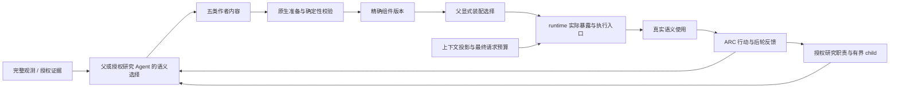
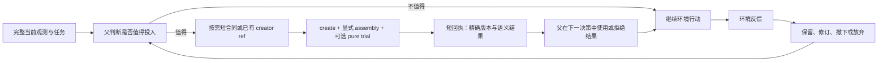

# Self-Harness 简化与可验证迭代实施方案

初稿：2026-10-06；Matt Pocock skills 修订：2026-10-07（Asia/Shanghai）。状态：**设计与开发交接；以下运行时改动尚未实施。**

**目标：**先消除已证实的错误与管理负担，让真实父 Agent 能以较少决策完成有价值的创建、装配、使用和行动反馈，再按重复对照决定哪些机制值得保留。

**架构：**复用现有原生组件、精确版本装配、工具执行、研究调度与资源归档。把确定性的准备、校验、错误收敛和数据绑定藏在已有接口内部；父 Agent 保留科学判断、投入选择、采用与撤下权。优先删除重复机制，不另建 self-harness 总控 Agent 或通用工作流平台。

**技术栈：**TypeScript / Pi extension、Python ARC runner、TypeBox schema、原生子进程 broker、现有 JSON/JSONL 资源与版本记录。

**开发入口：**先读 [开发流程](../development-workflow.md)，从任务 S0、S1 开始。本文同时承担 [变更记录模板](../templates/meta-harness-change.md) 的问题、设计、协议、验证和交付栏目；后续证据追加到本文末尾，不再维护另一套完成状态。

**2026-10-07 接手导航：**先读下方 **P0–P7 完整阶段方案**，再按 [规格](../../.scratch/self-harness-simplification/spec.md) 和 [逐票任务图](../../.scratch/self-harness-simplification/README.md) 接手。S0–S9 保留为实现定位、命令和唯一实验/证据记录。早期窄循环是第一验收点；后续五类组件、实际使能、接口、数据执行、上下文、研究和自主采用均有完整阶段设计。

本次明确使用 [to-spec](C:/Users/qi/.agents/skills/to-spec/SKILL.md)、[to-tickets](C:/Users/qi/.agents/skills/to-tickets/SKILL.md)、[codebase-design](C:/Users/qi/.agents/skills/codebase-design/SKILL.md) 和 [writing-for-agents](C:/Users/qi/.agents/skills/writing-for-agents/SKILL.md)。用户已明确要求完整各阶段方案；本地材料标为 planned（规划完成、尚未实施），不再以技能的发布前访谈作为补全方案的前置。正式外部 tracker 发布是另一个动作，不影响本次完整交付。

**相对初稿的实质调整：**将首次真实语义复用诊断提前到 05 号票据，基于现有接口执行，不等高级 schema 和完整预算改造全部完成。05 若在有界诊断中失败，先定位断点，不展开高级机制。完整五类 ARC 闭环仍在 12 号票据统一验收；早期窄诊断不冒称五类闭环完成。10 号源码语法扩展是条件分支，缺少对应故障时直接记录不实施。

## 完整阶段方案：P0–P7

所有阶段都在本次设计范围内。阶段之间安排验收与修订，是为了减少一次改动的因素，不表示后面的方案尚未设计。每个阶段都需交付实现或有依据的“不需改代码、现有实现已满足”结果。只有执行引擎替换、额外 worker 等大替代方案保留条件进入，不能将整个后续阶段降为可选。

### 总体目标结构与状态约束



`created`、`selected`、`effective`、`used`、`beneficial` 五个事实分开：创建只是有版本；selected 是父的装配选择；effective 是实际请求/执行配置已经包含它；used 是真实语义使用；beneficial 要有任务与成本依据。runtime 只自动推进获得授权后的机械转换、装配应用、暴露、执行和事实反馈，不能自动宣告后两者。

这五项复用现有组件、assembly、使用与效果记录。下面的状态约束是实现验收规则，不要求加入一个新的通用状态平台，更不要求游戏父填写五张表。

| 阶段 | 解决的完整问题域 | 对应票据 | 阶段交付 |
| --- | --- | --- | --- |
| P0 | 真实生效现状与成本可归因 | 01、07 | 可恢复基线、运行路径表、最终请求成本表 |
| P1 | 错误与创作债务 | 02–05 | 错误一次结束、允许放弃、首个正确后轮复用 |
| P2 | 五类组件转化、装配、实际使能和反馈 | 16–19 | 全组件实现路径与重启/变更生命周期 |
| P3 | 作者/管理接口、host/grid 与执行契约 | 06、10、20、21 | 小接口、准确数据绑定、严格内部校验与迁移 |
| P4 | 上下文总预算、信息寿命与本轮生成成本 | 08、09、24 | 最终请求约束、精确恢复、推理/续接独立治理 |
| P5 | Auto-Research 从授权到交付与反馈 | 11、22、23 | 一个职责完整运行并接入同一采纳链 |
| P6 | 普通父自主采用和全链路回归 | 12、13 | 普通机会到行动/反馈，以及全组件官方验收 |
| P7 | 总收益、机制退休与交接 | 14、15 | 匹配对照、最终默认集合和恢复路径 |

推荐执行 P0→P1→一次早期真实诊断，再按 P2–P5 单因素迭代，最后 P6/P7 集成验收。P0 的测量在各阶段继续使用。早期诊断可以发现未露出的断点；不因早期通过而省掉 P2–P5 的完整覆盖。

<a id="p0"></a>

### P0：建立可恢复的真实现状与测量基线

**目标与命题：**能从实际 runtime 路径回答“组件在哪个环节停止、每轮 token 为什么增加”，而不是根据接口存在或注册成功推断。

**实施步骤：**

1. 按 S0 冻结当前实际源码和有效配置，保存普通首轮、创建前、失败后、装配后、重启后的请求与产物。记录现有成功/失败，不先重建组件系统。
2. 为五类组件列一张开发期路径表：作者入口→转换器/原生 mutation→版本保存→assembly→实际暴露/执行→使用记录→反馈。逐个注明当前已接线、仅测试覆盖、真实 guided、ordinary 或未验证。
3. 核对入口是否由 Pi 初始化真正安装、assembly 应用后是否刷新动态工具、prompt/memory/skill/subagent 是否由当前父循环读取；仅 helper 或 fixture 调用不算生产路径。
4. 在已有 provider 接点按最终 payload 分解 system/schema/messages/results/images；关联父子 usage、output/reasoning/cache、请求耗时与失败流。保留未知，不重复相加。
5. 以同一 observation 与有效配置建立 B0。随后每个改动与前一冻结版 Bi 做单因素比较；最终与 B0 比较整体收益。

**入口：**S0/S5，`pi_provider_telemetry.ts`、`pi_reported_token_budget.ts`、`pi_task_local_self_harness.ts` 的安装/装配/父轮钩子以及 ARC runner。只在已有日志缺少必要身份关联时补测量字段，不向模型添加汇报负担。

**验收与交付：**一份可恢复 manifest、一份五类真实路径表、一份成本分解。任一未验证项明确标记，下一阶段据此决定复用或补接线。原 fixture 可重复说明缺陷；没有付费行为材料时只停留在诊断层。

<a id="p1"></a>

### P1：结束无效错误义务并完成第一个小闭环

**目标与命题：**无执行拒绝不增加无限修复义务，读 creator 不形成债务，现有接口能用最短合法路径获得一次正确且可复用的结果。

**实施步骤：**执行 S1/S2 和票据 02–05。分类以确证的执行阶段为依据；无写入尝试结束，未知副作用仍定向核对。错误原文归档，模型得到路径/原因/ref，state card 不复制全文。删除未完成 creator/deferred development 默认催办。保留当前 Agent 选定工作与精确引用。

**首次闭环：**用一个独立核验的真实公开帧计算创建 Tool，父显式选中，纯 trial 返回具体值，下一父轮能够据此决策，并在后来输入上调用同一版本。发布、装配与 trial 的成功/失败分别返回，不虚报全部回滚。该窄诊断尽早进行，同时作为后续阶段的回归样例。

**验收与迁移：**原错误无 pending、无强制 inspect，全文能恢复；读而不用可继续 action；后轮真实语义值正确。旧失败记录只凭确证无执行证据退休，未知保守保留。此阶段不能宣布五类组件、自主采用或净收益完成。

<a id="p2"></a>

### P2：补齐五类转化、精确装配与 runtime 实际使能

**目标与命题：**父作出一个有效组件/装配选择后，已有 runtime 自动完成机械转化和使能，后续父轮使用的确是该精确版本。Agent 无需再调用一个独立“使能接口”才能让已经选择的配置生效。

**五类转化与使用设计：**

| 类型 | Agent 必须表达的语义 | runtime 必须完成的机械过程 | 实际使能证据与语义使用 |
| --- | --- | --- | --- |
| system_prompt | 任务内补充指令、适用范围、依据 | 校验任务 scope，保存 overlay 版本，按选中版本投影；保持宿主指令优先级 | 实际父 system context 含准确 overlay；后续决策是否利用另审阅 |
| memory | 事实/假设/反证、必要 validity 与依据 | 将其存为作者 Memory；可从当前 task/epoch 确定的身份自动绑定，内容与科学有效性不猜 | 当前有效选中内容进入工作集/可恢复；后轮利用反证；自动 action Memory 不冒充作者 |
| skills | 最小方法步骤、适用条件、必要资源 | 校验内容与文件路径，写 task-local SKILL 版本，按选择提供读入口 | 实际 scoped read 可读该版本；后续 action 使用步骤，read 本身不足 |
| tools | 程序意图/source、输入/输出语义、必要权限 | source→受限 IR、schema 校验、版本发布、动态注册、授权绑定与执行 | 最终 tools 定义和正确具体输出；后来输入复用，未选版本不能执行 |
| subagents | 职责、输出目标、授权上下文/工具与预算 | 编译原生 agent 配置，绑定精确组件，broker 起进程，结构化结果返回 | 实际 child 的配置/权限与版本对应，语义输出由后轮父消费 |

**按三个完整切片实现：**

1. **转化切片（16）：**复用每类现有 creator/native mutation；将同一 canonical 合同用于 authoring 文档和内部校验。先运行合法/非法样例验证每个真实入口。统一错误语义和机械默认值，避免泛化成新 DSL；语义必需项不能静默补造。
2. **发布与装配切片（17）：**复用 `publishParentChanges`、`applyParentAssembly` 与现有 revision。准备期无写入；通过输入/权限/CAS 检查后发布，再精确装配。异步中 revision 变化时拒绝，不自动重选。已发布而装配失败如实返回精确版本；重试不重复发布。创建未选中时保留候选且不执行。
3. **实际使能切片（18）：**核对并修复现有安装、selection 应用、上下文投影和动态 tools 刷新接点。Tool 注册成功还需最终 provider tool 定义选中；Prompt/Memory 在下个真实父上下文生效；Skill/Subagent 的使用入口只有准确选中版本可用。进程重启从持久 assembly 重建，退场后撤下旧入口。

**使能时序约束：**tool selection 可在 assembly 成功时机械刷新；prompt overlay 等按 SDK 支持的上下文接点，在下一个合法父 turn 生效。不能将 `before_agent_start` 当每次内部 provider request 都会触发。若同一 Agent loop 无法刷新某类上下文，回执说明明确的生效父轮，runner 必须确实执行该父轮；不把“文件已写”伪装成立即生效。

**反馈切片（19）：**runtime 复用调用/assembly/effect 日志记录精确版本、实际输入、结果、时延和关联 action。Agent 判断结果是否改变决策、是否成立以及是否保留；允许 uncertain。只读、暴露和模型自称使用分别记录，不自动标有益。退场/更新处理未来配置，环境历史不回滚。

**代码与检查入口：**`pi_task_local_self_harness.ts` 的原生 facade、`publishParentChanges/applyParentAssembly/applyAssemblyToolSurface`；`pi_task_local_tools.ts`、`pi_task_harness_route_runtime.ts`、既有 broker 与 scoped resource。复用 `test_publish_assembly_native.py`、`test_harness_composition_native.py`、`test_harness_assembly.py`、`test_arc_capability_surface_native.py` 与 official smoke 五类场景。

**阶段验收：**五类分别有真实入口→转化→准确版本→assembly→effective 后轮证据；新增版本、冲突、取消、重启、撤下均能保持身份。Tool/Subagent 有具体语义输出，其他类型的使用归因与暴露分开。不要求 runtime 自动选择或“每局五类都用”。

<a id="p3"></a>

### P3：简化作者/管理 Interface，收回 host/grid 机械负担

**目标与命题：**Agent 只决定语义内容、授权内投入和选择；机械格式/数据准备留在现有内部实现。schema 被简化后仍有一个可明确构造的真实提交路径。

**核心 Interface 方案：**复用现有 create/change、assembly、execute/read/resource 和研究授权入口。普通面提供能直接完成核心流程的短合同；review、induction、plan/node、route/history 等高级管理按需披露，字段与 action enum 同步收窄。执行始终用完整 canonical schema；展示不是授权。

1. **合同一致性（21）：**清点 schema 默认值、必填/可选、枚举、nested shape、gateway 编码和 creator 示例；对已观察到的实际调用逐项做“模型示例→SDK→execute”契约回归。只有 omission 默认化，显式 null/矛盾值拒绝；不能为了避免 SDK 错误把校验全部改成 Any。
2. **creator 前置：**保留按需读取与详细参考，默认创作入口内置版本化最小合同；将“必须先读取固定文档”逐类替换为内容/权限/版本校验。Agent 已能准确提交时不强制补一次手册读取。先以单类消融验证是否减少管理轮，随后五类回归；不是移除权限检查。旧 creator_ref 显式传入仍核对版本，省略时使用本次接口确定的合同版本。
3. **host/data（20）：**将 canonical numeric grid 和 snapshot identity 作为授权 binding，不让 Agent 重新输出 grid。内部固定 task/epoch/action/frame/cutoff、检查路径/scope/尺寸/准备预算/取消，记录来源。默认“当前最终帧”与显式历史引用分开；比较哪两帧和算法含义由 Agent 决定。
4. **程序执行：**继续用当前 source→纯执行路径，核对最小常用语法和清楚的 unsupported 诊断；10 号票据按实际失败修一个主因。执行限额、禁止越权 I/O、返回 schema 与取消仍由内部强制。不让父写 IR、复制默认空结构或重复模型可计算的机械 metadata。
5. **发布试用：**一个显式 create+assembly+pure trial 可合并必要管理操作；环境 action 独立授权。试用失败保留真实已提交部分；output 值过大归档为精确结果，不常驻展开全部。

**能否直接拿掉 host/grid：**删除模型可见的 host 操作仪式、内部 DSL 搬运和重复 grid；保留数据来源、授权与限额。完整当前 grid/native PNG 继续提供。若受限语法在简化后仍阻断主要计算，再用冻结输入做当前受限执行与受约束普通代码执行的替代试验，比较表达正确性、隔离、限额和成本；完成前不更换引擎。

**迁移：**先让新短入口按同一 canonical 语义工作，保持旧调用兼容；按路径迁移实际调用者，然后撤下默认旧 schema/同义 wrapper。没有两个实际需要的执行实现时不加新 adapter seam。高级管理后端可保留按需能力，不要求永久维护全部默认组合。

**验收：**合法最短作者调用、错误契约汇总、显式 null/矛盾值、gateway schema、授权帧、历史帧、跨关陈旧 ref、越权与取消均走真实路径。报告每次成功获益所需父决策/读取轮，不能只报 schema 字符降幅。

<a id="p4"></a>

### P4：同时治理常驻输入、恢复连续性与本轮生成成本

**目标与命题：**每个最终请求可解释且有界，旧管理细节可退出驻留，反证可恢复并用于决策；新生成 reasoning 独立受控。

**四个有界切片：**

1. **分项计量：**沿 P0/07 测最终 system/schema/messages/results/images；同样测 child。根据真实增长来源调节，不把字符或传输体积替代模型 token。
2. **请求 admission（08）：**分别核对模型窗口、单次 output envelope 和父子累计已报告预算；按已支持的 tokenizer/图像估计、预留与安全余量决定是否可发。超限先去重复管理/旧只读结果；受保护事务或完整当前观察仍无法容纳时结束该请求，不循环压缩重试或删观察。
3. **工作集寿命（09）：**当前观察、有效认识、反证、未完成实验、下一步与必要未决失败保留；旧 source/手册/报告/结果按精确 ref 归档；读取恢复在首次必要续轮可见，然后回到原寿命。相同信息只投影一次；不能把父历史原始 reasoning 全量反复注入另一状态卡。
4. **生成与续接（24）：**依据该 provider 实测能力设置 per-request output/effort，父子受同一预算约束；分析 output 中 reasoning 占比，不能仅靠历史压缩期待减少新推理。provider length 对 research/delegate 保持有界 native continuation，保存 cursor/结果，禁止重放已经完成工具或动作。unknown/取消 usage 进入结算，不当零。选择“继续生成、以当前证据行动或放弃”属于 Agent 科学判断，runtime 只强制机械限额。

**避免变量混淆：**先固定 effort 测上下文寿命；再固定输入寿命测生成设置。没有 provider 明确支持的可编辑历史/effort 合约时保守保持协议字段，不能伪造缓存/usage。不能因历史输入下降就宣称 reasoning 提升。

**实现与验证：**S5 的 lifecycle、telemetry、budget、ARC admission；补用 `test_latest_reasoning_native.py`、`test_arc_reasoning_length_recovery_native.py`、`test_arc_reasoning_allocation_runtime.py`。验证早期反证在压缩后仍能推翻旧主张；确定性路径证明数据可达，真实普通轨迹审阅科学判断。恢复费用和首次有效行动延迟全部纳入。

**阶段交付：**请求分项与实际 HTTP 对齐；超限不发新请求；无新信息多轮不增长正文；恢复认知结果分层报告。阈值复用第 4 节，不增加游戏中必须汇报的预算表。

<a id="p5"></a>

### P5：把 Auto-Research 接入完整 self-harness 生命周期

**目标与命题：**一次授权足以启动有界研究职责、在合适时短交付核心结论，并让父采用或拒绝；研究到组件、行动和反馈不靠父搬运内部字段。

**职责与最小授权 Interface（22）：**复用 `auto_research(assign)`，父表达问题/目标、可读证据范围、允许工具与有限预算。没有复杂依赖时不要求 plan/node/release；高级研究计划只在显式提交时校验。runtime 可确定的 ID/cutoff/队列身份自动生成；权限、剩余预算和输出上限不能省略。科学 stop 条件由 Agent 判断，机械预算/无消费进展/撤销由 runtime 执行。

**实际运行过程：**

1. 输入授权生成现有 durable research line 与 worker assignment；启动一个有界 session/run。不是新建总控 Agent，也不是每窗口启动新 worker。
2. 新行动/组件使用反馈作为精确证据批次入队；active child 固定输入 cutoff，下一片段再处理新材料。只有实际分析确认推进 consumed cursor，入队/读取不是分析。
3. 真实 broker/process 返回 validated structured report/update；当前核心结论短交付父，详细分析留在研究线。分歧与反证保持，不用多数票合并。
4. 父可只利用结论，也可采纳 source/其他类型候选。通过 11 和 P2/P3 同一转换/装配路径，授权与原 evidence cutoff 不漂移；不会因为 child completed 就自动修改父 harness。
5. 父的精确选中、使用结果、action 反馈和可选语义评估回到已授权研究线；worker 可据新证据修订、撤回或停止，不能擅自扩大权限或预算。

**增量交付与失败（23）：**复用 `deliverResearchIncrements`、既有短卡限额与 exact publication refs；只有真正放入父输入的内容才记交付，尾部留下待交付。父不必每轮查询 inbox/确认通知。相同版本不重复展全文。超时、取消、length、空/坏结构化结果、无新证据和任务结束都保存真实状态并停止有界计算；普通合法 action 不被 optional research 门禁阻塞。

**迁移：**现有多 worker/plan 后端保留按需路径；先用一个职责验证核心授权/短交付，再在明确问题需要时复用既有多职责能力。研究进程存在不等于创建了 subagent 组件；两个身份分别验收。

**入口与验收：**`pi_auto_research_worker_runtime.ts`、`pi_auto_research_workers.ts`、已有 protocol/router 与 S8；复用 worker Node 测试、Auto-Research native smoke、官方 ARC child/router 场景。覆盖“结论到行动”“source 候选到使用”“合理拒绝”“过时撤回”“取消后父继续”五条真实路径，双方 length 都测。B/C/D 的研究、通信、连续性仅据对应真实结果更新。

<a id="p6"></a>

### P6：验证普通父自主采用，而不是只提高强制探针成功率

**目标与命题：**普通真实 Agent 能理解核心能力入口，在有价值机会选择投入，利用具体结果指导任务，并能够识别负收益后退出。

**实现与诊断方案：**

1. 冻结 P2–P5 实际纳入候选的改动，执行完整官方五类 ARC 矩阵。首个 P1 最小版也可以提前走该矩阵；提前通过不替代最终集成回归。
2. ordinary prompt 只提供一份简短、非阻塞的核心能力入口和真实调用合同；移除重复 creator/review/研究步骤叙述。不能注入开发流程或强制产出配额。仅在观察到理解/发现断点时单因素修这一提示，而不是每个失败都再加 reminder。
3. 用普通任务中的同类重复计算/证据缺口、剩余预算与可见数据定义机会分母。预先明确一次性计算、预算不足、过时任务的合理不使用。
4. 沿 recognition→investment→candidate→assembly→effective→use→feedback 漏斗定位；未发布看表达/校验、selected 未 effective 看 runtime、effective 未用看价值/理解、用后未影响行动看任务语义、反馈未保留看连续性。每次修最早断点的一项因素。
5. 先在已知困难 provider 上三次有界 ordinary 探索，再独立复核另一 provider。guided 只作为诊断；不把它计入普通采用率。

**验收：**12/13 和 S6/S7；五类接线、两种 length、具体语义结果及后续父轮均存在；普通窄采用达到原协议门槛才支持该情境采用。未采用但无机会判不确定；存在机会的多次失败停止扩样，回到对应 P 阶段。无需由父填漏斗表，评估由轨迹与外部审阅得出。

<a id="p7"></a>

### P7：证明净收益、退休机制与完成迁移

**目标与命题：**整个方案在任务质量保持的情况下减少父子总成本、等待和认知回退；没有净帮助的机制可撤下，维护复杂度随证据降低。

**比较方案：**S9/14。首个最小 P1 候选与 B0 做小对照，判断原 bugfix 的实际贡献；最终 P2–P6 候选再与 B0 比较整体表现。按需要加入 Bi 单因素或 Bmin 机制消融，三种比较不混归因。相同 provider/model/effort、模态、任务初态、预算与运行顺序，独立新 run；每局不可回退历史。

**具体推进：**首对检验协议可判别性，随后用原第 4 节 6 对/两个游戏的预算做首批确认。阶段总额不因 24 张票据重复分配。每个样本包含父子全部片段、失败/未知、管理与恢复读取、时延和质量；小样本不足时报告不确定，两个版本都无进展时不能宣称 benchmark 改善。

**退休与默认集合：**15 号票据逐项决定错误恢复、合同披露、creator 前置、上下文寿命、reasoning 设置、研究交付是否进入最终默认。必要权限/版本/预算/完整性 bugfix 独立保留；没有收益的 reminder、同义 wrapper、默认 gate 或高级常驻字段撤下。高级机制仍有合理用途则保留按需入口，不默认展开。

**清理与迁移步骤：**新短路径稳定→核对所有真实调用者迁移→移除被替代实现/仅内部耦合测试→保留旧资源兼容读与明确恢复配置→重新 freeze 并做受影响回归。清理改变行为需重新验证，不将清理前结果直接归给新版本。回退只作用未来配置。

**最终交付：**完整源码/配置、各阶段产物和四层证据、默认机制与 retired 清单、父子成本/质量对照、旧数据与未来配置恢复办法、未验证范围和下一有限检查。可以完成全部实现而收益仍不确定；不能以文档齐全或测试数量宣布优化有效。

### 阶段预算和工作量边界

各阶段复用已有第 4 节预算：离线/确定性接线不启动付费语言模型；guided 阶段总 160k、ordinary 探索总 360k、首批重复对照总 2.88M known reported 是候选上限。不是每个 P 阶段各获得一份额度，也不是批准现在运行。早期检查、重试和 10/24 消融使用相应剩余额度，未知在途费用独立记录并触发止损。

P2、P3、P4、P5 分别可以交付不改变行为的现状通过项和确有断点的代码改动。区别必须注明；不能为“完成完整路线图”把已实现部分重写一遍。所有待实现项现在均未验证。

## 1. 问题与命题

### 1.1 当前判断与证据边界

用户提出的两个核心问题有依据：普通 Agent 的 self-harness 采用尚未稳定，而管理与接口成本已经明显；同时存在具体的错误生命周期和重复投影缺陷。但“完全只有接口、runtime 从未真实使能”不符合全部证据。

| 观察 | 支持的判断 | 不支持的判断 |
| --- | --- | --- |
| 原生创建、精确装配、动态工具注册、Skill/Memory/Prompt/Subagent 暴露已有实现；确定性 provider 经真实 ARC/Pi 的五类链路已有历史验收 | 基础运行时确实存在，不能另起炉灶重复实现 | 普通模型会自主采用；创建能带来净收益 |
| stage78–80 普通真实 GPT 运行分别 40/50/44 动作，作者组件、装配、语义使用均为 0；其中一次过 1 关 | 普通任务运行和关卡进展不等于 self-harness 采用 | 该机制改善了任务；所有模型都永远不会采用 |
| 显式真实 Skill 诊断和保存帧 Tool 诊断有成功例外 | 有引导时部分能力可达 | 已在普通游戏中稳定闭环 |
| stage140 guided Qwen：5 个完整 HTTP、66,986 reported token、1 动作、0 关；正确绑定 final numeric grid，但 Tuple 编译拒绝、未发布工具 | 数据准备有实际实现；创作接口仍会阻断投入到候选的转移 | host/grid 整体无用；删除它们必然提高收益 |
| 当前 Pi 离线重现：非法 `trial.bindings={}` 产生 5,231 字符完整参数回显，形成 1 个 retryable pending；state card 从 675 增至 7,017 字符 | 拒绝本身正确；回执膨胀、错误修复义务和重复投影是可修的具体缺陷 | 所有高 token 都由这一缺陷造成 |
| stage118r1：2 动作、82,187 known reported，其中新生成 reasoning 52,486 | 缩历史输入不能解决本轮新生成推理过长 | 所有浪费都来自历史重复输入 |

证据入口：

- [48h 复盘](../reports/2026-10-06-48h-optimization-review.md)：该窗口至少 10,289,671 reported token；不含开发 Agent 和缺失 usage 的未知消耗。
- [当前版本索引](../reports/arc-mechanism-version-index.json)：本次核查 `current_candidate=stage142`；`best_verified_restorable_qwen=null`。历史 Qwen 有过关记录，但不能当可恢复、可比较的当前基线。
- [错误重现审计](../../tmp/context-bug-audit-7wy9dqf2/diagnostic-audit.json)：真实 Pi、离线 scripted provider；不是付费 ARC 结果。
- [stage140 成本](../../tmp/arc-stage140-live-tool-cost-audit.json)、[语义审计](../../tmp/arc-stage140-live-tool-semantic-audit.json)、[普通 stage78–80](../../tmp/arc-stage78-80-final-audit-20261004.json)。
- [历史实现与诊断记录](2026-10-02-context-tool-reasoning-design.md)：按日期理解，不用旧 stage 的绿色测试代替当前代码验收。

stage140 的初始六个 tool schema 共 16,571 序列化字符，约为初始非图像上下文字符的 58.5%。这是**字符口径**，不能直接报成 token 归因。各类调用对应整次请求的 token 也不是该工具的边际成本。stage142 的标准 425 项检查来自首次 16 场景与一次失败场景重试的联合覆盖，不是一次完整全绿运行；source-format research child handoff、自主采用和净收益仍未验证。

### 1.2 待检验的窄命题

| ID | 命题 | 减少的负担 | 推翻或降级条件 |
| --- | --- | --- | --- |
| H1 | 对已证实未进入执行的参数拒绝，一次短错误即可结束该次调用，不产生待修事务 | 无效 inspect、重复参数回显、每轮 pending 投影 | 仍有 pending；短化丢失可修字段；误清真实副作用不明的事务 |
| H2 | 删除未完成创作的持续提醒、收窄默认 schema，能降低实际请求固定负担而保持核心能力可发现、可调用 | 常驻手册、阶段性管理字段、重复决策 | 真实下一轮 schema 未缩小；核心路径不可达；合同发现新增往返抵消收益 |
| H3 | 利用既有 create+assembly+trial 和准确数据绑定，可让普通父 Agent 在重复计算确有价值时完成一次有效工具投入并复用 | 手工 grid 搬运、机械合同填写、分离管理轮 | 有合适机会仍不采用；采用后反复修复；结果不用或任务成本更高 |
| H4 | 对最终请求的预算核算和精确恢复，可限制上下文增长且保持关键反证与未完成实验 | 被 system/schema 绕过的软预算、重复读取和认知回退 | 计量不包含最终 schema/images；压缩后错用过时结论；恢复成本抵消节省 |
| H5 | 仅在父已授权的研究职责内，短结果交付可帮助上述同一路径，并降低父子总负担 | 父重新总结研究和搬运候选、重复调度 | child 成本超过节省；过时结果进入行动；父仍需重做全部分析 |

H1/H2 的功能和表示结果可以独立交付；H3/H4/H5 的行为或收益不能用测试数量替代。没有复用机会、剩余预算不足、环境已改变、一次计算即可完成时，合理不使用/放弃都是正常结果。

### 1.3 范围

本次交付是方案、任务顺序和验证协议；不修改运行时，不启动付费 provider，不干预其他 chat 的活动实验。后续实现按当前授权逐项推进。并行中的 stage142b guided GPT 对比有独立协议，不与本方案合并计分，也不能当本方案的 ordinary 采用证据。

不做：强制每局创建组件、按调用数奖励、增加评审 Agent、重写整个 host、把五类组件全部合为新 DSL、用大量 prompt 提醒替代缺失接线。

## 2. 设计与成本：删除、内收、保留、延后

| 对象 | 决定 | 具体处理与保留条件 |
| --- | --- | --- |
| SDK 错误的 `Received arguments` 全量回显 | 删除模型常驻副本 | 原文与 attempted input 留在授权审计资源；模型只收错误路径、短原因和 ref |
| 无写入参数拒绝的 pending/required inspect | 删除 | 本次尝试 terminal；允许新提交或直接继续任务；不会要求先“结案” |
| 未知副作用、版本冲突、真实活动事务 | 保留并精确收敛 | 不把“输入看起来有错”当无副作用证据；禁止自动重放环境动作 |
| `UNFINISHED CREATOR PREPARATION` 持续正文、deferred development 循环提醒 | 移出默认驻留 | 读手册不再生成完成义务；仅 Agent 显式维护的当前工作引用可留在其工作集 |
| 周期性 review 和全池方法/候选清单 | 默认按需 | 当前默认 review 已是 advisory，不能假称撤销了默认硬门禁；保留人工/诊断入口与已有历史数据 |
| review/plan/node/route 等高级 schema 字段与动作名 | 按需披露 | 复用 `managementSchemaSurface`，同时收窄字段与 enum；不再新增一套 discover 工具 |
| source → IR 的机械转换与公开数据准备 | 内收 | 复用当前编译器和 host，契约一次说明、校验一次汇总；Agent 不输出 IR 或重新抄完整 grid |
| host | 保留内部职责，缩小模型接口 | 保持可读资源、精确帧/版本、准备预算、取消、输出限额、provenance；不要求父理解内部装配步骤 |
| grid / native PNG | 保留完整 canonical observation | 删除重复模型搬运与旧观察副本；不删当前完整网格/PNG，不把有损摘要称无损 |
| creator-read 硬前置 | P3 逐类迁移为内容/权限/版本校验 | 内置版本短合同，按需保留详细手册；单类消融与五类回归，准确提交无需证明先读；显式旧 ref 保持版本检查 |
| 显式 assembly | 保留语义选择，复用合并调用 | 已有 `assembly:true` / 精确 selection；创建可不装配，未选择版本不能执行，不自动挑组件 |
| assessment/研究反馈 | 自动事实 + 可选语义判断 | runtime 记调用、结果、时延、动作关联；Agent 决定是否帮助任务。不能用自动 Memory 当采用证据 |
| Auto-Research plan/多 worker/竞争视图 | 保留后端与按需路径；延后扩张 | 无授权不调度；先闭合一个实际研究职责；不把窗口当必须新建 worker 的理由 |
| action decision / checkpoint | 保留有效语义记录，取消重复手续 | 复用动作内已有 decision 持久化；不要求每步另写 checkpoint，事实记录不能冒充作者 Memory |
| 新的通用管理框架与大量永久开关 | 不加入 | 用现有版本快照做对照；候选保留后删除被替代分支，不永久维护组合爆炸 |

**删除判断：**删除后复杂性如果消失，优先删除；如果转移给每个 Agent（例如抄 grid、核对版本和权限），则把它留在内部。采用 [codebase-design](C:/Users/qi/.agents/skills/codebase-design/SKILL.md) 的小接口原则，但保留本项目“组件”“装配”等领域术语。

### 2.1 最小首次获益路径



这是缩短**管理路径**的目标，不是动作配额。一般至少仍有投入判断、选择候选/装配、结果到行动、反馈判断；有依赖的工具调用不能因省轮强行并发。已有 creator ref 时应允许一次提交完成发布、选择与纯试用；需要读取合同的新调用者可多一次按需读取。环境动作仍走独立 ARC action 边界。

### 2.2 生命周期责任

| 转移 | 谁推进 | 机械完成证据 | 失败、过时与合理不使用 |
| --- | --- | --- | --- |
| 机会 → 识别 | 父或已授权研究 Agent | 普通任务中对重复工作/证据缺口的实际判断 | 不由 runtime 从自然语言猜机会；外部评估记录未知 |
| 识别 → 投入 | 父或授权范围内的研究 Agent | 创建请求或真实 child 启动；预算/范围 | 可不投入；非法 delegate 参数不算研究启动 |
| 投入 → 候选 | 作者 Agent 判断内容，runtime 转换/校验/发布 | 精确 candidate ref、校验结果、源码/内容版本 | 汇总独立错误；拒绝不形成无限修复义务 |
| 候选 → 装配 | 父显式选择，runtime 原子应用 CAS | selection 与 assembly revision；旧引用处理 | 不自动全选，不静默覆盖并发变化 |
| 装配 → 语义使用 | 父/获授权 Agent 调用或利用；runtime 执行 | 真实输入/输出/暴露，随后行动证据 | 暴露、status completed、文本自称使用均不够 |
| 使用 → 反馈 | runtime 记录事实；Agent 判断意义 | 后续真实观测与预期差异、反证、效果判断 | 无法归因时写未知；反馈不能虚构因果 |
| 反馈 → 保留/修订/撤下 | 父或显式授权 Agent；runtime 改配置 | 下一轮实际 assembly 与使用行为 | 只影响未来，不回滚环境或已获得信息 |
| 研究结果 → 上述路径 | broker/router 机械交接，父作采用选择 | 短核心结论、精确 evidence cutoff 和候选 ref | 同版不重复交付；过时标识；研究允许只给结论 |

不新增游戏中必须填写的 lifecycle 表格。评估从已有轨迹提取，缺失语义由开发审阅标注，不能要求父每一步自报来制造漏斗。

## 3. 实施任务与依赖

S0–S9 是问题域与技术定位编号，**不再作为强制线性实施顺序**。当前开发图见 [01–24 号票据](../../.scratch/self-harness-simplification/README.md)，所有阶段的最新目标结构与依赖以 P0–P7 为准，S 节提供局部文件/测试参考。首先完成 S0 和 S1 的窄修复，随后提前做 S4 的现有接口复用诊断，再完成所有 P 阶段的覆盖。每个功能切片内部按“一个真实失败测试 → 最小实现 → 相关回归 → 核对实际下一轮 → 记录结果”推进。

| 任务 | 真正前置 | 可单独交付的行为 | 主张级别 |
| --- | --- | --- | --- |
| S0 冻结基线 | 无 | 可恢复源码、实际配置与同口径测量 | 诊断准备 |
| S1 结束错误尝试 | S0 | 无执行参数拒绝不挂 pending；错误不放大下一轮 | 功能正确 |
| S2 允许放弃创作 | S0；回归使用 S1 | 读 creator 后可以继续游戏，无持续完成义务 | 功能、表示 |
| S3 精简默认接口 | S0；集成 S2 后比较 | 普通父只见核心合同，高级操作仍按需可达 | 功能、表示 |
| S4 单次作者到语义结果 | S1；先用现有接口诊断，S3 后再做兼容回归 | 精确帧绑定、创建/装配/试用、后续正确使用 | 功能、局部链路 |
| S5 最终请求预算 | S0；覆盖 S1–S4 输出 | 真实请求计量、溢出控制与认知恢复可检查 | 功能、连续性待实测 |
| S6 五类真实接线 | 当次选定改动冻结；首版按 12 号票据，不强制等待全部 S3/S5 改造 | 官方 ARC/Pi/child 五类闭环与 length 续接 | 全链路可达 |
| S7 普通真实采用 | S6 | 无创作指令的机会到使用与反馈轨迹 | 自主采用，窄范围 |
| S8 研究交付路径 | S4；启用前重验 S6 | 授权 child 结果进入同一作者/装配路径 | 接线；行为另测 |
| S9 对照与退休 | S7；涉及研究时 S8 | 父子总成本、质量与延迟的重复对照 | 净收益或撤下决定 |

<a id="s0"></a>

### S0：冻结实际运行版本与可比较基线

**入口：**[版本索引](../reports/arc-mechanism-version-index.json)、[优化手册](../optimization-handbook.md)、[provider 遥测](../../demo/pi_provider_telemetry.ts)、[共享预算](../../demo/pi_reported_token_budget.ts)。

1. 保存实际源码清单/hash、当前未提交 diff、Pi/Node/Python/ARC SDK 版本、有效 prompt、全部 tools schema、provider/model/推理设置和实际环境配置的非敏感部分。记录 credentials 来源名，不能保存凭据正文。
2. 当前工作区有大量既有修改；从经过确认的实际源码快照派生 `codex/self-harness-simplification` 实施分支或隔离目录。不得从旧 HEAD 直接建“干净”分支后声称它包含当前修复；不得覆盖其他 chat 的活动源码/产物。
3. 保存错误原始 fixture、首次/错误后/恢复后实际 provider 请求。归档用可持久路径和 hash，勿只依赖可能被清理的 `tmp`。
4. 建立三种比较器：B0=冻结当前版，Bi=上一已验收小步，Bmin=同环境同感知的最小任务能力基线。Bmin 仅作总复杂度参照，不拿多因素差异归因给某一处修改。
5. 复用已有遥测，仅离线汇总缺失维度；不因测量再向父 prompt 添加字段。

**完成：**另一开发者可恢复同一基线、复跑同一失败并得到同口径请求材料。单独保存 prompt 或 stage 名不合格。若基线不可恢复，停止收益比较，但可继续定位局部功能缺陷。

<a id="s1"></a>

### S1：修正无执行拒绝、短错误回执和 pending 投影

**修改入口：**[failureClassification](../../demo/pi_harness_control.ts)、[failedOperation 与工具结束钩子](../../demo/pi_external_benchmark_research.ts)、[decision card v2](../../demo/pi_decision_card.ts)、[上下文生命周期](../../demo/pi_task_local_context_lifecycle.ts)。只有钩子无法覆盖实际 SDK 错误时才查对应 SDK adapter；不要改第三方安装包。

1. 在 `tests/test_pending_contract_failure_native.py` 加入已复现的 `trial.bindings={}`：真实 Pi 调用 → SDK 拒绝 → 下一父请求 → 合法操作。复用 `tests/fixtures/harness-stage138-observed-live-create-call.json`，只改一个错误字段。
2. 首先断言当前失败：pending 非空、错误含完整 `Received arguments`、state card 重复正文。独立验证组件/child/环境 action 均未执行。测试必须对实际下一轮输入断言，不能只测新 formatter。
3. 优先传递结构化执行阶段证据：SDK pre-execution rejection / preflight no-write / committed / unknown。既有 `failure_class/applied/retryable` 继续复用；“可以重新提交”与“当前事务待恢复”解耦。不得仅匹配 `must/invalid` 就认定无副作用。
4. 已证实未执行的拒绝：`applied=false`、该次调用 terminal、无 pending、无 `required_next_call=inspect`。未知执行状态继续保留针对具体事务的恢复，不自动重新执行。
5. 审计日志完整保留原始错误与输入；模型回执只给路径、原因、至多少量必要代码摘录和精确 failure ref。首版建议最多 8 个独立错误、总计 1,200 字符；超出有 count/ref，不能让信息静默消失。
6. state card 不再直接序列化 `checkpoint.pending_operations` 全对象；仅投影真实未决事务的身份、状态、具体恢复条件和 ref。已终结错误不再次进 state card。
7. 兼容旧记录：只能凭旧审计中确证的 no-execute/no-write 证据退休；证据不足保留 unknown。成功恢复只清同事务，不能清无关 pending。参数改变形成的新提交不得永久继承旧输入 hash 的义务。

**拟定行为示例，不是新增模型请求字段：**

```text
trial.bindings: expected array; no execution occurred.
This attempt ended. Correct the field in a new submission, or continue the task.
details: failure:<exact-id>@v1
```

**验收：**原 fixture 短错误 ≤1,200 字符；pending=0；错误后 state card 不因该错误增长；实际下一轮无完整参数回显，失败全文可按授权 ref 恢复。版本冲突、写后取消、未知副作用仍可核对且不会重放 ARC action。首次 assistant 的原始调用参数允许留存，不为字符目标破坏 tool-call/result 配对。

```powershell
python -m pytest -q tests/test_pending_contract_failure_native.py tests/test_harness_control_repair.py tests/test_harness_argument_integrity_native.py tests/test_pure_invocation_defaults_native.py
node --experimental-strip-types --test tests/pi_decision_card.test.ts
```

**回退：**发现真实未决事务被误清，则回退分类变更；可独立保留已正确验证的短投影。不能靠重新加入全量回显解决分类错误。

<a id="s2"></a>

### S2：去掉读手册后的创作债务

**入口：**[self-harness before-agent-start 投影](../../demo/pi_task_local_self_harness.ts)，重点 `preparedCreators`、`UNFINISHED CREATOR PREPARATION`、`DEFERRED PARENT DEVELOPMENT` 和周期 review 文案；[baseline methods](../../demo/pi_harness_baseline_methods.ts)。

1. 在 `tests/test_conversion_workset_native.py` 增加：读取 creator 后不创建、继续两个真实 Pi 父轮；再次按 ref 获取仍能恢复合同。
2. 删除“读过就持续提醒直到创建/显式 decline”的默认正文重注入；读取只产生读取证据。Agent 不需要额外调用 defer/drop 才能继续游戏。
3. 当前明确选中的创作工作可保留短 ref 与必要 source 工作集；任务切换后按已有资源寿命归档。不要删除 Agent 明确保留的当前计划。
4. deferred 开发意图与待采纳研究方法保留 durable 记录、按需可读；只有新的相关交付有一次短事件，之后不按每轮重新催办。runtime 不猜语义 reconsider_when 是否成立。
5. 默认 advisory review 保留可调用能力、去掉重复通知；`required` 诊断模式维持独立兼容，不推广为普通运行前置。

**验收：**“读而不用”“试用失败后放弃”“游戏阶段变化”三种情况均能继续合法 action；没有因忽略提醒而新增 gate；无新工具/worker/必填状态字段。完成创作的既有路径仍能利用准确 creator ref。

```powershell
python -m pytest -q tests/test_harness_contract_lifetime_native.py tests/test_conversion_workset_native.py tests/test_compact_creator_native.py tests/test_arc_capability_surface_native.py
```

<a id="s3"></a>

### S3：把高级合同从默认模型接口移走

**入口：**[management schema surface](../../demo/pi_management_schema_surface.ts)、[self-harness 注册](../../demo/pi_task_local_self_harness.ts)、[research 注册](../../demo/pi_external_benchmark_research.ts)、[ordinary prompt](../../demo/prompts/arc_decision_cycle.md)。

1. 记录 ordinary 首次及后续实际 HTTP 中各 schema 的序列化字符和 tokenizer 估值。测试区分 SDK 内部注册表与 provider 真正看到的定义。
2. 扩展现有披露策略：普通面只保留任务行动、当前状态/资源恢复、组件创作/显式选择/使用、简单委派和研究授权的必要入口。高级 review/induction、plan/node/release、路由/历史评估参数及对应 action enum 按需加载。
3. 复用 `contract` 获取相应操作的**完整可提交短合同**并刷新下一轮定义；不新增 discover→inspect→read→ack 链。不要只隐藏字段却仍展示大量不可正确构造的动作。
4. 合同披露不是权限授予。执行始终按完整权威 schema、scope、budget、CAS 校验；隐藏参数不能变成校验绕过。未披露调用若拒绝，只给具体合同入口，无永久 pending。
5. 定义 schema 生命周期：当前选中的高级工作期间保留；完成/取消/显式回到 core 后撤下；重启按任务状态恢复。与组件工具选择隔离，不能误撤选中的 task-local tool。禁止每轮切换造成缓存持续失效。
6. 不随此任务更改科学目标提示、reasoning policy 或观察表示，保证比较只测管理接口变化。

**开发目标：**同一初态下管理 schema 序列化字符较 B0 至少下降 30%，core 实际首请求总非图像内容不增加；记录具体 tokenizer 估值而非把字符当 token。30% 是本候选筛选目标，不是任务 Agent 的运行时配额；若为达到数字损害能力可达，撤回该设计。负例含当前最短直接创建、普通 delegate、按需高级调用、重启与 stale scope。

```powershell
python -m pytest -q tests/test_management_schema_surface_native.py tests/test_arc_initial_context_budget.py tests/test_arc_capability_surface_native.py
node --experimental-strip-types --test tests/pi_management_schema_surface.test.ts
```

<a id="s4"></a>

### S4：收敛已有作者接口，打通一次真实语义使用

**入口：**[task_harness_create](../../demo/pi_task_local_self_harness.ts)、[pure authoring](../../demo/pi_task_pure_authoring.ts)、[Python lowering](../../demo/pi_task_pure_python_lower.py)、[pure host](../../demo/pi_task_pure_expression_host.ts)、[ARC snapshot](../../demo/pi_arc_observation_snapshot.ts)、[tool execution](../../demo/pi_task_local_tools.ts)。

1. 选一个真实公开帧上的有价值重复计算，例如准确比较两帧变化位置；预期值独立人工计算或用已审核 oracle 验证，不能复制待测实现来算 expected。不向普通父写游戏答案。
2. 复用已有 source 作者入口和 `create + assembly + trial`，不要再包装第二个同义入口。`assembly:true` 已存在；保留捕获的 revision 和 CAS，不能静默重读再覆盖并发 selection。
3. grid 通过精确授权 ref 绑定；由 host 在执行前固定 action/level/frame 身份，校验 numeric grid、尺寸、准备预算与取消。默认当前帧与显式历史帧含义分开，语义对比哪两帧仍由 Agent 选择。
4. 完整合同只保留写程序真正需要的语法、输入名、返回形状、限额和例子。内部 IR、默认空 parameters/bindings、重复 metadata 由已有确定性转换生成；显式矛盾值仍报错。
5. 用观察到的 source 失败锁定下一因素。首个小步可单独处理 Tuple 等常见纯语法的支持或明确一次性诊断，不能同时换执行引擎、改变预算和加入额外提示。其他独立错误一次列出，不逐错支付多轮。
6. 成功回执分开报告发布、装配、试用三个结果，附精确版本与真实 trial value。发布成功后 trial 失败不能写成“没有任何变更”；重试 trial 不重发组件、不重复装配。
7. 下一父轮读到具体语义结果；再用后来帧调用**同一已选版本**，证明输入未钉死在作者时刻。仅创建时试用不能证明后续复用。

**核心负例：**错帧、跨关旧 ref、越权 ref、schema 矛盾、assembly CAS 冲突、准备中取消、写后试用失败、返回超限、未选中工具不可调用。保留原始完整 current grid 和 native PNG。

```powershell
python -m pytest -q tests/test_publish_assembly_native.py tests/test_pure_publication_trial_native.py tests/test_arc_creator_grid_handoff_native.py tests/test_pure_binding_schema_completion_native.py tests/test_pure_binding_schema_cancellation_native.py tests/test_task_pure_python_native.py tests/test_pure_source_diagnostics_native.py
```

**更大替代方案的进入条件：**只有简化后真实错误仍主要来自受限源码表达、且一个小语法增量不能解决时，另立单因素试验比较“当前受限编译器”与“受资源/权限约束的普通代码执行”。后者涉及执行隔离、进程取消、读写和依赖权限，不能以删除 host 为实现。先做离线有界原型，不默认启用，不把未来候选混进本轮收益。

<a id="s5"></a>

### S5：以最终 provider 请求为预算与恢复验收面

**入口：**[context lifecycle](../../demo/pi_task_local_context_lifecycle.ts)、[provider telemetry](../../demo/pi_provider_telemetry.ts)、[reported token budget](../../demo/pi_reported_token_budget.ts)、[ARC runner](../../src/autoresearch_pi/arc_agi_3_e2e.py)。

1. 复用请求 admission/telemetry 接点，在**最终 schema、system、messages、图像与工具结果已组装后**记录分项估计。只在 message 数组上预算的现有软限制不能冒充全请求上限。
2. 分开三种预算：上下文可装入窗口、下一调用可生成 output、父子累计已报告计算预算。每次请求预计 `input + reserved_output + margin <= context_capacity`；provider tokenizer/图像计费未知时明确估计与置信限制。
3. 缩减次序：去同义重复投影 → 过期管理正文/旧只读结果转精确 ref → 已完成可编辑历史按既有策略归档。保留当前 canonical observation、当前假设/反证、未完成实验、下一步、实际预算与必要失败。
4. schema/system 过大应修它们的来源，不能通过删 current grid/PNG 来掩盖。最新 tool transaction 受保护导致超软预算时显式报溢出与原因；安全边界或模型窗口无法满足则在 HTTP 前结束/返回受控失败，不循环压缩再重试同一超大请求。
5. 新生成 reasoning 用 provider 已支持的 output/effort 约束单独实验。压缩试验固定其设置，不能把关闭 thinking 的节省归给历史压缩。`length` 必须沿既有有界续接处理，不重复执行先前动作。
6. 设计一次必须用早期反证才能避免错误的恢复检查：旧主张→反证→压缩→恢复→后续父决策。准确存盘和成功读取只是中间证据；父仍坚持被否定结论则连续性失败。
7. 恢复读取的 token/耗时全部计入。unknown usage 不填 0，取消未完成流独立记账，父/child 共享停止条件。

```powershell
python -m pytest -q tests/test_arc_initial_context_budget.py tests/test_arc_context_budget.py tests/test_context_continuity.py tests/test_arc_action_knowledge_native.py tests/test_arc_parent_provider_admission_native.py tests/test_reported_token_budget_native.py
```

**验收：**请求分项与最终实际 payload 对齐、总量能解释；固定无新信息的多轮管理事件不线性累积正文；超限不会发出下一 HTTP。模型对反证的实际利用列到 S7/S9，不以 fixture 通过提前宣布认知质量改善。

<a id="s6"></a>

### S6：五类组件经官方 ARC/Pi 全链路验收

**入口：**[arc_harness_smoke](../../src/autoresearch_pi/arc_harness_smoke.py)、[确定性 provider](../../tools/arc_harness_smoke_provider.ts)、[CLI](../../src/autoresearch_pi/cli.py)。

先冻结当次选定候选的源码与有效配置，再运行既有入口。第一版按 12 号票据的最小前置执行；后续合入 S3/S5/S8 等修改后重验相关链路，不要求全部高级改造完成才第一次验证。以下为仓库根目录中的 PowerShell，要求 Python 依赖、Pi 与官方 ARC 环境已按项目文档配置；每次使用新 run root。当前 shell 未注册 `autoresearch-pi` 命令，因此示例直接从 `src` 调用同一个 CLI，避免依赖 PATH：

```powershell
python -c "import sys; sys.path.insert(0, 'src'); from autoresearch_pi.cli import main; raise SystemExit(main())" arc-harness-smoke --help
python -c "import sys; sys.path.insert(0, 'src'); from autoresearch_pi.cli import main; raise SystemExit(main())" arc-harness-smoke --root runs/self-harness-simplification-wiring-01 --game ls20
```

不使用 `--mock-environment` 做闭环验收；若官方 SDK 启动失败，保留失败与零模型请求的证据，在相同 freeze 下有界重试。多次联合覆盖和单次全绿分开报告，不追求隐藏失败后的漂亮总数。

| 必须覆盖 | 语义断言 |
| --- | --- |
| system_prompt | 精确选中版本进入后续实际父 system context；实际行为检查与暴露证据分开 |
| skills | 创建的文件/ref、选择、可读正文与后续决策相关内容；read 不等于采纳 |
| memory | 作者 Memory 与自动 action-decision Memory 分开；精确内容及后续使用 |
| tools | 动态定义实际注册；正确输入/具体输出；后来帧复用；未选版本不可执行 |
| subagents | 已选组件触发真实 broker/process；正确授权、结构化返回与后续父消费 |
| Auto-Research | 真实 child → structured return → parser/router → 原生修改 → assembly → action → 后续父轮 |
| length | Auto-Research 与普通 `delegate_task` 都真实经历 provider length 并有界续接；不重放动作 |
| 生命周期 | 取消/恢复、陈旧 ref、试用失败、放弃、重启；保护版本与环境历史 |

标准矩阵当前历史为 17 场景/425 检查；数量可因合理新用例变化，不能把数量作为成功目标。scripted provider 的顺序替父作了选择，因此此任务只证明接线。

<a id="s7"></a>

### S7：真实模型采用——先可判别诊断，再普通运行

**前置：**S6 接线可用；预先填写第 4 节实验协议与预算。先测已观察失败的 yibu / `qwen3.8-27b`，确认当前 provider 实际支持的模型 ID 与 thinking 设置；GPT 复核作为独立分层，不能合并不同模型得出收益。

1. 一次 guided 短诊断确认 S4 可由真实模型完成，记录强制/建议创作的原话。成功仅说明真实 provider 接口可用；失败定位第一次断点后回到 S1–S5，一次只改主因。
2. 普通任务保留 ordinary prompt，不含“必须创建工具/研究/五组件”等试验指令，也不注入本文/AGENTS/开发模板。
3. 独立审阅普通轨迹的机会：是否有同类重复计算、数据是否足够、剩余预算与潜在复用次数。机会分母由可见证据和预定规则判断，不以创建次数定义机会。
4. 记录每次机会的识别、投入、候选、装配、语义使用、后续反馈；分别记合理不使用、过时放弃与无法判断。组件 invocation 或自动 Memory 数量不是 adoption 的替代指标。
5. 若 3 次探索中存在明确机会却仍无任何完整采用，停止付费扩样；审查核心能力是否可发现、投入成本、表达失败与价值不足。不得为“让它用”加强制提醒再将结果归入普通采用。

**窄采用通过条件：**至少两个独立普通运行出现可审计的自主识别→投入→精确装配→语义结果→后续行动/反馈，且包括一次后来输入上的复用。该门槛仅支持已测情境采用，不证明总体采用率或净收益；没有合适机会时判“不确定”，而非机制失败。

<a id="s8"></a>

### S8：让研究结果复用同一条采纳路径

**入口：**[Auto-Research ADR](2026-10-01-auto-research-mechanism-and-workers.md)、[当前实现](../auto-research-workers-implementation-2026-10-01.md)、[worker runtime](../../demo/pi_auto_research_worker_runtime.ts)、[现有 router](../../demo/pi_task_local_self_harness.ts)。

1. 首个切片仅覆盖一个已授权研究职责、一个有界 child 片段和一个 source-format 候选交付；先补当前 source-format handoff 的证据缺口。
2. 核心结论短交付父，持续分析留给 durable research line；worker/session/run 身份分开。机械字段由 router 生成并校验，科学结论、程序意图与采用选择不由 runtime 补写。
3. child 给 source 候选可经 S4 相同转换/发布路径；父可修改/采用/拒绝，也可只利用研究结论。不要求研究一定生产组件，不要求每窗口开 worker。
4. 原版本/证据 cutoff、分析消费游标、发布版本与权限一致；重复结果不重复展开。RESET/跨关后旧证据可作为历史反例，但不伪装当前观察。
5. child 超时/length/取消/重复无进展按既有有界生命周期结束；父能继续合法行动。子进程未启动的拒绝不能记成研究完成或投入。

```powershell
python -m pytest -q tests/test_auto_research_self_harness_smoke.py tests/test_arc_harness_smoke.py
python -c "import sys; sys.path.insert(0, 'src'); from autoresearch_pi.cli import main; raise SystemExit(main())" arc-harness-smoke --root runs/self-harness-simplification-research-wiring-01 --game ls20
```

pytest 是诊断；闭环声明依靠后一个官方运行和新增 source-format 用例的语义断言。此后再按普通运行检验父是否会授权与利用，单次 guided 研究不能关闭 B/C/D。

<a id="s9"></a>

### S9：相称对照、保留或撤下

1. 接口/回执小步各自与 Bi 比较；最终完整候选与 B0 比较。需要判断保留整个机制是否划算时，另测 Bmin。每种比较回答不同问题，不混算。
2. 同 provider/model、推理设置、任务初态、模态、动作/时间/父子预算；独立新 run，随机或 AB/BA 交错运行顺序，不能先跑完所有旧版再跑新版。
3. 首轮探索只检验可判别性和方差。预定确认样本开始后冻结主要终点与停止规则；如果修改，重开协议，探索样本不混入确认样本。
4. 不能在一局内“先旧后新”宣称净收益：状态、已获知识、剩余时间不可回滚。在线前后可作诊断，但必须披露混杂。
5. 符合第 4 节标准才保留默认行为；只证明功能则报告功能交付。无收益就保留必要 bugfix、退休无帮助的管理机制，不继续叠加提醒。

## 4. 运行前实验协议

以下是**建议的实验上限与筛选标准**，不是已启动的任务，也不是新生产默认限制。实施者在首次运行前填写实际模型能力与 source freeze；若当前授权预算更小，取较小者。本方案不授权现在执行这些付费实验。

### 4.1 分层预算

| 阶段 | 比较/样本 | 单次建议上限 | 阶段累计建议上限 | 结果含义 |
| --- | --- | --- | --- | --- |
| 离线功能与请求诊断 | 原故障、修复版和关键负例 | 相关测试；无付费模型 | 不扩大到无关全量测试 | 功能与表示 |
| 官方 ARC 接线 | S6；S8 如有改动再跑 | 既有矩阵，失败场景同 freeze 最多一次基础设施重试 | 无付费语言模型；SDK/环境开销另记 | 接线 |
| guided 真实接口 | 候选 1 次；有可比较行为才补 B0 1 次 | 80k reported、600 秒、12 动作，先到先止 | 160k known reported；未知流另记 | 接口诊断 |
| ordinary 采用探索 | 候选最多 3 次 | 120k reported、900 秒、30 动作 | 360k known reported | 是否值得进入对照；不是关卡性能结论 |
| 重复对照首批 | B0/候选各 6 次，共 6 对；2 个游戏各 3 对 | 每臂 240k reported、1,200 秒、60 动作 | 2.88M known reported | 小样本局部比较；不足以默认泛化 |

上述预算是停止阈值，存在在途 usage 延迟与 token 估算误差；不是保证绝不超出的账单上限。下一请求需保守预留 input/output 与并发 child，未知流触发已有结算/停止逻辑，不当零、不无限续跑。设 provider 支持的 per-request output 上限，并固定两臂；默认不为扩大样本临时调高预算。

两游戏建议 `ft09` 和 `ls20`，使用当前环境实际版本/完整 ID、可比初态与可用种子。若初态不能对齐，在报告中降级为匹配任务的独立样本。guided 与 ordinary 的 prompt 不可互换。

**普通运行命令形状已按当前 CLI 核对；下例仅供日后在配置冻结后执行：**

```powershell
python -c "import sys; sys.path.insert(0, 'src'); from autoresearch_pi.cli import main; raise SystemExit(main())" arc-agi-3-e2e --help
python -c "import sys; sys.path.insert(0, 'src'); from autoresearch_pi.cli import main; raise SystemExit(main())" arc-agi-3-e2e --root runs/self-harness-simplification-ordinary-01 --game ft09 --variant treatment --max-actions 30 --input-modalities text,image --review-mode advisory --max-reported-tokens 120000 --max-output-tokens 4096 --experiment-timeout 900
```

`--variant control` 不自动等于 B0；新旧源码必须分别从正确 freeze 启动。命令未硬编码 provider 凭据；通过项目已有配置加载，运行前确认 summary 中实际 model/provider/thinking。4096 是建议的共享 output envelope，先做对应 provider 的 `length` 与续接验收；若不支持或不够完成一次合法作者输出，先调整协议并对两臂一致应用，不能边跑边选。

### 4.2 指标与判定

- **质量主要指标：**固定预算下完成关卡数与任务最终状态；局部计算阶段使用预定语义正确率及真实行动结果。两臂都零关时不宣称 benchmark 提升，改报窄路径结果。
- **成本主要指标：**父 + 全部 child 的 reported input/output；cache 为输入中的独立口径，不重复相加；reasoning 已含在 output 时不再加一次。计费金额按 provider 实际账单/计费表另列，未知保持未知。
- **延迟：**首次有效环境行动、首次有价值语义结果、固定进展耗时、总墙钟；并发 child 耗时之和另报计算负担。
- **管理负担：**合同/inspect/checkpoint/修复/creator 读取等管理轮；每条必要义务的生成与退休；合理任务状态更新与无效管理分开审阅。
- **上下文：**实际每请求的 system/schema/历史/result/图像分项；峰值、增长、恢复读取；JSON 字符、token 估值、provider reported token 各自列示。
- **连续性：**已知反证是否仍可获得且被使用，过时结论有无重现，未完成实验是否接续；不以 ref 存在代替有效认知。

**预设筛选标准：**同质量的可比较样本，候选父子总 reported token 中位数下降至少 20%，管理轮中位数下降至少 30%，墙钟中位数不恶化超过 10%，且无新增完整性/权限/错误行动问题。这些是开发决策阈值，不是已有收益结论。质量若下降，成本节省不能抵消；任务质量预先采用不退化要求。

6 对仅为首批确认材料：报告每对差异、范围与置信区间/不确定性；样本少而无法排除实质退化时，判不确定，不用“中位数达标”宣称普遍有效。若两臂成功率均低，先修任务/机会可判别性，不盲目扩到 48h。跨模型泛化必须分层再测。

**停止与负例：**

1. 权限、版本、当前网格完整性或 action 重放异常：立即停止该候选，保留产物。
2. 同一无进展错误连续两次：结束该短实验、回到离线诊断；不改变普通游戏默认 gate，不强迫模型完成创作。
3. 预算/超时/未知 usage 达边界：停止新请求、处理在途结算；取消本身失败要保留。
4. 无复用机会、简单一次性计算、剩余预算不足：允许不使用，观察简化后是否仍强行投资。
5. 过时研究、跨关/RESET、复用错误帧、trial 错误、child 长度截断、恢复丢反证：必须进入相应负例，不只统计成功样本。

### 4.3 每个 run 的最小交接材料

继续使用现有 run 目录和 JSONL，不新增父必须维护的表单：source manifest；实际配置与 prompt/schema；真实请求和 usage 对应关系；ARC canonical actions/observations；组件版本/assembly/use；所有 child、失败、pending、取消材料；四层判断与成本汇总。对照 run 使用共同 comparison ID；派生结果包含生成命令和输入 hashes。

## 5. 测试策略与兼容迁移

**主验收面：**真实 Pi 工具调用及后续 provider 输入；更高层是官方 ARC runner → Pi → child/broker → router → native mutation → ARC action → 后续父轮。直接 helper 测试只覆盖难以端到端定位的分类/投影边缘情况，不复制所有实现细节。

- 旧内部断言若只是要求旧提醒/完整错误存在，应改成用户可观察行为；不能删除保护权限、完整性、恢复的负例来凑 green。
- 对旧 durable JSONL 采用兼容读取、短投影；不要批量重写历史记录。确需新内部字段时只在必要接点写入，并给旧记录 conservative fallback。
- 创建、装配、trial 的提交边界显式保留；不假设它们全部可以回滚。对工具发布后试用失败的状态如实报告。
- 合同 schema、内部校验与 creator 文档同一处生成或复用定义；不以三个复制的“最小合同”开始下一轮漂移。
- 先保持老入口可读/可诊断，再迁移模型默认面；最后检查无调用者后删除同义实现。只为这次迁移临时保留兼容分支，不引入永久版本矩阵。
- 每个功能小步通过相关检查后，不重复运行无变化全量测试；在 S6 冻结点执行完整必需矩阵。当前仓库已知历史失败独立记录，不把它混算本改动的新失败，也不宣称全仓库全绿。

## 6. 开发人员接手方式

### 第一个可直接实现的切片

**任务 S1，范围限定为已证实 pre-execution 的 `task_harness_create` SDK 拒绝。**

输入：原 observed create fixture，把 `trial.bindings` 改为 `{}`。输出：短、可修复且一次性的错误，后续父轮无该 pending；合法 action 或修正提交可继续。失败全文仍可恢复。

第一提交加真实 Pi regression 并记录 red；第二提交修正生命周期/投影并通过相关 negative cases。若发现需要先改变 SDK 适配钩子，只做这个 seam 的最小调整，不同时改作者语法、review 与模型策略。建议提交信息：`fix: retire pre-execution harness rejections without context amplification`。

### 每个任务的开发交付要求

1. 说明唯一主要变量与实际改动入口，写出移除的父决策/驻留内容；若新增，说明为何删除/复用不足。
2. 附 red→green 命令、退出码、实际下一轮输入材料及副作用检查；测试数只用于追踪覆盖。
3. 保留 run/source/config identity，填写功能、接线、自主采用、净收益四栏。
4. 写明保留/修订/撤下与下一项可证伪检查；未验证就停止在当前证据层，不靠下一阶段承诺标完成。
5. 只提交自己负责的文件，避免 `git add .`，不覆盖其他 chat 的修改。本文是独立计划，不替换正在运行的 goal 的预算或控制状态。

### 进度台账

下表是 2026-10-06 初稿的证据快照。2026-10-07 起逐票状态以 [任务目录](../../.scratch/self-harness-simplification/README.md) 中各票据为准；本节只维护实际实验和四层证据，不再同步第二份任务完成标记。

| 项目 | 本文交付时状态 | 下一份必要证据 |
| --- | --- | --- |
| S0 | 待实施冻结；已有诊断材料可用 | 可恢复完整源码与有效配置清单 |
| S1 | 待实现；故障已有离线真实 Pi 重现 | 短错误、无 pending、下一轮合法行动的 regression |
| S2–S5 | 设计候选，待实现 | 各单因素 before/after 与对应负例 |
| S6 | 新方案未验证；历史矩阵不是本方案验收 | 冻结候选的官方 ARC 全矩阵 |
| S7 | 未验证 | 普通真实机会→采用→行动/反馈 |
| S8 | 专项 source-format handoff 待验证 | 真 child/router/native/action/后续父链路 |
| S9 | 未验证 | 匹配重复对照与父子总成本/质量 |

## 7. 实现与验证记录

本轮仅安装/核对开发技能并编写方案。文档检查包括：50 处本地链接存在、测试入口存在、两个源码 CLI 的 `--help` 均退出 0、未把候选阈值当既有默认。没有执行本文测试命令、修改 Pi runtime 或启动新 ARC/provider 运行。

| 证据层级 | 本方案状态 | Provider / environment | 结论边界 |
| --- | --- | --- | --- |
| 功能正确 | 未验证改动；已复现原缺陷 | 当前 Pi + offline scripted provider | 原缺陷审计证明待修问题；本文不构成修复 |
| 全链路可达 | 本方案未验证 | 历史 official ARC/Pi + deterministic provider | 现有机制部分/标准矩阵历史证据，不自动继承给新方案 |
| 自主采用 | 未验证 | 历史 yibu Qwen/GPT 普通与 guided 分开 | 有正反例，尚无稳定普通闭环依据 |
| 净收益 | 未验证 | 待匹配真实 provider 对照 | 不以字符缩短、关卡个例或测试数量宣称提升 |

后续每完成一个票据，在本节追加“票据编号、source freeze、主要变量、命令/产物、四层状态、成本/异常、决定”，在对应票据中链接该记录。无需另开重复证据记录。

2026-10-07 静态复核：当前索引仍为 stage142；通用错误分类 fallback、decision card 全量 pending 投影、unfinished creator/deferred development 提醒、现有合并 assembly 入口仍在当前源码。此次没有重跑原缺陷或新 provider/ARC 实验；历史数字保留其原日期与环境。新增规格与票据只改变开发交接组织，功能、全链路、自主采用、净收益四层状态均未因此提升。

2026-10-07 第一次规格化的历史文档验证：当时 15 张票据及 104 处链接检查通过、状态为 draft。用户随后要求完整各阶段方案，本记录及任务图已扩展为 P0–P7/24 张 planned 票据，最终集成前置覆盖全阶段；原先仅 04/05 的前置属于早期候选预检查，不能再用于最终完成声明。

2026-10-07 完整阶段补全文档验证：主记录、规格、导航和 24 张票据共 27 份文档；141 处本地链接与指定 S/P 锚点均存在；全部八阶段有明确目标、步骤、迁移和验收；24 张票据 planned、依赖无环，最终集成 12 的前置覆盖五类使能、合同/数据、上下文/生成和研究反馈。文档 whitespace 检查通过。未改 runtime、未执行功能/ARC/provider 实验，四层运行证据状态保持未验证。

<a id="goal-r01"></a>
### Goal R01：2026-10-07 可恢复 B0 与真实 Pi 重现（票据 01）

失败/命题：原 observed create 调用仅令 `trial.bindings={}`，SDK 拒绝没有执行，但进入 pending、完整错误重复投影。可恢复的实际脏源码必须产生同一故障，才可比较修复。无新增 runtime 义务。

Freeze：[B0 summary](../../tmp/self-harness-goal-20261007/B0/summary.json)、[逐文件 manifest](../../tmp/self-harness-goal-20261007/B0/source-manifest.json)、[source.zip](../../tmp/self-harness-goal-20261007/B0/source.zip)。589 文件/8,843,779 bytes；archive SHA256 `12fc850670143b0c1a4b8634cdb607a52bb96c690df0432f5bf34acd091ecfcd`；包含当前源码、开发测试/方案、prompt、package lock，另存 tracked diff/status 与 Python/Node/Pi 依赖版本。`.env` 不归档；配置按键脱敏，未来 provider 运行复用既有本地凭据。

命令：`python tmp/self-harness-goal-20261007/freeze_baseline.py`；解包至 `B0/restored` 后分别运行 `python tmp/self-harness-goal-20261007/reproduce.py <new-run-root> [restored-project-root]`。源与恢复版的 [诊断](../../tmp/self-harness-goal-20261007/B0-repro/diagnostic-audit.json) / [恢复版诊断](../../tmp/self-harness-goal-20261007/B0-restored-repro/diagnostic-audit.json) 相同：error=5231、applied=unknown、retryable=true、pending=1、card chars=675→7017→7038；五类组件写入、child 和 ARC action 均 0。实际 provider input/schema 保存在各 run 的 `provider-contexts.jsonl`，生命周期事件在 `pi-events.json`。

环境：实际安装 Pi 进程 + `offline-external-test/scripted` provider + fixture task，无 ARC bridge。功能层：故障与恢复可重复；官方全链路/自主采用/净收益：未验证。Paid gameplay 0，本 goal 各阶段实验额度未动用。开发 token/工具/时间由宿主另计，未知项不记零。票据 01 完成，继续 02。

<a id="goal-r02"></a>
### Goal R02：SDK 无执行证据与错误表示（票据 02/03，实施中）

主要变量分两步：先使用 native `tool_execution_start → tool_call → tool_execution_end` 生命周期区分 SDK preparation 拒绝和 validated dispatch；再在实际 request 的 context 边界对已归档失败作短投影。`tool_execution_start` 本身不当成 execute 进入证据；错误词不用于无执行判断。未知副作用保留恢复；新 terminal 拒绝不清除同目标旧未决尝试；无 ARC action 重放。

Red：02 observed SDK 用例在 `applied='unknown'` 失败；03 [red-03.xml](../../tmp/self-harness-goal-20261007/red-03.xml) 在实际父请求 result=5231>1200 失败。窄 [green-03.xml](../../tmp/self-harness-goal-20261007/green-03.xml) 3 passed；[negative-02-fixed.xml](../../tmp/self-harness-goal-20261007/negative-02-fixed.xml) 证明执行后报错的 unknown pending 不被下一无执行拒绝清掉；修正 binding 的新 submission 可发布/装配/正确 trial，无强制 inspect。Full failure/input 仍存精确 `failure:failure-1@v1`，card 不复制正文。恢复正文按已有 evidence-consumer 生命周期释放；后续 request 验证进行中。

扩大检查首次 [green-02.xml](../../tmp/self-harness-goal-20261007/green-02.xml) 为 52 passed/12 failed。其中 Node v25.5.0 strip-only 不支持 `PureAuthoringError` parameter property，以及 research failure 未 defer handoff，在解包 B0 的 [B0-check.xml](../../tmp/self-harness-goal-20261007/B0-check.xml) 也重现。语法改为显式 readonly field/赋值，行为不变，[compatibility.xml](../../tmp/self-harness-goal-20261007/compatibility.xml) 1 passed；handoff 原失败保留至 P5，不能以排除测试称全套通过。初次 side-effect test fixture 名称与注册工具重复导致 Pi 启动失败，仅修正诊断 fixture 为未注册的 tracked `task_tool`，不是 runtime 修复。

当前四层：针对拒绝/恢复身份的功能证据已取得，其余回归与恢复寿命仍验；官方全链路、真实自主采用、净收益未验证。全部为实际 Pi + offline scripted；paid gameplay 0。待冻结候选及最终相关回归后更新票据状态。

<a id="goal-r03"></a>
### Goal R03：B1 错误、创作债务与早期语义复用（02–05）

候选：[B1 summary](../../tmp/self-harness-goal-20261007/B1/summary.json)、[source.zip](../../tmp/self-harness-goal-20261007/B1/source.zip)、[B0→B1 完整改动](../../tmp/self-harness-goal-20261007/B1/B0-to-B1.patch)。592 文件；archive SHA256 `d94fe6796be329ae7e7a61c459b5c814368f9bc1ae0172b0f11839d5348aee7f`。冻结包含当前脏基线，加上本轮切片；完整原始用户改动未 reset、覆盖或混入本轮归因。

命题与替代：已证明未执行的拒绝应结束本尝试，旧未知副作用事务应保留；读取创作手册应保持能力可用而不产生完成债务。复用既有失败/资源/版本/结果寿命体系，删除重复全文和逐轮催办，不增 worker、工具、必填回执或 gameplay 管理步骤。Agent 仍决定投入、候选、选择、放弃及用途；runtime 只做机械投影和已授权生命周期处理。

功能证据与命令：

- `python -m pytest -q tests/test_pending_contract_failure_native.py tests/test_creator_abandonment_native.py tests/test_harness_contract_lifetime_native.py tests/test_compact_creator_native.py tests/test_early_source_reuse_native.py ...`：[B1-acceptance.xml](../../tmp/self-harness-goal-20261007/B1-acceptance.xml) 20 passed。包括执行后 unknown、相同目标旧 pending 保留、修正新 submission、完整失败精确读取、回应后的 diagnostic 页退出、读而不用/失败后放弃/重启/精确恢复、同版本新输入复用。
- [B1-ingress.xml](../../tmp/self-harness-goal-20261007/B1-ingress.xml) 10 passed；[B1-commit-integrity.xml](../../tmp/self-harness-goal-20261007/B1-commit-integrity.xml) 11 passed，确认参数长度/取消、默认绑定、CAS、已写入后的 assembly 失败与后续恢复不被误清。
- `node --experimental-strip-types --test tests/pi_read_workset.test.ts tests/pi_decision_card.test.ts`：[node-p1-final.log](../../tmp/self-harness-goal-20261007/node-p1-final.log) 20 passed。diagnostic 释放与显式 pin、active plan 依赖分别验证；普通研究证据租约保留，机械退出不伪称理解。

实际 [B1 原缺陷重放](../../tmp/self-harness-goal-20261007/B1-repro/diagnostic-audit.json)：原错误全文仍 5231 字符，实际下一请求短 receipt 387 字符；pending 1→0，required inspect→无，card 7017→675。仅表示与生命周期节省，未测真实模型 input token 或任务收益。短的既有结构化 commit/preflight 回执保持原文，长回执仍保留 no_component_written/phase/错误总数与 ref。首次扩大检查中发现该保真问题并修复，[receipt-semantics.xml](../../tmp/self-harness-goal-20261007/receipt-semantics.xml) 1 passed。

02/03/04 本票据功能交付完成；05 在实际 Pi 中 source→创建→精确选择→trial→后来新快照复用得到独立预期 `{"value":0}` 与 `{"value":1}`，只发布一次，两次正确值进入实际后轮。provider 为 offline/scripted，环境为 fixture task；该部分不证明 ordinary 采用。

官方窄接线：从 `B1/restored` 执行 `arc-harness-smoke --root D:/autoresearch_pi_project/runs/self-harness-goal-b1-tools-20261007 --game ls20 --case tools`（用 `python -c` 调同一 CLI，无 mock-environment）。[ARC summary](../../runs/self-harness-goal-b1-tools-20261007/arc-self-harness-smoke-summary.json) Tool 21/21 passed：真实官方环境/bridge/Pi/child broker-process/structured return/router/native mutation/assembly/action/后续父轮，工具具体输出 2。parent/research provider mocked；仅此 case，可达声明限于这些边界，完整五类与两类 length 仍未验收；guided 真实 provider、ordinary 与净收益仍未验证，05 的真实模型检查未完成。

反例与未完成：旧测试的 creator 常驻/自动重注入要求已改为读取一次、ref 仍可用、明确恢复；相关测试转绿。conversion_workset 的 status 返回字段测试在 [B0-conversion.xml](../../tmp/self-harness-goal-20261007/B0-conversion.xml) 同样 2 failed；trial.required 字段断言在 [B0-trial.xml](../../tmp/self-harness-goal-20261007/B0-trial.xml) 同样失败。review 文案旧断言、handoff_ref/研究失败 defer 还需 P3/P5 复核；没有把排除项或旧结果称全套通过。重启旧版本已存的 transient=false 元数据迁移需在 15 检查，当前不宣称旧活动进程全部获得新寿命。

评审按 Matt Pocock code-review 的 Standards/Spec 两轴，由单开发 Agent 对 B0→B1 核对，遵从本 goal 禁止并行开发的约束。未静态类型检查（当前无 tsc）；实际 Pi 加载与相应 Node checks 已执行。保留独立可审阅 patch 与源码快照；未把整个脏文件/既有用户改动提交为本轮独立 commit，未推送/合并。

成本：新增付费语言模型 gameplay 0，官方 SDK/环境本身成本未计量；全部实验额度未动用。宿主开发成本一次读数为 502426 tokens / 2950 秒，是宿主口径，cache/计费拆分不可得；不混入游戏父子预算，也不假记为零。功能通过；Tool 窄接线通过/完整接线未验；自主采用与净收益未验。后续继续 07 与 P2–P7。

<a id="goal-r07"></a>
### Goal R07：最终 payload 图像计量与未知 usage（07，功能完成）

当前失败：现有 `contextTokenStats` 把 base64 URI 传输字符纳入 JSON/4 输入估值；HTTP error/取消时 native 默认全零可能被遥测显示为实际零消耗。窄命题：对实际最终请求只估算文本/schema、图像成本未知时标 null；失败默认零不作为免费使用。这是计量修正，不改变压缩、模型预算、模态或当前完整 grid/PNG。

实施：复用 before_provider_request 和已有 context/usage 日志；分离 text_json_chars、image transport、image_count 与 estimated_image/total，普通文字中的 data URI 不当图像；parent/child cost view 带估算 scope，新旧估算口径不直接比较。实际 usage 与 text 估值并列；未取得正 usage 的 native 默认全零标 unknown，包括 stop/error/aborted/length，保留原 native 记录。没有额外模型请求或 gameplay 必填字段。

Red：[red-07.xml](../../tmp/self-harness-goal-20261007/red-07.xml) 与 [red-07-unknown.xml](../../tmp/self-harness-goal-20261007/red-07-unknown.xml)。实际 Pi→原生 HTTP adapter→本地 SSE server 捕获最终 body；[p0-http-expanded.xml](../../tmp/self-harness-goal-20261007/p0-http-expanded.xml) 4 passed，覆盖 typed image、URI 是文字、动态 tool schema 更新、单独 child scope 实际 HTTP request/usage identity。child scope 测试是协议层，未伪装成 broker 闭环。新测试曾两次误猜 usage 字段名，已按既有 actual_input_tokens 合同纠正；原失败保留。

扩大检查 [p0-accounting.xml](../../tmp/self-harness-goal-20261007/p0-accounting.xml) 16 passed、[node-accounting.log](../../tmp/self-harness-goal-20261007/node-accounting.log) 23 passed；最终 [p0-usage-complete.xml](../../tmp/self-harness-goal-20261007/p0-usage-complete.xml) 22 passed，包含共享父子预算、取消、失败、未知、length 默认零和非零部分 usage，reasoning/cache 不另加到已包含它们的 total。先前额外 length 测试 fixture 实际发送 stop，失败结果保留；修正 fixture 后最终检查转绿。使用 local HTTP/scripted provider，无付费模型；模拟 usage 数字不冒充真实计费。各组重叠，不累加为总样本。

07 功能层完成：最终 body 与分项大小/动态 schema/图像/child request identity 已核对，未知项明确保留。未改变 admission 或压缩策略。完整 ARC、真实 provider 行为与成本质量收益仍未验证；金融计费无可得证据，未测量，不记零。后续 08/09/24 复用这些测量。[B2 summary](../../tmp/self-harness-goal-20261007/B2/summary.json) / [source.zip](../../tmp/self-harness-goal-20261007/B2/source.zip)：593 文件，SHA256 `236771689a48337cd99a76ae9d795a008baa2d2a7e876d16d69ad79f506ffa46`，包含 07 最终改造与 16 五类负例，尚不包含下述权限 preflight 修复；B1 官方窄接线结果不自动继承给 B2。

<a id="goal-r16"></a>
### Goal R16：五类批量转化的 adapter 权限前移（16，功能完成）

真实失败：[p2-five-negative.xml](../../tmp/self-harness-goal-20261007/p2-five-negative.xml) 4 passed/1 failed、[red-16-permission.xml](../../tmp/self-harness-goal-20261007/red-16-permission.xml)。Subagent 候选 tools=['unauthorized-tool'] 到原生 execute 才拒绝，前四类已发布；外层 SDK 仍把返回的内部 isError 当成功。权限检查时序与部分提交回执是两个因素；本切片只处理前者，后者留 17。

窄命题：复用原生 adapter 的工具 allowlist 校验，在批量任一组件写入前拒绝越权/缺 adapter；合法发布和原生直接调用的权限/更新继承行为保持。无新增 Agent 决策、schema、worker、提醒或确认。已有按 task root 隔离的 executor registry 携带可选只读 preflight；原生 execute 与 batch 使用同一校验器，execute 仍复检。Agent 负责科学候选与选择，runtime 负责授权校验和机械转化。

有界验证：实际 Pi 公共 change/create/native 工具 → 文件版本/回执与后轮输入；五类逐个缺语义或越权时均无版本写入，缺少 Subagent adapter 同样拒绝；直接原生工具越权拒绝、合法 tools=[] 发布后 update 继承。使用 offline-external-test/scripted 和 fixture 环境，无新增 paid gameplay，额度不变。[green-16-permission.xml](../../tmp/self-harness-goal-20261007/green-16-permission.xml) 五类负例 5 passed；[p2-conversion-final.xml](../../tmp/self-harness-goal-20261007/p2-conversion-final.xml) 23 passed（batch/composition/publication），包含五类精确原生版本和实际 Tool 独立预期语义值。

同一时序的第二负例：[red-16-context.xml](../../tmp/self-harness-goal-20261007/red-16-context.xml) 确认非法 context_recipe.recent_actions=-1 到原生写期才失败；preflight 的只检查 object 改为复用原生 normalizeContextRecipe。[p2-adapter-final.xml](../../tmp/self-harness-goal-20261007/p2-adapter-final.xml) 5 passed，覆盖该负例、缺 adapter、原生权限及 update 继承、合法纯推理 Subagent、五类公共 facade。两组按不同主要因素增量验证，不相加为独立样本。

四层：本票据功能交付完成；最终 [p2-final.xml](../../tmp/self-harness-goal-20261007/p2-final.xml) 39 passed，覆盖转化、方法矛盾值/原生schema、提交恢复及取消；当前候选官方全链路/真实自主采用/净收益未验证。原p2-surface的两处合同/错误位置失败仍保留，留21核对，未宣称整个测试集通过。[B3 source](../../tmp/self-harness-goal-20261007/B3/source.zip) 593文件/SHA256 `20341739ab3e49032f237a9a47ddb963cf092835e2754d3aaf49b212494b7ad2` 是权限/recipe修复后、17改造前freeze；不能继承B1官方结果。

<a id="goal-r17"></a>
### Goal R17：原生部分提交的错误标记与精确恢复（17，功能完成）

失败/窄命题与负担：真实 Pi SDK 不解释 execute 返回的内部 isError。原生晚失败后父的同响应装配曾继续；已写版本与未写候选也只在durable intent里完整保存，长错误短投影会丢失恢复身份。应复用现有结果钩子传播失败，保留已写版本并只恢复未写候选；无需新增review、父确认或常驻提示。执行后的失败不推断为零副作用，权限/CAS/环境历史保持。

逐项 red/green：[red-17-native-partial.xml](../../tmp/self-harness-goal-20261007/red-17-native-partial.xml) 外层 isError=false；结果钩子增加 failed status 后 [green-17-native-partial.xml](../../tmp/self-harness-goal-20261007/green-17-native-partial.xml) 1 passed，同响应装配被阻止，后轮只补未写Skill，Memory不重发。随后 [red-17-recovery.xml](../../tmp/self-harness-goal-20261007/red-17-recovery.xml) 缺partial_applied；将applied_resource_refs/remaining_changes放进同一回执，actual provider检查仍发现长投影丢失身份（green-17-recovery.xml保留失败）。短投影仅保留最多12条已写refs/未写target及真实count、全文recovery_read，不复制作者全文；[green-17-recovery-projection.xml](../../tmp/self-harness-goal-20261007/green-17-recovery-projection.xml) 1 passed。

进一步同提交边界反例：[red-17-overlay.xml](../../tmp/self-harness-goal-20261007/red-17-overlay.xml) 一个语义候选的Skill已写、System Prompt未写，但remaining_changes错误为空。恢复改为沿现有编译结果保留未提交原生target的父作者内容，返回可通过同一公共change边界重试的独立System Prompt候选，不重建已写Skill；intent与实际回执使用同一remainingChanges。相关最终检查执行中。

取消真实red：[red-17-cancel.xml](../../tmp/self-harness-goal-20261007/red-17-cancel.xml) 两公开入口均在RPC abort后继续native写入并装配。signal原先未透传；现传入facade/native/review路径，每步写前复查，取消后保留已写版本且拒绝装配。[p2-cancel-final.xml](../../tmp/self-harness-goal-20261007/p2-cancel-final.xml) 17 passed，含公开create/change、overlay回执原样重启重试及P1未知副作用回归；[p2-after-write-cancel.xml](../../tmp/self-harness-goal-20261007/p2-after-write-cancel.xml) 2 passed，证明写后取消不擦除v1、不提交assembly。

提交完整性：[p2-commit-final.xml](../../tmp/self-harness-goal-20261007/p2-commit-final.xml) 19 passed；[p2-assembly-race.xml](../../tmp/self-harness-goal-20261007/p2-assembly-race.xml) 1 passed：明确fixture在native await内推进既有assembly revision1→2，出版v1保留，CAS拒绝自动重选；父仅单独assemble恢复到revision3，不重复出版。[p2-activation-first.xml](../../tmp/self-harness-goal-20261007/p2-activation-first.xml) 8 passed，含未选路径、旧/失效scope调用拒绝、合法纯推理Subagent及失败使用反馈。最后 [p2-final.xml](../../tmp/self-harness-goal-20261007/p2-final.xml) 39 passed（范围有重叠，不当独立样本总数）。

环境与范围：实际Pi+offline-external-test/scripted；执行期失败/CAS竞态由明确标注fixture注入，ARC surface fixture URL不可达，没有官方bridge/action，不称ARC全链路。本票据功能交付完成，当前候选完整接线/自主采用/净收益未验证；新增paid gameplay仍0。按Standards/Spec两轴单Agent核对：复用已有registry和result hook，不增加父管理步骤；准备错误/未知副作用/取消与已写恢复分开。没有覆盖旧p2-surface合同失败，21需复核。

<a id="goal-r18"></a>
### Goal R18：B4实际使能与官方窄接线（18，功能完成）

命题/替代：已有精确assembly应在后续合法父请求中实际投影并提供使用入口，无需独立enable。核查当前接线满足部分则复用，不再加装配框架。Agent决定科学用途/选择；runtime机械刷新已授权surface、scope和版本。

候选：[B4 summary](../../tmp/self-harness-goal-20261007/B4/summary.json) / [source.zip](../../tmp/self-harness-goal-20261007/B4/source.zip)，598文件，SHA256 `7c8cce2b828773656a1a8deb48897c9c15877d165df59b4f943a1edf0b590a6b`，含16/17最终runtime；独立恢复到B4/restored后执行官方CLI。`arc-harness-smoke --game ls20 --case publish-five-pool`：[五类发布summary](../../runs/self-harness-goal-b4-publication-20261007/arc-self-harness-smoke-summary.json) 38/38 passed，含五类原生版本、显式精确装配、实际后轮Memory/Prompt/Skill上下文、Tool具体输出2、Subagent具体结果、后续真实ARC动作；同一路径无需独立使能。`--case subagents`：[Subagent summary](../../runs/self-harness-goal-b4-subagents-20261007/arc-self-harness-smoke-summary.json) 22/22 passed，实际child broker/process/结构化返回/router/native/assembly/action/下一父轮。

负例/重启：p2-activation-first.xml 8 passed含Skill重启首轮surface与过时scope拒绝；[p2-retirement.xml](../../tmp/self-harness-goal-20261007/p2-retirement.xml) 2 passed，原v1保留、v2 retired，Tool/Subagent旧调用不执行、Tool后轮schema移除；[p2-unselected.xml](../../tmp/self-harness-goal-20261007/p2-unselected.xml) 2 passed，仅出版不选择的两种执行组件不可调用。新测试未改B4 runtime。时序依据实际provider-contexts和真实action边界，不把before_agent_start误当每次provider请求。

四层与成本：18功能与上述窄接线通过；provider parent/research mocked，environment/runtime_boundaries真实。仅所列场景，不是12的完整五类/两类length矩阵；普通自主采用与净收益未验证。新增paid gameplay仍0，官方环境本身费用未计量；B/C/D保持开放。19修复后新候选不自动继承B4验收。

<a id="goal-r19"></a>
### Goal R19：反馈引用的canonical身份（19，功能完成）

真实失败：[red-19-canonical-ref.xml](../../tmp/self-harness-goal-20261007/red-19-canonical-ref.xml)：public inspect.lifecycle输出memory:memory-1、tool:task-tool-1等内部ID refs，与publication/assembly的key/name精确引用不一致。窄命题：复用既有taskResourceName得到同一精确引用，内部join仍按record ID/version，不推断价值。没有新增日志职责、schema、review或Agent步骤；兼容缺name的旧record保留原id fallback。

[green-19-canonical-ref.xml](../../tmp/self-harness-goal-20261007/green-19-canonical-ref.xml) 2 passed：公共五类create/select、实际Tool输出color4、inspect lifecycle与selected refs逐项相等；completion不自动算semantic_success/utility，旧版本invocation不归到新版本。[p2-feedback-first.xml](../../tmp/self-harness-goal-20261007/p2-feedback-first.xml) 3 passed，暴露不支持utility、允许inconclusive、unsupported反馈阻止同版本继续使用并保留研究handoff。

后续同反馈断点的有界检查：[red-19-subagent-output.xml](../../tmp/self-harness-goal-20261007/red-19-subagent-output.xml) 是实际broker/process完成、公开lifecycle却output_excerpt=null；现在复用已有result.text短投影（最多1200字符）并给delegation精确result_ref，不按completed推断价值。[green-19-subagent-output.xml](../../tmp/self-harness-goal-20261007/green-19-subagent-output.xml) 3 passed，实际child返回明确abstained及原因，父按精确ref可恢复。

准入装配身份：[red-19-use-assembly.xml](../../tmp/self-harness-goal-20261007/red-19-use-assembly.xml) 2 failed；复用native执行前已取得的assembly对象，在既有Tool/Subagent调用记录中写assembly_ref（旧记录无此值返回null，不猜时间相关）。[green-19-use-assembly.xml](../../tmp/self-harness-goal-20261007/green-19-use-assembly.xml) 7 passed，覆盖未选/撤下拒绝和精确selection一致。

行动引用：从既有execution observation提取parent decision.basis_refs，在按需lifecycle标为agent_basis_ref并给准确observation_ref/error状态，单独保留uses。首次测试漏装action fixture导致Tool not found，red-19-action-citation.xml与p2-feedback-final.xml的失败保留，不能称runtime反证；修正fixture后 [red-19-action-citation-fixed-fixture.xml](../../tmp/self-harness-goal-20261007/red-19-action-citation-fixed-fixture.xml) 在缺字段失败；[p2-feedback-complete.xml](../../tmp/self-harness-goal-20261007/p2-feedback-complete.xml) 6 passed。该负例明确“父引用了Tool但没有调用”，action citation不制造invocation/semantic success/utility。Agent评估因果价值，runtime只关联机械事实和显式引用。

旧回执兼容补查：[red-17-legacy-partial.xml](../../tmp/self-harness-goal-20261007/red-17-legacy-partial.xml) 确认旧partial无新字段时短投影错误报未提交/剩余0；现从原results恢复已提交refs，未提供remaining_changes的旧记录计数为null、保留exact recovery_read。[p2-legacy-projection.xml](../../tmp/self-harness-goal-20261007/p2-legacy-projection.xml) 2 passed，当前新回执与旧格式分别核对。这是17恢复负例的兼容补充，不从已执行错误推断零副作用。

本票据功能交付完成；当前候选已超出B4，官方全链路/自主采用/净收益未验证，新增paid gameplay0。日志仅附准入已有assembly ref；短输出/action引用在按需inspect投影，不增加默认schema、父必填字段或常驻prompt。额外日志/按需读取CPU与token成本未作真实provider测量，不宣称净收益。开发host一次读数1291944 tokens/6995秒，cache/计费拆分未知；与gameplay分开。

<a id="goal-r21"></a>
### Goal R21：内容校验替代creator-read证明与作者合同一致性（21，功能及B9相关窄接线完成）

真实问题/命题：合法完整Skill无论省略creator ref，还是提供正确ref但没有read receipt，都不能进入可用路径；另一方面读过creator会令显式错误hash被静默改成当前值。窄命题：合法内容足以进入未验证候选/精确装配/实际scoped read；显式creator citation仍检查当前版本，null/过期ref拒绝。移除准备往返，不增加自动科研内容或新model字段。按Skill→Tool→Subagent分别迁移，其他类型原有内容/权限/版本校验保持。

Red：[red-21-skill-creator.xml](../../tmp/self-harness-goal-20261007/red-21-skill-creator.xml) 3 failed/1 passed。前移guard后3 passed/1 failed（green-21-skill-creator.xml与green-21-skill-citation.xml保留）：Skill实际已写v1，但没creator ref被另一既有eligibility规则标unstructured_requires_review，assembly失败。这是候选→装配断点；仅删除接口read gate没有打通使能。

修复：Skill引用省略可通过，显式null/错误hash保持拒绝；内容预检照常。原生Skill writer将合法无method/creator引用内容标parent_authored_untested_candidate，既有eligibility已支持可选未验证内容，无需新门禁/额外方法档案。旧unstructured_requires_review记录不自动重标；未来兼容迁移留15。默认描述/发现提示和BASELINE_AUTHORING_GUIDANCE同步Skill现状，复用Matt Pocock writing-for-agents按需模板/单一入口思路，不改权限/CAS/取消/观察完整性。

有界证据：[green-21-skill-content.xml](../../tmp/self-harness-goal-20261007/green-21-skill-content.xml) 4 passed：public create→native version→精确assembly→scoped read无需creator receipt；正确显式ref无需read，错误ref即使先read也拒绝，null拒绝且零写入。扩大 [p3-skill-first.xml](../../tmp/self-harness-goal-20261007/p3-skill-first.xml) 20 passed/1 failed，唯一失败仍要求有效Skill在未read时有creator gate错误；按新合同去掉该期待，增加Skill authoring_method_ref无错误断言，保留Tool/Subagent及schema/AST拒绝和全batch零写入检查（p3-skill-contract-negative.xml）。没有通过排除失败称全suite通过。

实际Pi/ARC surface fixture/provider scripted，无官方bridge，不代表自主采用；当前候选官方全链路/真实采用/净收益未验证，paid gameplay0。Tool/Subagent gates及完整作者模板/gateway/null/同义wrapper仍待；旧creator正文/既有module断言需随实际合同继续复核，21不标完成。Skill status union与默认发现/作者guidance已同步；手册hash本身尚未改，旧候选显式citation仍按当前精确version检查。

P2冻结补充：[B5 summary](../../tmp/self-harness-goal-20261007/B5/summary.json) / [source.zip](../../tmp/self-harness-goal-20261007/B5/source.zip) 600文件、SHA256 `5f1ae1dc41dd9c5ec7c6355549b1621e489ee3a83ca008bbb1b6e1fe4a8871af`，包含19与旧partial兼容、尚不含21。恢复版官方 [publish-five-pool](../../runs/self-harness-goal-b5-publication-20261007/arc-self-harness-smoke-summary.json) 38/38通过，provider mocked、环境/运行边界真实；仅窄接线，不是12完整矩阵。21改变后的候选不能自动继承B5结果。

Tool/Subagent逐类迁移：red-21-tool-creator.xml与red-21-subagent-creator.xml各3 failed/1 passed（省略/正确ref仍被read gate拒绝；读过后stale ref被静默覆盖）；[green-21-tool-creator.xml](../../tmp/self-harness-goal-20261007/green-21-tool-creator.xml) 4 passed，真实Pi纯Tool输出2；[green-21-subagent-creator.xml](../../tmp/self-harness-goal-20261007/green-21-subagent-creator.xml) 4 passed，non-ARC fixture adapter、实际broker/child/provider scripted返回2。语义输出来自确定性fixture，不当真实模型能力/收益。

共用closure改为validateCreatorCitation，删除read receipt核对/隐式stamp/静默换hash的旧逻辑；省略无需遍历creator目录，显式引用仍严格校验版本/type。三类默认描述和authoring discovery同步可直接提交内容；Auto-Research orchestration read留22，未混改。21剩余：原生直接CRUD的显式citation校验需与facade统一；按需作者正文/SDK/gateway、metadata冲突/null/旧合同断言及重复入口继续检查。尚未标完成，完整回归与新freeze官方证据待后续。

Native兼容入口真实red：[red-21-native-citation.xml](../../tmp/self-harness-goal-20261007/red-21-native-citation.xml) 3 failed，三类direct-native会把错误显式hash写入。已将纯引用校验提取到既有baseline module，facade、native Skill/Tool/Subagent create/update都复用；省略直接返回，显式仅读取本creator，保留其他内容/权限/版本校验。错误引用以现有controlError(rejected_input,applied=false,no_component_written)在写前终止，不生成新inspect义务或循环。

[green-21-unified-citation.xml](../../tmp/self-harness-goal-20261007/green-21-unified-citation.xml) 15 passed，含12个facade省略/current/stale/null与3个native错误hash；原生失败的terminal/no-inspect追加检查与取消/五类batch目前在p3-authoring-current检查。按真实新合同修正batch旧creator gate期待，仍保留schema/AST、未写版本和实际权限断言；没有排除旧失败冒充整个suite通过。

续跑合同检查：p3-authoring-current 33 passed/2 failed，两个五类成功/修复用例仍携带历史creator hash。旧gate曾读后静默替换它们；新合同正确拒绝。保留原失败轨迹不改写，当前合法修复显式移除过期可选引用，原过期引用负例继续覆盖。没有由runtime换hash或绕过版本校验。

新公开Pi切片 [red-21-canonical-metadata.xml](../../tmp/self-harness-goal-20261007/red-21-canonical-metadata.xml) 5 failed/1 passed：同值assembly因对象键序误判冲突，component/source-only作者未走metadata归位，显式execution/semantic_kind=null被补默认值。修复复用normalizeSemanticCandidate和stableControlJSON，不新增wrapper或字段。green-21-canonical-metadata 7 passed/1 failed：语义输出2和精确装配均通过，剩余失败是修复回合的历史引用问题挤出短receipt中的程序诊断；针对当前内容修复检查移除该已另测的过期引用，保留AST错误/后轮indexed receipt断言。

第二负例 [red-21-explicit-control.xml](../../tmp/self-harness-goal-20261007/red-21-explicit-control.xml) 1 failed/1 passed：semantic_kind=tool、component=skill会被静默选择Tool；nested assembly=null原有完整校验已拒绝。canonical正规化现在在写前拒绝相互矛盾的carrier aliases，等价alias仍兼容。按需三类作者正文与生成Tool模板同步当前合同；Subagent正文明确facade所需tools数组，显式citation可省略但提供时必须当前版本。creator正文变更产生新hash，旧显式hash不自动改写。

扩大检查p3-authoring-expanded运行中，包含作者旧入口、五类batch、12个optional creator案例、native citation、实际SSE解析及pure source；需先收结果再冻结，不能继承B5证据。paid gameplay仍0。06下一断点已定位：现有披露仅隐藏review/plan字段，advanced action仍驻留；尚未修改该因素。

扩大结果：[p3-authoring-expanded.xml](../../tmp/self-harness-goal-20261007/p3-authoring-expanded.xml) 90 passed/6 failed。六项均为旧断言/fixture合同：历史hash未移除、SDK thrown错误被错查内层isError、隐式read provenance与status期待、把合法无read候选当失败、正文旧调用形状。迁移时不删负例：content缺失代替read gate验证修复intent；显式stale/current citation各保留；creator正文退出驻留后用明确citation验证恢复。p3-authoring-contract-migration 5 passed/1 failed（唯一失败为省略的Tool metadata字段被测试直接索引）；改为允许省略且不自动stamp后，p3-five-kind-no-stamp单项通过。未重跑未改源码的90项，也不把重叠组相加为独立样本或收益。

B6冻结：603文件，[source.zip](../../tmp/self-harness-goal-20261007/B6/source.zip)，SHA256 `6335d528c0d33eac7a949613a97a7dee087dd0b369dcb70229d25c09677c5428`。恢复版官方 [publish-five-pool](../../runs/self-harness-goal-b6-publication-20261007/arc-self-harness-smoke-summary.json) 38/38、[subagents](../../runs/self-harness-goal-b6-subagents-20261007/arc-self-harness-smoke-summary.json) 22/22。provider scripted/mocked，官方环境/bridge/Pi/child/router/native/action边界真实；完整12矩阵、真实自主采用、净收益未验证。

后补完整性检查揭示遗漏：[red-21-normalization-terminal.xml](../../tmp/self-harness-goal-20261007/red-21-normalization-terminal.xml) 5 failed，null/矛盾carrier/metadata虽零写入，却因generic Error被记applied=unknown并要求inspect。修复只包围无native调用的参数正规化，并将metadata conflict投影复用现有preflight格式；nested null metadata明确写前拒绝。绝不包围已写入执行或把未知副作用改false。[green-21-normalization-terminal.xml](../../tmp/self-harness-goal-20261007/green-21-normalization-terminal.xml) 28 passed：8个metadata/control、12个creator、既有metadata/实际SSE路径均通过，写前终止不制造inspect义务。另 [p3-preflight-final.xml](../../tmp/self-harness-goal-20261007/p3-preflight-final.xml) 16 passed。B6不包含terminal修复，待新freeze接线后再结束21。

21最终冻结：[B7 summary](../../tmp/self-harness-goal-20261007/B7/summary.json) / [source.zip](../../tmp/self-harness-goal-20261007/B7/source.zip)，604文件，SHA256 `cf19e6379b6b843ef7862553e9c28817e17b9fc2640efdaf4d310e9c1d53d614`。恢复源码官方 [publish-five-pool](../../runs/self-harness-goal-b7-publication-20261007/arc-self-harness-smoke-summary.json) 38/38、[subagents](../../runs/self-harness-goal-b7-subagents-20261007/arc-self-harness-smoke-summary.json) 22/22通过；父与研究provider scripted/mocked，官方环境和运行边界真实。功能通过/相关窄接线通过/自主采用未验证/净收益未验证；12的完整矩阵和真实外部gateway泛化仍待。21按其功能/相关接线范围完成，不关闭P3或全goal。当前工作区06投影改变不能自动继承B7当前候选接线。新增paid gameplay0，全部累计实验额度未动。

嵌套contract补查：normalizeContextRecipe的count与inherit_harness_refs使用??，显式null仍被当作默认。真实Pi [red-21-recipe-null.xml](../../tmp/self-harness-goal-20261007/red-21-recipe-null.xml) 4 failed，四项均实际出版/装配，而非仅helper推断。已将defaults限定undefined；native在构造记录/分配ID之前正规化recipe，失败给现有rejected_input/preflight，不制造inspect义务。facade/native八个负例与既有省略/实际child语义回归待收；21因具体新断点重新implementing，B7历史结果保留且不继承到当前候选。

嵌套defaults最终检查：`green-21-recipe-null.xml` 9 passed/9 deselected，仅验证选中项；`p3-recipe-native-and-delegate.xml` 9 passed，包含 facade/native 八个 null 负例及普通 delegate 未知 recipe 负例。零出版/装配/child、applied=false、无 inspect 债务；待新 freeze 官方 subagents/publication 验收，不继承 B7 到当前候选。

B9恢复版官方publication38/38、subagents22/22通过，包含嵌套修复、06和20。当前21功能/相关窄接线完成，12完整矩阵、自主采用、净收益未验证；历史失败与B7证据仍保留。

<a id="goal-r06"></a>
### Goal R06：默认字段与advanced action一起按需披露（06，功能及B9相关窄接线完成）

真实问题：现有managementSchemaSurface只隐藏review/plan大字段，实际provider action enum仍展示依赖这些字段的高级操作，plan_ref/node_id等仍常驻。窄命题：同一既有profile同时管理字段与对应action；普通create/显式assembly/Tool语义调用和研究start/assign保持可达；contract一次取得typed高级合同，core复原和任务重启不误撤动态组件。移除固定schema负担，不增加discover工具、worker、权限或常驻提醒。

有界评价：以真实Pi→provider-context seam，同初态记录core/advanced/core/restart，失败与隐式旧参数、完整canonical校验、跨root记录及full fallback另测；离线/确定性，无新增paid额度。一次只改披露因素，不改科研语义、目标提示、grid/PNG或reasoning。负例与推翻条件是核心路径不可达、合法高级调用不能提交、权限/完整校验减弱、选择丢失或schema每轮抖动。功能/完整官方接线/自主采用/净收益当前分别未验证。

[red-06-action-disclosure.xml](../../tmp/self-harness-goal-20261007/red-06-action-disclosure.xml) 1 failed：核心publication和Tool仍输出2，但首provider schema仍展示review/capability_review/defer_review/level_review/report_level_reset。既有profile采用机械投影；展示不授予权限，execute继续完整校验。需在green后检查生命周期和高级真实语义提交，不能以schema缩小直接声称净收益。

字段/action投影已对齐同一profile，完整canonical执行校验保留。初扩大green-06-action-disclosure为7 passed/1 failed，唯一失败是测试要求不存在的skip_reason（实际共享review_reason还用于core worker撤销，不能隐藏）；修正fixture字段和无效profile条目后green-06-action-core通过core创建/值2/advanced/core/restart。Node10项通过，跨root/full fallback/非法hidden参数覆盖保留。

生命周期切片：red-06-review-lifetime首次失败因fixture的独立assemble缺decision，补全合法声明后的 [red-06-review-lifetime-valid.xml](../../tmp/self-harness-goal-20261007/red-06-review-lifetime-valid.xml) 才是有效red：失败修复与合法发布/装配/read均可达，但成功后review schema永久保留。现在成功review/capability_review/defer_review/level_review移除相应profile；失败/partial保留修复合同，live plan的既有显式选择及core复原保留，未额外扫描每轮计划或加worker。p3-management-lifetime9 passed、Node10 passed，不相加为行为样本。

继承的正确性断点：[red-06-validation-terminal.xml](../../tmp/self-harness-goal-20261007/red-06-validation-terminal.xml) 2 failed，完整hidden参数校验与误置schema_action在handler前拒绝却被记unknown并要求inspect。改用既有rejected_input/preflight回执，conversion/check/control guard均只覆盖handler调用之前；handler后抛错与真正未知副作用不改写。[p3-management-terminal.xml](../../tmp/self-harness-goal-20261007/p3-management-terminal.xml) 12 passed（含实际broker普通delegate），Node10项通过；[p3-management-http.xml](../../tmp/self-harness-goal-20261007/p3-management-http.xml) 7 passed，真实SDK/HTTP SSE参数完整性保持。源码描述纠正topic=review不加载typed字段的错误指针，改为schema_action；原review gate提示同一contract入口。没有新gate或提醒。

匹配确定性测量：[B7 baseline](../../tmp/self-harness-goal-20261007/management-B7-measure/measurement.json) 与 [current](../../tmp/self-harness-goal-20261007/management-final-measure/measurement.json)，同一source-only Tool/advanced/core调用脚本，真实Pi、provider scripted，无ARC bridge。task_harness schema 4632→4161字符（32→28字段，23→18动作），auto_research3385→3286（26→24字段，14→10动作）；所有工具定义24823→24278字符（约2.20%）。两者7次请求、返回值2；完整请求29678→29136受路径/任务scope长度影响，不能全部归因。provider tokens/计费未知，不将字符减少当token或任务净收益。总实验paid0。

官方diagnostic脚本的review/level-review入口迁移为先加载对应typed contract，维持原负例/语义动作；不用full模式绕过新surface。新freeze与相关官方ARC发布/advanced链路待运行；12完整矩阵、自主采用与净收益未验证。06仍实施中，计划取消/完成的更广泛异步披露语义留真实任务状态核查，不以显式core样本夸大自动清理范围。

B8冻结：604文件、SHA256 `ac6c57246ee38030ab5717002dfc41413232af1e0f62fc2df15990f243ebc765`。恢复源码 [review-input-repair](../../runs/self-harness-goal-b8-review-20261007/arc-self-harness-smoke-summary.json) 8/8通过；[online-retrospective](../../runs/self-harness-goal-b8-retrospective-20261007/arc-self-harness-smoke-summary.json) 12/13通过，唯一失败是旧oracle的严格调用序列未包含新增typed contract（四次真实ARC动作/组件/后轮事实通过）。已同步expected sequence并额外断言该contract的schema_action/window_id准确，不排除这项检查或把失败算通过。新freeze后重验；发布窄case在B8另运行。父/研究provider scripted，环境和运行边界真实，paid0。

B8 publication 窄接线 38/38；不覆盖此后嵌套 recipe 修复或 retrospective oracle 修正。

共享action与异步寿命补查：`red-06-core-skip.xml` 1 failed，真实父的 research_candidate 跳过被 action enum 拒绝，不能为隐藏 plan 字段同时隐藏共用 skip。已保留 core skip，plan专属enqueue/inspect_plan/release继续按需。`red-06-terminal-plan.xml` 1 failed：两个合法计划都跳过结束后 typed plan 合同仍驻留。registerManagementTool 复用同一持久化profile写入函数，返回内部释放callback；已有 persistPlan 维护最后版本集合，所有计划 completed/skipped才机械释放 enqueue，failed/pending/runnable/active/blocked仍保留修复/推进面。取消session时立即同步已有plan转移，不增加每轮扫描或父管理动作。13项公开Pi回归 `p3-management-plan-lifetime.xml`、10项Node `p3-management-node-lifetime.log`通过；实际broker/child `p3-management-background-lifetime.xml` 2 passed，验证异步完成与取消后轮schema及精确报告/计划状态。无新增worker/schema字段；旧显式core、full fallback、动态Tool仍保留。此前2.20%字符测量已不完全对应新增core skip的候选，待新freeze同脚本更新，不称token或净收益。

<a id="goal-r20"></a>
### Goal R20：准确数据绑定、执行限额与取消边界（20，功能及B9相关窄接线完成）

真实机会/窄命题：当前已有 host 数据绑定/source 降低路径，先证明它在真实父调用中固定 task/epoch/action/frame/cutoff、内部读取当前最终或精确历史 numeric grid，并保持权限/限额/取消。复用已有实现，移除模型 grid 搬运与手工 IR，不替换引擎或删完整 grid/PNG。反证是错误帧、过期跨关默认为当前、越权读取、取消后出版、输出/schema 超限仍返回成功。

有界评价：先运行现有 host/source/取消/默认值行为检查；新缺陷仅增加一个针对性公开边界负例。随后冻结并运行相关官方精确数据绑定路径。fixture/provider deterministic，无新增 paid 请求；自主采用/净收益未验证。必要完整身份、资源路径、CAS、权限和准备/执行/返回预算保留。生命周期由 Agent 选择计算含义/授权引用，runtime 机械准备/执行/记录来源，父接收实际语义结果并决定后续行动。

初查 `p3-host-current.xml` 17 passed/1 failed：执行前取消由 create 首 guard 抛普通文本，fixture 按既有 JSON preflight 合同解析失败；准备中取消路径已通过。核查该 guard 在 native 写入之前，最小修复将 create 两处写前取消复用现有 preflight details；写后取消及未知副作用不改。`p3-host-cancel-green.xml` 在运行，先收结果，不以测试解析错误推断写入成功或自主净收益。下一检查为实际当前最终帧/历史身份及跨关、cutoff，避免重复实现已有 host 保护。

取消修复 `p3-host-cancel-green.xml` 6 passed，包含准备中/执行前取消及既有写后取消。扩大 `p3-host-exact-current.xml` 43 passed/5 failed：3项正例夹带旧stale/fixture引用，另2项仍将合法下划线Tool名和省略creator视为非法。只迁移正例的显式过期citation，不改历史原件；非法名改真实路径分隔符、无read负例改显式stale citation，保持零出版检查。`p3-host-contract-migration.xml` 9 passed/1 failed，剩余为同一测试的object正例仍夹带历史hash；修正该正例后纳入 `green-20-epoch-cutoff.xml`，13 passed（同组有重叠，不相加）。

身份新断点 `red-20-epoch-cutoff.xml` 1 failed：snapshot及binding provenance无实际bridge截止点/重置或跨关epoch。已在既有register快照时复用真实`/events`窗口：完整起点0或与前一快照截止点精确接续时才计epoch，RESET/跨关是机械边界；缺失或断档保留null，非法/倒退窗口写前拒绝。实际ARC extension传递已有eventWindow，不增加模型参数、提示或grid搬运；host provenance沿精确ref写task、epoch、action cutoff、frame index。内容hash与路径/权限/预算保持。新快照有nullable身份字段，旧记录按未知读取，非伪造0。`green-20-epoch-cutoff.xml` 13 passed；补同帧RESET、重复capture、断档未知与不完整窗口零写入的 `green-20-epoch-negative.xml` 待收。真实候选接线仍待新freeze官方pure-expression及subagents；采用/收益未验证。

用户更新最终验收：真实provider隔离ARC实际50环境动作，ordinary动作上限30→50，其余单次120k token/900秒、阶段360k/最多3次及总3.4M不变，见更新Goal prompt。截止本记录新增paid gameplay0；未运行/不足50不能当完成。当前宿主成本读数2531730 tokens（cache/计费未拆），与gameplay分开。

P3集成冻结B9：[summary](../../tmp/self-harness-goal-20261007/B9/summary.json)、[source.zip](../../tmp/self-harness-goal-20261007/B9/source.zip)，605文件、SHA256 `058d021cd5d51efece3c5af202ccd39e58b074ac3423ff81f1e3ff0fd3a52d25`，archive与全部恢复文件逐一hash一致。从`B9/restored` cwd实际执行`arc-harness-smoke --root <fresh root> --game ls20 --case <case>`：

- [publish-five-pool](../../runs/self-harness-goal-b9-publication-20261007/arc-self-harness-smoke-summary.json) 38/38；[subagents](../../runs/self-harness-goal-b9-subagents-20261007/arc-self-harness-smoke-summary.json) 22/22。
- [pure-expression-tool](../../runs/self-harness-goal-b9-pure-20261007/arc-self-harness-smoke-summary.json) 20/20；[online-retrospective](../../runs/self-harness-goal-b9-retrospective-20261007/arc-self-harness-smoke-summary.json) 13/13，包括同步后的typed-contract严格序列。
- 父与研究provider scripted/mocked，官方环境、bridge、Pi、broker/child、router、native/action边界真实。只声明相关窄接线，不是12完整五类/两类length矩阵、自主采用或游戏净收益。
- [identity audit](../../tmp/self-harness-goal-20261007/b9-observation-identity-audit.json)逐一将四条真实轨迹共14快照的epoch/cutoff对照canonical bridge事件，全部一致；不是额外独立样本。`green-20-epoch-negative.xml`单项通过同帧RESET/重复捕获/断档unknown/非法窗口零写入。旧grid/PNG和源历史未裁剪。
- 匹配确定性[B9测量](../../tmp/self-harness-goal-20261007/management-B9-measure/measurement.json)与此前B7同脚本：task_harness4632→4161、auto_research3385→3293、所有工具24823→24285字符（约2.17%）；各7请求、语义值2。真实tokens/计费未知，完整请求因路径scope长度混杂不全归因，不由此声称已解决每action几十万token或净收益。

决定：06/20/21按功能与相关官方窄接线范围完成；当前runtime候选B9，缺口转入08/09/24、11/22/23、12–15和05真实guided，不扩大原票据完成声明。没有移除host的权限/路径/版本/限额保护，无新增模型必填字段、门禁或worker，新增paid仍0。

<a id="goal-r08"></a>
### Goal R08：最终system/schema/messages/images与output预留准入（08，实施中）

真实缺口/窄命题：现有reported累计停止与message-only软预算已实现，但最终payload schema/system/图像加output预留仍无窗口准入。复用07的最终payload计量与现有before_provider_request，给整个最终请求一个可解释、有限的准入决定；不增加父手工预算或删完整当前grid/PNG。每次仅改变最终请求准入因素，输出策略另留24。

有界评价：本地真实Pi/native HTTP server，比对请求次数；先构造仅schema或system超界、output预留超界、typed图像估计缺失/已知及合法边界。要求超界零HTTP、合法仍可返回实际语义值且后轮可达，拒绝不制造unknown费用；父/child共享累计usage原门槛不削弱。估算≠tokenizer计费，缺失图像模型明确unknown而不能按零。把相同超界payload无限重试、删除当前完整观察、放宽权限/事务配对或合法请求误拒绝作为反证。

当前源码核查：Pi 0.80.6 native onPayload→emitBeforeProviderRequest会捕获handler throw，因此单纯throw不能证明HTTP前阻断。现有reported预算通过ctx.abort并存止损记录实际阻断；新准入须沿该可测边界而不是新增wrapper或全局改installed Pi。先通过本地HTTP计数验证，不宣称新窗口准入已实现。功能/当前候选该接线/自主采用/净收益均未验证，paid0。

首个真实HTTP red：`python -m pytest -q tests/test_whole_request_admission_native.py --junitxml=tmp/self-harness-goal-20261007/red-08-whole-request.xml`，1 failed。真实native模型128k避免auto-compaction，明确声明较小1000窗口；含system/全部动态schema的最终payload仍发出1个HTTP，而应0。尚未修改准入runtime。下一窄修复复用07最终payload统计和before_provider_request原生abort，独立处理文本估值、typed-image预留、实际output envelope及margin；写前decline不能制造“已发请求unknown费用”，不得把PNG base64按文本计费、删除观察或重复压缩。新增测试是当前候选后开发文件，未入B9，不改变B9历史hash/验收。

最新用户验收改为真实provider ARC实际50动作 **或** 满30分钟，先到者停止；ordinary单次1800秒/50动作，120k token、阶段360k/最多3次、总3.4M不变。此前“必须50”“900秒”记录是当时协议，最新Goal prompt覆盖它们。预算/取消/提前终局更早停止需单独报告，不虚构达到步数/时间。宿主一次读数2575090 tokens，与gameplay另计。

用户新增阶段验收邮件授权，已通过连接Gmail将P3/B9结论发送到595819371@qq.com，message/thread ID `1a1149050bc6b542`，回执SENT；[正文/发送回执](../../tmp/self-harness-goal-20261007/notifications/p3-b9-email.json)。内容区分窄接线与真实采用/净收益，注明50步或30分钟验收尚未运行。此通知无新增常驻worker，后续阶段只在产生新结论时发送一次。

### Goal R08 补充：首次真实样本前的有界准入修复与协议

最终payload准入已落在`demo/pi_provider_request_admission.ts`，以serialized文本UTF8 bytes每byte预留1token，独立保留实际output envelope、margin和显式图像reserve；这不是provider tokenizer或实际图像计费。原生Pi吞handler异常，因此以ctx.abort阻断。父拒绝写stop并由runner以126终止，不进入恢复循环；child stop按pid隔离。未发HTTP的拒绝usage为not_requested，真实响应后的取消仍需结算。

诊断证据：`green-08-whole-request.xml`通过零HTTP；`p4-admission-first.xml`6通过/1失败（测试错误使用registry output而非native实际cap，随后已修断言）；`red-08-runner-terminal.xml`暴露21秒等待，修复后`p4-runner-prelive-diagnostic.xml`两项通过：零HTTP/126/无恢复循环，以及合法Tool值2/后轮语义。新增实际payload的history chars/UTF8 bytes/message count，排除system/developer、当前ephemeral观察文本及typed image transport，schema另计。它们均为诊断，不建立最新标准下的阶段验收；08的未知/取消/child及其它provider格式仍未完整验证。

用户最新标准覆盖旧邮件/阶段约定：阶段验收唯一依据为真实provider ARC实际50动作或满1800秒，先到者停止；level数衡量能力，最终payload历史长度衡量效率。pytest/smoke仅诊断，邮件只发新真实ARC结果；B9历史邮件不重发。B/C/D研究到行动、父子通信、认知连续性保持开放。

首个ordinary探索协议（运行前声明）：冻结B10，逐文件hash恢复，从恢复源码运行官方ARC/Pi/child broker；ls20/treatment、现有gateway/qwen3.8-27b、175000窗口、provider-default reasoning、advisory review、完整grid/native PNG，显式text,image（项目配置原为text，视觉接受/利用待真实响应检验），实际output cap4096。50动作或1800秒先到者停止，父子共享120000 reported止损；不增加no-level/growth/length观察止损。guided160k、ordinary360k/最多3次、matched2.88M/6对、总3.4M额度不变。提前预算、未知流、完整性或终局停止单列，不冒充达到验收边界。

命题/评价：首次真实样本能给出当前候选的实际运行能力与历史长度口径，并定位最早行为断点；不是历史压缩单因素对照，不宣称净收益。报告canonical真实动作和levels、实际运行时间、历史首/末/峰/均值、system/schema/current/image分项、父子reported及未知流、研究/候选/装配/语义使用/反馈。无动作、误拒绝合法请求、请求反复恢复或无法计量均为失败/缺口；据实际断点选择下一主要因素。协议与launcher在`tmp/self-harness-goal-20261007/b10-ordinary-protocol.json`及`run_b10_ordinary.py`，当前新增paid gameplay仍0。

### Goal R24：真实length循环触发的单因素修复（24，实施中）

B10首个ordinary真实样本在一次实际ACTION之后连续length，provider-default每次new_session重新推理，没有新行动。只改变一个主要因素：将既有最多一次连续length续接的计数器保护从特定Qwen策略扩展至所有策略，不更改effort、provider格式、输出cap、观察或恢复prompt。第二次连续length前结束并报告`provider_length_retry_exhausted`；已提交行动不重放，单次length后成功仍可继续。B10恢复源码未改，本修复不追溯归入它的实测。

评价与反证：用真实Pi/native本地HTTP给出一次已提交action，再连续两次length；要求第三次恢复请求不发送、new_session仅一次、语义action仅一次、output固定、未声明thinking格式不发送effort控制字段。单次length后可继续与不同streak仍可分别恢复；如果重放action、改变effort或合法单次续接失效则修订。`red-24-default-length.xml`重现旧runtime继续第四请求并返回0；改动后`green-24-default-length.xml`19通过/1失败，失败是fixture显式Qwen格式自动带enable_thinking却被测试误要求字段不存在；改为与真实B10一致的未声明格式后`green-24-default-length-revised.xml`1通过。其余19项不重跑；均为开发诊断，不当阶段验收。该切片不证明质量/成本净收益；child、普通delegate与Auto-Research完整length覆盖仍待24/12。

08补充诊断：`p4-admission-budget-diagnostic.xml`22通过，覆盖合法/非法最终请求与已有共享unknown/取消/恢复预算；`p4-child-cancel-diagnostic.xml`1通过/1失败，child误用了初始化父授权的fixture而启动退出，非准入缺陷。改用既有真实native child预算fixture后`p4-child-cancel-green.xml`2通过：child零HTTP拒绝不制造父/共享止损，真实HTTP响应后的取消不伪装未发送。重叠检查不累加为独立样本，08未验层保持未验。

终态报告补充：summary明确识别连续length耗尽；`p4-summary-diagnostic.xml`现有两项诊断通过。`green-24-default-length-final.xml`又暴露新测试漏传bridge_result actions导致summary actions=0，已删除重复的错误fixture断言（真实native语义及canonical action=1已独立检查），`green-24-default-length-summary.xml`1通过，含provider-default未声明effort、三HTTP/一次恢复/一次真实语义action及正确停止状态。保留失败原件；不把fixture修正当新增runtime修复。

### Goal R08/R24：B10首个真实ordinary ARC终态（2026-10-07）

冻结B10：609文件，archive SHA256 `eeaf12de3dce446258a4f9a6847b858846ab086019868e88cd8b21584c803d38`；从恢复源码执行，启动前及结束后逐文件校验、零漂移。产物：[协议](../../tmp/self-harness-goal-20261007/b10-ordinary-protocol.json)、[真实runner summary](../../runs/self-harness-goal-b10-ordinary-ls20-20261007/summary.json)、[canonical events](../../runs/self-harness-goal-b10-ordinary-ls20-20261007/bridge-events.jsonl)、[父子/历史审计](../../tmp/self-harness-goal-20261007/b10-ordinary-audit.json)、[launcher终态](../../tmp/self-harness-goal-20261007/b10-ordinary-launch-result.json)。官方ARC ls20，Pi真实父，现有yibu gateway/qwen3.8-27b，openai-completions；无scripted provider，child broker实际启动但没有研究child调用。完整grid/PNG保留，7个最终请求均有1图像，HTTP接受不证明视觉语义利用。

实际终态：**1环境动作、0 level、NOT_FINISHED**。launcher墙钟466.844秒（含启动/清理），Pi agent_start 04:31:33.606279Z至最后agent_settled 04:39:06.311056Z为452.705秒。Pi返回125、CLI返回1、reported_budget_exhausted；未达到50动作或1800秒，**阶段验收未通过**。父120375 reported、child0，input91735/output28640，其中reasoning28293已包含于output（98.79%），非reasoning347，cache0；无unknown usage记录。registry示例currency cost不作真实账单；实际计费不可得。reported阈值最后响应超出375已扣累计，不扩额。

真实历史长度（7个最终payload，定义见协议）：chars首4627/末8677/峰18811/均9546.14；UTF8 bytes首4627/末8677/峰18827/均9548.43。含system/schema/current的文本chars首28619/末35646/峰45780/均36089.86。恢复后长度回落来自会话重建；不称能力/效率改进，不把字符换算当实际计费。system/schema/current分项在审计保留。

行为断点：7个父响应为1 toolUse＋6连续length，5次new_session恢复；首次ACTION1造成52 changed cells，之后未有新动作。无研究child、作者组件、装配、组件语义使用或收益反馈。runtime自动保存1条action-decision memory，不能算作者自主创作。length重试重复同一请求输入和重做推理，在共享预算耗尽前没有进展；该样本支持定位恢复缺口，不支持净收益因果结论。R24候选修复不在B10内，其新真实运行仍待；普通采用、五类完整接线/真实矩阵、B/C/D和P0–P7 Goal均保持未完成。

预算：ordinary已用1/3次、120375/360000，剩余239625（含375超出），最多再2次；guided160000与matched2880000仍未使用，总已用120375/3400000。下一实验先核对当前生成策略与provider可声明能力，单因素选择有判别性的策略，避免原样重试此已知length循环。先继续可独立完成的24/08及09/P5实现；不为诊断通过发邮件。

真实结果已按授权发送595819371@qq.com，Gmail SENT ID `1a114a9b1360a8d7`，正文与回执：[request](../../tmp/self-harness-goal-20261007/notifications/b10-ordinary-email-request.json)、[receipt](../../tmp/self-harness-goal-20261007/notifications/b10-ordinary-email-receipt.json)。明确未达到验收边界，不重发相同结果。

宿主Goal读数3056355 tokens/16106秒，无显式宿主token预算；cache和真实计费拆分未知，与gameplay120375分开。Goal active，未标complete。当前B10及本轮诊断均已退出，不需轮询；24新候选尚未冻结，下一步继续08/24完整性与09/P5，真实下一样本先据length断点制定有判别性的生成策略。

### Goal R22：最小研究授权的取消失败并发核算（22，实施中）

真实代码缺口：`advanceResearchWorkers`在broker cancel抛错后仍减active，使同轮后续授权可能多启动child；下一轮虽然会重新计数，也不能撤销已经启动的额外计算。最小assign本已不要求plan/node，复用原授权/worker/session模型；先只修并发slot因素，不新增worker、提醒或停止重试系统。停止授权及stop_error保持，取消失败的实际active session继续占slot，成功取消才释放。

有界评价：并发1，第一worker output预算耗尽、实际session仍active，cancel失败；第二授权允许研究但应等待，反证为第二start被发出。新增Node诊断真实旧代码输出dispatches=[cancel,start]（工具回执保留），改动一条active释放条件后`green-22-cancel-slot.log`11项全部通过，含原取消失败状态、无report的预算、队列/消费区分、tail交付。callbacks为诊断替身，不是ARC/真实child验收，paid新增0。功能窄切片通过，native完整接线/自主采用/净收益未验证；22仍实施中。B/C父子成本与通信待办保持开放。

### Goal R24：B11真实ordinary固定off探索协议（运行前）

依据：B10第二请求以后纯reasoning length且重建会话无新行动；历史真实stage133的同gateway/qwen3.8-27b窗口`tmp/arc-stage133-qwen-compute-provider-20261006/summary.json`已报告payload_controls_verified=true、27017reported、reasoning0且无unknown。本轮native `p4-fixed-off-native.xml`确认现有adaptive策略只声明off时，所有真实Pi/native HTTP请求enable_thinking=false、output4096及两语义动作；它是诊断，不代替新真实provider测量。

命题/主因素：固定off能避免本轮纯reasoning截断，推进真实后续动作；不把历史压缩或接口改动归因给这个生成设置。冻结B11并恢复hash，ls20/treatment/现有yibu qwen3.8-27b/175000窗口/text,image/完整grid+PNG/advisory、output4096，沿既有adaptive/off和qwen native format，不改任务prompt或历史寿命。新候选还含24通用length保护及22取消slot修复，必须披露；若这些路径被触发，不能称与B10严格单因素对照，单次探索始终不作净收益因果结论。

边界与预算：actual50动作或1800秒先到停止，共享120000 reported止损，无额外no-level/growth观察止损；未知usage/完整性失败/终局可更早结束并单列。ordinary已有120375、1/3次，本次第二次，不能重置累计；guided/matched不挪用、不增加额度。主要指标为levels、最终payload历史首末峰均；另报父子input/output/reasoning、首次有效行动时延、长度/恢复、child/作者/装配/语义使用和负例。反证为仍然纯reasoning length、provider不接受字段、无新有效动作或任务质量更差；无level不称能力改善，达到用户边界也不等于证明Self-Harness收益。native字段是否真实接受/利用以新响应和计量核实。

入口：`python tmp/self-harness-goal-20261007/run_b10_ordinary.py B11`，只读审计`audit_b10_ordinary.py B11`；run root隔离为`runs/self-harness-goal-b11-ordinary-ls20-20261007`，不恢复B10。协议在启动前写`b11-ordinary-protocol.json`，结果结算后仅发送一次真实结果邮件。当前新增paid仍仅B10的120375。

### Goal R24/R07：B11真实ordinary终态与已组装/已发送计量缺口

B11恢复源码612文件，archive SHA256 `6d3cc379867b90d52b5c27d60cdf8e6019e53ff13e8f97ce33d87d06d35b1c73`，逐文件hash零漂移；现有yibu/qwen3.8-27b、官方ls20、adaptive仅off、output4096、完整grid/PNG。产物：[协议](../../tmp/self-harness-goal-20261007/b11-ordinary-protocol.json)、[summary](../../runs/self-harness-goal-b11-ordinary-ls20-20261007/summary.json)、[审计](../../tmp/self-harness-goal-20261007/b11-ordinary-audit.json)、[launcher](../../tmp/self-harness-goal-20261007/b11-ordinary-launch-result.json)。真实**4动作/0level**，NOT_FINISHED，launcher86.406秒含启动清理；Pi agent_start至最后agent_settled73.852秒。Pi125、reported_budget_exhausted；**未达到50动作/1800秒，阶段验收未通过**。

成本父120409、child0；input96063＋cache_read22272＋output2074＝total120409，reasoning0；实际账单不可得，registry示例cost不作为计费。输出off已真实接受，无length/恢复。8个真实HTTP响应，9个组装payload；第9被预算拒绝，ledger request_declined且无unmeasured。旧遥测却把这条合成aborted记unknown，不能据此称实际paid未知，也不能删除原件。最后arc_actions Operation aborted，零提交；此前4 arc_action成功、一次checkpoint消耗ref格式拒绝，未形成强制pending。无研究child/作者/装配/组件使用，1条runtime action memory不算创作。

主历史指标改为**响应确认的8个最终请求**：chars首4627/末23930/峰23930/均15805.875，UTF8首4627/末23932/峰23932/均15806.375；含system/schema/current的文本首28619/末53816/峰53816/均43958.375。已组装9个payload的历史末25169/均16846.222单独保存。typed image transport排除，schema/current单列，不把未发送的payload当实际provider输入。固定off降低生成负担但仍无level，不声称能力/净收益；两独立探索不作因果对照。通用length保护和worker slot修复在B11普通轨迹未触发，真实新修复效果仍未验证。

由真实计量缺口定位单因素修复：复用reported预算现有准入状态，提供进程内declined/responseSeen给遥测；未发HTTP synthetic为not_requested，真实响应后取消继续保留未知或partial，不加schema/父义务。`red-07-reported-decline-telemetry.xml`原生零HTTP却unknown；修后`green-07-reported-decline-telemetry.xml`7项通过（父/child预拒绝、原生error/cancel默认零未知、window child隔离与HTTP后取消）。这是诊断，补丁不在B11冻结，不追溯改原日志。

预算：ordinary累计240784/360000，2/3次，剩余119216/最多1次；guided160000与matched2880000均未用，总剩余3159216。暂停新增ordinary扩样，先推进当前已可定位的上下文/研究路径；Goal保持active，不暂停控制状态。B11真实结果已发送595819371@qq.com，Gmail SENT ID `1a114b8324f15447`，[正文](../../tmp/self-harness-goal-20261007/notifications/b11-ordinary-email-request.json)/[回执](../../tmp/self-harness-goal-20261007/notifications/b11-ordinary-email-receipt.json)，不重发。

### Goal R23：研究增量在最终请求被接受后确认（23，实施中）

真实代码缺口：旧`deliverResearchIncrements`在context hook选出短卡即写delivered；之后窗口/共享预算拒绝或最终投影移除时，后续父已无法再收到该版。窄命题：将选择与确认分离，最终payload含完整精确短卡且provider成功响应后才推进现有delivery游标，能保留未发送的增量，不增加父ack或常驻管理字段。

实现复用既有update/delivery：read-only `selectResearchIncrements`保留两条/4000chars上限及tail；`before_provider_request`捕获实际payload，2xx `after_provider_response`核查当前精确短卡全文并写`measurement_basis=accepted_final_provider_payload`。引用未知、正文裁剪/变形或未收到成功响应不确认；实际曝光不等于语义采用。native输入只追加原短卡，开发手续不进游戏。

有界评价：父fixture队列放1条已撤销worker的未交付结果（不启动child，手工种子仅诊断），真实Pi/native HTTP第一次1000窗口拒绝；旧代码零HTTP仍delivered，`red-23-final-payload-delivery.xml`1失败。修后重新进程合法窗口收到精确反例短卡并确认一次，再后轮不重复，`green-23-final-payload-delivery.xml`1通过。`green-23-worker-selection.log`11 Node诊断通过，覆盖选择不消耗、已确认tail/分歧、预算/取消slot。真实provider/ARC采用和反馈未验证，不能把seed、HTTP fixture或Node当阶段验收。

本切片仅assigned-worker短增量；普通nonworker `reconcileCompletion`的提前delivery和source回流仍待23/11。既有scripted provider不触发最终payload/response hook，不能为其添加生产fallback并冒充真实确认；12诊断接线需升级相应provider seam或改用native HTTP，不继承旧矩阵。新源码未入B11，不追溯其报告。

11已定位的下一断点：`normalizeMethodCandidates`只保留method/summary/basis等，child候选的program/input_schema未进入规范化返回和`buildParentAuthoringHandoffs`；router本已识别task-pure-python-v1，但读到的method候选不带source。这是研究结果→父候选的合同缺口，下一切片在已有report/canonical authoring边界保留可验证source候选，父仍显式选择/装配，child不获写Harness权限。尚未实施，不当完成证据。

### Goal R11：研究source候选的真实child合同缺口（11，实施中）

失败/机会：当前ResearchMethodCandidateSchema只声明方法文本；child合同禁止tool program；normalizeMethodCandidates忽略program/input_schema/output_schema，buildParentAuthoringHandoffs因而只含元信息。即使child结构化提交了source，父也无法从交接得到它。这不是runtime尚未支持受限source：已有task-pure-python-v1作者入口、原生编译/发布/执行可以复用。

窄命题：一个computation method candidate可选择携带现有受限program及可选schema，通过真实broker/Pi child结构化提交、解析和非执行handoff保持原内容；父显式选用同一内容才经既有发布/装配/执行链，使源内容不用手工重写。候选正确性与任务收益仍需分别验证。

设计/成本：复用canonical纯计算作者及JSON schema校验，保持child只写研究产物、证据cutoff和版本；不接受implementation_ref、adapter操作或父组件mutation。增加仅child候选的三个可选字段及handoff中的候选内容，不加父门禁/worker/确认流程。发现handoff仍要求creator-read的历史义务时迁移为现有按需参考，不恢复已删除前置。父可修改/拒绝/只读结论；runtime不自动使能。

有界开发协议：已有授权的真实Pi工具→后续provider输入seam；offline scripted模型、真实本地Pi/broker/process，先建立source被丢弃的失败诊断，再修最小合同缺口，观察原生正确数值和后轮输入。负例包括非computation夹带program、坏source/schema、child组件写入和结论无候选。诊断不计真实ARC阶段验收或自主采用；paid新增0，真实guided/最终矩阵在修复可达路径后另冻结和预登记。

接续证据：原exec 24360已终态，父/child最终请求准入与交付诊断[25 passed/78.65秒](../../tmp/self-harness-goal-20261007/p4-p5-admission-delivery-diagnostic.xml)。未启动新付费运行；ordinary累计240784、余额119216/最多1次，guided160000和matched2880000仍未用。全部Goal及B/C/D保持未完成。

实现/诊断：真实Pi/broker/child [red-11-source-handoff.xml](../../tmp/self-harness-goal-20261007/red-11-source-handoff.xml)重现completed后program丢失。修复后原诊断通过；父从持久化handoff直接取source发布/装配，6→7、后轮9→10正确且下一provider输入含结果，没有tool-creator读取前置。[相关49项](../../tmp/self-harness-goal-20261007/green-11-native-and-runner-contract.xml)通过：8项source原生诊断、既有最小候选接纳、禁止旧child组件proposal仍迁移纯方法、runner合同等。坏source/schema、非computation和adapter/implementation_ref可被拒绝后再提交结论，不写父组件。旧harness_proposals保持仅方法元信息迁移，组件body仍丢弃。

异常完整计入：首次父发布诊断的fixture未安装task_tool执行器（native executor unavailable），补齐诊断fixture后通过，未修改生产装配来绕过；null schema在SDK入口先拒绝，断言改为实际SDK错误。一次过宽-k source选择得到22 passed/2 failed，缺少checkpoint认识标识和旧ephemeral工具集要求在[B11恢复源码](../../tmp/self-harness-goal-20261007/11-b11-baseline-existing-failures.xml)同样重现。结果保留，不声明全套回归通过；P4/09、P6需判明这些当前行为/旧合同差异。

下一有界检查：冻结B12，执行新增source-handoff-tool官方ARC case（真实SDK/bridge/Pi/broker/child，provider scripted），验证child source到native编译、精确新旧snapshot的三个正确结果、ARC action及后轮实际输入；不是50动作/1800秒阶段验收，不发送诊断邮件。完整默认矩阵由17增加至18，纳入source case；五类、研究/普通delegate的length及worker增量接线仍须在最终候选核查，不能继承B11/B9旧结论。当前功能相关诊断通过/官方source窄接线待验/自主采用未验证/净收益未验证。

B12冻结613文件，SHA256 `36ee7fb810945f83d5962b50c84fb2ed3a21e30933c681a9c69b880eb2cbf8a7`，恢复零漂移。官方ls20 [source case首次结果](../../runs/self-harness-goal-b12-source-handoff-20261007/arc-self-harness-smoke-summary.json)11/13、2实际动作，Pi0无timeout；child报告/交接/精确编译/显式装配/语义结果入父已通过，但只有trial和首个调用，配置max_actions=2使ACTION2后的重绑定请求未执行，故不能称后轮复用通过。仅修正诊断时序为3动作：ACTION2后重绑定/后provider收到，再ACTION3结束；保持生产runtime、权限和用户真实阶段50动作/1800秒标准。runner相关28项诊断通过，下一B12r1重新冻结并新root执行；不覆盖原失败。

B12r1冻结613文件、SHA256 `b29fc5026ec21c4370c8419c7a8e969d779c8688fda74180601d701ece8b2c58`，[summary](../../tmp/self-harness-goal-20261007/B12r1/summary.json)，运行后恢复manifest逐项复核零漂移。[官方source诊断](../../runs/self-harness-goal-b12r1-source-handoff-20261007/arc-self-harness-smoke-summary.json)13/13通过，3实际ARC动作；真实SDK/bridge/Pi/broker/child，provider offline-arc-harness-smoke/scripted。child受限source经report与非执行handoff到父显式出版/装配，原生trial/首用绑定parent-state-2、后用绑定parent-state-3，三个输出均为`rows=64,columns=64,first=5`，独立对canonical frame核对正确；真实后provider输入含source交接与后轮语义结果。没有tool-creator读前置，child无父组件mutation。见[审计](../../tmp/self-harness-goal-20261007/b12r1-source-audit.json)。功能/该source路径窄诊断通过；05真实guided、12全部前置及完整矩阵、自主采用/净收益仍未验。新增paid0，累计预算不变；这不是50动作/1800秒真实provider阶段验收，不发邮件，不关闭11全部负例或P5/P6。

下一断点已定位：普通nonworker的reconcileCompletion在before_agent_start构造inbox即append completion_delivery_status=delivered，随后准入拒绝/上下文投影丢失可永久吞掉结果，同一system注入还可能跨工具轮驻留。23需像assigned worker一样按最终实际payload和成功响应确认，保持父无额外ack义务。修复后再处理09的反证寿命与两项B11已存在的合同差异；scripted provider目前仍缺最终payload/response事件，不以生产fallback掩盖，最终12诊断provider需完善同一hook语义。全部Goal保持active。

### Goal R23：普通nonworker完成交付的准入与驻留（实施中）

失败/窄命题：reconcileCompletion在before_agent_start准备inbox时写delivered，未发HTTP的请求也会耗掉结果；system追加的同一正文在后续工具轮继续驻留。将选择与确认分离，实际最终payload含完整短卡且provider成功响应才确认；已确认正文退出后续请求。复用既有session版本和provider hooks，父不增加ack、查询或门禁，worker运行职责不变。

协议/成本：在已授权真实Pi工具→后HTTP输入seam，用native HTTP诊断provider、手工terminal session种子重现“准入拒绝→下一父合法输入→同进程后轮/新进程不重复”；种子仅诊断，不冒充真实child/ARC。真实broker的非阻塞完成在诊断provider正确启用hooks后另测。比较请求实际内容、session版本、拒绝/裁剪/响应失败和其他session更新；每次一个主要因素，不扩大付费额度。当前ordinary余额119216/最多1次、guided160000、matched2880000，新增paid0。全部Goal和B/C/D仍开放。

实施结果：将`reconcileCompletion`替换为只读`selectCompletion`；完成卡移到context临时user投影，成功响应前不写delivery。2xx响应时核对已捕获payload中的完整精确卡片及当前session版本/status，再append新版本，`completion_delivery_basis=accepted_final_provider_payload`。确认后释放卡片，同进程后工具轮和新进程不重复；连续完成的另一session可在下一context被选中。父不增加ack、查询或常驻字段；assigned worker选择/确认沿用已有路径。

诊断证据：[red](../../tmp/self-harness-goal-20261007/red-23-completion-final-payload.xml)复现零HTTP却delivered；[最终相关诊断](../../tmp/self-harness-goal-20261007/green-23-completion-admission-source-native.xml)23 passed/69.19秒，native HTTP覆盖拒绝→合法交付、context删卡不确认、两卡逐轮交付、同进程/新进程不重复，以及真实broker/Pi child的nonblocking completed→父native HTTP→后轮不重复。child结构化报告、broker completed/exit_code=0/pid>0和真实stdout提交均核对。诊断child显式配置其provider extension；detached事件位置为task-context-cache/auto-research-broker，不能要求不存在的根progress日志。中间fixture配置失败产物保留，没有以改生产权限绕过。

边界：这是native HTTP测试provider和scripted child的开发诊断，不是真实模型ARC阶段验收、语义采纳或净收益。当前捕获发生于before_provider_request；更晚handler返回全新删卡payload的情况尚未验证，不能把提前捕获冒充最终输入保证。completion仍展开完整authoring handoffs，较大source的短卡成本另需窄切片。scripted诊断provider尚未实现onPayload/onResponse，12最终矩阵不得继承旧交付结论或添加生产伪确认。本轮源码未冻结，B12r1的hash/接线证据不属于本改动。paid新增0，预算与邮件账不变；09反证寿命随后推进，23保持implementing。

### Goal R09：被否定候选的反证在当前工作集丢失（09，实施中）

真实Pi/scripted provider诊断[red-09](../../tmp/self-harness-goal-20261007/red-09-rejected-counterevidence.xml)复现：父通过task_checkpoint提出goal候选、probe取得公开证据、将候选标rejected并记录counterevidence，再经历七次大型probe与18000chars归档压力；最终CURRENT TASK STATE没有该反证。持久strategy candidate v2仍含原反证、checkpoint无stale_fields、未完成问题/下一实验仍在，因此断点是decisionCardV2先过滤rejected，再只从剩余候选汇总counterevidence，而非存盘/过时/归档失效。

窄命题：保留rejected候选的明确Agent-authored反证及精确候选ref，保持它退出active_claims，可避免父在旧细节归档后失去已否定依据。复用现有counterevidence和omitted_claim_refs，细节按原task_resource恢复；不新增状态库、字段、提醒、门禁或复盘步骤。新增驻留量只为仍有效的明确反证及身份，原始候选正文继续按需。

有界协议：真实Pi公共checkpoint/probe/resource→实际scripted provider context，在18000chars压力下核对反证、未完成实验、Agent解释标识、精确v2恢复及工具事务完整性；候选重新修订/明确清空反证后旧证据退出。旧checkpoint标识和ephemeral工具集失败单独核对合同，不为旧拼写添加生产字段或为测试删除合法child_context。诊断不证明真实模型利用、ARC阶段验收或净收益；paid新增0，预算不变。

实施结果：decisionCardV2继续过滤rejected活动主张，但将这类候选的明确counterevidence汇入既有反证字段，附精确candidate_ref；既有omitted_claim_refs提供全文恢复入口，不展开旧主张。原认识/问题/下一步不变；无counterevidence的rejected候选不新增驻留。父显式将候选修订为proposed且清空counterevidence后，旧反证/ref退出，新v3由现有competition投影引用。

最终[Pi诊断](../../tmp/self-harness-goal-20261007/green-09-counterevidence-final.xml)3 passed/11.02秒，含18000chars压力、已否定反证保持、当前未完成实验、精确v2读取、显式v3修订/清空；`node --test tests/pi_decision_card.test.ts`8 passed，既有竞争视图去重、部分更新、过时字段与认识/事实边界保留。一次新增v3负例断言误要求已由competition去重的id/status仍在active_claims，实际输入含精确ref且competition含proposed；修正诊断为核查两者，原失败[记录](../../tmp/self-harness-goal-20261007/green-09-counterevidence-revision-and-permissions.xml)保留，生产去重未撤回。

旧失败判定：当前card已经以`interpretation_status=agent_authored_not_runtime_fact`标识Agent解释，旧测试期待`agent_interpretation_not_runtime_fact`为过时拼写，现断言具体字段及原working_summary。ephemeral child已有child_context用于自身上下文寿命/只读schema选择，保留它并断言精确只读工具集、未授权resource读取拒绝、尝试启用父task_checkpoint被拒绝、父敏感正文未注入及无native skills；不为求绿删工具。相关检查通过不等于子进程全部权限验收。

证据层级：本反证缺口功能诊断通过；ARC完整当前观察/跨关/恢复后真实父行为、最终18case集成、自主采用及净收益未验证。原始历史可恢复与当前反证可见，不证明模型利用。新源码未冻结，不能归入B12r1或发阶段邮件；09保持implementing，B/C/D仍开放。后续需处理23更晚payload替换边界、诊断provider hooks、最终候选冻结/完整矩阵，再按既有累计预算做真实provider运行。

### Goal R23：晚handler替换payload的真实HTTP反例（未修复）

新[red-23-late-replacement-payload.xml](../../tmp/self-harness-goal-20261007/red-23-late-replacement-payload.xml)1 failed/2.34秒：diagnostic fixture在research的before-provider observer之后返回全新的payload，移除completion消息而不改原对象；native HTTP确实不含完成卡，session却追加delivered并标accepted_final_provider_payload。因此此前23项通过只覆盖原捕获对象保持有效的情境，最终发送边界尚未闭合，新候选不可据此声明完整交付。

SDK核对：当前Pi sdk.js的options.onPayload调用runner.emitBeforeProviderRequest，runner按扩展/handler顺序逐次替换currentPayload并最后返回；after_provider_response只给status/headers，早observer无法见到晚返回的新对象。不是context寿命问题或HTTP未发。本反例保留为可直接运行的窄诊断；下一修复需在完整onPayload返回之后观察确实将被transport使用的对象，并复用成功响应确认。优先核查现有宿主transport接点/SDK合同，不能用延时猜测、调整fixture顺序、仅确认HTTP成功或生产fallback伪造最终payload保证；也不为此擅自覆盖全局provider/重装外部SDK。assigned worker与最终请求统计/准入的同类早observer风险需据各自实际handler顺序检查，不将这个nonworker反例直接当其他路径已经失败。

本轮所有诊断进程终态，新增paid0、ordinary累计240784/360000、guided160000与matched2880000未用；不发诊断邮件，不重发B10/B11。宿主Goal读数3867558 tokens/20439秒（读取时快照），cache/真实账单未知，与gameplay分开；没有显式宿主预算。Goal仍active，全部P0–P7及B/C/D未完成。

接续设计：复用项目现有显式`--no-extensions`、有序adapter/provider扩展启动边界，在全部扩展之后追加一个只读final-payload observer，通过既有pi.events广播实际最后对象；research只订阅该内部事件并沿原成功响应/CAS确认，不再信任自己早before-provider对象。ARC父启动器及child启动参数确保observer最后；诊断seam同样覆盖晚替换handler。observer无tool/schema/模型决策、无全局provider覆盖或SDK修改；未安装时不伪确认。它只保证项目受控启动列表，任意外部启动器还需按该顺序接入；provider自身在onPayload之后再次变换内容时另需核验。先修23交付因素，再独立检查07/08同类最终观察位置。

23实现/诊断：受控启动器末位observer已接入ARC、普通child及现有shopping/office/terminal父入口；research仅订阅它，未安装时保持未确认。`green-23-ordered-final-payload.xml`7 passed/33.13秒，覆盖普通完成与worker增量的晚替换删卡、拒绝→新进程接受、连续卡/后轮不重复及真实broker child。`green-23-final-payload-negative.xml`3 passed/12.19秒，覆盖缺observer、真实HTTP400、响应前并发session v2更新，成功响应不会覆盖新版本。首次green的失败是诊断第二次run缺resume导致FileExistsError，生产late删卡断言已通过；修正仅诊断启动参数，原`green-23-final-observer.xml`1 failed/3 passed保留。ARC/非ARC真实provider及新冻结矩阵尚未验，所有launcher接入不等于所有平台运行通过。

下一诊断因素：三个scripted provider绕过options.onPayload/onResponse，旧完整矩阵未覆盖真实hooks。新`red-scripted-provider-transport.xml`2 failed/3.82秒，真实Pi证明晚replacement未进入provider有效context，准入abort也未阻止脚本推进/tool执行。共享诊断transport wrapper将先await payload hooks、检查abort，再报告接受并把替换context交给实际脚本；它以Context为诊断transport payload，不冒充native HTTP序列化或真实provider。只改diagnostic adapters，不加生产fallback、父ack或常驻字段。接线矩阵与相关行为在新候选重新核查；paid新增0。

### Goal R07/R08：计量与窗口准入也必须观察最后替换对象

真实HTTP[red-08-late-replacement-window.xml](../../tmp/self-harness-goal-20261007/red-08-late-replacement-window.xml)1 failed/2.35秒：晚handler追加150000chars到新对象，旧准入仍检查原较小对象并允许HTTP；最终请求已超声明128k窗口。窄命题：把计量/窗口准入复用到23末位只读observer，保持原字节保守预留、output/image独立口径和原生abort，可以拒绝这个真实超限并正确记录实际对象，不新增Agent决策或观察删减。

实现仅改变观察位置：内部事件携带最后payload及native ctx，窗口预算同步校验、计量同步记录；订阅采用既有pi.events，未覆盖provider、未改全局SDK。窗口准入开启而缺少有序observer时按环境完整性明确拒绝`final_provider_observer_unavailable`，不静默放行；保留原stop/ledger分工。检查零HTTP、实际150000chars计量、既有合法语义/动态schema、画像/输出预留、取消/unknown，确认后再冻结完整矩阵。诊断/真实接线/自主采用/净收益分开，paid新增0。

结果：`green-07-08-23-final-observation.xml`5 passed/11.38秒，超限晚replacement零HTTP且遥测计入完整150000chars；合法原生发布/装配/trial与后轮同版Tool值正确，request bytes与实际HTTP对齐，23晚删卡及scripted hooks仍正确。`green-scripted-provider-transport.xml`2 passed/3.37秒，真实Pi晚replacement进入scripted有效context，abort不推进决策/工具且不报接受。共享helper用于external/subagent/official smoke三类诊断provider，仍仅诊断。

扩大相关检查`green-final-payload-context-source-integration.xml`34 passed/1 failed/113.43秒；失败是旧实验交付测试要求最后工具轮仍驻留完成卡，与23一次交付后释放的目标冲突。改为核对该新父进程首次实际输入含实验、后轮退出，`green-final-observer-lifetime-and-integrity.xml`2 passed/6.43秒，另含window开启但缺observer的零HTTP明确拒绝，无unmeasured误计。未重跑无变更的34通过项，不合并重叠检查数为真实样本。

扩大runner/launcher检查`green-final-observer-launchers.xml`76 passed/11 failed/6.85秒；11项在B12r1恢复源码针对性重跑全部同样失败（`b12r1-existing-arc-failures.xml`），包括旧prompt字面/强制创作债务/内部action-boundary断言和旧validation-window进度合同。它们不是本切片新增回归，仍须按现行要求判明语义/迁移，不能说整套通过。terminal/office的现有launcher检查通过不等于真实平台运行验收。

下一诊断协议：冻结B13、逐文件恢复验证，使用官方ARC ls20、真实bridge/Pi/broker/child和更新后的scripted transport执行默认18case，包含五类组件、两类length、source及worker。目标是重新核查当前候选实际接线/语义和后父输入，失败保留原件并定位一个因素；不是50动作/1800秒真实provider阶段验收，不发邮件。所有diagnostic paid新增0，累计240784，额度不增。当前09/23和最终12仍implementing，B/C/D开放。

### Goal R12：B13完整诊断终态与按需合同断点

B13冻结618文件，archive SHA256 `21508d2185eddbe9259c09270644ba47ba98a07beec9a62d6fd2c66edac4174e`，独立恢复运行后逐文件零漂移。[官方矩阵](../../runs/self-harness-goal-b13-full-matrix-20261007/arc-self-harness-smoke-summary.json)18 case中15通过、3失败，[launcher](../../tmp/self-harness-goal-20261007/b13-full-matrix-launch-result.json)exit1、791.453秒。官方ls20、真实bridge/Pi/broker/child、scripted provider；五类组件、source及持续worker对应case通过。仅接线诊断，不是真实provider阶段验收，不发送邮件。paid新增0，累计240784，ordinary余额119216/最多1次、guided160000、matched2880000/6对，总余额3159216。

三个失败的首个断点：periodic-memory/tools在5个动作后直接调用默认核心schema中隐藏的review；cross-context-method直接调用隐藏的defer_review，同样被SDK枚举拒绝，随后required review阻止后续行动。实际5/7动作，缺少实际使用和method-feedback handoff是后续级联现象，先不作为独立反馈缺陷修改。早期矩阵不覆盖本次小核心合同变化；保留B13失败，不扩大生产默认schema、不把required case改为advisory。

窄命题/下一协议：诊断provider在最新advertised schema未允许review/defer_review时，先通过已有task_harness(contract, opportunity)披露准确输入，再在下一实际请求提交原步骤；实际请求计数与计划步骤计数分离，避免跳过原行动。测试seam沿既有Pi provider接口与官方ARC runner，先建立枚举/步骤连续性red，再做最小诊断adapter修复；负例为披露失败不得反复请求同合同或提交非法操作，已披露无需多请求、child与非review计划不变。新freeze先新root重验3个失败case，再当前候选完整18case。联合覆盖与一次全绿分开；这些检查不支持自主采用或净收益。

23晚替换payload、07/08最终计量及准入已沿项目受控末位observer修复，见前述原生HTTP正负例；外部启动器仍须同样有序接入，SDK一般行为未宣称。23大source短卡成本、09跨关认知连续性、旧11项合同差异、P3 prompt仍要求Read creator的冲突及真实provider评估尚未完成。B/C/D保持开放，全部Goal active。

B14冻结619文件，archive SHA256 `73e20cee432135a6f8ae05080784125a85cd89f40eaf5ca91ba7cded7d7c871b`。provider接口最小red复现隐藏review被直接提交；修后披露/步骤连续性、已披露省略、披露失败有界停止通过。相关phase检查原来未await异步transport导致读取产物过早，修正诊断await后两项通过；生产未因fixture时序改变。官方新root periodic-memory（20.344秒）和periodic-tools（15.516秒）通过；cross-context（18.016秒）实际7动作、语义利用/同线反馈全部通过，唯一剩余是验收器旧固定序列不允许合法的opportunity读取。三个恢复源码均零漂移，原失败保留，paid新增0。

下一B14r1只修诊断验收器的序列合同：允许在defer前一次topic=opportunity读取；其余前后顺序、实际7动作、反馈及语义断言保留，不忽略任意contract事件。当前验收器读取B14原轨迹21项通过，仅离线诊断，不追溯改写B14 freeze或run结果。新候选先重验cross-context，再完整18case；本轮不新增付费gameplay，仍非真实阶段验收。

### Goal R23：source候选全文占用一次完成卡（下一独立切片）

当前实际代码selectCompletion直接把完整parent_authoring_handoffs投到父上下文，source候选连同源码、schema和作者模板被自动展开；“临时一次”仍可能造成单请求大开销或准入拒绝。窄命题：一次完成卡保留核心结论与有限候选元信息/精确ref，全文沿既有task_resource分页读取，能去掉与source长度成比例的自动驻留，同时保持父显式恢复、选择和发布权限。只改变完成卡的handoff投影，不改变blocking返回、持久化source、报告/版本或反馈合同。

有界诊断：真实Pi/native HTTP，种子completed nonworker与canonical作者handoff（仅诊断，不声称真实child），12000字符合法源码；先证明首次实际HTTP完成卡超3000chars，再最小投影修复；父按精确handoff ref恢复完整原内容，仍无自动出版。首次fixture漏method导致规范化无候选、随后30000chars超过既有16KiB而被正确拒绝，已将诊断修正为合法输入；不是生产源码限制缺陷。负例复用已验证的晚payload删除、HTTP拒绝、CAS新版本和完成尾部。B14r1独立恢复的官方完整矩阵进行中，其证据不继承到此生产投影改动；paid新增0，预算不变。完成后新候选重新核查相关官方路径，再进入真实provider评估。

R23完成卡结果：合法12000chars source在首次真实HTTP卡里自动展开15048chars（`red-23-source-card-valid-input.xml`）。现在完成卡最多投影4个候选元信息/精确ref及按需read_call；完整handoff仍持久化，blocking返回未改。`green-23-source-card-and-delivery.xml`9 passed/36.91秒，完整源码通过原task_resource exact read进入后请求，未自动出版；晚替换删卡、成功响应确认/后轮退出、HTTP错误及CAS/tail相关负例保持。诊断fixture原未激活task_resource已补齐，仅fixture范围；不能称真实child源码采用已验证。source短卡功能通过，自主采用/净收益未验证。

B14r1完整官方诊断：619文件，archive SHA256 `5b85c8ab0d5558611eb302721cb15643dde3356eb290e0825719e8b97918061b`，[完整矩阵](../../runs/self-harness-goal-b14r1-full-matrix-20261007/arc-self-harness-smoke-summary.json)一次18/18通过，[launcher](../../tmp/self-harness-goal-20261007/b14r1-full-matrix-launch-result.json)exit0、255.406秒、运行后逐文件零漂移；五类/两类length/source/worker均覆盖。前置cross-context新root21项通过、20.563秒。provider scripted，官方ARC与runtime真实；全链路诊断通过，真实provider阶段验收/自主采用/净收益未验证，不发邮件。该freeze不含其后R23短卡改动，后续候选须复核受影响路径，12仍implementing，全部Goal active。

### Goal R21：已移除creator-read前置仍在游戏指导中被要求

当前接口已允许直接完整创作，但arc_decision_cycle仍写Read creator；候选及research continuation提示也要求读匹配creator，普通返回fallback重复旧义务。B11真实8个响应确认请求均含该指导，能证明合同冲突存在，不能证明未采用由它造成。窄命题：把这些旧要求统一为按需creator参考，保留完整候选/精确装配/语义试用、显式引用版本校验及父选择，使实际指导与canonical作者合同一致，减少被要求的管理往返。只改已有文案，不加提醒/schema/worker；source短卡是前述独立切片，真实下一样本披露所有因素，不称严格单因素因果比较。

验证范围：核对所有受影响实际context文案，复用已有direct-authoring/native语义和optional creator版本负例；实际prompt成本和普通采用另在新freeze真实provider评价，功能合同一致不等于采用/收益通过。旧11项runner检查中的字面/实现位置断言另按真实生产职责判明；validation-window旧fake kernel只有tool_end args，需要核对native当前写入主体，不能为绿恢复重复Python持久化。

R21相关诊断：`green-21-source-card-contracts.xml`20 passed/52.58秒，覆盖省略/current creator与stale/null负例、三类完整作者语义使能、真实broker source交接及坏源码可放弃。普通决策prompt、candidate/continuation指导、错误恢复/fallback及所用tool capability guided模板均明确creator按需，完整候选/引用版本检查/精确装配/语义trial保留。功能合同一致通过；实际普通采用收益未验证。

### Goal R05/R10：B15真实guided Tool探索协议（运行前）

先冻结当前B15源码，恢复逐文件hash；真实官方ARC ls20/现有yibu gateway/qwen3.8-27b、完整grid+native PNG、output4096、adaptive仅off/qwen native格式、advisory。使用现有`--harness-validation`及`PI_HARNESS_CAPABILITY_VALIDATION=tool`的显式guided模板，Agent自行选择有任务价值的计算，不脚本替它选调用/source/行动顺序。这是guided能力/作者诊断，不是ordinary机会识别或阶段验收；包含R23短卡和R21指导变化，披露多个已分别诊断因素，不作严格单因素净收益比较。

窄命题：真实模型在该显式开发情境能自主填写canonical完整Tool、显式精确选择、得到语义值并用于后续行动/同版复用；反证为首个schema/source/权限/装配或后轮使用断点。已无已知基础路径完整性缺陷，B14r1官方完整接线18/18与当前native相关29项支持启动诊断；新B15源码的完整矩阵另外核查，不继承旧freeze。记录合理不开发和未知利用；Tool返回正确是否推动实际行动及level单列，自动memory不作作者采用。

有界额度：guided累计最多160000、当前未用；本次最多80000 parent+child reported、600秒、12实际环境动作，任一先到停止；共享预留/未知usage和完整性止损保留，不扩额。ordinary累计240784/2次、剩119216/最多1次，matched2880000/6对未用。未知流不填零，usage超额如实累计。记录实际levels、最终HTTP历史首末峰均/system/schema/current/image、父子input/output/reasoning/cache、首次行动延迟、所有失败/length/cancel与成本；真实结果只发一次已授权邮件并保存回执，注明未达到50动作/1800秒阶段边界。

### B15真实guided终态与用户请求的进度摘要

B15冻结619文件，archive SHA256 `338552ef2edfcdbab06f0432b9fac36ed109c137780e6c0bc6fd9f6810f26e95`，恢复源码运行后零漂移。真实官方ARC ls20/现有yibu/qwen3.8-27b、off/output4096、完整grid/PNG；[guided审计](../../tmp/self-harness-goal-20261007/b15-guided-audit.json)实际2动作/0level，6响应确认请求，79.766秒含启动清理，Pi125/reported_budget_exhausted。父82575（input80755/output1820/reasoning0）、child0、unknown记录0；实际账单未知。6个实际请求历史chars/UTF8首4342/末16339/峰17106/均12352.333；7个组装payload最后未发不计真实输入。无child/作者组件/装配/组件语义使用，也无新source/schema拒绝；不能据此改作者引擎。guided未达到50动作/1800秒，不是普通自主采用/收益或阶段验收通过。

累计游戏父子reported323359/3400000；余额3076641：guided77425，ordinary119216/最多1次，matched2880000/6对。B15超80000阈值的2575全部累计，不扩额。真实B15邮件SENT ID `1a1152d5904fb7e1`，回执位于notifications/b15-guided-email-receipt.json，不重发。

用户随后要求总结并发送摘要。核对时Goal状态paused，宿主快照4506896 tokens/24556秒、cache/计费未知；本次不启动新实验。B15完整scripted诊断在后台，尚无终态，不能以B14r1通过替它完成验收。源码完成卡在当前native HTTP合法样例中实测15048→983chars、精确恢复通过，不能把该局部变化当总成本收益。独立[进度摘要](../reports/2026-10-07-self-harness-progress-summary.md)汇总完成范围与未证明项；B/C/D和全部阶段交付保持未完成。

### 2026-10-08：用户继续授权与真实ARC唯一验证边界

用户明确继续，并要求后续验证只在真实ARC上进行。此后验证使用真实provider与官方ARC环境，不再运行pytest、scripted provider、deterministic smoke或mock验证；已有诊断保留历史证据，但不代替本次验证。源码/轨迹只读定位、源码冻结与文件完整性核对是开发准备，不冒充行为验证。原预算、完整grid/PNG、授权范围、邮件通知及50动作/1800秒阶段门槛延续，不扩额。B15后台历史scripted矩阵现已终态18/18、281.5秒、源码零漂移，不再启动此类矩阵。

### R06/R09：ARC常规checkpoint更新复用既有行动持久化（真实运行切片）

真实失败/负担：B15显式guided真实运行6响应、82575tokens仅2动作，首轮全文status后，出现3个独立task_checkpoint(update)调用，其中2成功、最后1因预算取消；没有组件创作。checkpoint更新与后续arc_action已有hypothesis/next_step/knowledge存在重叠；这能证明管理往返存在，不证明它是唯一原因。

窄命题/主因素：仅把ARC默认task_checkpoint改为按需激活，常规认识/反证继续用已有arc_action.decision自动持久化，减少独立管理请求和驻留schema。科学内容仍由父填写，task_checkpoint保持注册/授权/显式激活，独立goal/plan/复杂编辑不丢失入口；非ARC入口不变。现有普通及guided指导同步给出按需激活位置，不新增提醒、wrapper、worker或门禁。全文status和任务价值判断留作另两个候选原因，不在此轮修改。

评价协议：新B16源码冻结并恢复，现有yibu/qwen3.8-27b、官方ls20、完整grid/PNG、off/output4096、advisory，沿B15显式Tool guided任务，其余条件保持。guided余额77425为本次最高reported父子阈值，12动作/600秒先到停止；只做这次改变因素后的真实运行，不原样重跑或扩额。B15较高预算与独立环境历史属于混杂，比较为探索而非严格净收益对照。反证为模型仍重复激活/管理往返、丢失关键反证/下一实验、合法独立编辑不可达或能力退化。

主要观察：最终真实请求的checkpoint schema是否退出、行动decision是否真实入checkpoint并进入后轮；独立编辑如被模型选择是否实际可达；环境动作/levels、历史首末峰均及父子reported/未知usage/时延。未触发的负例明确未验证。组件创作→精确装配→语义值→行动若发生逐环节核查，未发生不能凭接口可用声称采用。只采用真实ARC结果，不运行额外离线测试。

B16真实终态：655文件，SHA256 `c182f085dbc11225c5efea1d90ab9b3b7196d60857b23e86013c28380fd3bdf2`，恢复运行后零漂移；当前runtime与B15相比只改checkpoint默认暴露及对应已有指导，额外文件主要为工作区文档，未继承B15验证。官方ls20/真实yibu qwen3.8-27b、off、完整grid/PNG，实际7动作/0level，131.688秒含启动清理，Pi125预算提前停止。[审计](../../tmp/self-harness-goal-20261007/b16-guided-audit.json)父82854（input80274/output2580/reasoning0）、child0、unknown0；6响应确认请求/7组装payload，最后未发。history chars首4294/末21967/峰21967/均12947.167，UTF8末21969。实际账单未知。

本真实样本证明：初始5个schema不含task_checkpoint（B15为6个且checkpoint3170 JSON chars）；全程无独立checkpoint/status调用，2次arc_actions及后续arc_action提交7真实动作，后3动作明确含父的subgoal/hypothesis/prediction/falsifier/next_step/knowledge。原生checkpoint revision7保存认识和下一实验；独立goal/plan编辑、反证撤回和跨压缩恢复未触发，保持未验证。后轮自动披露delegate_task/task_resource，未披露checkpoint。无child/作者组件/装配/语义组件使用；不能说已完成自主使能。较B15管理往返减少但2→7动作、相近82854tokens仍0level，history更长，样本预算/环境轨迹混杂，不能称能力或总成本净收益。

预算：guided累计165429（82575+82854），因reported准入估算及响应后结算超160000阈值5429；全部计入，guided停止新增请求。ordinary累计240784，余额119216/最多1次；matched原上限2880000/6对未动，但共享总余额只有2993787，保留ordinary余额后matched最多2874571，不自动挪用或扩额。累计游戏reported406213/3400000、unknown0；开发成本另计。下一必要成本断点是请求前reported input预留随实际动态schema/历史增长不足，本轮仅定位，不混入checkpoint变量。

下一真实协议：同一B16 freeze、新root ordinary ls20，现有真实provider、完整grid/PNG、off/output4096、advisory；普通任务无必须开发指令，实际50动作/1800秒先到停止，reported阈值最高119216，仍受响应后超出及完整性/终局止损影响。这是ordinary第3/3次，失败后不原样扩样；观测机会分母/合理不使用、checkpoint按需选择、实际研究/作者/使能/反馈、levels/历史/父子成本。既有B11较高预算及独立环境历史，比较仅探索。阶段门槛未达仍不完成；后续净收益实验另登记配对协议与全局预留。后续只真实ARC验证，不运行诊断测试。

### 2026-10-08 B16 ordinary 真实终态与预算更正

同一655文件 B16 freeze（SHA256 `c182f085dbc11225c5efea1d90ab9b3b7196d60857b23e86013c28380fd3bdf2`），官方ls20、真实yibu/qwen3.8-27b、off/output4096、完整grid/native PNG，普通任务无必须开发指令。实际7动作/0level，152.359秒含启动清理，预算停止/Pi125，恢复源码零漂移；未达到50动作或1800秒阶段门槛。[原始审计](../../tmp/self-harness-goal-20261007/b16-ordinary-audit.json)、[启动协议](../../tmp/self-harness-goal-20261007/b16-ordinary-protocol.json)、[真实轨迹](../../runs/self-harness-goal-b16-ordinary-ls20-20261008/pi-events.jsonl)。父121536=input116659+output4877，reasoning0、child0、unknown记录0；实际账单/cache成本未知。8响应确认请求、9组装payload（最后未发）；实际历史chars首4645/末36870/峰36870/均17455.125，UTF8末36966/均17471.125；每次实际输入保留1张图。

7次arc_action成功；末次arc_actions因预算取消，未产生环境动作，不把tool completion计为8动作。没有status或独立checkpoint调用；checkpoint revision7保存父的假设、预测、证伪条件、下一实验和知识。此样本没有作者、研究child、装配或组件语义使用；周期pattern extraction记录1个机会只是runtime信号，不证明有净收益的开发机会或父已识别；合理不使用与漏用的归因仍不确定。跨压缩反证、按需复杂编辑、length和五类闭环未触发，保持未验证。不能用7动作和管理调用消失声称任务能力或净收益改善。

预算账更新：guided165429，超原160000阈值5429；ordinary362320（240784+121536），3/3次，超原360000阈值2320；超额全部扣账，不扩额，两个阶段均停止新增运行。游戏累计527749/3400000，总余额2872251；matched已用0、最多6对/两游戏各3对/每臂240000，原2880000上限进一步受总余额2872251限制。开发Goal快照仍为4506896tokens/24556秒且metadata paused；当前用户继续授权不等于工具已更新metadata，也不据此完成Goal。

更正上一段预算原因：当前`pi_reported_token_budget.ts`只读取已报告累计量，在响应后的message_end超阈值再停止；**没有按最终请求输入/图像/output对剩余reported额度做发送前预留**。现有final-payload admission只检查context window。此前“预留估算不足”表述过强，本次以源码和真实ledger纠正为“共享reported请求前预留缺失”。ordinary最后一条实际响应从100455累计到121536；发送时剩18761，仍发送了最终实际21081token请求，超出2320。下一因素仅修此预算断点，不同时改变历史寿命、观察或语义提示。

ordinary通知已发送一次：SENT `1a1173a61cf0b705`，请求及回执在`notifications/b16-ordinary-email-{request,receipt}.json`，不重发。

### 2026-10-08 B17 请求前共享预算预留：实施前命题与配对协议

问题/窄命题：B16真实响应后超预算。复用final-payload admission，在发送前把文本UTF8、图像、output和已有margin形成保守预留；父/child在同一shared ledger原子预留、响应同一记录结算，可阻止“剩余估算支付能力不足仍发送”的路径。它是reported预算完整性修复，不宣称能降低解决游戏所需token。图像预留与实际tokenizer不同，不能把估算称为硬账单上界。

选择与负担：不增加parent决策、提示、schema、worker或压缩重试；复用现有observer、ledger和取消分类。仅本地文件锁/在途记录属于必要预算完整性成本。相比只比较已结算总量，原子预留避免多个child各自使用同一余额；机械准入由runtime推进，科学判断和采用仍归parent。请求前reserve→provider响应→message_end原子结算；预算/未知usage/文件异常拒绝；进程崩溃的预留不自动释放，不猜测已经免费。权限、版本、完整grid/PNG和环境动作保持。实验设置下可撤下预留因子，但既有reported后结算止损保持。

预登记首对（matched第1/6对，ls20第1/3对）：同一B17冻结源码，两个全新官方ARC root，真实yibu/qwen3.8-27b、openai-completions、adaptive only off/qwen/output4096、text+image/advisory、普通任务；仅`PI_PROVIDER_REPORTED_ADMISSION`为control disabled、treatment enabled。顺序control→treatment，分别50实际动作或1800秒先到停止，每臂reported阈值240000，最多480000含所有失败/取消/响应后超额，仍受总余额2872251约束；每臂未知usage即停，control超阈值从配对/全局余额扣，不从零重分配。独立canonical环境，不回退旧历史；初始公开状态指纹记录，种子无法锁定则披露，样本1对仅为可判别性探索。无引导创作/能力任务；不冒称第4次ordinary或guided。

判定：主指标仍levels和实际请求history首/末/峰/均；同时审阅父子总成本、延迟、无效动作、管理轮/首次行动。功能信号为treatment每个实际发送请求均存在先于HTTP的成功预留，reported+其他在途+required<=limit；余额不足拒绝后无实际请求/动作，人工复查报表和完整输入，不用mock或pytest。负例为最后不足余额、无usage/取消/错误、并发child在途、晚payload替换；真实未触发项明确未验证。若treatment减少动作/levels，则不得声称净收益；若用量仍越界，区分估算误差、在途竞争和路径未覆盖，改一个因素。连续性与五类闭环未触发不完成P6。实施前四层均未验证；结束后按真实产物更新，首对不能支持普遍因果收益。

实施入口：`demo/pi_reported_token_ledger.ts`保存既有reader与必要文件锁；`pi_provider_request_admission.ts`复用最终UTF8/图像/output/margin结果预留；`pi_reported_token_budget.ts`在同一reported_usage/unmeasured/request_declined记录原子结算精确reservation_id，reader原导出兼容保留。500ms锁等待有界，异常拒绝且不猜释放崩溃预留；这些是实现设计，尚无并发/崩溃真实验证。预留默认只在已有context admission和reported预算同时启用时生效，可用显式disabled做同源消融。沒有运行离线测试/模拟。首对是08预算安全因素的有界对照，不能绕过13→14依赖称整体P7净收益验收；14保持planned。

配对480000为两臂reported止损阈值之和，不承诺provider延迟计量不会越界；所有超额实际扣全局和matched累计，下一臂启动前核对未知用量及全局余额，不能因此扩额。后续配对数与可用阈值按累计余量收缩。

B17冻结656文件、SHA256 `2da1e732153ef318d9fd9a1af19ab320ad480af205ebd6b7e5b56b8e19d39ca2`；通过恢复文件逐项hash准备后，于UTC2026-10-07T16:51:08启动pair1 control。命令/协议/owner与后续终态保存在`tmp/self-harness-goal-20261007/b17-pair1-control-*`，真实root为`runs/self-harness-goal-b17-pair1-control-ls20-20261008`。两臂都采用ARC CLI既有variant=treatment以保持游戏机制相同；这里“control”仅指预算预留消融，不能误读成baseline游戏variant。源码完整性核对是准备，不算运行行为验收。

pair1 control真实终态：13动作/0level、218.609秒含启动清理、reported250603=input243394+output7209，reasoning0/child0/unknown记录0，阈值超10603全扣；官方scorecard同13/0，源码零漂移。实际15响应请求/16组装payload；history chars首4645/末37165/峰37165/均22710.6，UTF8末37200/均22718.8，每次1图。13arc_action成功，1task_harness管理调用；最后arc_actions预算取消未产生动作。无作者entry/研究child；checkpoint revision13，阶段边界未达。模型实际qwen3.8-27b、enable_thinking=false、output4096。初始frame SHA256 `3529ecbab7c7f2c8e438232cabc8e542b3a2ec1918f489381e550849cc61b8e5`，待处理臂核对；[审计](../../tmp/self-harness-goal-20261007/b17-pair1-control-audit.json)。matched累计250603、游戏累计778352/3400000，余2621648；结算无未知记录，可继续原登记处理臂。首对结果邮件等两臂终态后合并一次，不重复通知control。

pair1 treatment真实终态：9动作/0level、212.531秒含启动清理，reported143578=input134238+output9340，reasoning0/child0/unknown记录0，恢复源码零漂移。9响应确认/10组装payload，实际history chars首4645/末36366/峰36366/均19044.778，UTF8末36434/均19060.222，每次1图。初始frame指纹与control完全相同，实际模型/enable_thinking=false/output4096一致。9个成功原子request_reserved与9个reported_usage精确结算，9次后续真实父请求走同一准入路径；终态预留96638、余额96422、在途0，下一请求declined且无第10响应或动作，合成aborted记request_declined，不标unknown；无未结算reservation。官方scorecard同9动作/0level。无独立管理工具调用、作者entry或研究child，checkpoint revision9保存decision capsule；未达到50动作/1800秒边界。[配对审计](../../tmp/self-harness-goal-20261007/b17-pair1-comparison.json)、[真实处理臂](../../runs/self-harness-goal-b17-pair1-treatment-ls20-20261008/provider-window-admission.jsonl)。

| B17证据层 | 状态 | 实际provider/environment及边界 |
| --- | --- | --- |
| 功能正确 | 已测正常预留/结算/不足余额拒绝通过；相关负例未验证 | 真实yibu/qwen3.8-27b+官方ls20，9次完整请求；并发child、文件失败、未知usage及崩溃没有实际触发 |
| 全链路可达 | 父final observer→准入→真实provider→结算→后轮可达；child/五类未验证 | 当前B17恢复源码零漂移；不把父预算路径称self-harness全链闭环 |
| 自主采用 | 预算为机械runtime行为，不适用；组件采用仍未证明 | 两臂无作者/研究/装配/组件语义使用 |
| 净收益 | 未支持，保留实验状态 | control13动作/250603与treatment9动作/143578，均0关；处理提前留96422额度，保守估算降低执行量，较短均值混有运行长度和路线差异 |

保留预算完整性修复，但不称为效率优化完成；UTF8逐byte及图像/输出/margin保守估算可能过早停止，需要继续评估。一次配对含parent随机输出差异且顺序固定，不支持泛化收益。matched累计394181、完成首对1/6（ls20第1/3）；游戏累计921930/3400000，余2478070，下一配对阈值受该余额约束。guided/ordinary账不变且不扩样。源码冻结及行为验证只用真实ARC，不运行pytest/scripted。其他票据依赖、B/C/D继续开放。

下一上下文断点的只读真实证据：control最后实际输入仍有约9组旧工具call/result、5903chars assistant说明、10404chars行动参数；旧tool结果多已缩至191chars，但“已保存的判断+旧参数+新task state/当前轨迹”重复驻留。首schema约13527 JSON chars（task_harness4423、create1885、auto_research3547、arc_action2975、arc_actions697），后轮多delegate/task_resource共1795；当前grid/PNG保留。记录来自response-confirmed payload分析，不是离线重放验证。下一变量考虑复用已有事务安全归档/精确ref与checkpoint，仅缩旧事务驻留窗口，不混改schema/模型/观察/预算估算；认知质量须继续真实检查，不能由存盘替代。

B17配对摘要邮件已发送一次，SENT `1a117502c3a4df9a`，原件/回执在notifications/b17-pair1-email-{request,receipt}.json。

### 2026-10-08 B18 ARC旧事务驻留：实施前命题与首个上下文对照

真实机会：B17实际payload的旧结果已短化，旧完整行动参数和普通assistant说明仍多轮累积；默认24条recent message在后轮驻留约9组事务。已有checkpoint/反证capsule、当前完整grid/PNG和canonical observation window可提供近期行动事实，原始事务已有精确归档。窄命题：仅把ARC默认recent message窗口24→8，复用完整call/result安全边界与精确恢复，减少历史驻留和父input成本，同时后续真实父判断仍利用有效认识/反证/未完成实验。当前约6条生成投影+最新2条事务是8的设计依据；保护投影/ leased pages/最新事务可能使实际条数超过8，不把8设为硬删字段配额。

负担/生命周期：runtime机械归档旧事务、生成可恢复ref，parent仍选择恢复/推理/投入。无新schema、提示、worker、管理步骤；显式环境设置优先，非ARC默认保持。保留最新完整结果、permission/CAS/budget检查、当前grid/native PNG、checkpoint科学判断和反证；不改预算估算法、模型、动作或研究提示。科学语义只由真实后轮判定，存盘不是认知通过。不足/丢失/重新重复被否定假设作为反证，撤回更短默认或仅保留明确安全投影。

matched第2/6对、ls20第2/3对预登记：B18同源源码与两个全新官方ls20 root，实际qwen3.8-27b/off/output4096、text+image/advisory、普通任务，预算预留两臂enabled；唯一factor为`PI_AUTORESEARCH_CONTEXT_KEEP_RECENT`，treatment8先运行→control24，改变顺序以披露/减少时序偏差。每臂reported止损240000，50实际动作或1800秒先到，未知usage/完整性/终局/发送前准入提前止损；共享总余额2478070，所有失败/超额扣账，matched含首对394181，不重新分配阶段额度。没有额外ordinary/guided样本，仍是独立匹配context因素对照；初始frame/有效配置/source drift审计。

主要指标levels与实际history首/末/峰/均，父子input/output/reasoning、耗时、动作及每请求成本分开。支持仅限实测较短历史、语义关键事实/反证继续影响后轮且任务质量无退化；两臂都0关、动作不足/认知证据不足则净收益不确定，不能把少花钱的早停当提高能力。负例：旧反证消失、最新call/result孤立/重复、不得恢复、子在途、不完整流；实际未发生项标未验证，不运行pytest/mock。两样本同样无组件作者或研究时不能完成05/12/13；14仍待完整采用评估，不提前升级为整套self-harness净收益。

B18冻结656文件、SHA256 `457d91e3fc6b49e6b2294fcb2bf695a04af9aadfeb416b146588cd641970c422`。pair2 treatment先跑真实终态：12动作/0level、184.719秒含启动清理，reported188674=input182591+output6083、reasoning0/child0/unknown记录0，恢复源码零漂移。13实际响应请求/14组装，history chars首4645/末18056/峰19042/均15269.538，UTF8末18058/峰19046，每次1图。13原子reserve/settle，下一预留62587>余额51326拒绝，未结算0；1status(all)管理调用、12arc_action，checkpoint revision12。仍未达阶段边界，作者/研究/装配/组件语义使用0。当前matched已结算582855（394181+188674）、游戏1110604、余额2289396；待同源control24，结果邮件待两臂终态合并。

真实认知审阅发现：动作5的reasoning及prediction说向上，但实际参数ACTION2（下），同一decision.knowledge明确写ACTION1=up、ACTION2=down；实际发送前输入仍有该映射及完整当前grid，故这一次不能归因于归档删除映射。动作6改ACTION1，并在6–8后轮记录“向下受阻”证据；动作7/8在受阻处重复左移，后轮9记录left no-op，10才显式识别cc与9块共同上移。已观察局部认识继续传递/修正，也有当前语义判断错误；角色身份/成功条件仍未解决。早期映射在后期短输入中退出驻留，未实际恢复，不据此称全部反证/认知连续性通过。证据来自`pi-events.jsonl`、实际provider captures及`audit_real_continuity.py`落盘结果，脚本只分析真实轨迹，不重放验证；尚待control真实对照。

B18 pair2 control24真实终态：11动作/0level、177.312秒含启动清理，reported171280=input164734+output6546、reasoning0/child0/unknown记录0；11实际响应请求/12组装payload，history chars首4645/末31567/峰31567/均18470，UTF8末/峰31576/均18470.818，每次1图。11原子reserve/settle，最后82086预留>68720余额，发送前declined；无未结算预留。checkpoint revision11，无管理调用。两臂有效模型/初始frame一致、源码零漂移；官方scorecard同实际动作与0关。两臂独立实际输入审阅未见孤立tool call/result、缺失current grid marker或图像；这些检查不替代游戏解释正确性。[完整配对原件](../../tmp/self-harness-goal-20261007/b18-pair2-comparison.json)。

结果：短历史treatment末值31567→18056（约-42.8%）、峰值31567→19042（约-39.7%）、均值18470→15269.538（约-17.3%）。但两臂都0关、都未达50动作/1800秒；处理188674总tokens高于对照171280（约+10.2%）、184.719秒高于177.312秒，动作12 vs11。每请求input均值约14045 vs14976，仅描述；处理额外1次status(all)及多一次动作，随机路线/输出混杂，不用较小历史证明总成本或能力净收益。保留8为**实验候选**（显式24可恢复，非ARC默认不变），不称稳定默认通过；不能按已存ref/实际读取最新图推断所有反证连续性。合理不使用、精准恢复/跨关、五类闭环、child/length均未发生，未验证。

| B18证据层 | 状态 | 真实材料与结论边界 |
| --- | --- | --- |
| 功能正确 | 已测归档/完整事务/当前grid+image和预算后轮通过；负例未覆盖 | 真实yibu/qwen3.8-27b+官方ls20，两臂实际输入；恢复/跨关/并发未触发 |
| 全链路可达 | 父归档→最终输入→后续决策可达；恢复及五类未验证 | 当前B18冻结恢复零漂移，不继承历史scripted矩阵 |
| 自主采用 | 部分行动判断跨归档继续传递，完整self-harness仍未证明 | 0源码作者entry、0研究child、0显式装配/组件语义用法；行为差错与合理不使用仍需分开 |
| 净收益 | 未支持/不确定 | 实际历史缩短，总token与耗时未下降，0关，阶段门槛未达；单对不足排除能力退化 |

预算终账：pair2共359954，matched累计754135，已完成2/6对（ls20第2/3）；游戏累计1281884/3400000，余额2118116。guided165429、ordinary362320/3次仍封顶，不重开；下一完整配对最高480000阈值，全部重试/超额/未知按总账处理。没有活动付费进程，B17/B18四个launcher均终态，不重启它们。尚需P1首次作者语义复用、P2真实provider五类装配/使用、P4真实精准恢复/反证、P5研究child与反馈、P6/P7完整验收/采用/退休；当前不能完成Goal。

进一步分类：本记录“作者entry0”指源码创作接口和显式组件流程；行动decision已由父提供并被runtime转换写入原生memory候选版本，是真实机械转换，不是五类全闭环。必须继续区分候选写入、精确显式装配、语义使用及任务收益。下一优先断点是机会识别→投入，及实际语义错误；不在同一未变化0关条件下原样扩样，不再用输入缩减代替创作/使能证明。

B18配对摘要邮件已发送一次，SENT `1a1175eda0364b01`，notifications/b18-pair2-email-{request,receipt}.json保存原件与回执，不重复。

### 2026-10-08 B19 清除按需followup残留creator-read前置

源码断点：`pi_harness_capability_followup.ts`的capabilityFollowups仍生成“For skill/tool/subagent methods read the matching creator once”，与R21已实现的内容/权限/精确版本准入及按需手册冲突。carrierPreparation的准备说明也没有明确可选性。这是当前源码合同矛盾，B17/B18无作者分支，不声称它解释那些真实0关/不采用结果。

窄命题/负担：删除这条隐含机械阅读义务，让已知正规合同的作者无需为流程付一次读取；两个既有followup说明改为手册按需可查，不改schema、native内容校验、creator_ref版本检查、装配或semantic trial。不增加提示/worker；runtime仍处理机械检查，是否查阅与开发投入由parent判断。历史显式版本检查保留。21票据重开implementing，第一项canonical全来源一致性重新未验，旧功能/诊断结果只属于原版本。

验证边界/下一检查：新文案尚无真实ARC分支触发证据；功能正确、作者全链路、自主采用、净收益四层对此新分支均未验证。没有运行pytest/scripted/mock，不追加已封顶guided/ordinary。只在下一有价值且预算内的真实ARC匹配实验出现该分支时审查最终父输入、可不读而提交/装配/后轮使用；未出现则记录未验证，不将剩余对照额度伪作guided。当前仅本地源修正，非阶段验收，预算不变。

B19仅准备冻结656文件，SHA256 `6d43d022104d18868522a5b44fd2328342ecee6abb5bc9abff935b4542b0b468`，源归档逐项hash核对；未启动provider，新增paid0。B17实际输入独立call/result/current-grid审阅亦未见问题，不据此升级为作者或五类闭环。当前票据11项历史功能/窄诊断交付，10项implementing（含重开21、真实探索13），3项planned；完整阶段仍未验收。

宿主Goal当前核对为active、4604532 tokens/26032秒（工具快照），未完成；较此前4506896/24556快照新增97636 tokens/1476秒，包含期间开发与续跑上下文，不与游戏1281884混算。开发input/output/reasoning/cache及实际计费分项当前不可得，不填零。后续继续从README短入口和当前直接依赖进入，不反复展开整份计划/技能/旧矩阵。

### 2026-10-08 B20 最小研究准备不得覆盖显式版本

源码机会：R22的ARC/open admission把首次research-orchestration准备合进已授权start/enqueue/assign，但首次未读时无条件`params.authoring_method_ref=method.method_ref`，会覆盖父显式传入的过期/错误ref，后面的精确版本校验因此看不到错误。这是源码可见版本完整性缺陷，当前真实样本均未启动研究，不谎称已出现付费失败。

窄命题：省略ref可内部绑定当前合同；显式ref必须在记录准备/创建研究session前验证，不能被默认化掩盖。复用现有method catalog、native校验和terminal error路径，不增加父字段/阅读/worker。即使需要旧非ARC确认路径，也先保留并校验显式版本。实现只改首次版本准备；不改研究语义、组件采用、预算或取消。新分支四层均未验证，真实ARC显式错误ref负例没有触发；不运行pytest/mock或从封顶guided借额度。下一真实出现研究准备时审查正确省略/显式引用，不将普通采用等同故意错误版本测试。

B20准备冻结656文件，SHA256 `16e87d265c0d62d4c7278ba8f3f147866cd37275c38724d103eb2de9b57b031e`；新增paid0，新显式错误ref分支未验证。

### 2026-10-08 B21 实际机会提示与按需准备合同一致性

真实断点：B17/B18响应确认输入的`OPEN RESEARCH OPPORTUNITIES`仍含“Read research-orchestration before starting research”，而R22的ARC/open admission已在同一次授权调用内部准备当前baseline并继续；`auto_research_main_contract.md`仍描述无先读就只返回手册/retry，不区分ARC与旧非ARC确认路径。development brief/opportunity参考仍要求读creator一次，内容正确的直接发布已不要求。角色机会→识别→投入前可见成本被旧说明夸大；尚不证明这是唯一不采用原因。

窄命题/减负：统一既有说明的“阅读是按需参考、必要版本由runtime检查”含义，使ARC父可以直接用既有最小start或已知合法candidate，不误以为需要先读/确认。删除重复手册前置，不新增schema/动作/提醒/worker；保留已有明确授权、权限、预算、CAS、精确引用、科学投入及显式装配。旧非ARC authoring_method_supplied确认回执仍如实描述，手册可读，显式引用错误不得被默认化（B20两臂共用）。只改准备合同文案与实际机会投影，没有改变研究调度/策略、作者执行或当前grid/PNG。

matched第3/6对、ls20第3/3对预登记：control B20冻结 vs treatment B21冻结，独立官方ls20，真实yibu/qwen3.8-27b、adaptive only off/qwen/output4096、text+image/advisory、ordinary prompt；两臂recent8及预算预留enabled。顺序control→treatment，每臂reported阈值240000、50实际动作或1800秒先到，仍受未知usage/完整性/终局/最终准入提前停止。当前游戏1281884、总余额2118116、matched754135/2对；所有失败/超额计入，不开新guided/ordinary，不借配对额度做指定必须调用的能力探针。初态frame、有效模型、源码hash/drift、实际最终输入核对。

判定：实际受影响提示出现在后续输入，旧读前置消失而合法操作可直接提出；行为由真实父选择，计机会/识别/投入/研究或作者/装配/语义/反馈与合理不使用分开。指标仍levels、实际history首/末/峰/均、父子总成本、时延/管理轮；前置文案修正和调用增加都不自动算净收益。若依旧无研究/作者，结束这个因素，不在ls20原样扩样，保留语义机会适用性与当前模型判断不足等替代解释。版本负例/五类/恢复未触发则未验证；不运行pytest/mock/scripted。完整P0–P7及05/12/13/14仍未验收。

B21准备冻结656文件，SHA256 `5db4344b0a5f18ead1c104dd5e8562fee53ba400563ae2bfab49e9cf578a6c45`。两候选manifest对比仅9个运行时文件变化：机会提示1个TS+8个按需准备参考，另2个开发记录文件；研究first-ref保护、预算、近期事务寿命、执行/组装/调度均相同。源码比较是准备，不是行为验证。UTC2026-10-07T17:37:23启动pair3 control B20恢复源码，root`runs/self-harness-goal-b21-pair3-control-ls20-20261008`，协议、owner、日志及终态在tmp/self-harness-goal-20261007/b21-pair3-control-*；不重复启动。

### 2026-10-08 B21 pair3 真实终态与预算结算

已完成预登记的control B20→treatment B21独立官方ls20真实yibu/qwen3.8-27b配对；有效请求thinking=false/output4096，recent8和共享预留两臂相同。源码冻结同上，恢复后零漂移，初始frame SHA256均为`3529ecbab7c7f2c8e438232cabc8e542b3a2ec1918f489381e550849cc61b8e5`。两个launcher终态，不重启session18051/39015。[完整配对原件](../../tmp/self-harness-goal-20261007/b21-pair3-comparison.json)。

| 指标 | control B20 | treatment B21 |
| --- | ---: | ---: |
| 实际canonical动作 / 完成level | 12 / 0 | 16 / 0 |
| reported父子tokens（child为0） | 182524 | 178615 |
| input / output（reasoning含于output，本轮0） | 173301 / 9223 | 171125 / 7490 |
| 墙钟秒（含启动/清理） | 215.797 | 209.187 |
| 响应确认请求 / 组装请求 | 12 / 13 | 12 / 13 |
| history chars首 / 末 / 峰 / 均 | 4645 / 16317 / 27231 / 15490.167 | 4645 / 20058 / 20668 / 15346.167 |
| history UTF8末值 | 16321 | 20064 |
| checkpoint revision / 机会事件 | 12 / 2 | 16 / 3 |

真实输入[文案可达审阅](../../tmp/self-harness-goal-20261007/b21-pair3-guidance-reachability.json)确认：control机会提示含旧“Read research-orchestration before starting research”；treatment同一位置说明“ARC start prepares research-orchestration inside the authorized call; the manual is optional”。其它baseline作者说明两臂一致；按需八份手册本轮未读取，不能声明八份都实际到达父。完整当前grid/native PNG及tool事务审阅无缺失/孤立，官方scorecard与canonical动作/0关一致。各有一次2图，其余1图。control12次arc_action，treatment11次arc_action+1次arc_actions产生16动作；不同路线/批次/关键帧不能归因于文案。

两臂均12次reserve/settle、1次下一请求declined，无未结算reservation和unknown记录。control下次required65429>remaining57476，treatment65223>61385。均预算提前停止，未达实际50动作或1800秒，故**阶段未验收**。研究run/作者entry/显式装配/组件语义使用两臂仍0；本因素结束ls20扩样，不以调用增加/峰值缩短宣称净收益。

| 证据层 | 状态与边界 |
| --- | --- |
| 功能正确 | 受影响机会提示在真实响应确认输入已一致；未读取手册及显式ref负例未验证 |
| 全链路可达 | 提示投影→真实父后轮可达；研究/作者/五类装配使能/child/两类length未验证 |
| 自主采用 | 未建立：提示可见但无研究或作者投入；适用机会与合理不使用仍需语义审阅 |
| 净收益 | 不确定/未支持：两臂0关且门槛未达；末历史处理更长，峰更短；单对不能作因果结论 |

预算终账：pair3共361139，matched累计1115274，完成3/6对、ls20 3/3封顶；guided165429与ordinary362320/3次继续关闭，其既有超阈值5429/2320全额计入。游戏总1643023/3400000，余额1756977。剩余仅另一游戏3对匹配额度（每臂240000阈值，同时受总余额约束），不转成强制创作/闭环guided探针。该结果摘要已发一次至授权邮箱，SENT `1a11780520233988`，notifications/b21-pair3-email-{request,receipt}.json保存原件；旧结果不重发。

当前验收工具断点：`arc-harness-smoke`只有确定性provider模式，不能用于用户最新“只真实provider+官方ARC”验证；e2e显式validation flags属于guided。guided已封顶，尚未获额度重分配；不把强制探针伪作ordinary配对。先完成可独立推进的实现/具体协议，再在既有额度内选可判别普通对照；未触发分支继续未验证。P0–P7未完成，Goal active，宿主开发快照4959829tokens/27772秒，分项/cache/实际计费未知，与gameplay分开。

### 2026-10-08 B22 pair4 ft09：短历史候选的跨游戏撤回检查（预登记）

真实机会/窄命题：B18在ls20的history峰下降但总成本上升、两臂0关且均预算提前止，不足以支持recent8作为稳定默认；B21提示一致也未带来研究/作者投入。停止ls20扩样。剩余另一游戏匹配额度只用于一次可判别的ft09普通对照：同一B21冻结、唯一因素recent24 vs8，判断缩短历史是否在另一公开任务中保持判断连续性且减少历史/总负担；不是五类闭环探针，不指定研究/作者/组件调用。

两臂真实现有yibu/qwen3.8-27b、thinking off/output4096、text+image、review advisory、final reported预留enabled；官方ft09各自独立root，同B21源码SHA256 `5db4344b0a5f18ead1c104dd5e8562fee53ba400563ae2bfab49e9cf578a6c45`。control显式recent24→treatment显式recent8（与B18反向运行次序），初态事后核对公开frame，不强设种子。每臂240000reported阈值/50实际动作或1800秒先到；未知usage/完整性/终局/准入可提前停，提前停不算阶段验收。投入前matched1115274/3对、gameplay1643023/3400000，余额1756977；所有父子/失败/超額累计，guided/ordinary额度继续关闭。

主要指标：完成levels与响应确认最终history chars首/末/峰/均；另报UTF8、system/schema/current/image、父子input/output/reasoning、总墙钟、管理往返。负例审阅实际call/result、完整current grid/native PNG、已知控制及反证是否继续影响行动、精确恢复是否发生；未发生项未验证。不因较早预算停止/少请求声称效率，也不把不同路线或批次归因于候选。

预定决策：只有达到阶段边界、质量无退化且成本/连续性有支持时，才考虑在已测范围保留短默认；不足以排除退化时将recent8留作显式实验配置，恢复既有默认24，并在真实ARC检查实际生效（运行中的control24可证明配置，不能冒充后续新源码已验证）。本对若再次无作者/研究，不追加相同采用实验；五类/两类length及新源码负例仍另行未验证，不把剩余两对当强制探针。14转implementing仅表示局部单因素匹配工作已执行，13前置未满足，完整self-harness净收益仍未验收。

### 2026-10-08 B23 真实研究探针合同准备与缺失验收协议

源码准备断点：`arc_auto_research_validation.md`仍在研究handoff后要求先读creator，和R21/B21的已知完整内容可直接提交不一致。已改成creator按需、显式ref仍检查，ARC start内部准备如实说明。不改研究授权、五类语义门槛、router/native/预算/版本/完整观察。B22两臂继续使用同一旧B21冻结，此修改不混入正在运行的匹配变量。该探针尚未运行，新分支功能/全链路均未验证；无pytest/scripted/mock、paid新增0，不发文档邮件。

12的真实模型验收方案（具体准备，不是已实施/已授权重分配）：复用现有`arc-agi-3-e2e --auto-research-validation`真实父/child链与该probe文案；`arc-harness-smoke`新增显式real模式应直接调用同一runner，拒绝mock环境、脚本provider/自定义脚本扩展、复用已有final payload/ledger，不引入游戏schema/worker/确认。验收collector读取真实产物并区分缺失、失败、未验证；不得复用硬编码SMOKE_*的确定性validator去判真实父。

| 缺失层 | 可证伪验收与现有产物 |
| --- | --- |
| 研究→候选→父作者 | 实际child broker/process/结构化报告、原生router handoff精确refs，父在当前候选发布；仅completed报告不通过 |
| 五类精确装配 | 同freeze各kind的原生正确内容/版本、assembly CAS、后轮实际payload暴露；候选池写入不通过 |
| 语义使用 | Tool代表值及至少一个对照与公开帧独立oracle一致；Subagent返回具体公开证据/结论而非completed；Skill步骤/Memory事实/System Prompt政策在后续真实父decision与action有对应证据，含反证与无效用法 |
| 动作边界后轮 | 官方bridge canonical action、完整grid/PNG、后轮真实响应确认payload；无动作/只有组装字段不通过 |
| 两类provider length | 分开运行Auto-Research和普通delegate；现有output envelope一次有界续接，实际provider stop=length后沿同invocation/session继续，保留partial/累积usage/最终语义；未遇length就是未验证，禁止伪造或无限重试 |
| 负例/反馈 | 显式过期creator ref不得被准备覆盖、纯输入拒绝无永久pending、失败试用可放弃；真实输入refs/后续恢复/反馈审阅，未触发保持未验证 |

拟议额度变更需用户批准：从**尚未使用的匹配额度**移出至多480000reported供三个guided真实接线样本（五类研究闭环、Auto-Research length、普通delegate length），每样本160000阈值，父子共享预留，每样本12实际动作/600秒先到；总3400000不增加，失败/未知/超额累积，余款不自动回流。它们是接线诊断，仍不满足50动作/1800秒阶段验收、不证明自主采用/净收益。没有授权前不发此类请求，不修改现有guided或matched账目；最终分配需在B22两臂结算后核对余额和剩余pair数。

这份协议使需要批准的变化具体可审阅；当前仍可推进B22普通对照及实现/退休准备。B/C/D保持开放，研究到行动、父子总成本与认知连续性不能由文案修正关闭。

### 2026-10-08 B24 真实Windows CLI摘要输出故障

真实材料：B22 control官方ft09已落盘完整summary/scorecard/ledger，11动作/0关/185639reported，预算准入declined后，CLI `print(summary.read_text(...))`发生`UnicodeEncodeError: gbk ... U+2194`。这是终态摘要传输故障，不是游戏provider未知流、不是预算提前停止的原因。保留原失败日志，不重启该付费样本，实际usage仍全额计入。

窄命题/实现：Windows CLI启动时将现有可reconfigure的stdout设为UTF-8，使模型生成的非GBK字符可输出；对没有reconfigure的嵌入流保持既有行为。复用标准流，无游戏提示/schema/worker/预算/版本变化。两臂B22仍用原B21冻结，未混入该因素。新输出分支未通过真实ARC验证，不运行独立打印测试/pytest；下一新冻结真实ARC终态须检查完整输出与落盘结果一致。四层：真实缺陷已观察、修复源码已准备，修复功能未验证，self-harness采用/收益不适用。无需因字符不可打印而追加付费重试。

### 2026-10-08 B25 真实provider闭环证据采集入口实现准备

依据B23具体协议，在`arc_harness_smoke.py`/CLI新增显式`--provider-mode real`，支持`research-closure`和`author-closure`，直接调用现有官方ARC/e2e/Pi/provider/broker路径。real模式不加载确定性provider、不接受mock environment，要求调用者显式传入正数action/time/reported/output边界，沿现有共享最终请求预留；完整grid/native PNG保持。没有常驻游戏schema、额外worker或父确认动作。

该入口仅采集证据：原始真实runner summary与实际日志保留，五类语义/两类length标`unverified`，`passed=false`，CLI退出1。未实现最终独立语义oracle/审阅判定，不能被视作12完整验收器，更不能用真实HTTP成功或completed自动关票。默认确定性入口只为历史兼容保留，本Goal不运行它。新real模式未执行，四层功能/接线/采用/收益均未验证，不跑pytest/deterministic/mock，paid新增0。

待批准的首个诊断具体命令（**当前禁止执行，guided配额已耗尽**）：`python -m autoresearch_pi.cli arc-harness-smoke --provider-mode real --case research-closure --root <新的隔离目录> --arc-root D:/arc-agi-benchmark/arc-agi-3-benchmarking --game ft09 --max-actions 12 --experiment-timeout 600 --max-reported-tokens 160000 --max-output-tokens 4096 --reasoning-policy adaptive --reasoning-levels off`。后两类length仍需按B23实现具体可判别场景/真实停止证据；未实现前不启动，未遇length不算通过。三个场景最大追加480000须从现有剩余匹配额度划转并受全局余额约束，不自扩额。

### 2026-10-08 B26 撤回未证实短历史默认

依据B18与B22已登记判定：ls20总成本未降/0关；ft09短历史仅2动作/0关却3管理查询+6次context归档读取，对照24为11动作/0关+1次归档索引读取。6次恢复包括两个archive索引、初始任务、两个旧行动参数、一个旧回执的首2000字符；没有完整恢复全部旧证据、没有后续环境动作，不能称认知恢复通过。另有status(section=memory)未知section一次拒绝，无永久pending重放；schema/索引可发现性是候选断点，不据单次错字段扩充wrapper。

源码还发现recent窗口按所有投影后的message计数，常驻投影也占尾部；短8不代表8个行动事务。这解释早期归档的结构风险，但没有真实单因素证明它是恢复链的唯一原因。当前选择最小撤回而非引入另一上下文调度：移除`pi_external_benchmark_research.ts`的ARC默认8覆盖，复用lifecycle默认24（`PI_AUTORESEARCH_CONTEXT_KEEP_RECENT=8`仍可显式实验）。归档、精确refs、预算、CAS、当前grid/native PNG均保持，无新提示/义务/worker。

四层：旧冻结显式24配置的实际行为已观察；新源码默认恢复尚未真实验证，不把旧freeze的配置实验冒充新候选通过；自主采用/净收益仍未支持。15转implementing仅局部退休决定，完整清理/最终交接未完成。后续真实新冻结普通对照可核对默认24和Windows UTF8输出；强制闭环依B23/B25待额度重分配，不从现有匹配普通协议偷借。

### 2026-10-08 B22 pair4 真实终态结算

两臂官方ft09真实yibu/qwen3.8-27b/off/output4096均終态，B21同源零漂移，初始frame均`c203116cbbaefc4a70044c5ea4bb7605e352865e9b92fb31ae977a5e2481ad93`。control24：11动作/0关/185639reported=input181912+output3727、142.140秒；treatment8：2动作/0关/174175=input172863+output1312、101.141秒。child/reasoning/unknown记录均0。[完整对照原件](../../tmp/self-harness-goal-20261007/b22-pair4-comparison.json)。

响应确认请求12/11、组装13/12；history chars首4645，末/峰28685→26977，均20190.333→17122.091，UTF8末28697→26977。control11 arc_action+1 task_resource（仅索引），treatment2 arc_action+3 task_harness+6 task_resource；恢复内容和限制见B26，不因读取成功称认知恢复。control3次双图、treatment10次双图（其余单图），长驻同一动画/不同路线混杂披露。官方scorecard一致，实际tool pairing/current grid、预算ledger未见完整性问题。

均下一预留拒绝（72415>54361、76793>65825），无未结算，未达50动作/1800秒；不是阶段验收。control终态CLI另有GBK打印故障见B24，不伪作provider未知成本/重启样本。两臂研究/作者entry/显式装配/组件语义使用0；功能/父归档接线仅限实际输入，精确完整恢复/负例/五类/两length仍未验证，自主采用未建立，净收益未支持/不确定。少token、少时间伴随少9动作与更多管理，不称效率改善。

终账：本对359814，matched1475088（4/6，ls20 3/3、ft09 1/3）；guided165429/ordinary362320仍关闭。游戏总2002837/3400000，余额1397163。SENT `1a1178f946d1f351`一次，notifications/b22-pair4-email-{request,receipt}.json保存；不重发。B26 freeze656文件、SHA256 `9e61bd06be66c6fceb71398730f774b221a36165903ba9bb3de61f51a50afacb`，只做源码/归档完整性准备，不当行为验证。

### 2026-10-08 B26 pair5 新源码默认与退休行为检查（预登记）

现有授权ft09第2/3对（总第5/6）：普通任务，treatment新B26恢复默认24先跑，再control旧B21默认8；两臂均删除launcher对recent的显式设置，检查实际lifecycle日志。首个主因素是ARC默认尾部长度覆盖的撤回，非强制研究/作者探针。新源码另外包含UTF8终态输出修复（只影响摘要输出）及未调用的real-smoke分支/显式probe文案（普通任务不加载）；逐项披露，不归因到上下文收益。

两臂真实现有yibu/qwen3.8-27b/off/output4096、完整text+image/advisory、最终共享预留相同；官方ft09独立新root，每臂reported240000阈值/实际50动作或1800秒先到，初态公开frame对齐、source drift检查。预算启动前按B22终账；原guided不重开，未知usage即停，不扩总额。目标：验证新源码默认24实际到达后续provider、完整事务/grid/PNG保留、CLI终态Unicode能输出，并报告levels/history/父子总成本。不是完整P2/P5或净收益确认；不足阶段门槛仍未验收。

负例/决策：本对若仍无研究/作者、0关及早预算停止，不再原条件扩样第3个ft09对；保留或撤回以B22/B26预登记为准，精确恢复/两类length及real-smoke未运行保持未验证。待用户回答的guided划转不阻塞本对，但未收到允许前不发送显式probe。

### 2026-10-08 B27 实际动作纯输入拒绝被宿主误作动作边界

真实失败：B26 pair5 control第三个arc_action的原始参数JSON在position1332含额外尾字符，`installHarnessArgumentIntegrity`以`tool-call-arguments-error-v1`/failed/preflight/`execution_started=false`拒绝（isError=true），bridge仍只有2动作。`PiKernel.wait_for_agent_events(stop_after_progress_tools=...)`却只检查toolName匹配就调用fallback abort；ARC投影保留isError但丢弃纯拒绝事实。旧父没有得到正常修复续轮，第四个请求已最终预留52623，随后aborted、无响应头/usage，ledger依法记unmeasured并停新请求。动作工具完成事件3不等于canonical动作2，不能计错或把该断点归于budget reserve不足。

窄命题：明确没有执行的参数拒绝不会触发已提交动作的宿主abort；错误回执原样留给原生下一轮修复，沿既有共享预算/取消/length边界受控。实现仅在ARC内部event投影保留已知标准错误format+failed+execution_started=false+匹配toolCallId的事实`preflight_rejected`，kernel排除此标记；不泛化为忽略所有isError（未知执行/已提交部分动作的完整性仍保留原边界）。没有游戏schema、提示、worker、新阅读义务或新重试配额。

当前仅源码修复准备，最新真实失败日志保留，不能回填unknown为0、不能用无response证明HTTP未发/未计费，不重新启动旧样本。未运行pytest/scripted/mock/replay。新分支功能/全链路/自主采用/净收益均未验证。下一可证伪真实检查是同freeze新隔离ARC中明确无执行的动作参数拒绝→没有宿主abort→真实续轮修复→canonical动作及后轮完整观察；还需覆盖已提交动作/部分batch仍正确停止。显式制造错误属于guided，需要已询问的额度划转且先解决unknown结算，不能伪作剩余ordinary。02既有task_harness_create拒绝窄交付不覆盖这条action宿主路径；24/12保持implementing，B/C/D开放。

### 2026-10-08 B26 pair5 终态、真实输出与未知成本停止

实际treatment B26→control B21均终态，冻结源码零漂移，初始frame同B22。两臂未设置recent，实际日志值分别24/8，证明新源码恢复默认已生效。新版本11动作/0关/166.875秒、known173444（SDK input160589+output5431+cacheRead7424；reasoning0，cache不重算）；旧版2动作/0关/42.750秒、known35994=input34996+output998，另1条unmeasured。child均0。新11次arc_action类（10 single+1 batch单动作），旧3个action工具完成事件含1次纯拒绝，canonical仅2，不计作3动作。[原件](../../tmp/self-harness-goal-20261007/b26-pair5-comparison.json)。

新版本响应确认11/组装12，history chars首4645/末峰33052/均20936.727，UTF8末33094；旧响应确认3/组装4，首4645/末峰12045/均9148。新1次双图、其余1图，旧确认请求均1图。双方已确认输入call/result/current-grid无问题，官方scorecard一致；新ledger无未结算，下一预留78722>66556余额拒绝，未达阶段门槛。旧最后admitted4/response3差距对应1次aborted/unmeasured，不能用取消流的0 usage当0计费。最后请求52623是保守预留，不能当真实usage或已知成本上界。

新版本stdout实际含`U+2194`（↔，GBK不可编码），UTF8输出与落盘summary JSON完全一致，未再出现UnicodeEncodeError；CLI退出1来自结果未passed而非打印故障。[源比较/实际输出审阅入口](../../tmp/self-harness-goal-20261007/inspect_b26_preparation.py)。B21→B26仅4个运行时文件差异：default尾覆盖撤回、CLI摘要UTF8、未调用real-smoke分支及未加载显式probe文案；后两者不继承本普通运行通过。

| 证据层 | 当前结论 |
| --- | --- |
| 功能正确 | 新默认24、原非GBK字符终态输出、完整事务/current grid/PNG、正常父预留/结算真实可达；B27纯拒绝修复/并发/崩溃未验 |
| 全链路可达 | 普通父context→provider→action→后轮已验；real-smoke新分支、研究child、五类作者/装配/反馈和两length未验 |
| 自主采用 | 未建立：研究/作者entry/显式组件语义使用0；旧父纯拒绝→错误abort断点已定位，不是成功修复 |
| 净收益 | 不可判/未支持：两臂0关、门槛未达，旧臂中断且成本未知，不能把历史更短/花费更少当改善 |

费用终账：pair5 known209438+未知；matched known1684526，已尝试5/6对（第五组非有效收益配对；ls20 3/3、ft09尝试2/3）。guided165429、ordinary362320保持关闭。总gameplay known2212275/3400000，名义余额1187725**尚未扣未知、不得据此发新请求**；全局新付费停止，终态样本不重启，不扩额度。该结果SENT `1a1179ee186ff48f`一次，notifications/b26-pair5-email-{request,receipt}.json已保存。先前划转guided480000的问题仍待用户回复，即使允许也先要解决未知usage结算。

B27准备冻结656文件SHA256 `fdf663db5655c9b37c2896d363dc46a336fd65368bb9b58291f0e52d5d9ab63b`，仅源码归档hash准备。当前无活动付费进程；B26两launcher session46374/28366终态，不重启。下一验证必须真实新隔离ARC的纯拒绝→续轮修复和已提交边界对照；需要合法实验额度和明确成本账。当前仅首次出现这项外部成本阻塞，不提前将Goal标blocked或complete，P0–P7及B/C/D未完成。

开发上下文减负：README短续跑摘要3183→1339chars（缩减时快照，后续增量按最新状态更新），去掉过时预算/在途猜测并引用主§7历史；开发记录不进Pi gameplay。不用该字符缩减声称游戏净收益。宿主Goal最新工具快照active、5147436tokens/30125秒，相对本轮起点4959829/27772新增187607tokens/2353秒；开发input/output/cache/实际账单不可得，与本轮新增gameplay known569252+未知分开，不填0。

### 2026-10-08 B28 纯拒绝修复的完整性收紧；成本阻塞第二轮

上一轮分类为progress：真实ARC新源码默认/Unicode已观测，B27由实际动作参数拒绝→宿主误abort失败定位并改变源码。本轮重新核对B26两个launcher终态、原ledger末尾，未知reservation `e588067d-7633-4423-8b9f-55e6e8995a86`仍仅unmeasured，无新增真实usage结算；未启动/重启任何付费运行，邮件状态未变化不重复发送。guided划转仍未收到用户授权。此为同一成本阻塞连续第2轮，Goal不complete、不提前blocked。

实质源码审阅机会：B27纯拒绝标记应仅代表严格已知的执行前拒绝，不能由缺失ID或与已提交动作证据矛盾的回执触发。继续同一个主要因素，在ARC内部投影补充非空string toolCallId、phase=preflight以及native arc_action_boundary=true优先；非list content保持正常事件投影而不进入解析。保留已知标准format/failed/execution_started=false/同callId检查。kernel只排除这项内部事实，不泛化为跳过所有isError。没有新增父schema、提醒、worker或管理往返，已提交/部分batch/未知副作用仍走既有边界。

检查限于源码审阅、diff格式和归档hash准备，没有调用修改函数进行离线重放/fixture，也未跑pytest/scripted/mock；新分支功能、真实全链、自主采用及净收益仍全部未验证。后续真实ARC负例需覆盖纯拒绝后的合法修复、缺失/不同callId、执行阶段错误、已提交动作与错误文字并存、部分batch；显式故障探针先要合法guided额度和成本结算，不能挪用普通协议。

当前预算reader遇到unmeasured会永久维持fail-closed状态，没有现成可自动清除的晚usage结算入口。未得到真实provider凭据前不设计猜测释放或删除旧记录；收到可靠凭据后需精确绑定该调用、保留原未知事件并安全结算，不能直接把52623预留当reported。已知gameplay2212275+未知维持原账，名义1187725不作为可支配余额。尚未触发的五类/研究child/两length及50动作或1800秒验收不能靠继续扩建未验证机制补齐。

B28准备freeze656文件SHA256 `e9e1d93d3b03270fe9c236793811c1c216b95f48abb0df0a08f972de25c14875`，归档逐项hash一致。两个原launcher PID48884/43568当前不存在，实际终态记录一致，无本Goal活动付费进程可等待。下一轮需重新核对账与授权；若同一成本阻塞仍持续且确无可独立推进工作，按第3轮阈值将Goal设blocked，不通过空状态重述继续消耗开发上下文。

### 2026-10-08 B29 Goal成本阻塞第三轮审计

上一轮为progress：B28收紧同一纯拒绝修复的phase、callId和已提交边界优先，完成源码冻结；不属于等待活动进程。本轮重新读取原ledger、两launcher终态与PID状态：未知reservation `e588067d-7633-4423-8b9f-55e6e8995a86`仍无真实usage结算，原进程均不存在。没有新的guided划转授权，也没有活动作业可等待。此为同一真实成本阻塞连续第3轮（首次B26未知停止→B28→本轮），不是从首次就blocked。

完成余下独立交接纠正：09/15票据更新为B26新冻结实际默认24/UTF8已观察，不能继续写该窄路径未运行；同时保留精确恢复/认知、整套采用/净收益、B28新分支未验证。23已有末位observer修复历史记录，未重复执行或冒称真实child反馈闭合。主账known2212275+未知、名义1187725及已封顶guided/ordinary不变；源码仍B28，未增加机制/付费请求/邮件。

不能继续的具体条件来自Goal prompt原第82行：“缺失/取消流不填零，结算不清时停止新增付费请求”。当前没有可靠provider usage或未计费凭据，不能把预留52623/SDK取消的零usage当实际成本；没有许可将余下普通对照改成强制五类/两length/纯拒绝故障探针。预算/权限是必要边界，不能删除以绕过阻塞。独立必要局部修复/交接已完成；剩余真实修复验证、五类/child/两length/自主采用/质量门槛及相关后续实现需外部结算、合法实验额度与真实反馈，继续猜测扩建不能替代它们。

blocked审计通过，Goal工具实际返回blocked、5191024开发tokens/30995秒；保持原全部P0–P7目标和24票据，不设complete、不把停止当阶段验收。解除条件：（1）该取消请求真实usage或provider未计费凭据，精确绑定原请求、保留历史未知事件安全结算；（2）显式接线诊断额度方案B23/B25获用户允许（已提出至多480000从剩余matched划转，总3400000不增加），或另有符合原协议的可判别真实实验。恢复后从B28纯拒绝→修复续轮/已提交边界检查开始，不重启旧样本。

### 2026-10-08 B30 直接创作默认装配：实施前命题

状态：设计/待真实验收。用户本轮授权简化或暂时 bypass 阻碍 self-harness 的高级机制，唯一任务验收仍为真实 ARC 实际 50 动作或 1800 秒。

**问题与命题：** B21–B26真实官方 ARC/yibu/qwen3.8-27b记录均没有非Memory作者/语义使用，不能因此断言某一门禁是原因。当前源码可确定的负担是：`task_harness_create`省略assembly只发布候选，Agent仍需另做选择；初始工具说明没有直接给出已有纯源码格式。`assembly:true`照搬先前selected refs，已失效版本会在新写入前被严格校验拒绝。窄命题：把直接create定义为“创作并安装”，由runtime完成精确版本合并及既有失效选择清理，减少一个管理决定/往返，并使有价值的新非Memory组件在后续父轮可用。是否提高采用/解题仍待真实数据；无用组件增多、历史膨胀、level下降都可推翻收益预期。下层本来继承省略的prompt_contributions，无贡献丢失bug，不据此改动。

**设计与成本：** 复用native publication、CAS assembly、动态Pi tool/skill/subagent及prompt投影，不增加worker、review、enable或action gate。直接create省略assembly与true均请求安装；false明确仅暂存。`task_harness(change)`省略assembly仍保留原pool-only语义，旧显式assembly对象仍严格拒绝错误/过时引用。安装捕获当前revision，保留所有仍有效的已选版本及有效prompt贡献，失效引用/贡献列入回执；不改选别的候选、不自动升级版本或执行环境动作。源码/内容、权限、预算、精确版本、取消、部分提交以及完整grid/native PNG合同保留。Agent选择投入和具体内容，runtime推进发布/装配/使能；语义使用、反馈、保留/修订/撤下仍由Agent基于任务效果决定，失败纯trial不重复发布。自动action Memory捕获路径不变。

**运行前协议：** 唯一新增行为验证为独立官方ft09真实provider ARC运行；新源码默认安装为主要因素，普通任务不强制创建/调用或规定组件数量。记录真实动作、elapsed、level、响应确认最终history首/末/峰/均（字符与UTF8分列）、system/schema/current grid/images、父子reported及未知、管理回合和author→assembly→later use→feedback。达到50实际动作或1800秒先到才算任务验收；更早预算/终局/故障停止保持未验收。负例待真实遇到或授权真实诊断：assembly=false暂存不能执行、trial+false零写入拒绝、显式过期引用拒绝、自动合并过期引用不阻塞、仍有效prompt贡献保留、CAS竞态、取消与已提交失败、后轮正确新输入输出。最小基线/重复对照仍需同预算独立运行；单次不证明因果净收益。

**预算和当前证据：** 不进行pytest、mock、scripted provider或replay新行为验证；只做源码审阅和diff/hash准备。当前known2212275/3400000+未知1条不变，52623为预留而非真实成本。新增付费运行仍受原“结算不清停止”约束；须先得到原取消请求可靠usage/未计费凭据并安全结算。本轮拟将原未用matched余额划转到一次最多900000reported、50动作/1800秒的普通验收（不增加总3400000），该划转尚未授权，不能启动。前述480000guided方案未获答复且本轮不以短探针代替用户唯一验收。功能/全链可达/自主采用/净收益均未验证；B/C/D继续开放。

**交付决定：** 先完成可审阅的窄实现和合同迁移；未得到真实验收前保持候选状态，不宣称优化有效或全部阶段完成。下一可证伪检查为新组件从一次create到实际后轮schema/投影及语义结果，最终能力/效率仍按同一完整运行量化。

**B30实施与授权更新：** 已实现直接create默认发布+装配、false仅暂存、自动合并时清理已不合法的旧选择及失效source/dependency贡献并给出applied回执；显式对象和change仍严格校验/保持兼容。三类creator模板统一direct create，prepared ARC grid模板只适用于Tool，避免把Skill/Subagent错误改写成Tool。初始候选说明直接披露既有task-pure-python-v1，常驻指导改写为一次创作/安装而非追加新提醒；没有新schema工具、worker或action gate。SKILL.md变更会产生新的creator精确hash，旧显式引用继续拒绝；未引用不强制读手册。源码/diff检查不等于功能或接线通过。

用户本轮异步答复“允许”，已授权将未用matched额度划转到本次最多900000reported普通验收，总reported3400000不增。没有收到原unknown的usage证据，正在单独确认是否允许保留未知成本继续本次；该旧停止条件的豁免尚未获答复，不启动付费。历史ordinary三次仍如实计数，本次标记为新授权的普通验收，不伪装matched第六对或guided。旧五对不能与本次不等预算样本作净收益比较。

随后用户明确答复“允许保留未知并继续本次验收”，豁免仅适用于B26旧reservation `e588067d-7633-4423-8b9f-55e6e8995a86`及这一次B30验收。保留原unknown事件，不制造usage、不删账、不把52623当实际成本或成本上界；本次新的unknown仍停止。运行前known总2212275、名义remaining1187725未扣旧未知；900000阈值可容于已知reported余额，不能声称包含旧未知的实际计费成本已受3400000验证约束。CLI/source冻结后按普通ft09/text+image/qwen/off/4096/advisory执行，不注入强制组件任务、Goal或开发模板。

B30冻结656文件，archive SHA256 `14d8878692cdd5d7f0ff16c130f29ab273aa7f0b1ad1142727e4dd8879eb3932`，源归档核对通过仅代表准备。首次新root `self-harness-goal-b30-installed-create-ft09-20261008`在bridge_readiness失败：官方SDK make返回None后.info AttributeError，20.438秒、0模型请求/0动作，无reported ledger；不得当0成本完整游戏样本。官方只读metadata返回ft09-0d8bbf25可用，另一次ls20请求SSLError，不能确定首次网络错误的具体类型。依原Goal同freeze一次有界基础设施重试，在全新root `self-harness-goal-b30-installed-create-retry1-ft09-20261008`启动；不重启旧root、不改TLS/认证/环境、不扩额。两次protocol/launcher/log在tmp/self-harness-goal-20261007，首次失败保留，后续结果在此增量记录。

### 2026-10-08 B30 真实重试终态与直接路径断点

官方 ft09-0d8bbf25 / yibu/qwen3.8-27b / off / text+image，冻结源码无漂移。新隔离 root `runs/self-harness-goal-b30-installed-create-retry1-ft09-20261008` 已终态，不重启。含启动/清理 elapsed 253.641 秒，canonical 实际动作 **10**，completed levels **0**；提前预算准入停止，未达到 50 动作或 1800 秒，**任务未验收**。父 11 次响应、181430 reported，child 15 次响应、605955 reported；合计 **787385** = input 669498 + output 7807 + cache_read 110080（reasoning 0，不重复相加），本次 unknown 0。父自主一次 Auto-Research，child 持续读证据页而无 report；作者 create/change、非 Memory 组件、装配、非 Memory 语义使用均 0。自动 action Memory 的 10 个版本不计为父创作组件。

响应确认的 11 个父请求 history chars 首 4648、末/峰 **38233**、均 23028.363636；UTF8 bytes 首 4648、末/峰 38315、均 23041.272727。口径排除 system/developer、当前临时 ARC 文本和 typed image，schema 单列；每请求 1–2 图。第 12 个 prepared history 39749 未发送，不能计为最终请求效率。child 最后 prepared history 89964 chars、tool results 72215 chars，尚不能当响应确认输入；真实调用记录表明分页读取 pre_action_state 原始证据，包含动画全帧，未完成语义交付。

预算拒绝保留：父准入时 known 713011、child 在途预留 124970、剩 62019 < 父需 82602；child 最后结算后 known 787385、剩 112615 < 下一需 125428。研究开销及预留挤占父行动，不能据此删除必要预算检查。总账现为 **known 2999660/3400000 + 历史 unknown 1**，名义余额 400340 未扣未知。B30 一次性 900000 划转及保留旧 unknown 的豁免已使用，不自动授权另一付费样本。

产物：[响应确认审计](../../tmp/self-harness-goal-20261007/b30-installed-create-retry1-audit.json)、[成本拆分](../../tmp/self-harness-goal-20261007/b30-real-cost-audit.json)、[生命周期](../../tmp/self-harness-goal-20261007/self-harness-goal-b30-installed-create-retry1-ft09-20261008-lifecycle-audit.json)、[child 实际调用](../../tmp/self-harness-goal-20261007/b30-child-calls.json)。结果已一次邮件发送到 595819371@qq.com，SENT `1a119304c10961c7`，notifications/b30-real-email-{request,receipt}.json 保存回执，勿重发。

四层分开：真实父行动链与预算结算有观察；B30 默认 create/清理新分支未被调用，功能与组件全链未验证；自主作者采用未建立；任务净收益不支持。本样本直接断点在投入研究→证据读取→未交付，不能推断直接作者链不存在。用户最新要求暂时 bypass Auto-Research、保留模块供后续开发；下一因素改为隔离研究与直接 Self-Harness。

### 2026-10-08 B31 可恢复 bypass 与直接 Self-Harness 分析：实施前

**问题与命题：** B30 的研究 child 占 reported 约 77%，无报告/作者/装配/语义使用。ARC adapter 当前硬编码 autoResearch=true；Self-Harness 机会刷新及自动工具暴露还会独立投影研究入口。窄命题：仅在 ARC 安装入口暂时不安装 Auto-Research，并以真实注册可用性约束研究机会/续跑/交接投影，使父可以直接创作、装配和使用组件，且不再承担这条研究启动/读页链。若绕开后仍暴露不可执行研究工具/强制研究前置，命题被推翻；若没有作者或任务改善，则采用/收益仍未支持。

**设计与成本：** 复用 installTaskLocalSubagents 的 autoResearch 选项，ARC 暂时默认 bypass，`PI_ARC_AUTO_RESEARCH=enabled` 在新进程恢复原功能。保留 Auto-Research 源码、worker/session/report、历史资源及普通 delegate_task/作者 Subagent；不修改 child 读页 lease 或研究内部架构。研究提示与机会以 getAllTools 中实际注册 auto_research 为准，不重复分散读取配置。移除这次实验的研究 schema/自动机会/续跑提示；不新增 worker、管理回合、阅读义务或行动门禁。版本/CAS、权限、共享预算、取消及完整 current grid/native PNG 保留。旧终态运行不迁移/重启，模块恢复只适用于新的隔离进程。

**生命周期与首次获益：** 父判断重复计算/策略/独立问题是否值得投入→直接 task_harness_create 写原生组件→runtime 合并精确装配并使能→父后轮读 Skill/调用 Tool 或 delegate_task/按 scoped prompt 决策→真实结果/行动反馈→父保留、修订或撤下。Memory 自动记录不等于作者创作。研究不再是任何直接转移的前置；机械装配由 runtime 执行，内容和价值判断仍由父负责。源码审阅逐类标明真实入口、执行主体与尚缺证据，发现新断点先记录再独立改变因素。

**运行前协议：** 行为验证仅真实官方 ARC/Pi/真实 provider；不跑 pytest、mock、scripted provider、deterministic smoke 或行为 replay。拟新隔离普通 ft09，保持 B30 模型/off/text+image/4096/advisory 和观察合同；主要变量为 Auto-Research bypass，不强制组件类型/调用数量。唯一任务验收仍实际 50 动作或 1800 秒先到；提前预算/故障停止即未验收。主要指标 completed levels 与响应确认最终 history chars/UTF8 首末峰均，另报父子总 reported/未知/管理轮。B30 仅探索性比较，单次且动作/预算不齐不能声称因果净收益；完整 Auto-Research 五类及两 length 矩阵仍另待验收，不能以 bypass 声称研究链闭合。

**预算与负例：** 本轮先完成可审阅代码/分析；没有新付费授权，不复用 B30 一次豁免或余下 112615 作为新样本额度。新真实运行需核对明确授权与 unknown 规则。负例包括 bypass 下未注册 auto_research 的 enable 拒绝、普通 delegate/已装配 Subagent 可达、恢复 enabled 后研究注册/机会/worker 生命周期仍在、旧研究记录不触发不可用入口；直接作者链包含暂存无使能、CAS 错误拒绝、过期引用、trial 失败已提交保存与后轮动态工具。

**当前证据与交付决定：** 源码/diff/hash 是准备，四层行为均保持未验证，B/C/D 不关闭。本轮交付可恢复 bypass 和直接转化/装配现状分析；待真实验收才判断保留及任务净收益，不增加研究内部修复。

#### B31 当前直接转化/装配链：待真实 ARC 验证的源码假设

**2026-10-08 用户再次明确验收口径：唯一依据是 ARC 真实运行的观察结论。** 本节只列源码提出的检查方向，不是已验收的功能、运行发现或优化结果；语法、diff、接口说明和 exposure 日志均不能替代真实 ARC 中的执行和后续请求。B31 尚未产生真实运行，全部行为结论保持未验证。先运行当前候选，再按真实观察决定是否修复下一假设，不以继续源码分析代替运行。

当前不是“所有组件最终只能变成 Memory”。[semantic router](../../demo/pi_harness_protocol.ts) 将 fact/plan 存 Memory，procedure→Skill、computation→Tool、role→Subagent，显式 component=system_prompt→独立原生 overlay。五类 component 别名会补齐机械 execution/reuse/reasoning 默认值；作者无需先学完整研究 delivery schema。若把策略只写成 plan/task_policy，当前仍会落为 Memory 的 task_prompt 投影，这是既有路由语义；想产生独立 System Prompt 要明确 carrier。纯 Python source 被编译为有界表达式 IR，由原生动态 Pi Tool 执行，不是仅保存代码文本，也不是执行任意 Python/新加载任意扩展文件。

| Carrier | 父作者内容和原生转化 | 装配后的真实执行入口 | 成功证据及当前缺口 |
| --- | --- | --- | --- |
| Tool | name/description/program 的 source 经 compiler/preflight，task_tool 写版本并 pi.registerTool | assembly 选精确版本→applyAssemblyToolSurface 激活动态 exposed_name；可在 create 中 trial 原生 executor，后轮继续调用 | 必须审实际语义 input/output、task-tool-events 与后轮动作；B30 未调用，新默认未验证 |
| Skill | component=skill + instructions→task_skill，写 task-local SKILL.md/记录 | assembly→ARC scoped read 工具激活→索引给精确路径→父读取并按流程决策 | 读取事件和语义采用分开；ARC 默认索引不展开正文，读取仍需一次父决定。未证明净收益 |
| Subagent | component=subagent + instructions/tools→task_subagent，存 native 定义 | assembly→delegate_task 激活；agent_name 命中定义，校验精确版本/许可，普通 broker/process 执行并返回结果 | 普通 delegation 不在 adapter.autoResearch guard 内，bypass 保留；需真实语义返回及父下一行动，不能以 completed 代替。新 bypass 未运行 |
| System Prompt | component=system_prompt + content/scope→task_system_prompt，独立版本 | 源码通过 before_agent_start 渲染 selected/eligible overlay 加入 systemPrompt | **时序假设，非真实发现：**同一 prompt 内先 create 再工具续轮可能不会刷新 overlay；下一 ARC action boundary 后新 prompt 才重建。必须审真实最终请求验证是否发生，不能把 exposure=true 当即时生效 |
| Memory | 明确 fact/plan/atom，scope 自动绑定→task_memory | selected/eligible 的知识、task_prompt 投影进入 context；自动 action 捕获仍只落池 | 存池/索引/注入≠实际利用；必须与父创作非 Memory 分开计量 |

主要公共入口在 [Self-Harness](../../demo/pi_task_local_self_harness.ts)：normalize direct create→normalizeSemanticCandidate→preflight→publishParentChanges→applyFacadeChanges→nativeHarnessExecutor→applyParentAssembly。发布前验证 CAS/保留引用，发布后将写出的精确 refs 合入装配；回执给 use entry。纯 Tool trial 在同一次 create 内执行，失败回执保留已提交版本，不重创。显式 false 仅暂存且 trial 被预检拒绝。create 没有强制研究/creator-read/review 前置；[admission](../../demo/pi_task_execution_admission.ts) 当前是无本地配额的兼容 hook，不能把历史调用 gate 当当前阻碍。

实际安装的 Pi 源码 `C:/nvm4w/nodejs/node_modules/@earendil-works/pi-coding-agent/dist/core/agent-session.js` 的 _installAgentNextTurnRefresh 从 agent.state.tools 更新工具快照；setActiveToolsByName 和动态 registry rebuild 提供预期的下一轮使能实现。其 systemPrompt 沿用 _systemPromptOverride/base，before_agent_start 在 prompt 预备阶段触发。项目 runner 的行动边界会重新 prompt，因此待验证的 System Prompt 假设限定为“同一管理工具 loop 的应用延迟/曝光口径”，不能断言永不使能或已经发现真实故障。这次未触发真实路径，不能凭源码确定实际生效/失败。

还有两项需要按真实失败选择下一因素：① update 仍走 change；若新 assembly 保留将被写入 supersede 的旧 selected ref，后置严格校验可能失败，回执要求保留写入、单独修复选择。新 create 清理解决的是调用前已失效引用，不自动解决本次更新产生的冲突。② active Jev routing 会在 context 重选组件；B30 明确 disabled，本轮直接路径继续 disabled，不能将自动路由问题归于 B30。它是可选路径，现无依据新增 router/worker 来提高创建次数。

host/grid 暂时保留：完整 current grid/native PNG 是用户观察合同；host 将获授权数据绑定到纯计算、校验输入/输出/资源和执行上限，是 Tool 可真实运行的实现。可以删重复说明或机械必填，不能以关闭校验/删 grid 换取较短上下文。本次仅 bypass 有实际失败证据的研究投入路径，不删除这些完整性边界。

#### B31 实现结果、检查与后续可验证顺序

已修改 [ARC 安装入口](../../demo/pi_arc_task_subagents.ts) 默认暂时 bypass；新进程显式 `PI_ARC_AUTO_RESEARCH=enabled` 恢复，其他值或未设置均不安装研究 lifecycle。没有删除或改造 Auto-Research/worker 源模块，没有取消共享 Subagent installer。Self-Harness 根据实际注册 auto_research 决定是否刷新机会、恢复/投影交接、反馈 research handoff、研究续跑及常驻方法发现；不让已 bypass 的 worker 承接 periodic review。开放 conversion intents 时只激活 registered 控制，修复无条件加未注册 auto_research 的路径。父作者 intents/内容/装配/普通 delegate/read/反馈保留，历史研究资源仍可按精确引用手工读取。

同时对齐 B30 遗漏的两处旧合同：read_method 回执不再误称省略 assembly 只入池；start 的 discovery 包含直接 create 和已有纯 source 格式。未新增提醒/字段/门禁。恢复研究完整矩阵时必须显式开启上述开关；此次 bypass 不能作为 Auto-Research 五类/两 length 接线通过的证据。

2026-10-08 源码检查：git diff --check（限本次相关文件）及 node --experimental-strip-types --check 对 ARC adapter、Self-Harness、baseline methods 全部退出 0。这些仅格式/语法检查，没有执行业务函数、fixture、pytest、deterministic provider 或行为 replay。本次没有新真实 ARC、付费请求或邮件；B30 终态与账保留。

| 证据层 | B31 状态 | 依据/剩余工作 |
| --- | --- | --- |
| 功能正确 | 未验证 | 语法/源码检查通过；注册可用性、恢复与普通 Subagent 的行为尚需真实 ARC |
| 全链路可达 | 未验证 | 有原生执行源码入口；五类后轮/语义与完整研究矩阵未验，bypass 不代替 |
| 自主采用 | 未验证 | B30 作者 0；新版本尚无普通运行，不以少研究/多组件计为成功 |
| 净收益 | 未验证 | completed levels/最终历史长度仍只来自 B30 失败样本，不能报告 bypass 后提升 |

后续按一个主因素迭代，开发人员接入顺序：

1. **直接路径隔离验收。** 合法新预算/unknown 授权确认后，冻结 B31，在新的普通真实 ARC 跑 50 canonical 动作或 1800 秒。不要给“必须创作”的 probe。审确认请求中无 auto_research/研究机会、父作者→native→assembly→后轮 use/反馈的真实漏斗，能力/效率照原口径计量。未达到门槛或仍 0 作者如实失败，不能靠 smoke 替代。
2. **定位最早未发生的直接转移。** 未投入先审实际可见候选/schema及任务复用机会；投入失败先审拒绝/源码/输入绑定；已写未装配先审 CAS/旧版本；已装配未用先审下一请求 tools/read/agent_name；有语义结果未推进先审是否误判任务和组件价值。仅调整那个断点，合理不使用、放弃、负收益都保留。
3. **优先修 System Prompt 时序与证据。** 在有明确授权的真实 ARC 内捕获同 prompt create/assemble→工具续轮→最终 system payload、新 action boundary 后 prompt、update/retire/过期各状态。只有旧 override 确实滞后时，选择 Pi 每轮 system 刷新 seam 或已有 before_provider_request 的 provider 原生 system 字段投影；复用 overlay renderer，保证 base system/角色优先级/预算 observer 顺序，不用 user-message 冒充 System Prompt。先单因素修复再真实验收，避免一口气新建调度框架。
4. **修订及长期效率。** 真实命中版本冲突时简化 update+assembly 的机械替换，保留 CAS/部分提交恢复；真实历史增长时优先压缩重复回执/恢复工作集，维持当前 grid/PNG与反证。每项独立冻结，在普通真实 50动作/1800秒样本上核查关数与响应确认历史；收益需要相近预算独立对照，不能跨不同阶段在线前后直接归因。
5. **最后恢复研究。** 直接非 Memory 创作、装配、语义贡献有真实证据后再 enabled 接回 Auto-Research，另验 core conclusion→parent authoring 与原五类/两 length 矩阵，研究架构持续开发，不把暂时 bypass 当删除/研究完成。B/C/D 对应质量问题保持开放。

#### B31 真实 ARC 唯一验收的启动准备（2026-10-08，未启动）

用户再次要求只以 ARC 真实运行的观察结论验收。本次先把源码推断降为待验证假设，不再称运行发现；不执行离线行为测试，下一工作为当前 bypass 候选真实官方 ft09 普通运行。计划仍 50 canonical 动作或 1800 秒先到；能力 completed levels，效率响应确认最终 provider 历史长度；零作者/未调用分支如实未验证。

全工作区冻结 `B31-arc-candidate` 源码检查发现 B30 以外还有 pi_child_context_control、pi_read_workset、pi_task_validation_child、auto_research_child_contract 的额外修改；这些不是本轮 bypass 的单因素，工作区原件保留，不从这个冻结启动。改用 `B31-direct-arc-source`：B30 完整已归档基线仅替换本轮三个运行时文件（ARC adapter、Self-Harness、baseline methods）及两份开发记录，其余运行时从 B30 保持；隔离快照不改写当前工作区或旧终态运行。源码/hash 仅保证待运行版本可追溯，不作为验收。

拟 root `runs/self-harness-goal-b31-direct-no-research-ft09-20261008`，保持 yibu/qwen3.8-27b、off、text+image、output4096、advisory、Jev disabled；显式 PI_ARC_AUTO_RESEARCH=bypass，普通任务不强制组件创作。本次准备协议在 `tmp/self-harness-goal-20261007/b31-direct-no-research-proposed-protocol.json`，status 必须保持 prepared/authorization pending 直到用户回复。

已知累计 2999660、原总上限 3400000、名义余额 400340，另有旧 unknown reservation e588067d-7633-4423-8b9f-55e6e8995a86，实际用量未测。原 Goal prompt 第81–82行要求共享累计、不自行扩额、结算不清停止；B30 明确豁免仅一次，现已终态。拟请求一次新普通验收最多900000 reported、总known上限3900000，并允许保留旧 unknown 继续该次；若用户保持原总上限，可改为一次400000上限，但早停仍未验收。两项均未获新授权，不发付费请求；旧unknown不填零、不当52623已结算，任何新unknown停止。未新增真实结果，所以不发邮件。

#### B31 授权及真实启动（2026-10-08）

用户明确答复：“允许本次最多 900000 reported token，将累计已知上限从 3400000 调整为 3900000，并允许保留历史未知继续本次验收。”仅用于当前 B31 新样本，旧 unknown 原样保留，任何新 unknown 停止，不为其他实验重新授权。启动前核对16个原ledger，known2999660、仅原unknown1；B31隔离656文件逐项hash无漂移，archive SHA256 `daf4a9fbd46708269a8076cb4ef417994cd06e33e9f9a49f7930bc7a5f7fc893`。

首次 root `self-harness-goal-b31-direct-no-research-ft09-20261008` 实际在 bridge_readiness 失败，官方SDK环境None后.info AttributeError；19.156秒、0模型请求/0动作，无provider budget ledger，不算Self-Harness运行或验收。原件bridge-error/runner-error/summary保留，源码漂移[]。按原一次有界基础设施重试，用相同freeze在新root `self-harness-goal-b31-direct-no-research-retry1-ft09-20261008` 启动，不重启旧root、不改TLS/认证。实际结果在本记录增量补入；启动配置与hash均非验收结论。

#### B31 启动重试终态与真实连接诊断（未进入验收）

第二root `self-harness-goal-b31-direct-no-research-retry1-ft09-20261008` 已终态，22.953秒，0模型请求、0动作，无provider budget ledger，source_drift=[]。与首次None不同，本次原始bridge-error明示 **opening_scorecard 阶段 ReadTimeout**：官方 arcprize.org:443 经proxy的TLS握手超时，SDK timeout10秒。不是Self-Harness执行错误，不能报告bypass、五类作者/装配、关数或上下文改善。

两次启动没有真实游戏轨迹；关数和响应确认历史长度标记 **未测量/null**，不使用summary初始化0冒称真实0关质量结果。新增reported0，旧known2999660及unknown1不变。原件保存在两root；[启动观察汇总](../../tmp/self-harness-goal-20261007/b31-real-startup-observations.json)保留各失败阶段/类型/时长/请求数，未验收。

2026-10-08 02:18:05 UTC 的一次官方只读 GET /api/games/ft09（保留TLS验证、不创建游戏或scorecard）实际返回HTTP200、ft09-0d8bbf25，3.391秒。[连接诊断](../../tmp/self-harness-goal-20261007/b31-arc-connection-diagnostic.json)只证明元数据读取恢复，不证明scorecard写入/游戏启动/父Agent运行或验收。未修改代理/TLS/凭据或换成离线环境。

原Goal prompt第84行“同一freeze的基础设施失败最多一次有界重试”已耗尽，所以没有自行第三次启动。已准备新root recovery1及launch入口；其开关需要额外一次启动的显式授权文件，原900000/累计3900000与旧unknown豁免继续，不重新请求费用权限、不增加模型额度。用户选择允许则继续同一个尚未开始gameplay的B31验收；选择停止则保留未验证结论。此时没有新的阶段真实游戏结果，尚不发送结果邮件。

用户随后明确“允许这一次额外启动；不增加 token 额度”。已落盘 `b31-recovery-retry-authorization.json`，额外一次 recovery1 在同freeze新root启动，原两失败不删除、不重启。该次已进入实际Pi parent loop（初次观察2 canonical动作、reported21115），不把在途状态当验收；只到终态后审真实响应确认请求/关数/生命周期。额度仍单次900000、累计known3900000，旧unknown仍未测，后续没有再增加重试许可。

#### B31 recovery1 真实终态（2026-10-08）

官方 ft09-0d8bbf25 / Pi 原生父循环 / yibu/qwen3.8-27b，thinking off、text+image、output4096。用户额外启动授权仅使用一次，源码冻结 SHA256 `daf4a9fbd46708269a8076cb4ef417994cd06e33e9f9a49f7930bc7a5f7fc893`，终态 source_drift=[]。两次前置基础设施失败保留，均无模型请求；第三 root [recovery1](../../runs/self-harness-goal-b31-direct-no-research-recovery1-ft09-20261008/summary.json) 实际运行 744.766 秒（launcher，含启动/清理）、50 canonical 动作，官方 scorecard 同样为50动作、0 completed levels、7 resets、NOT_FINISHED。达到用户评估窗口，**未证明 Self-Harness 优化有效**。

完成动作工具调用22次 arc_action、4次 arc_actions，后者展开后合计50个真实动作。父26个成功工具响应、1个超时错误，无 child。作者 create/change、非 Memory 原生版本、显式装配、语义使用、反馈均0；22个 Memory 版本来自自动 action capture，不能算作者转化。研究机会/会话0、请求无 auto_research schema，支持本次注册/调度 bypass 实际生效；仍不能证明普通委派和五类作者链可达或自主采用。

响应确认的最终请求26个，历史 serialized messages 排除 system/developer、当前临时 ARC 文本和 typed image transport，schema另列：chars首4621、末55841、峰64516、均43423.076923；UTF8 bytes首4621、末55909、峰64590、均43468.461538。总文本含system/schema/current首21982、末76016、峰89017、均63977.5；22个请求1图、4个请求2图，keep_recent=24。prepared28个，末两个无响应确认，不能以prepared末66440冒充最终效率值。

known reported566899（父input537861/output29038，child0）；实际账单不可读，注册表货币值不是结算。第27请求在50动作之后由 runner 发起终态 whole-level review，10282ms后错误 `Request timed out.`，无首模型delta/响应确认。新unknown reservation `4c3b07c3-535a-47a5-8031-c89744fd9afd` 的107096只是预留，实际usage未知；SDK零usage不当结算。随后第28 prepared请求被 `reported_usage_unknown` 拒绝，无新reservation/付费准入。运行已停止，不新增付费请求。累计known3566559/3900000，旧unknown `e588067d-7633-4423-8b9f-55e6e8995a86` 与新unknown均保留；名义余额333441未扣unknown，不当可花额度。终态复盘未产出报告，后续应单独审其必要性/边界，不能把provider超时解释为作者接口失败。

真实输入发现可用性矛盾：Auto-Research已关闭，provider任务提示仍有“Use bounded Auto-Research…”、“Choose action, Auto-Research or development…”、“Harness and Auto-Research remain available.”。这是实际输入缺陷；没有调用research或创作，不能归因其导致零作者。当前工作区已有用户开关及条件提示改动（见 [开关记录](2026-10-08-auto-research-switch.md)），不在B31旧冻结中，保留复用，真实采用/收益仍未测。System Prompt时序和版本替换仍仅源码假设。

| 证据层 | B31真实状态 | 边界 |
| --- | --- | --- |
| 功能正确 | 部分观察支持 | bypass无研究schema/会话/child；未执行五类创作、更新、普通委派分支 |
| 全链路可达 | 未验证 | 作者投入至后轮语义使用未发生，完整矩阵未运行 |
| 自主采用 | 本样本未达目标 | 非Memory作者/装配/使用0，机会适用性与不采用原因仍需审阅 |
| 净收益 | 未支持 | 0关，历史仍增长，无匹配独立重复对照 |

[用量/历史审计](../../tmp/self-harness-goal-20261007/b31-direct-no-research-recovery1-audit.json)、[生命周期审计](../../tmp/self-harness-goal-20261007/self-harness-goal-b31-direct-no-research-recovery1-ft09-20261008-lifecycle-audit.json)、[官方scorecard](../../runs/self-harness-goal-b31-direct-no-research-recovery1-ft09-20261008/arc-scorecard.json)、[启动终态](../../tmp/self-harness-goal-20261007/b31-direct-no-research-recovery1-launch-result.json)保留。B30为10动作/0关/787385 reported，B31为50动作/0关/566899 known+unknown，不同horizon且B31用量不完整，只能探索性描述，不支持效率因果改善。B/C/D保持开放。

[最终真实观察/全局账](../../tmp/self-harness-goal-20261007/b31-final-real-observations.json)已核对17个ledger及第27实际终态复盘输入。B31结果通过已连接Gmail发送至授权邮箱595819371@qq.com一次，SENT `1a119682ef4381d2`；notifications/b31-real-email-{request,receipt}.json保存请求/回执，不重发。邮件仅报告本次真实结果，没有将B32源码变化当成新验收结果。

#### B32 单动作观察入口：实施前协议（2026-10-08）

- 真实机会：B31四次arc_actions跨过多个canonical状态、26个动作工具调用完成50动作，作者/装配0。用户要求先bypass批量接口，便于逐动作审Self-Harness；没有证据证明批量导致零作者。
- 窄命题：默认新ARC进程只注册/暴露arc_action，每个已提交动作结束当前响应，下一父决策获得完整当前观测；无arc_actions可经activate重新暴露。研究由用户已有 `--no-auto-research` / `--auto-research` 控制。
- 设计：按启动配置跳过arc_actions注册，复用现有action boundary与单动作回执；保留批量实现和历史审计兼容。默认仅arc_action，显式 `PI_ARC_ACTION_BATCH=enabled` 在新运行恢复批量。无新CLI、worker、创作义务或语义门禁；减少一个常驻工具schema和批量指导。单动作可能增加模型请求/总成本，不能预先称效率优化。
- 生命周期：用户选择观察模式，runtime注册工具和提交后边界；父判断投入/作者候选及价值，runtime机械发布/装配，父后轮使用/反馈。无价值时允许不创作；不以调用次数奖励。
- 验证协议：当前只做源码/语法/格式检查，按用户约束不运行fixture/mock/replay。下一真实官方ft09样本用yibu/qwen3.8-27b/off/text+image/output4096及显式关闭研究，50 canonical动作或1800秒先到；实际关数与响应确认历史首末峰均为验收指标，父子成本/超时/unknown共同披露。无强制创作引导。因B31新unknown，当前停止新增付费，**没有授权新样本**；必须有可结算用量或明确覆盖新unknown及新样本预算的授权后才可执行。
- 推翻条件/负例：默认请求仍含arc_actions，activate可恢复它，同一响应提交多个动作，或后轮观测未更新；恢复批量时工具集/提示须一致。保留权限、预算、CAS/版本、环境完整性和完整grid/PNG。
- 四层状态：功能、全链、自主采用、净收益均未验证；B31的真实结果不替代B32。保持实验状态；只调整批量暴露这个主因素，不同时修终态复盘或作者时序。B/C/D仍开放。

#### B32 实现与当前检查

`demo/pi_arc_agi_3_extension.ts` 在默认新进程跳过arc_actions注册，treatment的baseTools和control初始工具集复用同一actionTools列表，只包含arc_action；批量处理源码及旧日志识别保留。`PI_ARC_ACTION_BATCH=enabled` 才注册批量接口，新进程生效。既有tool_call/action boundary阻止当前响应提交动作之后的后续操作；未增加新的动作门禁。纯工具adapter的arc.action_sequence仍只构造计划、live_execution=false，不执行批量环境动作；普通委派/作者Subagent保留其既有权限与显式lease合同，本次未改其行为。

runner从同一个启动env解析batch_actions_enabled并写入arc-runtime-config.json；初始、concise与普通后续提示按该值展示批量指导，关闭时只指导一动作后观察。用户已有研究开关/条件提示和其他工作区修改保留，没有改写B31冻结或终态root。

仅检查：`node --experimental-strip-types --check demo/pi_arc_agi_3_extension.ts`、Python AST解析runner、限定改动文件`git diff --check`均退出0，[检查记录](../../tmp/self-harness-goal-20261007/b32-source-checks.json)。这些未执行业务函数/模型/环境，不作为功能或ARC验收；未运行pytest、fixture、mock、行为replay或新付费请求。功能、全链、自主采用、净收益仍未验证。下一可证伪检查为新版本真实ARC实际单动作边界与后轮组件语义使用，评估窗口和unknown停止约束照B32协议，不重启旧root。

#### B32 真实验收准备（2026-10-08，授权待回复）

用户要求“真实ARC验收”。已准备 [协议](../../tmp/self-harness-goal-20261007/b32-single-action-proposed-protocol.json)及 [启动入口](../../tmp/self-harness-goal-20261007/run_b32_acceptance.py)，尚未启动、不自动复用B31授权。隔离freeze `B32-single-action-arc-source` 以B31的656文件完整基线为基础，只加入单动作入口、用户研究开关与匹配提示，共657文件；其他child/context工作区修改不纳入，旧roots不变。archive SHA256 `7ab230c178d4df7884aad3828a4452f3946a7a3fa895c9c2c988be8e4b84521a`。manifest及语法检查只保证准备完整，不构成验收。

拟官方ft09/真实yibu/qwen3.8-27b/off/text+image/output4096/advisory/Jev disabled，显式CLI `--no-auto-research`、`PI_ARC_ACTION_BATCH=disabled`、原生action boundary enabled；不注入强制创作probe。新root `runs/self-harness-goal-b32-single-action-ft09-20261008`，50 canonical动作或1800秒先到，能力completed levels、效率响应确认final history首末峰均，父子用量和unknown完整记录。新unknown立即停止，同freeze仅在零模型请求/零动作的基础设施失败时允许一次有界重试。

已再次核对17个ledger：known3566559、旧unknown2，现累计cap3900000，名义余额333441不能视作已结算可用额度。B31用566899获得26个成功决策请求，据此50个单动作决策约1.1M只是规划估计；提出本次最多1200000、累计known cap4800000并保留两条历史unknown继续，需明确授权，不自行扩额。保持累计cap时可提出单次333000，但可能提前预算止而无法验收。已一次异步询问，等待用户选择；启动入口要求该次授权文件及完全匹配历史unknown集合，任何新unknown拒绝准入。当前没有新模型请求或新验收结果，因此不发送新阶段邮件。

#### B32 授权与启动（2026-10-08）

用户明确答复“允许本次1,200,000 / 累计4,800,000，并保留历史未知继续”。已保存 `b32-real-authorization.json`，仅用于当前一次B32样本及协议的零请求基础设施重试，不授权其他实验。启动前known3566559、unknown2、freeze657文件hash一致，run_b32_acceptance.py在新root启动，原B31与工作区均不覆盖。过程观察不当验收；终态后核对官方scorecard、实际单动作边界、作者/装配/语义后轮漏斗、响应确认历史及失败/unknown账。

#### B32 首次基础设施失败与一次重试（2026-10-08，在途）

首次root bridge_readiness失败：真实官方环境未返回初始frame，`ValueError: ARC environment returned no frame`，19.531秒，0模型请求/0动作，无provider ledger，source_drift=[]。初始化summary里的0关不是已测游戏质量；该次不算Self-Harness验收。保留runner-error/bridge-error及log，不修改TLS/SDK或改成离线环境。

按已准备协议仅一次零请求基础设施重试，使用同freeze新root `runs/self-harness-goal-b32-single-action-retry1-ft09-20261008`，未重启失败root。该次已进入真实Pi父循环，实际runtime_config研究false、batchfalse、1200000限额；首批真实请求工具列表只有task_harness/task_harness_create/arc_action。初次观察1 canonical动作、known9012，无新增unknown。在途不当成功验收，终态后补实际窗口及完整账。

#### B32 真实 ARC 终态观察（2026-10-08）

**达到50实际动作评估窗口，但未证明Self-Harness优化有效。** 官方ft09-0d8bbf25、Pi原生父循环、真实yibu/qwen3.8-27b/off/text+image/output4096、研究关闭及单动作入口，retry1终态为50 canonical动作、0 completed levels、2 resets、NOT_FINISHED，官方scorecard一致（`7fd1b811-33ff-4b40-97dc-9b6602a672fe`）。launcher耗时1195.359秒，含启动/清理；源码漂移[]，freeze SHA256 `7ab230c178d4df7884aad3828a4452f3946a7a3fa895c9c2c988be8e4b84521a`。CLI exit1反映未通关，runtime completed、scorecard evaluation_complete=true；不是Pi启动失败。首次19.531秒零请求基础设施失败保留，不重启。

**单动作入口和提示一致性有实际观察。** 50次成功arc_action，各实际模型响应请求最多一个arc_action；54个捕获的prepared请求均无arc_actions/auto_research schema，没有B31的三处误导研究文案或未展开模板。真实当前观测中的total_used在前50个请求依次为0–49，后4个终态请求均为50；逐动作刷新实际到达provider。首次工具列表task_harness/task_harness_create/arc_action，终态另开放task_resource。未发生批量动作或研究child，不据此宣称开启研究、批量恢复、ordinary delegate或五类作者分支已验证。

**直接转化依然未发生。** 作者create/change0，system_prompt/skill/tool/subagent原生版本0，显式装配0、非Memory语义使用0、child0；50 Memory版本均自动action capture。50次实际动作提供了更细的观察，但本样本没有作者投入或候选，最早可观察的缺口仍在进入创作之前；无法据此归因于编译/装配阻断，也无法仅凭工具存在判断组件本应有价值。机会适用性、合理不采用和投资判断仍待窄问题审阅，不强制制造组件来满足计数。

**效率主口径（含终态只读复盘的全部53个响应确认final请求）：** history chars首4396、末51788、峰56618、均36015.584906；UTF8 bytes首4396、末52164、峰57038、均36243.547170。排除system/developer、当前临时ARC文本及typed image transport，schema另列。总文本含system/schema/current首21051、末71966、峰76796、均55479.433962；51个请求1图、2个请求2图。第50个游戏动作请求的history为41982 chars/42362 bytes，单列与完整运行末值区分。54个prepared的末57742 chars未经响应确认，不作为最终效率值。

**全账与停止原因：** reported1118442=input1069165+output49277，child0，已报告reasoning/cache0，实际货币账单不可读；未知历史不当零。游戏至第50动作known1034698；其后3个只读复盘请求83744，完成pending_level_reviews检查、一次归档index读取及level_review合同查询，但level_review提交0。随后第54 prepared请求因remaining81558 < conservative reserve98251在付费准入前拒绝（reported_request_reserve_exceeded），没有新reservation或新增unknown。50动作边界已在该拒绝前达到；不能把复盘阅读成功当成语义组件反馈或认知连续性证明。终态review事件error=null仅表示无provider传输错误，不等于提交完成。复盘的额外管理成本是本次真实观察，发生在动作窗口之后，不能解释此前零作者。

累计known4685001/4800000，历史unknown仍2条，本次新增unknown0；名义remaining114999未扣未知，不自行授权后续付费样本。单次实际低于1200000。全部B32样本终态，不重启。

| 证据层 | B32状态 | 实际结论边界 |
| --- | --- | --- |
| 功能正确 | 部分通过 | 默认单动作暴露、实际后轮观测、研究提示一致性有真实证据；恢复开关/委派/创作未执行 |
| 全链路可达 | 未验证 | 作者候选/装配/工具语义与完整五类矩阵未触发 |
| 自主采用 | 本样本未达目标 | 非Memory作者、装配、使用0，50自动Memory不计作者 |
| 净收益 | 未支持 | 0关；没有匹配独立重复对照，无法证明能力或效率因果提升 |

B31同为50动作/0关，history末55841/峰64516/均43423.076923 chars，known566899+unknown；B32末51788/峰56618/均36015.584906，known1118442。仅描述本次历史较短、请求及known成本较高：两者含不同终态处理、研究提示修正、初态/时延混杂且B31usage不完整，不据此声称净收益。保留单动作模式作为用户要求的观察方式；Self-Harness完整目标/P0–P7/B/C/D仍未完成。下一可证伪检查应定位有价值机会是否被父识别并决定投入，然后才检验候选至装配/语义后轮；不要扩大未调用高级机制或再添mandatory review掩盖零投入。

证据：[最终真实观察/全局账](../../tmp/self-harness-goal-20261007/b32-final-real-observations.json)、[响应确认审计](../../tmp/self-harness-goal-20261007/b32-single-action-retry1-audit.json)、[生命周期审计](../../tmp/self-harness-goal-20261007/self-harness-goal-b32-single-action-retry1-ft09-20261008-lifecycle-audit.json)、[官方scorecard](../../runs/self-harness-goal-b32-single-action-retry1-ft09-20261008/arc-scorecard.json)、[终态/源码完整性](../../tmp/self-harness-goal-20261007/b32-single-action-retry1-launch-result.json)。以上仅分析真实产物，没有执行fixture/mock/scripted provider/行为replay；首次基础设施失败和复盘未交付均计入记录。

B32真实结果已发至595819371@qq.com一次，SENT `1a1198b79db7c87b`。首次邮件调用遇到MCP transport错误，失败回执保留；已检查Sent相同收件人/主题返回空，再执行一次发送并收到SENT回执。notifications/b32-real-email-request.json、原失败receipt、delivery-check及retry1-receipt均保留，不再次发送。

#### B32 为什么未转化：真实入口补充诊断（2026-10-08）

用户追问为何没有Self-Harness转化。[真实入口观察](../../tmp/self-harness-goal-20261007/b32-conversion-entry-observations.json)区分以下三层：

1. **实际入口存在。** 首请求即含task_harness_create，说明明确“Create and install ... for later turns”，candidate为必需字段、assembly默认安装、trial可同次试纯Tool；完整candidate仍需父作者提供。首请求同时提供五类含义、可选creator名称和“Choose action or development by value...”提示。未发生调用，因此不是已观测到的工具注册缺失或创建错误；也不能因此认定这些说明足以让父识别实际收益。
2. **证据发现没有变成作者投入。** 实际task-harness-opportunities有9个周期窗口，pattern-candidates有18个版本；请求10/25/40/50确实包含changed/unchanged、not_advanced的通用统计模式。请求25的周期提示是“Continue task work; no review, deferral or acknowledgment is required... evidence index, not a task milestone”，供按需取证，不是可执行组件候选或作者工作分派。task-development-intents、task-harness-conversion-intents、task-harness-review-events均0；没有直接候选、编译或CAS拒绝记录。最早可观察断点是机会/证据到父识别与投入，父内部是否认定无价值未知。不能把9个窗口当成9个已证明应创作的机会。
3. **Memory统计来自独立机械路径。** harness-decisions的50条decision_path全部为action_decision_capture，intervention=memory_pool_write；由arc_action.decision持久化产生，并未执行五类父作者转化。它的数量不反映组件投资、装配或语义使用。

解释性假设是当前交互把“发现重复工作→判断组件价值→选载体→作者完整内容”留给游戏父自行发起，提示偏通用的能力目录和证据索引，实际父始终沿更新假设/arc_action的短路径推进。该假设来自真实输入/行为对照，但没有消融证明父不创作的具体心理或原因；模型能力、价值不足、接口理解/认知成本仍不可区分。关闭研究和批量后仍无作者，说明这两项bypass在本样本不足以触发转化，不证明host/grid/装配是根因。下一可证伪目标应是针对一次真实重复计算，把既有证据明确映射到有即时可试收益的候选作者路径，保留Agent语义判断和放弃权，不新增强制review或组件配额。是否改善仍需另次合法预算内真实ARC，不能把分析称已修复。

#### B32 创作未触发与研究开关耦合审计（2026-10-08）

**范围与窄命题。** 用户要求先分析真实父未创作的原因，再检查关闭研究是否切断 Self-Harness 基础功能或成为转化前置条件。本次仅源码/真实产物只读审计及记录，不修改 runtime、不重放行为、不运行 fixture/pytest、不新增付费请求。命题为：在 treatment、关闭研究、单动作的 B32 中，直接父创作与装配路径没有研究使能/完成前置条件，最早可观察断点在候选提交之前。若发现关闭配置切断 creator 注册、作者调用被研究状态拒绝、或编译/装配必须引用研究报告，该命题被推翻。减少的负担是先定位实际断点，避免恢复高成本研究、删除保护或增加强制 review 来试探未执行分支。

**证据与方法。** 沿用 Matt Pocock diagnosing-bugs 的分层排查；此次以已有真实负样本为观察对象，静态检查用于寻找机制，不能作为新行为验收。执行 `python tmp/self-harness-goal-20261007/audit_b30_lifecycle.py runs/self-harness-goal-b32-single-action-retry1-ft09-20261008` 与新增只读 `audit_b32_research_coupling.py`；后者保存 [耦合审计](../../tmp/self-harness-goal-20261007/b32-research-coupling-audit.json)，包含实际首轮 schema、53 个响应确认请求的提示计数、作者/错误/研究记录、决策与前轮公开文本样本、当前源码与 B32 freeze 的 SHA256 对比。它不调用 provider、ARC 或运行游戏行为；每个计数对应已执行实录。provider 为真实 yibu/qwen3.8-27b，环境为官方 ft09-0d8bbf25，沿用已终态 50 动作/0 关、1118442 reported、历史末 51788/峰 56618 chars 的 B32，没有新的实验变量/运行/预算。阶段授权已消费，本次不是新验收。

**为什么入口存在仍未触发——已观察与未确定因素分开。**

- 实际首轮工具为 task_harness、task_harness_create、arc_action；create 的唯一顶层必填为 candidate，提供五类最小内容说明，模板可选，默认安装，trial 可同次执行纯 Tool。task_harness 有 28 个顶层参数。所有动作之前没有 create/change，也没有创作参数错误或 operation failure；不能把未尝试的创作 schema、编译、host、grid 或 CAS 分支称为已观察阻断。schema 被 provider 接受不等于模型易于理解其内容合同。
- 50 个 gameplay 输入有作者目录与五类说明，45 个响应确认输入包含周期证据索引；实际只有 9 个窗口，45 是重复投射次数，不能算 45 次独立开发机会。没有公开作者投入/候选/显式放弃记录。机会窗口与 changed/unchanged/not_advanced 统计并未自动产生父作者程序或工作指派。
- 重复工作具有实际样本：请求 25、40、50 中上一轮父公开文本反复手工从 hex 行抽取大结构九个格子、重述小示例、比较差异；50 动作中 35 次 ACTION6(46,39)，两次 RESET 也有独立真实成本。50 次 decision 都写知识缺口，49 次 counterevidence 显式为空。它说明父持续沿同类分析/点击路径推进，值得检验抽取计算与目标纠偏；坐标重复本身不证明所有点击无效，也不证明 Tool 就能解决目标规则。
- 更具体的识别入口没有生效：实际输入中 PARENT-DECLARED OPERATION GAP、TESTABLE GOAL MODEL、OPEN HARNESS CONVERSION INTENTS 均 0；最终 checkpoint 无 task_goal、success_conditions、planning_gap。50 个 decision 都经 action 自动保存 subgoal/hypothesis/prediction/falsifier/next_step/knowledge，但该保存分支不把 knowledge_gaps 或普通 hypothesis 自动提升为 planning_gap、development_intent 或候选。这是确定的合同区别，不应把游戏知识缺口等同于组件缺口。
- 因而当前存在“有工具与证据，但识别可复用工作、判断回本、选择载体、作者完整内容仍须同一父主动承担”的链路缺口。源码中的 conversion workset 推进的是已提交意图/已写组件；不会替尚未投入的父生成意图。当前证据没有说明父明确评估后拒绝，也没有说明其内部从未考虑创作；价值不足、接口理解成本、决策惯性与模型能力仍无法因果区分。最早可定位边界是识别/投入未产生可观察作者行为，不是装配失败。

**研究开关与逻辑先后关系。**

| 路径 | 当前源码及实际边界 | 关闭研究的影响 / B32 状态 |
| --- | --- | --- |
| 共享 task-local 初始化 | `pi_arc_agi_3_extension.ts` 调用 `externalBenchmarkResearch`，后者在 treatment 内独立安装 Self-Harness；研究布尔值没有包住此安装 | 名称含 research，但不能把整个 installer bypass；现有开关只关闭研究分支。B32 首轮作者入口可见 |
| 父直接转化 | `task_harness_create` → normalize/preflight → `publishParentChanges` → native executor；完整候选即可，creator citation 可省略 | 不要求 auto_research、review、method 研究完成、报告/候选引用；创建未调用，真实执行仍未验证 |
| 精确装配 / 后续使能 | create 默认准备 CAS selection；change 省略 assembly 只入池；assembly 验证版本、scope、权限、数据；Pi context/tool surface 投射选择 | 没有研究完成门禁；B32 0 组件/装配，后续语义使用仍未验证 |
| 保存 Subagent / ordinary delegate | `installTaskLocalSubagents` 先注册 task_subagent 和 delegate_task，之后才 `if (researchEnabled)` 注册研究工具/worker/pump/inbox | 研究关闭不会源码上关闭这两项。B32 无委派，不以本次证明其真实语义运行 |
| 观测 / Memory / 周期窗口 | checkpoint/action capture、pattern 索引独立执行；periodicReviewEnabled 取独立环境开关与 arc_action 注册状态 | B32 50 自动 Memory、18 pattern 版本、9 窗口继续产生；自动 Memory 不是父作者转化 |
| 研究衍生的机会/交付/续研 | cross-context research candidates、研究 sessions/reports、worker assignment、handoff continuation 受 autoResearchAvailable 控制 | 关闭会停止研究提供的语义候选来源；这是研究旁路的真实影响，不能说对所有 Self-Harness 输入完全无影响 |
| 现有研究候选提示 | `pendingMethodHandoffs` 筛选还要求 autoResearchAvailable；已有 durable parent-authoring handoff 的专项提示会被关闭开关隐藏 | 是生命周期呈现耦合，关闭生产研究与隐藏已交付材料并非同一需求；B32 handoff 为 0，此分支不能解释它的零作者 |
| 本地效果反馈 | assessment 和 parent method lifecycle 不要求研究启用；只有生成后续研究 handoff 为条件分支 | 直接父仍可评估/修订；methodUseRejection 只拦被真实使用反证的精确版本，不要求先完成研究来获准首次使用 |

源码上的正常顺序是“当前观测 → 父判断/完整创作 → 校验和原生版本 → 精确装配 → later loop 使能/使用 → 本地效果判断”；研究是可选的候选/结论输入与后续复查分支，不能成为其全局前序。可选 creator 手册中的 research-orchestration 前置只用于研究 start/enqueue；`validateCreatorCitation` 对未提供引用直接返回。共享 `pi_auto_research_harness_router` 的类型/规范化函数与 method lifecycle 文件名表示实现代码依赖，不等于执行时必须有研究 session。`admitTaskLocalOperation` 无本地额度或序列门禁；同批 integrity gate 只处理实际变更失败，B32 没有这类失败。

**发现的具体合同问题与局限。**

1. `harness_development_brief.md:11` 在同时介绍 create/change 后笼统说省略 assembly 是 pool-only，与 create 默认安装的 schema、index、assembly/components brief 不一致。该 brief 在 B32 未被父读取，不能冒充它已导致失败。
2. `arc_decision_cycle_concise.md` 仍写“select exact versions through explicit assembly”；但 B32 的实际配置是 concise_arc_guidance=false，使用普通 prompt，其原文为“Publish complete components, assemble exact versions and trial semantics”。不能把简洁版的明确措辞误报为 B32 实际输入。两种文案均没有一致解释 create 的一次调用短路径；实际初始提示与工具/index 的负担呈现不同，是否抑制选择仍需真实消融。
3. 恢复已有研究成果时，pendingMethodHandoffs 的投射以“研究工具当前已注册”代替“材料仍可用且值得父审阅”。建议以后将停止新的研究计算与保留已交付材料的创作入口解耦；只读材料恢复和父作者权限仍需各自检查。此为静态呈现问题，未有真实关闭/恢复样本。
4. 当前 `pi_task_local_self_harness.ts` 与 B32 freeze hash 不同（current_grid/Memory selection 等其他授权改动）；B32 实际 create trial 没有 current_grid 字段。上述直接入口、研究条件分支与识别提示逻辑在 diff 中没有改变，但不能把当前快捷输入或其他未在该 freeze 的功能说成 B32 已验收。审计列出各文件 hash；adapter、subagent、shared installer、assembly、相关提示与 B32 一致。

**下一可证伪路径与成本。** 本次不增加常驻提示/schema/必填/worker/action gate，也不做 runtime 修复声明。下一因素优先检验“具体可重复计算到一次父作者投入”的交互：从真实手工取格/比较工作提炼输入、输出、证据引用和下一动作可用性，复用 existing create/default assembly/pure trial；计算先核对真实格子，目标模式保留不确定，允许判断无价值或放弃。先统一 create/change 的合同文案，恢复场景另检验已交付候选不随研究开关消失；不要一次把候选生成、worker、schema 与策略都改掉。普通样本仍用真实 ARC/真实 provider、50 实际动作或 1800 秒先到，按关数与响应确认历史末/峰长度验收，父子总成本与创作漏斗作解释指标，不把组件数量设成奖励。另次付费实验需要新的适用预算授权，不能复用已消费 B32 额度。

| 证据层级 | 本次状态 | 结论边界 |
| --- | --- | --- |
| 功能正确 | 只读源码诊断；入口/周期观测有真实证据 | 未调用的 create/assembly/delegate 不升级为通过 |
| 全链路可达 | 未验证 | 本次没有完整五类真实闭环 |
| 自主采用 | B32 未观察到父作者转化 | 可定位提交前断点；内部价值判断与因果原因不确定 |
| 净收益 | 未验证 | B32 0 关；无新运行/独立对照，不宣称优化有效 |

**交付决定。** 排除了已检查直接路径中的研究使能/完成硬前置，确认研究来源/交付呈现耦合及不一致的创作说明，保留各自证据层和未测执行分支。B/C/D 仍开放：当前结果不能完成研究到行动、父子总成本或跨压缩连续性验收；避免把恢复研究当作直接 Self-Harness 的修复前提。

#### 让创作具有即时用途：候选设计（2026-10-08，未实施/未验收）

用户进一步询问怎样让创作路径具体、容易选择。以下为基于 B32 重复手工取格/比较、零作者行为的候选建议，未确认其为因果根因，不新增 runtime 行为或付费运行。

**问题与命题。** 现有入口使用 capability、creator、assembly 等机制词，父仍要自行推导它能替代哪一段眼前工作。窄命题：在相同执行能力下，把现有创作说明改为“为当前问题作者一个小计算并立即取得结果”，清楚展示输入和一次调用路径，能降低父从当前求解转入创作的理解成本。首次计算可以有价值，不以重复次数/已有 planning_gap/组件种类为空作为创作前提。组件调用数不是成功标准。

**三种选择与成本。**

| 选择 | 做法与职责 | 新增成本与取舍 |
| --- | --- | --- |
| 优先：让现有入口直接描述求解用途 | 父决定所需计算及程序；runtime 复用 create/default assembly/trial/current_grid；说明强调本次返回具体值、后续可复用 | 替换现有泛化说明，不增加工具、worker、必填意图或常驻 checklist；仍可能因模型能力/价值判断不采用 |
| 次选：变化时的一条具体证据提示 | 复用可核查的调用/观测事实及精确引用，只在相关证据变化时投射；父决定是否存在可计算问题 | 需要记录实际字符和决策成本；相同坐标/未通关只能提示重新审视，不能由 runtime 判定应创建 Tool，更不能生成游戏规则 |
| 后续备选：独立作者辅助职责 | 经另定权限和预算，由 Agent 识别、提出/作者候选，父判断采用 | 增加模型、交付、过时与管理成本；暂不引入，避免重新依赖 Auto-Research 才能启动直接 Self-Harness |

**推荐的具体交互。** 将“Choose action or development; publish/assemble/trial”收敛为能回答当前问题的短说明，例如：“需要精确读取、计数或比较当前网格时，可写一个小 Tool 并在本次创建中试用；current_grid:true 提供 input.grid，默认安装，返回计算结果后再选择下一动作。完整内容可直接提交；模板按需读取。”这只是拟议文案，不是本次已生效 prompt。具体源码和适用区域仍由父根据当前观测作者；不预置 ft09 解题函数或把小示例等同于目标答案。

首次获益路径为：父表达计算/程序与必要参数 → runtime 输入绑定、验证、写版本、精确装配、试用 → 父看到语义结果并决定下一次 arc_action。无须先创建 planning_gap/development_intent 或完成研究/review；intent 可由既有实际作者调用留痕。当前工作区已经有 create 默认安装、纯 Tool trial 和 current_grid 捷径，应先复用；current_grid 不在 B32 冻结版，不能据此声明它已改善真实行为。

**结果与后续复用。** 回执优先呈现与问题对应的有界语义结果、输入来源、错误/未知及可再次使用的确切入口；长源码、版本事务明细保留按需引用。需要同时清楚区分已创建/已安装/试用失败，以免失败后重建。后续常驻的是已选 Tool 的简短用途与输入合同，程序/旧回执不反复全文投射。以上是建议，现有回执/上下文是否已经满足需实施前逐项检查。Tool 只计算观察事实；它算对格子不证明目标假设正确，父仍需用真实环境验证目标。Skill/System Prompt 用于父已经需要执行的步骤或决策规则，保留适用与撤回条件；不能把未证实假设升级成硬指令。Subagent 适用于有独立交付物的分析，先计入额外上下文/成本，不按类别配额创建。

**先清除合同冲突。** 开发 brief 的省略 assembly/pool-only 说法应明确区分 create 与 change；components brief 中 Skill/Tool/Subagent 的“Read … once”仍与 optional creator 合同不一致。这些文案问题由当前源码审阅发现，不声称 B32 读过它们或已证明它们导致零作者。应在独立维护切片统一，不通过新增必读步骤来弥补。

**验证与停止。** 下一真实实验先冻结共同执行能力，只改变入口的用途表达，保留无该表达的同能力比较器；不要把当前工作区多项变化与 B32 的差异全部归因于文案。若为定位输入/编译问题而明确要求计算某区域，标记为引导诊断，不能冒充自主识别。验收仍仅为官方 ARC/真实 provider 的 50 实际动作或 1800 秒先到，主要结果为关数和响应确认历史长度；父子总用量、管理轮、首次有用结果、后续是否复用只解释原因。若仍零作者，入口表达假设未获支持；若创作增加但结果不用/成本上升，也不能称优化有效。合理不使用、试用错误、撤下均保留，不增加组件配额或动作门禁。本次 paid=0，无执行层/全链路/自主采用/净收益状态提升；B/C/D 仍开放。

#### B33 用当前求解用途表达创作入口：实施前协议（2026-10-08）

用户同意上述候选设计并要求开始优化。本切片的主要因素为作者 Interface 的用途表达及一致性：父直接为当前需要提交完整内容，runtime 复用已实现的默认安装、当前网格绑定与试用。保留非 Tool 类型、合理不使用和放弃；不新增作者 worker、提示调度器、schema 字段、必填规划/意图或 action gate，不引入任何 ft09 目标/区域/答案。

- **真实机会与窄命题：** B32 父多轮手工取格/比较但零作者。入口若明确“当前可取得的计算结果、完整内容的最短提交方式、后续复用”，父更容易在值得精确计算时直接创作并应用；若仍无作者/首次结果不被使用，或任务/历史指标未改善，本次假设未获支持。不能从零调用推断某段文案就是确定根因。
- **负担与职责：** 父选择问题、程序/规则/角色内容、输入、结果的任务用途及保留/修订；runtime 已负责绑定、权限/预算/版本、写入、安装与所选 trial。替换现有 resident 提示而非新增提示；按需参考同步去除强制 creator-read、额外先开意图和 create 默认只入池的旧说法。记录改前/改后字符，不能换算成真实 token 节约。
- **首次路径与恢复：** 完整 candidate + 可选 trial/run → 原生发布及安装 → 实际结果/已有使用入口 → 后续父决策。支持首次/局部用途，无须跨关卡收益证明。写入与安装/试用回执分别检查，已写版本保留，失败不能重建重复资源或消除真实环境历史。
- **比较器与隔离：** 以 B32 源码为稳定底座，公共执行层纳入当前 Self-Harness 当前输入/直接使用改动；保留其未验收状态，排除 child read-workset 等无关工作区变化。冻结共同执行能力的原文案与候选文案两个源码包；只有用途说明/参考合同不同。B32 实测结果仅作历史参考，不能把公共执行层变化归因于本轮文案。第一份拟执行样本为候选 ordinary ARC；相同执行层对照若未获授权/未运行，则不得声明单因素因果或净收益。
- **实验条件：** 官方 ft09、真实 yibu/qwen3.8-27b、Pi parent、thinking off、text+image、output4096、关闭 Auto-Research、仅 arc_action、advisory、Jev disabled。50 canonical 动作或 1800 秒先到，保留完整当前 grid/native PNG。任何更早预算/异常停止不算达到验收窗口。主指标为 levels 和 response-confirmed 最后/峰值/均值 history chars/bytes；作者投入、语义输出与后续行动、父子 reported、延迟和管理轮作诊断，不以组件数为奖励。
- **预算/授权：** 既有 B32 单次授权已终态。本次开发与冻结已获授权；新付费样本待最终冻结后提交具体额度与历史 unknown 保留请求。不得将“同意优化”解释为自行提高累计 4800000 上限或抹去两条 unknown。候选拟单次1200000，出现新unknown停止；最终提案以实时账本重算。没有授权文件时 launcher 必须拒绝启动。
- **检查与负例：** 仅源码阅读、语法/格式与 hash 检查，遵循用户真实 ARC 唯一验证要求，不运行 pytest、scripted/mock provider、smoke、行为重放。保留同名/CAS、权限、输入冲突、预算与取消原有实现。观测合理不使用、局部计算正确但目标错误、试用失败、无后续复用和管理成本增长。
- **四层状态：** 改动待完成；执行分支的功能、全链路、自主采用、净收益均待相应真实证据，不从文本一致性或 syntax check 提升状态。B/C/D 保持开放。实现清单、增量与最终冻结信息在本节续记。

#### B33 实现与冻结（2026-10-08，真实验收待预算授权）

- 已完成本切片 8 个文件的用途/合同修改：普通与 concise ARC 初始说明、self_harness_index、create 工具 description、development/components 的 brief 与 operations。用“精确提取/计数/比较 → 作者小 Tool → 当前 grid → 同次返回结果”替换通用开发/装配说明；保留父作者、目标假设的真实检验及五类入口。删除按需参考中的强制 creator-read、先开意图、仅少数技术失败允许延期、create 省略 assembly 只入池等不一致义务。TS 本切片仅修改 description 字符串，没有增加工具/字段/worker/动作门禁，没有硬编码 ft09 规则/区域。
- 当前工作区已有的当前网格、Memory select、Prompt request 刷新、Skill 直接应用、Subagent run 作为两份冻结的**共同执行能力**，不是本切片新实现，也不继承其离线结果为真实 ARC 验收；新 Prompt helper 与 native delegate 注册/Prompt scope 合同依赖一起纳入。child read-workset、研究调度及其他未列工作区改动保持 B32 源码。完整 overlay/差异见[源码审计](../../tmp/self-harness-goal-20261007/b33-source-change-audit.json)和[限定补丁](../../tmp/self-harness-goal-20261007/b33-implementation.diff)。
- 文本成本（LF 源字符，非 actual payload/token）：普通初始 +68、concise -134、每轮索引 -199、create description +82；普通组合 **-49 chars**，concise 组合 **-251 chars**。按需 development brief/operations +237/+74，components brief/operations +56/+91；这些仅在读取时进入上下文，不伪称实际上下文已缩短。
- 已完成格式、Python AST、Node strip-types syntax、相对 TS import 存在性及冻结 hash 检查；两份源码均 658 文件、source drift 为空。未运行 pytest、fixtures、scripted/mock、deterministic smoke 或行为重放；未调用真实模型/ARC。语法记录见[检查产物](../../tmp/self-harness-goal-20261007/b33-source-checks.json)，不是功能/采用/收益验收。
- 候选 `B33-immediate-use-arc-source` SHA256：`a9c171f4e08136394127568b5828f34c0f7ec78ddb6d2c8e37a30025a965177b`；同执行能力旧文案 `B33-common-runtime-arc-source` SHA256：`c6511419bf9ad2fcb990a97067e5ee112fca61051eb51d13ee88f25d55c690ed`。比较版本未获付费授权、未运行。旧 B32 功能层不同，不能用它隔离本次文案作用。
- [具体验收提案](../../tmp/self-harness-goal-20261007/b33-immediate-use-proposed-protocol.json)与[启动脚本](../../tmp/self-harness-goal-20261007/run_b33_acceptance.py)已准备；新 root 为 `runs/self-harness-goal-b33-immediate-use-ft09-20261008`，不存在时才可启动。脚本要求新 B33 授权匹配 freeze，核对累计已知和 unknown ID，使用独占启动记录，禁止自动重试/重用终态根。没有新授权文件，未启动。
- 当前真实总账仍 **4685001/4800000 known + 两条历史 unknown**。提案为单次上限 **1200000 reported**、累计已知上限 **5900000**，保留历史未知、出现新未知立即停；50 动作/1800 秒、关闭研究、仅单动作、完整 grid/PNG。额度参考 B32 实际1118442，不保证达到验收窗口。授权仅拟覆盖候选一次，比较版本和基础设施重试均不自动包含。
- 交付状态：入口/合同修改和候选冻结完成；真实功能执行、完整链路、自主采用与净收益均待验证。没有阶段真实结果，按既有规则不发送邮件；B/C/D 保持开放。

#### B33 真实验收启动授权（2026-10-08）

用户在具体验收提案后指令“开始a'r'c真实验收”，按所提 B33 候选一次运行范围启动，原文保存在 [授权记录](../../tmp/self-harness-goal-20261007/b33-real-authorization.json)。单次1200000 reported、累计已知5900000，保留原两条 unknown，出现新 unknown 停止；50实际动作或1800秒先到。关闭 Auto-Research、仅 arc_action，不强制创作；冻结不变。此次授权不包含比较版本、基础设施重试或自动重启。结果待终态实录审计，不提升四层证据状态。

#### B33 真实终态：首次自主作者被源码合同拒绝，未达到验收窗口（2026-10-08）

**真实产物与条件。** [运行目录](../../runs/self-harness-goal-b33-immediate-use-ft09-20261008)、[终态审计v2](../../tmp/self-harness-goal-20261007/b33-final-real-observations-v2.json)、[失败回执审计](../../tmp/self-harness-goal-20261007/b33-real-failure-observations.json)。官方 `ft09`，真实 `yibu/qwen3.8-27b`，scorecard `13fabb92-d0d1-4662-b8ba-6973b672f3eb`，Pi parent、text+image、thinking off、output4096、Auto-Research关闭、仅arc_action、ordinary不强制作者。658文件冻结无漂移；无child、无脚本引导、未注入开发流程，未重试。v2仅纠正衍生审计的“最后请求动作”与“最后实际执行动作”的区分，保留v1和所有原始轨迹不变。

| 指标 | 真实结果 |
| --- | --- |
| ARC动作 / 完成关卡 / RESET | **18 / 0 / 0** |
| 启动器墙钟（包含启动/退出） | **532.594秒**；runtime timed_out=false |
| 验收窗口 | **未达到**50实际动作或1800秒，不能判通过 |
| 本次父 / child reported | **428736 / 0**，另有**新增unknown1** |
| 用量构成 | input397587、output23725、cache_read7424；reported reasoning0，不能把工具参数中长解释当成没有推理负担 |
| 响应确认请求历史 chars（22请求） | 首4301 / 末60862 / 峰60862 / 均33877.954545 |
| 对应历史UTF8 bytes | 首4301 / 末60960 / 峰60960 / 均33885.772727 |
| 最后实际动作的请求 | provider19；其history39763 chars；截至该请求的历史峰44371，均31302.105263（19请求） |
| 请求准备但无响应确认 | provider23；history67118 chars，**不纳入**响应确认主指标 |
| 实际作者 / 成功非Memory版本 / 装配 / trial / 语义使用 | **1 / 0 / 0 / 0 / 0** |
| Memory版本 | 18版，为自动动作capture，不能算作者转化 |

历史口径：实际最终provider请求的serialized messages，排除system/developer、当前ephemeral ARC文本、typed image transport，schema单列；全部确认请求含1张PNG，当前完整grid/native PNG保留。包含system/schema/current的文本首21545/末81629/峰81629/均54063.136364 chars，与历史主指标分别报告。

**生命周期断点。** 父在12个实际动作后自主提交 `analyze_arc_grid`，要求 `trial={current_grid:true}`，意图提取当前面板颜色与标记并判断目标。说明此次已到达识别→投入→候选提交；不是接口仅暴露或研究未结束。然而实际candidate.source包含`def`、赋值、for循环，违反实际schema所写的restricted Python expression合同。原生preflight返回`source is not a valid expression`、`no_component_written=true`，没有任何组件写入、装配或grid trial。该拒绝针对确实不符合合同的源代码，不能称合法源码被错误拒绝；同时揭示Agent对“写小Tool”与受限表达式执行的匹配尚未完成。后续未修复重交，也未读取creator/resource；恢复回执只要求修字段、未解释语句/表达式差异。价值识别内部原因、为何放弃仍不确定。

**动作和上下文摩擦。** 21次arc_action尝试只有18次到达真实环境：其后2次完整toolUse回应生成无效JSON，原生拒绝且execution_started=false；第3次provider22以length结束，被原生拒绝执行可能截断的参数。前两份JSON错误回执分别4071/8190文本字符，包含3504/7527字符raw_arguments；两份完整错误回显共12261字符进入后续真实provider22。说明存在可测的错误材料驻留成本，不代表它解释全部60862历史字符。provider22输出达到4096token；不要把前两次非length JSON错误都归因为截断，也不要把这三次失败算ARC动作。截止最后实际动作history39763，三轮未执行后最终历史60862；不能与不同执行能力、50动作的B32直接作收益对照。

**停止与账本。** provider23于05:13:34.744Z预留104943，05:13:34.762Z记录aborted/unmeasured；没有response或first-delta证据，不能推定已经计费或零计费。上游取消原因未验证。unknown触发exhausted并令runner终态标记reported_budget_exhausted，**不是428736达到1200000数值上限**。原两条unknown仍保留，新unknown reservation `2f9a7c92-0a3f-47f1-8805-ea0fb98a6362`另记，actual_tokens=null；104943为预留而非结算。总known **5113737/5900000 + unknown3**，名义剩余786263未扣未知且不能作为新运行授权。本次独占尝试已消费；没有基础设施重试/比较授权，不新增付费请求。

| 证据层 | 本次结果与边界 |
| --- | --- |
| 功能正确 | 实际单动作/完整观测可达；作者preflight正确拒绝非表达式，未写入；成功创作、安装、trial及未调用组件分支未验证 |
| 全链路可达 | **未闭合**：提交后即被拒，未到装配/语义输出/后续利用；五类及child/router矩阵未完成 |
| 自主采用 | 真实普通运行观察到**一次自主投入/提交**；未观察到成功组件采用。不是净收益，也不证明文案因果 |
| 净收益 | **未验证，验收未通过**：0关、窗口提前停止、无同能力独立对照；未证实效率改善 |

**决定与下一可证伪检查。** B33保持实验状态，不把首次调用称优化成功。下一主因素应针对已观测的作者源码合同摩擦：比较保留受限表达式并提供具体可执行结构/错误恢复，与在保留权限、输入绑定、预算、版本、隔离及输出限制下支持有界多语句程序；不能直接取消host保护或预置ft09答案。候选应复用create/default assembly/current_grid/trial，检验首次提交→安装→真实计算→后续有效动作，而非强制创作数量。原始参数全文回显/归档按需恢复与length后立即取消是独立待查问题，分别缩小因素，不能一次叠加修复后声称因果。当前请求只启动并审计B33，未实现上述下一因素；再次付费前需处理新增unknown及独立授权。B/C/D继续开放；本次新真实结果按既有邮件授权发送一次并保存回执。

B33新真实结果已向用户授权地址595819371@qq.com发送一次，SENT `1a119f2b0bd44811`；[请求](../../tmp/self-harness-goal-20261007/notifications/b33-real-email-request.json)、[回执](../../tmp/self-harness-goal-20261007/notifications/b33-real-email-receipt.json)已保存，不重复发送。owner进程已退出、启动器终态exit1、source_drift=[]；不自动启动新样本。

#### B34 修复 B33 作者与失败恢复：实施前记录（2026-10-08）

用户要求“修复关键发现中的问题”。范围是代码修复与审计准备，不包含已消费B33授权的重用或新的付费样本。真实失败依据为B33原始Pi/provider/bridge记录；继续保留unknown3、完整grid/PNG、权限/CAS、预算、取消和host隔离。本次使用已安装Matt Pocock diagnosing-bugs/codebase-design；用户仅真实ARC验证覆盖skill中的离线测试/行为重放建议，不执行这些建议。

**问题、窄命题和负担。** 三个独立切片，不把它们混成单因素收益：A，受限Python仅eval模式使常见分步计算无法提交，新增纯局部赋值/返回和纯helper、嵌套列表推导，仍编译为既有bounded JSON IR；精确拒绝有副作用的语句，提供对应恢复提示。命题是父能用自然的分步源码表达当前计算，而不需用立即调用lambda嵌套全部局部变量。B，JSON拒绝完整回显原参数，改为有界定位/长度/hash/现有failure资源精确引用；完整raw留在durable日志供按需恢复。命题是同类拒绝不再将raw全文驻留在错误回执。C，PiKernel把length后失败arc_action当progress tool，旧式abort在新provider开始时到达；只让成功工具触发action-boundary，失败不计进展/重置watchdog。命题是失败回执不触发此处abort，允许既有正常loop/length恢复处理；不声称这解释所有取消。

**选择与生命周期。** A复用原IR/编译/限额，优于直接exec不受限Python或删host；不承诺支持任意def/for/append/可变字典。本切片不引入新的executor/worker/必填schema。父仍选择计算/候选、核对结果及行动；runtime负责编译、权限、精确发布/装配和可选trial。B复用task_resource与failure版本/权限，不要求读取完整诊断；没有新增强制读取/提醒。C保留成功真实动作后的原生terminate与旧版兼容abort，保留真正取消、未知和预算停止。

**运行前协议与负例。** 不运行pytest、scripted/mock/smoke或行为重放；本次paid=0，允许源码/AST/Node syntax/依赖/hash检查，不能据此宣称功能/自主改善。下一真实候选仍官方ft09/真实Qwen、研究off/单动作、50canonical动作或1800秒、父子预算和unknown规则另授权；主指标关数及响应确认history chars/bytes。A/B/C各自冻结和标注，未分别真实对照时只能组合探索，不能因果归因。负例保留非法名字、import/属性/任意调用/循环突变、深度与扩展大小、重复tool ID、无效JSON、length与isError失败、真正成功旧版action、取消/unknown和不值得作者/修复的情况。A不自动改写旧候选或猜游戏目标，B不自动修复/执行坏JSON，C不将无观测变化视为失败动作。

**四层状态和决定。** 实施前：功能、全链路、自主采用、净收益均未验证；B33只证明一次作者提交/失败和错误驻留，未到验收窗口。本次待完成源码后逐项记录静态检查与尚缺的真实证据，不发文档/代码状态邮件。B/C/D保持开放。下一验收必须同时审阅真实语义值与后续动作，不把创作次数设为奖励。

#### B34 实现交付与静态检查（2026-10-08，真实复验未运行）

**A：作者计算语法与恢复。** `demo/pi_task_pure_python_lower.py`改用exec模式读取AST，但**不执行作者Python**。局部赋值转为fresh lexical let；仅纯位置参数helper、局部赋值和最终return，helper捕获定义时的早期绑定并静态展开，递归/后续未声明函数不解析；嵌套列表推导转为map/flat_map/filter，元组转JSON array、数组membership转bounded all、!=转not(eq)。补齐IR遍历和free-variable处理，沿用全部source/AST/IR深度、字节、节点、编译超时及native运行限额。没有新增IR操作、executor、worker或host能力。`pi_task_pure_authoring.ts`将compiler的错误行/列带入父回执；schema说明和按需creator/ref同步提供分步计算结构。支持的是受限计算语法：**B33原有for/append、字典突变和f-string程序不会被直接执行**，仍需父依提示改写为comprehensions/纯JSON结果；不把这个限制隐藏为“任意Python支持”。

**B：拒绝回执驻留。** `pi_harness_tool_batch.ts`保留strict final JSON与duplicate-ID拒绝，返回最多240字符的解析诊断、原长度/hash及diagnostic_ref，不再返回raw_arguments全文。完整raw仍保存至原诊断日志，并由现有task-operation-failures及task_resource恢复；引用ID由call ID/name/hash/time生成合法稳定摘要，task scope/version/child grants保持。诊断作为terminal rejected_input、applied=false、不创建pending修复义务，不自动修坏JSON或重试。父可选择短参数重交或按需读取。此修改只删除**错误回执中的**第二份原文；先前assistant调用正文仍在历史，不能声称全部重复/长推理已消除。

**C：失败动作后的错误取消。** 新增证据：B33 `pi-events.jsonl:228`实际记录id40的abort RPC成功，时间05:13:34.773060Z；紧邻length失败动作与provider23即时取消。冻结PiKernel stop_after_progress_tools分支只过滤特定JSON预拒绝标记，没有检查isError；length错误是普通文本、没有该标记，因此进入无native boundary的旧式abort。当前`src/autoresearch_pi/pi_kernel.py`仅在非isError动作工具完成时才进入该边界；watchdog同样不把失败progress调用计成功。正常完成但像素未变的动作仍是成功真实动作，native terminate与旧版成功fallback abort保留；真正permission/budget/unknown/取消不绕过。此处源码原因已定位，**新代码是否消除真实取消仍未复验**；不能追溯填零旧unknown。

**改动和成本。** 7文件有本次限定补丁；[改前快照](../../tmp/self-harness-goal-20261007/b34-before/manifest.json)、[补丁](../../tmp/self-harness-goal-20261007/b34-repairs.diff)、[检查产物](../../tmp/self-harness-goal-20261007/b34-source-checks.json)、[开发检查入口](../../tmp/self-harness-goal-20261007/check_b34_sources.py)。前5个runtime文件的改前hash与B33一致；2份creator参考在工作区此前已更新，保持其他授权内容，本次diff以改前快照为准，不能把全文差异当本轮因素。常驻candidate字段说明增加具体计算合同和一个短例；其他计算说明按需读取，成本仅有source字符/hash，**尚无实测新请求token/history缩减**。新增必填字段/工具/worker/作者门禁0；增加内部语法处理和diagnostic归档职责，移除错误回执raw驻留及失败动作误abort。

**检查与分层结论。** 执行`D:/conda/python.exe tmp/self-harness-goal-20261007/check_b34_sources.py`退出0：2个Python源码AST语法、3个TS Node strip-types syntax、相对import存在、改前hash校验；B33原658文件source drift=[]。检查脚本不执行作者源码或候选函数，也不重放B33动作/工具；未跑pytest/fixture/mock/scripted/smoke。行为和负例目前属于源码审阅，不能记为执行通过。本次新provider/ARC请求0、未发送代码状态邮件，总账仍known5113737/5900000+unknown3。

| 层级 | 本次状态 | Provider/environment及边界 |
| --- | --- | --- |
| 功能正确 | 新实现未验证 | 仅静态检查通过；旧B33真实失败用于诊断，不能替代新代码运行 |
| 全链路可达 | 未验证 | 成功创作/安装/grid trial/后续语义利用及五类矩阵仍缺 |
| 自主采用 | 未验证 | B33旧版的一次自主提交不继承为B34成功采用 |
| 净收益 | 未验证 | 新50动作/1800秒样本未运行，不称关数/效率改善 |

**交付决定与下一开发入口。** 三个修复切片实现完成、保持候选状态；没有新runtime冻结或启动授权文件，不复用B33 root。下一样本先以B33冻结为基底纳入指定A/B/C差异，再冻结实际hash/config，并处理新增unknown/额度授权；仅组合样本时按组合探索报告，不分配单因素因果。仍关闭研究、仅单动作、完整grid/PNG、50实际动作/1800秒先到，主指标关数与响应确认history首末峰均chars/bytes，记录父子成本。检查作者是否把loop改写成受限计算并获得真实值、值是否影响后续行动、诊断ref是否真能恢复、length失败之后是否再次出现该runner abort及新unknown。失败或无收益保留原轨迹，不追加强制创作或额外worker。B/C/D仍开放。

#### B34 真实验收冻结与启动协议（2026-10-08，待额度/第三条未知用量授权）

用户要求“真实ARC测试”。可审阅准备完成，尚未发起本次provider/ARC请求。以B33的658文件为基底，覆盖已审阅7文件，其他runtime逐字保留；前5个runtime改前hash一致，2份creator文档包含此前授权的current_grid合同同步，另见`b34-inherited-*.diff`，不算本次runtime修复。冻结`tmp/self-harness-goal-20261007/B34-repairs-arc-source`，archive SHA256 `197d4005921319d85e8a15753befb6ad9793f07051055feca3d87064914a4215`，source drift=[]。准备入口`prepare_b34_acceptance.py`、审计`b34-freeze-audit.json`、完整差异`b34-frozen-vs-b33.diff`。`run_b34_acceptance.py`要求对应hash的新授权、复查全部累计账本/unknown集合，独占创建protocol；拒绝重试和复用root。仅准备脚本运行及launcher AST检查，没有执行工具、fixtures、重放或smoke。

**命题、生命周期与负担。** 一次普通组合探索：A支持的分步计算能否获得真实值并帮助后续决策；B若发生JSON拒绝，回执能否排除完整raw且提供可恢复引用；C若发生失败action，是否不再触发成功progress边界abort。三因素同测，只作断点观察，不分配单因素因果。无对应机会/错误时该因素未验证；仍拒绝for/append突变，不支持任意Python。父负责识别机会、投资/创作、语义采用与反馈；现有runtime负责校验、版本、安装、trial、日志和回执。无强制创作、新worker、组件配额、管理门禁，不注入开发流程。真实权限/预算/CAS/host/环境取消规则、完整当前grid/native PNG保持；预算不足或无价值机会允许放弃。

**运行前协议。** 新root `runs/self-harness-goal-b34-repairs-ft09-20261008`，官方ARC `D:/arc-agi-benchmark/arc-agi-3-benchmarking`/ft09、真实yibu/qwen3.8-27b、Pi父loop、text/image、adaptive reasoning且levels仅off、output4096、advisory、ordinary treatment。关闭Auto-Research与Jev、仅arc_action；50 canonical动作或1800秒先到停止。准确command/environment见`b34-repairs-proposed-protocol.json`；单次独立样本，不恢复B33，不追加启动，不运行中指导作者或修改冻结。

**测量和判定。** 唯一验收依据是真实ARC观察：完成level数，响应确认的最终provider历史chars/UTF8 bytes首/末/峰/均；system/schema/当前观测/images另列，prepared无响应请求不计入。另报父子reported、失败/未知、墙钟、作者→版本→装配→trial语义值→后轮使用→反馈漏斗。旧B33为18动作/0关/532.594秒、history末峰60862，仅历史参照；轨迹/窗口不齐且无独立匹配样本，不证明净收益。预算/取消/错误/提前终局单列，不伪称满50/1800。支持计算仍拒绝或错误值、诊断丢失、失败动作再次误abort为相应反例；合理不使用不是组件配额失败。

**账本与授权缺口。** 全部B* ledger重查known5113737，既有上限5900000，remaining786263；unknown3保持actual_tokens=null。第三条为B33 `2f9a7c92-0a3f-47f1-8805-ea0fb98a6362`；前次单次授权仅覆盖两条历史unknown且已消耗。提案本次最多1200000、累计已知上限6400000（known+run cap6313737），保留三条历史unknown、新unknown立即停、重试0。不是已获授权或完成保证。原Goal prompt要求“结算不清时停止新增付费请求。禁止自行扩额”，因此具体准备后需确认第三条unknown例外及额度。本次paid/ARC请求0，四证据层未验证，B/C/D开放；不发代码状态邮件，真实结果产生后按既有授权发一次摘要并留回执。

#### B34 真实验收启动授权（2026-10-08）

用户在上述具体提案后回复“确认，开始执行”；精确原文保存在`tmp/self-harness-goal-20261007/b34-real-authorization.json`。授权一次1200000 reported、累计已知6400000，保留三条历史unknown、新unknown立即停，50 canonical动作或1800秒先到停止，重试/重启0。`run_b34_acceptance.py`重查known5113737及三条reservation集合、658文件/hash后已独占启动；protocol/owner/log在同目录的`b34-repairs-*`，run root为`runs/self-harness-goal-b34-repairs-ft09-20261008`。执行会话35422只作当前宿主句柄，恢复时需核对owner/实际产物，不假定跨会话有效。冻结不改、研究off、单arc_action，真实效果等待终态，不将启动提升为四层验收或收益。

#### B34 运行中创作失败诊断（2026-10-08，仍待终态）

用户在运行中要求分析“agent尝试自主创建harness组件失败”。按实际B34证据，不修改活动冻结：截至prepared request40，22真实动作/0关、known762043、新unknown0；7次作者中1成功、已安装`task_tool_panel_reader_v1`实际后轮调用4次。以下为阶段快照，终态不得复用为最终指标。检查入口`tmp/self-harness-goal-20261007/audit_b34_authoring.py`只读真实JSON/AST和实际回执，不执行作者源码、不重放工具或动作。

1. **首次失败：原始JSON缺外层闭括号。** provider6/call_9662b88b7ca041cfa6ad5340原raw838字符，解析位置恰为EOF，provider以toolUse正常结束、output311，不是4096截断。Pi流式SDK的正常路径逐片append并发toolcall_delta，未看到collector丢片的证据；没有独立wire捕获，不能给网络层最终归因。strict guard拒绝部分参数执行是必要完整性保护，不应直接删除。
2. **实际反馈矛盾。** provider7历史内该作者arguments已是补全后的有效JSON，错误却引用无效raw。安装的Pi AI `api/openai-completions.js`finalize通过parseStreamingJson修补并删除partialArgs，后续`JSON.stringify(tc.arguments)`投影修补对象；项目guard另存原raw并拒绝。两者的“原始/展示/执行”合同未对齐，父无法从显示的有效调用看到少了哪个括号。此次trial放candidate内有既有normalizeDirectCreateMetadata处理，不是失败原因。
3. **源码诊断丢失具体错误。** 下一三次调用的source末行均为`res}`，真实AST的SyntaxError.msg是`unmatched '}'`（line23→18→18,column4）。compiler catch却替换为“source is not a valid bounded Python calculation”，仅保留行列；回执泛称修复字段。第二、三次仍保留同一多余括号，其中后两份source相同。支持子集之外的for/append/import/set/sorted及首次最后仅assignment属于被更早拒绝掩盖的合同问题，不能冒称已经由runtime实际判过。
4. **后续已实际暴露调用子集摩擦。** active_panel_full两次source用`.join()`/`str()`生成hex strings，真正返回line2,column3“only len, range, pure local helpers…”；父把generator改list却仍保留join。当前candidate是Type.Record(Any)，strict=false，source子合同主要靠字符串说明，实际常驻说明没有完整callable边界。白名单本身有隔离用途；具体callee/源码token、可接受数据表示及错误分类未直接表达，恢复成本偏高，不能靠任意执行Python解决。
5. **正例确定断点。** 第5次`panel_reader`改用局部assign/nested comprehensions/final dict expression，native tool:panel_reader@v1发布、assembly revision1、current_grid trial返回四个3x3数值矩阵，后轮schema真实增加native工具并实际调用。没有Auto-Research前置、host权限拒绝、CAS冲突或高级review门禁阻断证据。本样本已走通纯Tool直接父创作局部路径，但五类/研究链路、自主选点语义正确与任务收益尚不能宣布通过。

**下一修复建议（尚未实施）。** 优先一个诊断因素：保留bounded SyntaxError.msg、具体失败callee/node和小源码行片段，附机械位置，不自动修改候选；消除raw拒绝与SDK修补历史的无标记矛盾，保留原始参数及非可执行预览的身份。随后按真实采用决定是否将compact typed Tool/source字段与最短可运行网格提取例代替Any合同；不要加必读creator/强制重交义务，也不要直接移除JSON/host/CAS检查或逐错扩大成任意Python。只用下一独立真实ARC观察检验修复轮成本、值→行动、level/history，不把当前成功次数当效用奖励。活动B34按原授权继续，其冻结未改；负例与完整终态另报。

#### B34 真实终态：纯Tool自主创建/装配/后轮使用已观察，验收窗口未达（2026-10-08）

**终态与环境。** 官方ARC ft09、真实yibu/qwen3.8-27b、Pi父、关闭研究/仅arc_action、普通无强制作者运行；scorecard `b99ec16f-82f0-4f67-8076-79b50630e06a`。32 canonical动作、0关、官方reset2，launcher1187.406秒、exit1，runtime request_admission_declined、NOT_FINISHED、无timeout。下一请求需reserve83467而剩余80459，付费前停止；不是新增unknown或硬数值超支。未达50动作/1800秒，**不算用户验收通过，也不宣称优化有效**。parent known1119541、child0、newunknown0；全Goal累计known6233278/6400000，剩余166722（排除原三条unknown）。source drift=[]，owner已退出，不重试/继续启动。输入1061202、cache_read22272、output36067、reasoning0，合计reported1119541；保留历史unknown的actual=null，不以保留量或SDK零值结算。

**唯一主指标。** 56个响应确认最终payload，history chars首4301/末42634/峰54520/均35354.875；UTF8 bytes首4301/末42644/峰54686/均35383.142857。history排除system/developer、当前ephemeral完整ARC观察、typed图片，schema另列。全部文字含system/schema/current的chars首21897/末64485/峰74930/均56662.214286；50次1图、6次2图，当前grid/native PNG保持。第57个prepared请求未入响应确认指标。最后成功动作在最后确认请求，无额外终态复盘费用。历史B33为18动作/0关、末峰60862/均33877.954545；B34另有恢复、轨迹/reset和组合差异，不以较小末值/峰值证明净收益，且均值未低于B33。

**真实创作漏斗与语义。** 8次父自主作者尝试：首次JSON缺括号、3次source末行res}、2次join/str、1次Slice拒绝，共7次失败；1次成功panel_reader，tool:panel_reader@v1、assembly revision1、current_grid trial完成。成功前父按需read_method(tool-creator)，随后自主改用assign/nested comprehensions/final dict；没有必读门禁或forced quota。安装后真实后轮schema暴露task_tool_panel_reader_v1，父以current_grid:true调用7次、均返回四个3x3数值矩阵；input provenance分别随17/18/20/21/23/26/31动作边界刷新。后续父行动理由引用all9→TL8等数值状态并选实际点击，观察到语义进入行动判断，未观察level完成；父仍混淆坐标和目标解释，不将数值计算有效等同游戏方法正确。32 Memory为自动capture，不算作者Memory；无作者Skill/Prompt/Subagent、无child、无已提交效果assessment，保留版本但效用未确认。

**A/B/C修复证据。** A的局部assign及nested comprehensions在真实发布/trial/7调用有功能与普通采用证据；纯helper/其他新语法未完整覆盖。B的5次JSON拒绝回执700/700/700/700/698 chars，共3498，均无raw全文，完整原文与failure引用保留；父未读取diagnostic ref，按需恢复路径仍未由此次自主行为证明。最后请求已无这些旧错误回执，原assistant调用正文是否缩减不能由此推断。C实际request21一次output4096/length动作拒绝后继续至真实动作17，整个运行abort RPC0/newunknown0，旧误abort现象未复现。失败不是真实动作：arc_action attempts37/canonical32。其他权限、预算、取消规则没有绕过。

**未修复诊断。** JSON原raw与SDK修补后history不一致、SyntaxError具体msg被丢弃、源码子集恢复提示不够具体，均保留上节证据。源码实际最后一行res}应回传unmatched '}'及小行片段，而不是generic invalid；join应指明callee，Slice应指明操作/可接受数值数组表示，不能盲目扩大任意Python。7个失败作者响应reported合计118308、全部作者响应134863，包含输入，属于请求组成本而非独立因果失败成本。恢复后同process101468计数从1重起，57个请求中22个bare request_id重复，是新增遥测身份缺陷；这次采用实际顺序＋started_at_ms/captured_at配对重新审计，主指标不变。不能把同名provider21分别在前/后恢复段的length与source拒绝误合并；request_id单独不足以作关联键。

**产物和审计修订。** `tmp/self-harness-goal-20261007/b34-final-real-observations-v2.json`、`b34-real-authoring-diagnosis-v2.json`、`b34-real-failure-observations-v2.json`为最新依据；v1保留历史，v2明确时间/顺序配对，未改runtime。原始产物在新run root；`b34-repairs-audit.json`及root名-lifecycle-audit作分项依据。本轮全部核查只读真实产物/源码AST，没有pytest、fixture、mock、scripted/smoke或工具重放。

| 证据层级 | 状态 | 真实证据与限制 |
| --- | --- | --- |
| 功能正确 | 局部支持；完整覆盖未验证 | 一种assign/嵌套推导工具正确返回JSON数值，5短JSON回执，length失败后续动作；未测所有新语法/diagnostic恢复负例 |
| 全链路可达 | 直接父纯Tool局部路径已观察；完整五类/研究链路未验证 | native创建→精确装配→grid trial→后轮schema→真实调用→行动；无child/router及其余四类矩阵 |
| 自主采用 | 本样本一种Tool已观察，创作恢复摩擦明显 | 8尝试/1成功及7后轮调用，不泛化为稳定采用，也不把次数当收益 |
| 净收益/用户ARC验收 | 未支持/窗口未达 | 32动作/0关/1187.406秒，预留预算止；无匹配独立重复，不能称提升能力或净效率 |

**决定与下一因素。** 保留B34为局部可达候选，未宣布全阶段完成；不新增高级门禁/worker/强制作者，不删除研究/host模块。下一开发切片优先精确源码错误与raw/history身份一致性；随后改善源码最短合同，遥测ID唯一化单列维护。真实下一样本需要独立新授权/预算并保持原失败记录，不自动续跑本次。B/C/D开放，父知识反证/跨压缩连续性、工具语义到level收益仍未完成。结果邮件沿用授权发一次到595819371@qq.com并保存回执，不发送代码状态邮件。

**B34结果邮件状态。** 已按既有授权向595819371@qq.com发送一次真实结果摘要；Gmail返回403/Quota exceeded/非retryable，无SENT message ID，不能声明送达。完整请求及回执保存在`tmp/self-harness-goal-20261007/notifications/b34-real-email-request.json`和`b34-real-email-receipt.json`。未盲目重发；后续若补发先查sent避免重复。B33旧邮件SENT不等于B34送达。

#### B35 完整修复路径提案（2026-10-08，设计记录，未实施/未启动）

**历史提案：下方六阶段顺序已被“B35轻量化修订”覆盖。用户明确拒绝增加ID匹配等复杂机制，不再将其作为Self-Harness前置。**

用户问“如何能够彻底修复这些问题”。目标是使生成错误可定位、低成本恢复，实际接受/执行/历史/计量具有一致含义，而不是保证模型永不生成错误或所有工具都带来level。真实依据为B34的7作者拒绝、SDK修补投影、22重复request ID以及1个真实Tool发布/装配/使用正例。沿用同一变更记录；以下六阶段覆盖全部已观察缺陷，按阶段冻结，一个主要因素一个真实行为检查，不把组合样本当因果证明。

**总设计与负担。** 复用task_harness_create现有单次创建/默认精确装配/trial路径，把参数规范化、语法检查、版本及失败分类集中在已有authoring/runtime模块中。父仍决定机会、载体、源码语义、是否重交/使用/保留；runtime处理已授权的机械步骤。新增父必填字段/必读creator/确认门禁/worker/独立validate工具均0。开发元数据由runtime生成；降低重复全文和无针对性修复往返，保留raw、编译源码/hash、版本、CAS、budget及host输入隔离。Memory自动capture继续单独计数，其他四类不被强制创作。

| 阶段 | 狭义命题、实现入口与开发动作 | 对应真实ARC可证伪检查 |
| --- | --- | --- |
| 1：统一调用事实并修复身份 | 在pi_provider_telemetry/已有provider事件通道分配不可复用request UID，保留ordinal只作展示；prepared→admitted/sent→headers→completed/declined/unknown沿用同一请求对象，关联budget reservation和tool call。SDK reload/recovery不重用UID；无payload fallback不虚构已发送HTTP。审计旧记录用实际顺序/时间，禁止仅按bare request_id去重。 | 真实发生恢复/失败时，输入、usage、历史、工具回执一一对应；无恢复情境只验证本窗口唯一性，不称恢复完整通过。新未知仍停，不因补ID填零旧unknown。 |
| 2：保真且可操作的诊断 | pi_task_pure_python_lower保留bounded SyntaxError.msg、line/column及小行片段；unsupported节点保留操作/callee，如Slice、join，而不是泛称invalid source。pi_task_pure_authoring与self_harness路由传递已有分类，保留JSON/源码/不支持操作/版本/输入/执行不同阶段。语法未通过时只报真实语法问题，AST通过后可一次收集互不依赖的不支持特性，避免产生虚假的undeclared连锁错。 | 若真实父再写res}，收到unmatched '}'和对应行；join/Slice指出实际节点；重交是否修改真实断点、失败请求/轮次成本是否下降。没出现相应错误则该分支未验证。 |
| 3：原始参数与历史一致 | pi_harness_tool_batch及现有provider payload投影共用同一最终参数事实。流式补全可用于预览，但明确其非可执行身份；最终有效raw才授权执行，原raw哈希/错误位置/小尾片段可恢复。被拒绝调用在后轮历史保留原参数或清楚标记修补预览，不能把未提交的修补对象冒作原始调用。拒绝仍是terminal/no execution，不生成pending义务。 | 真实无效JSON仍零写入/零动作，后续父实际输入可辨认被拒绝原文和展示对象，不再出现无解释的有效调用＋invalid错误。正常调用、duplicate-ID及length保护不绕过；不自动补括号并执行。 |
| 4：固定一种默认作者合同 | 在pure authoring/lowerer/原schema和creator文档使用同一能力定义及版本/hash，生成精简说明。首选复用已成功的bounded calculation：明确assign、嵌套推导、len/range、final JSON值及数值数组输出；默认Tool candidate用有限字段而非纯Any，保留其他载体兼容。typed schema约束外层，不能验证source字符串语法。若需要扩大Python子集，先定义一组有限纯操作的完整语义/限额再分批实现；不能逐错加任意函数、假称完整Python，或机械改写join为矩阵而更改作者输出合同。 | 普通真实父选择短计算后，能凭实际入口提交合法结构并获得值；未支持操作有准确反馈。程序/schema/按需文档同版本，默认路径不要求读手册或知道IR/host路径。若父仍持续以普通Python预期重试，则合同设计未成功。 |
| 5：保持首次获益路径短并管理失败生命周期 | 复用create的规范化→preflight→版本写入→精确装配→可选trial→后轮暴露。高级装配/resource/CAS字段留内部或按需；取消/权限/预算保持。区分published/assembled/trial各实际状态，trial失败保留已发布版本，不假称整个创建未写入。成功回执压缩为版本ref、装配状态、真实结果/错误及按需诊断ref，全文一次durable保存；同一source hash同一错误可短报未变化，父自主改写/放弃，不自动重试/强制修复。 | 新Tool真实安装、后轮schema存在、同版本调用返回正确语义，当前grid provenance随动作刷新；真实trial失败或环境变化时状态诚实可恢复。失败不触发ARC progress abort，不留虚假pending。对照实际provider历史和管理成本，完整current grid/native PNG不删。 |
| 6：真实任务验收、决定与泛化 | 每阶段独立freeze并记主要因素；最终冻结完整候选做普通官方ARC/真实provider，保持研究off、单arc_action、相同推理/输出/模态，50 canonical动作或1800秒先到。追踪机会→识别→投资→候选→装配→语义使用→反馈→保留/修订/退休及合理不使用。主指标level和响应确认history首/末/峰/均，父子reported/失败/未知/时延另列；判断净收益需要匹配独立重复样本。 | 达到窗口只是实验完整性；实际level/history及真实值→后续行动决定是否支持收益，不能奖励组件数量或只凭注册/调用通过。预算提前止、错误/取消/终局提前止均报告未达窗口；其他四类和Auto-Research五类完整链路按各自真实证据扩展，Tool成功不替代。 |

**作者语言的完整选择。** 当前优先保留已有bounded IR实现，发布诚实的计算子集合同，利用JSON数值矩阵而不是要求作者重编码hex字符串。如果真实需求持续集中在for/append/slice/string转换，可另开纯计算语义扩展切片，先约定返回、循环、局部突变、集合/字符串及异常语义的完整范围与限额；更换执行substrate属于独立架构实验，不能把直接exec作者Python当此次缺陷修复。host输入绑定、资源权限和计算限额藏在implementation；agent只选输入与语义，不管理host协议。Provider若真实支持strict schema可独立验证采用，但不得为了strict化把现有可选字段改成mandatory null，也不能把schema约束夸成源码正确保证。

**优先顺序与归因。** 先阶段1使后续比较可信，接阶段2解决已经证实的具体诊断缺失，阶段3消除raw/SDK矛盾，再阶段4统一合同；阶段5以复用B34成功路径和缩短回执为主，完整候选在阶段6验证。每个切片记录新增resident字符/schema/token实测、减少的父决策和管理往返；身份元数据不上游戏prompt，指南不增加必读义务。阶段1/2/3均不需要新的model worker；语言语义扩展或其他载体用途呈现不得混入同一单因素净收益样本。

**预算、证据与交付。** 本条仅设计，未改runtime或启动真实请求。B34授权单次已耗用、现有累计known6233278/6400000+unknown3，不能将余166722自动当完整新验收授权，也不能虚构模型usage或把独立其他chat账本归入本Goal。真实实验按用户已有“只真实ARC”要求，不使用pytest/fixture/scripted/smoke充当新验收。新增完整运行需先准备具体冻结/协议，再按当前授权缺口处理预算；本地实施可独立推进。功能正确、全链路可达、自主采用、净收益分别更新；未测场景保留未验证。B/C/D未完成项是研究到行动、父子总成本与跨压缩认知连续性，这六阶段降低其基础协议摩擦，不能直接勾选完成。

#### B35 轻量化修订（2026-10-08，用户偏好覆盖上一提案；后续实施见下文）

用户明确“我认为不应该增加额外、复杂的机制（如ID匹配等）；我期望是往轻量化、简便的方向优化”。撤回上一提案的ID关联扩展/事件生命周期作为第一阶段，不建request matcher、修复调度器、额外worker、自动重试队列、contract registry或新的创作门禁。已有权限、预算、CAS及隔离保持原实现；不把现有必要引用和账本扩成父管理职责。重复ID属于已观察遥测缺陷，仍记录；本次复用已有实际时序/时间戳审计，局部编号维护可另行处理，不阻塞组件创建。不能通过删计量或把未知填零来省事。

**真实问题与窄命题。** B34已经成功走通一个Tool创建/装配/trial/后轮调用，证明无需先建新身份关联系统。7次作者失败主要是输入/源码错误、丢失具体原因及子集合同误解。命题是直接改善现有入口和回执，减少同错重交、找手册和安装管理往返，而非提高创作数量。支持的计算仍无法完成首次值、错误重复未减少、历史或管理开销上升，均不能称轻量化有效。

**当前实施路径仅三个切片。**

1. **直接修现有错误提示与反馈矛盾。** 在现有compiler catch保留SyntaxError.msg、行列和一个短源码片段；unsupported操作指出实际callee/节点。沿用现有issues/message，不新建分类平台。现有JSON guard保留最终严格校验；拒绝回执明确原raw在哪个位置/EOF失败、SDK展示对象已修补而未执行，先利用已有短回执解决歧义，避免引入跨事件匹配系统。不得静默执行修补JSON。没有执行的拒绝结束本次尝试，父自主改写/放弃，不追加强制任务。
2. **缩短并澄清现有作者接口。** 保持同一个task_harness_create；默认作者提供名称、用途、内容/程序，沿用可选trial/current_grid，版本和默认装配使用已有实现。程序说明清楚给出实际支持的最短assign/推导/final JSON例子与len/range范围；不要求父理解IR/host/resource绑定细节。先删矛盾/过时说明和默认无必要的高级字段展示，不扩充一套schema平台或新的Python方言；文档与源码直接同步，不加runtime合同注册机制。若语言子集仍是主要失败来源，用后续真实证据决定替换/扩展，不逐错无边界加规则。
3. **复用一次调用的首次收益路径、减少重复回显。** 保留已有效的create→默认安装→trial返回值→下一轮调用。高级装配仍按需可选，默认父不额外确认。回执只展示已有版本引用、安装结果及值/具体错误；深层重复的activation/current_assembly/assembly_receipt全文按现有资源恢复，不新增存储/索引系统。trial失败诚实报告已写入/已安装状态，保留恢复入口；不强制读creator、修复、review或feedback，不自动从Memory推断作者成功。

**生命周期与成本。** 父推进机会识别、投入、候选语义、使用和价值判断；runtime复用校验、发布、默认精确装配、执行与短回执。新增工具/父必填字段/模型worker/匹配协议/动作门禁/管理回合目标均0，实际schema/常驻文本以替换和缩减为主。只将必要机械职责放现有implementation，并删除重复内容，不能以“藏在内部”代替降低实现复杂度。host当前grid输入与计算限额保持；Auto-Research继续bypass且保留模块，单arc_action与完整grid/native PNG延续。

**验证与决定。** 每次一个切片，真实官方ARC/真实provider观察错误→父改写→发布/装配→真实值→后续行动，合理不使用允许。用户验收仍50实际动作或30分钟先到，关数/响应确认history首末峰均为主，父子reported/失败/时延补充；提前预算止单列，不能用提示更短或调用更多宣布成功。无新增实验授权或运行，本轮仅修订开发方案，四层证据不提升。研究到行动与跨压缩连续性的B/C/D仍开放，身份维护不作为它们的创作前置。

#### B35 轻量化实施协议（2026-10-08，用户已授权实施）

**问题与命题。** 沿用B34官方ft09/真实yibu qwen3.8-27b的8次作者提交、7次失败/1次成功实录和三份v2审计；失败断点为最终raw JSON与SDK预览歧义、源码诊断具体msg丢失、子集预期不清。窄命题：改善现有反馈/契约/回执后，父能修改实际错误，复用一次create默认安装/trial获取正确值，减少同错重交与重复历史。数量增加本身不支持命题；错误持续、关数无进展或历史/管理成本上升均不支持收益。真实错误已是红证据，用户“只真实ARC”覆盖技能的离线复现建议；本次不执行pytest、fixture、mock、scripted smoke或轨迹行为重放。

**设计与成本。** 三个顺序切片：保留具体语法/callee/切片错误及短源码位置、明确最终raw与修补预览；用已有schema说明/按需creator说明最短数值计算契约；只精简成功create的父模型回执，失败回执及原生details/持久记录保留完整，仍靠已有精确component/assembly资源恢复。不新建存储、匹配器、worker、工具、必填字段、强制读/修复/反馈或动作门禁。父负责识别、投入、候选语义、实际使用及价值判断；runtime复用校验→发布→默认精确安装→可选trial。合理不使用/放弃允许，trial失败不撤销已提交版本；权限、预算、版本CAS、取消、host数据隔离/限额和完整ARC grid/native PNG保持。Auto-Research保持模块/验收bypass，单arc_action。与本轮无关的其他chat改动保留。

**有界检查与运行前协议。** 本轮范围是实现和AST/Node语法、相对import存在性、差异/hash检查；预改快照见tmp/self-harness-goal-20261007/b35-before/manifest.json。功能/接线/自主采用/净收益在新版本均未验证。下一普通真实官方ARC探索候选保持B34 provider/模型、ft09、reasoning off、output4096及模态，其余实际生效差异须由冻结manifest披露；50 canonical动作或1800秒先到。主指标level数量及响应确认history字符/UTF8字节首末峰均，辅以父子reported（失败/缓存/未知包括在内）、延迟、管理轮及错误→修订→装配→语义值→后续行动。不强制创作、不奖励调用次数；无相应错误则对应恢复分支未验证，提前预算止不算完整窗口。负例包括无效raw拒绝零执行、unsupported调用/slice、闭合schema/限额独立错误、stage-only、trial失败已安装、取消/版本冲突和合理放弃。最终组合样本有多个切片混杂，只作探索，净收益需匹配独立重复对照。

**预算与边界。** B34单次授权已耗用，known6233278/6400000，余166722不含历史unknown3；不把旧unknown填零或自动复用旧启动授权。本地实施paid0；未获得新具体运行授权前不启动付费验收。B/C/D研究到行动、父子总成本、跨压缩认知连续性仍开放。

#### B35 实现交付与隔离候选（2026-10-08，真实行为待验）

**实现入口。** `demo/pi_task_pure_python_lower.py`保留SyntaxError原msg；unsupported调用指出实际callee，切片指出对应提取写法，语言能力和计算权限没有扩展。`demo/pi_task_pure_authoring.ts`沿已有issues/message加错误行/列附近最多120字符源码（原错误消息最多240字符，仍最多8项诊断）；原生IR验证和独立limits诊断保持。`demo/pi_harness_tool_batch.ts`沿已有拒绝回执明确“最终raw拒绝、SDK历史可能是修补预览”，最多120字符raw尾片段帮助发现EOF/闭合问题，全文仍用已有failure资源恢复；无效raw不修补执行，duplicate-ID防护保留且不误称JSON语法错误。

`demo/pi_task_local_self_harness.ts`的现有candidate说明使用一个短数值矩阵例子，说明最短assign/推导/final JSON，其他四类字段保持。creator入口手册缩短，高级能力/历史绑定/限额留原按需reference；没有强制读/修复义务。成功create的provider上下文副本只保留publication/installed状态、精确版本和assembly ref、短use入口及原样trial/run语义结果/错误/输入provenance；重复activation/current_assembly/requested_assembly深层正文移出副本。完整原生content/details、持久publication/assembly/trial日志和现有完整性hook未改；失败/部分提交/装配失败回执保持完整。trial失败仍诚实保留已发布/已安装状态，不变成mutation失败；stage-only显示installed=false。没有新增工具、字段要求、worker、ID matcher、重试或调度。

**成本与检查。** 当前工作区candidate说明758→718字符，create工具说明178→187，合计936→905（−31）；按需Tool入口手册−1314字符，advanced reference+582字符。相对B34隔离版本两个schema说明合计930→905（−25）；这两者比较口径不同，不能混称全部schema/provider token节省。错误消息在实际失败时增加短上下文，不常驻；成功receipt具体历史节省量留真实provider确认，未行为重放估算。源代码增加是局部消息/投影实现，不是新runtime决策组件。

已执行当前工作区及独立冻结的Python AST/Node语法、相对TS导入存在性、来源hash/差异核对（共10个语法检查，含准备器/未启动launcher）；B34/B35各658文件无漂移。审计和reviewable diff：`tmp/self-harness-goal-20261007/b35-source-checks.json`、`b35-lightweight.diff`、`b35-frozen-vs-b34.diff`。未执行pytest/fixture/mock/scripted smoke/行为重放；本轮provider请求0、ARC请求0。这些检查只证明源码可解析和来源完整，不证明功能正确或收益。冻结准备曾因非唯一文本锚点在任何写入前停止；缩窄到原两行上下文后完成，未影响历史运行。

**冻结与下一真实检查。** 新候选`tmp/self-harness-goal-20261007/B35-lightweight-arc-source`，658文件，archive SHA256 `794c749c5513e422e5dc58d7dccc32d4188785b60fe018ba59fcdd6b775b365b`。以B34精确冻结为底，只叠本次6文件切片；当前工作区其他chat已有self-harness变更继续保留，不混入该候选，差异见`b35-inherited-self-harness.diff`。这不是当前整个工作区的验收；未来整合需另核对实际生效路径。研究off、单arc_action、真实官方ft09/Qwen/off/output4096配置与完整grid/native PNG继承B34。协议`b35-lightweight-proposed-protocol.json`和已有守护逻辑复用的`run_b35_acceptance.py`均已准备但未启动；launcher需要新本次授权、准确freeze、账本/unknown集合一致性检查，不能使用B34授权或自动重试。下一观察仍50 canonical动作或1800秒先到，以level/history首末峰均决定效果；组合探索有混杂，不能单因素归因。

| 证据层级 | B35状态 | Provider / environment | 证据与边界 |
| --- | --- | --- | --- |
| 功能正确 | 未验证 | 本地Python AST/Node只读源码检查，无provider/ARC请求 | 语法/导入/hash通过；负例和功能行为仍待真实ARC |
| 全链路可达 | 未验证 | B35真实ARC/Pi尚未启动 | B34单Tool路径为历史依据，非新版本或五类闭合 |
| 自主采用 | 未验证 | B35普通真实Qwen尚未启动 | 不强制创作，不把Memory自动capture计作作者 |
| 净收益 | 未验证 | 无B35真实任务或独立对照 | 字符减少不等于token、关数或总成本改善 |

**交付决定与预算。** 用户授权的轻量化代码/文档修改完成，保留实验状态，真实采用/收益不作成功声明。known6233278/6400000、剩166722+unknown3，B34单次已消耗；已准备下一具体提案：本次最多1200000 reported、累计known上限7500000、仅一次且新unknown立即停，保留历史unknown3。该提案尚无授权、未启动、不增加旧额度；预算不足/取消/终局提前止单独报告，仍不能算达到验收窗口。B/C/D继续开放；无新真实结果，不发送code-only邮件。

#### B35 真实验收启动授权（2026-10-08）

用户在具体B35额度/历史未知例外问题之后明确“开始真实ARC执行”，授权按该提案启动，不重复索要确认。一次普通官方ft09/真实yibu qwen3.8-27b/Pi，reasoning off、output4096、text/image、研究off、单arc_action；50 canonical动作或1800秒先到，本次1200000 reported/累计known7500000，保留历史unknown3，新unknown立即停，no retry。授权文件`tmp/self-harness-goal-20261007/b35-real-authorization.json`引用精确freeze SHA256 `794c749c5513e422e5dc58d7dccc32d4188785b60fe018ba59fcdd6b775b365b`。请求前known6233278（不含unknown），若账本/freeze变化则已有launcher拒绝付费准入；不修改运行中源码或人工引导作者。真实终态前四层不提升，B/C/D仍开放。实际protocol/owner/launch-result在同目录，正式run为`runs/self-harness-goal-b35-lightweight-ft09-20261008`。

#### B35 真实终态与作者断点（2026-10-08）

官方 ft09 / yibu qwen3.8-27b / Pi 父 loop，研究关闭、单 arc_action。41 canonical 动作、0 level、6 RESET、1165.985 秒；parent reported 1,118,098、child 0、新 unknown 0。下一请求预留 92,683 > 剩余 81,902，付费前停止；未到 50 动作或 1800 秒，验收窗口不完整。响应确认的 51 个请求 history chars 首 4301 / 末 52165 / 峰 52710 / 均 42059.5098；UTF8 bytes 首 4301 / 末 52186 / 峰 52742 / 均 42090.0980。source drift=[]。详见 `tmp/self-harness-goal-20261007/b35-final-real-observations-v2.json`。

7 次作者尝试，5 拒绝、2 发布装配和初次 trial 成功；后续 native tool 调用 3 次。两次失败是原样非法 Python（分号后 def），三次是合法 Python 的 DictComp/str 被子集拒绝。失败位于 candidate 校验到发布之前，没有观察到 research、ID 匹配或高级装配门禁导致这些拒绝。准确诊断没有防止旧失败源码重交；两工具的采用不证明正确目标推断或通关收益。作者/失败逐条证据见同目录 b35-real-authoring-diagnosis-v2.json、b35-real-failure-observations-v2.json。累计 known 7,351,376 / 7,500,000，历史 unknown 3 保留；本次授权已耗用、不重试。

#### B36 普通 Python 执行替换协议（2026-10-08，用户明确要求移除专用方言）

**真实问题与窄命题。** B35 的合法 Python 创建失败来自专用 lowerer，不是语言错误。移除 source 到受限 IR 的默认转译，直接使用普通 CPython。命题：普通 Python 的函数、循环、局部突变、字典推导、切片、str/sorted/标准库不再因自制方言拒绝，正常源程序能经同一 create→默认装配→trial→后续 native call 计算授权公开输入。真实语法错误、非 JSON 结果、资源超限仍如实失败。这样减少学习/改写方言、查作者手册、反复修复的父决策及历史错误负担；不能预先承诺 level 或净收益。

**方案与撤回。** 已撤下未验收的自定义 Python AST 解释器（源码/hash/旧协议存于 b36-withdrawn-ast）；恢复仅本轮改过的两文件，保留 B35 和其他 chat 改动。用户明确要求避免 Docker；采用固定 CPython 3.12 WASI 模块 + Wasmtime 49.0.0，按调用启动进程，无容器/daemon、无 host preopen/环境/网络/桥接，内存/fuel/墙钟/输出限额。标准库 filesystem 已嵌入 WASM，仅此 bundled 内容可见。解析只检查 CPython 本身语法，不加 AST 操作/方法/导入 allowlist。保留旧 JSON IR 的旧执行语义；source 旧拼写作为兼容入口，新 task-python-v1 不增加必填。相比继续增添语法糖，这会多一项开发环境依赖和每次 WASM 编译与启动延迟，但删除自制语言实现与作者限制。WASI 依赖不可用时报告执行环境问题，不在 host 回退 exec 或把无执行能力的发布说成成功。

**生命周期、权限与恢复。** Agent 判断机会、价值和修订/放弃；runtime 机械解析/存储/默认安装/授权输入准备/隔离计算并提供结构化结果和反馈。name/description/source 与可选 trial 足够，无新 worker、matcher、管理轮或 action gate。版本/CAS、budget/cancellation、assembly 选择、授权 exact resource 和 current_grid snapshot 保持；输入仅由原 host preparation 传入 JSON 副本，不传 root/adapter/token。WASM/runner hash 固定到具体工具版本；超时/取消停止该运行进程（guest 不能生成 host 子进程）。失败 trial 保留已发布事实，旧版本仍可退役。WASI 中可用标准库属于普通 Python；OS 服务/外部包并非该执行环境默认能力，host 文件/网络/隐藏状态不授予。

**运行前实验协议。** 只以真实官方 ARC + yibu/Qwen + Pi 的观察验收，本地只语法/import/hash/环境只读检查，不做 pytest、fixture、行为重放或 scripted smoke。主变量 source 执行 substrate；与 B35 比较需披露其未满窗口及独立轨迹。新候选冻结后普通运行研究 off、仅 arc_action、完整 grid/native PNG，50 canonical 动作或 1800 秒先到；付费额度、累计上限与历史 unknown 延续须新具体授权，不复用 B35。主指标 level、响应确认 history 首末峰均 chars/UTF8 bytes；辅以父子 reported/unknown、时延、机会→投入→创建拒绝/成功→装配→实际语义值→后续行动。实际出现非法源码、非 JSON、超时/OOM/取消、越权输入/host 访问、旧 IR、trial 已发布失败、stage-only、合理不使用均保留。没有自主创建或没有正常语言需求则不足判定；正常 Python 仍被方言拒绝即推翻修复命题，level/上下文不改善则不能称净收益。净收益需同预算独立重复比较，不以创建数量奖励。Auto-Research 功能保留，语法格式识别仅同步兼容，不改研究调度。

**证据与交付。** 目前 B36 功能正确、全链路、自主采用、净收益四层均未验证；环境准备与源码检查不作验收。B35 支持断点诊断与局部两工具采用，未支持窗口验收、level 提升或净收益。B/C/D 延后项保持开放，下一可证伪检查为新冻结真实普通源代码的创建/计算/后续 parent 行动；未获新 paid 授权前不启动模型请求。

**B36 实现与静态交付。** 普通 source 已经接入 `pi_task_pure_authoring.ts` → `pi_task_local_tools.ts` 的 immutable 版本存储 → Pi native Tool → `pi_task_python.ts`/`pi_task_python_runtime.py` WASI 执行；self-harness 默认装配/初次 trial/后续 use 回执及格式路由同步。原 lowerer 从专用语法转译缩为 CPython parse/compile（不执行作者）；JSON IR evaluator 恢复原样。无 Docker、自定义 AST 解释器、修复 worker 或新增作者必填。旧 source 拼写兼容，已发布 IR 不变；真实 Python 语法错误仍拒绝，OS 服务/第三方包须由执行环境支持，不承诺通用 host Python 环境。创建只读核对依赖可用性，执行前按既有版本完整性机制核对固定 WASM/runner；权限及 canonical 数据不授予 guest。

依赖准备：host Python 3.12+，`npm install` 安装固定 @antonz/python-wasi 3.12.0（26,267,204-byte module），`python -m pip install -e ".[self-harness-python]"` 安装固定 Wasmtime 49.0.0。WASM 与 upstream release SHA256 一致 `e5dc5a398b07b54ea8fdb503bf68fb583d533f10ec3f930963e02b9505f7a763`；只编译/读取 imports，43 项均属 wasi_snapshot_preview1，没有实例化或执行 guest。逐调用编译/启动的墙钟成本未测；总 runtime timeout、fuel/epoch、linear-memory 和输出上限保留。npm 的既有 Pi shrinkwrap 展开已归档并从提交用 lock 移除，只增加 WASM 条目，现有 package 版本无变化。静态 TypeScript 使用当前解析到的本地 Pi0.87 类型；既有 ARC launcher 仍使用 global Pi0.80.6，不能拿前者当后者接线验收。

workspace 与独立 candidate 的 Python AST/guest-wrapper AST/Node syntax/相对 import/hash/JSON 检查通过；没有行为检查、fixture、replay、mock 或新 provider/ARC 请求。完整 tsc 未通过：B35 同环境 139 项、当前 130 项，按文件/诊断文字归一无新增诊断；新 Python runtime/authoring/native tools 三个核心文件均零诊断。这仍不是功能或真实链路通过。产物 `b36-source-checks.json`、`b36-typecheck-comparison.json`、`b36-wasi/imports.json`，四层仍未验证。

独立 candidate 只在 B35 上叠 15 文件改动，保留 workspace 中其他 chat 的 direct-use/child-context 改动但不混入验收；未改文件与 B35 字节一致。660 文件 freeze `B36-normal-python-arc-source`，archive SHA256 `4d9f866548e1d59b53ba79840e7eeb8ef4d107e55b57bb01c56645e844ef1997`；协议 `b36-normal-python-proposed-protocol.json` 与独占 launcher `run_b36_acceptance.py` 已准备，不存在 B36 授权/付费/运行目录。提案一次1,600,000 reported、累计已知上限9,000,000，保留历史unknown3、新unknown停、重试0、50 canonical 动作或1800秒先到。此额度按 B35 的41动作/1,118,098并留请求预留空间提出，不是已授权；原 Goal §4 要求不能自行扩额（当前余148,624）。下一步必须取得新具体额度/未知保留授权，再运行真实 ARC；代码实现不是验收通过。B35真实结果邮件已通过Gmail发送一次，SENT `1a11acb2daabe598`，请求/回执保存于 notifications，不重发。

**B36 真实运行已启动（2026-10-08）。** 用户明确授权本次1,600,000 reported / 累计9,000,000、保留历史unknown3继续；新unknown立即停、零retry。账本7351376与unknown3、660文件freeze/hash/drift=[]及依赖校验通过；授权记录 b36-real-authorization.json、独占 protocol/owner/log 已保存。真实 root `runs/self-harness-goal-b36-normal-python-ft09-20261008`，owner PID260320、exec session67416；恢复前先核对终态/owner，绝不重复启动。配置维持研究 off、单arc_action、真实官方ft09/真实yibu-Qwen、完整grid/native PNG、50动作或1800秒，观察结果在途；静态/依赖检查不代替实际验收。前段“尚未授权/启动”是历史准备状态。

#### B36 真实终态、语义审查与重复创建诊断（2026-10-08）

**真实窗口与主要指标。** 官方 ft09 / 真实 yibu qwen3.8-27b / Pi0.80.6，普通父自主运行，研究关闭、仅 arc_action、reasoning off、output4096，无 Docker，无运行中代码修改。达到1800秒截止，launcher含清理1819.422秒，exit1/runtime timed_out=true；32条已确认canonical动作、最后已确认0关。第33次环境step出现约300秒HeadersTimeoutError，最终官方scorecard文件缺失且summary.native_scorecard=null，不能把32/0说成完整官方终态对账，也不能把未确认动作填零或重放。1800秒观察边界已到，任务未完成、净收益不支持；最终环境结果有缺口。

71个响应确认请求的history chars首4301 / 末48687 / 峰51436 / 均37139.295775；UTF8 bytes首4301 / 末48746 / 峰51498 / 均37179.183099。口径排除system/developer、当前临时ARC文本、图像transport，schema另计。到最后成功动作的67请求history chars首4301 / 末41132 / 峰51436 / 均36535.582090。全输入文本（含system/schema/current）末73296、峰76045、均60067.563380字符。B35是不同轨迹且未满窗口，不能将历史均值差异当因果效率收益。

**实际转化与断点。** 12次create，3次发布/默认装配/初次trial成功，9次拒绝：1次raw JSON unterminated string（复制长网格到trial，尚未进入Python执行），8次同名create冲突（ft09_panels7次、ft09_blocks1次）。本轮未观察自制Python方言拒绝或成功工具的执行失败。后续真实native21次：panels4、blocks13、full_analysis4；初次trial3次另计，32 Memory版本是自动capture，不算自主创作。普通函数、循环、append、列表推导及顶层import json实际执行得到JSON；其他语言/资源/隔离负例仍未验证。

8次冲突中，panels首次重交与已成功源完全一致，随后6次使用同一修改稿；blocks冲突也是修改稿。真实provider输入含成功published/installed/resource_ref和冲突消息，不能归因为成功回执完全不可见或研究开关。创建tool描述为“Save and install”，实际仅create；更新须切换task_harness(action=change,changes=[operation=update,...])，change默认仅stage，create默认install并可trial。当前错误仅“use update with the current version”，无具体下一调用。代码实际上允许update省略target_version并在内部解析current，但回执没有说明。8次确定在pre-write阶段拒绝还被通用failure记录为operation_failure/applied=unknown/retryable=true、required_next_call=inspect，误导恢复状态并增加管理负担。以上是接口/恢复缺陷与行为相符的诊断，Agent内在原因及各因素因果贡献未由单次轨迹确定。

**语义与成本。** panels的rx+6采到分隔颜色5；blocks将small3起点设为row18，跨到背景/大面板，输出[5,5,5]。full_analysis定义提取函数但不调用，最终返回硬编码旧矩阵；第27/29动作边界的输入hash不同而输出hash相同，其semantic_effect_observed=true仅表示runtime非恒等输出，不能证明任务正确性或收益。另有3次同工具/同动作边界/同输入输出hash的重复后续调用。21次native完整Pi工具时延平均2.087891秒（1.876059–2.356822），guest execution平均156.857毫秒；不能只以guest字段报总调用成本。9次失败作者响应reported161172，包含该请求全部输入/输出，不能当纯拒绝增量成本。

parent已知reported1457408（input1399356、output50628、cache_read7424，reasoning0），child0、新provider unknown0。累计known8808784/9000000，名义余额191216未扣历史unknown3；原3条unknown保持未结算。账单货币值未获得，registry cost非真实账单。授权的一次运行已消耗，owner结束，source drift=[]，无基础设施retry或新付费请求。

**四层证据与决定。** 功能正确：已测普通源样例可运行，语义坐标/固定输出有缺陷，未测负例未验证；全链路：直接Tool→发布→装配→trial→后续父轮native路径已观察，五类/child/research closure未验证；自主采用：3个父自创Tool及21次后续调用已观察，修订入口失败、一般采用和任务帮助未证明；净收益：0已确认关、缺最终scorecard、无matched独立对照，不支持优化有效。暂保留普通CPython实验实现，不为修订失败重新加方言、worker或action gate。下一轻量单因素检查是统一保存/修订路径并复用内部版本/CAS：相同已发布内容可复用，修改稿沿现有update默认装配/试用；同名不同kind及并发变化仍需完整性检查。纯pre-write拒绝应明确applied=false，不要求盲目inspect。此为后续候选方向，本轮未实现或付费验收。

证据：`tmp/self-harness-goal-20261007/b36-final-real-observations-v2.json`、`b36-real-authoring-diagnosis-v2.json`、`b36-real-failure-observations-v2.json`、`b36-real-semantic-observations.json`及真实root的summary/Pi/provider/bridge日志。审计仅读取真实产物及检查记录源码，没有执行作者代码或行为重放。B/C/D继续开放。结果邮件按既有授权发送一次，具体状态以notifications内独立回执为准。

#### B36验收版本与已优化prompt不一致：结论修正（2026-10-08）

用户指出其他聊天已经优化五类组件提示。当前会话没有可调用read_thread工具，未核实引用聊天内容；以下仅以仓库实施记录、当前文件、B36协议及真实provider输入为证据。`docs/plans/2026-10-08-self-harness-direct-use.md`的“组件性质与直接入口：实现及验证结果”记载标准/简洁ARC提示、索引/schema等已清理具体任务→指定Tool的推荐。当前`demo/prompts/arc_decision_cycle.md:17`和concise版:15确为中立的“The task-local harness index describes optional component types…”；两个文件mtime均为2026-10-08北京时间15:24:53（mtime只是辅助证据，不独立证明修改时刻）。

B36于北京时间17:27:22启动，实际从B35冻结继承并仅叠普通Python的15文件切片，source_changes不含上述两份ARC任务prompt；冻结中的相应行仍是“For exact grid extraction, counts or comparisons…author a small Tool with trial={current_grid:true}”。B36首轮真实HTTP payload已确认包含旧推荐，先前审阅的实际schema也保留旧Tool优先说明。两份文件workspace与freeze hash不同。由此可以确定：B36没有验收工作区的全部五类提示优化，旧文案通过候选继承进入实际请求，而非新中立prompt已生效后又由模型自行复述。

这是验收候选集成遗漏，不能以“隔离单因素”替代核对用户已经授权的当前基线，也不能将B36只创建Tool归因于当前工作区prompt仍缺Skill说明。前文有关入口偏置的诊断限定于B36旧冻结；当前新prompt的真实自主选择/效果仍未验证。保留B36所有冻结、日志与用量，不改写历史或启动新付费运行。下一候选应先审阅合并已完成的提示/入口优化与普通Python改动，逐项解决交叉文件差异，再核对拟运行payload与源码清单；无需新增runtime门禁/Agent义务。是否创建Skill等仍以该候选真实ARC观察判定，B36不能充作它的验收。

#### B37 当前工作区完整冻结（2026-10-08，用户授权仅创建快照）

**问题与窄命题。** B36继承旧冻结而遗漏工作区已经优化的ARC提示和五类入口。本次按用户“冻结为B37”将当前工作区源码、提示、开发文档和依赖声明一并保存，不再按B36白名单拼接。可证伪命题仅为版本完整性：两份中立ARC prompt、五类索引/当前入口及普通CPython执行必须同时出现在一个字节可核对的B37快照，恢复副本与归档/manifest一致；缺任何项或冻结期间发生源文件变化即不能宣布冻结完成。

**范围与成本。** 复用既有source.zip/source-manifest/restored结构，包含已跟踪及未跟踪的项目源码，不修改runtime行为、不新增Agent手续/门禁/worker，不读取或复制provider凭据、node_modules、运行历史、缓存和本地连接器配置。B36及其他历史快照不变；B37是当前工作区组合版本，不能称只有prompt一个变量。相对B36的added/modified/removed清单及文本diff均保留，未经验证的工作区变更不变成通过项。

**推进者与恢复。** 开发Agent收集同一工作区字节、验证归档与恢复副本、生成差异和静态入口检查；任务Agent的机会识别、投资、创建、语义使用与反馈不在本次冻结中执行。首次获益路径仍由已有runtime实现决定。快照目录独占创建，失败保留证据且不覆盖B36；未来修改需另一个版本，不回写历史源码。机械核对不构成ARC验收。

**产物与验证协议。** 目录`tmp/self-harness-goal-20261007/B37-current-workspace-arc-source`；`source.zip`、`source-manifest.json`、`restored/`、`summary.json`、`verification.json`、`changes-vs-b36.json`、`changes-vs-b36.diff`。summary保存最终hash、文件数和快照时间；verification核对归档/manifest/restored、工作区稳定性、提示旧推荐已移除、五类索引与真实源码加载点、普通Python执行与依赖声明。只做字节/JSON/Python语法及入口文本诊断，不实例化guest、不执行测试/fixture/replay、不发provider/ARC请求。冻结是否完成以summary及verification的实际产物为准。

**证据层级与后续。** 本次只交付冻结完整性。B37功能正确、全链路、自主采用、净收益均未验证，provider/environment本次未运行；B36只作历史局部证据。下一真实验收仍以官方ARC真实provider、50 canonical动作或1800秒先到、level和响应确认history为标准；沿用研究off/单动作/无Docker偏好。本次无启动/扩额/重试授权，不能复用B36；known8808784/9000000及历史unknown3是B36后已知账本，未来请求前重新核对。B/C/D保持开放，纯冻结不发结果邮件。

#### B37 真实ARC运行准备（2026-10-08，预算授权待确认）

用户要求“B37真实ARC运行”。已为准确B37快照准备一次普通官方ft09/yibu-qwen3.8-27b/Pi parent验收，关闭Auto-Research（保留模块）、仅arc_action、完整grid/native PNG、reasoning off、output4096、advisory、无Docker。50已确认canonical动作或1800秒先到，level及响应确认history首末峰均为主指标；直接创作/修订/装配/后轮语义使用、合理不使用、父子成本及失败作为诊断。既有702文件归档hash `3d38b1a809d62308129b71cb195a26498c546196436a9f732966abe400d59ebe`，manifest/hash/源码漂移=[]、两份中立prompt、Wasmtime49与固定WASM字节核对通过；只读准备未执行guest、fixture、replay或ARC/provider请求。

协议`tmp/self-harness-goal-20261007/b37-current-workspace-proposed-protocol.json`，launcher `run_b37_acceptance.py`，monitor `monitor_b37_real.py`，准备审计`b37-prelaunch-checks.json`；拟全新root `runs/self-harness-goal-b37-current-workspace-ft09-20261008`。launcher复用已有独占、预算/历史unknown集合、准确freeze与依赖检查，仅从B37/restored运行，不重用B36授权或旧root、不自动基础设施重试。真实HTTP中的prompt/index生效仍待实际运行核对；当前workspace组合变化不冒称prompt单因素。B/C/D继续开放。

真实账本重新确认known8808784/9000000，余额191216，历史unknown3未结算。B36单次授权已消耗，原Goal要求禁止自行扩额及未知结算不清停止；因此提出B37一次最多1600000 reported、累计known上限10500000、明确保留历史unknown3继续、本次新增unknown立即停、retry0。用户要求运行尚未给这组数值/未知例外授权；授权文件、正式launch protocol、运行目录均不存在，paid=0。额度按B36同配置30分钟reported1457408参考，不保证关卡收益。批准前保持未启动，不把预留量或SDK零usage当未知结算，不发仅代码状态邮件。

沙箱exec helper本轮出现setup refresh错误；外部执行权限经工具审批后完成源码/账本/依赖本地核对，未因此扩大付费或运行授权。冻结与实际四层证据分开：B37四层仍未验证，准备仅证明版本和启动配置可审阅。

#### B37 用户确认、真实终态与证据边界（2026-10-08）

**授权与真实版本。** 用户“确认”接受已提出的本次1600000 reported、累计known10500000以及保留历史unknown3继续；授权落盘 `tmp/self-harness-goal-20261007/b37-real-authorization.json`，没有重复询问。只启动一次，owner PID47232 / exec session71815，2026-10-08T12:55:44Z 左右启动、13:16:59Z收尾；准确时间以protocol/launch-result为准。官方ft09 / 真实yibu qwen3.8-27b / Pi0.80.6父loop，研究off、单arc_action、reasoning off、output4096、完整grid/native PNG、无Docker、retry0。准确B37归档SHA256 `3d38b1a809d62308129b71cb195a26498c546196436a9f732966abe400d59ebe`，source drift=[]；不修改活动freeze、无作者引导、无fixture/mock/重放。

**版本命题得到真实确认。** `b37-actual-prompt-check.json`引用已收到响应的第一份HTTP payload：中立“optional component types”段和Memory/Skill/Tool/System Prompt/Subagent五类索引均生效，旧“提取/计数/比较→小Tool”推荐不在该payload。初始可见工具为task_harness/task_harness_create/arc_action，研究和批量动作均关闭。与B36相比是完整工作区组合版本，不能作prompt单因素归因。

**唯一验收窗口与指标。** 官方scorecard与canonical事件一致：50已确认动作、0 level、5 RESET、NOT_FINISHED；达到50动作窗口，launcher1275.485秒，Pi returncode0、run_complete=true、无provider/environment错误。顶层exit1表示游戏未通过，不能叫连接失败。57个响应确认历史（排除1个未确认prepared请求）：chars首5042 / 末107504 / 峰107504 / 均41556.807018；UTF8 bytes首5042 / 末107618 / 峰107618 / 均41641.228070。仅至最后成功ARC动作的52个确认请求：chars首5042 / 末46525 / 峰51558 / 均39201；UTF8首5042 / 末46671 / 峰51756 / 均39279.423077。历史定义为序列化消息、排除system/developer/当前临时ARC文本、typed image transport及schema；不冒充provider输入token。

**生命周期和实际失败。** 9个runtime opportunity只作诊断，没有独立机会分母；第7动作后父用task_harness inspect引用harness-opportunity-1，得到4231字符状态回执，之后继续游戏。没有create/change候选投入，作者组件0/装配0/语义使用0；Memory50均为自动动作capture。两次level_review是终态后档案，非Skill/Prompt转化。未提交候选，所以无创建拒绝，也无法验收B36的重复create、更新或普通Python执行问题。首轮含无效plan身份导致action门禁拒绝，后续自行恢复；50步后的另一次arc_action因终态边界正确拒绝。最多每响应1个arc_action；两次拒绝均不算canonical动作。不将“不创作”推断为接口隐藏、研究耦合或合理弃用，具体投入判断原因仍不确定。

**上下文断点。** 50动作后查询第15窗口和第50窗口的level_review合同，回执分别12985 / 50476字符，完整进入实际后续provider输入；同一终态请求同时保留两份。终态反馈增加历史峰值，不是游戏阶段单次grid增长。源码 `demo/pi_task_local_self_harness.ts` 的level_review contract返回完整window/input_contract；B37记录只读，不在验收途中修复。父先回顾旧窗口，仍曾请求第51动作，随后完成当前复盘；这种额外管理与历史扩张没有产生新的关卡进展。

**真实成本及新增未结算项。** 已知parent1230853 / child0 reported；input1177237、output53616、reasoning0，cache_read/write reported0；实际账单未取得。累计known10039637 / 10500000，名义余460363不含未知。ledger显式新增unmeasured_usage行0，但最后一笔 `7d991b9f-05cc-4a4c-a30d-eae01695e23b` reserve144795无usage/declined/取消结算，第58请求只有prepared/provider_request记录，无响应头/assistant_end；是否送达provider未确认，actual_tokens=null。这不是零成本，也不能把reserve记账单。历史unknown3继续保留，新增未结算风险另存 `b37-terminal-evidence-supplement.json`，不篡改原运行账本；禁止追加付费或自动重启。此前只按显式unknown行计数的摘要必须与此补充一并阅读。50动作以后的确认reported63619；至最后成功动作的真实游戏成本仍以最终审计gameplay关联字段为准，不用“最后请求动作”口径混称成功动作成本。

| 证据层级 | B37结论 | Provider / environment及局限 |
| --- | --- | --- |
| 功能正确 | 部分真实观察，其余未验证 | 官方ARC/真实Qwen证明提示暴露、单动作边界及两次拒绝后继续；没有候选，作者/更新/执行负例未测 |
| 全链路可达 | 未验证 | 本轮无create→assembly→semantic use；研究关闭，不宣称五类研究全链路闭合 |
| 自主采用 | 本样本未达到 | 一次opportunity inspect、0候选/作者/使用；既不计自动Memory，也不把未提交当格式成功 |
| 净收益 | 不支持有效声明 | 0关；B36只有32动作且组合版本/终态不同，无匹配重复对照，不宣称prompt收益或能力退化因果 |

**产物与下一检查。** 同一tmp目录 `b37-final-real-observations-v2.json`、`b37-real-authoring-diagnosis-v2.json`、`b37-real-failure-observations-v2.json`、`b37-real-semantic-observations.json`、`b37-real-boundary-diagnosis.json`和terminal supplement；官方 `runs/self-harness-goal-b37-current-workspace-ft09-20261008/arc-scorecard.json`。下一窄修订应优先将复盘合同改为短概览+已有分页ref，并消除终态续发/未结算缝隙，再在单独授权真实ARC中验证后续payload和完整费用；这是候选建议，本轮未实现。创作投入环节仍待分析，不能通过强制配额或更重机制掩盖。B/C/D研究到行动、父子成本与跨压缩认知连续性继续开放。

## 8. 交付决定与关联 backlog

当前决定：完整规划 P0–P7，包括错误与管理减负、五类转化/精确装配/runtime 使能/反馈、Interface 与 host/data/执行、上下文和本轮生成、Auto-Research、ordinary 采用与净收益退休。早期可复用 Tool 是第一个检查点，最终交付需要全阶段覆盖。host 的确定性保护职责与完整观测保留在内部；是否替换受限源码执行需另有证据。

本方案涉及 [延后待办](../deferred-research-todos.md) 的 B/C/D：研究到行动、父子通信、跨压缩认知连续性和父子总成本。它们仍开放。下一最小可证伪检查是 S1 的实际下一轮回归，不是又一次无差别长时间 goal。

技能安装见 [安装记录](../reports/2026-10-06-mattpocock-skills-installation.md)。技能只用于开发流程；不得把安装的技能全集、本文或仓库 AGENTS 注入 Pi 游戏上下文。
B37新真实结果摘要已通过Gmail发送至595819371@qq.com，SENT 1a11bbcf8bfe3e7a；request/receipt在tmp/self-harness-goal-20261007/notifications/b37-real-email-*.json，不重发。
