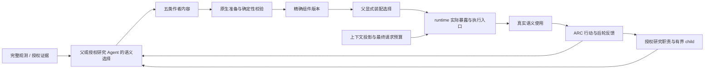
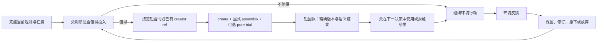

# Self-Harness 简化与可验证迭代实施方案

初稿：2026-10-06；Matt Pocock skills 修订：2026-10-07（Asia/Shanghai）。状态：**设计与开发交接；以下运行时改动尚未实施。**

**目标：**先消除已证实的错误与管理负担，让真实父 Agent 能以较少决策完成有价值的创建、装配、使用和行动反馈，再按重复对照决定哪些机制值得保留。

**架构：**复用现有原生组件、精确版本装配、工具执行、研究调度与资源归档。把确定性的准备、校验、错误收敛和数据绑定藏在已有接口内部；父 Agent 保留科学判断、投入选择、采用与撤下权。优先删除重复机制，不另建 self-harness 总控 Agent 或通用工作流平台。

**技术栈：**TypeScript / Pi extension、Python ARC runner、TypeBox schema、原生子进程 broker、现有 JSON/JSONL 资源与版本记录。

**开发入口：**先读 [开发流程](../development-workflow.md)，从任务 S0、S1 开始。本文同时承担 [变更记录模板](../templates/meta-harness-change.md) 的问题、设计、协议、验证和交付栏目；后续证据追加到本文末尾，不再维护另一套完成状态。

**2026-10-07 接手导航：**先读下方 **P0–P7 完整阶段方案**，再按 [规格](../../.scratch/self-harness-simplification/spec.md) 和 [逐票任务图](../../.scratch/self-harness-simplification/README.md) 接手。S0–S9 保留为实现定位、命令和唯一实验/证据记录。早期窄循环是第一验收点；后续五类组件、实际使能、接口、数据执行、上下文、研究和自主采用均有完整阶段设计。

本次明确使用 [to-spec](C:/Users/qi/.agents/skills/to-spec/SKILL.md)、[to-tickets](C:/Users/qi/.agents/skills/to-tickets/SKILL.md)、[codebase-design](C:/Users/qi/.agents/skills/codebase-design/SKILL.md) 和 [writing-for-agents](C:/Users/qi/.agents/skills/writing-for-agents/SKILL.md)。用户已明确要求完整各阶段方案；本地材料标为 planned（规划完成、尚未实施），不再以技能的发布前访谈作为补全方案的前置。正式外部 tracker 发布是另一个动作，不影响本次完整交付。

**相对初稿的实质调整：**将首次真实语义复用诊断提前到 05 号票据，基于现有接口执行，不等高级 schema 和完整预算改造全部完成。05 若在有界诊断中失败，先定位断点，不展开高级机制。完整五类 ARC 闭环仍在 12 号票据统一验收；早期窄诊断不冒称五类闭环完成。10 号源码语法扩展是条件分支，缺少对应故障时直接记录不实施。

## 完整阶段方案：P0–P7

所有阶段都在本次设计范围内。阶段之间安排验收与修订，是为了减少一次改动的因素，不表示后面的方案尚未设计。每个阶段都需交付实现或有依据的“不需改代码、现有实现已满足”结果。只有执行引擎替换、额外 worker 等大替代方案保留条件进入，不能将整个后续阶段降为可选。

### 总体目标结构与状态约束



`created`、`selected`、`effective`、`used`、`beneficial` 五个事实分开：创建只是有版本；selected 是父的装配选择；effective 是实际请求/执行配置已经包含它；used 是真实语义使用；beneficial 要有任务与成本依据。runtime 只自动推进获得授权后的机械转换、装配应用、暴露、执行和事实反馈，不能自动宣告后两者。

这五项复用现有组件、assembly、使用与效果记录。下面的状态约束是实现验收规则，不要求加入一个新的通用状态平台，更不要求游戏父填写五张表。

| 阶段 | 解决的完整问题域 | 对应票据 | 阶段交付 |
| --- | --- | --- | --- |
| P0 | 真实生效现状与成本可归因 | 01、07 | 可恢复基线、运行路径表、最终请求成本表 |
| P1 | 错误与创作债务 | 02–05 | 错误一次结束、允许放弃、首个正确后轮复用 |
| P2 | 五类组件转化、装配、实际使能和反馈 | 16–19 | 全组件实现路径与重启/变更生命周期 |
| P3 | 作者/管理接口、host/grid 与执行契约 | 06、10、20、21 | 小接口、准确数据绑定、严格内部校验与迁移 |
| P4 | 上下文总预算、信息寿命与本轮生成成本 | 08、09、24 | 最终请求约束、精确恢复、推理/续接独立治理 |
| P5 | Auto-Research 从授权到交付与反馈 | 11、22、23 | 一个职责完整运行并接入同一采纳链 |
| P6 | 普通父自主采用和全链路回归 | 12、13 | 普通机会到行动/反馈，以及全组件官方验收 |
| P7 | 总收益、机制退休与交接 | 14、15 | 匹配对照、最终默认集合和恢复路径 |

推荐执行 P0→P1→一次早期真实诊断，再按 P2–P5 单因素迭代，最后 P6/P7 集成验收。P0 的测量在各阶段继续使用。早期诊断可以发现未露出的断点；不因早期通过而省掉 P2–P5 的完整覆盖。

<a id="p0"></a>

### P0：建立可恢复的真实现状与测量基线

**目标与命题：**能从实际 runtime 路径回答“组件在哪个环节停止、每轮 token 为什么增加”，而不是根据接口存在或注册成功推断。

**实施步骤：**

1. 按 S0 冻结当前实际源码和有效配置，保存普通首轮、创建前、失败后、装配后、重启后的请求与产物。记录现有成功/失败，不先重建组件系统。
2. 为五类组件列一张开发期路径表：作者入口→转换器/原生 mutation→版本保存→assembly→实际暴露/执行→使用记录→反馈。逐个注明当前已接线、仅测试覆盖、真实 guided、ordinary 或未验证。
3. 核对入口是否由 Pi 初始化真正安装、assembly 应用后是否刷新动态工具、prompt/memory/skill/subagent 是否由当前父循环读取；仅 helper 或 fixture 调用不算生产路径。
4. 在已有 provider 接点按最终 payload 分解 system/schema/messages/results/images；关联父子 usage、output/reasoning/cache、请求耗时与失败流。保留未知，不重复相加。
5. 以同一 observation 与有效配置建立 B0。随后每个改动与前一冻结版 Bi 做单因素比较；最终与 B0 比较整体收益。

**入口：**S0/S5，`pi_provider_telemetry.ts`、`pi_reported_token_budget.ts`、`pi_task_local_self_harness.ts` 的安装/装配/父轮钩子以及 ARC runner。只在已有日志缺少必要身份关联时补测量字段，不向模型添加汇报负担。

**验收与交付：**一份可恢复 manifest、一份五类真实路径表、一份成本分解。任一未验证项明确标记，下一阶段据此决定复用或补接线。原 fixture 可重复说明缺陷；没有付费行为材料时只停留在诊断层。

<a id="p1"></a>

### P1：结束无效错误义务并完成第一个小闭环

**目标与命题：**无执行拒绝不增加无限修复义务，读 creator 不形成债务，现有接口能用最短合法路径获得一次正确且可复用的结果。

**实施步骤：**执行 S1/S2 和票据 02–05。分类以确证的执行阶段为依据；无写入尝试结束，未知副作用仍定向核对。错误原文归档，模型得到路径/原因/ref，state card 不复制全文。删除未完成 creator/deferred development 默认催办。保留当前 Agent 选定工作与精确引用。

**首次闭环：**用一个独立核验的真实公开帧计算创建 Tool，父显式选中，纯 trial 返回具体值，下一父轮能够据此决策，并在后来输入上调用同一版本。发布、装配与 trial 的成功/失败分别返回，不虚报全部回滚。该窄诊断尽早进行，同时作为后续阶段的回归样例。

**验收与迁移：**原错误无 pending、无强制 inspect，全文能恢复；读而不用可继续 action；后轮真实语义值正确。旧失败记录只凭确证无执行证据退休，未知保守保留。此阶段不能宣布五类组件、自主采用或净收益完成。

<a id="p2"></a>

### P2：补齐五类转化、精确装配与 runtime 实际使能

**目标与命题：**父作出一个有效组件/装配选择后，已有 runtime 自动完成机械转化和使能，后续父轮使用的确是该精确版本。Agent 无需再调用一个独立“使能接口”才能让已经选择的配置生效。

**五类转化与使用设计：**

| 类型 | Agent 必须表达的语义 | runtime 必须完成的机械过程 | 实际使能证据与语义使用 |
| --- | --- | --- | --- |
| system_prompt | 任务内补充指令、适用范围、依据 | 校验任务 scope，保存 overlay 版本，按选中版本投影；保持宿主指令优先级 | 实际父 system context 含准确 overlay；后续决策是否利用另审阅 |
| memory | 事实/假设/反证、必要 validity 与依据 | 将其存为作者 Memory；可从当前 task/epoch 确定的身份自动绑定，内容与科学有效性不猜 | 当前有效选中内容进入工作集/可恢复；后轮利用反证；自动 action Memory 不冒充作者 |
| skills | 最小方法步骤、适用条件、必要资源 | 校验内容与文件路径，写 task-local SKILL 版本，按选择提供读入口 | 实际 scoped read 可读该版本；后续 action 使用步骤，read 本身不足 |
| tools | 程序意图/source、输入/输出语义、必要权限 | source→受限 IR、schema 校验、版本发布、动态注册、授权绑定与执行 | 最终 tools 定义和正确具体输出；后来输入复用，未选版本不能执行 |
| subagents | 职责、输出目标、授权上下文/工具与预算 | 编译原生 agent 配置，绑定精确组件，broker 起进程，结构化结果返回 | 实际 child 的配置/权限与版本对应，语义输出由后轮父消费 |

**按三个完整切片实现：**

1. **转化切片（16）：**复用每类现有 creator/native mutation；将同一 canonical 合同用于 authoring 文档和内部校验。先运行合法/非法样例验证每个真实入口。统一错误语义和机械默认值，避免泛化成新 DSL；语义必需项不能静默补造。
2. **发布与装配切片（17）：**复用 `publishParentChanges`、`applyParentAssembly` 与现有 revision。准备期无写入；通过输入/权限/CAS 检查后发布，再精确装配。异步中 revision 变化时拒绝，不自动重选。已发布而装配失败如实返回精确版本；重试不重复发布。创建未选中时保留候选且不执行。
3. **实际使能切片（18）：**核对并修复现有安装、selection 应用、上下文投影和动态 tools 刷新接点。Tool 注册成功还需最终 provider tool 定义选中；Prompt/Memory 在下个真实父上下文生效；Skill/Subagent 的使用入口只有准确选中版本可用。进程重启从持久 assembly 重建，退场后撤下旧入口。

**使能时序约束：**tool selection 可在 assembly 成功时机械刷新；prompt overlay 等按 SDK 支持的上下文接点，在下一个合法父 turn 生效。不能将 `before_agent_start` 当每次内部 provider request 都会触发。若同一 Agent loop 无法刷新某类上下文，回执说明明确的生效父轮，runner 必须确实执行该父轮；不把“文件已写”伪装成立即生效。

**反馈切片（19）：**runtime 复用调用/assembly/effect 日志记录精确版本、实际输入、结果、时延和关联 action。Agent 判断结果是否改变决策、是否成立以及是否保留；允许 uncertain。只读、暴露和模型自称使用分别记录，不自动标有益。退场/更新处理未来配置，环境历史不回滚。

**代码与检查入口：**`pi_task_local_self_harness.ts` 的原生 facade、`publishParentChanges/applyParentAssembly/applyAssemblyToolSurface`；`pi_task_local_tools.ts`、`pi_task_harness_route_runtime.ts`、既有 broker 与 scoped resource。复用 `test_publish_assembly_native.py`、`test_harness_composition_native.py`、`test_harness_assembly.py`、`test_arc_capability_surface_native.py` 与 official smoke 五类场景。

**阶段验收：**五类分别有真实入口→转化→准确版本→assembly→effective 后轮证据；新增版本、冲突、取消、重启、撤下均能保持身份。Tool/Subagent 有具体语义输出，其他类型的使用归因与暴露分开。不要求 runtime 自动选择或“每局五类都用”。

<a id="p3"></a>

### P3：简化作者/管理 Interface，收回 host/grid 机械负担

**目标与命题：**Agent 只决定语义内容、授权内投入和选择；机械格式/数据准备留在现有内部实现。schema 被简化后仍有一个可明确构造的真实提交路径。

**核心 Interface 方案：**复用现有 create/change、assembly、execute/read/resource 和研究授权入口。普通面提供能直接完成核心流程的短合同；review、induction、plan/node、route/history 等高级管理按需披露，字段与 action enum 同步收窄。执行始终用完整 canonical schema；展示不是授权。

1. **合同一致性（21）：**清点 schema 默认值、必填/可选、枚举、nested shape、gateway 编码和 creator 示例；对已观察到的实际调用逐项做“模型示例→SDK→execute”契约回归。只有 omission 默认化，显式 null/矛盾值拒绝；不能为了避免 SDK 错误把校验全部改成 Any。
2. **creator 前置：**保留按需读取与详细参考，默认创作入口内置版本化最小合同；将“必须先读取固定文档”逐类替换为内容/权限/版本校验。Agent 已能准确提交时不强制补一次手册读取。先以单类消融验证是否减少管理轮，随后五类回归；不是移除权限检查。旧 creator_ref 显式传入仍核对版本，省略时使用本次接口确定的合同版本。
3. **host/data（20）：**将 canonical numeric grid 和 snapshot identity 作为授权 binding，不让 Agent 重新输出 grid。内部固定 task/epoch/action/frame/cutoff、检查路径/scope/尺寸/准备预算/取消，记录来源。默认“当前最终帧”与显式历史引用分开；比较哪两帧和算法含义由 Agent 决定。
4. **程序执行：**继续用当前 source→纯执行路径，核对最小常用语法和清楚的 unsupported 诊断；10 号票据按实际失败修一个主因。执行限额、禁止越权 I/O、返回 schema 与取消仍由内部强制。不让父写 IR、复制默认空结构或重复模型可计算的机械 metadata。
5. **发布试用：**一个显式 create+assembly+pure trial 可合并必要管理操作；环境 action 独立授权。试用失败保留真实已提交部分；output 值过大归档为精确结果，不常驻展开全部。

**能否直接拿掉 host/grid：**删除模型可见的 host 操作仪式、内部 DSL 搬运和重复 grid；保留数据来源、授权与限额。完整当前 grid/native PNG 继续提供。若受限语法在简化后仍阻断主要计算，再用冻结输入做当前受限执行与受约束普通代码执行的替代试验，比较表达正确性、隔离、限额和成本；完成前不更换引擎。

**迁移：**先让新短入口按同一 canonical 语义工作，保持旧调用兼容；按路径迁移实际调用者，然后撤下默认旧 schema/同义 wrapper。没有两个实际需要的执行实现时不加新 adapter seam。高级管理后端可保留按需能力，不要求永久维护全部默认组合。

**验收：**合法最短作者调用、错误契约汇总、显式 null/矛盾值、gateway schema、授权帧、历史帧、跨关陈旧 ref、越权与取消均走真实路径。报告每次成功获益所需父决策/读取轮，不能只报 schema 字符降幅。

<a id="p4"></a>

### P4：同时治理常驻输入、恢复连续性与本轮生成成本

**目标与命题：**每个最终请求可解释且有界，旧管理细节可退出驻留，反证可恢复并用于决策；新生成 reasoning 独立受控。

**四个有界切片：**

1. **分项计量：**沿 P0/07 测最终 system/schema/messages/results/images；同样测 child。根据真实增长来源调节，不把字符或传输体积替代模型 token。
2. **请求 admission（08）：**分别核对模型窗口、单次 output envelope 和父子累计已报告预算；按已支持的 tokenizer/图像估计、预留与安全余量决定是否可发。超限先去重复管理/旧只读结果；受保护事务或完整当前观察仍无法容纳时结束该请求，不循环压缩重试或删观察。
3. **工作集寿命（09）：**当前观察、有效认识、反证、未完成实验、下一步与必要未决失败保留；旧 source/手册/报告/结果按精确 ref 归档；读取恢复在首次必要续轮可见，然后回到原寿命。相同信息只投影一次；不能把父历史原始 reasoning 全量反复注入另一状态卡。
4. **生成与续接（24）：**依据该 provider 实测能力设置 per-request output/effort，父子受同一预算约束；分析 output 中 reasoning 占比，不能仅靠历史压缩期待减少新推理。provider length 对 research/delegate 保持有界 native continuation，保存 cursor/结果，禁止重放已经完成工具或动作。unknown/取消 usage 进入结算，不当零。选择“继续生成、以当前证据行动或放弃”属于 Agent 科学判断，runtime 只强制机械限额。

**避免变量混淆：**先固定 effort 测上下文寿命；再固定输入寿命测生成设置。没有 provider 明确支持的可编辑历史/effort 合约时保守保持协议字段，不能伪造缓存/usage。不能因历史输入下降就宣称 reasoning 提升。

**实现与验证：**S5 的 lifecycle、telemetry、budget、ARC admission；补用 `test_latest_reasoning_native.py`、`test_arc_reasoning_length_recovery_native.py`、`test_arc_reasoning_allocation_runtime.py`。验证早期反证在压缩后仍能推翻旧主张；确定性路径证明数据可达，真实普通轨迹审阅科学判断。恢复费用和首次有效行动延迟全部纳入。

**阶段交付：**请求分项与实际 HTTP 对齐；超限不发新请求；无新信息多轮不增长正文；恢复认知结果分层报告。阈值复用第 4 节，不增加游戏中必须汇报的预算表。

<a id="p5"></a>

### P5：把 Auto-Research 接入完整 self-harness 生命周期

**目标与命题：**一次授权足以启动有界研究职责、在合适时短交付核心结论，并让父采用或拒绝；研究到组件、行动和反馈不靠父搬运内部字段。

**职责与最小授权 Interface（22）：**复用 `auto_research(assign)`，父表达问题/目标、可读证据范围、允许工具与有限预算。没有复杂依赖时不要求 plan/node/release；高级研究计划只在显式提交时校验。runtime 可确定的 ID/cutoff/队列身份自动生成；权限、剩余预算和输出上限不能省略。科学 stop 条件由 Agent 判断，机械预算/无消费进展/撤销由 runtime 执行。

**实际运行过程：**

1. 输入授权生成现有 durable research line 与 worker assignment；启动一个有界 session/run。不是新建总控 Agent，也不是每窗口启动新 worker。
2. 新行动/组件使用反馈作为精确证据批次入队；active child 固定输入 cutoff，下一片段再处理新材料。只有实际分析确认推进 consumed cursor，入队/读取不是分析。
3. 真实 broker/process 返回 validated structured report/update；当前核心结论短交付父，详细分析留在研究线。分歧与反证保持，不用多数票合并。
4. 父可只利用结论，也可采纳 source/其他类型候选。通过 11 和 P2/P3 同一转换/装配路径，授权与原 evidence cutoff 不漂移；不会因为 child completed 就自动修改父 harness。
5. 父的精确选中、使用结果、action 反馈和可选语义评估回到已授权研究线；worker 可据新证据修订、撤回或停止，不能擅自扩大权限或预算。

**增量交付与失败（23）：**复用 `deliverResearchIncrements`、既有短卡限额与 exact publication refs；只有真正放入父输入的内容才记交付，尾部留下待交付。父不必每轮查询 inbox/确认通知。相同版本不重复展全文。超时、取消、length、空/坏结构化结果、无新证据和任务结束都保存真实状态并停止有界计算；普通合法 action 不被 optional research 门禁阻塞。

**迁移：**现有多 worker/plan 后端保留按需路径；先用一个职责验证核心授权/短交付，再在明确问题需要时复用既有多职责能力。研究进程存在不等于创建了 subagent 组件；两个身份分别验收。

**入口与验收：**`pi_auto_research_worker_runtime.ts`、`pi_auto_research_workers.ts`、已有 protocol/router 与 S8；复用 worker Node 测试、Auto-Research native smoke、官方 ARC child/router 场景。覆盖“结论到行动”“source 候选到使用”“合理拒绝”“过时撤回”“取消后父继续”五条真实路径，双方 length 都测。B/C/D 的研究、通信、连续性仅据对应真实结果更新。

<a id="p6"></a>

### P6：验证普通父自主采用，而不是只提高强制探针成功率

**目标与命题：**普通真实 Agent 能理解核心能力入口，在有价值机会选择投入，利用具体结果指导任务，并能够识别负收益后退出。

**实现与诊断方案：**

1. 冻结 P2–P5 实际纳入候选的改动，执行完整官方五类 ARC 矩阵。首个 P1 最小版也可以提前走该矩阵；提前通过不替代最终集成回归。
2. ordinary prompt 只提供一份简短、非阻塞的核心能力入口和真实调用合同；移除重复 creator/review/研究步骤叙述。不能注入开发流程或强制产出配额。仅在观察到理解/发现断点时单因素修这一提示，而不是每个失败都再加 reminder。
3. 用普通任务中的同类重复计算/证据缺口、剩余预算与可见数据定义机会分母。预先明确一次性计算、预算不足、过时任务的合理不使用。
4. 沿 recognition→investment→candidate→assembly→effective→use→feedback 漏斗定位；未发布看表达/校验、selected 未 effective 看 runtime、effective 未用看价值/理解、用后未影响行动看任务语义、反馈未保留看连续性。每次修最早断点的一项因素。
5. 先在已知困难 provider 上三次有界 ordinary 探索，再独立复核另一 provider。guided 只作为诊断；不把它计入普通采用率。

**验收：**12/13 和 S6/S7；五类接线、两种 length、具体语义结果及后续父轮均存在；普通窄采用达到原协议门槛才支持该情境采用。未采用但无机会判不确定；存在机会的多次失败停止扩样，回到对应 P 阶段。无需由父填漏斗表，评估由轨迹与外部审阅得出。

<a id="p7"></a>

### P7：证明净收益、退休机制与完成迁移

**目标与命题：**整个方案在任务质量保持的情况下减少父子总成本、等待和认知回退；没有净帮助的机制可撤下，维护复杂度随证据降低。

**比较方案：**S9/14。首个最小 P1 候选与 B0 做小对照，判断原 bugfix 的实际贡献；最终 P2–P6 候选再与 B0 比较整体表现。按需要加入 Bi 单因素或 Bmin 机制消融，三种比较不混归因。相同 provider/model/effort、模态、任务初态、预算与运行顺序，独立新 run；每局不可回退历史。

**具体推进：**首对检验协议可判别性，随后用原第 4 节 6 对/两个游戏的预算做首批确认。阶段总额不因 24 张票据重复分配。每个样本包含父子全部片段、失败/未知、管理与恢复读取、时延和质量；小样本不足时报告不确定，两个版本都无进展时不能宣称 benchmark 改善。

**退休与默认集合：**15 号票据逐项决定错误恢复、合同披露、creator 前置、上下文寿命、reasoning 设置、研究交付是否进入最终默认。必要权限/版本/预算/完整性 bugfix 独立保留；没有收益的 reminder、同义 wrapper、默认 gate 或高级常驻字段撤下。高级机制仍有合理用途则保留按需入口，不默认展开。

**清理与迁移步骤：**新短路径稳定→核对所有真实调用者迁移→移除被替代实现/仅内部耦合测试→保留旧资源兼容读与明确恢复配置→重新 freeze 并做受影响回归。清理改变行为需重新验证，不将清理前结果直接归给新版本。回退只作用未来配置。

**最终交付：**完整源码/配置、各阶段产物和四层证据、默认机制与 retired 清单、父子成本/质量对照、旧数据与未来配置恢复办法、未验证范围和下一有限检查。可以完成全部实现而收益仍不确定；不能以文档齐全或测试数量宣布优化有效。

### 阶段预算和工作量边界

各阶段复用已有第 4 节预算：离线/确定性接线不启动付费语言模型；guided 阶段总 160k、ordinary 探索总 360k、首批重复对照总 2.88M known reported 是候选上限。不是每个 P 阶段各获得一份额度，也不是批准现在运行。早期检查、重试和 10/24 消融使用相应剩余额度，未知在途费用独立记录并触发止损。

P2、P3、P4、P5 分别可以交付不改变行为的现状通过项和确有断点的代码改动。区别必须注明；不能为“完成完整路线图”把已实现部分重写一遍。所有待实现项现在均未验证。

## 1. 问题与命题

### 1.1 当前判断与证据边界

用户提出的两个核心问题有依据：普通 Agent 的 self-harness 采用尚未稳定，而管理与接口成本已经明显；同时存在具体的错误生命周期和重复投影缺陷。但“完全只有接口、runtime 从未真实使能”不符合全部证据。

| 观察 | 支持的判断 | 不支持的判断 |
| --- | --- | --- |
| 原生创建、精确装配、动态工具注册、Skill/Memory/Prompt/Subagent 暴露已有实现；确定性 provider 经真实 ARC/Pi 的五类链路已有历史验收 | 基础运行时确实存在，不能另起炉灶重复实现 | 普通模型会自主采用；创建能带来净收益 |
| stage78–80 普通真实 GPT 运行分别 40/50/44 动作，作者组件、装配、语义使用均为 0；其中一次过 1 关 | 普通任务运行和关卡进展不等于 self-harness 采用 | 该机制改善了任务；所有模型都永远不会采用 |
| 显式真实 Skill 诊断和保存帧 Tool 诊断有成功例外 | 有引导时部分能力可达 | 已在普通游戏中稳定闭环 |
| stage140 guided Qwen：5 个完整 HTTP、66,986 reported token、1 动作、0 关；正确绑定 final numeric grid，但 Tuple 编译拒绝、未发布工具 | 数据准备有实际实现；创作接口仍会阻断投入到候选的转移 | host/grid 整体无用；删除它们必然提高收益 |
| 当前 Pi 离线重现：非法 `trial.bindings={}` 产生 5,231 字符完整参数回显，形成 1 个 retryable pending；state card 从 675 增至 7,017 字符 | 拒绝本身正确；回执膨胀、错误修复义务和重复投影是可修的具体缺陷 | 所有高 token 都由这一缺陷造成 |
| stage118r1：2 动作、82,187 known reported，其中新生成 reasoning 52,486 | 缩历史输入不能解决本轮新生成推理过长 | 所有浪费都来自历史重复输入 |

证据入口：

- [48h 复盘](../reports/2026-10-06-48h-optimization-review.md)：该窗口至少 10,289,671 reported token；不含开发 Agent 和缺失 usage 的未知消耗。
- [当前版本索引](../reports/arc-mechanism-version-index.json)：本次核查 `current_candidate=stage142`；`best_verified_restorable_qwen=null`。历史 Qwen 有过关记录，但不能当可恢复、可比较的当前基线。
- [错误重现审计](../../tmp/context-bug-audit-7wy9dqf2/diagnostic-audit.json)：真实 Pi、离线 scripted provider；不是付费 ARC 结果。
- [stage140 成本](../../tmp/arc-stage140-live-tool-cost-audit.json)、[语义审计](../../tmp/arc-stage140-live-tool-semantic-audit.json)、[普通 stage78–80](../../tmp/arc-stage78-80-final-audit-20261004.json)。
- [历史实现与诊断记录](2026-10-02-context-tool-reasoning-design.md)：按日期理解，不用旧 stage 的绿色测试代替当前代码验收。

stage140 的初始六个 tool schema 共 16,571 序列化字符，约为初始非图像上下文字符的 58.5%。这是**字符口径**，不能直接报成 token 归因。各类调用对应整次请求的 token 也不是该工具的边际成本。stage142 的标准 425 项检查来自首次 16 场景与一次失败场景重试的联合覆盖，不是一次完整全绿运行；source-format research child handoff、自主采用和净收益仍未验证。

### 1.2 待检验的窄命题

| ID | 命题 | 减少的负担 | 推翻或降级条件 |
| --- | --- | --- | --- |
| H1 | 对已证实未进入执行的参数拒绝，一次短错误即可结束该次调用，不产生待修事务 | 无效 inspect、重复参数回显、每轮 pending 投影 | 仍有 pending；短化丢失可修字段；误清真实副作用不明的事务 |
| H2 | 删除未完成创作的持续提醒、收窄默认 schema，能降低实际请求固定负担而保持核心能力可发现、可调用 | 常驻手册、阶段性管理字段、重复决策 | 真实下一轮 schema 未缩小；核心路径不可达；合同发现新增往返抵消收益 |
| H3 | 利用既有 create+assembly+trial 和准确数据绑定，可让普通父 Agent 在重复计算确有价值时完成一次有效工具投入并复用 | 手工 grid 搬运、机械合同填写、分离管理轮 | 有合适机会仍不采用；采用后反复修复；结果不用或任务成本更高 |
| H4 | 对最终请求的预算核算和精确恢复，可限制上下文增长且保持关键反证与未完成实验 | 被 system/schema 绕过的软预算、重复读取和认知回退 | 计量不包含最终 schema/images；压缩后错用过时结论；恢复成本抵消节省 |
| H5 | 仅在父已授权的研究职责内，短结果交付可帮助上述同一路径，并降低父子总负担 | 父重新总结研究和搬运候选、重复调度 | child 成本超过节省；过时结果进入行动；父仍需重做全部分析 |

H1/H2 的功能和表示结果可以独立交付；H3/H4/H5 的行为或收益不能用测试数量替代。没有复用机会、剩余预算不足、环境已改变、一次计算即可完成时，合理不使用/放弃都是正常结果。

### 1.3 范围

本次交付是方案、任务顺序和验证协议；不修改运行时，不启动付费 provider，不干预其他 chat 的活动实验。后续实现按当前授权逐项推进。并行中的 stage142b guided GPT 对比有独立协议，不与本方案合并计分，也不能当本方案的 ordinary 采用证据。

不做：强制每局创建组件、按调用数奖励、增加评审 Agent、重写整个 host、把五类组件全部合为新 DSL、用大量 prompt 提醒替代缺失接线。

## 2. 设计与成本：删除、内收、保留、延后

| 对象 | 决定 | 具体处理与保留条件 |
| --- | --- | --- |
| SDK 错误的 `Received arguments` 全量回显 | 删除模型常驻副本 | 原文与 attempted input 留在授权审计资源；模型只收错误路径、短原因和 ref |
| 无写入参数拒绝的 pending/required inspect | 删除 | 本次尝试 terminal；允许新提交或直接继续任务；不会要求先“结案” |
| 未知副作用、版本冲突、真实活动事务 | 保留并精确收敛 | 不把“输入看起来有错”当无副作用证据；禁止自动重放环境动作 |
| `UNFINISHED CREATOR PREPARATION` 持续正文、deferred development 循环提醒 | 移出默认驻留 | 读手册不再生成完成义务；仅 Agent 显式维护的当前工作引用可留在其工作集 |
| 周期性 review 和全池方法/候选清单 | 默认按需 | 当前默认 review 已是 advisory，不能假称撤销了默认硬门禁；保留人工/诊断入口与已有历史数据 |
| review/plan/node/route 等高级 schema 字段与动作名 | 按需披露 | 复用 `managementSchemaSurface`，同时收窄字段与 enum；不再新增一套 discover 工具 |
| source → IR 的机械转换与公开数据准备 | 内收 | 复用当前编译器和 host，契约一次说明、校验一次汇总；Agent 不输出 IR 或重新抄完整 grid |
| host | 保留内部职责，缩小模型接口 | 保持可读资源、精确帧/版本、准备预算、取消、输出限额、provenance；不要求父理解内部装配步骤 |
| grid / native PNG | 保留完整 canonical observation | 删除重复模型搬运与旧观察副本；不删当前完整网格/PNG，不把有损摘要称无损 |
| creator-read 硬前置 | P3 逐类迁移为内容/权限/版本校验 | 内置版本短合同，按需保留详细手册；单类消融与五类回归，准确提交无需证明先读；显式旧 ref 保持版本检查 |
| 显式 assembly | 保留语义选择，复用合并调用 | 已有 `assembly:true` / 精确 selection；创建可不装配，未选择版本不能执行，不自动挑组件 |
| assessment/研究反馈 | 自动事实 + 可选语义判断 | runtime 记调用、结果、时延、动作关联；Agent 决定是否帮助任务。不能用自动 Memory 当采用证据 |
| Auto-Research plan/多 worker/竞争视图 | 保留后端与按需路径；延后扩张 | 无授权不调度；先闭合一个实际研究职责；不把窗口当必须新建 worker 的理由 |
| action decision / checkpoint | 保留有效语义记录，取消重复手续 | 复用动作内已有 decision 持久化；不要求每步另写 checkpoint，事实记录不能冒充作者 Memory |
| 新的通用管理框架与大量永久开关 | 不加入 | 用现有版本快照做对照；候选保留后删除被替代分支，不永久维护组合爆炸 |

**删除判断：**删除后复杂性如果消失，优先删除；如果转移给每个 Agent（例如抄 grid、核对版本和权限），则把它留在内部。采用 [codebase-design](C:/Users/qi/.agents/skills/codebase-design/SKILL.md) 的小接口原则，但保留本项目“组件”“装配”等领域术语。

### 2.1 最小首次获益路径



这是缩短**管理路径**的目标，不是动作配额。一般至少仍有投入判断、选择候选/装配、结果到行动、反馈判断；有依赖的工具调用不能因省轮强行并发。已有 creator ref 时应允许一次提交完成发布、选择与纯试用；需要读取合同的新调用者可多一次按需读取。环境动作仍走独立 ARC action 边界。

### 2.2 生命周期责任

| 转移 | 谁推进 | 机械完成证据 | 失败、过时与合理不使用 |
| --- | --- | --- | --- |
| 机会 → 识别 | 父或已授权研究 Agent | 普通任务中对重复工作/证据缺口的实际判断 | 不由 runtime 从自然语言猜机会；外部评估记录未知 |
| 识别 → 投入 | 父或授权范围内的研究 Agent | 创建请求或真实 child 启动；预算/范围 | 可不投入；非法 delegate 参数不算研究启动 |
| 投入 → 候选 | 作者 Agent 判断内容，runtime 转换/校验/发布 | 精确 candidate ref、校验结果、源码/内容版本 | 汇总独立错误；拒绝不形成无限修复义务 |
| 候选 → 装配 | 父显式选择，runtime 原子应用 CAS | selection 与 assembly revision；旧引用处理 | 不自动全选，不静默覆盖并发变化 |
| 装配 → 语义使用 | 父/获授权 Agent 调用或利用；runtime 执行 | 真实输入/输出/暴露，随后行动证据 | 暴露、status completed、文本自称使用均不够 |
| 使用 → 反馈 | runtime 记录事实；Agent 判断意义 | 后续真实观测与预期差异、反证、效果判断 | 无法归因时写未知；反馈不能虚构因果 |
| 反馈 → 保留/修订/撤下 | 父或显式授权 Agent；runtime 改配置 | 下一轮实际 assembly 与使用行为 | 只影响未来，不回滚环境或已获得信息 |
| 研究结果 → 上述路径 | broker/router 机械交接，父作采用选择 | 短核心结论、精确 evidence cutoff 和候选 ref | 同版不重复交付；过时标识；研究允许只给结论 |

不新增游戏中必须填写的 lifecycle 表格。评估从已有轨迹提取，缺失语义由开发审阅标注，不能要求父每一步自报来制造漏斗。

## 3. 实施任务与依赖

S0–S9 是问题域与技术定位编号，**不再作为强制线性实施顺序**。当前开发图见 [01–24 号票据](../../.scratch/self-harness-simplification/README.md)，所有阶段的最新目标结构与依赖以 P0–P7 为准，S 节提供局部文件/测试参考。首先完成 S0 和 S1 的窄修复，随后提前做 S4 的现有接口复用诊断，再完成所有 P 阶段的覆盖。每个功能切片内部按“一个真实失败测试 → 最小实现 → 相关回归 → 核对实际下一轮 → 记录结果”推进。

| 任务 | 真正前置 | 可单独交付的行为 | 主张级别 |
| --- | --- | --- | --- |
| S0 冻结基线 | 无 | 可恢复源码、实际配置与同口径测量 | 诊断准备 |
| S1 结束错误尝试 | S0 | 无执行参数拒绝不挂 pending；错误不放大下一轮 | 功能正确 |
| S2 允许放弃创作 | S0；回归使用 S1 | 读 creator 后可以继续游戏，无持续完成义务 | 功能、表示 |
| S3 精简默认接口 | S0；集成 S2 后比较 | 普通父只见核心合同，高级操作仍按需可达 | 功能、表示 |
| S4 单次作者到语义结果 | S1；先用现有接口诊断，S3 后再做兼容回归 | 精确帧绑定、创建/装配/试用、后续正确使用 | 功能、局部链路 |
| S5 最终请求预算 | S0；覆盖 S1–S4 输出 | 真实请求计量、溢出控制与认知恢复可检查 | 功能、连续性待实测 |
| S6 五类真实接线 | 当次选定改动冻结；首版按 12 号票据，不强制等待全部 S3/S5 改造 | 官方 ARC/Pi/child 五类闭环与 length 续接 | 全链路可达 |
| S7 普通真实采用 | S6 | 无创作指令的机会到使用与反馈轨迹 | 自主采用，窄范围 |
| S8 研究交付路径 | S4；启用前重验 S6 | 授权 child 结果进入同一作者/装配路径 | 接线；行为另测 |
| S9 对照与退休 | S7；涉及研究时 S8 | 父子总成本、质量与延迟的重复对照 | 净收益或撤下决定 |

<a id="s0"></a>

### S0：冻结实际运行版本与可比较基线

**入口：**[版本索引](../reports/arc-mechanism-version-index.json)、[优化手册](../optimization-handbook.md)、[provider 遥测](../../demo/pi_provider_telemetry.ts)、[共享预算](../../demo/pi_reported_token_budget.ts)。

1. 保存实际源码清单/hash、当前未提交 diff、Pi/Node/Python/ARC SDK 版本、有效 prompt、全部 tools schema、provider/model/推理设置和实际环境配置的非敏感部分。记录 credentials 来源名，不能保存凭据正文。
2. 当前工作区有大量既有修改；从经过确认的实际源码快照派生 `codex/self-harness-simplification` 实施分支或隔离目录。不得从旧 HEAD 直接建“干净”分支后声称它包含当前修复；不得覆盖其他 chat 的活动源码/产物。
3. 保存错误原始 fixture、首次/错误后/恢复后实际 provider 请求。归档用可持久路径和 hash，勿只依赖可能被清理的 `tmp`。
4. 建立三种比较器：B0=冻结当前版，Bi=上一已验收小步，Bmin=同环境同感知的最小任务能力基线。Bmin 仅作总复杂度参照，不拿多因素差异归因给某一处修改。
5. 复用已有遥测，仅离线汇总缺失维度；不因测量再向父 prompt 添加字段。

**完成：**另一开发者可恢复同一基线、复跑同一失败并得到同口径请求材料。单独保存 prompt 或 stage 名不合格。若基线不可恢复，停止收益比较，但可继续定位局部功能缺陷。

<a id="s1"></a>

### S1：修正无执行拒绝、短错误回执和 pending 投影

**修改入口：**[failureClassification](../../demo/pi_harness_control.ts)、[failedOperation 与工具结束钩子](../../demo/pi_external_benchmark_research.ts)、[decision card v2](../../demo/pi_decision_card.ts)、[上下文生命周期](../../demo/pi_task_local_context_lifecycle.ts)。只有钩子无法覆盖实际 SDK 错误时才查对应 SDK adapter；不要改第三方安装包。

1. 在 `tests/test_pending_contract_failure_native.py` 加入已复现的 `trial.bindings={}`：真实 Pi 调用 → SDK 拒绝 → 下一父请求 → 合法操作。复用 `tests/fixtures/harness-stage138-observed-live-create-call.json`，只改一个错误字段。
2. 首先断言当前失败：pending 非空、错误含完整 `Received arguments`、state card 重复正文。独立验证组件/child/环境 action 均未执行。测试必须对实际下一轮输入断言，不能只测新 formatter。
3. 优先传递结构化执行阶段证据：SDK pre-execution rejection / preflight no-write / committed / unknown。既有 `failure_class/applied/retryable` 继续复用；“可以重新提交”与“当前事务待恢复”解耦。不得仅匹配 `must/invalid` 就认定无副作用。
4. 已证实未执行的拒绝：`applied=false`、该次调用 terminal、无 pending、无 `required_next_call=inspect`。未知执行状态继续保留针对具体事务的恢复，不自动重新执行。
5. 审计日志完整保留原始错误与输入；模型回执只给路径、原因、至多少量必要代码摘录和精确 failure ref。首版建议最多 8 个独立错误、总计 1,200 字符；超出有 count/ref，不能让信息静默消失。
6. state card 不再直接序列化 `checkpoint.pending_operations` 全对象；仅投影真实未决事务的身份、状态、具体恢复条件和 ref。已终结错误不再次进 state card。
7. 兼容旧记录：只能凭旧审计中确证的 no-execute/no-write 证据退休；证据不足保留 unknown。成功恢复只清同事务，不能清无关 pending。参数改变形成的新提交不得永久继承旧输入 hash 的义务。

**拟定行为示例，不是新增模型请求字段：**

```text
trial.bindings: expected array; no execution occurred.
This attempt ended. Correct the field in a new submission, or continue the task.
details: failure:<exact-id>@v1
```

**验收：**原 fixture 短错误 ≤1,200 字符；pending=0；错误后 state card 不因该错误增长；实际下一轮无完整参数回显，失败全文可按授权 ref 恢复。版本冲突、写后取消、未知副作用仍可核对且不会重放 ARC action。首次 assistant 的原始调用参数允许留存，不为字符目标破坏 tool-call/result 配对。

```powershell
python -m pytest -q tests/test_pending_contract_failure_native.py tests/test_harness_control_repair.py tests/test_harness_argument_integrity_native.py tests/test_pure_invocation_defaults_native.py
node --experimental-strip-types --test tests/pi_decision_card.test.ts
```

**回退：**发现真实未决事务被误清，则回退分类变更；可独立保留已正确验证的短投影。不能靠重新加入全量回显解决分类错误。

<a id="s2"></a>

### S2：去掉读手册后的创作债务

**入口：**[self-harness before-agent-start 投影](../../demo/pi_task_local_self_harness.ts)，重点 `preparedCreators`、`UNFINISHED CREATOR PREPARATION`、`DEFERRED PARENT DEVELOPMENT` 和周期 review 文案；[baseline methods](../../demo/pi_harness_baseline_methods.ts)。

1. 在 `tests/test_conversion_workset_native.py` 增加：读取 creator 后不创建、继续两个真实 Pi 父轮；再次按 ref 获取仍能恢复合同。
2. 删除“读过就持续提醒直到创建/显式 decline”的默认正文重注入；读取只产生读取证据。Agent 不需要额外调用 defer/drop 才能继续游戏。
3. 当前明确选中的创作工作可保留短 ref 与必要 source 工作集；任务切换后按已有资源寿命归档。不要删除 Agent 明确保留的当前计划。
4. deferred 开发意图与待采纳研究方法保留 durable 记录、按需可读；只有新的相关交付有一次短事件，之后不按每轮重新催办。runtime 不猜语义 reconsider_when 是否成立。
5. 默认 advisory review 保留可调用能力、去掉重复通知；`required` 诊断模式维持独立兼容，不推广为普通运行前置。

**验收：**“读而不用”“试用失败后放弃”“游戏阶段变化”三种情况均能继续合法 action；没有因忽略提醒而新增 gate；无新工具/worker/必填状态字段。完成创作的既有路径仍能利用准确 creator ref。

```powershell
python -m pytest -q tests/test_harness_contract_lifetime_native.py tests/test_conversion_workset_native.py tests/test_compact_creator_native.py tests/test_arc_capability_surface_native.py
```

<a id="s3"></a>

### S3：把高级合同从默认模型接口移走

**入口：**[management schema surface](../../demo/pi_management_schema_surface.ts)、[self-harness 注册](../../demo/pi_task_local_self_harness.ts)、[research 注册](../../demo/pi_external_benchmark_research.ts)、[ordinary prompt](../../demo/prompts/arc_decision_cycle.md)。

1. 记录 ordinary 首次及后续实际 HTTP 中各 schema 的序列化字符和 tokenizer 估值。测试区分 SDK 内部注册表与 provider 真正看到的定义。
2. 扩展现有披露策略：普通面只保留任务行动、当前状态/资源恢复、组件创作/显式选择/使用、简单委派和研究授权的必要入口。高级 review/induction、plan/node/release、路由/历史评估参数及对应 action enum 按需加载。
3. 复用 `contract` 获取相应操作的**完整可提交短合同**并刷新下一轮定义；不新增 discover→inspect→read→ack 链。不要只隐藏字段却仍展示大量不可正确构造的动作。
4. 合同披露不是权限授予。执行始终按完整权威 schema、scope、budget、CAS 校验；隐藏参数不能变成校验绕过。未披露调用若拒绝，只给具体合同入口，无永久 pending。
5. 定义 schema 生命周期：当前选中的高级工作期间保留；完成/取消/显式回到 core 后撤下；重启按任务状态恢复。与组件工具选择隔离，不能误撤选中的 task-local tool。禁止每轮切换造成缓存持续失效。
6. 不随此任务更改科学目标提示、reasoning policy 或观察表示，保证比较只测管理接口变化。

**开发目标：**同一初态下管理 schema 序列化字符较 B0 至少下降 30%，core 实际首请求总非图像内容不增加；记录具体 tokenizer 估值而非把字符当 token。30% 是本候选筛选目标，不是任务 Agent 的运行时配额；若为达到数字损害能力可达，撤回该设计。负例含当前最短直接创建、普通 delegate、按需高级调用、重启与 stale scope。

```powershell
python -m pytest -q tests/test_management_schema_surface_native.py tests/test_arc_initial_context_budget.py tests/test_arc_capability_surface_native.py
node --experimental-strip-types --test tests/pi_management_schema_surface.test.ts
```

<a id="s4"></a>

### S4：收敛已有作者接口，打通一次真实语义使用

**入口：**[task_harness_create](../../demo/pi_task_local_self_harness.ts)、[pure authoring](../../demo/pi_task_pure_authoring.ts)、[Python lowering](../../demo/pi_task_pure_python_lower.py)、[pure host](../../demo/pi_task_pure_expression_host.ts)、[ARC snapshot](../../demo/pi_arc_observation_snapshot.ts)、[tool execution](../../demo/pi_task_local_tools.ts)。

1. 选一个真实公开帧上的有价值重复计算，例如准确比较两帧变化位置；预期值独立人工计算或用已审核 oracle 验证，不能复制待测实现来算 expected。不向普通父写游戏答案。
2. 复用已有 source 作者入口和 `create + assembly + trial`，不要再包装第二个同义入口。`assembly:true` 已存在；保留捕获的 revision 和 CAS，不能静默重读再覆盖并发 selection。
3. grid 通过精确授权 ref 绑定；由 host 在执行前固定 action/level/frame 身份，校验 numeric grid、尺寸、准备预算与取消。默认当前帧与显式历史帧含义分开，语义对比哪两帧仍由 Agent 选择。
4. 完整合同只保留写程序真正需要的语法、输入名、返回形状、限额和例子。内部 IR、默认空 parameters/bindings、重复 metadata 由已有确定性转换生成；显式矛盾值仍报错。
5. 用观察到的 source 失败锁定下一因素。首个小步可单独处理 Tuple 等常见纯语法的支持或明确一次性诊断，不能同时换执行引擎、改变预算和加入额外提示。其他独立错误一次列出，不逐错支付多轮。
6. 成功回执分开报告发布、装配、试用三个结果，附精确版本与真实 trial value。发布成功后 trial 失败不能写成“没有任何变更”；重试 trial 不重发组件、不重复装配。
7. 下一父轮读到具体语义结果；再用后来帧调用**同一已选版本**，证明输入未钉死在作者时刻。仅创建时试用不能证明后续复用。

**核心负例：**错帧、跨关旧 ref、越权 ref、schema 矛盾、assembly CAS 冲突、准备中取消、写后试用失败、返回超限、未选中工具不可调用。保留原始完整 current grid 和 native PNG。

```powershell
python -m pytest -q tests/test_publish_assembly_native.py tests/test_pure_publication_trial_native.py tests/test_arc_creator_grid_handoff_native.py tests/test_pure_binding_schema_completion_native.py tests/test_pure_binding_schema_cancellation_native.py tests/test_task_pure_python_native.py tests/test_pure_source_diagnostics_native.py
```

**更大替代方案的进入条件：**只有简化后真实错误仍主要来自受限源码表达、且一个小语法增量不能解决时，另立单因素试验比较“当前受限编译器”与“受资源/权限约束的普通代码执行”。后者涉及执行隔离、进程取消、读写和依赖权限，不能以删除 host 为实现。先做离线有界原型，不默认启用，不把未来候选混进本轮收益。

<a id="s5"></a>

### S5：以最终 provider 请求为预算与恢复验收面

**入口：**[context lifecycle](../../demo/pi_task_local_context_lifecycle.ts)、[provider telemetry](../../demo/pi_provider_telemetry.ts)、[reported token budget](../../demo/pi_reported_token_budget.ts)、[ARC runner](../../src/autoresearch_pi/arc_agi_3_e2e.py)。

1. 复用请求 admission/telemetry 接点，在**最终 schema、system、messages、图像与工具结果已组装后**记录分项估计。只在 message 数组上预算的现有软限制不能冒充全请求上限。
2. 分开三种预算：上下文可装入窗口、下一调用可生成 output、父子累计已报告计算预算。每次请求预计 `input + reserved_output + margin <= context_capacity`；provider tokenizer/图像计费未知时明确估计与置信限制。
3. 缩减次序：去同义重复投影 → 过期管理正文/旧只读结果转精确 ref → 已完成可编辑历史按既有策略归档。保留当前 canonical observation、当前假设/反证、未完成实验、下一步、实际预算与必要失败。
4. schema/system 过大应修它们的来源，不能通过删 current grid/PNG 来掩盖。最新 tool transaction 受保护导致超软预算时显式报溢出与原因；安全边界或模型窗口无法满足则在 HTTP 前结束/返回受控失败，不循环压缩再重试同一超大请求。
5. 新生成 reasoning 用 provider 已支持的 output/effort 约束单独实验。压缩试验固定其设置，不能把关闭 thinking 的节省归给历史压缩。`length` 必须沿既有有界续接处理，不重复执行先前动作。
6. 设计一次必须用早期反证才能避免错误的恢复检查：旧主张→反证→压缩→恢复→后续父决策。准确存盘和成功读取只是中间证据；父仍坚持被否定结论则连续性失败。
7. 恢复读取的 token/耗时全部计入。unknown usage 不填 0，取消未完成流独立记账，父/child 共享停止条件。

```powershell
python -m pytest -q tests/test_arc_initial_context_budget.py tests/test_arc_context_budget.py tests/test_context_continuity.py tests/test_arc_action_knowledge_native.py tests/test_arc_parent_provider_admission_native.py tests/test_reported_token_budget_native.py
```

**验收：**请求分项与最终实际 payload 对齐、总量能解释；固定无新信息的多轮管理事件不线性累积正文；超限不会发出下一 HTTP。模型对反证的实际利用列到 S7/S9，不以 fixture 通过提前宣布认知质量改善。

<a id="s6"></a>

### S6：五类组件经官方 ARC/Pi 全链路验收

**入口：**[arc_harness_smoke](../../src/autoresearch_pi/arc_harness_smoke.py)、[确定性 provider](../../tools/arc_harness_smoke_provider.ts)、[CLI](../../src/autoresearch_pi/cli.py)。

先冻结当次选定候选的源码与有效配置，再运行既有入口。第一版按 12 号票据的最小前置执行；后续合入 S3/S5/S8 等修改后重验相关链路，不要求全部高级改造完成才第一次验证。以下为仓库根目录中的 PowerShell，要求 Python 依赖、Pi 与官方 ARC 环境已按项目文档配置；每次使用新 run root。当前 shell 未注册 `autoresearch-pi` 命令，因此示例直接从 `src` 调用同一个 CLI，避免依赖 PATH：

```powershell
python -c "import sys; sys.path.insert(0, 'src'); from autoresearch_pi.cli import main; raise SystemExit(main())" arc-harness-smoke --help
python -c "import sys; sys.path.insert(0, 'src'); from autoresearch_pi.cli import main; raise SystemExit(main())" arc-harness-smoke --root runs/self-harness-simplification-wiring-01 --game ls20
```

不使用 `--mock-environment` 做闭环验收；若官方 SDK 启动失败，保留失败与零模型请求的证据，在相同 freeze 下有界重试。多次联合覆盖和单次全绿分开报告，不追求隐藏失败后的漂亮总数。

| 必须覆盖 | 语义断言 |
| --- | --- |
| system_prompt | 精确选中版本进入后续实际父 system context；实际行为检查与暴露证据分开 |
| skills | 创建的文件/ref、选择、可读正文与后续决策相关内容；read 不等于采纳 |
| memory | 作者 Memory 与自动 action-decision Memory 分开；精确内容及后续使用 |
| tools | 动态定义实际注册；正确输入/具体输出；后来帧复用；未选版本不可执行 |
| subagents | 已选组件触发真实 broker/process；正确授权、结构化返回与后续父消费 |
| Auto-Research | 真实 child → structured return → parser/router → 原生修改 → assembly → action → 后续父轮 |
| length | Auto-Research 与普通 `delegate_task` 都真实经历 provider length 并有界续接；不重放动作 |
| 生命周期 | 取消/恢复、陈旧 ref、试用失败、放弃、重启；保护版本与环境历史 |

标准矩阵当前历史为 17 场景/425 检查；数量可因合理新用例变化，不能把数量作为成功目标。scripted provider 的顺序替父作了选择，因此此任务只证明接线。

<a id="s7"></a>

### S7：真实模型采用——先可判别诊断，再普通运行

**前置：**S6 接线可用；预先填写第 4 节实验协议与预算。先测已观察失败的 yibu / `qwen3.8-27b`，确认当前 provider 实际支持的模型 ID 与 thinking 设置；GPT 复核作为独立分层，不能合并不同模型得出收益。

1. 一次 guided 短诊断确认 S4 可由真实模型完成，记录强制/建议创作的原话。成功仅说明真实 provider 接口可用；失败定位第一次断点后回到 S1–S5，一次只改主因。
2. 普通任务保留 ordinary prompt，不含“必须创建工具/研究/五组件”等试验指令，也不注入本文/AGENTS/开发模板。
3. 独立审阅普通轨迹的机会：是否有同类重复计算、数据是否足够、剩余预算与潜在复用次数。机会分母由可见证据和预定规则判断，不以创建次数定义机会。
4. 记录每次机会的识别、投入、候选、装配、语义使用、后续反馈；分别记合理不使用、过时放弃与无法判断。组件 invocation 或自动 Memory 数量不是 adoption 的替代指标。
5. 若 3 次探索中存在明确机会却仍无任何完整采用，停止付费扩样；审查核心能力是否可发现、投入成本、表达失败与价值不足。不得为“让它用”加强制提醒再将结果归入普通采用。

**窄采用通过条件：**至少两个独立普通运行出现可审计的自主识别→投入→精确装配→语义结果→后续行动/反馈，且包括一次后来输入上的复用。该门槛仅支持已测情境采用，不证明总体采用率或净收益；没有合适机会时判“不确定”，而非机制失败。

<a id="s8"></a>

### S8：让研究结果复用同一条采纳路径

**入口：**[Auto-Research ADR](2026-10-01-auto-research-mechanism-and-workers.md)、[当前实现](../auto-research-workers-implementation-2026-10-01.md)、[worker runtime](../../demo/pi_auto_research_worker_runtime.ts)、[现有 router](../../demo/pi_task_local_self_harness.ts)。

1. 首个切片仅覆盖一个已授权研究职责、一个有界 child 片段和一个 source-format 候选交付；先补当前 source-format handoff 的证据缺口。
2. 核心结论短交付父，持续分析留给 durable research line；worker/session/run 身份分开。机械字段由 router 生成并校验，科学结论、程序意图与采用选择不由 runtime 补写。
3. child 给 source 候选可经 S4 相同转换/发布路径；父可修改/采用/拒绝，也可只利用研究结论。不要求研究一定生产组件，不要求每窗口开 worker。
4. 原版本/证据 cutoff、分析消费游标、发布版本与权限一致；重复结果不重复展开。RESET/跨关后旧证据可作为历史反例，但不伪装当前观察。
5. child 超时/length/取消/重复无进展按既有有界生命周期结束；父能继续合法行动。子进程未启动的拒绝不能记成研究完成或投入。

```powershell
python -m pytest -q tests/test_auto_research_self_harness_smoke.py tests/test_arc_harness_smoke.py
python -c "import sys; sys.path.insert(0, 'src'); from autoresearch_pi.cli import main; raise SystemExit(main())" arc-harness-smoke --root runs/self-harness-simplification-research-wiring-01 --game ls20
```

pytest 是诊断；闭环声明依靠后一个官方运行和新增 source-format 用例的语义断言。此后再按普通运行检验父是否会授权与利用，单次 guided 研究不能关闭 B/C/D。

<a id="s9"></a>

### S9：相称对照、保留或撤下

1. 接口/回执小步各自与 Bi 比较；最终完整候选与 B0 比较。需要判断保留整个机制是否划算时，另测 Bmin。每种比较回答不同问题，不混算。
2. 同 provider/model、推理设置、任务初态、模态、动作/时间/父子预算；独立新 run，随机或 AB/BA 交错运行顺序，不能先跑完所有旧版再跑新版。
3. 首轮探索只检验可判别性和方差。预定确认样本开始后冻结主要终点与停止规则；如果修改，重开协议，探索样本不混入确认样本。
4. 不能在一局内“先旧后新”宣称净收益：状态、已获知识、剩余时间不可回滚。在线前后可作诊断，但必须披露混杂。
5. 符合第 4 节标准才保留默认行为；只证明功能则报告功能交付。无收益就保留必要 bugfix、退休无帮助的管理机制，不继续叠加提醒。

## 4. 运行前实验协议

以下是**建议的实验上限与筛选标准**，不是已启动的任务，也不是新生产默认限制。实施者在首次运行前填写实际模型能力与 source freeze；若当前授权预算更小，取较小者。本方案不授权现在执行这些付费实验。

### 4.1 分层预算

| 阶段 | 比较/样本 | 单次建议上限 | 阶段累计建议上限 | 结果含义 |
| --- | --- | --- | --- | --- |
| 离线功能与请求诊断 | 原故障、修复版和关键负例 | 相关测试；无付费模型 | 不扩大到无关全量测试 | 功能与表示 |
| 官方 ARC 接线 | S6；S8 如有改动再跑 | 既有矩阵，失败场景同 freeze 最多一次基础设施重试 | 无付费语言模型；SDK/环境开销另记 | 接线 |
| guided 真实接口 | 候选 1 次；有可比较行为才补 B0 1 次 | 80k reported、600 秒、12 动作，先到先止 | 160k known reported；未知流另记 | 接口诊断 |
| ordinary 采用探索 | 候选最多 3 次 | 120k reported、900 秒、30 动作 | 360k known reported | 是否值得进入对照；不是关卡性能结论 |
| 重复对照首批 | B0/候选各 6 次，共 6 对；2 个游戏各 3 对 | 每臂 240k reported、1,200 秒、60 动作 | 2.88M known reported | 小样本局部比较；不足以默认泛化 |

上述预算是停止阈值，存在在途 usage 延迟与 token 估算误差；不是保证绝不超出的账单上限。下一请求需保守预留 input/output 与并发 child，未知流触发已有结算/停止逻辑，不当零、不无限续跑。设 provider 支持的 per-request output 上限，并固定两臂；默认不为扩大样本临时调高预算。

两游戏建议 `ft09` 和 `ls20`，使用当前环境实际版本/完整 ID、可比初态与可用种子。若初态不能对齐，在报告中降级为匹配任务的独立样本。guided 与 ordinary 的 prompt 不可互换。

**普通运行命令形状已按当前 CLI 核对；下例仅供日后在配置冻结后执行：**

```powershell
python -c "import sys; sys.path.insert(0, 'src'); from autoresearch_pi.cli import main; raise SystemExit(main())" arc-agi-3-e2e --help
python -c "import sys; sys.path.insert(0, 'src'); from autoresearch_pi.cli import main; raise SystemExit(main())" arc-agi-3-e2e --root runs/self-harness-simplification-ordinary-01 --game ft09 --variant treatment --max-actions 30 --input-modalities text,image --review-mode advisory --max-reported-tokens 120000 --max-output-tokens 4096 --experiment-timeout 900
```

`--variant control` 不自动等于 B0；新旧源码必须分别从正确 freeze 启动。命令未硬编码 provider 凭据；通过项目已有配置加载，运行前确认 summary 中实际 model/provider/thinking。4096 是建议的共享 output envelope，先做对应 provider 的 `length` 与续接验收；若不支持或不够完成一次合法作者输出，先调整协议并对两臂一致应用，不能边跑边选。

### 4.2 指标与判定

- **质量主要指标：**固定预算下完成关卡数与任务最终状态；局部计算阶段使用预定语义正确率及真实行动结果。两臂都零关时不宣称 benchmark 提升，改报窄路径结果。
- **成本主要指标：**父 + 全部 child 的 reported input/output；cache 为输入中的独立口径，不重复相加；reasoning 已含在 output 时不再加一次。计费金额按 provider 实际账单/计费表另列，未知保持未知。
- **延迟：**首次有效环境行动、首次有价值语义结果、固定进展耗时、总墙钟；并发 child 耗时之和另报计算负担。
- **管理负担：**合同/inspect/checkpoint/修复/creator 读取等管理轮；每条必要义务的生成与退休；合理任务状态更新与无效管理分开审阅。
- **上下文：**实际每请求的 system/schema/历史/result/图像分项；峰值、增长、恢复读取；JSON 字符、token 估值、provider reported token 各自列示。
- **连续性：**已知反证是否仍可获得且被使用，过时结论有无重现，未完成实验是否接续；不以 ref 存在代替有效认知。

**预设筛选标准：**同质量的可比较样本，候选父子总 reported token 中位数下降至少 20%，管理轮中位数下降至少 30%，墙钟中位数不恶化超过 10%，且无新增完整性/权限/错误行动问题。这些是开发决策阈值，不是已有收益结论。质量若下降，成本节省不能抵消；任务质量预先采用不退化要求。

6 对仅为首批确认材料：报告每对差异、范围与置信区间/不确定性；样本少而无法排除实质退化时，判不确定，不用“中位数达标”宣称普遍有效。若两臂成功率均低，先修任务/机会可判别性，不盲目扩到 48h。跨模型泛化必须分层再测。

**停止与负例：**

1. 权限、版本、当前网格完整性或 action 重放异常：立即停止该候选，保留产物。
2. 同一无进展错误连续两次：结束该短实验、回到离线诊断；不改变普通游戏默认 gate，不强迫模型完成创作。
3. 预算/超时/未知 usage 达边界：停止新请求、处理在途结算；取消本身失败要保留。
4. 无复用机会、简单一次性计算、剩余预算不足：允许不使用，观察简化后是否仍强行投资。
5. 过时研究、跨关/RESET、复用错误帧、trial 错误、child 长度截断、恢复丢反证：必须进入相应负例，不只统计成功样本。

### 4.3 每个 run 的最小交接材料

继续使用现有 run 目录和 JSONL，不新增父必须维护的表单：source manifest；实际配置与 prompt/schema；真实请求和 usage 对应关系；ARC canonical actions/observations；组件版本/assembly/use；所有 child、失败、pending、取消材料；四层判断与成本汇总。对照 run 使用共同 comparison ID；派生结果包含生成命令和输入 hashes。

## 5. 测试策略与兼容迁移

**主验收面：**真实 Pi 工具调用及后续 provider 输入；更高层是官方 ARC runner → Pi → child/broker → router → native mutation → ARC action → 后续父轮。直接 helper 测试只覆盖难以端到端定位的分类/投影边缘情况，不复制所有实现细节。

- 旧内部断言若只是要求旧提醒/完整错误存在，应改成用户可观察行为；不能删除保护权限、完整性、恢复的负例来凑 green。
- 对旧 durable JSONL 采用兼容读取、短投影；不要批量重写历史记录。确需新内部字段时只在必要接点写入，并给旧记录 conservative fallback。
- 创建、装配、trial 的提交边界显式保留；不假设它们全部可以回滚。对工具发布后试用失败的状态如实报告。
- 合同 schema、内部校验与 creator 文档同一处生成或复用定义；不以三个复制的“最小合同”开始下一轮漂移。
- 先保持老入口可读/可诊断，再迁移模型默认面；最后检查无调用者后删除同义实现。只为这次迁移临时保留兼容分支，不引入永久版本矩阵。
- 每个功能小步通过相关检查后，不重复运行无变化全量测试；在 S6 冻结点执行完整必需矩阵。当前仓库已知历史失败独立记录，不把它混算本改动的新失败，也不宣称全仓库全绿。

## 6. 开发人员接手方式

### 第一个可直接实现的切片

**任务 S1，范围限定为已证实 pre-execution 的 `task_harness_create` SDK 拒绝。**

输入：原 observed create fixture，把 `trial.bindings` 改为 `{}`。输出：短、可修复且一次性的错误，后续父轮无该 pending；合法 action 或修正提交可继续。失败全文仍可恢复。

第一提交加真实 Pi regression 并记录 red；第二提交修正生命周期/投影并通过相关 negative cases。若发现需要先改变 SDK 适配钩子，只做这个 seam 的最小调整，不同时改作者语法、review 与模型策略。建议提交信息：`fix: retire pre-execution harness rejections without context amplification`。

### 每个任务的开发交付要求

1. 说明唯一主要变量与实际改动入口，写出移除的父决策/驻留内容；若新增，说明为何删除/复用不足。
2. 附 red→green 命令、退出码、实际下一轮输入材料及副作用检查；测试数只用于追踪覆盖。
3. 保留 run/source/config identity，填写功能、接线、自主采用、净收益四栏。
4. 写明保留/修订/撤下与下一项可证伪检查；未验证就停止在当前证据层，不靠下一阶段承诺标完成。
5. 只提交自己负责的文件，避免 `git add .`，不覆盖其他 chat 的修改。本文是独立计划，不替换正在运行的 goal 的预算或控制状态。

### 进度台账

下表是 2026-10-06 初稿的证据快照。2026-10-07 起逐票状态以 [任务目录](../../.scratch/self-harness-simplification/README.md) 中各票据为准；本节只维护实际实验和四层证据，不再同步第二份任务完成标记。

| 项目 | 本文交付时状态 | 下一份必要证据 |
| --- | --- | --- |
| S0 | 待实施冻结；已有诊断材料可用 | 可恢复完整源码与有效配置清单 |
| S1 | 待实现；故障已有离线真实 Pi 重现 | 短错误、无 pending、下一轮合法行动的 regression |
| S2–S5 | 设计候选，待实现 | 各单因素 before/after 与对应负例 |
| S6 | 新方案未验证；历史矩阵不是本方案验收 | 冻结候选的官方 ARC 全矩阵 |
| S7 | 未验证 | 普通真实机会→采用→行动/反馈 |
| S8 | 专项 source-format handoff 待验证 | 真 child/router/native/action/后续父链路 |
| S9 | 未验证 | 匹配重复对照与父子总成本/质量 |

## 7. 实现与验证记录

本轮仅安装/核对开发技能并编写方案。文档检查包括：50 处本地链接存在、测试入口存在、两个源码 CLI 的 `--help` 均退出 0、未把候选阈值当既有默认。没有执行本文测试命令、修改 Pi runtime 或启动新 ARC/provider 运行。

| 证据层级 | 本方案状态 | Provider / environment | 结论边界 |
| --- | --- | --- | --- |
| 功能正确 | 未验证改动；已复现原缺陷 | 当前 Pi + offline scripted provider | 原缺陷审计证明待修问题；本文不构成修复 |
| 全链路可达 | 本方案未验证 | 历史 official ARC/Pi + deterministic provider | 现有机制部分/标准矩阵历史证据，不自动继承给新方案 |
| 自主采用 | 未验证 | 历史 yibu Qwen/GPT 普通与 guided 分开 | 有正反例，尚无稳定普通闭环依据 |
| 净收益 | 未验证 | 待匹配真实 provider 对照 | 不以字符缩短、关卡个例或测试数量宣称提升 |

后续每完成一个票据，在本节追加“票据编号、source freeze、主要变量、命令/产物、四层状态、成本/异常、决定”，在对应票据中链接该记录。无需另开重复证据记录。

2026-10-07 静态复核：当前索引仍为 stage142；通用错误分类 fallback、decision card 全量 pending 投影、unfinished creator/deferred development 提醒、现有合并 assembly 入口仍在当前源码。此次没有重跑原缺陷或新 provider/ARC 实验；历史数字保留其原日期与环境。新增规格与票据只改变开发交接组织，功能、全链路、自主采用、净收益四层状态均未因此提升。

2026-10-07 第一次规格化的历史文档验证：当时 15 张票据及 104 处链接检查通过、状态为 draft。用户随后要求完整各阶段方案，本记录及任务图已扩展为 P0–P7/24 张 planned 票据，最终集成前置覆盖全阶段；原先仅 04/05 的前置属于早期候选预检查，不能再用于最终完成声明。

2026-10-07 完整阶段补全文档验证：主记录、规格、导航和 24 张票据共 27 份文档；141 处本地链接与指定 S/P 锚点均存在；全部八阶段有明确目标、步骤、迁移和验收；24 张票据 planned、依赖无环，最终集成 12 的前置覆盖五类使能、合同/数据、上下文/生成和研究反馈。文档 whitespace 检查通过。未改 runtime、未执行功能/ARC/provider 实验，四层运行证据状态保持未验证。

<a id="goal-r01"></a>
### Goal R01：2026-10-07 可恢复 B0 与真实 Pi 重现（票据 01）

失败/命题：原 observed create 调用仅令 `trial.bindings={}`，SDK 拒绝没有执行，但进入 pending、完整错误重复投影。可恢复的实际脏源码必须产生同一故障，才可比较修复。无新增 runtime 义务。

Freeze：[B0 summary](../../tmp/self-harness-goal-20261007/B0/summary.json)、[逐文件 manifest](../../tmp/self-harness-goal-20261007/B0/source-manifest.json)、[source.zip](../../tmp/self-harness-goal-20261007/B0/source.zip)。589 文件/8,843,779 bytes；archive SHA256 `12fc850670143b0c1a4b8634cdb607a52bb96c690df0432f5bf34acd091ecfcd`；包含当前源码、开发测试/方案、prompt、package lock，另存 tracked diff/status 与 Python/Node/Pi 依赖版本。`.env` 不归档；配置按键脱敏，未来 provider 运行复用既有本地凭据。

命令：`python tmp/self-harness-goal-20261007/freeze_baseline.py`；解包至 `B0/restored` 后分别运行 `python tmp/self-harness-goal-20261007/reproduce.py <new-run-root> [restored-project-root]`。源与恢复版的 [诊断](../../tmp/self-harness-goal-20261007/B0-repro/diagnostic-audit.json) / [恢复版诊断](../../tmp/self-harness-goal-20261007/B0-restored-repro/diagnostic-audit.json) 相同：error=5231、applied=unknown、retryable=true、pending=1、card chars=675→7017→7038；五类组件写入、child 和 ARC action 均 0。实际 provider input/schema 保存在各 run 的 `provider-contexts.jsonl`，生命周期事件在 `pi-events.json`。

环境：实际安装 Pi 进程 + `offline-external-test/scripted` provider + fixture task，无 ARC bridge。功能层：故障与恢复可重复；官方全链路/自主采用/净收益：未验证。Paid gameplay 0，本 goal 各阶段实验额度未动用。开发 token/工具/时间由宿主另计，未知项不记零。票据 01 完成，继续 02。

<a id="goal-r02"></a>
### Goal R02：SDK 无执行证据与错误表示（票据 02/03，实施中）

主要变量分两步：先使用 native `tool_execution_start → tool_call → tool_execution_end` 生命周期区分 SDK preparation 拒绝和 validated dispatch；再在实际 request 的 context 边界对已归档失败作短投影。`tool_execution_start` 本身不当成 execute 进入证据；错误词不用于无执行判断。未知副作用保留恢复；新 terminal 拒绝不清除同目标旧未决尝试；无 ARC action 重放。

Red：02 observed SDK 用例在 `applied='unknown'` 失败；03 [red-03.xml](../../tmp/self-harness-goal-20261007/red-03.xml) 在实际父请求 result=5231>1200 失败。窄 [green-03.xml](../../tmp/self-harness-goal-20261007/green-03.xml) 3 passed；[negative-02-fixed.xml](../../tmp/self-harness-goal-20261007/negative-02-fixed.xml) 证明执行后报错的 unknown pending 不被下一无执行拒绝清掉；修正 binding 的新 submission 可发布/装配/正确 trial，无强制 inspect。Full failure/input 仍存精确 `failure:failure-1@v1`，card 不复制正文。恢复正文按已有 evidence-consumer 生命周期释放；后续 request 验证进行中。

扩大检查首次 [green-02.xml](../../tmp/self-harness-goal-20261007/green-02.xml) 为 52 passed/12 failed。其中 Node v25.5.0 strip-only 不支持 `PureAuthoringError` parameter property，以及 research failure 未 defer handoff，在解包 B0 的 [B0-check.xml](../../tmp/self-harness-goal-20261007/B0-check.xml) 也重现。语法改为显式 readonly field/赋值，行为不变，[compatibility.xml](../../tmp/self-harness-goal-20261007/compatibility.xml) 1 passed；handoff 原失败保留至 P5，不能以排除测试称全套通过。初次 side-effect test fixture 名称与注册工具重复导致 Pi 启动失败，仅修正诊断 fixture 为未注册的 tracked `task_tool`，不是 runtime 修复。

当前四层：针对拒绝/恢复身份的功能证据已取得，其余回归与恢复寿命仍验；官方全链路、真实自主采用、净收益未验证。全部为实际 Pi + offline scripted；paid gameplay 0。待冻结候选及最终相关回归后更新票据状态。

<a id="goal-r03"></a>
### Goal R03：B1 错误、创作债务与早期语义复用（02–05）

候选：[B1 summary](../../tmp/self-harness-goal-20261007/B1/summary.json)、[source.zip](../../tmp/self-harness-goal-20261007/B1/source.zip)、[B0→B1 完整改动](../../tmp/self-harness-goal-20261007/B1/B0-to-B1.patch)。592 文件；archive SHA256 `d94fe6796be329ae7e7a61c459b5c814368f9bc1ae0172b0f11839d5348aee7f`。冻结包含当前脏基线，加上本轮切片；完整原始用户改动未 reset、覆盖或混入本轮归因。

命题与替代：已证明未执行的拒绝应结束本尝试，旧未知副作用事务应保留；读取创作手册应保持能力可用而不产生完成债务。复用既有失败/资源/版本/结果寿命体系，删除重复全文和逐轮催办，不增 worker、工具、必填回执或 gameplay 管理步骤。Agent 仍决定投入、候选、选择、放弃及用途；runtime 只做机械投影和已授权生命周期处理。

功能证据与命令：

- `python -m pytest -q tests/test_pending_contract_failure_native.py tests/test_creator_abandonment_native.py tests/test_harness_contract_lifetime_native.py tests/test_compact_creator_native.py tests/test_early_source_reuse_native.py ...`：[B1-acceptance.xml](../../tmp/self-harness-goal-20261007/B1-acceptance.xml) 20 passed。包括执行后 unknown、相同目标旧 pending 保留、修正新 submission、完整失败精确读取、回应后的 diagnostic 页退出、读而不用/失败后放弃/重启/精确恢复、同版本新输入复用。
- [B1-ingress.xml](../../tmp/self-harness-goal-20261007/B1-ingress.xml) 10 passed；[B1-commit-integrity.xml](../../tmp/self-harness-goal-20261007/B1-commit-integrity.xml) 11 passed，确认参数长度/取消、默认绑定、CAS、已写入后的 assembly 失败与后续恢复不被误清。
- `node --experimental-strip-types --test tests/pi_read_workset.test.ts tests/pi_decision_card.test.ts`：[node-p1-final.log](../../tmp/self-harness-goal-20261007/node-p1-final.log) 20 passed。diagnostic 释放与显式 pin、active plan 依赖分别验证；普通研究证据租约保留，机械退出不伪称理解。

实际 [B1 原缺陷重放](../../tmp/self-harness-goal-20261007/B1-repro/diagnostic-audit.json)：原错误全文仍 5231 字符，实际下一请求短 receipt 387 字符；pending 1→0，required inspect→无，card 7017→675。仅表示与生命周期节省，未测真实模型 input token 或任务收益。短的既有结构化 commit/preflight 回执保持原文，长回执仍保留 no_component_written/phase/错误总数与 ref。首次扩大检查中发现该保真问题并修复，[receipt-semantics.xml](../../tmp/self-harness-goal-20261007/receipt-semantics.xml) 1 passed。

02/03/04 本票据功能交付完成；05 在实际 Pi 中 source→创建→精确选择→trial→后来新快照复用得到独立预期 `{"value":0}` 与 `{"value":1}`，只发布一次，两次正确值进入实际后轮。provider 为 offline/scripted，环境为 fixture task；该部分不证明 ordinary 采用。

官方窄接线：从 `B1/restored` 执行 `arc-harness-smoke --root D:/autoresearch_pi_project/runs/self-harness-goal-b1-tools-20261007 --game ls20 --case tools`（用 `python -c` 调同一 CLI，无 mock-environment）。[ARC summary](../../runs/self-harness-goal-b1-tools-20261007/arc-self-harness-smoke-summary.json) Tool 21/21 passed：真实官方环境/bridge/Pi/child broker-process/structured return/router/native mutation/assembly/action/后续父轮，工具具体输出 2。parent/research provider mocked；仅此 case，可达声明限于这些边界，完整五类与两类 length 仍未验收；guided 真实 provider、ordinary 与净收益仍未验证，05 的真实模型检查未完成。

反例与未完成：旧测试的 creator 常驻/自动重注入要求已改为读取一次、ref 仍可用、明确恢复；相关测试转绿。conversion_workset 的 status 返回字段测试在 [B0-conversion.xml](../../tmp/self-harness-goal-20261007/B0-conversion.xml) 同样 2 failed；trial.required 字段断言在 [B0-trial.xml](../../tmp/self-harness-goal-20261007/B0-trial.xml) 同样失败。review 文案旧断言、handoff_ref/研究失败 defer 还需 P3/P5 复核；没有把排除项或旧结果称全套通过。重启旧版本已存的 transient=false 元数据迁移需在 15 检查，当前不宣称旧活动进程全部获得新寿命。

评审按 Matt Pocock code-review 的 Standards/Spec 两轴，由单开发 Agent 对 B0→B1 核对，遵从本 goal 禁止并行开发的约束。未静态类型检查（当前无 tsc）；实际 Pi 加载与相应 Node checks 已执行。保留独立可审阅 patch 与源码快照；未把整个脏文件/既有用户改动提交为本轮独立 commit，未推送/合并。

成本：新增付费语言模型 gameplay 0，官方 SDK/环境本身成本未计量；全部实验额度未动用。宿主开发成本一次读数为 502426 tokens / 2950 秒，是宿主口径，cache/计费拆分不可得；不混入游戏父子预算，也不假记为零。功能通过；Tool 窄接线通过/完整接线未验；自主采用与净收益未验。后续继续 07 与 P2–P7。

<a id="goal-r07"></a>
### Goal R07：最终 payload 图像计量与未知 usage（07，功能完成）

当前失败：现有 `contextTokenStats` 把 base64 URI 传输字符纳入 JSON/4 输入估值；HTTP error/取消时 native 默认全零可能被遥测显示为实际零消耗。窄命题：对实际最终请求只估算文本/schema、图像成本未知时标 null；失败默认零不作为免费使用。这是计量修正，不改变压缩、模型预算、模态或当前完整 grid/PNG。

实施：复用 before_provider_request 和已有 context/usage 日志；分离 text_json_chars、image transport、image_count 与 estimated_image/total，普通文字中的 data URI 不当图像；parent/child cost view 带估算 scope，新旧估算口径不直接比较。实际 usage 与 text 估值并列；未取得正 usage 的 native 默认全零标 unknown，包括 stop/error/aborted/length，保留原 native 记录。没有额外模型请求或 gameplay 必填字段。

Red：[red-07.xml](../../tmp/self-harness-goal-20261007/red-07.xml) 与 [red-07-unknown.xml](../../tmp/self-harness-goal-20261007/red-07-unknown.xml)。实际 Pi→原生 HTTP adapter→本地 SSE server 捕获最终 body；[p0-http-expanded.xml](../../tmp/self-harness-goal-20261007/p0-http-expanded.xml) 4 passed，覆盖 typed image、URI 是文字、动态 tool schema 更新、单独 child scope 实际 HTTP request/usage identity。child scope 测试是协议层，未伪装成 broker 闭环。新测试曾两次误猜 usage 字段名，已按既有 actual_input_tokens 合同纠正；原失败保留。

扩大检查 [p0-accounting.xml](../../tmp/self-harness-goal-20261007/p0-accounting.xml) 16 passed、[node-accounting.log](../../tmp/self-harness-goal-20261007/node-accounting.log) 23 passed；最终 [p0-usage-complete.xml](../../tmp/self-harness-goal-20261007/p0-usage-complete.xml) 22 passed，包含共享父子预算、取消、失败、未知、length 默认零和非零部分 usage，reasoning/cache 不另加到已包含它们的 total。先前额外 length 测试 fixture 实际发送 stop，失败结果保留；修正 fixture 后最终检查转绿。使用 local HTTP/scripted provider，无付费模型；模拟 usage 数字不冒充真实计费。各组重叠，不累加为总样本。

07 功能层完成：最终 body 与分项大小/动态 schema/图像/child request identity 已核对，未知项明确保留。未改变 admission 或压缩策略。完整 ARC、真实 provider 行为与成本质量收益仍未验证；金融计费无可得证据，未测量，不记零。后续 08/09/24 复用这些测量。[B2 summary](../../tmp/self-harness-goal-20261007/B2/summary.json) / [source.zip](../../tmp/self-harness-goal-20261007/B2/source.zip)：593 文件，SHA256 `236771689a48337cd99a76ae9d795a008baa2d2a7e876d16d69ad79f506ffa46`，包含 07 最终改造与 16 五类负例，尚不包含下述权限 preflight 修复；B1 官方窄接线结果不自动继承给 B2。

<a id="goal-r16"></a>
### Goal R16：五类批量转化的 adapter 权限前移（16，功能完成）

真实失败：[p2-five-negative.xml](../../tmp/self-harness-goal-20261007/p2-five-negative.xml) 4 passed/1 failed、[red-16-permission.xml](../../tmp/self-harness-goal-20261007/red-16-permission.xml)。Subagent 候选 tools=['unauthorized-tool'] 到原生 execute 才拒绝，前四类已发布；外层 SDK 仍把返回的内部 isError 当成功。权限检查时序与部分提交回执是两个因素；本切片只处理前者，后者留 17。

窄命题：复用原生 adapter 的工具 allowlist 校验，在批量任一组件写入前拒绝越权/缺 adapter；合法发布和原生直接调用的权限/更新继承行为保持。无新增 Agent 决策、schema、worker、提醒或确认。已有按 task root 隔离的 executor registry 携带可选只读 preflight；原生 execute 与 batch 使用同一校验器，execute 仍复检。Agent 负责科学候选与选择，runtime 负责授权校验和机械转化。

有界验证：实际 Pi 公共 change/create/native 工具 → 文件版本/回执与后轮输入；五类逐个缺语义或越权时均无版本写入，缺少 Subagent adapter 同样拒绝；直接原生工具越权拒绝、合法 tools=[] 发布后 update 继承。使用 offline-external-test/scripted 和 fixture 环境，无新增 paid gameplay，额度不变。[green-16-permission.xml](../../tmp/self-harness-goal-20261007/green-16-permission.xml) 五类负例 5 passed；[p2-conversion-final.xml](../../tmp/self-harness-goal-20261007/p2-conversion-final.xml) 23 passed（batch/composition/publication），包含五类精确原生版本和实际 Tool 独立预期语义值。

同一时序的第二负例：[red-16-context.xml](../../tmp/self-harness-goal-20261007/red-16-context.xml) 确认非法 context_recipe.recent_actions=-1 到原生写期才失败；preflight 的只检查 object 改为复用原生 normalizeContextRecipe。[p2-adapter-final.xml](../../tmp/self-harness-goal-20261007/p2-adapter-final.xml) 5 passed，覆盖该负例、缺 adapter、原生权限及 update 继承、合法纯推理 Subagent、五类公共 facade。两组按不同主要因素增量验证，不相加为独立样本。

四层：本票据功能交付完成；最终 [p2-final.xml](../../tmp/self-harness-goal-20261007/p2-final.xml) 39 passed，覆盖转化、方法矛盾值/原生schema、提交恢复及取消；当前候选官方全链路/真实自主采用/净收益未验证。原p2-surface的两处合同/错误位置失败仍保留，留21核对，未宣称整个测试集通过。[B3 source](../../tmp/self-harness-goal-20261007/B3/source.zip) 593文件/SHA256 `20341739ab3e49032f237a9a47ddb963cf092835e2754d3aaf49b212494b7ad2` 是权限/recipe修复后、17改造前freeze；不能继承B1官方结果。

<a id="goal-r17"></a>
### Goal R17：原生部分提交的错误标记与精确恢复（17，功能完成）

失败/窄命题与负担：真实 Pi SDK 不解释 execute 返回的内部 isError。原生晚失败后父的同响应装配曾继续；已写版本与未写候选也只在durable intent里完整保存，长错误短投影会丢失恢复身份。应复用现有结果钩子传播失败，保留已写版本并只恢复未写候选；无需新增review、父确认或常驻提示。执行后的失败不推断为零副作用，权限/CAS/环境历史保持。

逐项 red/green：[red-17-native-partial.xml](../../tmp/self-harness-goal-20261007/red-17-native-partial.xml) 外层 isError=false；结果钩子增加 failed status 后 [green-17-native-partial.xml](../../tmp/self-harness-goal-20261007/green-17-native-partial.xml) 1 passed，同响应装配被阻止，后轮只补未写Skill，Memory不重发。随后 [red-17-recovery.xml](../../tmp/self-harness-goal-20261007/red-17-recovery.xml) 缺partial_applied；将applied_resource_refs/remaining_changes放进同一回执，actual provider检查仍发现长投影丢失身份（green-17-recovery.xml保留失败）。短投影仅保留最多12条已写refs/未写target及真实count、全文recovery_read，不复制作者全文；[green-17-recovery-projection.xml](../../tmp/self-harness-goal-20261007/green-17-recovery-projection.xml) 1 passed。

进一步同提交边界反例：[red-17-overlay.xml](../../tmp/self-harness-goal-20261007/red-17-overlay.xml) 一个语义候选的Skill已写、System Prompt未写，但remaining_changes错误为空。恢复改为沿现有编译结果保留未提交原生target的父作者内容，返回可通过同一公共change边界重试的独立System Prompt候选，不重建已写Skill；intent与实际回执使用同一remainingChanges。相关最终检查执行中。

取消真实red：[red-17-cancel.xml](../../tmp/self-harness-goal-20261007/red-17-cancel.xml) 两公开入口均在RPC abort后继续native写入并装配。signal原先未透传；现传入facade/native/review路径，每步写前复查，取消后保留已写版本且拒绝装配。[p2-cancel-final.xml](../../tmp/self-harness-goal-20261007/p2-cancel-final.xml) 17 passed，含公开create/change、overlay回执原样重启重试及P1未知副作用回归；[p2-after-write-cancel.xml](../../tmp/self-harness-goal-20261007/p2-after-write-cancel.xml) 2 passed，证明写后取消不擦除v1、不提交assembly。

提交完整性：[p2-commit-final.xml](../../tmp/self-harness-goal-20261007/p2-commit-final.xml) 19 passed；[p2-assembly-race.xml](../../tmp/self-harness-goal-20261007/p2-assembly-race.xml) 1 passed：明确fixture在native await内推进既有assembly revision1→2，出版v1保留，CAS拒绝自动重选；父仅单独assemble恢复到revision3，不重复出版。[p2-activation-first.xml](../../tmp/self-harness-goal-20261007/p2-activation-first.xml) 8 passed，含未选路径、旧/失效scope调用拒绝、合法纯推理Subagent及失败使用反馈。最后 [p2-final.xml](../../tmp/self-harness-goal-20261007/p2-final.xml) 39 passed（范围有重叠，不当独立样本总数）。

环境与范围：实际Pi+offline-external-test/scripted；执行期失败/CAS竞态由明确标注fixture注入，ARC surface fixture URL不可达，没有官方bridge/action，不称ARC全链路。本票据功能交付完成，当前候选完整接线/自主采用/净收益未验证；新增paid gameplay仍0。按Standards/Spec两轴单Agent核对：复用已有registry和result hook，不增加父管理步骤；准备错误/未知副作用/取消与已写恢复分开。没有覆盖旧p2-surface合同失败，21需复核。

<a id="goal-r18"></a>
### Goal R18：B4实际使能与官方窄接线（18，功能完成）

命题/替代：已有精确assembly应在后续合法父请求中实际投影并提供使用入口，无需独立enable。核查当前接线满足部分则复用，不再加装配框架。Agent决定科学用途/选择；runtime机械刷新已授权surface、scope和版本。

候选：[B4 summary](../../tmp/self-harness-goal-20261007/B4/summary.json) / [source.zip](../../tmp/self-harness-goal-20261007/B4/source.zip)，598文件，SHA256 `7c8cce2b828773656a1a8deb48897c9c15877d165df59b4f943a1edf0b590a6b`，含16/17最终runtime；独立恢复到B4/restored后执行官方CLI。`arc-harness-smoke --game ls20 --case publish-five-pool`：[五类发布summary](../../runs/self-harness-goal-b4-publication-20261007/arc-self-harness-smoke-summary.json) 38/38 passed，含五类原生版本、显式精确装配、实际后轮Memory/Prompt/Skill上下文、Tool具体输出2、Subagent具体结果、后续真实ARC动作；同一路径无需独立使能。`--case subagents`：[Subagent summary](../../runs/self-harness-goal-b4-subagents-20261007/arc-self-harness-smoke-summary.json) 22/22 passed，实际child broker/process/结构化返回/router/native/assembly/action/下一父轮。

负例/重启：p2-activation-first.xml 8 passed含Skill重启首轮surface与过时scope拒绝；[p2-retirement.xml](../../tmp/self-harness-goal-20261007/p2-retirement.xml) 2 passed，原v1保留、v2 retired，Tool/Subagent旧调用不执行、Tool后轮schema移除；[p2-unselected.xml](../../tmp/self-harness-goal-20261007/p2-unselected.xml) 2 passed，仅出版不选择的两种执行组件不可调用。新测试未改B4 runtime。时序依据实际provider-contexts和真实action边界，不把before_agent_start误当每次provider请求。

四层与成本：18功能与上述窄接线通过；provider parent/research mocked，environment/runtime_boundaries真实。仅所列场景，不是12的完整五类/两类length矩阵；普通自主采用与净收益未验证。新增paid gameplay仍0，官方环境本身费用未计量；B/C/D保持开放。19修复后新候选不自动继承B4验收。

<a id="goal-r19"></a>
### Goal R19：反馈引用的canonical身份（19，功能完成）

真实失败：[red-19-canonical-ref.xml](../../tmp/self-harness-goal-20261007/red-19-canonical-ref.xml)：public inspect.lifecycle输出memory:memory-1、tool:task-tool-1等内部ID refs，与publication/assembly的key/name精确引用不一致。窄命题：复用既有taskResourceName得到同一精确引用，内部join仍按record ID/version，不推断价值。没有新增日志职责、schema、review或Agent步骤；兼容缺name的旧record保留原id fallback。

[green-19-canonical-ref.xml](../../tmp/self-harness-goal-20261007/green-19-canonical-ref.xml) 2 passed：公共五类create/select、实际Tool输出color4、inspect lifecycle与selected refs逐项相等；completion不自动算semantic_success/utility，旧版本invocation不归到新版本。[p2-feedback-first.xml](../../tmp/self-harness-goal-20261007/p2-feedback-first.xml) 3 passed，暴露不支持utility、允许inconclusive、unsupported反馈阻止同版本继续使用并保留研究handoff。

后续同反馈断点的有界检查：[red-19-subagent-output.xml](../../tmp/self-harness-goal-20261007/red-19-subagent-output.xml) 是实际broker/process完成、公开lifecycle却output_excerpt=null；现在复用已有result.text短投影（最多1200字符）并给delegation精确result_ref，不按completed推断价值。[green-19-subagent-output.xml](../../tmp/self-harness-goal-20261007/green-19-subagent-output.xml) 3 passed，实际child返回明确abstained及原因，父按精确ref可恢复。

准入装配身份：[red-19-use-assembly.xml](../../tmp/self-harness-goal-20261007/red-19-use-assembly.xml) 2 failed；复用native执行前已取得的assembly对象，在既有Tool/Subagent调用记录中写assembly_ref（旧记录无此值返回null，不猜时间相关）。[green-19-use-assembly.xml](../../tmp/self-harness-goal-20261007/green-19-use-assembly.xml) 7 passed，覆盖未选/撤下拒绝和精确selection一致。

行动引用：从既有execution observation提取parent decision.basis_refs，在按需lifecycle标为agent_basis_ref并给准确observation_ref/error状态，单独保留uses。首次测试漏装action fixture导致Tool not found，red-19-action-citation.xml与p2-feedback-final.xml的失败保留，不能称runtime反证；修正fixture后 [red-19-action-citation-fixed-fixture.xml](../../tmp/self-harness-goal-20261007/red-19-action-citation-fixed-fixture.xml) 在缺字段失败；[p2-feedback-complete.xml](../../tmp/self-harness-goal-20261007/p2-feedback-complete.xml) 6 passed。该负例明确“父引用了Tool但没有调用”，action citation不制造invocation/semantic success/utility。Agent评估因果价值，runtime只关联机械事实和显式引用。

旧回执兼容补查：[red-17-legacy-partial.xml](../../tmp/self-harness-goal-20261007/red-17-legacy-partial.xml) 确认旧partial无新字段时短投影错误报未提交/剩余0；现从原results恢复已提交refs，未提供remaining_changes的旧记录计数为null、保留exact recovery_read。[p2-legacy-projection.xml](../../tmp/self-harness-goal-20261007/p2-legacy-projection.xml) 2 passed，当前新回执与旧格式分别核对。这是17恢复负例的兼容补充，不从已执行错误推断零副作用。

本票据功能交付完成；当前候选已超出B4，官方全链路/自主采用/净收益未验证，新增paid gameplay0。日志仅附准入已有assembly ref；短输出/action引用在按需inspect投影，不增加默认schema、父必填字段或常驻prompt。额外日志/按需读取CPU与token成本未作真实provider测量，不宣称净收益。开发host一次读数1291944 tokens/6995秒，cache/计费拆分未知；与gameplay分开。

<a id="goal-r21"></a>
### Goal R21：内容校验替代creator-read证明与作者合同一致性（21，功能及B9相关窄接线完成）

真实问题/命题：合法完整Skill无论省略creator ref，还是提供正确ref但没有read receipt，都不能进入可用路径；另一方面读过creator会令显式错误hash被静默改成当前值。窄命题：合法内容足以进入未验证候选/精确装配/实际scoped read；显式creator citation仍检查当前版本，null/过期ref拒绝。移除准备往返，不增加自动科研内容或新model字段。按Skill→Tool→Subagent分别迁移，其他类型原有内容/权限/版本校验保持。

Red：[red-21-skill-creator.xml](../../tmp/self-harness-goal-20261007/red-21-skill-creator.xml) 3 failed/1 passed。前移guard后3 passed/1 failed（green-21-skill-creator.xml与green-21-skill-citation.xml保留）：Skill实际已写v1，但没creator ref被另一既有eligibility规则标unstructured_requires_review，assembly失败。这是候选→装配断点；仅删除接口read gate没有打通使能。

修复：Skill引用省略可通过，显式null/错误hash保持拒绝；内容预检照常。原生Skill writer将合法无method/creator引用内容标parent_authored_untested_candidate，既有eligibility已支持可选未验证内容，无需新门禁/额外方法档案。旧unstructured_requires_review记录不自动重标；未来兼容迁移留15。默认描述/发现提示和BASELINE_AUTHORING_GUIDANCE同步Skill现状，复用Matt Pocock writing-for-agents按需模板/单一入口思路，不改权限/CAS/取消/观察完整性。

有界证据：[green-21-skill-content.xml](../../tmp/self-harness-goal-20261007/green-21-skill-content.xml) 4 passed：public create→native version→精确assembly→scoped read无需creator receipt；正确显式ref无需read，错误ref即使先read也拒绝，null拒绝且零写入。扩大 [p3-skill-first.xml](../../tmp/self-harness-goal-20261007/p3-skill-first.xml) 20 passed/1 failed，唯一失败仍要求有效Skill在未read时有creator gate错误；按新合同去掉该期待，增加Skill authoring_method_ref无错误断言，保留Tool/Subagent及schema/AST拒绝和全batch零写入检查（p3-skill-contract-negative.xml）。没有通过排除失败称全suite通过。

实际Pi/ARC surface fixture/provider scripted，无官方bridge，不代表自主采用；当前候选官方全链路/真实采用/净收益未验证，paid gameplay0。Tool/Subagent gates及完整作者模板/gateway/null/同义wrapper仍待；旧creator正文/既有module断言需随实际合同继续复核，21不标完成。Skill status union与默认发现/作者guidance已同步；手册hash本身尚未改，旧候选显式citation仍按当前精确version检查。

P2冻结补充：[B5 summary](../../tmp/self-harness-goal-20261007/B5/summary.json) / [source.zip](../../tmp/self-harness-goal-20261007/B5/source.zip) 600文件、SHA256 `5f1ae1dc41dd9c5ec7c6355549b1621e489ee3a83ca008bbb1b6e1fe4a8871af`，包含19与旧partial兼容、尚不含21。恢复版官方 [publish-five-pool](../../runs/self-harness-goal-b5-publication-20261007/arc-self-harness-smoke-summary.json) 38/38通过，provider mocked、环境/运行边界真实；仅窄接线，不是12完整矩阵。21改变后的候选不能自动继承B5结果。

Tool/Subagent逐类迁移：red-21-tool-creator.xml与red-21-subagent-creator.xml各3 failed/1 passed（省略/正确ref仍被read gate拒绝；读过后stale ref被静默覆盖）；[green-21-tool-creator.xml](../../tmp/self-harness-goal-20261007/green-21-tool-creator.xml) 4 passed，真实Pi纯Tool输出2；[green-21-subagent-creator.xml](../../tmp/self-harness-goal-20261007/green-21-subagent-creator.xml) 4 passed，non-ARC fixture adapter、实际broker/child/provider scripted返回2。语义输出来自确定性fixture，不当真实模型能力/收益。

共用closure改为validateCreatorCitation，删除read receipt核对/隐式stamp/静默换hash的旧逻辑；省略无需遍历creator目录，显式引用仍严格校验版本/type。三类默认描述和authoring discovery同步可直接提交内容；Auto-Research orchestration read留22，未混改。21剩余：原生直接CRUD的显式citation校验需与facade统一；按需作者正文/SDK/gateway、metadata冲突/null/旧合同断言及重复入口继续检查。尚未标完成，完整回归与新freeze官方证据待后续。

Native兼容入口真实red：[red-21-native-citation.xml](../../tmp/self-harness-goal-20261007/red-21-native-citation.xml) 3 failed，三类direct-native会把错误显式hash写入。已将纯引用校验提取到既有baseline module，facade、native Skill/Tool/Subagent create/update都复用；省略直接返回，显式仅读取本creator，保留其他内容/权限/版本校验。错误引用以现有controlError(rejected_input,applied=false,no_component_written)在写前终止，不生成新inspect义务或循环。

[green-21-unified-citation.xml](../../tmp/self-harness-goal-20261007/green-21-unified-citation.xml) 15 passed，含12个facade省略/current/stale/null与3个native错误hash；原生失败的terminal/no-inspect追加检查与取消/五类batch目前在p3-authoring-current检查。按真实新合同修正batch旧creator gate期待，仍保留schema/AST、未写版本和实际权限断言；没有排除旧失败冒充整个suite通过。

续跑合同检查：p3-authoring-current 33 passed/2 failed，两个五类成功/修复用例仍携带历史creator hash。旧gate曾读后静默替换它们；新合同正确拒绝。保留原失败轨迹不改写，当前合法修复显式移除过期可选引用，原过期引用负例继续覆盖。没有由runtime换hash或绕过版本校验。

新公开Pi切片 [red-21-canonical-metadata.xml](../../tmp/self-harness-goal-20261007/red-21-canonical-metadata.xml) 5 failed/1 passed：同值assembly因对象键序误判冲突，component/source-only作者未走metadata归位，显式execution/semantic_kind=null被补默认值。修复复用normalizeSemanticCandidate和stableControlJSON，不新增wrapper或字段。green-21-canonical-metadata 7 passed/1 failed：语义输出2和精确装配均通过，剩余失败是修复回合的历史引用问题挤出短receipt中的程序诊断；针对当前内容修复检查移除该已另测的过期引用，保留AST错误/后轮indexed receipt断言。

第二负例 [red-21-explicit-control.xml](../../tmp/self-harness-goal-20261007/red-21-explicit-control.xml) 1 failed/1 passed：semantic_kind=tool、component=skill会被静默选择Tool；nested assembly=null原有完整校验已拒绝。canonical正规化现在在写前拒绝相互矛盾的carrier aliases，等价alias仍兼容。按需三类作者正文与生成Tool模板同步当前合同；Subagent正文明确facade所需tools数组，显式citation可省略但提供时必须当前版本。creator正文变更产生新hash，旧显式hash不自动改写。

扩大检查p3-authoring-expanded运行中，包含作者旧入口、五类batch、12个optional creator案例、native citation、实际SSE解析及pure source；需先收结果再冻结，不能继承B5证据。paid gameplay仍0。06下一断点已定位：现有披露仅隐藏review/plan字段，advanced action仍驻留；尚未修改该因素。

扩大结果：[p3-authoring-expanded.xml](../../tmp/self-harness-goal-20261007/p3-authoring-expanded.xml) 90 passed/6 failed。六项均为旧断言/fixture合同：历史hash未移除、SDK thrown错误被错查内层isError、隐式read provenance与status期待、把合法无read候选当失败、正文旧调用形状。迁移时不删负例：content缺失代替read gate验证修复intent；显式stale/current citation各保留；creator正文退出驻留后用明确citation验证恢复。p3-authoring-contract-migration 5 passed/1 failed（唯一失败为省略的Tool metadata字段被测试直接索引）；改为允许省略且不自动stamp后，p3-five-kind-no-stamp单项通过。未重跑未改源码的90项，也不把重叠组相加为独立样本或收益。

B6冻结：603文件，[source.zip](../../tmp/self-harness-goal-20261007/B6/source.zip)，SHA256 `6335d528c0d33eac7a949613a97a7dee087dd0b369dcb70229d25c09677c5428`。恢复版官方 [publish-five-pool](../../runs/self-harness-goal-b6-publication-20261007/arc-self-harness-smoke-summary.json) 38/38、[subagents](../../runs/self-harness-goal-b6-subagents-20261007/arc-self-harness-smoke-summary.json) 22/22。provider scripted/mocked，官方环境/bridge/Pi/child/router/native/action边界真实；完整12矩阵、真实自主采用、净收益未验证。

后补完整性检查揭示遗漏：[red-21-normalization-terminal.xml](../../tmp/self-harness-goal-20261007/red-21-normalization-terminal.xml) 5 failed，null/矛盾carrier/metadata虽零写入，却因generic Error被记applied=unknown并要求inspect。修复只包围无native调用的参数正规化，并将metadata conflict投影复用现有preflight格式；nested null metadata明确写前拒绝。绝不包围已写入执行或把未知副作用改false。[green-21-normalization-terminal.xml](../../tmp/self-harness-goal-20261007/green-21-normalization-terminal.xml) 28 passed：8个metadata/control、12个creator、既有metadata/实际SSE路径均通过，写前终止不制造inspect义务。另 [p3-preflight-final.xml](../../tmp/self-harness-goal-20261007/p3-preflight-final.xml) 16 passed。B6不包含terminal修复，待新freeze接线后再结束21。

21最终冻结：[B7 summary](../../tmp/self-harness-goal-20261007/B7/summary.json) / [source.zip](../../tmp/self-harness-goal-20261007/B7/source.zip)，604文件，SHA256 `cf19e6379b6b843ef7862553e9c28817e17b9fc2640efdaf4d310e9c1d53d614`。恢复源码官方 [publish-five-pool](../../runs/self-harness-goal-b7-publication-20261007/arc-self-harness-smoke-summary.json) 38/38、[subagents](../../runs/self-harness-goal-b7-subagents-20261007/arc-self-harness-smoke-summary.json) 22/22通过；父与研究provider scripted/mocked，官方环境和运行边界真实。功能通过/相关窄接线通过/自主采用未验证/净收益未验证；12的完整矩阵和真实外部gateway泛化仍待。21按其功能/相关接线范围完成，不关闭P3或全goal。当前工作区06投影改变不能自动继承B7当前候选接线。新增paid gameplay0，全部累计实验额度未动。

嵌套contract补查：normalizeContextRecipe的count与inherit_harness_refs使用??，显式null仍被当作默认。真实Pi [red-21-recipe-null.xml](../../tmp/self-harness-goal-20261007/red-21-recipe-null.xml) 4 failed，四项均实际出版/装配，而非仅helper推断。已将defaults限定undefined；native在构造记录/分配ID之前正规化recipe，失败给现有rejected_input/preflight，不制造inspect义务。facade/native八个负例与既有省略/实际child语义回归待收；21因具体新断点重新implementing，B7历史结果保留且不继承到当前候选。

嵌套defaults最终检查：`green-21-recipe-null.xml` 9 passed/9 deselected，仅验证选中项；`p3-recipe-native-and-delegate.xml` 9 passed，包含 facade/native 八个 null 负例及普通 delegate 未知 recipe 负例。零出版/装配/child、applied=false、无 inspect 债务；待新 freeze 官方 subagents/publication 验收，不继承 B7 到当前候选。

B9恢复版官方publication38/38、subagents22/22通过，包含嵌套修复、06和20。当前21功能/相关窄接线完成，12完整矩阵、自主采用、净收益未验证；历史失败与B7证据仍保留。

<a id="goal-r06"></a>
### Goal R06：默认字段与advanced action一起按需披露（06，功能及B9相关窄接线完成）

真实问题：现有managementSchemaSurface只隐藏review/plan大字段，实际provider action enum仍展示依赖这些字段的高级操作，plan_ref/node_id等仍常驻。窄命题：同一既有profile同时管理字段与对应action；普通create/显式assembly/Tool语义调用和研究start/assign保持可达；contract一次取得typed高级合同，core复原和任务重启不误撤动态组件。移除固定schema负担，不增加discover工具、worker、权限或常驻提醒。

有界评价：以真实Pi→provider-context seam，同初态记录core/advanced/core/restart，失败与隐式旧参数、完整canonical校验、跨root记录及full fallback另测；离线/确定性，无新增paid额度。一次只改披露因素，不改科研语义、目标提示、grid/PNG或reasoning。负例与推翻条件是核心路径不可达、合法高级调用不能提交、权限/完整校验减弱、选择丢失或schema每轮抖动。功能/完整官方接线/自主采用/净收益当前分别未验证。

[red-06-action-disclosure.xml](../../tmp/self-harness-goal-20261007/red-06-action-disclosure.xml) 1 failed：核心publication和Tool仍输出2，但首provider schema仍展示review/capability_review/defer_review/level_review/report_level_reset。既有profile采用机械投影；展示不授予权限，execute继续完整校验。需在green后检查生命周期和高级真实语义提交，不能以schema缩小直接声称净收益。

字段/action投影已对齐同一profile，完整canonical执行校验保留。初扩大green-06-action-disclosure为7 passed/1 failed，唯一失败是测试要求不存在的skip_reason（实际共享review_reason还用于core worker撤销，不能隐藏）；修正fixture字段和无效profile条目后green-06-action-core通过core创建/值2/advanced/core/restart。Node10项通过，跨root/full fallback/非法hidden参数覆盖保留。

生命周期切片：red-06-review-lifetime首次失败因fixture的独立assemble缺decision，补全合法声明后的 [red-06-review-lifetime-valid.xml](../../tmp/self-harness-goal-20261007/red-06-review-lifetime-valid.xml) 才是有效red：失败修复与合法发布/装配/read均可达，但成功后review schema永久保留。现在成功review/capability_review/defer_review/level_review移除相应profile；失败/partial保留修复合同，live plan的既有显式选择及core复原保留，未额外扫描每轮计划或加worker。p3-management-lifetime9 passed、Node10 passed，不相加为行为样本。

继承的正确性断点：[red-06-validation-terminal.xml](../../tmp/self-harness-goal-20261007/red-06-validation-terminal.xml) 2 failed，完整hidden参数校验与误置schema_action在handler前拒绝却被记unknown并要求inspect。改用既有rejected_input/preflight回执，conversion/check/control guard均只覆盖handler调用之前；handler后抛错与真正未知副作用不改写。[p3-management-terminal.xml](../../tmp/self-harness-goal-20261007/p3-management-terminal.xml) 12 passed（含实际broker普通delegate），Node10项通过；[p3-management-http.xml](../../tmp/self-harness-goal-20261007/p3-management-http.xml) 7 passed，真实SDK/HTTP SSE参数完整性保持。源码描述纠正topic=review不加载typed字段的错误指针，改为schema_action；原review gate提示同一contract入口。没有新gate或提醒。

匹配确定性测量：[B7 baseline](../../tmp/self-harness-goal-20261007/management-B7-measure/measurement.json) 与 [current](../../tmp/self-harness-goal-20261007/management-final-measure/measurement.json)，同一source-only Tool/advanced/core调用脚本，真实Pi、provider scripted，无ARC bridge。task_harness schema 4632→4161字符（32→28字段，23→18动作），auto_research3385→3286（26→24字段，14→10动作）；所有工具定义24823→24278字符（约2.20%）。两者7次请求、返回值2；完整请求29678→29136受路径/任务scope长度影响，不能全部归因。provider tokens/计费未知，不将字符减少当token或任务净收益。总实验paid0。

官方diagnostic脚本的review/level-review入口迁移为先加载对应typed contract，维持原负例/语义动作；不用full模式绕过新surface。新freeze与相关官方ARC发布/advanced链路待运行；12完整矩阵、自主采用与净收益未验证。06仍实施中，计划取消/完成的更广泛异步披露语义留真实任务状态核查，不以显式core样本夸大自动清理范围。

B8冻结：604文件、SHA256 `ac6c57246ee38030ab5717002dfc41413232af1e0f62fc2df15990f243ebc765`。恢复源码 [review-input-repair](../../runs/self-harness-goal-b8-review-20261007/arc-self-harness-smoke-summary.json) 8/8通过；[online-retrospective](../../runs/self-harness-goal-b8-retrospective-20261007/arc-self-harness-smoke-summary.json) 12/13通过，唯一失败是旧oracle的严格调用序列未包含新增typed contract（四次真实ARC动作/组件/后轮事实通过）。已同步expected sequence并额外断言该contract的schema_action/window_id准确，不排除这项检查或把失败算通过。新freeze后重验；发布窄case在B8另运行。父/研究provider scripted，环境和运行边界真实，paid0。

B8 publication 窄接线 38/38；不覆盖此后嵌套 recipe 修复或 retrospective oracle 修正。

共享action与异步寿命补查：`red-06-core-skip.xml` 1 failed，真实父的 research_candidate 跳过被 action enum 拒绝，不能为隐藏 plan 字段同时隐藏共用 skip。已保留 core skip，plan专属enqueue/inspect_plan/release继续按需。`red-06-terminal-plan.xml` 1 failed：两个合法计划都跳过结束后 typed plan 合同仍驻留。registerManagementTool 复用同一持久化profile写入函数，返回内部释放callback；已有 persistPlan 维护最后版本集合，所有计划 completed/skipped才机械释放 enqueue，failed/pending/runnable/active/blocked仍保留修复/推进面。取消session时立即同步已有plan转移，不增加每轮扫描或父管理动作。13项公开Pi回归 `p3-management-plan-lifetime.xml`、10项Node `p3-management-node-lifetime.log`通过；实际broker/child `p3-management-background-lifetime.xml` 2 passed，验证异步完成与取消后轮schema及精确报告/计划状态。无新增worker/schema字段；旧显式core、full fallback、动态Tool仍保留。此前2.20%字符测量已不完全对应新增core skip的候选，待新freeze同脚本更新，不称token或净收益。

<a id="goal-r20"></a>
### Goal R20：准确数据绑定、执行限额与取消边界（20，功能及B9相关窄接线完成）

真实机会/窄命题：当前已有 host 数据绑定/source 降低路径，先证明它在真实父调用中固定 task/epoch/action/frame/cutoff、内部读取当前最终或精确历史 numeric grid，并保持权限/限额/取消。复用已有实现，移除模型 grid 搬运与手工 IR，不替换引擎或删完整 grid/PNG。反证是错误帧、过期跨关默认为当前、越权读取、取消后出版、输出/schema 超限仍返回成功。

有界评价：先运行现有 host/source/取消/默认值行为检查；新缺陷仅增加一个针对性公开边界负例。随后冻结并运行相关官方精确数据绑定路径。fixture/provider deterministic，无新增 paid 请求；自主采用/净收益未验证。必要完整身份、资源路径、CAS、权限和准备/执行/返回预算保留。生命周期由 Agent 选择计算含义/授权引用，runtime 机械准备/执行/记录来源，父接收实际语义结果并决定后续行动。

初查 `p3-host-current.xml` 17 passed/1 failed：执行前取消由 create 首 guard 抛普通文本，fixture 按既有 JSON preflight 合同解析失败；准备中取消路径已通过。核查该 guard 在 native 写入之前，最小修复将 create 两处写前取消复用现有 preflight details；写后取消及未知副作用不改。`p3-host-cancel-green.xml` 在运行，先收结果，不以测试解析错误推断写入成功或自主净收益。下一检查为实际当前最终帧/历史身份及跨关、cutoff，避免重复实现已有 host 保护。

取消修复 `p3-host-cancel-green.xml` 6 passed，包含准备中/执行前取消及既有写后取消。扩大 `p3-host-exact-current.xml` 43 passed/5 failed：3项正例夹带旧stale/fixture引用，另2项仍将合法下划线Tool名和省略creator视为非法。只迁移正例的显式过期citation，不改历史原件；非法名改真实路径分隔符、无read负例改显式stale citation，保持零出版检查。`p3-host-contract-migration.xml` 9 passed/1 failed，剩余为同一测试的object正例仍夹带历史hash；修正该正例后纳入 `green-20-epoch-cutoff.xml`，13 passed（同组有重叠，不相加）。

身份新断点 `red-20-epoch-cutoff.xml` 1 failed：snapshot及binding provenance无实际bridge截止点/重置或跨关epoch。已在既有register快照时复用真实`/events`窗口：完整起点0或与前一快照截止点精确接续时才计epoch，RESET/跨关是机械边界；缺失或断档保留null，非法/倒退窗口写前拒绝。实际ARC extension传递已有eventWindow，不增加模型参数、提示或grid搬运；host provenance沿精确ref写task、epoch、action cutoff、frame index。内容hash与路径/权限/预算保持。新快照有nullable身份字段，旧记录按未知读取，非伪造0。`green-20-epoch-cutoff.xml` 13 passed；补同帧RESET、重复capture、断档未知与不完整窗口零写入的 `green-20-epoch-negative.xml` 待收。真实候选接线仍待新freeze官方pure-expression及subagents；采用/收益未验证。

用户更新最终验收：真实provider隔离ARC实际50环境动作，ordinary动作上限30→50，其余单次120k token/900秒、阶段360k/最多3次及总3.4M不变，见更新Goal prompt。截止本记录新增paid gameplay0；未运行/不足50不能当完成。当前宿主成本读数2531730 tokens（cache/计费未拆），与gameplay分开。

P3集成冻结B9：[summary](../../tmp/self-harness-goal-20261007/B9/summary.json)、[source.zip](../../tmp/self-harness-goal-20261007/B9/source.zip)，605文件、SHA256 `058d021cd5d51efece3c5af202ccd39e58b074ac3423ff81f1e3ff0fd3a52d25`，archive与全部恢复文件逐一hash一致。从`B9/restored` cwd实际执行`arc-harness-smoke --root <fresh root> --game ls20 --case <case>`：

- [publish-five-pool](../../runs/self-harness-goal-b9-publication-20261007/arc-self-harness-smoke-summary.json) 38/38；[subagents](../../runs/self-harness-goal-b9-subagents-20261007/arc-self-harness-smoke-summary.json) 22/22。
- [pure-expression-tool](../../runs/self-harness-goal-b9-pure-20261007/arc-self-harness-smoke-summary.json) 20/20；[online-retrospective](../../runs/self-harness-goal-b9-retrospective-20261007/arc-self-harness-smoke-summary.json) 13/13，包括同步后的typed-contract严格序列。
- 父与研究provider scripted/mocked，官方环境、bridge、Pi、broker/child、router、native/action边界真实。只声明相关窄接线，不是12完整五类/两类length矩阵、自主采用或游戏净收益。
- [identity audit](../../tmp/self-harness-goal-20261007/b9-observation-identity-audit.json)逐一将四条真实轨迹共14快照的epoch/cutoff对照canonical bridge事件，全部一致；不是额外独立样本。`green-20-epoch-negative.xml`单项通过同帧RESET/重复捕获/断档unknown/非法窗口零写入。旧grid/PNG和源历史未裁剪。
- 匹配确定性[B9测量](../../tmp/self-harness-goal-20261007/management-B9-measure/measurement.json)与此前B7同脚本：task_harness4632→4161、auto_research3385→3293、所有工具24823→24285字符（约2.17%）；各7请求、语义值2。真实tokens/计费未知，完整请求因路径scope长度混杂不全归因，不由此声称已解决每action几十万token或净收益。

决定：06/20/21按功能与相关官方窄接线范围完成；当前runtime候选B9，缺口转入08/09/24、11/22/23、12–15和05真实guided，不扩大原票据完成声明。没有移除host的权限/路径/版本/限额保护，无新增模型必填字段、门禁或worker，新增paid仍0。

<a id="goal-r08"></a>
### Goal R08：最终system/schema/messages/images与output预留准入（08，实施中）

真实缺口/窄命题：现有reported累计停止与message-only软预算已实现，但最终payload schema/system/图像加output预留仍无窗口准入。复用07的最终payload计量与现有before_provider_request，给整个最终请求一个可解释、有限的准入决定；不增加父手工预算或删完整当前grid/PNG。每次仅改变最终请求准入因素，输出策略另留24。

有界评价：本地真实Pi/native HTTP server，比对请求次数；先构造仅schema或system超界、output预留超界、typed图像估计缺失/已知及合法边界。要求超界零HTTP、合法仍可返回实际语义值且后轮可达，拒绝不制造unknown费用；父/child共享累计usage原门槛不削弱。估算≠tokenizer计费，缺失图像模型明确unknown而不能按零。把相同超界payload无限重试、删除当前完整观察、放宽权限/事务配对或合法请求误拒绝作为反证。

当前源码核查：Pi 0.80.6 native onPayload→emitBeforeProviderRequest会捕获handler throw，因此单纯throw不能证明HTTP前阻断。现有reported预算通过ctx.abort并存止损记录实际阻断；新准入须沿该可测边界而不是新增wrapper或全局改installed Pi。先通过本地HTTP计数验证，不宣称新窗口准入已实现。功能/当前候选该接线/自主采用/净收益均未验证，paid0。

首个真实HTTP red：`python -m pytest -q tests/test_whole_request_admission_native.py --junitxml=tmp/self-harness-goal-20261007/red-08-whole-request.xml`，1 failed。真实native模型128k避免auto-compaction，明确声明较小1000窗口；含system/全部动态schema的最终payload仍发出1个HTTP，而应0。尚未修改准入runtime。下一窄修复复用07最终payload统计和before_provider_request原生abort，独立处理文本估值、typed-image预留、实际output envelope及margin；写前decline不能制造“已发请求unknown费用”，不得把PNG base64按文本计费、删除观察或重复压缩。新增测试是当前候选后开发文件，未入B9，不改变B9历史hash/验收。

最新用户验收改为真实provider ARC实际50动作 **或** 满30分钟，先到者停止；ordinary单次1800秒/50动作，120k token、阶段360k/最多3次、总3.4M不变。此前“必须50”“900秒”记录是当时协议，最新Goal prompt覆盖它们。预算/取消/提前终局更早停止需单独报告，不虚构达到步数/时间。宿主一次读数2575090 tokens，与gameplay另计。

用户新增阶段验收邮件授权，已通过连接Gmail将P3/B9结论发送到595819371@qq.com，message/thread ID `1a1149050bc6b542`，回执SENT；[正文/发送回执](../../tmp/self-harness-goal-20261007/notifications/p3-b9-email.json)。内容区分窄接线与真实采用/净收益，注明50步或30分钟验收尚未运行。此通知无新增常驻worker，后续阶段只在产生新结论时发送一次。

### Goal R08 补充：首次真实样本前的有界准入修复与协议

最终payload准入已落在`demo/pi_provider_request_admission.ts`，以serialized文本UTF8 bytes每byte预留1token，独立保留实际output envelope、margin和显式图像reserve；这不是provider tokenizer或实际图像计费。原生Pi吞handler异常，因此以ctx.abort阻断。父拒绝写stop并由runner以126终止，不进入恢复循环；child stop按pid隔离。未发HTTP的拒绝usage为not_requested，真实响应后的取消仍需结算。

诊断证据：`green-08-whole-request.xml`通过零HTTP；`p4-admission-first.xml`6通过/1失败（测试错误使用registry output而非native实际cap，随后已修断言）；`red-08-runner-terminal.xml`暴露21秒等待，修复后`p4-runner-prelive-diagnostic.xml`两项通过：零HTTP/126/无恢复循环，以及合法Tool值2/后轮语义。新增实际payload的history chars/UTF8 bytes/message count，排除system/developer、当前ephemeral观察文本及typed image transport，schema另计。它们均为诊断，不建立最新标准下的阶段验收；08的未知/取消/child及其它provider格式仍未完整验证。

用户最新标准覆盖旧邮件/阶段约定：阶段验收唯一依据为真实provider ARC实际50动作或满1800秒，先到者停止；level数衡量能力，最终payload历史长度衡量效率。pytest/smoke仅诊断，邮件只发新真实ARC结果；B9历史邮件不重发。B/C/D研究到行动、父子通信、认知连续性保持开放。

首个ordinary探索协议（运行前声明）：冻结B10，逐文件hash恢复，从恢复源码运行官方ARC/Pi/child broker；ls20/treatment、现有gateway/qwen3.8-27b、175000窗口、provider-default reasoning、advisory review、完整grid/native PNG，显式text,image（项目配置原为text，视觉接受/利用待真实响应检验），实际output cap4096。50动作或1800秒先到者停止，父子共享120000 reported止损；不增加no-level/growth/length观察止损。guided160k、ordinary360k/最多3次、matched2.88M/6对、总3.4M额度不变。提前预算、未知流、完整性或终局停止单列，不冒充达到验收边界。

命题/评价：首次真实样本能给出当前候选的实际运行能力与历史长度口径，并定位最早行为断点；不是历史压缩单因素对照，不宣称净收益。报告canonical真实动作和levels、实际运行时间、历史首/末/峰/均值、system/schema/current/image分项、父子reported及未知流、研究/候选/装配/语义使用/反馈。无动作、误拒绝合法请求、请求反复恢复或无法计量均为失败/缺口；据实际断点选择下一主要因素。协议与launcher在`tmp/self-harness-goal-20261007/b10-ordinary-protocol.json`及`run_b10_ordinary.py`，当前新增paid gameplay仍0。

### Goal R24：真实length循环触发的单因素修复（24，实施中）

B10首个ordinary真实样本在一次实际ACTION之后连续length，provider-default每次new_session重新推理，没有新行动。只改变一个主要因素：将既有最多一次连续length续接的计数器保护从特定Qwen策略扩展至所有策略，不更改effort、provider格式、输出cap、观察或恢复prompt。第二次连续length前结束并报告`provider_length_retry_exhausted`；已提交行动不重放，单次length后成功仍可继续。B10恢复源码未改，本修复不追溯归入它的实测。

评价与反证：用真实Pi/native本地HTTP给出一次已提交action，再连续两次length；要求第三次恢复请求不发送、new_session仅一次、语义action仅一次、output固定、未声明thinking格式不发送effort控制字段。单次length后可继续与不同streak仍可分别恢复；如果重放action、改变effort或合法单次续接失效则修订。`red-24-default-length.xml`重现旧runtime继续第四请求并返回0；改动后`green-24-default-length.xml`19通过/1失败，失败是fixture显式Qwen格式自动带enable_thinking却被测试误要求字段不存在；改为与真实B10一致的未声明格式后`green-24-default-length-revised.xml`1通过。其余19项不重跑；均为开发诊断，不当阶段验收。该切片不证明质量/成本净收益；child、普通delegate与Auto-Research完整length覆盖仍待24/12。

08补充诊断：`p4-admission-budget-diagnostic.xml`22通过，覆盖合法/非法最终请求与已有共享unknown/取消/恢复预算；`p4-child-cancel-diagnostic.xml`1通过/1失败，child误用了初始化父授权的fixture而启动退出，非准入缺陷。改用既有真实native child预算fixture后`p4-child-cancel-green.xml`2通过：child零HTTP拒绝不制造父/共享止损，真实HTTP响应后的取消不伪装未发送。重叠检查不累加为独立样本，08未验层保持未验。

终态报告补充：summary明确识别连续length耗尽；`p4-summary-diagnostic.xml`现有两项诊断通过。`green-24-default-length-final.xml`又暴露新测试漏传bridge_result actions导致summary actions=0，已删除重复的错误fixture断言（真实native语义及canonical action=1已独立检查），`green-24-default-length-summary.xml`1通过，含provider-default未声明effort、三HTTP/一次恢复/一次真实语义action及正确停止状态。保留失败原件；不把fixture修正当新增runtime修复。

### Goal R08/R24：B10首个真实ordinary ARC终态（2026-10-07）

冻结B10：609文件，archive SHA256 `eeaf12de3dce446258a4f9a6847b858846ab086019868e88cd8b21584c803d38`；从恢复源码执行，启动前及结束后逐文件校验、零漂移。产物：[协议](../../tmp/self-harness-goal-20261007/b10-ordinary-protocol.json)、[真实runner summary](../../runs/self-harness-goal-b10-ordinary-ls20-20261007/summary.json)、[canonical events](../../runs/self-harness-goal-b10-ordinary-ls20-20261007/bridge-events.jsonl)、[父子/历史审计](../../tmp/self-harness-goal-20261007/b10-ordinary-audit.json)、[launcher终态](../../tmp/self-harness-goal-20261007/b10-ordinary-launch-result.json)。官方ARC ls20，Pi真实父，现有yibu gateway/qwen3.8-27b，openai-completions；无scripted provider，child broker实际启动但没有研究child调用。完整grid/PNG保留，7个最终请求均有1图像，HTTP接受不证明视觉语义利用。

实际终态：**1环境动作、0 level、NOT_FINISHED**。launcher墙钟466.844秒（含启动/清理），Pi agent_start 04:31:33.606279Z至最后agent_settled 04:39:06.311056Z为452.705秒。Pi返回125、CLI返回1、reported_budget_exhausted；未达到50动作或1800秒，**阶段验收未通过**。父120375 reported、child0，input91735/output28640，其中reasoning28293已包含于output（98.79%），非reasoning347，cache0；无unknown usage记录。registry示例currency cost不作真实账单；实际计费不可得。reported阈值最后响应超出375已扣累计，不扩额。

真实历史长度（7个最终payload，定义见协议）：chars首4627/末8677/峰18811/均9546.14；UTF8 bytes首4627/末8677/峰18827/均9548.43。含system/schema/current的文本chars首28619/末35646/峰45780/均36089.86。恢复后长度回落来自会话重建；不称能力/效率改进，不把字符换算当实际计费。system/schema/current分项在审计保留。

行为断点：7个父响应为1 toolUse＋6连续length，5次new_session恢复；首次ACTION1造成52 changed cells，之后未有新动作。无研究child、作者组件、装配、组件语义使用或收益反馈。runtime自动保存1条action-decision memory，不能算作者自主创作。length重试重复同一请求输入和重做推理，在共享预算耗尽前没有进展；该样本支持定位恢复缺口，不支持净收益因果结论。R24候选修复不在B10内，其新真实运行仍待；普通采用、五类完整接线/真实矩阵、B/C/D和P0–P7 Goal均保持未完成。

预算：ordinary已用1/3次、120375/360000，剩余239625（含375超出），最多再2次；guided160000与matched2880000仍未使用，总已用120375/3400000。下一实验先核对当前生成策略与provider可声明能力，单因素选择有判别性的策略，避免原样重试此已知length循环。先继续可独立完成的24/08及09/P5实现；不为诊断通过发邮件。

真实结果已按授权发送595819371@qq.com，Gmail SENT ID `1a114a9b1360a8d7`，正文与回执：[request](../../tmp/self-harness-goal-20261007/notifications/b10-ordinary-email-request.json)、[receipt](../../tmp/self-harness-goal-20261007/notifications/b10-ordinary-email-receipt.json)。明确未达到验收边界，不重发相同结果。

宿主Goal读数3056355 tokens/16106秒，无显式宿主token预算；cache和真实计费拆分未知，与gameplay120375分开。Goal active，未标complete。当前B10及本轮诊断均已退出，不需轮询；24新候选尚未冻结，下一步继续08/24完整性与09/P5，真实下一样本先据length断点制定有判别性的生成策略。

### Goal R22：最小研究授权的取消失败并发核算（22，实施中）

真实代码缺口：`advanceResearchWorkers`在broker cancel抛错后仍减active，使同轮后续授权可能多启动child；下一轮虽然会重新计数，也不能撤销已经启动的额外计算。最小assign本已不要求plan/node，复用原授权/worker/session模型；先只修并发slot因素，不新增worker、提醒或停止重试系统。停止授权及stop_error保持，取消失败的实际active session继续占slot，成功取消才释放。

有界评价：并发1，第一worker output预算耗尽、实际session仍active，cancel失败；第二授权允许研究但应等待，反证为第二start被发出。新增Node诊断真实旧代码输出dispatches=[cancel,start]（工具回执保留），改动一条active释放条件后`green-22-cancel-slot.log`11项全部通过，含原取消失败状态、无report的预算、队列/消费区分、tail交付。callbacks为诊断替身，不是ARC/真实child验收，paid新增0。功能窄切片通过，native完整接线/自主采用/净收益未验证；22仍实施中。B/C父子成本与通信待办保持开放。

### Goal R24：B11真实ordinary固定off探索协议（运行前）

依据：B10第二请求以后纯reasoning length且重建会话无新行动；历史真实stage133的同gateway/qwen3.8-27b窗口`tmp/arc-stage133-qwen-compute-provider-20261006/summary.json`已报告payload_controls_verified=true、27017reported、reasoning0且无unknown。本轮native `p4-fixed-off-native.xml`确认现有adaptive策略只声明off时，所有真实Pi/native HTTP请求enable_thinking=false、output4096及两语义动作；它是诊断，不代替新真实provider测量。

命题/主因素：固定off能避免本轮纯reasoning截断，推进真实后续动作；不把历史压缩或接口改动归因给这个生成设置。冻结B11并恢复hash，ls20/treatment/现有yibu qwen3.8-27b/175000窗口/text,image/完整grid+PNG/advisory、output4096，沿既有adaptive/off和qwen native format，不改任务prompt或历史寿命。新候选还含24通用length保护及22取消slot修复，必须披露；若这些路径被触发，不能称与B10严格单因素对照，单次探索始终不作净收益因果结论。

边界与预算：actual50动作或1800秒先到停止，共享120000 reported止损，无额外no-level/growth观察止损；未知usage/完整性失败/终局可更早结束并单列。ordinary已有120375、1/3次，本次第二次，不能重置累计；guided/matched不挪用、不增加额度。主要指标为levels、最终payload历史首末峰均；另报父子input/output/reasoning、首次有效行动时延、长度/恢复、child/作者/装配/语义使用和负例。反证为仍然纯reasoning length、provider不接受字段、无新有效动作或任务质量更差；无level不称能力改善，达到用户边界也不等于证明Self-Harness收益。native字段是否真实接受/利用以新响应和计量核实。

入口：`python tmp/self-harness-goal-20261007/run_b10_ordinary.py B11`，只读审计`audit_b10_ordinary.py B11`；run root隔离为`runs/self-harness-goal-b11-ordinary-ls20-20261007`，不恢复B10。协议在启动前写`b11-ordinary-protocol.json`，结果结算后仅发送一次真实结果邮件。当前新增paid仍仅B10的120375。

### Goal R24/R07：B11真实ordinary终态与已组装/已发送计量缺口

B11恢复源码612文件，archive SHA256 `6d3cc379867b90d52b5c27d60cdf8e6019e53ff13e8f97ce33d87d06d35b1c73`，逐文件hash零漂移；现有yibu/qwen3.8-27b、官方ls20、adaptive仅off、output4096、完整grid/PNG。产物：[协议](../../tmp/self-harness-goal-20261007/b11-ordinary-protocol.json)、[summary](../../runs/self-harness-goal-b11-ordinary-ls20-20261007/summary.json)、[审计](../../tmp/self-harness-goal-20261007/b11-ordinary-audit.json)、[launcher](../../tmp/self-harness-goal-20261007/b11-ordinary-launch-result.json)。真实**4动作/0level**，NOT_FINISHED，launcher86.406秒含启动清理；Pi agent_start至最后agent_settled73.852秒。Pi125、reported_budget_exhausted；**未达到50动作/1800秒，阶段验收未通过**。

成本父120409、child0；input96063＋cache_read22272＋output2074＝total120409，reasoning0；实际账单不可得，registry示例cost不作为计费。输出off已真实接受，无length/恢复。8个真实HTTP响应，9个组装payload；第9被预算拒绝，ledger request_declined且无unmeasured。旧遥测却把这条合成aborted记unknown，不能据此称实际paid未知，也不能删除原件。最后arc_actions Operation aborted，零提交；此前4 arc_action成功、一次checkpoint消耗ref格式拒绝，未形成强制pending。无研究child/作者/装配/组件使用，1条runtime action memory不算创作。

主历史指标改为**响应确认的8个最终请求**：chars首4627/末23930/峰23930/均15805.875，UTF8首4627/末23932/峰23932/均15806.375；含system/schema/current的文本首28619/末53816/峰53816/均43958.375。已组装9个payload的历史末25169/均16846.222单独保存。typed image transport排除，schema/current单列，不把未发送的payload当实际provider输入。固定off降低生成负担但仍无level，不声称能力/净收益；两独立探索不作因果对照。通用length保护和worker slot修复在B11普通轨迹未触发，真实新修复效果仍未验证。

由真实计量缺口定位单因素修复：复用reported预算现有准入状态，提供进程内declined/responseSeen给遥测；未发HTTP synthetic为not_requested，真实响应后取消继续保留未知或partial，不加schema/父义务。`red-07-reported-decline-telemetry.xml`原生零HTTP却unknown；修后`green-07-reported-decline-telemetry.xml`7项通过（父/child预拒绝、原生error/cancel默认零未知、window child隔离与HTTP后取消）。这是诊断，补丁不在B11冻结，不追溯改原日志。

预算：ordinary累计240784/360000，2/3次，剩余119216/最多1次；guided160000与matched2880000均未用，总剩余3159216。暂停新增ordinary扩样，先推进当前已可定位的上下文/研究路径；Goal保持active，不暂停控制状态。B11真实结果已发送595819371@qq.com，Gmail SENT ID `1a114b8324f15447`，[正文](../../tmp/self-harness-goal-20261007/notifications/b11-ordinary-email-request.json)/[回执](../../tmp/self-harness-goal-20261007/notifications/b11-ordinary-email-receipt.json)，不重发。

### Goal R23：研究增量在最终请求被接受后确认（23，实施中）

真实代码缺口：旧`deliverResearchIncrements`在context hook选出短卡即写delivered；之后窗口/共享预算拒绝或最终投影移除时，后续父已无法再收到该版。窄命题：将选择与确认分离，最终payload含完整精确短卡且provider成功响应后才推进现有delivery游标，能保留未发送的增量，不增加父ack或常驻管理字段。

实现复用既有update/delivery：read-only `selectResearchIncrements`保留两条/4000chars上限及tail；`before_provider_request`捕获实际payload，2xx `after_provider_response`核查当前精确短卡全文并写`measurement_basis=accepted_final_provider_payload`。引用未知、正文裁剪/变形或未收到成功响应不确认；实际曝光不等于语义采用。native输入只追加原短卡，开发手续不进游戏。

有界评价：父fixture队列放1条已撤销worker的未交付结果（不启动child，手工种子仅诊断），真实Pi/native HTTP第一次1000窗口拒绝；旧代码零HTTP仍delivered，`red-23-final-payload-delivery.xml`1失败。修后重新进程合法窗口收到精确反例短卡并确认一次，再后轮不重复，`green-23-final-payload-delivery.xml`1通过。`green-23-worker-selection.log`11 Node诊断通过，覆盖选择不消耗、已确认tail/分歧、预算/取消slot。真实provider/ARC采用和反馈未验证，不能把seed、HTTP fixture或Node当阶段验收。

本切片仅assigned-worker短增量；普通nonworker `reconcileCompletion`的提前delivery和source回流仍待23/11。既有scripted provider不触发最终payload/response hook，不能为其添加生产fallback并冒充真实确认；12诊断接线需升级相应provider seam或改用native HTTP，不继承旧矩阵。新源码未入B11，不追溯其报告。

11已定位的下一断点：`normalizeMethodCandidates`只保留method/summary/basis等，child候选的program/input_schema未进入规范化返回和`buildParentAuthoringHandoffs`；router本已识别task-pure-python-v1，但读到的method候选不带source。这是研究结果→父候选的合同缺口，下一切片在已有report/canonical authoring边界保留可验证source候选，父仍显式选择/装配，child不获写Harness权限。尚未实施，不当完成证据。

### Goal R11：研究source候选的真实child合同缺口（11，实施中）

失败/机会：当前ResearchMethodCandidateSchema只声明方法文本；child合同禁止tool program；normalizeMethodCandidates忽略program/input_schema/output_schema，buildParentAuthoringHandoffs因而只含元信息。即使child结构化提交了source，父也无法从交接得到它。这不是runtime尚未支持受限source：已有task-pure-python-v1作者入口、原生编译/发布/执行可以复用。

窄命题：一个computation method candidate可选择携带现有受限program及可选schema，通过真实broker/Pi child结构化提交、解析和非执行handoff保持原内容；父显式选用同一内容才经既有发布/装配/执行链，使源内容不用手工重写。候选正确性与任务收益仍需分别验证。

设计/成本：复用canonical纯计算作者及JSON schema校验，保持child只写研究产物、证据cutoff和版本；不接受implementation_ref、adapter操作或父组件mutation。增加仅child候选的三个可选字段及handoff中的候选内容，不加父门禁/worker/确认流程。发现handoff仍要求creator-read的历史义务时迁移为现有按需参考，不恢复已删除前置。父可修改/拒绝/只读结论；runtime不自动使能。

有界开发协议：已有授权的真实Pi工具→后续provider输入seam；offline scripted模型、真实本地Pi/broker/process，先建立source被丢弃的失败诊断，再修最小合同缺口，观察原生正确数值和后轮输入。负例包括非computation夹带program、坏source/schema、child组件写入和结论无候选。诊断不计真实ARC阶段验收或自主采用；paid新增0，真实guided/最终矩阵在修复可达路径后另冻结和预登记。

接续证据：原exec 24360已终态，父/child最终请求准入与交付诊断[25 passed/78.65秒](../../tmp/self-harness-goal-20261007/p4-p5-admission-delivery-diagnostic.xml)。未启动新付费运行；ordinary累计240784、余额119216/最多1次，guided160000和matched2880000仍未用。全部Goal及B/C/D保持未完成。

实现/诊断：真实Pi/broker/child [red-11-source-handoff.xml](../../tmp/self-harness-goal-20261007/red-11-source-handoff.xml)重现completed后program丢失。修复后原诊断通过；父从持久化handoff直接取source发布/装配，6→7、后轮9→10正确且下一provider输入含结果，没有tool-creator读取前置。[相关49项](../../tmp/self-harness-goal-20261007/green-11-native-and-runner-contract.xml)通过：8项source原生诊断、既有最小候选接纳、禁止旧child组件proposal仍迁移纯方法、runner合同等。坏source/schema、非computation和adapter/implementation_ref可被拒绝后再提交结论，不写父组件。旧harness_proposals保持仅方法元信息迁移，组件body仍丢弃。

异常完整计入：首次父发布诊断的fixture未安装task_tool执行器（native executor unavailable），补齐诊断fixture后通过，未修改生产装配来绕过；null schema在SDK入口先拒绝，断言改为实际SDK错误。一次过宽-k source选择得到22 passed/2 failed，缺少checkpoint认识标识和旧ephemeral工具集要求在[B11恢复源码](../../tmp/self-harness-goal-20261007/11-b11-baseline-existing-failures.xml)同样重现。结果保留，不声明全套回归通过；P4/09、P6需判明这些当前行为/旧合同差异。

下一有界检查：冻结B12，执行新增source-handoff-tool官方ARC case（真实SDK/bridge/Pi/broker/child，provider scripted），验证child source到native编译、精确新旧snapshot的三个正确结果、ARC action及后轮实际输入；不是50动作/1800秒阶段验收，不发送诊断邮件。完整默认矩阵由17增加至18，纳入source case；五类、研究/普通delegate的length及worker增量接线仍须在最终候选核查，不能继承B11/B9旧结论。当前功能相关诊断通过/官方source窄接线待验/自主采用未验证/净收益未验证。

B12冻结613文件，SHA256 `36ee7fb810945f83d5962b50c84fb2ed3a21e30933c681a9c69b880eb2cbf8a7`，恢复零漂移。官方ls20 [source case首次结果](../../runs/self-harness-goal-b12-source-handoff-20261007/arc-self-harness-smoke-summary.json)11/13、2实际动作，Pi0无timeout；child报告/交接/精确编译/显式装配/语义结果入父已通过，但只有trial和首个调用，配置max_actions=2使ACTION2后的重绑定请求未执行，故不能称后轮复用通过。仅修正诊断时序为3动作：ACTION2后重绑定/后provider收到，再ACTION3结束；保持生产runtime、权限和用户真实阶段50动作/1800秒标准。runner相关28项诊断通过，下一B12r1重新冻结并新root执行；不覆盖原失败。

B12r1冻结613文件、SHA256 `b29fc5026ec21c4370c8419c7a8e969d779c8688fda74180601d701ece8b2c58`，[summary](../../tmp/self-harness-goal-20261007/B12r1/summary.json)，运行后恢复manifest逐项复核零漂移。[官方source诊断](../../runs/self-harness-goal-b12r1-source-handoff-20261007/arc-self-harness-smoke-summary.json)13/13通过，3实际ARC动作；真实SDK/bridge/Pi/broker/child，provider offline-arc-harness-smoke/scripted。child受限source经report与非执行handoff到父显式出版/装配，原生trial/首用绑定parent-state-2、后用绑定parent-state-3，三个输出均为`rows=64,columns=64,first=5`，独立对canonical frame核对正确；真实后provider输入含source交接与后轮语义结果。没有tool-creator读前置，child无父组件mutation。见[审计](../../tmp/self-harness-goal-20261007/b12r1-source-audit.json)。功能/该source路径窄诊断通过；05真实guided、12全部前置及完整矩阵、自主采用/净收益仍未验。新增paid0，累计预算不变；这不是50动作/1800秒真实provider阶段验收，不发邮件，不关闭11全部负例或P5/P6。

下一断点已定位：普通nonworker的reconcileCompletion在before_agent_start构造inbox即append completion_delivery_status=delivered，随后准入拒绝/上下文投影丢失可永久吞掉结果，同一system注入还可能跨工具轮驻留。23需像assigned worker一样按最终实际payload和成功响应确认，保持父无额外ack义务。修复后再处理09的反证寿命与两项B11已存在的合同差异；scripted provider目前仍缺最终payload/response事件，不以生产fallback掩盖，最终12诊断provider需完善同一hook语义。全部Goal保持active。

### Goal R23：普通nonworker完成交付的准入与驻留（实施中）

失败/窄命题：reconcileCompletion在before_agent_start准备inbox时写delivered，未发HTTP的请求也会耗掉结果；system追加的同一正文在后续工具轮继续驻留。将选择与确认分离，实际最终payload含完整短卡且provider成功响应才确认；已确认正文退出后续请求。复用既有session版本和provider hooks，父不增加ack、查询或门禁，worker运行职责不变。

协议/成本：在已授权真实Pi工具→后HTTP输入seam，用native HTTP诊断provider、手工terminal session种子重现“准入拒绝→下一父合法输入→同进程后轮/新进程不重复”；种子仅诊断，不冒充真实child/ARC。真实broker的非阻塞完成在诊断provider正确启用hooks后另测。比较请求实际内容、session版本、拒绝/裁剪/响应失败和其他session更新；每次一个主要因素，不扩大付费额度。当前ordinary余额119216/最多1次、guided160000、matched2880000，新增paid0。全部Goal和B/C/D仍开放。

实施结果：将`reconcileCompletion`替换为只读`selectCompletion`；完成卡移到context临时user投影，成功响应前不写delivery。2xx响应时核对已捕获payload中的完整精确卡片及当前session版本/status，再append新版本，`completion_delivery_basis=accepted_final_provider_payload`。确认后释放卡片，同进程后工具轮和新进程不重复；连续完成的另一session可在下一context被选中。父不增加ack、查询或常驻字段；assigned worker选择/确认沿用已有路径。

诊断证据：[red](../../tmp/self-harness-goal-20261007/red-23-completion-final-payload.xml)复现零HTTP却delivered；[最终相关诊断](../../tmp/self-harness-goal-20261007/green-23-completion-admission-source-native.xml)23 passed/69.19秒，native HTTP覆盖拒绝→合法交付、context删卡不确认、两卡逐轮交付、同进程/新进程不重复，以及真实broker/Pi child的nonblocking completed→父native HTTP→后轮不重复。child结构化报告、broker completed/exit_code=0/pid>0和真实stdout提交均核对。诊断child显式配置其provider extension；detached事件位置为task-context-cache/auto-research-broker，不能要求不存在的根progress日志。中间fixture配置失败产物保留，没有以改生产权限绕过。

边界：这是native HTTP测试provider和scripted child的开发诊断，不是真实模型ARC阶段验收、语义采纳或净收益。当前捕获发生于before_provider_request；更晚handler返回全新删卡payload的情况尚未验证，不能把提前捕获冒充最终输入保证。completion仍展开完整authoring handoffs，较大source的短卡成本另需窄切片。scripted诊断provider尚未实现onPayload/onResponse，12最终矩阵不得继承旧交付结论或添加生产伪确认。本轮源码未冻结，B12r1的hash/接线证据不属于本改动。paid新增0，预算与邮件账不变；09反证寿命随后推进，23保持implementing。

### Goal R09：被否定候选的反证在当前工作集丢失（09，实施中）

真实Pi/scripted provider诊断[red-09](../../tmp/self-harness-goal-20261007/red-09-rejected-counterevidence.xml)复现：父通过task_checkpoint提出goal候选、probe取得公开证据、将候选标rejected并记录counterevidence，再经历七次大型probe与18000chars归档压力；最终CURRENT TASK STATE没有该反证。持久strategy candidate v2仍含原反证、checkpoint无stale_fields、未完成问题/下一实验仍在，因此断点是decisionCardV2先过滤rejected，再只从剩余候选汇总counterevidence，而非存盘/过时/归档失效。

窄命题：保留rejected候选的明确Agent-authored反证及精确候选ref，保持它退出active_claims，可避免父在旧细节归档后失去已否定依据。复用现有counterevidence和omitted_claim_refs，细节按原task_resource恢复；不新增状态库、字段、提醒、门禁或复盘步骤。新增驻留量只为仍有效的明确反证及身份，原始候选正文继续按需。

有界协议：真实Pi公共checkpoint/probe/resource→实际scripted provider context，在18000chars压力下核对反证、未完成实验、Agent解释标识、精确v2恢复及工具事务完整性；候选重新修订/明确清空反证后旧证据退出。旧checkpoint标识和ephemeral工具集失败单独核对合同，不为旧拼写添加生产字段或为测试删除合法child_context。诊断不证明真实模型利用、ARC阶段验收或净收益；paid新增0，预算不变。

实施结果：decisionCardV2继续过滤rejected活动主张，但将这类候选的明确counterevidence汇入既有反证字段，附精确candidate_ref；既有omitted_claim_refs提供全文恢复入口，不展开旧主张。原认识/问题/下一步不变；无counterevidence的rejected候选不新增驻留。父显式将候选修订为proposed且清空counterevidence后，旧反证/ref退出，新v3由现有competition投影引用。

最终[Pi诊断](../../tmp/self-harness-goal-20261007/green-09-counterevidence-final.xml)3 passed/11.02秒，含18000chars压力、已否定反证保持、当前未完成实验、精确v2读取、显式v3修订/清空；`node --test tests/pi_decision_card.test.ts`8 passed，既有竞争视图去重、部分更新、过时字段与认识/事实边界保留。一次新增v3负例断言误要求已由competition去重的id/status仍在active_claims，实际输入含精确ref且competition含proposed；修正诊断为核查两者，原失败[记录](../../tmp/self-harness-goal-20261007/green-09-counterevidence-revision-and-permissions.xml)保留，生产去重未撤回。

旧失败判定：当前card已经以`interpretation_status=agent_authored_not_runtime_fact`标识Agent解释，旧测试期待`agent_interpretation_not_runtime_fact`为过时拼写，现断言具体字段及原working_summary。ephemeral child已有child_context用于自身上下文寿命/只读schema选择，保留它并断言精确只读工具集、未授权resource读取拒绝、尝试启用父task_checkpoint被拒绝、父敏感正文未注入及无native skills；不为求绿删工具。相关检查通过不等于子进程全部权限验收。

证据层级：本反证缺口功能诊断通过；ARC完整当前观察/跨关/恢复后真实父行为、最终18case集成、自主采用及净收益未验证。原始历史可恢复与当前反证可见，不证明模型利用。新源码未冻结，不能归入B12r1或发阶段邮件；09保持implementing，B/C/D仍开放。后续需处理23更晚payload替换边界、诊断provider hooks、最终候选冻结/完整矩阵，再按既有累计预算做真实provider运行。

### Goal R23：晚handler替换payload的真实HTTP反例（未修复）

新[red-23-late-replacement-payload.xml](../../tmp/self-harness-goal-20261007/red-23-late-replacement-payload.xml)1 failed/2.34秒：diagnostic fixture在research的before-provider observer之后返回全新的payload，移除completion消息而不改原对象；native HTTP确实不含完成卡，session却追加delivered并标accepted_final_provider_payload。因此此前23项通过只覆盖原捕获对象保持有效的情境，最终发送边界尚未闭合，新候选不可据此声明完整交付。

SDK核对：当前Pi sdk.js的options.onPayload调用runner.emitBeforeProviderRequest，runner按扩展/handler顺序逐次替换currentPayload并最后返回；after_provider_response只给status/headers，早observer无法见到晚返回的新对象。不是context寿命问题或HTTP未发。本反例保留为可直接运行的窄诊断；下一修复需在完整onPayload返回之后观察确实将被transport使用的对象，并复用成功响应确认。优先核查现有宿主transport接点/SDK合同，不能用延时猜测、调整fixture顺序、仅确认HTTP成功或生产fallback伪造最终payload保证；也不为此擅自覆盖全局provider/重装外部SDK。assigned worker与最终请求统计/准入的同类早observer风险需据各自实际handler顺序检查，不将这个nonworker反例直接当其他路径已经失败。

本轮所有诊断进程终态，新增paid0、ordinary累计240784/360000、guided160000与matched2880000未用；不发诊断邮件，不重发B10/B11。宿主Goal读数3867558 tokens/20439秒（读取时快照），cache/真实账单未知，与gameplay分开；没有显式宿主预算。Goal仍active，全部P0–P7及B/C/D未完成。

接续设计：复用项目现有显式`--no-extensions`、有序adapter/provider扩展启动边界，在全部扩展之后追加一个只读final-payload observer，通过既有pi.events广播实际最后对象；research只订阅该内部事件并沿原成功响应/CAS确认，不再信任自己早before-provider对象。ARC父启动器及child启动参数确保observer最后；诊断seam同样覆盖晚替换handler。observer无tool/schema/模型决策、无全局provider覆盖或SDK修改；未安装时不伪确认。它只保证项目受控启动列表，任意外部启动器还需按该顺序接入；provider自身在onPayload之后再次变换内容时另需核验。先修23交付因素，再独立检查07/08同类最终观察位置。

23实现/诊断：受控启动器末位observer已接入ARC、普通child及现有shopping/office/terminal父入口；research仅订阅它，未安装时保持未确认。`green-23-ordered-final-payload.xml`7 passed/33.13秒，覆盖普通完成与worker增量的晚替换删卡、拒绝→新进程接受、连续卡/后轮不重复及真实broker child。`green-23-final-payload-negative.xml`3 passed/12.19秒，覆盖缺observer、真实HTTP400、响应前并发session v2更新，成功响应不会覆盖新版本。首次green的失败是诊断第二次run缺resume导致FileExistsError，生产late删卡断言已通过；修正仅诊断启动参数，原`green-23-final-observer.xml`1 failed/3 passed保留。ARC/非ARC真实provider及新冻结矩阵尚未验，所有launcher接入不等于所有平台运行通过。

下一诊断因素：三个scripted provider绕过options.onPayload/onResponse，旧完整矩阵未覆盖真实hooks。新`red-scripted-provider-transport.xml`2 failed/3.82秒，真实Pi证明晚replacement未进入provider有效context，准入abort也未阻止脚本推进/tool执行。共享诊断transport wrapper将先await payload hooks、检查abort，再报告接受并把替换context交给实际脚本；它以Context为诊断transport payload，不冒充native HTTP序列化或真实provider。只改diagnostic adapters，不加生产fallback、父ack或常驻字段。接线矩阵与相关行为在新候选重新核查；paid新增0。

### Goal R07/R08：计量与窗口准入也必须观察最后替换对象

真实HTTP[red-08-late-replacement-window.xml](../../tmp/self-harness-goal-20261007/red-08-late-replacement-window.xml)1 failed/2.35秒：晚handler追加150000chars到新对象，旧准入仍检查原较小对象并允许HTTP；最终请求已超声明128k窗口。窄命题：把计量/窗口准入复用到23末位只读observer，保持原字节保守预留、output/image独立口径和原生abort，可以拒绝这个真实超限并正确记录实际对象，不新增Agent决策或观察删减。

实现仅改变观察位置：内部事件携带最后payload及native ctx，窗口预算同步校验、计量同步记录；订阅采用既有pi.events，未覆盖provider、未改全局SDK。窗口准入开启而缺少有序observer时按环境完整性明确拒绝`final_provider_observer_unavailable`，不静默放行；保留原stop/ledger分工。检查零HTTP、实际150000chars计量、既有合法语义/动态schema、画像/输出预留、取消/unknown，确认后再冻结完整矩阵。诊断/真实接线/自主采用/净收益分开，paid新增0。

结果：`green-07-08-23-final-observation.xml`5 passed/11.38秒，超限晚replacement零HTTP且遥测计入完整150000chars；合法原生发布/装配/trial与后轮同版Tool值正确，request bytes与实际HTTP对齐，23晚删卡及scripted hooks仍正确。`green-scripted-provider-transport.xml`2 passed/3.37秒，真实Pi晚replacement进入scripted有效context，abort不推进决策/工具且不报接受。共享helper用于external/subagent/official smoke三类诊断provider，仍仅诊断。

扩大相关检查`green-final-payload-context-source-integration.xml`34 passed/1 failed/113.43秒；失败是旧实验交付测试要求最后工具轮仍驻留完成卡，与23一次交付后释放的目标冲突。改为核对该新父进程首次实际输入含实验、后轮退出，`green-final-observer-lifetime-and-integrity.xml`2 passed/6.43秒，另含window开启但缺observer的零HTTP明确拒绝，无unmeasured误计。未重跑无变更的34通过项，不合并重叠检查数为真实样本。

扩大runner/launcher检查`green-final-observer-launchers.xml`76 passed/11 failed/6.85秒；11项在B12r1恢复源码针对性重跑全部同样失败（`b12r1-existing-arc-failures.xml`），包括旧prompt字面/强制创作债务/内部action-boundary断言和旧validation-window进度合同。它们不是本切片新增回归，仍须按现行要求判明语义/迁移，不能说整套通过。terminal/office的现有launcher检查通过不等于真实平台运行验收。

下一诊断协议：冻结B13、逐文件恢复验证，使用官方ARC ls20、真实bridge/Pi/broker/child和更新后的scripted transport执行默认18case，包含五类组件、两类length、source及worker。目标是重新核查当前候选实际接线/语义和后父输入，失败保留原件并定位一个因素；不是50动作/1800秒真实provider阶段验收，不发邮件。所有diagnostic paid新增0，累计240784，额度不增。当前09/23和最终12仍implementing，B/C/D开放。

### Goal R12：B13完整诊断终态与按需合同断点

B13冻结618文件，archive SHA256 `21508d2185eddbe9259c09270644ba47ba98a07beec9a62d6fd2c66edac4174e`，独立恢复运行后逐文件零漂移。[官方矩阵](../../runs/self-harness-goal-b13-full-matrix-20261007/arc-self-harness-smoke-summary.json)18 case中15通过、3失败，[launcher](../../tmp/self-harness-goal-20261007/b13-full-matrix-launch-result.json)exit1、791.453秒。官方ls20、真实bridge/Pi/broker/child、scripted provider；五类组件、source及持续worker对应case通过。仅接线诊断，不是真实provider阶段验收，不发送邮件。paid新增0，累计240784，ordinary余额119216/最多1次、guided160000、matched2880000/6对，总余额3159216。

三个失败的首个断点：periodic-memory/tools在5个动作后直接调用默认核心schema中隐藏的review；cross-context-method直接调用隐藏的defer_review，同样被SDK枚举拒绝，随后required review阻止后续行动。实际5/7动作，缺少实际使用和method-feedback handoff是后续级联现象，先不作为独立反馈缺陷修改。早期矩阵不覆盖本次小核心合同变化；保留B13失败，不扩大生产默认schema、不把required case改为advisory。

窄命题/下一协议：诊断provider在最新advertised schema未允许review/defer_review时，先通过已有task_harness(contract, opportunity)披露准确输入，再在下一实际请求提交原步骤；实际请求计数与计划步骤计数分离，避免跳过原行动。测试seam沿既有Pi provider接口与官方ARC runner，先建立枚举/步骤连续性red，再做最小诊断adapter修复；负例为披露失败不得反复请求同合同或提交非法操作，已披露无需多请求、child与非review计划不变。新freeze先新root重验3个失败case，再当前候选完整18case。联合覆盖与一次全绿分开；这些检查不支持自主采用或净收益。

23晚替换payload、07/08最终计量及准入已沿项目受控末位observer修复，见前述原生HTTP正负例；外部启动器仍须同样有序接入，SDK一般行为未宣称。23大source短卡成本、09跨关认知连续性、旧11项合同差异、P3 prompt仍要求Read creator的冲突及真实provider评估尚未完成。B/C/D保持开放，全部Goal active。

B14冻结619文件，archive SHA256 `73e20cee432135a6f8ae05080784125a85cd89f40eaf5ca91ba7cded7d7c871b`。provider接口最小red复现隐藏review被直接提交；修后披露/步骤连续性、已披露省略、披露失败有界停止通过。相关phase检查原来未await异步transport导致读取产物过早，修正诊断await后两项通过；生产未因fixture时序改变。官方新root periodic-memory（20.344秒）和periodic-tools（15.516秒）通过；cross-context（18.016秒）实际7动作、语义利用/同线反馈全部通过，唯一剩余是验收器旧固定序列不允许合法的opportunity读取。三个恢复源码均零漂移，原失败保留，paid新增0。

下一B14r1只修诊断验收器的序列合同：允许在defer前一次topic=opportunity读取；其余前后顺序、实际7动作、反馈及语义断言保留，不忽略任意contract事件。当前验收器读取B14原轨迹21项通过，仅离线诊断，不追溯改写B14 freeze或run结果。新候选先重验cross-context，再完整18case；本轮不新增付费gameplay，仍非真实阶段验收。

### Goal R23：source候选全文占用一次完成卡（下一独立切片）

当前实际代码selectCompletion直接把完整parent_authoring_handoffs投到父上下文，source候选连同源码、schema和作者模板被自动展开；“临时一次”仍可能造成单请求大开销或准入拒绝。窄命题：一次完成卡保留核心结论与有限候选元信息/精确ref，全文沿既有task_resource分页读取，能去掉与source长度成比例的自动驻留，同时保持父显式恢复、选择和发布权限。只改变完成卡的handoff投影，不改变blocking返回、持久化source、报告/版本或反馈合同。

有界诊断：真实Pi/native HTTP，种子completed nonworker与canonical作者handoff（仅诊断，不声称真实child），12000字符合法源码；先证明首次实际HTTP完成卡超3000chars，再最小投影修复；父按精确handoff ref恢复完整原内容，仍无自动出版。首次fixture漏method导致规范化无候选、随后30000chars超过既有16KiB而被正确拒绝，已将诊断修正为合法输入；不是生产源码限制缺陷。负例复用已验证的晚payload删除、HTTP拒绝、CAS新版本和完成尾部。B14r1独立恢复的官方完整矩阵进行中，其证据不继承到此生产投影改动；paid新增0，预算不变。完成后新候选重新核查相关官方路径，再进入真实provider评估。

R23完成卡结果：合法12000chars source在首次真实HTTP卡里自动展开15048chars（`red-23-source-card-valid-input.xml`）。现在完成卡最多投影4个候选元信息/精确ref及按需read_call；完整handoff仍持久化，blocking返回未改。`green-23-source-card-and-delivery.xml`9 passed/36.91秒，完整源码通过原task_resource exact read进入后请求，未自动出版；晚替换删卡、成功响应确认/后轮退出、HTTP错误及CAS/tail相关负例保持。诊断fixture原未激活task_resource已补齐，仅fixture范围；不能称真实child源码采用已验证。source短卡功能通过，自主采用/净收益未验证。

B14r1完整官方诊断：619文件，archive SHA256 `5b85c8ab0d5558611eb302721cb15643dde3356eb290e0825719e8b97918061b`，[完整矩阵](../../runs/self-harness-goal-b14r1-full-matrix-20261007/arc-self-harness-smoke-summary.json)一次18/18通过，[launcher](../../tmp/self-harness-goal-20261007/b14r1-full-matrix-launch-result.json)exit0、255.406秒、运行后逐文件零漂移；五类/两类length/source/worker均覆盖。前置cross-context新root21项通过、20.563秒。provider scripted，官方ARC与runtime真实；全链路诊断通过，真实provider阶段验收/自主采用/净收益未验证，不发邮件。该freeze不含其后R23短卡改动，后续候选须复核受影响路径，12仍implementing，全部Goal active。

### Goal R21：已移除creator-read前置仍在游戏指导中被要求

当前接口已允许直接完整创作，但arc_decision_cycle仍写Read creator；候选及research continuation提示也要求读匹配creator，普通返回fallback重复旧义务。B11真实8个响应确认请求均含该指导，能证明合同冲突存在，不能证明未采用由它造成。窄命题：把这些旧要求统一为按需creator参考，保留完整候选/精确装配/语义试用、显式引用版本校验及父选择，使实际指导与canonical作者合同一致，减少被要求的管理往返。只改已有文案，不加提醒/schema/worker；source短卡是前述独立切片，真实下一样本披露所有因素，不称严格单因素因果比较。

验证范围：核对所有受影响实际context文案，复用已有direct-authoring/native语义和optional creator版本负例；实际prompt成本和普通采用另在新freeze真实provider评价，功能合同一致不等于采用/收益通过。旧11项runner检查中的字面/实现位置断言另按真实生产职责判明；validation-window旧fake kernel只有tool_end args，需要核对native当前写入主体，不能为绿恢复重复Python持久化。

R21相关诊断：`green-21-source-card-contracts.xml`20 passed/52.58秒，覆盖省略/current creator与stale/null负例、三类完整作者语义使能、真实broker source交接及坏源码可放弃。普通决策prompt、candidate/continuation指导、错误恢复/fallback及所用tool capability guided模板均明确creator按需，完整候选/引用版本检查/精确装配/语义trial保留。功能合同一致通过；实际普通采用收益未验证。

### Goal R05/R10：B15真实guided Tool探索协议（运行前）

先冻结当前B15源码，恢复逐文件hash；真实官方ARC ls20/现有yibu gateway/qwen3.8-27b、完整grid+native PNG、output4096、adaptive仅off/qwen native格式、advisory。使用现有`--harness-validation`及`PI_HARNESS_CAPABILITY_VALIDATION=tool`的显式guided模板，Agent自行选择有任务价值的计算，不脚本替它选调用/source/行动顺序。这是guided能力/作者诊断，不是ordinary机会识别或阶段验收；包含R23短卡和R21指导变化，披露多个已分别诊断因素，不作严格单因素净收益比较。

窄命题：真实模型在该显式开发情境能自主填写canonical完整Tool、显式精确选择、得到语义值并用于后续行动/同版复用；反证为首个schema/source/权限/装配或后轮使用断点。已无已知基础路径完整性缺陷，B14r1官方完整接线18/18与当前native相关29项支持启动诊断；新B15源码的完整矩阵另外核查，不继承旧freeze。记录合理不开发和未知利用；Tool返回正确是否推动实际行动及level单列，自动memory不作作者采用。

有界额度：guided累计最多160000、当前未用；本次最多80000 parent+child reported、600秒、12实际环境动作，任一先到停止；共享预留/未知usage和完整性止损保留，不扩额。ordinary累计240784/2次、剩119216/最多1次，matched2880000/6对未用。未知流不填零，usage超额如实累计。记录实际levels、最终HTTP历史首末峰均/system/schema/current/image、父子input/output/reasoning/cache、首次行动延迟、所有失败/length/cancel与成本；真实结果只发一次已授权邮件并保存回执，注明未达到50动作/1800秒阶段边界。

### B15真实guided终态与用户请求的进度摘要

B15冻结619文件，archive SHA256 `338552ef2edfcdbab06f0432b9fac36ed109c137780e6c0bc6fd9f6810f26e95`，恢复源码运行后零漂移。真实官方ARC ls20/现有yibu/qwen3.8-27b、off/output4096、完整grid/PNG；[guided审计](../../tmp/self-harness-goal-20261007/b15-guided-audit.json)实际2动作/0level，6响应确认请求，79.766秒含启动清理，Pi125/reported_budget_exhausted。父82575（input80755/output1820/reasoning0）、child0、unknown记录0；实际账单未知。6个实际请求历史chars/UTF8首4342/末16339/峰17106/均12352.333；7个组装payload最后未发不计真实输入。无child/作者组件/装配/组件语义使用，也无新source/schema拒绝；不能据此改作者引擎。guided未达到50动作/1800秒，不是普通自主采用/收益或阶段验收通过。

累计游戏父子reported323359/3400000；余额3076641：guided77425，ordinary119216/最多1次，matched2880000/6对。B15超80000阈值的2575全部累计，不扩额。真实B15邮件SENT ID `1a1152d5904fb7e1`，回执位于notifications/b15-guided-email-receipt.json，不重发。

用户随后要求总结并发送摘要。核对时Goal状态paused，宿主快照4506896 tokens/24556秒、cache/计费未知；本次不启动新实验。B15完整scripted诊断在后台，尚无终态，不能以B14r1通过替它完成验收。源码完成卡在当前native HTTP合法样例中实测15048→983chars、精确恢复通过，不能把该局部变化当总成本收益。独立[进度摘要](../reports/2026-10-07-self-harness-progress-summary.md)汇总完成范围与未证明项；B/C/D和全部阶段交付保持未完成。

## 8. 交付决定与关联 backlog

当前决定：完整规划 P0–P7，包括错误与管理减负、五类转化/精确装配/runtime 使能/反馈、Interface 与 host/data/执行、上下文和本轮生成、Auto-Research、ordinary 采用与净收益退休。早期可复用 Tool 是第一个检查点，最终交付需要全阶段覆盖。host 的确定性保护职责与完整观测保留在内部；是否替换受限源码执行需另有证据。

本方案涉及 [延后待办](../deferred-research-todos.md) 的 B/C/D：研究到行动、父子通信、跨压缩认知连续性和父子总成本。它们仍开放。下一最小可证伪检查是 S1 的实际下一轮回归，不是又一次无差别长时间 goal。

技能安装见 [安装记录](../reports/2026-10-06-mattpocock-skills-installation.md)。技能只用于开发流程；不得把安装的技能全集、本文或仓库 AGENTS 注入 Pi 游戏上下文。
