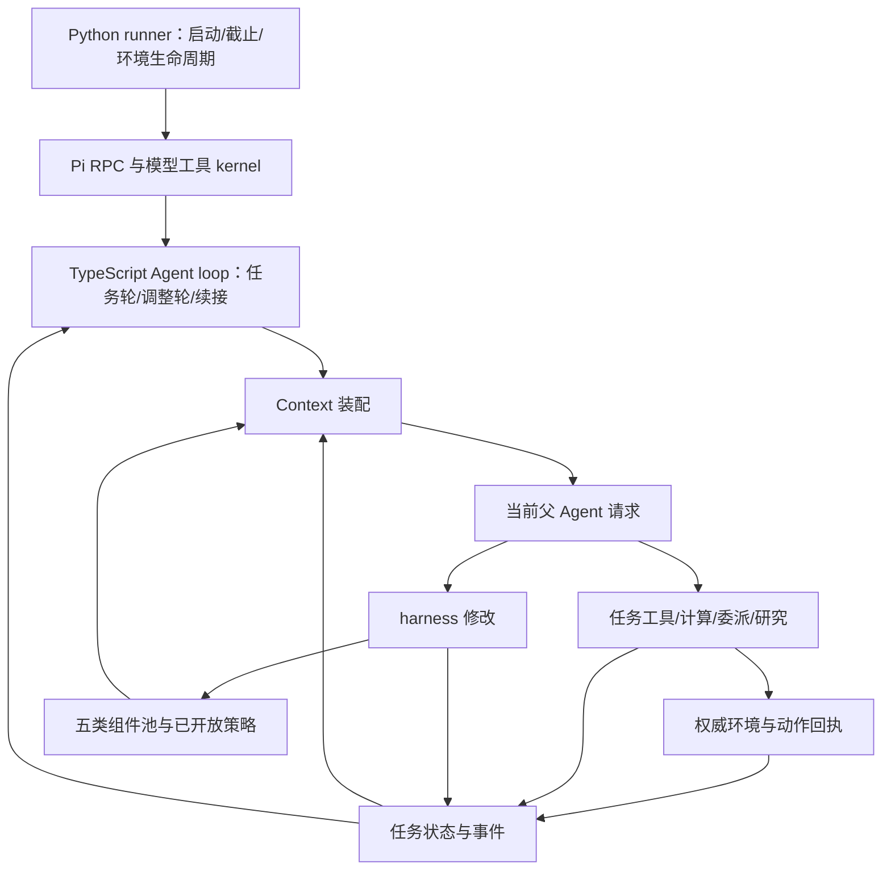

# 最小 Self-Harness Agent 系统：从可塑 loop 到后续真实使用

日期：2026-11-02。状态：旧 after-batch Hook 的第一阶段路径已在一次真实运行中走通；本工作树增加 TypeScript-owned phase loop、五类组件可调用修正及有界事件增量上下文。新 AZ/Qwen 真实运行到达 TASK→checkpoint ADAPT→TASK 并写入 memory，但在 provider error 恢复边界暴露 phase 状态分歧，11 动作后提前停止。memory Covered、稳定恢复、普通运行自主采用和净收益仍未验收；已修正不完整 turn 的过早停止判断，待针对性检查与新预算真实复验。

依据：[设计原则](../harness-design-principles.md)、[开发流程](../development-workflow.md)。本文件是开发方案和单一变更记录，不进入任务 Agent 上下文，不新增项目流程规则。文中默认值是本方案待实施的运行配置，不代表用户已确认长期设计变更。

## 1. 问题与可证伪命题

当前不是在一个已完成的 Agent 上增加组件商店：Pi 提供模型、工具、事件和 session 的 kernel；任务循环、上下文供给、记忆、调整轮、研究交付和恢复主要由本项目搭建。完整 Agent 的设计必须同时确定这些机制。

源码核查现场：当前主工作区为 thin-arc-self-harness；候选 donor 为 D:/agent/.codex/worktrees/self-harness-minimal-path/autoresearch_pi_project，包含未提交修改。本方案不把其提交版本等同于实际工作树，不搬运整个 dirty diff。

该 donor 的实际 native 路径已具备 Binder、Workspace、Python session、工具与行动桥接、文本 skill/subagent、loop mounts，以及独立 hook turn。但默认 self baseline 以 promote/save_tool 为主，其他类别被标为 compatibility；hook 的 Python 外层指令仍只列 promote/save_tool/read_component/skip；callable() 用 env.act 源码文本筛选并通常只暴露一个工具；多种 review、恢复、上下文分支混在 arc_thin_extension.ts 和 Python runner 中。这些实现不能只靠补一句“五类组件”收敛。

窄命题：保留现有真实执行底座，统一任务轮/调整轮的控制、五类修改入口及下一轮装配，可让父 Agent 在一次修改决策后，直接于后续任务轮获得并使用修改，无需再登记、组装、证明或强制复盘。它不保证模型会采用，也不保证净收益。

减负目标：消除选择载体后的路径封装、精确版本搬运、重复目录维护、显式 assemble/focus、额外成功声明。保留是否调整、调整内容、适用范围和结果解释等语义判断。

推翻条件：完整候选提交后仍要模型补机械手续；五类入口没有相应生效位置；hook 返回后丢失当前任务状态；策略修改未改变实际请求/调度；一次行动在恢复中被重复提交；普通运行持续付出调整成本而没有后续任务用途。

## 2. 路线选择

| 路线 | 收益 | 代价/决定 |
| --- | --- | --- |
| 在 thin 主分支继续叠五类入口 | 代码较短 | 缺少最新 hook/native 工作，会重复建设；不选 |
| 在旧通用 task-local harness 上全面简化 | 五类、研究和验收材料丰富 | 容易保留 assembly/review/管理协议成为父常驻义务；作为实现来源，不作为默认 loop |
| 以 minimal-path 的 native 执行基础重构上层 loop | 已有真实行动、组件文件、会话和 hook | 需清理多模式与工具实验偏向；推荐 |

不是从零重写 Pi；新建单一入口的上层实现，逐段借用 donor 的已核查函数。旧实验入口保留供对照，新入口只加载新 loop，不同时注册两套控制 hook。跨分支迁移前检查 donor 的实际 diff、依赖和测试，不 cherry-pick 未审计的整块工作树。

预计完整实现超过 300 行：需要贯通状态机、五类内容、上下文、调度和真实适配器，单补 prompt 无法完成。分成可独立运行的阶段实施，避免先建通用平台。

## 3. 完整系统与责任



- Pi kernel：provider 流、模型工具消息、工具分派、session 事件。不假设它替本项目定义完整任务策略。
- Python runner：启动/停止 bridge 和 Pi、外层硬截止与预算、传输续接请求、汇总产物。不再用 CONSOLIDATE/STALL 等文本决定正常调度。
- TypeScript loop：选择轮次、冻结本轮组件快照、装配 context/工具、消费回执、推进下一轮、按已开放策略安排 hook。选择逻辑是确定性的，不另加总控模型。
- 父 Agent：任务理解、行动、是否调整和如何调整、是否使用组件、结果解释。
- Runtime：存储版本、编译/注册、状态注入、权限与预算、执行和增量交付。不从自然语言推断组件价值。
- 子 Agent/研究：承担获授权的有界职责；不默认获得父的修改权限、行动权限或额外预算。

任务 Agent 看不到开发 AGENTS.md、设计文档、验收表或本变更记录。

## 4. Loop 是明确可塑的实现对象

第一版只有 TASK 和 ADAPT 两种模型工作轮。启动、恢复、环境结束是状态转换，不额外创建 planner/reviewer/controller 模型。

TASK 的职责是推进任务，可以观察、计算、读取方法、委派、直接修改 harness，最终行动/交付或明确等待。修改不要求先失败或先进入 hook。ADAPT 使用同一父角色的独立 context，检查经验或预期需要，可修改全部五类及已开放策略，也可不改；不操作在线环境。

正常状态转移：TASK settled → 记录真实事件 → 若终态则停止；否则有已排定 hook 则 ADAPT → TASK，否则 TASK。ADAPT 不安排自己的下一次 ADAPT；失败或不修改都回到任务。TASK 不必先完成组件创作才能继续。

TypeScript 概念代码（接口是拟新增，不冒充已有 API）：

```ts
async function beginTurn() {
  const facts = await adapter.observe();
  if (facts.terminal || budget.exhausted()) return stop();
  const phase = loop.resumePhase ?? chooseDuePhase(loop, policy, facts);
  const snapshot = await harness.bindPendingAtBoundary(facts);
  return { phase, snapshot, context: await buildContext(phase, facts, snapshot) };
}
// before_agent_start 建立 TurnFrame；context 仅投影；工具记录事件。
// agent_end 结算已执行事实与 stop reason，决定是否保留本轮续接或推进轮次。
```

Python 对新入口只重复发一个固定 transport 请求。before_agent_start 读取持久化的本轮状态，而非从模型自然语言或 prompt 正则识别模式；context 和工具执行都使用同一个 TurnFrame。agent_end 并非无条件完成：provider length 保留 phase、已提交操作和未完成消息，下一请求续接同一轮，不重新插入 hook。中断的工具批次先核对工具/环境回执，不按原文本重放。

正常完成依据实际行动回执、最终答复、显式等待或调整轮结束；模型文本“已行动”不是环境事实。沿用现有批次结束机制并检查混合工具批次回执，不在 tool callback 内重入 session.prompt。

默认调度建议：保留 donor 的“每个已结算行动批次后一次 hook”，作为待测起点；终态、硬预算和给下次任务保留的时间不足时跳过。普通任务可在一个实质工作批次后形成同类边界。Agent 可设为 manual 或每 N 批次，并可主动请求下一边界调整；不会因每条工具消息自动启动 hook。没有价值时允许连续不修改，skip 不要求填写理由码。

### 真正开放哪些运行机制

| 调整对象 | 内容载体/接口 | TypeScript 生效位置 |
| --- | --- | --- |
| 目标解释、实验/解题流程 | prompt/skill | TASK 指令与按需方法载入 |
| hook 时机与证据范围 | prompt 组件的受类型约束 policy 字段 | chooseDuePhase、buildAdaptContext |
| context 历史长度、memory 选择、skill 装载 | 同一 policy 的 context 字段；Agent 选逻辑名 | buildContext，真实 provider 输入改变 |
| 当前观察加工、反馈计算 | tool 挂载到已有 decision/feedback 点 | before request / 已结算 feedback 执行器 |
| 分工、工具范围、交接 | subagent 组件和授权研究职责 | 子请求构造、broker、交付边界 |
| 任意新 TS 扩展点、全新存储协议、修改硬预算/环境权威 | 第一版未开放 | 需后续开发，不以修改 markdown 冒充支持 |

policy 不是第六类组件，而是 prompt 组件附带的组织配置：例如 `{hook:{mode:'after_batch',every:3},context:{recentTurns:4,memory:['rules'],skills:['probe']}}`。解析后由 runtime 执行；文本指导不冒充调度改变。实际字段按现有能力收窄，不做任意图编排 DSL。

policy 不能提高外层预算/权限、隐藏权威新观察、撤销已执行动作或修改内核边界。policy 未知字段在一次入口校验报错；Runtime 不默默忽略并报成功。计算挂载第一版只供给数据/反馈，不新增语义 action gate；现有权限与环境拒绝照常生效。

## 5. 五类组件：统一管理，按作用生效

对父开放 `harness` 工具：`put / get / list / remove / select`。put 默认保存并选用；select 用于选用现有内容或归档，未选不自动判失败。逻辑键由 kind+name 确定，版本、路径、内容 hash 和当前绑定由 runtime 维护。put 更新同名组件，无需 create/update 两种操作。版本检查由本轮读取快照自动带入；发生真实冲突时才请求重新读取。

最小公共字段为 op、kind、name；put 按类别要求 body 或 program，scope 不填继承 task。description 对目录型 skill/tool/subagent 有用；不要求所有类别填写 reason、expected、basis_refs 或 creator 引用。可附证据引用，由当前轮自动补足来源事件，但不把来源当作结论已验证。

| 类别 | 表达与保存 | 装配/实际使用 |
| --- | --- | --- |
| prompt | Markdown 正文；可含已开放 policy | 下一轮指令段；policy 真正改变调度/装配 |
| skill | SKILL.md 方法正文及可选资源 | 默认只给目录，read 读取完整方法；明确选为本轮方法时直接注入，无需重复读 |
| tool | 复用 Python 执行契约、显式参数和 env/state | 选用后下一轮具名暴露；所有计算工具均可调用，不要求源码含 env.act |
| subagent | 职责、指令、允许工具、交接说明 | consult/delegate 按该版本构造真实子请求并返回结果 |
| memory | 文本或可选结构化事实/假设/反证/未完事项 | 选中的适用内容进工作集，其余有目录和精确检索 |

Memory 的条目结构是可选的，不能为了存一句经验强迫填 subject/predicate/value。task_state 保存当前计划/未完实验等易变工作内容，harness memory 保存未来需要保留的认识；普通文件/变量不自动升级为组件。scope=task/episode/level/state 明确过期，默认 task；跨任务持久化不在第一版隐式开启。

兼容 donor 的 promote/save_tool，内部转成相同 put，属于工具便捷入口；不能占据全部 system prompt。self_component 不再把非工具称为 compatibility。存储保持五类现有位置；process 内容归 prompt，不新增主体类别。

生效边界统一为下一 settled 轮，不强求创建后同一工具批次立即执行新能力。回执只返回逻辑名、版本、作用域、生效轮次、失败原因；存储/编译失败保留旧可用版本，绝不把旧版当新版调用。下一轮绑定成功与否另有真实回执。修改和安装之间不加模型确认步骤。

先完成单组件写入/绑定。组合由 Agent 在一次消息提交多个独立 put，下一轮一起取快照；不承诺跨组件事务。若方法确实依赖其他组件，可指明逻辑依赖，由 runtime 绑定精确版本；缺依赖返回具体缺项，不悄悄声称整个组合可用。不为猜测竞态新建发布平台。

## 6. Context 与数据内容构成完整 Agent 的工作记忆

原始事件、当前工作集、组件池三个职责分开：事件保存事实；工作集保存当前继续任务所需内容；组件承载可持续使用的方法、指令、能力和认识。只保存事件无法保证认知连续。

TASK 每轮实际输入按顺序构造：稳定根指令 → 生效 prompt → 最新权威观察/预算 → 当前任务状态与有效 memory/反证 → 已选择方法与能力目录 → 尚未交付的研究增量/修改回执 → 最近完整消息和本轮工具调用链。范围过大的原始结果留精确 ref，不能删掉模型判断所需的当前网格/PNG。

ADAPT 输入：调整角色指令 → 当前任务目标和当前任务状态 → 上次查看以来的事实摘要与关键失败/成功/研究增量 → 相关组件内容/目录 → 剩余预算。它能按 ref 查完整轨迹及全部组件；不直接拿整个 Python namespace 或重放所有解题上下文。Python promotion 只是可选便利来源，不能成为调整前提。

事件查看游标与“最后保存组件”分离：不修改也可以确认已查看范围，但未完线索继续留在 task_state/memory/研究线；不能用 skip 删除未处理证据。hook 可请求更早证据，任务开始与跨关历史仍可检索。

工作状态允许父在自然任务工具中更新，也允许随 harness 修改附带 continuation；没有变化不必重写表格。预算接近 context 上限时才进行必要压缩；Agent 保留关键假设、反证、未完成实验和下一步理由，runtime 保留最新观察、真实动作与工具回执。压缩是 context 维护，不要求产生新组件或开始一轮 self-harness 仪式。

在 kernel 的 context 扩展点投影，检查实际 provider payload；根指令/工具表在每轮快照内稳定。本轮历史中的 tool call/result 必须成对保留，不按字符随意截断；尚未交付的 child 结果不因压缩丢弃。不默认保留/复制 provider 私有 reasoning，以显式工作状态和可见结果延续。

重启：从最新已提交组件、工作状态、动作回执、交付游标恢复；现场状态向 adapter 重新获取。若中断操作的行动结果不明，先查询并如实报告，不能假设没发生然后重试。跨关清理 level/state scope，task 认识保留且注明适用范围。

## 7. 提示与 AGENTS.md 的具体设计

运行包内只有短的 agent.md 根指令，由启动器显式加载；不依赖 Pi 自动搜索开发仓库文件。它包含目标、观察/事实优先级、可用能力、允许自主调整及预算边界，不复制设计原则全文。

TASK 提示示意：

> 完成当前任务。依据实际反馈选择下一步。当前状态、有效认识、方法和能力见本轮工作集。你可以直接工作，也可以根据经验或预期需要修改指令、方法、工具、分工和记忆，以及已开放的运行策略。harness.put 保存并默认选用，下一轮生效；不要求调整或创建任何类别。一次性计算用 python。需要独立调整窗口可请求 hook。实际效果由后续任务反馈判断。

ADAPT 提示示意：

> 检查这些经验或预期需要是否值得改变当前工作系统。可修改/组合/删除五类组件及已开放策略，也可保持现状。优先解决当前任务的实际负担。提交完整内容后由 runtime 安装；不要操作在线环境，不必产出总结或凑组件。本轮结束后返回任务。

另外分别维护 task.md（用户目标/环境契约）、adapt.md、context-summary.md，以及五类工具 schema 描述。方法说明在 skills，不把所有策略写进 system。移除默认提示中的强制重用、缺失类别提醒、固定先 consult/先 refine 才能行动、ok=true 就是成功优化等表述。保留任务确有必要的环境规则；预测/行动批量等 ARC 专用策略放 adapter 提示，不成为通用 Agent 规则。

## 8. 子 Agent、Auto-Research 与反馈

首次闭环不强制启动研究。父可独立调整；subagent 也是可选。需要独立分析时复用现有 broker、有限 session、结构化交接与 length 续接，不把新进程当作已保存的职责组件。

Auto-Research 保持已确认机制：研究线/职责持久，有界 worker 执行，新证据增量供给，核心结论即时交父，详情留研究线。第一阶段先接好普通 consult；后续接既有 Auto-Research runtime，不另建研究总控。研究默认只读环境、写隔离产物；候选由父通过同一个 harness 接口采用。纯结论可直接影响当前任务，不必转换成组件。

研究证据 cutoff、适用 scope 与前序 publication 随交付保留；同版本只交一次，修订/撤回明确显示。父采用后产生的组件版本、调用结果和行动反馈自然回流已授权研究线。父不维护 worker 全部分析，也不逐条确认机械交付。过时结果保持可检索，不直接覆盖当前计划。

## 9. 对应代码改造

路径均以目标仓库为根；新文件名是实施建议，未创建代码。

| 文件/来源 | 具体改变 |
| --- | --- |
| 新 demo/self_harness_agent.ts | 唯一 Pi extension 入口，注册轮次、context 和工具；不叠旧 arc_thin_extension |
| 新 demo/self_harness_loop.ts | TurnFrame、TASK/ADAPT、hook 调度、续接与终态；仅复杂独立职责拆文件 |
| 新 demo/self_harness_context.ts | 工作集、增量结果、两种 context、压缩/恢复；记录真实输入口径 |
| donor arc_thin_binder.ts/workspace.ts | 复用文件解析、版本与存储；补五类逻辑管理及下一轮绑定，删除对父的路径装配要求 |
| donor arc_thin_native_runtime.ts/components.ts | 复用 Python 执行与 env.act；撤掉 env.act 文本筛选和单工具 callable，明确选择的计算/行动工具都可见；取当前状态不依赖活变量抽取 |
| donor arc_thin_extension.ts | 只移植 ARC action/state/memory 等必要实现到薄 adapter；不搬整个模式分支、refiner/daemon/所有 review |
| 新 demo/prompts/self_harness/ | agent.md、task.md、adapt.md、context-summary.md；五类均为一等用途 |
| src/autoresearch_pi/arc_thin_e2e.py | 新入口走统一 NEXT/续接 transport，不再决定 hook/review；保留旧实验路径作比较器 |
| src/autoresearch_pi/pi_kernel.py | 优先不改 RPC 内核；复用事件和 length 续接；确有缺失才补小接口 |
| pi_task_local_subagents、auto_research worker runtime | 提取/复用 broker、交付、授权调度；不引入旧组件审批/assemble 前置链 |
| cli.py、现有 arc-harness-smoke | 增加显式新入口并让既有验收链实际加载它；旧 smoke 通过不自动证明新入口 |

Pi 0.87.0 的本地类型已核对 before_agent_start、context、agent_end、context_with_system、setActiveTools 等能力。它们证明可挂载的位置，不证明新系统已接通。工具注册/可见列表最终以实际 provider 请求核查；不依赖修改 prompt 假装修改 schema。

## 10. 从启动到闭环的完整例子

1. 启动器加载运行 agent.md、任务目标和 ARC adapter，初始化 task 状态；TASK 收到当前权威观察和基础能力。
2. 父发现“反复局部探测却没排除另一种规则”是当前瓶颈，先做一次区分性实验；也可在实验前因预期需要调整。
3. 行动完成，回执进事件。调度选 ADAPT，提供观察到的反例、未决解释、当前方法和预算。
4. 父保存文本 skill“先列互斥预测再探测”，更新一条 memory 的反证，并将 context policy 设为持续展示该反证；无需制造 Python 工具。
5. Runtime 保存、选用并于下一 TASK 绑定：方法正文和反证进入实际请求。父根据它们设计不同预测的实验，真实 action 产生可区分反馈。这里才有该场景的语义使用证据。
6. 后续任务可直接继续，不强制 assessment；若判断无用可修订/移除。若需要计算，另保存工具并后轮调用；需要独立解释时保存职责并委派，输出实际影响主任务。

改变 loop 的另一个例子：父发现每批 hook 开销高，put 更新组织 policy 为每 3 批；之后两批不启动 ADAPT，第三批触发，真实请求序列可验证。只写“少复盘”而代码仍每批触发不算实现。

## 11. 分段实施与真实验收

先构建一个完整纵向切片，再扩展覆盖；不先创建通用组件平台。每阶段沿用本记录更新，最多两轮评审。

| 阶段 | 可运行交付与删除负担 | 通过后才能声称 |
| --- | --- | --- |
| A 单一 loop | 新入口跑 TASK→ADAPT→TASK；只先接 prompt/memory；删除文本识别调度和 assemble 手续 | 该切片真实接线可达，非完整五类闭环 |
| B 五类一致生效 | 文本 skill、具名计算/行动 tool、subagent 接入同一管理与上下文；修改策略改变真实轮次 | 五类对应运行位置已实现，需矩阵验收 |
| C 连续性与研究 | 恢复/压缩、过期、研究增量与反馈回流；父不接管 worker 详情 | 已测恢复与研究链路可达 |
| D 普通运行 | 真实 provider 自主识别/修改/使用，含合理不修改 | 仅已测情境自主采用 |
| E 对照 | 相同执行底座、模型和预算的有/无调整及 hook 消融 | 仅满足预定判据时声称净收益 |

A/B 必须使用真实 bridge/Pi/kernel/action 路径，不能由离线脚本扮演父循环替代。完整 ARC 接线继续执行 arc-harness-smoke：真实 bridge、父 Pi loop、child broker/process、结构化回传、router、native mutation、action 边界及后续父轮；覆盖五类和 Auto-Research/普通 delegate 的 length 续接。新入口接入 router 时直接调用同一内部 put/bind，不要求父再 apply_route。确定性 provider 只用于接线诊断。

各类语义断言：prompt 改变后的后续判断、skill 方法执行、memory 认识参与决策、tool 对真实输入产生正确语义输出、subagent 按职责完成并被父采用。prompt/memory 影响无法确定则保留不确定，不能仅用出现字符串替代语义检查。policy 另断言实际 hook 序列/context 内容改变。具名只读工具无需自己 env.act；完整 ARC 场景仍要证明任务行动边界可达。

负例至少覆盖：无需调整、只归档、工具无价值未调用、更新/删除后不再装配、失效 scope、语法失败保留旧版、hook 超时回任务、未完整输出的修改不落地、length 保持 phase、行动后报错不重放、child 过时/撤回、context 压缩后关键反证仍可用于后续判断。

### 普通运行协议（待执行时填实际 provider 配置与授权预算）

- 不在任务中指定必须创建哪类组件；五类探针单列诊断，不算自主采用。
- 先一个有界探索样本，预算不得超出已授权运行；缺 provider/model/reasoning、总 token/时间/动作值时不启动计费运行。探索失败只定位一个主因。
- 确认实验建议同一底座上三组：无 self 修改、可修改但 manual hook、可修改且 after_batch hook。先选择一个主要变量比较，不把整分支差异归因给 hook。
- 各组至少三个独立样本作为初步重复；小样本仍是探索性证据，不许由单次通关声明普遍收益。ARC 无法对齐初态/种子时明确披露；不回退在线历史制造配对。
- 主要记录任务进展/完成、父子总 input/output/reasoning、墙钟、管理轮、首次有效行动延迟、压缩后反证和未完实验保留。缺计量为未知；output 已含 reasoning 不重复累计。
- 预先设定“质量不得退化”和预算限制；达到停止条件即终止，不为凑闭环追加研究/保存。hook 创建率、工具调用率不作为任务奖励。
- 机会→识别→投入→候选→装配→使用→反馈由现有事件离线分析；合理不使用、失败、放弃均保留。只有 Agent 作语义选择，runtime 记录事实；保留/修订/撤下是可选后续。

## 12. 第一段实现记录与证据状态

本段修改 donor `codex/self-harness-minimal-path` 的任务/调整提示和调整轮上下文：新增短的 root `arc_thin_agent.md` 与按需 `arc_thin_adapt.md`；普通任务和调整轮都显式加载 root，ADAPT 加载专属职责提示；ADAPT 请求注入当下环境观察、当前 memory、活动 prompt、组件索引和现有运行反馈；Python runner 的 hook 附加指令改为描述真实 ADAPT 职责，并保留现有工具调用上限与 smoke marker。native treatment 现在以行动后 ADAPT 作为唯一常规调整轮，抑制额外的 miss/stall/level/interval consolidation；WIN/GAME_OVER、动作/level/decision/token 上限或 hook 时间预留不足时跳过 ADAPT；ADAPT 的 provider length stop 最多续接一次，恢复仍未完成时回执如实标记 failed。hook 结算也检查 memory 日志，使只修改 memory 的轮次不会被记成 `no_save`。使用文章的重点是短常驻入口、相关内容分层和按需披露；文章针对编码仓库 AGENTS.md，本运行时提示仍以实际任务行为为准。

当前改动把 native treatment 的外层运行收敛为 TASK→ADAPT→TASK，并给调整轮补上一次 length 续接；phase 调度仍在 Python ARC runner，TypeScript 负责识别 ADAPT transport、限制工具并构造 context，双方仍通过 SELF_HARNESS_HOOK 文本标记衔接。尚未实现跨进程崩溃后的 ADAPT phase 恢复，也没有实现 Agent 可修改的 hook cadence/context policy。提示中“修改将在下一任务轮使用”尚需真实请求确认。以上剩余项不能用本文的规格或静态可读性代替。

实现环境中的 donor worktree 原有 native/hook 未提交修改已保留。第一段改动落盘时没有执行 provider/ARC 运行；后续真实运行证据及限制见下方 2026-11-02 补记。

| 证据层级 | 状态 | Provider / environment | 材料与边界 |
| --- | --- | --- | --- |
| 功能正确 | 部分观察；整体未验证 | AZ / Qwen3.8-27b / real ARC | 一次 Hook memory/prompt save 与下一 TASK binding 成功；失败恢复和完整任务行为未通过/未验证 |
| 全链路可达 | 一条真实路径观察到 | donor native runner + 真实 bridge/Pi/provider/ARC | action #2 → ADAPT 写 memory/prompt → 下一 TASK 绑定并执行 action #3；不代表稳定恢复或新 adapt-config 路径 |
| 自主采用 | 部分观察；语义使用未验证 | 同上 | Agent 选择保存组件；memory 虽被注入，是否改变下一步判断没有证据 |
| 净收益 | 未验证 | 无匹配对照 | 未通关，不能把一次保存或动作归因于收益 |

下一可证伪检查：用新 `--typescript-phase-owner` 入口构造一条真实 provider 路径，确认 TS phase state 实际选择 TASK→ADAPT→TASK，length 恢复保持当前 phase，终态/硬预算不再启动下一 phase；再检查 ADAPT 事实增量、策略更新、组件绑定和后续 Task 输入。该运行需单独预算授权，且不做对照实验。若 ADAPT 改 memory，审阅下一实际决策是否采纳、修订或合理忽略；不能仅凭出现于 context 声称 Covered。

关联 [deferred-research-todos.md](../deferred-research-todos.md) 的研究到行为、父子总成本与跨压缩认知连续性。本轮只给出实现与验证位置，不改变这些事项的未完成状态。

### 2026-11-02 第一阶段真实路径补记

运行产物在 `D:/autoresearch_pi_project/runs/self-harness-bounded-20261102-103200/`，代码来自 `codex/self-harness-minimal-path` donor worktree；真实 AZ / Qwen3.8-27b / ARC `ls20`。该运行后来以 recovery allowance exhausted 失败结束，12 动作、0 关；以下只确认已经实际到达的局部生命周期，不把失败运行说成整体成功。

- **TASK 观察与行动结算：** action #2 已收到真实 receipt 和更新后的 observation，随后进入 action_id 2 的 Hook；见 [trajectory](D:/autoresearch_pi_project/runs/self-harness-bounded-20261102-103200/harness/trajectory.jsonl) 与 [Hook trace](D:/autoresearch_pi_project/runs/self-harness-bounded-20261102-103200/harness/self_harness_hook.jsonl)。
- **ADAPT 修改：** action #2 后的 Hook `self_harness_hook:2` 调用了 `self_component(kind="memory", name="arc_thin_game_state")`，并保存 `prompts/arc_thin_strategy.md` v1；Hook 记录 `memory_updates: 1`、`disposition: saved_untried`，本次 turn 完成。细节见 [Hook events](D:/autoresearch_pi_project/runs/self-harness-bounded-20261102-103200/harness/self_harness_hook.jsonl) 和 [component versions](D:/autoresearch_pi_project/runs/self-harness-bounded-20261102-103200/.harness/components.jsonl)。
- **Runtime 保存：** memory 更新进入 [memory.jsonl](D:/autoresearch_pi_project/runs/self-harness-bounded-20261102-103200/harness/memory.jsonl)，并出现在 [persisted memory view](D:/autoresearch_pi_project/runs/self-harness-bounded-20261102-103200/workspace/data/memory.md)。代码路径由 `self_component(kind="memory")` 调用 `commitMemory()`，该函数写入 memory log 并更新本进程 memory 状态。
- **下一 TASK 绑定：** action #2 后的 Task working set（decision 5）记录了 prompt v1 为 active version，memory section 从空状态增长为包含该 entry 的约 722 字符。工作集日志见 [working_set.jsonl](D:/autoresearch_pi_project/runs/self-harness-bounded-20261102-103200/harness/working_set.jsonl)。
- **下一 TASK 继续行动：** Task 收到更新后继续判断并执行 action #3 (`ACTION3/Left`)；见同一 [trajectory](D:/autoresearch_pi_project/runs/self-harness-bounded-20261102-103200/harness/trajectory.jsonl)。但 memory 内容建议再次按 Right，下一动作却是 Left；日志没有说明这是否是 Agent 基于新观察作出的有意取舍。因此 memory 是 Created、Persisted，并被装入下一 TASK 的 working set；实际 provider 请求中的精确内容未单独留证，**Covered/语义采纳未证实**。Prompt v1 被装入后续 working set，但因决策同时由最新 observation 驱动，也不能仅凭相邻动作断言 prompt 导致动作变化。

**结论：** 第一阶段所述真实路径在旧的每批 Hook native 运行中**至少完整走通一次**，包括 ADAPT 写 memory、runtime 持久化、下一 TASK 加载并继续行动。若“完成”指机制可达，这一项有真实证据；若指 memory 已被语义利用并带来改进，尚未完成验收。L0（Agent-created tool 后有成功调用）本次未达到，因为没有创建并调用 tool；这不否定 prompt/memory 路径的局部可达性。当前 `adapt-config` 的 uncapped run 是另一个候选：它只有 1 个 action，没有 `request_adapt`/ADAPT/memory write 记录，不能用来验收这条第一阶段路径。

**开放 issue MEMORY-A1 — memory 的下一轮语义使用未验收。** 已确认 ADAPT 写入一条 memory，runtime 持久化，下一 TASK 工作集的 memory section 增长并继续行动；尚无单独的实际 provider 请求内容记录，也不能证明下一判断使用、修订或有理由忽略了该 memory。下一检查应在稳定的真实 TASK→ADAPT→TASK 链中，对照 ADAPT 保存的 key/内容与后续真实 provider 输入，审阅下一轮的假设、理由、行动及反馈；若 Agent 不采用，记录适用性和理由。只有后续决策确实受 memory 影响才将其记为 Covered；若声称收益，再用预先设定的 matched-prefix 或相近预算对照。此项保持开放，不阻断 B 阶段的独立实现，但第一阶段不能据此宣称 memory 已发挥语义作用。

## 13. 可配置的按需 ADAPT 候选（独立工作树，待真实运行）

本次回应“TASK 可能忽视旁路信号”和“反证次数属于任务配置”的问题。实现放在独立的 `adapt-config` 工作树，未修改正在跑 ARC 参照样本的 donor 工作树。主要命题：用持久的 Agent 请求、可编辑的结构化信号和稀疏全局检查点代替每批模型调用，在不丢失明显调整机会的条件下降低 ADAPT 总成本。若请求未被执行或明确结算、配置修改未改变后续调度、或任务进展/总成本劣于每批基线，则推翻相应部分；当前无行为或净收益证据。

启动时 `arc-thin-e2e --adapt-config <json>` 将经校验的文件复制到运行目录 `adapt-config.json`；不指定时使用与 `config/arc-adapt.example.json` 相同的默认值。TASK 可以用现有 read/write/edit 工具修改运行副本；runner 在每个已结算 TASK 边界重新读取，非法内容保留上一有效配置，并在 `harness/adapt_schedule.jsonl` 记录错误。配置字段：

| 字段 | 含义 |
| --- | --- |
| `mode` | `on_demand`：请求、信号或检查点触发；`manual`：只接受 Agent 请求；`after_batch`：每个行动批次触发，供对照 |
| `checkpoint_every_batches` | 跨批次全局检查间隔；`0` 关闭。默认 6，仅在 `on_demand` 生效 |
| `rules[]` | `event`、`count`、`within_actions`。事件可为 `prediction_miss`、`claim_failed`、`level_change`；`claim_failed` 可另设 `key`，指向 Agent 在 memory 中定义检查的假设。规则只数真实结构化回执，不解析自然语言 |

例如某任务的假设名为 `mechanism_a`，用户或 Agent 可将规则设为 `{"event":"claim_failed","key":"mechanism_a","count":2,"within_actions":6}`；另一个任务可以改名、次数、窗口，或删去这条规则。Agent 可以直接调用 `request_adapt(focus=...)`，请求写入 `harness/adapt_requests.jsonl`；下一已结算安全边界合并所有待处理请求，进入一次 ADAPT 或记录终态/预算跳过。没有环境行动的 TASK 轮也可触发请求。ADAPT 不再触发自身；失败有回执，不自动重试。阶段状态仍由 Python runner 调度，未实现原计划中的 TypeScript 持久 phase。

ADAPT prompt 附触发原因及上次 ADAPT 以来的行动数、预测失误数、关卡变化和行动范围；完整当前观察、memory、活动 prompt 和组件索引仍由 extension 提供。此摘要不是跨压缩认知连续性的证明，尚需检查实际 provider 输入与后续决策。默认 `claim_failed` 规则未启用；Agent 定义检查后可按任务添加。现有旧 smoke 按每批 hook 的预期不能代表 on-demand 模式；本次不做对照实验。

截至下方真实运行前，本候选只有静态检查和 scripted wiring smoke；当时四层行为证据均未验证。下方记录真实运行更新及尚未关闭的事项。

### 2026-11-02 `request_adapt` smoke 协议（运行前固定）

用户授权本候选一次真实 provider ARC 运行，上限为 8 环境动作、1200 秒和 60000 reported tokens，先到即停。目标是观察普通 TASK 是否自主调用 `request_adapt`，以及请求是否导致 ADAPT 和后续 TASK；不以这一次样本判断净收益。先用脚本 provider、mock ARC SDK、生产 bridge/Pi/runner 诊断接线；其调用是脚本指定，不计自主采用。真实样本用主项目 `.env` 的 OpenRouter gateway、`nvidia/nemotron-3.5-super-vl:free`、真实 ARC SDK、`ls20`，provider 默认推理设置，单请求输出上限 8192，text 输入。使用 `config/arc-adapt-manual-smoke.json`（只允许 Agent 主动请求，关闭自动规则和检查点），不在任务中指示必须调用工具；ledger/critic 关闭以隔离触发变量。若没有调用，检查是否出现适用机会、工具是否实际暴露、模型是否看见反证；不能把无调用直接说成接口失败。成功接线须在真实运行日志看到 TASK `request_adapt` 调用与成功回执、ADAPT 请求，以及返回后的 TASK；若边界先结束则按实记录未完成。研究到行动、父子总成本和跨上下文连续性仍需独立评估。

第一次真实 provider 样本在 2 次 Python 调用后被本地 conservative reported-token 预留拒绝，0 动作、0 次 ADAPT；产物在 `runs/adapt-request-real-20261102/`。其已报告 22076 tokens，但第三次请求的预留 46733 超过当时 60000 总上限的剩余额度，不能据此评价自主请求。用户随后明确取消 token 上限；后续样本只保留 8 动作和 1200 秒两个停止条件，使用独立运行目录。单请求输出上限也取消，由 provider/model 自身约束；其余配置与普通任务条件保持一致。这是预算变更，不把前一失败样本删去。

### 2026-11-02 真实运行结果与待追踪项

**已完成的接线诊断。** `runs/adapt-request-scripted-20261102b/` 使用 scripted provider 和 mock ARC SDK，生产 bridge/Pi/runner 记录到 TASK 请求 ADAPT、ADAPT 执行 `skip`、随后 TASK 继续。它证明该脚本路径的 wiring 可达，不证明真实模型会请求或采用。

**第一次有界真实样本。** `runs/adapt-request-real-20261102/` 在 2 次 Python 调用后被 conservative token 预留拒绝，0 个 ARC 动作、0 次 ADAPT；这是预算门控停止，不能作为模型不请求的证据。

**取消 token 上限后的真实样本。** `runs/adapt-request-real-uncapped-20261102/` 使用 OpenRouter `nvidia/nemotron-3.5-super-vl:free`、默认推理设置、真实 ARC SDK、`ls20`、manual 配置（仅 Agent 请求触发，规则为空）。运行配置确认 `max_reported_tokens: null`。运行 635 秒后以 `continuous turn recovery allowance exhausted` 结束：1/8 个授权动作、0 关、未出现 `request_adapt` 工具调用、未进入 ADAPT，故也没有 ADAPT 后的 TASK。日志计 3 次 decision timeout、2 次恢复、11 次父请求（8 完成、3 中断）；报告 134,772 tokens，另 3 次中断请求成本未知，非完整账单。运行在 1200 秒和 8 动作限额前结束。

| 证据层级 | 当前状态 | 证据边界 |
| --- | --- | --- |
| 功能正确 | scripted 样本有限通过 | 仅证明脚本请求路径能调度 ADAPT 并返回 TASK；规则触发、恢复和真实 provider tool schema 未由该样本覆盖 |
| 全链路可达 | scripted 路径通过；真实 provider 未验证 | 真实样本未调用请求工具，因此真实 TASK→ADAPT→TASK 链路没有走通 |
| 自主采用 | 未验证 / 样本不足 | 真实样本没有请求，但仅完成 1 个动作且发生多次决策超时，不能区分合理不使用、忽略信号或模型未能及时决策 |
| 净收益 | 未验证 | 无 ADAPT、无后续使用、无匹配 after_batch 对照；单样本也不足以比较任务质量与总成本 |

**开放 issues 与未完成测试。**

1. **ADAPT-R1 — 真实 TASK 对请求工具的可见性与自主触发。** 从实际发给 provider 的 schema/请求记录确认 `request_adapt` 是否暴露；在一次稳定、有适用调整机会的普通 TASK 中记录是否请求、参数、成功回执及理由。当前真实运行没有请求事件，触发行为仍未知。
2. **ADAPT-R2 — 连续决策超时与恢复耗尽。** 查明本次 3 次 decision timeout、2 次恢复后耗尽连续恢复额度的原因；用不改任务触发语义的诊断确认请求耗时、恢复次数与最终 stop reason，并检查中断时请求/环境操作不会重复执行。当前是导致样本过早结束的首要断点。
3. **ADAPT-R3 — 可配置规则触发。** 单独验证一条配置规则（如显式记录的 prediction miss 或 claim check 反证）在边界触发一次 ADAPT；验证合法配置编辑在下一 TASK 边界生效、非法配置保留上一有效值并记录错误。当前真实运行配置 `rules: []`，没有覆盖这条路径。
4. **ADAPT-R4 — ADAPT 产物进入后续 TASK 并改变下一步。** 运行中让 Agent 自主或由已配置规则请求 ADAPT，若其修改 prompt/memory/工具，检查真实后续 provider 输入、组件调用和动作是否体现该修改；区分 Shown、Called、Covered。当前没有 ADAPT，所以该闭环未测。
5. **ADAPT-R5 — 触发策略的成本与任务对照。** 在获得新的真实运行授权后，用相近初态/预算比较 manual/on-demand 与 after_batch，报告父子总 tokens（含未知/中断）、延迟、管理轮、动作进展和终局；预先固定负例与停止阈值。当前没有比较器，不能宣称效率或收益。
6. **ADAPT-R6 — 边界行为与回归。** 覆盖终态、动作/时间预算不足、重复请求合并、ADAPT 失败后回 TASK、无行动 TASK 请求、配置变更生效边界等情境。此次未运行这些检查；scripted smoke 只覆盖请求→skip→TASK 的一条路径。

上述未完成的真实 provider 检查需要新的单独预算授权；本次 8 动作 / 1200 秒授权已用于该运行，不视为后续运行授权。后续 Self-Harness run 按[测试验收分析指南](../self-harness-test-acceptance-guide.md)分别检查 TASK、ADAPT、组件生命周期与 engineering 改进。相关的研究到行动、父子总成本和跨上下文连续性仍保持开放，见 [deferred-research-todos.md](../deferred-research-todos.md#2026-11-02-按需-adapt真实运行遗留)。

## 14. TypeScript phase loop、五类调用边界与 Workspace/PythonSession 复核（2026-11-02）

### 问题与实现命题

- 原 Python runner 每次 Task 后读取请求、配置和结构化反馈并选择是否调用 Hook；TypeScript 只从 `SELF_HARNESS_HOOK` 文本标记推断当前轮，phase 状态没有稳定恢复点。这使单一 Agent loop 的控制权仍分裂在两个进程。
- 新增 native-treatment opt-in `--typescript-phase-owner`：Python 对每轮只发送固定 `ARC_THIN_PHASE_NEXT`/`ARC_THIN_PHASE_RESUME` transport、执行 bridge/Pi 与硬预算；TypeScript 持久化 phase、action count、请求 ID、配置和事件 cursor，决定下一轮 TASK/ADAPT。length/retry 保持 phase；已提交 action 由轨迹回执对账；未知 action receipt 停止，不重放；环境终态和 action budget 不再启动新 phase。
- ADAPT 是同一父 Agent 的独立请求，工具不开放环境 action。旧兼容 Hook 保持其原先受限工具 surface。Agent 可通过有限 `adapt_policy` 接口修改 workspace 内的结构化 policy；用户仍可用 `--adapt-config` 提供初始配置。合法配置在下一已结算 Task 边界使用，非法配置保留上一有效值并记事件。
- ADAPT 会按每个 JSONL source 的本地行号携带 bounded factual delta，轮转提供 trajectory、component_runs、memory、adapt_requests；cursor 仅在对应 ADAPT 成功结算后推进，未交付行留待后续。现有 context 继续提供当前观察和 memory；该事件增量不是语义使用或压缩连续性证明。
- 静态审阅发现 `max_decisions`/`no_action_streak` 原先会在 Task 结算后先于已触发 ADAPT 生效，导致预算边界吞掉 ADAPT；runner 现在只在 TypeScript state 明确为 `settled + nextPhase=adapt` 时让该 ADAPT 收尾，再在后续 Task 边界执行原限制。Task 用户提示也由 TypeScript 持有，并保留 native treatment 的短窗口检查与已发布 Tool 调用指引，不再把 Python transport 对应的 generic 提示当成任务指令。
- 为执行用户授权的无时限运行，CLI 新增 `--decision-timeout 0` 以关闭单个 Pi turn 截止；同时需传 `--turn-idle-timeout 0` 与 `--experiment-timeout 0`，使 idle 恢复和 run deadline 都不形成额外时限。该参数本身尚未运行验证。

### Workspace 与 Python 复用：证据和判断

当前实现已有三种不同状态：`Workspace` 是 run-local 文件/观察沙箱，`PythonSession` 是当前 Task 的 live Python namespace 与 checkpoint，`Binder`/`.harness` 是显式保存后按版本绑定的能力目录。它们部分分离在不同存储位置，但 component 身份仍从 Workspace 路径约定推导；scratch、输出引用和 `tools/`、`skills/` 等能力路径共用同一文件域。Python 临时 helper、可持久文件、可调用 Tool 的边界主要靠调用惯例，不是一个直接统一的逻辑 API。

最近 uncapped 真实运行中，Task 曾在 Python #4 定义 `comps(color)` 并分析若干区域，后面 Python #7 再次定义同名 helper 并重扫既有颜色/区域；当时 working set 已显示 session 函数名/签名和可复用地址。既有 `reuse_report.json` 只识别到 1 个文本/代码形状重复，因此对概念重复存在漏报。该运行仅 1 个真实动作且没有 ADAPT；它证明“提示可见仍可能重写”和报告盲点，不足以推断全项目重复率、重复 token 比例或自动晋升的收益。

本次修正移除 callable 对 Python 源码字面量 `env.act(...)` 的语义过滤：Agent 显式发布且成功绑定的 compute/action Tool 均可按逻辑名调用，是否行动由实际回执记录；这解除只读计算能力被误分类为不可调用的断点。没有新增自动 promote、强制选择、常驻复用提醒或组件计数奖励。PythonSession 已有函数列表、签名、`cell(P#)`、同状态缓存和函数被变量覆盖时的提示；只有一次近期重定义证据时，再增加提醒或作者流程不能证明会替代重写，并会增加每轮 token/决策成本，因此本次只修真实 callability 缺口。

后续架构方向按证据分阶段：保留 Workspace 的受限文件/精确引用职责；保留 PythonSession 作为临时 Task 工作台；只有 Agent 显式 `promote`/`save_tool` 的逻辑组件进入 Binder。下一步先从真实 run logs 测“已显示 helper/组件 → 实际调用、改写、重复取证、确实替代下游”的频率及父总成本，再决定是否需要跨 session 命名 helper 索引、workspace 子域 API 或更直接的复用入口。普通文件不自动升级成组件，Python namespace 不整体复制成持久组件商店。

### 交付与证据边界

| 层级 | 本工作树状态 | 可支持的说法 |
| --- | --- | --- |
| 功能正确 | 部分通过；恢复边界失败 | 真实 TASK→ADAPT→TASK 可达；Task 12 provider error 令 TS 过早锁定 `action_receipt_unknown`，runner 随后恢复并提交 action #11，状态分歧。修复已改为只对完整 provider turn 的缺失回执停止，尚未重跑验证 |
| 全链路可达 | 单条链路通过；运行提前停止 | 真实 AZ/Qwen + ARC 运行在 action #6 后触发 checkpoint ADAPT、写 memory，之后进入 Task 并继续行动；未到 50 动作，最终因上述恢复状态分歧停止 |
| 自主采用 | 部分观察；memory Covered 未证实 | Agent 在 ADAPT 写入 `task_state`；decision 8–12 working set 显示该条目。其内容建议 Right，后续 action #7–#10 均为 ACTION1；没有理由日志证明有意拒绝或语义采纳 |
| 净收益 | 未验证 | 单次运行、未完成任务、无对照；832,087 reported tokens 及 1 个失败请求的计量不完整 |

### 2026-11-02 TypeScript phase-owner 真实 ARC 验收记录

**运行身份与边界：** `runs/self-harness-typescript-owner-az-qwen38-50-20261102/`；branch `adapt-config`，启动 HEAD `90d636fe` 且 31 项既有/本轮脏改动（不等于全都属于本变更）；真实 Pi + AZ (`az.gptplus5.com`) / `yibu` custom provider + `qwen3.8-27b`，`thinking=low`, `thinking_format=qwen`，真实 ARC `ls20`。授权最多 50 动作、无 run/turn/idle 时间上限、无 reported-token 上限；ARC bridge/action budget 50。实耗 11 actions / 0 levels / 3,374 秒；reported 832,087 tokens、预算口径 682,583，父 36 次（35 成功、1 失败），refiner 3 次；1 次失败请求用量未知，故完整成本未知。scorecard 已核验，状态 `NOT_FINISHED`。无对照实验。

- **TASK：** 11 个已确认 trajectory/bridge actions 均有 receipt，最后 1 次 action 由 recovery 后提交；没有终态或关卡进展。未完成 ARC 任务目标。
- **ADAPT：** config 为 `on_demand`、checkpoint 每 6 个批次、prediction miss 2/8。没有 `request_adapt`；第 6 批次后因 `checkpoint:6 batches` 进入一次 ADAPT。该轮真实调用 `self_component(kind=memory, name=task_state)` 后调用 `skip(no_reusable_logic)`，ADAPT 结算并回到 Task。完整转移见 `harness/adapt_schedule.jsonl`。
- **组件：** memory `task_state` 于 action count 6 写入 `harness/memory.jsonl`，decision 8–12 的 `harness/working_set.jsonl` 含该 key 与 memory 文本，证明 runtime 侧构造并投递到下一 Task head；Pi 未持久化最终 provider prompt payload，因此 Shown 证据是 working-set 构造日志加源码发送路径。后续 action #7–#10 与记忆的方向建议不一致，没有记录理由；Covered 未证实。run 中 `tools/player_pos.py` 与 `prompts/strategy.md` 的 `by=refiner`，不是 parent Agent-created 组件；没有 parent Agent-created tool 成功复用，无 L0；Skill/Subagent 未创建或调用。
- **Engineering/meta：** 本次 phase loop、Task/ADAPT prompts 和 Runtime 均由开发者构建；Agent 未修改 loop/engineering process rule。L3 不适用/未达到。
- **L0–L3 与四层：** 最高 L0–L3 = 未达到；functional correctness 部分（happy path 达到、恢复路径失败并已改代码但未复验）；full-chain reachability 对一次 TASK→ADAPT→TASK 通过；autonomous adoption 仅观察到 memory creation，semantic Covered 未验收；net benefit 未验证。
- **末端断点：** Task 12 在 08:21 的 provider attempt 2 以 `error` 结束，Pi 留下含 `arc_action` 的未回执消息；TypeScript 当时把不完整 provider turn 误判为执行结果未知并锁定 stop。Python runner 后续恢复，attempt 3 成功，08:22 提交 action #11；最终 bridge 和 trajectory 都是 11 动作、无重复提交，但 phase state 保留 `action_receipt_unknown`，runner 因而以该错误原因结束。已将 TS 判定收紧为：不完整 turn 的恢复交由 runner/bridge 对账，只有完整 turn 的未结算动作回执才停止。该修正尚未经过针对性检查或新的真实运行。
- **其他启动尝试：** 首次无凭证 root `runs/self-harness-typescript-owner-20261102/` 在 0 action/0 reported token 时退出。选错 Nemotron 路由的 `runs/self-harness-typescript-owner-20261102-retry1/` 被用户中断，0 action 但留有 pending provider response、无 final summary；该次 provider 用量不能确认，单独保留，不计入 11-action run。

后续只验证一个断点：新预算授权后，用同 provider/模型重新运行 phase-owner，检查 incomplete provider error 后 runner retry 与 TS phase state 最终一致，且不会重放已提交动作。保持真实运行一条路径，不做对照实验。phase-owner 仍 opt-in；不把当前结果描述为默认架构已替换。
