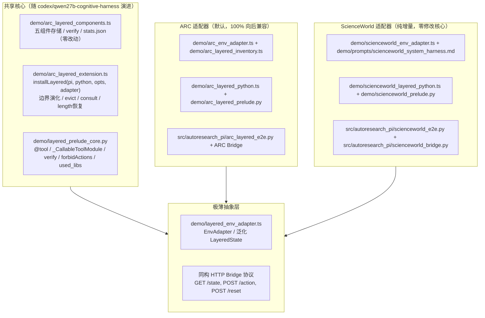

# Meta-harness 变更记录：基于 `codex/qwen27b-cognitive-harness`（`d68e1e7`）剥离 `EnvAdapter` 并适配 ScienceWorld

日期：2026-11-27（Asia/Shanghai）。状态：设计（仅文档，尚未修改运行时代码或启动付费运行）。
基线：`codex/qwen27b-cognitive-harness` @ `d68e1e7`；工作分支：`codex/scienceworld-adapter`。
按 [开发流程](../development-workflow.md) 编写，对应 [延后待办](../deferred-research-todos.md) A 节（environment adapter 与 Agent runtime 边界解耦）。

---

## 一、问题与命题

- **真实机会与基线材料（`d68e1e7` 源码核对）**：
  - 当前 `codex/qwen27b-cognitive-harness` 已闭合四件核心在线自进化能力（未接入 `meta loop`）：
    1. 天然边界触发的**独立干净上下文演化**（`GAME_OVER` / `LEVEL COMPLETE` / 冷却后的 `STUCK` & `STALL`，禁 `submit_actions`，最多 3 轮工具，[arc_layered_extension.ts](../../demo/arc_layered_extension.ts)）；
    2. 五组件版本存储与 `Memory.verify` 自动转移回测（[arc_layered_components.ts](../../demo/arc_layered_components.ts)——**0% ARC 耦合**）；
    3. WASI Python 会话、`@tool` 自动挂载、`forbidActions` 双层拦截与 `used_libs` 归因（[arc_layered_python.ts](../../demo/arc_layered_python.ts)、[arc_layered_prelude.py](../../demo/arc_layered_prelude.py)）；
    4. 面向 Qwen 27B 紧凑窗口的 `evict()` 驱逐恢复块、无工具 `consult` 反锚定与 `length` 有界恢复。
  - 当前缺陷：上述通用核心与 ARC 专属渲染/网格逻辑（`framePng`、`PALETTE`、`boardInventory`、64×64 hex grid、`MOUSE` 点击去重、`ACTION1..7`）混在 `arc_layered_extension.ts` 与 `arc_layered_prelude.py` 中，无法直接在非 ARC 环境中验证 `General, not ARC-fitted` 不变量；若直接复制分支魔改，主分支后续对边界演化、驱逐策略或组件统计的改动将难以同步。
  - 选择 **ScienceWorld** 的原因：纯文本科学实验交互环境，标准 `step(action) -> obs, reward, done`，强假设检验与客观反馈，无视觉感知噪声，支持将同任务的多个 variation 串联成多关（`level 1..K`），最适合在不依赖 `meta loop` 的前提下直接检验四件核心能力。
- **窄命题**：
  - 工程命题：将 `arc_layered_extension.ts` 中约 15% 的 ARC 专属观测/提示耦合抽离为极薄 `EnvAdapter` 接口（ARC 为默认实现，零行为变化），并将 `arc_layered_prelude.py` 的 `@tool` / `Memory.verify` / `forbidActions` / `used_libs` 抽成 `layered_prelude_core.py`，即可在不修改核心自进化循环的前提下接入 ScienceWorld，并支持与 `codex/qwen27b-cognitive-harness` 的无冲突实时同步。
  - 行为命题（留待 Slice 3 真实模型验证）：在 ScienceWorld 同任务多变体串联（3 variations = `level 1..3`）上，开启独立上下文边界演化 + `consult`（Arm B）相比关闭两者（Arm A），在不引入任何科学实验攻略提示的前提下，Agent 会自主产出被后续 variation 复用的 `@tool` 或 `Memory.verify`，并在留出任务上提高 variation 完成率/最终得分且父子总成本受控。
- **减少的负担**：
  - 工程负担：消除“每接一个新 benchmark 就复制 1,700 行 extension”的维护分裂，主分支核心改进一次修改、多环境同步生效。
  - 模型上下文负担：ScienceWorld 单步合法动作可达 50–300 条，通过“状态消息只给紧凑房间/背包/动作模板 + Python 内核提供完整 `valid_actions` 与 `filter_actions()`”避免撑爆 Qwen 27B 的 40k/64k 窗口。
- **适用条件、合理不使用条件与推翻条件**：
  - 适用条件：多步交互、存在需要实证检验的物理/实验规则或可复用子流程（如测量、加热、导航）的 ScienceWorld 任务（尤其多 variation 串联）。
  - 合理不使用条件：≤ 15 步即可一次完成的极短 variation，不创建 `@tool` 或不触发演化属合理不使用。
  - 推翻条件：
    1. Slice 0 抽离破坏现有 ARC 行为或回归测试；
    2. Slice 2 全链路 scripted smoke 无法在独立上下文边界演化中挂载 `@tool` 或执行 `Memory.verify`；
    3. Slice 3 真实 Qwen 3.8 27B 留出集对照中，Arm B 完成率/得分低于 Arm A，或父子总成本上升 > 25% 且零有效 `@tool`/`verify` 复用。
- **范围及非目标**：
  - 范围：本次提交仅落地设计文档（不改现有运行时代码、不启动付费实验）。后续实现分 Slice 0–3 推进。
  - 非目标：不接入 `self_root` / `meta loop`；不改 ARC 现有 CLI/行为/指标口径；不在系统提示或 adapter 中注入任何 ScienceWorld 任务攻略、物体角色或实验方法提示。

---

## 二、设计与成本

### 2.1 四层解耦架构



### 2.2 `EnvAdapter` 最小接口（`demo/layered_env_adapter.ts`）

仅将 `arc_layered_extension.ts` 中随环境变化的 5 个点外置，其余 95% 逻辑（五组件、边界冷却、独立上下文演化、驱逐恢复、`consult`、telemetry）全部留在共享核心：

```ts
export interface EnvAdapter<TObs = unknown> {
  readonly id: string; // "arc" | "scienceworld"

  /** 主任务系统提示（仅含环境动作契约 + 通用五组件说明，不含攻略） */
  systemPrompt(ctx: { maxActionsPerCall: number }): string;

  /** 注入给独立边界演化子调用的只读 Kernel API 说明 */
  evolutionKernelApiDoc(): string;

  /** 渲染发给模型的观测内容（ARC: PNG/hex+inventory；SW: 结构化纯文本） */
  renderStateObservation(
    state: LayeredState<TObs>,
    prev: LayeredState<TObs> | null,
    opts: ObservationRenderOptions
  ): Content;

  /** 渲染给边界演化与 consult 的紧凑纯文本当前状态摘要 */
  renderBriefObservation(state: LayeredState<TObs>): string;

  /** 单步轨迹行与复盘里附带的环境事实 */
  formatStepExtra?(fact: StepFact): string;
  extraReviewFacts?(state: LayeredState<TObs>): string[];
}
```

- **向后兼容**：`installLayered(pi, python, options, adapter = defaultArcAdapter)`，不传第 4 参数时默认使用 `ArcEnvAdapter`，现有 ARC 测试、扩展入口与 CLI 零回归。
- **`LayeredState` 泛化**：将 `frame: number[][]` 调整为 `frame?: number[][]` 并增加 `obs?: TObs`；通用的 `level / levels_completed / win_levels / state / step / actions_used / budget_left / valid_actions / stale_steps` 全部沿用。

### 2.3 ScienceWorld 领域语义映射

1. **评估形态（支持两种，串联为主）**：
   - 单变体模式（`--variations 0`）：`level = 1, win_levels = 1`，用于对标常规单局评估。
   - **同任务多变体串联模式**（`--variations 0,1,2`）：将同一 task 的 K 个 variation 依次映射为 `level 1..K`，完成当前 variation（`score == 100`）时触发 `LEVEL COMPLETE` 并自动进入下一 variation，`work/lib`、`Memory`、`Skills`、`Prompt` 跨变体持续继承，直接检验跨关自进化复用收益。
2. **四类天然边界 1:1 映射**：
   - `LEVEL COMPLETE`：当前 variation `score == 100`（进入下一 variation 或终态 `WIN`）。
   - `GAME_OVER`：`isCompleted && score < 100`（任务失败终态，如毁坏关键器材或负分终止），或 Agent 主动触发 `RESET` 重开当前 variation。
   - `STUCK`：连续 `stuckAfter` 步 `score` 无上升 **且** `state_key = hash(room + look + inventory)` 未出现新态。
   - `STALL`：连续无效/歧义动作（`"No known action matches"` / `"Ambiguous"` ≥ 4 次）或同 `(state_key, action)` 重复 ≥ 3 次。
3. **防动作空间爆炸**：
   - Bridge 返回完整 `valid_actions`（`getValidActionObjectCombinations()`）和去重动作模板 `templates`（~15–25 条）。
   - 发给 LLM 的状态消息仅呈现：`Task`、`Score (0..100)`、`Location + Look`、`Inventory`、`Valid actions count` 与 `templates`（不把 200 条动作塞进上下文）。
   - Python 内核暴露完整 `valid_actions` 与客观辅助 `filter_actions(query)`，供 Agent 在脚本或 `@tool` 中精确检索。
4. **Python 内核 API 与 `Memory.verify`（`demo/scienceworld_prelude.py`）**：
   - 命名空间：`current_obs`, `previous_obs`（`.text`, `.look`, `.inventory`, `.room`, `.score`, `.step`, `.level`, `.state`, `.task_desc`, `.valid_actions`, `.templates`）、`history`, `transitions`（`.action`, `.before_obs`, `.after_obs`, `.score_delta`, `.changed`, `.invalid`, `.level`）、`last_transition`。
   - 动作接口：`submit_actions(actions, stop_on=None, expect=None)`（单次最多 8 步，支持 `"RESET"`；遇无效动作、`score_delta != 0`、`done`、无状态变化或 `expect` 不符即停批）。
   - 客观辅助：`obs_diff(a, b)`（行级状态 diff）、`filter_actions(query)`。
   - `Memory.verify` 与 `@tool`：通过 `layered_prelude_core.py` 直接复用现有 `syncMemoryChecks()`、`_CallableToolModule`、`used_libs` 与 `forbidActions` 双层拦截。

### 2.4 与 `codex/qwen27b-cognitive-harness` 的实时同步机制

要让 ScienceWorld 适配与主分支 `codex/qwen27b-cognitive-harness` **实时同步且零冲突**，关键前提是**先把 Slice 0（`EnvAdapter` 剥离，纯重构、ARC 零行为变化）合入 `codex/qwen27b-cognitive-harness`**。在此之后有两种实时同步方案：

| 方案 | 做法 | 实时性 | 冲突风险 | 适用场景 |
| --- | --- | --- | --- | --- |
| **方案 1（最简单，零同步成本）**：同分支插件化 | Slice 0 合入后，把 `demo/scienceworld_*` 和 `src/autoresearch_pi/scienceworld_*` 作为独立可选文件直接放在 `codex/qwen27b-cognitive-harness` 上（默认不加载、不影响任何 ARC 入口） | **原生 0 延迟** | **0** | 希望主分支同时作为多环境统一演进基线 |
| **方案 2（独立分支 + GitHub Actions 自动同步）** | 保持 `codex/scienceworld-adapter` 为独立分支，只在其中维护 `scienceworld_*` 增量文件；在 `codex/qwen27b-cognitive-harness` 上加一个 GitHub Actions workflow：每当主分支有新 push，自动将 `codex/qwen27b-cognitive-harness` merge 到 `codex/scienceworld-adapter` 并自动跑 ScienceWorld 离线回归测试 | **秒级自动同步**（每次主分支 push 后自动触发） | **极低**（因为 Slice 0 后两分支触碰的文件集合完全不相交；若核心接口发生破坏性变更，CI 立即报错提示） | 希望 `codex/qwen27b-cognitive-harness` 保持严格 ARC-only |

- **推荐路径**：
  1. 先在 `codex/scienceworld-adapter` 完成 Slice 0 的 `EnvAdapter` 抽离并跑通 ARC 回归，将 Slice 0 单独 PR 合回 `codex/qwen27b-cognitive-harness`；
  2. 合回后，按团队偏好二选一：若选方案 2，只需在 `.github/workflows/sync-scienceworld-adapter.yml` 配一个 `on: push: branches: [codex/qwen27b-cognitive-harness]` 的自动合并 + 单测工作流，即可实现全自动实时同步。

### 2.5 生命周期、成本与边界检查

- **生命周期与首次获益路径**：与 `d68e1e7` 一致，无新增常驻义务或动作门禁。首次获益路径：探索观察 → 遇边界进入独立干净上下文演化（或主轮直接编写）→ 产出 `@tool` / `Memory.verify` → 下一步或下一 variation 实际调用/回测并计入 `stats.json`。
- **新增/移除**：无新增常驻工具或门禁；ScienceWorld 系统提示控制在 ≤ 2,800 字节；纯文本观测相比 ARC 省去图像 token，单步输入更紧凑。
- **权限/环境边界**：runner 严格保留 `--no-context-files`（不注入开发流程或仓库 `AGENTS.md`）；`forbidActions` 双层拦截演化轮动作；`scienceworld_bridge.py` 单进程常驻 JVM，同时提供纯 Python `MockScienceWorldEnv` 支持无 JVM 离线回归。
- **放弃与恢复**：动作预算耗尽、`length_exhausted` 或 provider 连续失败即止损；组件支持 `restore` 回退版本（不回退真实环境历史）。

---

## 三、分步开发切片

1. **Slice 0（核心抽离，可独立 PR 合回 `codex/qwen27b-cognitive-harness`）**：
   - 新增 `demo/layered_env_adapter.ts`、`demo/arc_env_adapter.ts`、`demo/layered_prelude_core.py`；
   - 轻改 `demo/arc_layered_extension.ts` 与 `demo/arc_layered_prelude.py` 接入上述抽象；
   - 跑通现有 ARC 定向 Node 测试 + `tests/test_arc_layered_evolution.py`，确认 ARC 行为零漂移。
2. **Slice 1（ScienceWorld Bridge + Python 会话层）**：
   - 新增 `src/autoresearch_pi/scienceworld_bridge.py`（真实 `ScienceWorldEnv` + `MockScienceWorldEnv`）；
   - 新增 `demo/scienceworld_prelude.py`、`demo/scienceworld_layered_python.ts`；
   - 新增 `tests/scienceworld_python.test.ts`（FakeBridge + 真实 WASI 内核，覆盖 `submit_actions`、`@tool`、`used_libs`、`Memory.verify`、`forbidActions`）。
3. **Slice 2（Adapter + Prompt + Runner + 全链路 Smoke）**：
   - 新增 `demo/scienceworld_env_adapter.ts`、`demo/scienceworld_layered_extension.ts`（~40 行薄入口）、`demo/prompts/scienceworld_system_harness.md`、`src/autoresearch_pi/scienceworld_e2e.py`；
   - 新增 `tests/scienceworld_extension.test.ts`、`tests/test_scienceworld_bridge.py` 及 scripted provider 全链路 smoke。
4. **Slice 3（真实模型探索与对照，需预算授权后启动）**：
   - 按第四节实验协议在真实 Qwen 3.8 27B + 真实 ScienceWorld 上运行 A/B 对照。

---

## 四、运行前实验协议（Slice 3，待授权）

- **目标证据层级**：自主采用与净收益（Slice 0–2 先完成功能正确与全链路可达）。
- **模型/配置**：Qwen 3.8 27B（`thinking` 开关、output 上限、40k/64k 驱逐参数在两臂严格一致）。
- **比较器**：
  - **Arm A（基线）**：`qwen27b-harness` + `EVOLUTION=0, CONSULT=0`（保留紧凑上下文、Python 工具和基础状态反馈，关闭边界演化与 `consult`）；
  - **Arm B（实验臂）**：`qwen27b-harness` + `EVOLUTION=1, CONSULT=1`。
- **任务与样本**：
  - 探索集：2 类任务 × 3 variations 串联（如 `boil` / `use-thermometer`）；
  - 留出集：3 类未见任务 × 3 variations 串联（锁定代码与提示后再跑），每任务独立重复 ≥ 2 次。
- **预算与停止规则**：每 variation 上限 100 动作，单局总 token 与墙钟上限在启动前由用户授权确定；含 `length_truncation`、`provider_error`、`idle` 止损。
- **主要指标与负例**：
  - 主指标：variation 完成率、平均最终 `score`、每 variation 动作数、父子总 token（含演化与 `consult`）与墙钟时间；
  - 过程指标：`audits_followed_by_evolution`、`@tool` 绑定与复用调用数、`Memory.verify` 命中/反例数、跨 variation 动作数变化；
  - 负例：极短 variation 的合理不使用、无效动作洪泛、演化产出语法/运行失败后的回执与恢复、裁剪后 `Memory` 恢复一致性。

---

## 五、实现与验证

当前处于**设计阶段**，未修改运行时代码，未执行付费运行。

| 证据层级 | 状态 | Provider / environment | 产物及结论边界 |
| --- | --- | --- | --- |
| 功能正确 | 未验证 | — | 待 Slice 0–2 完成后由 Node + pytest + 真实 WASI 内核验证 |
| 全链路可达 | 未验证 | — | 待 Slice 2 完成后由真实 Pi + `scienceworld_layered_extension.ts` + Mock/真实 Bridge + scripted provider 验证 |
| 自主采用 | 未验证 | — | 待 Slice 3 真实 Qwen 3.8 27B 普通运行验证 |
| 净收益 | 未验证 | — | 待 Slice 3 留出集 A/B 独立对照验证 |

---

## 六、交付决定

- **已支持声明**：仅完成面向 `d68e1e7` 基线的 `EnvAdapter` 剥离与 ScienceWorld 适配设计，并给出与 `codex/qwen27b-cognitive-harness` 的实时同步机制。
- **下一步可证伪检查**：用户确认同步方案（方案 1 同分支插件化 vs 方案 2 独立分支 + GitHub Actions 自动同步）与 Slice 0 授权后，先实施 Slice 0 并验证 ARC 回归零漂移。
- **关联 backlog**：
  - [deferred-research-todos.md](../deferred-research-todos.md#a-arc-adapter-职责边界主要待办) A 节（adapter/runtime 边界）：Slice 0 将直接推进该节解耦，但当前仅完成设计，状态保持开放；
  - B/C/D 节（研究目的、父子总成本、压缩后认知连续性）：保持开放，留待 Slice 3 真实运行留证。
