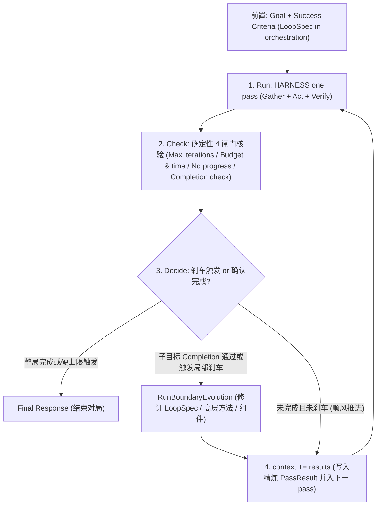

# Meta-harness 开发设计文档：薄 Outer Loop 自进化与高层科学解题策略

日期：2026-11-28（Asia/Shanghai）。状态：实现中（Slice 1 与 Slice 2 已完成编码与本地免付费测试；全链路/自主采用/净收益待真实 provider 验证）。
按 [开发流程](../development-workflow.md) 与 [变更模板](../templates/meta-harness-change.md) 编写。
关联记录：[六载体薄认知策略层](./2026-11-28-six-carrier-thin-cognitive-strategy.md) · [延后待办](../deferred-research-todos.md)

---

## 一、问题与命题

### 1. 真实失败与观测证据

对比最近一轮真实对局 [arc-local-su15-20261128-173946](../../runs/arc-local-su15-20261128-173946)（截至第 149–170 步快照）与前一轮 [arc-env-error-validation-20261128-154610](../../runs/arc-env-error-validation-20261128-154610)（`1/9` 关）：

- **已观察到的改善**：
  - 策略卡到行动的路径贯通：第 1 关 `strategy_card` v2 明确给出下一步尝试与预期变化，第 11 步实际执行并在第 14 步通过第 1 关。
  - 竞争解释与证伪执行：第 2 关第 135 步死亡后，v8 提出竞争假说并要求对比先前死亡前后的计数变化，主 Agent 实际回查了三次死亡前后画面。
  - 避开了重型世界模型开销：`work/model.py` 发布次数从上轮 4 次降为 0 次；前 149 步未复现 `EnvironmentReturnedNoFrame` 与上下文溢出；`reframer` 子代理成功被调用 3 次（[stats.json](../../runs/arc-local-su15-20261128-173946/harness/components/stats.json)）。
- **仍然卡住的 4 项结构性缺口**（两轮均为 `1/9` 关，目前无过关收益证据）：
  1. **演化停留在局部排错，缺少高层问题求解与目标/进度驱动**：第 2 关演化集中在死亡归因（如坐标或计数归零）与局部防御工具（`repeat_click_guard` 发布后 `invocations=0`），直到第 170 步 `v9` 才提出回查初始画面寻找过关目标，整个关内长期只有避死约束、没有趋近胜利的可观测梯度。
  2. **跨关高层科学方法未能沉淀并进入回路**：第 1 关 `level_complete` 产出的 `click_path_level_transition` 仅记录“沿路径点击触发过关”，未抽象过关判据先验或通用的系统性探索协议；本轮 `Skill` 产出为 0，上轮产出的 `segment_and_validate_motion` 也因游离于主循环之外而 `reads=0`。
  3. **外层缺乏显式 Loop 控制（Goal + 4 闸门 + `context += results`）**：外层续跑仅依赖 [arc_layered_e2e.py:339-453](../../src/autoresearch_pi/arc_layered_e2e.py#L339-L453) 的简单分段循环与 `"Continue playing."` 提示，缺少“事前定义的 `Goal + completion_check` $\rightarrow$ 单次有界 `HARNESS` pass $\rightarrow$ 4 项硬闸门校验（`Max iterations / Budget & time / No progress / Completion check`）$\rightarrow$ 结构化 `results` 结转”的闭环。
  4. **策略卡 700 字符隐性上限引发摩擦与失忆**：[arc_layered_extension.ts:1545](../../demo/arc_layered_extension.ts#L1545) 硬性拒绝超过 700 字符的策略卡，但 `EVOLUTION_SYSTEM_PROMPT` 与工具描述从未告知该上限；第 21、51、84、135 步 4 次修订均先被拒后再压缩重投（白耗 4 轮），且压缩过程导致 `v7` 已确认的硬事实（`GAME_OVER` 后 `UNDO` 无效）在 `v8` 丢失。

### 2. 窄命题与设计目标

- **窄命题**：在不增加新组件类型或重型外置模型的条件下，把写死的外层连续会话收口为**薄的声明式 Outer Loop（`LoopSpec` + 4 闸门 + `PassResult` 结转）**，并用**高层问题求解框架（四维未知量 + 受控实验 + 子目标可行性）+ 双尺度演化 + `LoopSpec.method` 自动入回路**替代限制总体战略形成的既有 Prompt 约束；使 Agent 能在 ARC 对局中自主制定与迭代阶段性可验证子目标、将跨关科学方法真正带入执行回路，减少无方向试探与跨轮失忆。
- **减少的负担**：
  - 0 新组件类型（继续复用 `orchestration` 与 `skill` / `memory` / `tool`）、0 主 Agent 新工具、正常推进 pass 内 0 次额外模型调用；
  - 用 4 项确定性外部闸门收拢分散边界判断，用精炼 `PassResult` 替代 `"Continue playing."` 与冗长历史拖尾，用 `LoopSpec.method` 替代靠主观记忆调用 `read_component`。
- **适用条件、合理不使用条件与推翻条件**：
  - **适用条件**：机制未知、每关结构可能变化的交互式探索任务（当前聚焦 ARC）中，需要显式区分“已明 vs 未知”、设定可验证中间目标并严控盲步成本的对局。
  - **合理不使用条件**：规则与目标在首轮已显而易见、单目标连续顺风推进的简单关卡——此时保留默认单目标 `LoopSpec`、不强行切分多阶段或强造 `Skill` 与 `completion_check`（允许零开销跳过）。
  - **推翻条件**：本地功能/接线单测未能全部通过；或在用户授权的真实 provider 对照运行中，演化与上下文总开销明显升高，而无目标空转步数、策略卡修订失误、跨关方法实际入回路率及过关进展未见改善。
- **范围与非目标**：
  - **范围内**：ARC layered/thin 路径（`demo/arc_layered_*`、`demo/layered_env_adapter.ts`、`src/autoresearch_pi/arc_layered_e2e.py`、`demo/prompts/arc_layered_system_minimal.md`），并以域无关 `LoopSpec` 与 `LayeredEnvAdapter` 为未来 `autoresearch` 留好拓展接缝。
  - **非目标**：不写 `autoresearch` 未挂接的空实现（严守无悬空产物原则）；不恢复已弃用的旧 Auto-Research ARC 路径；不触碰冻结的 `demo/pi_arc_agi_3_extension.ts`；不把全帧离线 `work/model.py` 恢复为默认必选项；不将开发流程或任何特定游戏颜色、坐标、对象名称或玩法提示注入任务上下文。

---

## 二、整体架构设计：薄 Outer Loop + 高层科学解题策略 + 六载体兼容

### 2.1 1:1 对齐 Loop Engineering 的极薄外层骨架

外层 Loop 控制以**整段有界 run / pass**为工作单元，包裹一次内部 `HARNESS` pass（`Gather + Act + Verify`），结构严格对应 Loop Engineering 五步闭环：



#### 1. `LoopSpec`（存放在现有 `orchestration` 载体中，不新增第 7 类载体）
`parseLoopSpec` 解析兼容现有 `mode / handoff / batch_hint / reframe_after_deaths` 文本与 JSON 格式，并在安全范围内强制钳位（全局硬预算与时间边界不可被覆盖）：

```ts
export type LoopSpec = {
  // Loop Engineering 核心定义（域无关）
  goal?: string;                 // 事先定义的本段目标与可观测判据（非空话）
  completion_check?: string;     // 可选：只读验收函数名 (@tool)，返回 bool 或 { done, progress?, detail? }
  method?: string;               // 可选：绑定的 L4 skill 名称，进入本段 pass 时自动注入精炼步骤
  max_iterations?: number;       // 当前 Goal 最多跑几个 pass（钳位 [1, 10]，默认 3）
  max_actions_per_pass?: number; // 单次 HARNESS pass 动作预算（钳位 [2, 24]，默认 12）
  no_progress_after?: number;    // 连续无新进展或重复调用多少步/pass 拉闸（钳位 [1, 12]）
  max_batch?: number;            // 单次执行批上限（钳位 [1, maxActionsPerCall]）

  // 向后兼容现有 orchestration 字段
  mode?: "EXPLORE" | "EXPLOIT" | "REFRAME";
  handoff?: string;
  batch_hint?: string;
  reframe_after_failures?: number; // 兼容别名 reframe_after_deaths
  note?: string;
};
```

#### 2. `PassResult`（对应 ④ 的 `context += results`）
每个 pass 收口时由宿主纯逻辑生成 `<=400` 字符的结构化结转记录写入 `layered.jsonl`，注入下一 pass 入口（取代 [arc_layered_e2e.py:446](../../src/autoresearch_pi/arc_layered_e2e.py#L446) 单薄的 `"Continue playing."`）：
- `pass`: `k / max_iterations` 与累计耗时/步数
- `delta`: `executed`、`new_states`、`failures/deaths`、`surprises`
- `check`: `completion_check` 实测输出（`done`, `progress`, `detail`）、`no_progress` 触发状态
- `facts`: 本 pass 经 `verify` 新证实/推翻的因果条目标签与核心结论

---

### 2.2 补齐高层科学解题方法与策略的 3 个薄构件

在不引入重型外部规划器的前提下，通过下面 3 个轻量构件把演化从“单步排错”拉升到“高层问题结构化求解”：

1. **升级 L4 `[STRATEGY]` 为高层「问题求解框架（Problem-Solving Frame）」（上限放宽至 `<=900` 字符）**
   - 取消 700 字符隐性短墙并显式标注 `<=900 chars`，同时约定固定用 4 个高层槽位表达：
     - `Unknowns`：对照四维认知版图（**可控性与动力学 / 约束与资源账本 / 目标与胜利判据 / 全局子目标路径**），明确当前最大盲区在哪里（防止约束已明却一直忽略目标空白）。
     - `Goal & Progress`：必须写出**候选过关/阶段完成条件**与**可观测进度指标**；若目标未知，必须将其列为当前首要判别实验。
     - `Subgoals & Feasibility`：从候选目标倒推关键里程碑与资源预算可行性（现有有限资源是否足够支撑所选策略）。
     - `Experiment`：针对当前最大未知项给出 **2 个互斥假说 + 1 个单变量受控实验 + 观察分支结论**。
   - **已验证不变量下沉 L3 `memory`**：明确“策略卡只保留动态规划与当前假设；经证实的硬约束（例如某动作在终态无效）固化到 L3 `memory`（尽量带 `verify`）或保留在短 `Confirmed:` 字段”，从结构上杜绝压缩修订丢失已有结论。
2. **双尺度演化（复用现有 `runBoundaryEvolution`，不加新 Agent）**
   - **局部尺度**（`verify_contradiction`、局部 `@tool` 报错等）：锚定具体步号 `k` 快速修复 L3 `verify` 或局部 `@tool`，不轻易推翻全局路线。
   - **高层战略与方法尺度**（`level_complete`、`loop_brake`、`loop_goal_completed`、`reframer` 介入后）：解除“必须钉死在单步 `k`”的约束，要求俯瞰整关四维 `Unknowns` 收敛情况与过关前后终态差异，优先重构 **Problem-Solving Frame + `LoopSpec` + 跨关科学解题方法 `Skill`**。
3. **高层方法通过 `LoopSpec.method` 自动入回路（消除 `Skill` `reads=0` 悬空）**
   - 当 `LoopSpec` 指定 `method: "<skill_name>"` 时，进入该目标下的 pass 时由宿主自动把对应 L4 `Skill` 正文的精炼摘要（安全截断，如 `<=400` 字符）直接放入本 pass 上下文入口，并自动记录该 `Skill` 的有效注入/读取（`reads` / `method_injected`）；
   - 从而形成闭环：**跨关科学方法（`Skill`）$\rightarrow$ 定义外层阶段与验收标准（`LoopSpec`）$\rightarrow$ 指导内部受控实验与局部工具（`HARNESS`）$\rightarrow$ 实证结果通过 `PassResult` 反过来修订方法本身**。

---

### 2.3 与现有“感知–状态–认知建模–六载体自进化”的兼容性及收敛原则

| 现有体系层次 | 在新架构中的位置与复用方式 |
|---|---|
| **L1 感知 / L2 状态 / 局部 `@tool`** | 保留在 `HARNESS` pass 内运行；只读 `@tool` 可直接作为 `LoopSpec.completion_check` 供外层自动调用验收 |
| **L3 因果记忆（`memory + verify`）与按需 `work/model.py`** | 保持逐帧 `verify` 与 `live` / `by_level` 拆分；持久化硬规则；`work/model.py` 维持按需可选 |
| **L4 `[STRATEGY]` / `skill` / `subagent` (`consult`)** | `[STRATEGY]` 升级为 Problem-Solving Frame；`skill` 通过 `LoopSpec.method` 挂入回路；`reframer` 同时检查约束与目标假说 |
| **L5 六载体存储与编排（`LayeredComponents`）** | 零新增载体：`LoopSpec` 直接存放在唯一活跃的 `orchestration` 中（上限放宽至 `<=800` 字符，保留版本、SHA-256、回退与 `live_injected`） |

#### 3 条防叠床架屋收敛原则
1. **统一触发口径，不双倍演化**：现有 7 路演化边界收拢进 Loop 4 闸门语义中（`level_complete` / 自定义 `completion_check` $\rightarrow$ Completion；`stall` / `repeated_surprise` / `method_drift` / `game_over` $\rightarrow$ No-progress / 失败刹车；`max_iterations` / `max_actions_per_pass` $\rightarrow$ 迭代与预算闸门），**共用同一个 `correctiveAudits < 8` 与冷却机制**。
2. **单一目标真值，未设则零负担回退**：若未定义 `LoopSpec`（或未填 `goal`），默认目标即为环境终态目标（ARC 当前关过关），沿用 `[STRATEGY]` 即可，不强迫同时维护两份目标。
3. **顺风 pass 零打断结转**：当单 pass 到达 `max_actions_per_pass` 但既未触及 `no_progress` 刹车也未触发 `completion_check` 通过时，不重开 Pi 会话、不额外调用演化模型，只做确定性 `PassResult` 结转继续下一 pass。

---

### 2.4 ARC 聚焦与 `autoresearch` 拓展接缝

复用现有极简接口 [layered_env_adapter.ts](../../demo/layered_env_adapter.ts)，扩展极少可选类型（仅保留接缝，本轮不写任何 `autoresearch` 业务或测试代码）：

- **域无关核心**（`demo/layered_loop.ts`）：持有 `LoopSpec` 解析与钳位、`PassResult` 格式化、`evaluateLoopChecks` 四闸门确定性判断与 `Decide` 路由，不含任何 ARC 术语。
- **ARC 适配器**（[arc_env_adapter.ts](../../demo/arc_env_adapter.ts)）：将 `max_actions_per_pass` / `max_batch` 映射到 `submit_actions`；将 `No progress` 映射到 `same` / `region_tries` / `same_death` / `new` 与可选 `progress` 增量；将默认 `Completion check` 映射到 `level_changed` / `WIN`（可选调用只读 Python `@tool`）。
- **`autoresearch` 预留接缝**：未来接入仅需实现对应环境适配器（`actions` 映射为实验次数、`Completion check` 映射为评测脚本与单测全过、`No progress` 映射为指标无提升），即可复用同一套 `LoopSpec`、`PassResult`、版本回退与双尺度演化机制。

---

## 三、限制自进化整体策略的 Prompt 逐项审计与修正方案

以下是对当前仓库代码里所有限制“高层战略形成、跨关科学方法沉淀与 Loop 自进化”的 Prompt 文本的逐一梳理（共 12 处），附带保留现有单测回归锚点后的**可执行修正文案草案**（均严守通用性不变量，零 ARC 规则/颜色/坐标泄漏）。

### A. `EVOLUTION_SYSTEM_PROMPT`（[demo/arc_layered_extension.ts:156-182](../../demo/arc_layered_extension.ts#L156-L182)）

1. **解除“单步显微镜”限制（L160–L165）**
   - **现状问题**：`anchor to ONE concrete decision point k or cross-level delta` 且第 1 步围绕单步 `k` 找错，迫使演化器盯住局部事故点打补丁，忽略整关四维认知结构与全局策略缺失。
   - **修正后草案**：
     ```text
     Meta-evolution loop (match scale to the bottleneck):
     - Local scale (single verify contradiction, broken @tool, or isolated tactical error): anchor to concrete step k to patch the L3 rule or scoped @tool without disturbing working global strategy.
     - Strategic / Loop scale (level_complete, loop_brake, loop_goal_completed, stall, or after reframer): step back from single step k, audit the full Problem-Solving Frame across all four unknown dimensions (controllability & dynamics, constraints & resource ledger, win/completion criteria & progress metric, global subgoal path & budget feasibility) plus cross-level deltas, and evolve the outer LoopSpec, strategy frame, or reusable method.
     1. Critique the solver's method, strategy, and thinking at the appropriate scale — identify the deepest bottleneck along the scientific ladder:
        - Observation & decomposition (L1/L3): acting without separating controllable mechanics, resource constraints, and observable progress signals, or lacking lightweight confirmed vs competing hypotheses.
        - Controlled experimentation & verification (L3/L4): running uninformative, multi-variable, or vacuous-expect batches instead of single-variable discriminating probes with explicit branch outcomes, or ignoring SURPRISE / verify contradictions.
        - Global strategy & subgoal planning (L4): pursuing failure avoidance alone without candidate completion/progress criteria, feasible subgoal ordering, or bounded plans inside verified conditions.
        - Outer loop & method orchestration (L4/L5): wandering without a testable pass Goal/completion_check, leaving relevant Skills/tools unused outside the loop, or repeating a stalled framing without triggering REFRAME.
     ```

2. **解除“硬性 0 或 1 变更”导致的悬空断链与修订失忆（L166 & L181）**
   - **现状问题**：`0 or 1 targeted change` 让演化器无法在同一个演化轮里同时做两件强依赖的事（例如：把 `v7` 的稳定结论固化到 L3 `memory` 并修订 L4 策略卡；或创建一个只读 `@tool` 并把它挂进 `orchestration` 的 `completion_check`），结果要么遗忘事实、要么产出闲置 `invocations=0` 的工具。
   - **修正后草案**：
     ```text
     2. Carry the evolved method in the lightest effective harness update (make ONE focused change — or ONE tightly coupled pair such as solidifying a confirmed L3 rule alongside revising the strategy card, or publishing a scoped check tool together with binding it in `orchestration` — NEVER write vague pep-talks):
     ```
     （同时将 L181 同步调整为允许一次聚焦更新或紧密耦合的“工具/L3固化 + 策略/Loop绑定”成对提交并附带 `finish_evolution`。）

3. **解除策略卡 700 字符隐性限制并升级为 Problem-Solving Frame（L167 & L1545 & L1673）**
   - **现状问题**：L1545 硬限制 700 字符但 Prompt 未写明，且 L167 只要求松散的 `Goal, Strategy, Hypotheses, and Next`，既没覆盖四维未知量、预算可行性倒推，也没强制要求保留已确认约束。
   - **修正后草案**（同步将 L1545 与 L1673 上限改为 **`900` 字符**并显式标出）：
     ```text
        - Global Problem-Solving Frame (`memory` via reflect_component(op=add/revise/retire/merge/promote/demote, kind='memory', layer='L4'|'L3', scope='level'|'game', name, body, verify?)): keep ONE level-scoped L4 `[STRATEGY]` card (<=900 chars) structured with:
          * Unknowns: what is confirmed vs unknown across mechanics, resource/failure constraints, win/progress criteria, and subgoal path;
          * Goal & Progress: candidate completion condition and observable progress measure (if unknown, state 2 competing goal hypotheses and a single-variable probe first, even after diagnosing a failure);
          * Subgoals & Feasibility: backward subgoal milestones and resource-budget check before deep execution;
          * Experiment: Next discriminating probe + falsifier and branch rule.
          On revision, NEVER silently drop confirmed hard facts — move invariant constraints into scoped L3 `memory` (preferably with `verify={'rule': {'when': '...', 'assert': '...'}}`) or retain a terse Confirmed line.
     ```

4. **解除对跨关科学方法 `Skill` 的负向压制（L170 & L179）**
   - **现状问题**：L179 的 `Avoid creating Skills when existing Skills have reads=0` 在主代理懒得主动 `read_component` 时直接把演化器赶回只写局部内存或工具，切断了高层科学方法论的演化。
   - **修正后草案**（保留单测锚点 `kind='prompt', layer='L5'`、`kind='skill', layer='L4'`、`revised AT MOST 2 times per level`）：
     ```text
        - Reusable high-level scientific method (`skill` via reflect_component(op=add/revise/retire/merge/promote/demote, kind='skill', layer='L4', scope='game'|'level', name, summary, body)): coordinate-free problem-solving methodology (how to decompose unknowns, calibrate objectives/resources, run controlled experiments, and sequence subgoals across tasks). Bind an active Skill to `LoopSpec.method` so the host surfaces its steps automatically at pass entry instead of relying on ad-hoc memory.
     ```
     并将 L179 中的 Skill 反发散护栏改写为：
     ```text
     Avoid adding redundant Skills when an existing Skill has `reads=0`; instead, tighten its `when:` trigger, bind it via `orchestration` (`method: <skill>`), or revise/merge it so the method enters the loop. Prefer directly callable `@tool` or `Memory + verify` only for narrow computation or single-step invariant checks, not as a substitute for missing high-level method.
     ```

5. **升级 `orchestration` 描述为可进化 Outer `LoopSpec`（L173）**
   - **现状问题**：当前只描述 `EXPLORE/EXPLOIT/REFRAME` 与 `batch_hint`，缺少 `goal`、`completion_check`、`method`、`max_iterations`、`max_actions_per_pass`、`no_progress_after` 等 Loop 工程字段（且 500 字符上限偏紧）。
   - **修正后草案**（上限同步放宽至 **`800` 字符**，兼容旧字段）：
     ```text
        - Outer Loop & Orchestration Spec (`orchestration` via reflect_component(op=add/revise/retire/restore, kind='orchestration', layer='L5', scope='game', name, body), <= 800 chars): single active Loop specification steering goal + success criteria, iteration/pass bounds, brake thresholds, method handoff, and solving mode (`goal`, `completion_check`, `method`, `max_iterations`, `max_actions_per_pass`, `no_progress_after`, `max_batch`, `mode`, `handoff`, `reframe_after_failures`).
     ```

6. **补充 Loop 级与方法级留存评估口径（L174）**
   - **现状问题**：`3. Verify & curate` 重点考察 `world-model back-test, guided_recent, unchecked_batches, repeats, action_aligned`，未明确检查“信息增益、未知量是否缩小、Loop 刹车或 `completion_check` 是否生效”。
   - **修正后草案**：
     ```text
     3. Verify & curate: check Epistemic status, Strategy & orchestration, Process profile, and Last evolution feedback to judge whether prior changes actually improved problem solving (Loop pass outcomes, brake triggers, completion/progress checks, uncertainty reduction across the 4 unknown dimensions, guided_recent, unchecked_batches, repeats, and method adoption); revise, merge, retire, or restore ineffective components.
     ```

7. **修正 `Executable-first offloading` 的局部倾向（L178）**
   - **现状问题**：L178 在任何停滞下偏向写局部 `@tool` / `Memory + verify`，容易造出 `RepeatGuard` 类旁路护栏却放空“缺失目标判断/子目标路径”。
   - **修正后草案**（保留锚点前缀 **`Executable-first offloading`**）：
     ```text
     - Executable-first offloading (CRITICAL): match the mechanism to the missing layer — when objective, progress signal, or global route is missing or reframing is needed, FIRST restructure `[STRATEGY]` (Problem-Solving Frame) and `orchestration` (Loop goal, `completion_check`, or `method`); offload repeated scoring, local safety checks (allowed to return `'unknown'`/`None`), `completion_check` probes, and invariant verification to read-only L3/L4 `@tool` or `Memory + verify`; author `work/model.py` only when repeated forward trajectory prediction on the current level clearly warrants it.
     ```

---

### B. 主任务系统提示（[demo/prompts/arc_layered_system_minimal.md:93-110](../../demo/prompts/arc_layered_system_minimal.md#L93-L110)）

8. **升级 `## Scientific solving loop`（L93–L97）**
   - **现状问题**：第 1–4 条偏向局部试探与工具/模型选择，没有明确“四维未知量分解 $\rightarrow$ 单变量受控实验 $\rightarrow$ 确认目标与预算可行性后再按子目标推进”的科学求解主干。
   - **修正后草案**（确保不含禁止锚点 `## Working method` 或 `small probe batches`，继续保留 `submit_actions`、`## ACTIVE HARNESS`、`work/model.py`）：
     ```markdown
     ## Scientific solving loop
     1. Map unknowns before committing: separate controllable mechanics, resource/failure constraints, completion/progress criteria, and candidate subgoals (tracked in your `[STRATEGY]` frame); treat unknown objectives as first-class experimental targets, not afterthoughts.
     2. Run controlled discriminating experiments: design 1–2 action single-variable probes with tight `expect=` that separate competing explanations cleanly instead of blind or multi-variable batches.
     3. Offload scoped checks and keep `work/model.py` optional: use mounted `@tool` checks (returning `None`/`"unknown"` when uncertain is valid) or a `LOOP` `completion_check` for objective progress and safety; only write `work/model.py` (`predict(frame, action)`) when repeated transitions and foresight on the current level justify it.
     4. Execute subgoals within feasible budget: once mechanics and completion criteria are verified, plan backward from the goal inside verified scope with explicit `expect=`; any `SURPRISE`, `unknown`, `completion` miss, or loop brake returns you to controlled hypothesis testing.
     ```

9. **升级 `## ACTIVE HARNESS` 的 Loop 与 Method 引导（L99–L108）**
   - **现状问题**：只提到了 `ORCHESTRATION` / `[STRATEGY]` / `SKILL`，未说明外层 `LOOP PASS` 目标、`PassResult` 结转与已自动展开的 `METHOD`。
   - **修正后草案**：
     ```markdown
     Follow any active LOOP PASS goal, pass budget, and success criteria; respect carried PassResult facts from prior passes and execute any auto-surfaced METHOD workflow before improvising.
     ```

---

### C. 边界规则、诊断引导与 `reframer`（[demo/arc_layered_extension.ts:877, 1419, 1723-1727, 2212](../../demo/arc_layered_extension.ts)）

10. **扩展 `dualAudit` 五层诊断清单（L877）**
    - **现状问题**：L877 将 L4 简写为 `strategy/probe`、L5 简写为 `orchestration/pacing`，未能引导诊断目标缺口与外层 Loop 失配。
    - **修正后草案**：
      ```text
      - Diagnose the primary bottleneck across scales: L1 observation/delta, L2 state/progress metric, L3 causal rule/constraint, L4 high-level strategy (4 unknowns, subgoal feasibility, controlled experiment, or cross-task Skill method), L5 outer loop spec (pass Goal, completion_check, gate bounds, or method binding). Cross-level contradictions require refine preconditions vs demote/retire.
      ```

11. **扩展 `Boundary rule`（L1723–L1727 + 新增 Loop 边界）**
    - **现状问题**：`LEVEL_COMPLETE` 的过关目标沉淀已在最近修改中加上，但未引导沉淀**跨关科学方法 `Skill`** 与 **`LoopSpec` 目标/方法绑定**；同时缺少 `LOOP_BRAKE` 与 `LOOP_GOAL_COMPLETED` 专用边界指令。
    - **修正后草案**（严格保留 `Boundary rule (LEVEL_COMPLETE): use at most 1 python_inspect call` 既有单测前缀）：
      - `level_complete`：要求用最多 1 次 `python_inspect` 完成过关条件与进度指标提取后，**优先将本关验证有效的跨关解题方法（如何分解未知量、定标目标、检验可行性）沉淀或修订为 `scope='game'` 的 L4 `skill`（并可绑定到 `orchestration.method`）或 L3 `memory` 规则**；
      - `strategy_readiness`：优先维护结构化 L4 `[STRATEGY]`（四维未知量 + `Goal & Progress` + 受控实验）与对应的有界 `LoopSpec`（`goal` / `max_actions_per_pass` / 可选 `completion_check`），不再把局部护栏工具当作战略替代品；
      - 新增 `loop_brake`：在 `no_progress` 或 `max_iterations` 拉闸时触发高层视角重构——**明确禁止沿用刚刚触发刹车的同一套路，要求检查哪一类未知量尚未收敛（尤其是目标与可行性），修订 `LoopSpec` 子目标/闸门参数、`[STRATEGY]` 或借助 `reframer`**；
      - 新增 `loop_goal_completed`：当自定义 `completion_check` 实测返回 `done: true` 时，汇总本阶段确认事实到 L3/L4 并更新 `orchestration` 为下一阶段目标与成功标准。

12. **微调内置 `reframer` 提示（L1419–L1420 & L2212）**
    - **现状问题**：当前仅要求 `Give two mutually exclusive explanations and one discriminating next probe.`，当模型卡在“知道死因却不知目标”时，`reframer` 往往也顺着死因出招。
    - **修正后草案**：
      ```text
      Give two mutually exclusive explanations covering either the failed mechanism OR the missing win/progress criterion, plus one single-variable discriminating probe with branch outcomes. Cite observed facts and <= 200 words.
      ```

### 必须守住的既有回归测试锚点清单
改动任何 Prompt 时，不得破坏以下现有测试断言：
- [arc_layered_system_minimal.md](../../demo/prompts/arc_layered_system_minimal.md)：禁止出现 `## Working method` 或 `small probe batches`；必须包含 `submit_actions`、`## ACTIVE HARNESS`、`work/model.py`。
- [arc_layered_extension.ts](../../demo/arc_layered_extension.ts)：必须保留 `Boundary rule (LEVEL_COMPLETE): use at most 1 python_inspect call`、`kind='prompt', layer='L5'`、`kind='skill', layer='L4'`、`scope='level' vs scope='game'`、`Executable-first offloading`、`revised AT MOST 2 times per level`、`Harness slots (active): prompt=${...}/1, skill=${...}/2, memory=${...}/6`、`- Epistemic status (L1): world_model=none;` 以及 `MODEL work/model.py (predict): backtest 5/6 (L1: 5/6)` 前缀。

---

## 四、分切片开发实施计划与成本边界

### Slice 1：薄 Outer Loop 骨架 + 4 闸门 + `context += results` + Prompt 全量修正

- **改动文件**：
  1. **新增** `demo/layered_loop.ts`（~120–150 行纯模块）：`LoopSpec`、`PassResult`、安全钳位解析 `parseLoopSpec`（向后兼容旧 `orchestration` 格式）、4 闸门判定与决策 `evaluateLoopChecks`、`formatPassResult`。
  2. **修改** [demo/layered_env_adapter.ts](../../demo/layered_env_adapter.ts) 与 [demo/arc_env_adapter.ts](../../demo/arc_env_adapter.ts)：补充最小 `LoopSignals` / `LoopEnvAdapter` 接缝类型与 ARC 默认提取（零 `autoresearch` 悬空代码）。
  3. **修改** [demo/arc_layered_extension.ts](../../demo/arc_layered_extension.ts)：
     - 放宽 `strategy_card` 限额至 `900` 字符、`orchestration` 至 `800` 字符并显式标注；
     - 落地第 三 节 A / C 的全部 Prompt 与 `reframer` 修正；
     - 在 `agent_before_settle` 按 `LoopSpec.max_actions_per_pass` 收口 pass，在 pass 结束运行 `evaluateLoopChecks` 并写入 `loop_check` / `pass_result` JSONL；
     - 在 `before_agent_start` / `context` 注入简洁 `LOOP PASS k/N | Goal | PassResult`，刹车触发归并共用 `correctiveAudits < 8` 进入现有 `runBoundaryEvolution`；将 `LoopSpec.max_batch` 下发给 `submit_actions`。
  4. **修改** [demo/prompts/arc_layered_system_minimal.md](../../demo/prompts/arc_layered_system_minimal.md)：落地第 三 节 B 修正。
  5. **修改** [src/autoresearch_pi/arc_layered_e2e.py](../../src/autoresearch_pi/arc_layered_e2e.py)：下一次 `kernel.prompt(...)` 带入上一 pass 结构化 `PassResult`（代替 `"Continue playing."`），在 `summary.json` 中记录 `loop_passes` 与 `loop_brakes`。
  6. **新增/更新本地免付费测试**：`tests/layered_loop.test.ts`、`tests/arc_layered_extension.test.ts`、`tests/test_arc_layered_evolution.py`。

### Slice 2：只读 Python `completion_check` + `LoopSpec.method` 入回路 + Loop 前后因果反馈

- **改动文件**：
  1. **修改** [demo/arc_layered_prelude.py](../../demo/arc_layered_prelude.py) 与 [demo/arc_layered_python.ts](../../demo/arc_layered_python.ts)：支持在严格 `forbidActions: true` 模式下调用 `LoopSpec.completion_check` 指定的只读 `@tool`，统一归一化为 `{ done, progress?, detail? }`，任何异常安全降级为 `{ done: false, error }`。
  2. **修改** [demo/arc_layered_extension.ts](../../demo/arc_layered_extension.ts)：
     - 将 `completion_check` 实测结果喂入 `evaluateLoopChecks` 第 4 闸门及第 3 闸门（连续无 `progress` 增量触发 `no_progress`）；
     - 实现 `LoopSpec.method` 自动展开与注入统计（将绑定 `Skill` 的精炼核心步骤注入当前 pass 上下文，同步计入 `reads`）；
     - 在 `Last evolution feedback` 中为 `orchestration` 增补前一版本 vs 当前版本 Loop 指标对比（pass 数、刹车触发、进度变化、未验证批次数），支持演化器基于实证保留、微调或 `restore` 回退。
  3. **更新本地免付费测试**：`tests/arc_layered_python.test.ts`、`tests/arc_layered_extension.test.ts`。

### Slice 3：授权真实 provider 对照验证（仅在本地测试全通过且获得预算授权后）
- 同种子/配置下对比改动前后的 `su15` 与未见留出关卡（如 `vc33` 等），严格按 4 层证据标准核验自主采纳与净收益。

### 权限、安全边界与放弃/恢复策略
- **硬边界不可越权**：整局动作上限、`budget_left`、时间限制、Token 预算与环境故障熔断（`environment_error`）永远在外层写死执行，`LoopSpec` 只能在安全子区间内收紧参数，不能放宽。
- **只读与幂等隔离**：`completion_check` 强制在 `forbidActions: true` 沙箱执行，绝不能执行游戏动作或修改外部状态。
- **放弃与恢复**：任意 `orchestration` / `strategy_card` / `skill` 修订如引起负收益（无效步增加、频繁触发 `no_progress` 刹车），演化器可通过 `reflect_component(op="restore"|"retire")` 一键回退到上一个已验证版本，不影响环境与组件不可变版本历史。

---

## 五、运行前实验协议、四层证据边界与交付决定

### 运行前对照实验协议（Slice 1–2 实现并准备跑真机时适用）
- **主要变量与比较器**：
  - 基线臂（Baseline）：当前提交前工作区的六载体薄策略层 + 按需 `model.py`（无外层 `LoopSpec` / 新战略 Prompt）；
  - 实验臂（Treatment）：Slice 1 + Slice 2（薄 Outer Loop + 问题求解框架 + 双尺度演化与 `method` 入回路）。
- **模型、推理与任务设定**：与既有验证对齐（同模型、同 `reasoning` 档位、禁用游戏源码暴露），先在发现问题的 `su15` 上检验机制闭合，再在独立留出关卡上检验泛化（禁止把调参集合当最终测试集）。
- **总预算与停止规则**：每次独立受控运行设置明确 `max_reported_tokens` / `wall_seconds` / `max_actions` 上限；遇 `environment_error` 或连续 `length_truncation` 立即止损退出，不重试绕过。
- **主要指标与判定标准**：
  - 过关数与关内推进速度（动作预算消耗/关）；
  - 过程指标：无 `expect=` 盲批占比、策略卡超限拒收轮次、关键已证实事实跨修订保留率；
  - 能力采用指标：`LoopSpec` 目标/约束自定义采用与实效、`Skill` 经 `LoopSpec.method` 入回路比例、`completion_check` 非零触发与准确率；
  - 总成本（主 Agent + 演化 + `consult` 合计 token 与真实耗时）。
- **负例覆盖**：简单关卡不强拆阶段、不强造 `Skill` 的合理不使用情形；`completion_check` 抛错安全降级；`no_progress` 刹车防止无限重复循环；预算不足正常止损。
- **遥测与验证命令（Slice 1–2 编码期免付费检查）**：
  - `node --experimental-transform-types --test --test-concurrency=1 tests/layered_loop.test.ts tests/arc_layered_components.test.ts`
  - `node --experimental-transform-types --test --test-concurrency=1 tests/arc_layered_extension.test.ts`
  - `node --experimental-transform-types --test --test-concurrency=1 tests/arc_layered_python.test.ts`
  - `python -m pytest tests/test_arc_layered_evolution.py tests/test_arc_layered_experiments.py -q`
  - `python tools/run_foundation_smoke.py runs/<new> <script>`（检查基础 smoke Checks 行）与 `git diff --check`

### 当前四层证据边界

| 证据层级 | 状态 | Provider / environment | 产物及结论边界 |
| --- | --- | --- | --- |
| 功能正确 | 部分通过（Slice 1 + Slice 2 新增/修改逻辑） | 本地 Node/Python 测试（无 provider） | `layered_loop.test.ts` + `arc_layered_components.test.ts` 14/14；`arc_layered_extension.test.ts` 70/77（7 个为既有失败，0 新增，含 completion_check 门控、method 注入、错误降级）；`arc_layered_python.test.ts` 58/70（12 个为既有失败，0 新增）；`pytest` 8/8；`git diff --check` 干净 |
| 全链路可达 | 未验证 | 无 | 需在 Slice 1 / Slice 2 编码完成后通过 Node/Python 集成测试与 foundation smoke 证明（尚未跑 foundation smoke） |
| 自主采用 | 未验证 | 无 | 需在授权真实 provider 对局中核验模型是否主动编写高质量 `LoopSpec` / 四维框架 / `Skill` 并产生实际行动收益 |
| 净收益 | 未验证 | 无 | 需与同种子基线对比关卡进展与父子总 token/耗时后才可判定 |

### 交付决定

- **已支持和未支持声明**：Slice 1 已完成编码（`layered_loop.ts`、Loop 接线与四闸门、`max_batch`/`max_actions_per_pass` 硬上限、12 处 Prompt 修正、`pass_result` 续跑结转），并已通过本地免付费功能测试；全链路可达、自主采用与净收益均未验证。
- **决定与依据**：状态更新为**Slice 1 与 Slice 2 实现完成（待全链路验证）**；下一步按 **（可选授权）Slice 3（真实 provider 对照）** 推进。
- **关联 backlog**：仅关联 [延后待办](../deferred-research-todos.md) 项 **A（ARC adapter 边界，通过 `LayeredEnvAdapter` 保持兼容并预留 `autoresearch` 接缝）**；未改变 B、C、D 状态。
