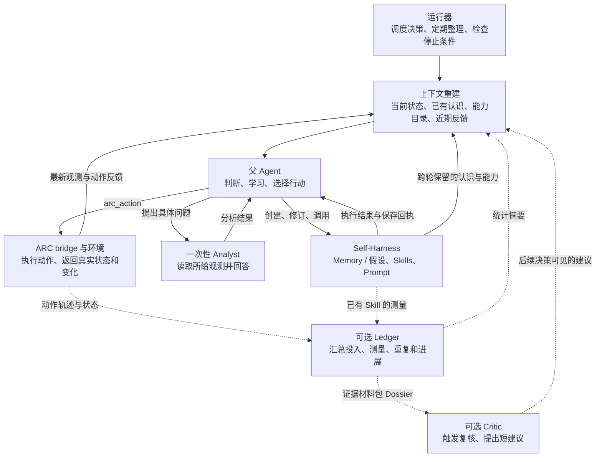
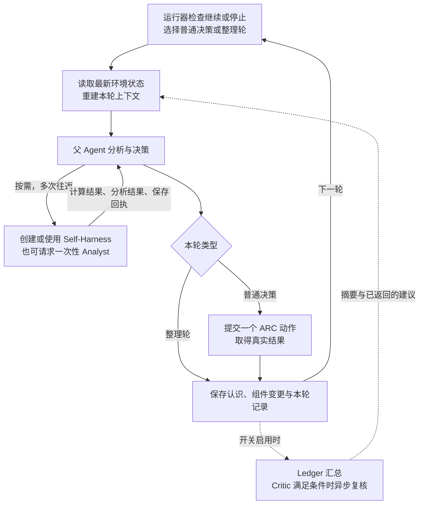

# thin-arc-self-harness：当前架构与完整流程

## 1. 整体架构

系统围绕父 Agent 的决策循环运行。Self-Harness 保存和执行父自己构建的辅助能力；上下文重建把这些积累带到下一轮；Analyst 提供按需分析。启用 Ledger/Critic 后，再增加自动统计和复核建议。

实线表示主要运行关系；虚线表示启用 Ledger/Critic 后的附加路径。运行器管理整个循环，图中只画到上下文入口，避免为每个调度和记录动作增加连线。

## 2. 核心机制的职责和方法

| 机制 | 负责什么 | 当前大概怎么做 |
| --- | --- | --- |
| **运行器** | 决定何时开始一轮、何时整理、何时结束 | 驱动一个 Pi 进程；检查任务状态、动作/决策数、已报告 token 和时间；按周期或阶段事件插入整理轮 |
| **父 Agent** | 解释状态、提出和检验假设、选择行动、调整自己的能力 | 在本轮调用辅助工具，再以一个 `arc_action` 结束普通决策；根据真实结果继续修订认识 |
| **Self-Harness** | 让父积累和使用自己的记忆、计算方法和长期指令 | 用 `memory` 批量更新事实/假设，用 `skill` 保存 Python 程序、`run_skill` 执行，用 `prompt` 更新后续系统提示中的附加指令 |
| **上下文重建** | 把跨轮积累转成下一轮可见输入 | 每次决策重新组装 memory/假设、skill 目录、近期动作、最新变化和当前 grid；模型支持图像时附 PNG；保留本轮工具交互 |
| **定期整理** | 让父清理过时记录、更新假设、沉淀可复用计算 | 默认每 25 个动作或关卡变化/GAME_OVER 等条件触发；父整理 memory 和 skills，这一轮不执行环境动作 |
| **一次性 Analyst** | 回答父主动提出的一个具体问题 | `ask_analyst` 调用同模型，提供当前 grid，可选附上前态和 memory；每次独立，无工具和持续对话 |
| **Ledger（可选）** | 自动汇总已发生行为和已有计算结果 | 记录状态，运行/回放保存的 skills，按 idea 汇总投入和动作片段，统计重复、停滞、完成事件，给父短摘要 |
| **Critic（可选）** | 复核可能遗漏的结论、矛盾和重复行为 | runtime 根据阶段事件、片段结束、长时间投入、重复/停滞触发；构造 Dossier，调用模型，过滤无效动作引用，交付短建议 |
| **ARC bridge 与环境** | 执行真实动作并提供实际结果 | 父通过 `arc_action` 提交；扩展保存动作回执、更新观测及变化摘要，供下一轮使用 |

这些机制的连接点是**实际行动反馈**：父用结果修改假设和技能；Ledger 用结果形成统计；Critic 用结果复核；下一轮上下文把它们汇合起来。

## 3. Self-Harness 怎样进入循环

Self-Harness 贯穿当前判断和后续决策，具体有三个持久载体：

| 载体 | 父写入的内容 | 后续怎样起作用 |
| --- | --- | --- |
| **Memory / Hypotheses** | 事实、计划、竞争假设、带测试条件的证据 | 下一轮直接进入工作集；父据此选择新的检验，批量修订过时认识 |
| **Skills** | `run(state, args)` 形式的 Python 计算，如计数、定位和比较 | 保存后更新可调用名称；父用 `run_skill` 在 sandbox 中执行，结果返回当前决策；错误也返回父以便修复 |
| **Prompt overlay** | 希望跨轮持续生效的简短决策指令 | 从下一次决策起追加到系统提示，父可以继续修改或清除 |

当前 skill 保存会自动更新调用界面，父无需再经过独立装配手续；memory 与 prompt 也通过持久存储进入后续输入。一次性 Analyst 是当前工具表面上的外部分析入口，图中单列，以说明它与父保存的持久组件之间的区别。

父可以在同一普通决策中反复执行“发现需要 → 保存/修订 → 调用 → 查看结果”，然后再决定环境动作。执行成功只说明程序跑通；结果是否帮助判断、行动是否带来进展，仍需结合真实反馈判断。

## 4. 完整运行流程

按一次完整循环理解：

1. **运行器开一轮。** 根据运行状态、已有成本和阶段变化，选择普通决策或整理轮；达到停止条件则结束。
2. **重建输入。** 读取当前环境，装入已经保存的认识、能力目录和近期反馈。Prompt overlay 进入系统提示；Ledger 摘要和已经完成的 Critic 建议按开关加入。
3. **父按需准备。** 保存/修订 memory 与假设、编写/调用 skill、调整 prompt，或询问 Analyst。工具结果继续参与本轮判断。
4. **完成本轮。** 普通决策提交一个真实动作；整理轮集中保存和清理认识，不提交环境动作。
5. **结果进入下一循环。** 轨迹、组件更新、费用与错误被保存。父在后续轮次根据结果继续修订 Self-Harness；可选 Ledger/Critic 提供额外反馈。

图按逻辑周期画出反馈方向。实际 `prepareLedger` 在下一轮开始、上下文组装前执行；Critic 异步返回，父只接收已经完成的建议，调用较慢时会延后到后续决策。

## 5. 当前 Ledger / Critic 的位置

当前代码中，Ledger/Critic 的作用是给父补充观察和复核。Self-Harness 的修改仍由父通过现有工具完成，Critic 不直接修改 memory、skill 或 prompt，也不执行 ARC 动作。

- **Ledger 已接入的能力：** 状态记录、skill 观测与回放、投入/片段/完成统计、重复和停滞检测、短视图。
- **Dossier 已存在：** 每次 Critic 调用前，汇集账本统计、父 memory、skill 信息、近期动作、当前状态和最近旧建议。
- **Critic 已接入的能力：** 自动触发、有界异步调用、动作引用过滤、一次性建议呈现。当前附带最近 3 次旧建议。
- **开关：** runner 的 `ledger` 与 `critic` 默认均为 `False`；启用 Critic 会同时启用 Ledger，适用于 treatment。某次运行是否实际启用，应查看该次启动参数。

本图以现有代码为边界，因此没有把 revision 2 的历史先例检索和持久 Notebook 画成现行模块。

## 6. 核对依据与状态

| 依据 | 对应内容 |
| --- | --- |
| [arc_thin_e2e.py](../../src/autoresearch_pi/arc_thin_e2e.py) | 唯一 thin 扩展的加载、决策循环、整理调度、停止条件与默认开关 |
| [arc_thin_extension.ts](../../demo/arc_thin_extension.ts) | 当前注册工具、组件持久化、动态 skill 调用、上下文重建、环境动作、Ledger/Critic 接入 |
| [arc_thin_system.md](../../demo/prompts/arc_thin_system.md) | 父实际可见的动作、假设、skill 与 prompt 使用说明 |
| [arc_thin_ledger.ts](../../demo/arc_thin_ledger.ts)、[arc_thin_critic.ts](../../demo/arc_thin_critic.ts) | 当前统计、触发、材料包与建议解析 |

本次只核对源码并更新说明。功能正确性、全链路可达、自主采用和净收益未在本次重新验证；代码接入与某次运行实际启用分别判断。父子通信、总成本与跨轮认知连续性的长期问题仍见 [延后事项 B/C/D](../deferred-research-todos.md)，本次文档不提升其证据状态。
