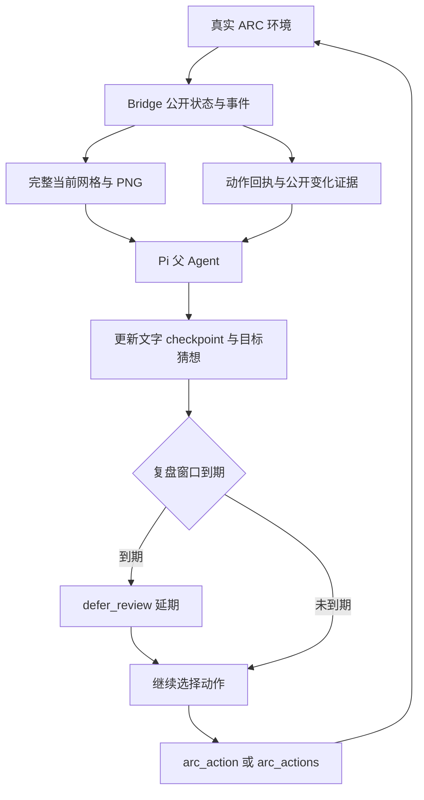
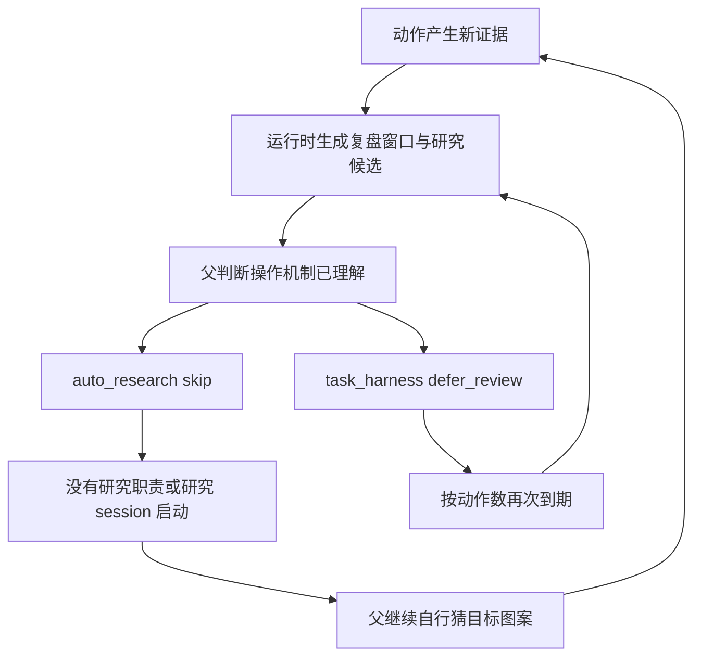

# ARC 运行路径与关键问题分析报告

日期：2026-10-02（Asia/Shanghai）。

状态：真实运行诊断及优化建议已记录；建议尚未实施，未启动新实验。

## 1. 问题与核心判断

真实运行 `arc-ft09-full-frame-real-60-20261002-005748` 在 60 步上限下完成 55 个成功原生动作，第 0 关仍未通过，随后发生环境错误及超时。

**最关键的问题：失败证据没有有效推动 Agent 修正对任务目标和规则的理解。**

Agent 识别了 ACTION6 的块级切换操作，之后多次以“机制已理解、无需研究”为由跳过研究。但操作效果已知并不等于目标状态的生成规则已知。它持续尝试复制、镜像、AND、OR、XOR 等目标猜想，没有识别本关中央小图案与外围大方块的对应关系。

这是由行为证据支持的诊断：本次没有形成有效的持续纠偏路径。尚不能用单次失败确定各项代码改动的因果贡献，也不能把整个模型退化归于取消裁剪。

### 证据来源

| 材料 | 路径 | 用途 |
| --- | --- | --- |
| 当前真实运行 | `runs/arc-ft09-full-frame-real-60-20261002-005748` | 动作、工具、观测、成本及退出状态 |
| 历史成功运行 | `runs/arc-ft09-harness-evidence-real-final-20261001` | 同一初态、同一模型的成功规则与动作对照 |
| 详细像素与日志复核 | [第 0 关失败分析](../arc-level-zero-failure-analysis-2026-10-02.md) | 哈希、方块目标、动作配置重算与数值来源 |
| 机制设计 | [Auto-Research 机制与多个研究子 Agent ADR](../plans/2026-10-01-auto-research-mechanism-and-workers.md) | 持续研究、阶段交付与职责边界 |
| 证据标准 | [开发流程](../development-workflow.md) | 区分接线、自主采用、净收益与未验证内容 |

## 2. 运行路径分析

### 2.1 观测与执行路径



本次使用真实 provider `qwen3.8-27b / yibu`、真实 ARC bridge 与 Pi 父循环。文本和图像输入启用，上下文压缩启用，最大动作数为 60。没有显式 Harness 验证脚本，也没有预置组件。

110 个父请求中，100 个存在匹配 PNG 的有效暴露；另 10 个无图请求均以 `aborted` 结束。88 个正常完成的消息都有有效图像暴露。正常决策轮缺图不是本次已发现的失败原因。

### 2.2 实际研究与复盘分支



本次统计：

| 环节 | 实际数量 | 路径含义 |
| --- | ---:| --- |
| `task_checkpoint(update)` | 36 | 记录文字目标、猜想和下一步 |
| `task_harness(defer_review)` | 54 | 反复延期；没有实际 review |
| `auto_research(skip)` | 21 | 跳过候选；没有启动研究 |
| 结构化计划创建 | 0 | 未进入 active plan 的执行与纠偏路径 |
| 研究 session / 持续职责 worker | 0 / 0 | 持续分析没有被分配给子 Agent |
| Agent 自主组件创建、装配、效果评估 | 0 | 没有发生 Harness 演化 |
| 自动 action-capture memory | 10 | 运行时采集记录，不能计作自主组件创作或语义使用 |

机制提示和门禁触发了；本次未进入持续研究、阶段交付及 Harness 创作与采用的分支。

### 2.3 生命周期断点

| 转移 | 推进主体 | 本次观察 |
| --- | --- | --- |
| 动作证据 → 研究/复盘机会 | runtime | 机会被生成并暴露 |
| 机会 → 问题识别 | 父 Agent | 将操作效果已知作为跳过理由；未据持续失败组织目标规则研究 |
| 问题识别 → 研究投入 | 父授权、机制调度 | 21 次 skip，未启动 worker/session |
| 研究投入 → 竞争解释与阶段结论 | 受授权研究 Agent | 未执行 |
| 阶段结论 → 父采纳与行动修订 | 父 Agent | 未发生来自研究的交付与采纳 |
| 方法候选 → 创建 → 装配 → 语义使用 | 授权 Agent 与 Harness runtime | 未执行 |
| 新行动证据 → 修订、保留或撤下 | 父/研究 Agent | 有文字猜想更新，未形成持续、可审计的研究反馈链 |

**首要断点位于“机会 → 问题识别 → 研究投入”。** 后续组件创建工具即使可达，也没有在这次任务中得到实际使用。

## 3. 目标规则与实际动作对照

两次运行使用相同模型和相同初始公开 frames；首帧 PNG 哈希相同。历史运行第 6 步过第 0 关，本次 55 步仍未通过。

历史成功判断是：右下方中央细节的 2×2 单元编码周围的大方块，对应黑色 0 的位置应改为 8，对应 2 的位置保持 9。公开动作与通关回执支持的四个点击是：

```text
(38,38) → (38,46) → (54,46) → (38,54)
```

本次 55 步经过 28 个不同外围配置，没有达到该已验证目标。第 44 步 RESET 后：

| 动作 | 点击 | 与成功目标的关系 |
| --- | --- | --- |
| 45 | `(38,38)` | 正确修改左上 |
| 46 | `(38,46)` | 正确修改左中 |
| 47 | `(54,46)` | 正确修改右中；只差左下 |
| 48 | `(54,54)` | 修改了右下；目标需要左下 `(38,54)` |

第 47 步接近通关是离线按已验证目标重算的结果。不能据此声称当时 Agent 已知道正确目标。这些坐标是诊断证据，不应被写入通用 prompt 作为游戏解法。

## 4. 问题分析

### P1：操作效果探索与目标规则探索混在一起

父 Agent 多次以“切换机制完全确认”为理由跳过研究。持续未过关却说明目标规则仍未得到解释。缺少对这两类知识状态的有效区分，使它过早终止了规则研究。

需要能够分别保留：哪些操作效果有证据支持、哪些目标解释仍待检验、哪些候选遭遇反例、下一次观测能区分什么。不能只把更长的文字总结写进 checkpoint。

### P2：复盘窗口反复到期，管理调用没有带来新认识

`demo/pi_harness_review.ts::periodicReviewQueue` 在 after_actions 条件满足后重新打开旧窗口。`demo/pi_task_local_self_harness.ts` 的动作门禁要求父先处理当前 due 窗口。

本次 `arc-pattern-5` 被处理 7 次，`arc-pattern-10` 被处理 8 次；5 次批量动作调用因 Harness 判断到期被直接拦截。54 次延期没有产出独立规则分析或组件候选。

应先比较合并旧窗口、去除重复决策和复用已记录判断的方案；新增提醒或职责都须证明能减少父管理负担。

### P3：持续研究的能力没有转化为实际承载

ADR 已实现授权后的持续职责、证据路由、有限调度及阶段交付。此次没有授权 worker，视觉追踪、猜想更换、目标分析和旧窗口处理全部由父模型承担。

“实现了研究 worker”与“真实模型会自主投资研究”是不同证据层级。此次实际采用结果没有达到预期。持续研究应围绕未解决问题延续；一个窗口只是证据批次，不应要求新建一个 Agent。

### P4：竞争性检验与无进展纠偏采用不足

没有结构化 active plan。`demo/pi_external_benchmark_research.ts` 的相关无进展计数依赖 active plan，summary 的 watchdog interventions 为 0。单动作调用中只有 1 次绑定 hypothesis_id 和有限 validation_window。

大多数目标解释以文字形式更换，缺少持续的候选比较、精确预测与实际配置核对。本次日志不支持声称“所有规划和竞争机制都未实现”；支持的结论是其自主采用不足、覆盖范围有限。

### P5：长推理放大成本，未纠正规则判断

最大实际输入为 60334 token，低于 175000 context window；provider error 为 0。没有上下文容量溢出的证据。

父输出共 1687833 token，其中 reasoning 为 1585830，约 94%；最长单条消息耗时 748.078 秒。该成本没有换来正确目标或独立复核。是否存在跨压缩遗忘仍需单独检验，不能仅由输入未超限排除。

### P6：环境错误使运行提前退出

55 个成功动作后，第 56 个动作位置出现 5 次 `EnvironmentReturnedNoFrame` 和桥接 502，随后出现 headers timeout。收尾 `/close` 也超时，`runner-error.json` 的失败阶段为 `bridge_close`。

这是任务退出的直接异常，解释不了前 55 步的规则失败。SDK 返回 None 的原始远端原因仍未知，应单独排查，不应与规则推理问题混为同一原因。

## 5. 优化方向与成本取舍

核心目标是让失败证据改变后续决策，并减少父模型的常驻追踪义务。候选路径为：

```text
目标规则仍未解释 / 新反例
  → 复用研究线、确定有限研究职责
  → 在授权预算内持续分析精确证据
  → 返回关键差异、候选解释和区分实验
  → 父选择行动或方法候选
  → 必要时创建组件、精确装配、验证语义输出
  → 新动作证据反馈给同一研究线
  → 保留、修订、撤下或合理停止
```

1. **先减少重复管理。** 合并证据重叠的旧窗口，避免父重复声明同一个延期判断。保持权限、动作预算、版本和环境完整性检查。
2. **复用持续研究承载。** 对未解释目标或反例分配有界职责，父只接收当前决策需要的核心结论。避免把全部分析作为常驻父上下文。
3. **让精确证据支持规则检验。** 方法候选可包括结构解析、坐标核对、目标配置比较；适用时才创建和装配，不把组件数量当作任务奖励。
4. **保留合理不使用。** 问题已被证据解决、研究信息增益低或预算不足时可以跳过；同一操作效果已知不能自动解释目标规则已知。
5. **单独恢复环境可靠性。** 未知结果不能被当作成功动作或自动重放依据；环境历史不能回滚。

这些是优化建议，不是已交付的运行策略。主要额外成本是子模型计算、职责授权和阶段交付；预期收益必须与减少的父推理及管理轮共同核算。

## 6. 验证状态与下一可证伪检查

| 证据层级 | 本报告状态 | Provider / environment | 结论边界 |
| --- | --- | --- | --- |
| 功能正确 | 本轮未新增验证 | 复核当前代码和日志 | 不因文档写入声称新功能通过 |
| 全链路可达 | 本轮未重新验收 | 既有 smoke 使用确定性 provider、真实 runner | 本次普通运行没有执行 child/创作/装配分支，不能声称闭环通过 |
| 自主采用 | 本次未达到预期 | 真实 qwen3.8-27b/yibu、真实 ARC | 研究被持续跳过，组件创作与使用未发生；单样本不代表所有情境 |
| 净收益 | 未验证 | 缺少受控重复对照 | 历史成功运行用于定位失败，不构成移除裁剪或其他改动的因果实验 |

下一轮优先提出窄命题：在目标长期未解决时，减少同一批证据的重复复盘要求，能降低父管理调用与总推理成本，同时不降低任务进度。

验证应一次改变一个主要因素，沿用相同模型、公开初态、60 步动作预算和推理配置；时间、父子计算预算与独立重复次数须在启动前确定。比较通关进度、父子总 token、耗时、重复管理调用，以及失败证据是否实际改变候选和行动。组件数和研究调用数只作诊断指标。若管理开销未下降或任务进度退化，应修订或撤下该优化；不能仅凭 skip 变少宣布改善。

研究职责的主动采用应作为另一个主要因素单独检验，包括问题已经解决、低信息增益、预算不足、过时结论及合理停止等负例。本报告没有授权或执行新的模型实验。

## 7. 交付决定与关联待办

本次完成路径和问题分析落盘。保留完整图像传递方案的现有事实记录；其成本及任务收益仍待对照。最优先处理重复复盘管理和目标规则研究的实际采用问题。

关联 [延期待办](../deferred-research-todos.md)：B 的研究目的与观察策略、C 的父子证据通信、D 的认知连续性和总成本。本次提供了真实失败样本，这些事项仍未完成。
